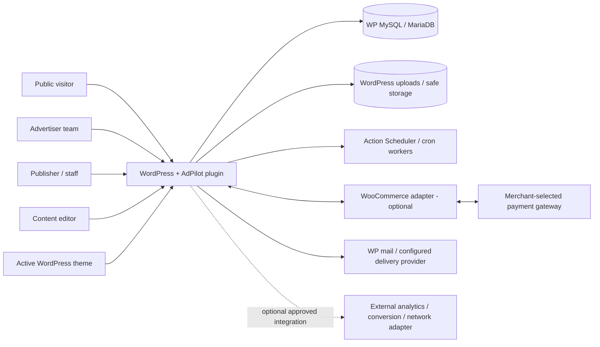
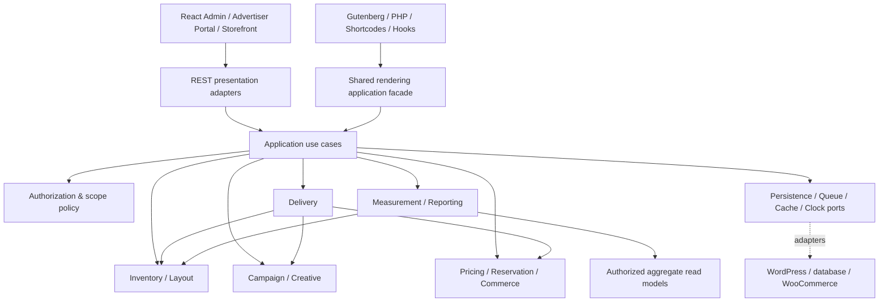
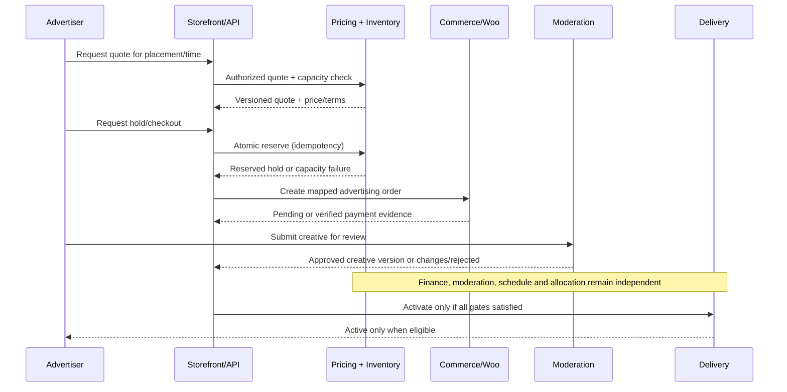
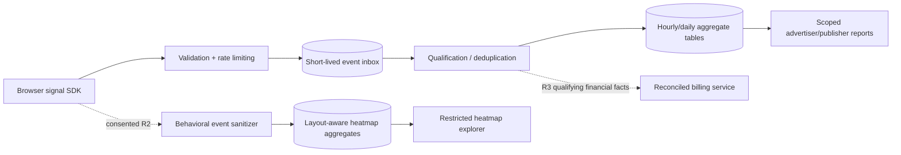

# AdPilot — System Architecture, Architectural Decision Records & Module Boundaries

**Document ID:** ADP-DOC-006  
**Filename:** `06_ADPILOT_SYSTEM_ARCHITECTURE_ADRS_MODULE_BOUNDARIES.md`  
**Version:** 1.0.0 (implementation architecture proposal)  
**Status:** Proposed — requires Product Owner, Technical Lead, Security Lead, UX Lead, AdTech Lead and Finance Lead sign-off  
**Date:** 2026-10-11  
**Product:** AdPilot — Self-Service Advertising Marketplace & Behavioral Analytics for WordPress  
**Document owner:** Principal Software Architect / Technical Lead  
**Responsible implementers:** WordPress/PHP, database, API, React/TypeScript, Gutenberg, browser rendering, advertising delivery, measurement, behavioral analytics, finance, QA and DevOps engineers  
**Implementation target:** GPT-6 High, using bounded, independently verifiable work packages  
**Normative inputs:** `ADP-DOC-001` through `ADP-DOC-005` (canonical source documents in the numbered set)  
**Next document:** `ADP-DOC-007` — Domain Model, Module Contracts & Application Services (proposed title; sequence may be refined only through documented change control)

---

## 1. Purpose, scope, precedence and normative language

### 1.1 Purpose

This document defines **how AdPilot is organized and how its parts may interact**. It is the architectural contract for an independently installable WordPress advertising platform with a self-service marketplace, complex inventory/layout management, four Gutenberg blocks, interoperable theme APIs, commercial purchases, independently moderated campaigns, progressive advertising delivery, trustworthy measurement and later heatmap intelligence. It also records the reasons for consequential architecture choices and sets enforceable module-level and process-level quality gates.

It is not a replacement for the PRD, detailed feature acceptance, workflows, business-state specifications or authorization decisions already recorded. It does **not** claim the implementation exists, that financial procedures have passed tests, or that any dependency has completed its final licensing review.

### 1.2 Precedence and conflict handling

1. **ADP-DOC-001** is authoritative for release scope, `FR-*`, `BR-*`, `NFR-*`, `INV-*` and `AC-*` meaning.
2. **ADP-DOC-002** adds the `CAP-01..CAP-18` workstream model, `AT-*` tests, `UI-01..UI-20` screens and `E2E-01..17` without changing item 1.
3. **ADP-DOC-003** specifies 16 personas, 24 JTBDs, 28 `UJ-*` journeys, 18 atomic workflows, UX acceptance and recovery behavior.
4. **ADP-DOC-004** specifies canonical `BR-001..BR-018`, independent `SM-*` state machines, `DP-*` policies, `PERM-*` tests and transition/audit requirements.
5. **ADP-DOC-005** specifies site-plane WordPress capabilities, organization-scoped memberships, cross-site authorization, elevated operations, access-control tests and role grants.
6. This document translates those sources into technical ownership, boundaries, protocols and ADRs. An architecture disagreement must be recorded as an **open ADR / change proposal** and resolved by the upstream document owner, not silently fixed by changing source requirements.

`SHALL` / `MUST` indicate mandatory architecture behavior for the applicable release; `SHOULD` indicates a preferred choice whose exception requires an ADR; `MAY` indicates an optional extension. Release labels `R1`, `R2`, `R3`, `R4` retain the **exact** meanings in Document 01. Architecture examples are contracts or pseudocode unless explicitly labeled as executable production code.

### 1.3 Architectural in-scope systems

- WordPress plugin lifecycle, bootstrap, service composition, capability registration, database migrations and upgrades.
- Public marketplace, advertiser portal, publisher admin, Layout Studio, Gutenberg editor surfaces and theme integration.
- First-party zone/container/slot/sequence/binding and immutable published-layout model.
- Campaign, creative, moderated-creative-version, quotation, reservation, order, settlement and delivery models.
- Public ad runtime (eligibility, batched decision retrieval, progressive loading, safe creative markup, event collection).
- Analytics collection, qualification, aggregation, dashboards and R2 native click/scroll/attention-proxy heatmaps.
- Optional R3 metered accounting, attribution/experimentation and R4 replay/network/worker adapters.
- Security, privacy, multisite isolation, reliable background processing, instrumentation and compliance.

### 1.4 Explicit exclusions

R1 shall **not** require a standalone microservice cluster, mandatory vendor-hosted analytics, optional replay, unverified metered CPC/CPM billing, off-site conversion claims unsupported by partner evidence, a full ad exchange, unrestricted custom advertiser JavaScript, or a checkout experience advertised as available without WooCommerce or an actually implemented payment adapter. R1 **does** support no-WooCommerce manual/complimentary campaigns while integrated online checkout uses the WooCommerce adapter.

### 1.5 Architectural success criteria

- The WordPress core plugin loads and safely serves eligible manual/complimentary campaigns without WooCommerce and without a proprietary SaaS dependency.
- One shared application command/query path is used across Gutenberg, shortcode, PHP themes, internal UI and REST: no duplicated eligibility, pricing or authorization logic.
- A logical 500-slot page (4 header, 100 sidebar, 196 in-content, 200 footer) is expressible compactly and does **not** automatically trigger 500 heavy creative loads, 500 SQL queries, or 500 billable impressions.
- The paid purchase, creative moderation and ad-delivery lifecycle states remain orthogonal; concurrency cannot oversell exclusive inventory.
- Page/slot/layout/render identifiers preserve paid commitments and historical measurement meaning.
- The UI is accessible, responsive and intuitive while protected commands are always server-authorized.
- Raw visitor behavior is strictly minimized; no unnecessary sensitive page/form content is captured.
- Failures degrade appropriately (blank/house ad, delayed analytic aggregation, queue alarms), but never silently make an unauthorized delivery, fabricate a payment or overwrite financial evidence.

---

## 2. Architectural drivers and quality attribute scenarios

The most critical **business drivers** are: reliable direct ad sales; publisher control of paid positions; understandable buyer UX; manageable layout editing at hundreds of positions; credible measurement; privacy controls; low WordPress installation friction; and a sustainable, GPL-compatible plugin distribution model.

| Driver / scenario | Architectural response | Verification owner | Baseline |
|---|---|---|---|
| A 500-slot page is opened on an ordinary theme | Compact compiled placement plan; SSR placeholders; batched prefetch; bounded viewport loading | Browser/Performance | `INV-04/05`, `NFR-003/004`, CAP-02/05 |
| Two advertisers purchase the last exclusive period | Inventory-scoped transactional capacity/uniqueness enforcement; retryable hold workflow | DB/Commerce/QA | `BR-001/002/005`, `NFR-006` |
| Payment succeeds before a creative is approved | Separate commerce and creative state machines; fail-closed eligibility | Campaign/Commerce | `INV-01`, `BR-003/004/007` |
| Administrator changes a sold slot | Immutable layout version; impact service; contract remedy and audit | Layout/Finance | `INV-03`, `BR-006/018` |
| Multiple copies of one Gutenberg zone render | Distinct render-instance IDs; same logical zone; correct occupancy rules | Integration/Measurement | `INV-04`, CAP-04/10 |
| Ads are paused while delivery caches are hot | Versioned/epoch-based invalidation and maximum stale-serve contract | Delivery/Ops | `BR-008`, `NFR-005` |
| Heatmap page height changes after ads load | Semantic element anchors, viewport categories, layout snapshots and geometry versions | Analytics/UX | CAP-12/13, `BR-013` |
| Payment webhook or job arrives twice | Authentication/provenance, idempotency key and state transition guard | Commerce/Ops | `NFR-005/006` |
| Advertiser guesses another company's order ID | Site/org-scoped repository and server policy; anti-enumerating response | Security/API | `INV-07`, ADP-DOC-005 |
| Multisite site context changes during job | Explicit trusted site scope, scoped repositories, `try/finally` restoration | Security/Operations | ADP-DOC-005 §9 |
| Analytics is unavailable | Public ad rendering continues; bounded event loss/retry with disclosed gaps | Delivery/Measurement | `NFR-005/012` |
| Third-party creative contains dangerous code | Approved declarative format or sandbox; CSP/validation; no first-party script privileges | Security/Creative | `INV-10`, `NFR-007` |
| Site lacks WooCommerce | Core plugin boots, manual/free campaigns work, storefront does not offer unavailable online checkout | WordPress/UX | Document 01 R1, `FR-OPS-012` |

**Performance budgets:** p75/p95 request, UX, browser memory, DB query and queue-lag values remain *TBD by benchmark on declared hardware*; never invent audited numbers. A concrete budget document shall freeze values before production sign-off (`NFR-004`).

---

## 3. System context and trust boundaries

### 3.1 Context diagram (logical)



### 3.2 Trust zones

| Zone | Examples | Protection approach |
|---|---|---|
| TZ-0 Untrusted browser | Public impression/click signals, arbitrary ad slot references, visitor context | Bounds and schema validation; anti-abuse; never trust claimed payment or eligibility |
| TZ-1 Advertiser | Logged-in browser/WordPress user, scoped org membership | Object-level org authorization; no publisher/report/replay access |
| TZ-2 Publisher operations | WordPress Admin, moderation, finance, inventory UI | Site-scoped capability AND domain-state checks; elevation for dangerous operations |
| TZ-3 Plugin service core | Use cases, domain policy evaluation, authoritative repositories | Internal typed contracts; transaction boundaries; structured audit |
| TZ-4 Persistent records | Financial ledger, campaigns, layouts, visitor aggregate data | Least-privilege access, consistent scoping, encryption for secrets, retention |
| TZ-5 External callbacks | Payment provider, webhook subscribers, optional workers | Signature/provenance validation, replay defense, allowlisted actions, idempotency |
| TZ-6 Site/network administration | Multisite cross-blog operations | Explicit site and network grant; target-site authority; safe `switch_to_blog()` cleanup |

### 3.3 Data-flow principles

- Public browser sees only allowed rendered creative markup, non-sensitive slot metadata and a bounded delivery response; never underlying pricing secrets, vendor tokens or other advertisers' purchases.
- Authenticated advertiser sees only own organization's permitted account/campaign/order/report projection; not raw replay or unrestricted visitor records.
- Publisher charts use restricted, redacted operational projections, with separately scoped raw/behavioral data access where explicitly allowed.
- Payment credentials and gateway secrets are held in approved secure settings/provider infrastructure, never exposed to browser.
- Event collection may be unauthenticated for visitor measurement but remains **untrusted**, and its receipt is not a financial assertion.
- Plugin-originated jobs execute as validated service principals bound to site, operation, version and provenance, not arbitrary user IDs from queue input.

---

## 4. Runtime and deployment topology

### 4.1 Deployment profile A: default self-hosted WordPress (R1)

```text
HTTP client
  └── WordPress runtime (theme + AdPilot)
        ├── Native PHP plugin (bootstrap, use cases, domain rules, data adapters)
        ├── Optional WooCommerce checkout integration
        ├── REST endpoints and lightweight public HTML placeholders
        ├── Static admin/editor/portal/browser SDK bundles
        └── Action Scheduler callbacks / cron-triggered processing
               └── MySQL/MariaDB custom tables, WordPress identities/media
```

No mandatory Node, Redis, Kafka, external API server, hosted pixel service or third-party paid plan in R1. Node/Composer build tooling is **development-time**, not a required customer runtime. WP-Cron can be supported with honest delivery limitations; a real cron runner should be recommended for time-critical production operations.

### 4.2 Deployment profile B: growing publisher (R1/R2)

Same plugin and database contracts, with optional CDN, object cache, authenticated REST fronting, monitored cron/CLI workers, background aggregation and controlled partition/retention policies. Advertising decisions that rely on current approval or budget must not be shared across incompatible cache contexts.

### 4.3 Deployment profile C: advanced/network extension (R4)

Optional independent event ingestion/aggregation workers and site-federation services communicate through versioned authenticated interfaces. Their outage must not eliminate baseline ad serving or invalidate local financial facts; *source-site* authorization remains authoritative. R4 cannot loosen R1/R2 tenant boundaries by moving data to a network-level index.

### 4.4 WordPress compatibility strategy

- Freeze and test supported WordPress/PHP/database/WooCommerce versions at release, with explicit minimums, not assumed universality.
- Use WordPress public APIs for identity, routing, blocks, assets, settings and content access.
- Use WordPress-managed prefix, `$wpdb` and versioned schema migrations for custom tables; capability migration uses an independent version counter.
- Avoid direct WooCommerce order-post table assumptions; interact via supported WC CRUD/HPOS-compatible APIs.
- Support classic themes and block themes using the same server renderer; avoid requiring one proprietary builder.
- Distinguish full-page cache from object cache; reject rendering-time assumptions that every browser receives a unique PHP page execution.

---

## 5. Architecture style, layers and composition rules

### 5.1 Decision: modular monolith (R1)

AdPilot SHALL be one installable WordPress plugin divided into bounded modules and platform adapters. Each module has separately testable domain, application and persistence contracts. Cross-module reuse occurs through explicit interfaces/use cases, not through direct database calls into another module's private tables.

### 5.2 Four-layer contract

| Layer | Owns | Must not own |
|---|---|---|
| **Domain** | Entities, value objects, eligibility invariants, allocation formulas, policies, domain events, state transitions | WP hook registration, SQL, HTTP, React, WooCommerce SDK |
| **Application** | Commands/queries, DTOs, transaction orchestration, authorization gates, consistency boundaries, outbox emission | Theme HTML and frontend state; direct infrastructure details when avoidable |
| **Infrastructure** | WordPress repositories, `$wpdb`, cache, queues, media, WooCommerce, time, UUIDs, telemetry, external adapters | Canonical business-rule decisions or shortcuts around policy |
| **Presentation** | Admin/portal REST controllers, Gutenberg render callbacks, shortcodes, PHP wrappers, browser and React UIs | Financial mutation logic, tenant-scoped SQL, independent campaign-eligibility implementations |

**Dependency rule:** Domain knows no WordPress functions. Application depends on Domain abstractions; infrastructure implements ports; presentation depends on application-facing interfaces. The composition root wires actual implementations at runtime. Shared primitive utility code must be small and must not become a bypass around the module graph.

### 5.3 Dependency enforcement

- All services typed, with explicit constructor dependencies; prohibit hidden service-location inside domain entities.
- Controller or hook callbacks are adapters. They parse bounded input, derive trusted site/actor contexts, authorize, invoke one use case, shape a safe response.
- A module's `Infrastructure/Repository` classes are private by default; foreign modules use public service interfaces or immutable projections.
- Interface changes follow semantic versioning and impact review across REST, JS, PHP API and hooks.
- Never invoke another module's private static helper simply because it is convenient; add a published contract or perform controlled refactor.
- Transaction ownership lives at use-case/orchestration level. Do not nest unrelated implicit DB transactions.
- JSON schema and typed DTO contracts are used for every public or queue boundary; runtime data from browser/provider remains untrusted.

### 5.4 Module lifecycle

```text
Plugin entrypoint
  -> Environment compatibility guard
  -> Composer PSR-4 autoload
  -> Core bootstrap and service registrations
  -> ModuleRegistry boot (ordered dependencies)
  -> WordPress hook / REST / block registration
  -> Request entry adapter -> authenticated/anonymous use case
  -> domain + repository + audit/outbox
  -> DTO -> response / renderer
```

Dependency registration should be lazy or scope-aware: ordinary visitor requests must not instantiate React/admin components or unnecessary analytics/report services.

### 5.5 Command, query, and event semantics

- **Command:** one attempt to change authoritative state; includes actor/service provenance, scoped identifiers, expected version, idempotency key (where appropriate), and audit context.
- **Query:** returns an authorized read model/projection; may be cached if freshness, scope, and privacy permit.
- **Domain event:** committed fact emitted only after authoritative change is durable. Use outbox for operations requiring reliable asynchronous delivery.
- **Integration event/webhook:** a sanitized public representation derived from a committed domain event, signed where sent externally.
- **Measured browser event:** untrusted claim until filtered/qualified; not a domain event and never directly mutates the ledger.

### 5.6 Architectural guardrail against a fake microservice design

Do not create dozens of empty class files or queue network calls for synchronous in-process operations. Module boundaries are about rules and contract ownership, not mandatory physical process separation.

---

## 6. Canonical bounded contexts and module ownership

The 18 `CAP-*` groups from ADP-DOC-002 are **feature/workstream categories**, not a requirement that exactly 18 deployable services exist. To preserve prior design intent, adopt the following domain-module map (one PHP modular monolith, not 18 different plugins):

| Module / owning boundary | Scope and aggregate ownership | Exports / allowed consumers | Maps to capability |
|---|---|---|---|
| Identity/Authorization | Publisher actor, organization membership, capability decision, access audit | `AuthorizationService`, `OrganizationMembershipQuery` for all use cases | CAP-01, CAP-18 |
| Advertisers | Organization profile, brand profile, invitations with membership collaboration | `AdvertiserDirectoryQuery`, `OrganizationCommandService` | CAP-01/06 |
| Inventory | Zone, container, logical slot, compact slot sequence, availability identity | `InventoryQuery`, `SlotRegistry`, `CapacityQuery` | CAP-02 |
| Layout | Placement binding, draft, immutable layout revision, publication contract impact | `LayoutCommandService`, `PublishedPlacementPlanQuery` | CAP-03 |
| Campaigns | Campaign definition, scheduling intents, review and delivery state | `CampaignCommandService`, `CampaignReadModel` | CAP-07 |
| Creatives/Moderation | Creative media metadata, immutable approved version, destination, policy outcome | `ApprovedCreativeQuery`, `ModerationCommandService` | CAP-07 |
| Pricing | Rate card version, quote and calculated commercial terms | `QuoteService`, `RateCardQuery` | CAP-08 |
| Reservations | Temporary hold, contracted allocation, exclusive-capacity invariant | `AvailabilityService`, `HoldCommandService`, `ContractedReservationQuery` | CAP-09 |
| Commerce/Billing | Advertising order mapping, payment evidence, refund/remedy, append-only ledger | `CommerceCommandService`, `SettlementReadModel` | CAP-09, CAP-14 |
| Delivery | Eligibility, targeting, selection, safe creative response, freshness policy | `AdDecisionService`, `DeliveryPolicyQuery` | CAP-05, CAP-14 |
| Measurement | Delivery telemetry validation, deduplication, aggregation and authoritative metric definitions | `EventIngestionService`, `QualifiedMetricsQuery` | CAP-10, CAP-13 |
| BehavioralAnalytics | Normalized page/slot heatmaps, geometry mapping and snapshots | `HeatmapQuery`, `BehaviorCollectionPolicy` | CAP-12/13 |
| Reporting | Role-scoped financial and advertising projections, export jobs | `ReportingQueryService`, `ExportCommandService` | CAP-11, CAP-15 |
| Optimization | Experiments, attribution model, scores and recommendations | `ExperimentService`, `RecommendationQuery` | CAP-15 |
| Compliance/Privacy | Ad policy, consent governance, retention/deletion and dangerous operation policy | `AdPolicyEvaluator`, `ConsentPolicy`, `RetentionPolicy` | CAP-18 |
| Notifications | Templates, delivery status and alerts | `NotificationService`, `NotificationPreferenceQuery` | CAP-11/18 |
| Integrations | Public PHP/REST/webhook contract adapters, external provider integration registry | `IntegrationRegistry`, `ProviderAdapter` | CAP-04/17 |
| Platform/Core | Bootstrap, migrations, clock, transaction, outbox, queue, cache, structured logs | shared **interfaces**, not cross-domain shortcuts | CAP-18 |

**Important overlap decisions:** `Identity` owns *grant evaluation*; `Advertisers` owns organization profile. `Reservations` owns capacity locks/holds; `Commerce` owns monetary evidence; `Delivery` owns runtime selection and MUST NOT write either domain's authoritative tables. `Measurement` owns qualified event definitions; `Billing` is the only subsystem allowed to create financial charges. `BehavioralAnalytics` owns heatmap aggregates, not raw monetary truth. `Integrations` adapts the shared `Delivery` renderer; it does not select creatives independently.

### 6.1 Aggregate roots and invariants

- Organization + membership: `site_id` + `organization_id` membership current-state authorization.
- Zone/slot: stable logical identifiers; no hard physical coordinate embedded in paid contract identity.
- Layout revision: immutable published snapshot; diff and impact analysis required when a sold position changes meaning.
- Campaign + creative version: campaign state and approved creative version immutable/readable separately.
- Hold/reservation: capacity constraints and TTL explicit; no overlapping sold exclusive stock.
- Advertising order: commercial term snapshot and independent settlement facts.
- Event aggregate: measured versus verified versus billable evidence separated.

### 6.2 Cross-module reads and command ownership

A service may read another module's **published immutable projection** or call its query API. Foreign modules MUST NOT perform writes to its tables. For example, the campaign activation handler reads `CurrentContractStatus`, `ApprovedCreativeVersion`, `CurrentAllocation` and `PolicyEligibility`, and then transitions campaign delivery under `SM-DELIVERY`, without editing payment rows or creative approval history.

### 6.3 Feature flags and release gates

`R1` modules required for the initial marketplace; `R2` viewability/heatmaps; `R3` metered billing/experiments; `R4` replay/multisite network and external workers. Feature flags SHALL gate service registration, REST route exposure, navigation, capabilities and background job scheduling. Merely hiding a frontend tab is never sufficient to disable an unreleased or unapproved operation.

## 7. Module boundaries, dependency graph and forbidden coupling

### 7.1 Logical dependency graph



**Interpretation:** arrows show permitted *contract consumption*, not private table ownership, transaction nesting or authority transfer. `DEL → RES` means consume a read-only allocation/contract projection, never alter a reservation through a delivery request. Sensitive writes pass application authorization even if triggered from an internal event.

### 7.2 Hard boundary rules (`ARCH-BND-*`)

| ID | Mandatory rule | Architectural verification |
|---|---|---|
| ARCH-BND-001 | `Domain` contains no direct WordPress, WooCommerce, REST or browser library calls | Dependency/import scan + domain unit tests outside WP |
| ARCH-BND-002 | Presentation never runs SQL or independently makes contract decisions | Code review + static boundary lint |
| ARCH-BND-003 | Cross-module writes use owning module's published command interface | Repository ownership audit |
| ARCH-BND-004 | Every protected command uses central authorization with site/object/state checks | Command decorator/policy integration tests |
| ARCH-BND-005 | Queries return explicitly scoped projections, not unrestricted entity graphs | Object leakage API tests |
| ARCH-BND-006 | Runtime ad request never mutates financial ledger based on browser claims | Ledger integrity tests |
| ARCH-BND-007 | Runtime read path is bounded for hundreds of slots | Query count and bundle instrumentation |
| ARCH-BND-008 | Theme, shortcode and block paths invoke the same rendering facade | Contract equality and occurrence tests |
| ARCH-BND-009 | A layout publish cannot skip sold-inventory impact gate | Concurrency and bypass tests |
| ARCH-BND-010 | Third-party adapters cannot override mandatory safety, tenant, approval or billing guards | Hostile adapter tests |
| ARCH-BND-011 | Cross-site operations require explicit target-site authority and restoration | Multisite isolation fixtures |
| ARCH-BND-012 | Events and background jobs verify provenance, scope, feature availability and current state | Replay/stale-job tests |
| ARCH-BND-013 | Feature availability is enforced by backend, not just UI or a plugin setting | Direct REST/PHP/CLI tests |
| ARCH-BND-014 | Report datasets preserve metric definitions and contextual denominators | Measure/report contract tests |
| ARCH-BND-015 | Logs and support exports redact secrets and disallowed behavior data | Structured log inspection |
| ARCH-BND-016 | Asset/integration dependencies have documented compatible license and provenance | SBOM/license gate |

### 7.3 Layer violation examples

**Prohibited:** calling `get_user_meta()` inside `Campaign::isEligibleToServe()`; SQL from a block `render.php`; WooCommerce order status treated as creative approval; `admin-ajax.php` callback directly adjusting account balance; ad delivery frontend calling a finance endpoint; media uploaded by an advertiser with unsandboxed first-party scripts; an R1 module directly linking to an R4 replay recorder.

**Permitted:** `CampaignEligibilityService` receives a typed `CurrentCampaignFacts` DTO built by repositories; `AdpilotZoneBlockRenderAdapter` calls `RenderZoneQuery`; `WooCommercePaymentAdapter` maps supported provider events to a verified `RecordPaymentEvidence` command; `HeatmapAggregator` consumes sanitized, appropriately consented eligible browser signals.

---

## 8. Public backend contract design

### 8.1 Common value objects

All command/query boundaries SHALL use validated values for `SiteId`, `OrganizationId`, `CampaignId`, `CreativeVersionId`, `ZoneId`, `SlotId`, `LayoutVersionId`, `RenderInstanceId`, `OrderId`, `ReservationId`, `EventId`, `Money`, `UtcInstant`, `TimeRange`, `AuthorizationDecision`, and `ConsentContext` when applicable.

Required properties:

- IDs are opaque on public interfaces; private sequential keys are never themselves authorization.
- `Money` uses integer minor units **only where supported for currency precision** or fixed-scale decimal representation; never binary float for authoritative monetary arithmetic. Include ISO currency code and rounding mode; handle currencies with nonstandard minor units.
- `TimeRange` uses stored UTC instants with documented half-open interval semantics `[start, end)` to avoid overlap ambiguity; contract-timezone text and DST resolution preserved in commercial snapshot.
- `LayoutVersionId` and `CreativeVersionId` reference immutable published/approved versions, not mutable drafts.
- Event timestamps distinguish observed client time from trusted server receive time.
- Public DTOs are separately versioned from persistent entity classes.

### 8.2 Command execution envelope

```text
CommandEnvelope<T>:
  command_id: opaque UUID/ULID
  command_type: stable, versioned name
  schema_version: positive integer
  actor: authenticated principal OR validated service identity
  site_id: derived from trusted runtime, not request JSON
  organization_id: derived and checked when applicable
  target: typed entity reference
  expected_revision: optional optimistic concurrency guard
  idempotency_key: mandatory for financial/external/retryable commands
  correlation_id: trace identifier (never bearer authorization)
  requested_at_utc: server-side timestamp
  payload: bounded validated T
```

A command handler validates feature gate, site scope, object scope, state, contract policy and permissions, executes within its defined consistency boundary, persists audit/outbox facts, then returns an explicit result (`succeeded`, `state_conflict`, `authorization_denied`, `retryable_failure`, `validation_failed`, etc.). Avoid catching errors to report success when the transaction did not commit.

### 8.3 PHP interface examples (normative intent, illustrative signature)

```php
<?php
namespace AdPilot\Modules\Delivery\Application\Contracts;

interface AdDecisionService {
    public function decideBatch(
        DecisionBatchRequest $request,
        RequestContext $context
    ): DecisionBatchResult;
}

interface RenderZoneQuery {
    public function compile(
        ZoneReference $zone,
        RenderContext $context,
        RenderOptions $options
    ): RenderPlan;
}

interface DeliveryPolicyReader {
    public function currentEligibility(
        CampaignReference $campaign,
        SiteContext $site
    ): EligibilityVerdict;
}

interface PublicCreativeRenderer {
    public function render(
        AuthorizedCreative $creative,
        SlotGeometry $geometry,
        RenderContext $context
    ): SafeHtml;
}
```

The code defines **interfaces to be implemented**, not finished implementation. Methods must not return unvalidated raw HTML strings; any `SafeHtml` type is an internal trusted wrapper only after the configured creative renderer's sanitization and output-escaping contracts are satisfied.

### 8.4 Response projection rules

- A delivery decision returns only safe creative/render metadata and opaque event correlation; no advertiser PII, exact internal auction weights or privileged eligibility evidence.
- A market listing returns only published, sanitized rate-card details, estimated availability, and public preview data.
- Advertiser report returns only a validated own-organization aggregate and explicit measurement/data-freshness notation.
- Financial adjustment returns immutable ledger event IDs and user-safe status, not mutable balance counters.
- Admin preview returns `preview=true`, excludes live billing/event qualification and is visually labeled preview.

### 8.5 Result and error taxonomy

All adapters must map domain codes consistently: `authentication_required`, `forbidden`, `scope_denied`, `resource_not_found`, `validation_failed`, `state_conflict`, `revision_conflict`, `reservation_expired`, `capacity_unavailable`, `payment_pending`, `moderation_required`, `feature_unavailable`, `rate_limited`, `temporarily_unavailable`, and `internal_error`. Use the precise response HTTP semantics specified by the canonical REST contract; this document does not unilaterally change ADP-DOC-005's anti-enumeration choices.

Error messages SHALL be localized, actionable, and reveal no foreign tenant records or security-sensitive implementation detail. For editor/admin UI, errors must preserve unsaved safe drafts and offer recovery when possible.

---

## 9. Presentation applications and frontend architecture

### 9.1 Six presentation surfaces

1. **Publisher administrator console** — operations, campaigns, moderation, billing, reporting, diagnostics, role-aware navigation.
2. **Advertising Layout Studio** — zone tree, slot navigator, responsive canvas, reservation overlays, impact review, revisions and publication.
3. **Advertiser portal** — organization onboarding, creative management, multi-step campaign purchase, payment and report access.
4. **Public marketplace** — published listings, package comparison, preview and checkout entry, theme-compatible style scope.
5. **Gutenberg editor** — four dynamic blocks, InspectorControls, preview states, validation, template part support.
6. **Analytics explorer** — time series, scroll/interaction heatmaps, zone and slot drill-down, accessible tabular alternatives; release-gated R2+.

`UI-01..UI-20` from ADP-DOC-002/003 remain canonical screen identifiers; this document does not create a conflicting screen catalog.

### 9.2 Component/package policy

- React + TypeScript for complex protected admin and advertiser workspaces; align with WordPress-shipped packages where feasible.
- Use strict TS and generated/manual runtime-validated API DTOs; avoid generic `any` in domain-facing code.
- Share design tokens, form validation patterns and typed API clients, not indiscriminately shared page-specific state.
- Public ad rendering uses server-issued safe markup plus a tiny, progressive browser SDK; **no entire admin React bundle** on content pages.
- Gutenberg blocks use `block.json` and dynamic PHP callbacks. Use Interactivity API only for interactions that benefit from its model and on validated WordPress versions; do not mix legacy scripts and Script Modules as if interoperable.
- Scope component styles to AdPilot in protected apps and public widgets; do not override host theme's global selectors.
- Use localizable interface strings, logical CSS properties for RTL, accessible icon/button labels, keyboard-compatible alternative controls and screen-reader descriptions.

### 9.3 Frontend package topology

```text
frontend/
  shared/
    design-system/{tokens,primitives,forms,navigation,data-display,feedback}
    api-client/{contracts,queries,mutations,error-adapters}
    auth/{principal,permissions,tenant-context}
    types/  i18n/  utilities/
  admin/{dashboard,campaigns,inventory,moderation,finance,diagnostics}
  advertiser/{onboarding,marketplace,campaign-builder,checkout,reports}
  layout-studio/{zone-tree,canvas,inspector,slot-navigator,history,contracts}
  analytics/{heatmap,viewability,reporting,accessible-alternatives}
  public-renderer/{observer,decision-client,dom-lifecycle,creative-host}
  tracking/{consent,measurement,buffer,transport}
  replay/ (R4 optional, gated and separately bundled)
```

### 9.4 Shared design system rule

The administrator console and advertiser portal SHALL share tokens and common primitives, but can have distinct navigation shells. UX approvals are part of the definition of done: loading, empty, unauthorized, validation, conflict, stale-data, network-offline and recovery states must be designed, not deferred to ad hoc error handling.

### 9.5 UI authorization is a projection

Frontend role gating controls **discoverability** and helpful explanations only. A hidden button is not a security boundary. Before displaying privileged actions, fetch a site/org-scoped **capabilities projection**, but every mutation must independently authorize server side against live membership/current policy. A revoked member must not retain access via a warm browser cache.

### 9.6 Layout Studio at high density

Use a **summary-based hierarchy** rather than creating an editor DOM for each logical slot. For 200–1,000 slot sequences, present aggregated ranges, virtualized/paginated slot navigation and a bounded preview; use drag handles plus keyboard move controls. Preview must distinguish draft versus published versions and highlight reservations that would be affected by a change.

### 9.7 Accessible analytical visualization

Every heatmap needs a paired numerical representation: per-zone/slot click count, eligible exposure denominator, time-in-view distribution and device segmentation with sorted/filterable tables. Screen readers must not be expected to interpret only canvas colors. Do not label mouse movement as proven human visual attention.

---

## 10. Inventory, layout compiler and placement rendering

### 10.1 Configured inventory is not instantiated inventory

The layout compiler reads a versioned configuration describing nested zones, containers and slot sequences. It returns a plan of **logical** slot identities and presentation geometry, but may materialize only a bounded visible/near-visible subset in the actual DOM. Never use one WP post, one Gutenberg block or one query for each of 500 slots by default.

### 10.2 Versioned layout model

```text
Site
 -> Page context / template / post-type conditions
 -> PlacementBinding (Gutenberg, PHP, shortcode, hook, auto-insert)
 -> Zone (site-scoped logical identity)
 -> Container (responsive layout and distribution rules)
 -> SlotSequence (compact generator, optional)
 -> LogicalSlot (stable identity + commercial metadata)
 -> RenderInstance (unique per occurrence in rendered document)
 -> DeliveryDecision (selected approved creative or empty)
```

- `LayoutDraft` may mutate with optimistic locking.
- `PublishedLayoutVersion` is immutable; publication atomically changes active pointer after impact validation.
- Slot commercial identity never silently changes because columns, responsive order or CSS positions shift.
- If a slot is sold under a guaranteed position, any change in the contracted semantics requires explicit contract-impact remedy approval (`BR-006`, `BR-018`).
- A repeated zone can intentionally produce multiple render instances; decide whether the underlying inventory contract covers one or multiple physical occurrences before enabling duplication.

### 10.3 Compiler stages

1. Resolve trusted site and page/template context.
2. Fetch active published layout and eligible placement bindings.
3. Validate compiler/schema version and configuration structure.
4. Expand only necessary sequence metadata, preserving stable logical identifiers.
5. Resolve responsive strategy and breakpoints without trusting claimed device properties for financial eligibility.
6. Check mandatory density/accessibility constraints, paid-slot conflicts and excluded contexts.
7. Produce bounded `RenderPlan` containing placeholder blueprints, priority hints and safe public metadata.
8. Return warnings/fallbacks for broken bindings; report diagnostics without fatal public output.

### 10.4 Layout compiler interface

```text
CompilePlacementPlan(site, page_context, active_layout_version, options)
  -> RenderPlan {
       active_layout_version_id,
       layout_schema_version,
       containers[],
       logical_slot_refs[],  // bounded/lazy reference ranges permitted
       responsive_rule_refs[],
       priority_hints,
       placeholder_specs,
       render_constraints,
       warnings[]
     }
```

This plan is a **layout contract**, not a promise that each slot has a creative, impression or inventory availability. The server may render stable CSS placeholders; client selection is later performed only as needed.

### 10.5 Rendering routes consume the same facade

| Entrypoint | Adapter | Required invariant |
|---|---|---|
| Gutenberg `adpilot/ad-slot` | Dynamic PHP block renderer | No billable tracking in editor previews |
| Gutenberg `adpilot/ad-zone` | Dynamic zone facade | Compact reference; no repeated 500 serialized blocks |
| Gutenberg `adpilot/ad-repeater` | Registered insertion/pattern adapter | Placement rules respect content flow/context |
| Gutenberg `adpilot/ad-showcase` | Showcase presenter | Controlled carousel/grid behavior, accessible controls |
| `adpilot_render_zone()` PHP | Public PHP facade | Same output and eligibility contracts as block |
| `[adpilot_zone ...]` shortcode | Shortcode adapter | Return markup; sanitize attribute values |
| Theme action/filter | Integration bridge | Avoid duplicate hook output; explicit occurrence identity |
| Automated insertion | Insertion policy adapter | De-duplicate only unintended copies; preserve intentional repeated placements |

### 10.6 Theme integration boundaries

Theme PHP API and shortcode calls can render **public inventory only** without granting arbitrary editor, moderator or financial privileges. A theme author cannot use `adpilot_get_campaign()` to enumerate protected advertiser records by calling from a publicly accessible template. Nonpublic query APIs must check trusted actor and site scope. Theme hook callbacks must tolerate multiple invocations and full-page caches.

### 10.7 Delivery-aware scrolling

- Render minimal, dimensionally stable placeholders in the server HTML.
- Observe slots/zones approaching the viewport with shared observers and bounded prefetch.
- Fetch batches for nearby slots, with abort handling and a concurrency budget.
- Load only approved creative assets in current contexts; avoid preloading all footer creative files.
- Preserve actual document flow. Virtualization is optional and must demonstrate no broken accessibility, scroll position or heatmap mapping.
- Account separately for configured, selected, rendered, measurable, viewable and billable events.

### 10.8 Example: 500 configured slots

```json
{
  "page_context": "homepage",
  "layout_version": "published-opaque-id",
  "zones": [
    { "zone": "header", "layout": "grid", "slots": 4, "desktop_columns": 4 },
    { "zone": "sidebar", "layout": "stack", "slots": 100, "desktop_columns": 1 },
    { "zone": "main", "layout": "repeater", "slots": 196, "desktop_columns": 2 },
    { "zone": "footer", "layout": "grid", "slots": 200, "desktop_columns": 5 }
  ]
}
```

**Illustrative configuration only.** The real schema shall define semantic identities, versioning, device variants and reservation properties in the dedicated Layout/Schema documents. `slots=500` is a logical capacity count, not a mandatory creative render count. The example is not a recommendation to overwhelm users with advertisements.

### 10.9 Inventory commercial constraints

Slot identity must remain stable across nonbreaking layout revisions, reservations use explicit capacity semantics (exclusive or shared), availability must distinguish optimistic catalog estimates from reserved/sold authority, and reflow must not automatically relocate a contracted premium position without remedy. Preview and staged layout events are nonbillable (`BR-009`).

---

## 11. Campaign, moderation, reservation and commerce orchestration

### 11.1 Orthogonal business state domains

Preserve every state machine in ADP-DOC-004 without renaming its identifier or merging tables merely for convenience:

| State machine | Release | Owning module |
|---|---|---|
| `SM-QUOTE` | R1 | Pricing |
| `SM-HOLD` | R1 | Reservations |
| `SM-RESERVATION` | R1 | Reservations |
| `SM-ORDER` | R1 | Commerce |
| `SM-PAYMENT` | R1 | Commerce/Provider adapter |
| `SM-CREATIVE` | R1 | Creatives/Moderation |
| `SM-CAMPAIGN` | R1 | Campaigns |
| `SM-DELIVERY` | R1 | Delivery/Campaigns orchestration |
| `SM-LAYOUT` | R1 | Layout |
| `SM-ALLOCATION` | R1/R3 | Reservations/Delivery projections |
| `SM-REMEDY` | R1 | Commerce + policy coordination |
| `SM-DISPUTE` | R1 basic / R3 formal | Commerce/Finance |
| `SM-EXPORT` | R2 | Reporting |
| `SM-CONSENT/REPLAY` | R2/R4 | Privacy/Behavioral analytics |
| `SM-JOB` | R1 | Platform/Queue |

### 11.2 Purchase-to-serving sequence



A WooCommerce 'paid' event does not itself authorize ad serving. Successful payment after a hold expiry must go through an explicit resolution path (refund, rebook, remedy), not resurrect an expired position without capacity validation.

### 11.3 Atomicity and database guarantees

- Reservation capacity changes must use a reviewed locking/uniqueness strategy compatible with supported MySQL/MariaDB (InnoDB when transactional guarantees are required).
- Idempotency keys must be bound to site, caller/provenance, operation and normalized payload, with a durable operation record.
- Unique constraints alone do not prevent overlapping time ranges on arbitrary interval columns; explicit row locks/serialized slot-capacity records and overlap queries inside one transaction are needed.
- Do not hold database transactions open during external gateway API requests, media processing or remote calls.
- Record payment gateway observations separately from verified authoritative settlement transitions.
- Store immutable terms and layout/slot snapshot references in accepted quotes/contracts.
- Financial corrections are append-only entries with reason, actor, evidence and compensating adjustment; never silently edit historical ledger values.

### 11.4 Consistency boundaries and saga-like remediation

Crossing WooCommerce payment callbacks, asynchronous moderation, expiry and eventual campaign activation cannot be a single atomic database transaction. Use durable, idempotent orchestration with explicit remedy states and compensating operations. E.g. payment confirmed after hold expiration enters `capacity_resolution_required`; no delivery until replacement inventory or refund is decided. A timeout is **unknown**, not automatically an unsuccessful charge.

### 11.5 Monetary precision

Money arithmetic is centralized in a finance value object, with declared rounding, currency and tax computation rules. Never build authoritative invoices or ledger balances by multiplying floating-point browser metrics by CPM/CPC prices. Metered charges (R3) consume reconciled, contract-qualified metrics through explicit billing periods and adjustment policies.

### 11.6 Reservation conflict resolution UI

Advertiser: show inventory unavailable with alternatives; do not disclose other advertiser's identity. Publisher: show impacted contractual positions, dates, affected customers and required remediation actions with authorization. Any override of sold inventory requires reason/audit and potentially independent approval per ADP-DOC-005.

---

## 12. Public ad delivery, browser runtime and cache coherence

### 12.1 Delivery architecture objective

The time spent composing heavy creatives and sending telemetry must not scale linearly with the number of configured slots. The critical visitor path should obtain a small published placement descriptor plus selectively load eligible creatives using near-viewport context.

### 12.2 Serving stages

```mermaid
sequenceDiagram
  participant W as WordPress page render
  participant B as Browser delivery SDK
  participant D as Delivery endpoint
  participant E as Eligibility/pacing
  participant M as Measurement ingestion
  W-->>B: Minimal placeholders + active layout/version
  B->>B: Shared viewport observer: nearby slots
  B->>D: Bounded batch decision request
  D->>E: Authoritative campaign/creative/contract eligibility
  E-->>D: Approved decisions, no privileged data
  D-->>B: Signed/opaque decision refs and safe creative descriptor
  B->>B: Render media, verify DOM display conditions
  B->>M: Batched untrusted render/interaction signals
  M-->>B: Acceptance or bounded retry response
  Note over M: Qualified metrics are derived asynchronously; receipt is not billable evidence
```

### 12.3 Request-level serving components

| Component | Inputs | Outputs | Failure behavior |
|---|---|---|---|
| `PageContextResolver` | Trusted site/page/template, safe locale | PageContext DTO | Return no-ads/safe context if invalid |
| `RenderPlanCompiler` | Layout version, bindings, window hints | Plan with stable logical slot refs | Placeholder + diagnostic on invalid version |
| `EligibilityService` | Campaign/contract/creative/policy projections | Allow/deny with internal reasons | Fail closed, no paid creative |
| `TargetingEvaluator` | Consent-permitted context, static targeting | Target verdict | Deny personalized target if context unavailable |
| `SelectionStrategy` | Eligible campaigns, inventory, priority weights | Selected campaign/creative | Empty or configured house creative |
| `PacingGuard` | Budget/cap, current authoritative state | Eligibility constraint | Stop/retry safely; never overcharge |
| `CreativePresenter` | Approved version, slot/layout constraints | Sanitized HTML or safe media instructions | Empty-safe output |
| `DeliveryDecisionController` | Bounded batch, site context, anti-abuse inputs | Minimal public decision DTO | 429/503 retry policy or empty safe response |
| `BrowserObserver` | Slot DOM nodes/thresholds | Fetch/release signals | Scrolling still usable if JS fails |
| `MeasurementCollector` | Bounded browser signals | Untrusted ingestion receipts | Drop/retry within privacy/performance limits |

### 12.4 Batch selection contracts

- Input bounded by documented maximum slots and bytes per request; larger groups paginated/segmented.
- Never accept `site_id`, advertiser ID or campaign approval flags from browser as authority.
- Compute decision eligibility at authoritative backend time; use cached candidate lists only with current-state guards.
- Use opaque decision IDs binding site, slot/render instance, creative/version, decision timestamp, and expiry; signatures must not become an excuse to skip current campaign status/contract validation where freshness requires it.
- For per-user frequency capping, a legally permitted stable identifier requires a documented policy; fall back to safe nonpersonalized operation when unavailable.
- Enforce a hard cap on network concurrency and creative decode work, set from benchmarked configuration, not a guessed universal default.

### 12.5 Ad lifecycle and event semantics

```text
configured -> placeholder_initialized -> eligible_decision_requested
  -> selected_or_empty -> creative_loaded -> rendered_or_render_failed
  -> measurable_or_unmeasurable -> viewable_or_not_viewable
  -> qualified_interaction_if_any
```

Each item is distinct. An ad request, creative selection, client render and viewable impression are **not interchangeable**. Viewability is an R2 feature; R1 reports shall not label a placeholder or selection as a verified viewable impression.

### 12.6 Page/cache strategy

1. Cache only published, site-scoped and safely reusable layout configuration by `(site, layout_version, template/context hash, policy version)`.
2. If a full-page cache/CDN serves placeholders, make live dynamic decisions only when appropriate, with current server eligibility.
3. Short-lived selection caches must include relevant contract/creative/campaign approval generation or invalidation epoch.
4. Critical pause, rejection, expiration, budget exhaustion, refund/suspension and emergency stop invalidate/circumvent stale decisions within a documented maximum propagation window.
5. Cache keys include site and tenant for any protected query; organization-private data must never be placed in a globally shared key.
6. Keep `Cache-Control` and CDN behavior explicit; avoid assuming `no-cache` means no storage, or a WP transient means instant invalidation.
7. Staging, editor and preview contexts must never send production-billable event tokens.

### 12.7 Rendering failure modes

| Fault | Visitor behavior | Operator evidence |
|---|---|---|
| Ad endpoint unreachable | Layout remains stable; empty/fallback creative; no fictional impression | Connection failure rate and affected zones |
| Creative asset timeout | Loading timeout then graceful empty/house treatment | Asset/source metric and rendering errors |
| Theme removes/adapts slot container | Do not fabricate render/viewable event | DOM-mismatch diagnostics |
| Cache contains revoked creative | Revalidate/expire; block serving beyond freshness contract | Stale-decision alarm |
| Observer unsupported/disabled | Safe non-JS or minimal rendering policy, declared measurement loss | Client feature diagnostic aggregate |
| Too many simultaneous visible slots | Enforce bounded batches and priority; document possible delayed loading | Queue/backpressure indicators |
| Budget depleted or suspension active | No paid selection; house/empty allowed | Eligibility denial aggregate |

### 12.8 Creative safety boundary

Use platform media formats and approved declarative templates by default. Advertiser-provided HTML must be restricted/sanitized; untrusted JavaScript must not execute with first-party WordPress privileges. If interactive creatives are offered later, enforce sandboxed isolated origin/iframe/CSP policies and audited message contracts; this is not license to allow arbitrary script in content templates.

---

## 13. Measurement, behavioral analytics and reporting data paths

### 13.1 Two-track event pipeline



The server event ingestion acceptance step acknowledges a **submitted signal** only. Qualification, deduplication, measurable/viewable status and billability remain subsequent independent stages. A stale or retracted raw event may be excluded without deleting immutable financial reconciliation evidence.

### 13.2 Measurement event envelope

Proposed versioned fields:

```json
{
  "schema_version": 1,
  "event_id": "opaque-permitted-identifier",
  "event_type": "rendered",
  "decision_ref": "opaque-validated-reference",
  "render_instance_ref": "opaque-instance-id",
  "logical_slot_ref": "public-opaque-slot-id",
  "layout_version_ref": "published-layout-id",
  "client_observed_at": "2026-10-11T16:00:00Z",
  "sample": {
    "viewport_class": "desktop",
    "visibility_duration_ms": null
  }
}
```

**Illustrative DTO, not a final wire schema.** Server derives trusted site, campaign, creative and allocation from authorized decisions; it ignores or verifies any browser-provided claims. Avoid collecting full URLs, IP addresses, form data, raw DOM text or stable personal identifiers unless separately justified and permitted.

### 13.3 Data semantics and denominators

| Measure | Denominator or definition | Availability |
|---|---|---|
| Configured slots | Published layout's logical slot inventory | R1 |
| Selected/served | Backend decision successfully selecting eligible creative | R1 |
| Rendered | Qualified browser evidence of actual creative display | R1 |
| Qualified clicks | Click signals after validation/deduplication/fraud controls | R1 baseline |
| CTR | Explicit numerator (qualified clicks) / corresponding defined impressions, with zero-denominator handling | R1 |
| Measurable | Ad exposures eligible for viewability evaluation | R2 |
| Viewable | Measurable impressions meeting declared visible-area/time threshold | R2 |
| Viewability rate | Viewable / measurable, never configured slots | R2 |
| Heatmap activity | Sampled consent-permitted interaction distribution with sample size and geometry basis | R2 |
| Attention proxy | Time-in-view/activity estimate, NOT measured gaze | R2 |
| Billable CPM/CPC | Reconciled contract-qualified events with agreed periods/invalid-traffic policy | R3 |
| Conversion | Configured attribution model plus verified external/on-site evidence | R3 |

### 13.4 Event pipeline reliability and privacy

- Event IDs and deduplication scopes are finite-retention and purpose-bounded; do not promise exactly-once browser event delivery.
- Browser batching must respect visibility/page unload constraints and browser privacy settings; failed sends can create honest measurement gaps.
- Ingestion uses schema validation, payload bounds, origin/throttle checks and proven event-decision correlations where feasible.
- Raw browser signal persistence must be consent-aware in relevant jurisdictions and configured retention-limited; do not use permanent raw-event storage as billing source of truth (`BR-012`).
- Publisher and advertiser datasets are separate role-scoped projections. Never expose visitor-level replay to advertiser accounts (`BR-011`).
- Analytics admin must show collection latency, sample sizes, report data freshness, known invalid traffic and measurement caveats.

### 13.5 R2 layout-aware heatmaps

- Maintain sanitized immutable layout snapshots/references and semantic anchors per page/template + published layout version.
- Normalize coordinates against slot/container geometry and viewport class, not page pixels alone.
- In long pages, track reached sections, maximum scroll depth and visible element time with page-height/layout-change context.
- Distinguish touch taps, pointer movement, clicks and time-visible; do not conflate them into 'attention' or gaze.
- A change to slot order or responsive geometry creates explicit comparison boundaries; old heatmap aggregates must not silently be painted on new placement geometry.
- Offer click/tap, scroll, visibility, attention-proxy, zone/slot interaction, and R3 conversion-associated views only where underlying data exists.
- Pair visual overlays with accessible sortable numerical tables and note bias from sampling/consent/device classes.

### 13.6 R4 replay isolation

Session replay is disabled by default, optional, separately bundled/feature-gated, purpose-limited, and limited to separately authorized publisher roles. Field masking is insufficient without collection-time sensitive-page/field exclusions. Deletion and retention are explicit; using an MIT-licensed replay library does not remove privacy obligations.

### 13.7 Reporting read models

- Daily/hourly aggregates keyed by site, UTC bucket, campaign, creative version, zone, slot, relevant layout version, device/format and event qualification type where applicable.
- Price, currency, accounting and refund data come from Commerce's ledger projection, **not** measurement counters.
- Reports support authorization-scoped filters and pagination; time-zone presentation does not silently shift stored UTC bucket boundaries.
- Query models carry metric definition version and data completeness indicator.
- Long-running exports are protected background jobs with recheck-on-download, expiry and purge; do not place private exports in unprotected WordPress uploads.

---

## 14. Persistence, schema ownership, migrations and consistency

### 14.1 Database strategy

WordPress native users/media remain native resources. Use custom indexed tables for inventory, financial transactions and high-volume analytics; no `wp_postmeta` event firehose. Tables use `$wpdb->prefix` in the active site context, with explicit `site_id` / `organization_id` scope fields where appropriate to prevent isolation mistakes. Actual key layout is frozen in the downstream database schema document, not guessed here.

### 14.2 Suggested table families

| Owner | Logical table families | Access path |
|---|---|---|
| Identity/Advertisers | organizations, memberships, invitations, role revisions | Current membership repository with tenant-scoped queries |
| Inventory/Layout | zones, containers, slots/sequences, bindings, layout revisions, published pointer | Inventory/Layout repository only |
| Campaign/Creative | campaigns, creative versions, media references, review decisions | Authorized campaign/creative repositories |
| Reservation/Pricing | rate card snapshots, quote snapshots, holds, reservations, allocations | Transactional capacity and quote repositories |
| Commerce | advertising orders, Woo order mappings, payment evidence, ledger entries, remedies | Append-only audit/ledger with idempotency |
| Delivery/Measurement | decision evidence, short-lived events, dedup scope, aggregate stats | Ingestion workers and read-model queries |
| Behavioral/R2 | heatmap aggregates, geometry/layout snapshot reference | Purpose-limited analytics access |
| Platform | outbox, job provenance, audit, migrations, redacted diagnostics | Scoped infrastructure services |

### 14.3 Table ownership and constraints

- All foreign logical references validated within site/org scope by the repository/application layer; database foreign keys are optional only after platform compatibility review, not proof that referential integrity is unnecessary.
- Unique keys for immutable versions, idempotency scope, event dedup, stable logical slot identity and approved state transitions; precise indexes from actual query patterns.
- Index `(site_id, organization_id, resource_id)` where scoped queries require it; no global `getById($id)` returning a foreign record.
- Conflict-sensitive booking must use explicit transactional locks and audited concurrency tests.
- Never put unbounded event streams or large grid arrays into one autoloaded WordPress option.
- On multisite `switch_to_blog()`, repositories must use the correct per-site prefix and not reuse incorrectly cached site-bound repository instances.

### 14.4 Migration design

- `database_schema_version`, `capability_schema_version`, `api_schema_version` and `layout_compiler_version` are separately tracked where needed.
- Migrations are ordered, idempotent, checksummed/logged and safe on partially updated sites; dangerous DDL requires preparation, backup guidance and recoverable operation status.
- Migrations should never update historical approved creative content or immutable financial facts in place without explicit transformation and evidence.
- Plugin activation creates only owned documented resources; deactivation preserves advertiser/financial data. Explicit uninstall policy handles deletion after administrator request and legal retention review.
- Read/query paths respond gracefully if a pending migration makes an optional feature unavailable; a corrupted database must not lead to unsafe paid serving.

### 14.5 Unit-of-work and outbox policy

A state-changing command writes authoritative records, audit and outbox event atomically **within the same database transaction when the storage engine supports it**. Outbox dispatcher retries with deduplicated delivery; consumers are idempotent. If using WordPress hosting that cannot provide required transactions for paid contracts, disable unsafe transactional purchasing and display an actionable diagnostic instead of pretending guarantees exist.

### 14.6 Explicit eventual consistency

Accept eventual consistency for charts, alert notifications, exported reports and search indexes. Do **not** accept it for exclusive reservation availability, current authority, final paid-contract entitlement or settled financial posting. User interfaces must show data freshness and retry/refresh options.

---

## 15. Security, tenant authorization and privacy architecture

### 15.1 Authorization decision path

```text
Input adapter (REST / wp-admin / theme / shortcode / CLI / job)
  -> Validate payload + operation name
  -> Derive trusted site context
  -> Resolve verified actor OR scoped internal principal
  -> Resolve target through site-scoped repository
  -> Validate org membership / WP capability / service provenance
  -> Apply object ownership + state + business policy + consent/purpose
  -> Execute authorized use case
  -> Commit audit and domain facts
  -> Return least-privilege projection
```

Do not make `current_user_can('manage_options')` a replacement for object and advertiser-organization rules. WordPress super-admin semantics do not override AdPilot-specific network/business/privacy restrictions. `switch_to_blog()` is a context operation, not an authorization grant.

### 15.2 Capabilities and membership source

Preserve the 22 public operation/capability names from ADP-DOC-004/005 and the additional primitives approved in Document 05. Publisher site-plane permissions derive from site-scoped WP capability evaluation plus policy; advertiser-plane rights derive from an active, current `(site, organization, user, membership role)` record plus object policy. A user belonging to two advertisers receives **no cross-organization implicit union**.

### 15.3 Protected entrypoint checklist

| Entrypoint | Mandatory enforcement |
|---|---|
| REST admin and advertiser mutations | Authentication, `permission_callback`, site/org scope, revision/state checks |
| Public marketplace GET | Allowlisted published fields, rate limits, no financial/tenant leak |
| Public decision/event endpoints | Anti-abuse, bounded input, site/decision validation, no privileged projection |
| Gutenberg editor UI | WordPress content editing rights, AdPilot block/zone policy, no live billing preview |
| PHP/shortcode public rendering | Public safe output only, not private data lookup privilege |
| WP-CLI admin | Trusted interactive/automation principal, explicit target site, authorization and audit |
| Action Scheduler jobs | Valid signed/internal provenance, idempotency, current domain state; no arbitrary user impersonation |
| Payment webhook | Provider signature/provenance, mapped site/order, idempotency, authoritative settlement validation |
| Export files | Initial permission AND download-time recheck, protected storage, expiry |
| Network/site switching | Target-site grant and `try/finally` restoration, re-resolved site-bound services |

### 15.4 Frontend creative trust boundary

All visible creative fields are sanitized/escaped for their final output context. Reject executable uploads by default. URL destinations are validated/sanitized; clicks cannot become open redirects to arbitrary dangerous schemes. A valid WordPress nonce alone never grants capability or org access.

### 15.5 Secret and telemetry policies

- Payment and integration secrets stored in approved server configuration with minimal access; not placed in REST projections or debug logs.
- Analytics captures only permitted, necessary signals and excludes confidential pages/fields at collection time.
- Heatmap data is role- and purpose-limited; visitor-level replay is separately gated and not part of advertiser dashboards.
- Record consent policy/version, data retention, access controls and export/deletion hooks in the dedicated privacy document.
- Use support bundles with redaction and no private raw telemetry by default.

### 15.6 High-risk operations

`adpilot_override_allocation`, `adpilot_adjust_finance`, `adpilot_manage_privacy`, `adpilot_view_replay`, `adpilot_manage_roles` and `adpilot_network_governance` require strict separation of authority, recorded reason and additional approvals where Document 05 specifies them. A publisher's site Administrator can be operationally powerful without bypassing contractual remedies or replay privacy policy.

---

## 16. Reliability, jobs, events and operational diagnostics

### 16.1 Queue use cases

Schedule jobs for hold expiration, campaign state reconciliation/activation, pending payment checks (provider-backed where permitted), creative validation, hourly/daily aggregates, heatmap processing, export preparation, retention cleanup, notification delivery and failed webhook retry. Durable job payloads contain site, operation, target reference, schema version, idempotency key, provenance and bounded retry metadata. They do **not** embed entire sensitive objects or trust a supplied arbitrary `user_id`.

### 16.2 Time-critical truth

Scheduled campaign activation and expiration jobs improve readiness, but **actual ad eligibility must be rechecked at decision time**. A delayed cron task cannot cause an expired campaign to remain eligible or an unapproved campaign to start serving solely because a stale `active` flag was not updated.

### 16.3 Job semantics

- Retry with exponential backoff and maximum attempt count for transient infrastructure faults.
- Use idempotent command handlers and durable work claim/lease where supported.
- Quarantine invalid or unverifiable job payloads; never treat them as an authorized instruction.
- Dead-letter persistent failures and display actionable operator alerts.
- Record scheduler lag, oldest pending work, retry count, dedup count, completion failures and incident correlation.
- Operator-triggered retry is an authorization-checked command, not a raw arbitrary job execution endpoint.

### 16.4 Domain events versus telemetry

**Domain facts:** `LayoutPublished`, `CreativeVersionApproved`, `HoldExpired`, `ReservationConfirmed`, `OrderSettled`, `CampaignPaused`, `RefundRecorded`, `ConsentPolicyChanged` — emitted from committed state through outbox as required.

**Telemetry:** `AdDecisionSelected`, `CreativeRenderedSignal`, `ClickSignal`, `VisibilityObservation`, `HeatmapClickSample` — may be untrusted, sampled or delayed, and do not immediately create authoritative business facts.

### 16.5 Health signals

Collect redacted metrics for PHP/DB timing, slow query count, delivery decision failures, creative asset failures, render/client errors, queue lag, outbox backlog, aggregate freshness, payment webhook reconciliation, inventory capacity conflicts, layout publication failures, consent configuration status, stale authorization cache, and R2 analytics lag. Site admin dashboard shows severity and prescribed recovery, with no sensitive payloads.

### 16.6 Operational failure matrix

| Failure | Safe functional behavior | Repair/evidence |
|---|---|---|
| Background scheduler stalls | Serving enforces current eligibility; campaigns may appear pending in UI until reconciliation | Lag alarm, audited retry/cron remediation |
| WooCommerce deactivated | No new online checkout; preserve orders/holds for explicit remediation; manual workflows remain available | Adapter health dashboard |
| DB write fails during booking | Roll back reservation/ledger write; no false confirmation | Transaction error and idempotency record |
| Woo webhook receives unknown settlement state | Quarantine/reconcile, no assumed payment | Signature and provider evidence logged safely |
| Analytics aggregation delayed | Existing ads continue; charts show stale/incomplete data | Worker queue backlog and freshness banner |
| Browser tracking disabled | No invented observed metrics; public safe ads remain subject to policy | Aggregate measurement coverage |
| Invalid layout version | Keep last known valid published version or safe empty output; do not silently reassign sold inventory | Layout integrity alert |
| Expired contract still in warm cache | Current gate blocks delivery within approved freshness budget | Invalidation/contract tests |
| Membership revoked during export generation | Result protected; download rechecks current access | Export audit and expiry |
| Provider API outage | Retry with circuit/timeout; do not invent success | Provider health indicator |

---

## 17. Build, packaging, deployment, upgrade and extension design

### 17.1 Physical repository proposal

```text
adpilot/
  adpilot.php                  # very thin plugin entrypoint
  uninstall.php                # explicit policy-governed uninstall
  composer.json / composer.lock
  package.json / lockfile
  readme.txt / LICENSE / THIRD-PARTY-NOTICES.md
  config/{modules,features,capabilities,routes,defaults}.php
  src/
    Core/{Bootstrap,Container,Contracts,Events,Support,FeatureFlags}
    Modules/{Identity,Advertisers,Inventory,Layout,Campaigns,Creatives,
             Pricing,Reservations,Commerce,Delivery,Measurement,
             BehavioralAnalytics,Reporting,Optimization,Compliance,
             Notifications,Integrations}/
    Presentation/{Admin,Portal,Storefront,Rest,Gutenberg,Theme,Shortcodes,Cli}/
    Infrastructure/{Database,Persistence,Cache,Queue,Storage,WordPress,
                    WooCommerce,Telemetry,Security}/
    PublicApi/{Functions,Contracts,Compatibility}/
  frontend/{shared,admin,advertiser,layout-studio,analytics,public-renderer,tracking}/
  blocks/{ad-slot,ad-zone,ad-repeater,ad-showcase}/
  templates/{portal,marketplace,ads,emails}/
  database/{migrations,schema,fixtures}/
  assets/  languages/  build/
  tests/{Unit,Integration,Api,E2E,Gutenberg,Accessibility,Security,Performance,Contract}/
  docs/{product,architecture,ux,api,database,security,testing,operations}/
  docker/ scripts/ .github/workflows/
```

Directory naming is illustrative and may follow established repository conventions, but **module ownership and dependency rules are normative**. Do not add unnecessary scaffold boilerplate solely to mirror directories.

### 17.2 Module internal structure

```text
Modules/<ModuleName>/
  Domain/{Entities,ValueObjects,Policies,Events,Contracts}/
  Application/{Commands,Queries,Handlers,DTOs,Validators}/
  Infrastructure/{Repositories,Mappers,EventHandlers}/
  ModuleProvider.php
```

### 17.3 Packaging rules

- Composer's production autoloader and compiled browser/editor bundles must ship with plugin ZIP, without requiring end-user Node/Composer execution.
- Enqueue assets only on applicable admin, editor, portal or public contexts.
- Avoid duplicate React runtimes and heavy analytics libraries on pages that contain only a banner.
- Use reproducible builds; pin dependency versions in lockfiles and record release hashes/SBOM.
- Run PHP static analysis, WordPress Coding Standards, TypeScript strict checks, unit/API/E2E/accessibility/security/performance suites and Plugin Check as applicable.
- Ensure all bundled fonts, illustrations, icons, libraries and binary assets have verified redistribution rights; GPL-compatible licensing requirements for WordPress.org submission.
- Clean uninstall removes owned resources only under explicit policy; deactivation is data-preserving.

### 17.4 Extension contracts

Public APIs require stability policies:

| Extension | Boundary | Safety constraints |
|---|---|---|
| PHP helper functions | Stable versioned wrapper facade | No privileged record access on public themes |
| Shortcodes | Validated attributes and safe markup | Return content, no arbitrary code evaluation |
| WordPress hooks | Documented safe event points | External callbacks cannot bypass core invariants |
| REST API `/adpilot/v1/` | Versioned resources, schema and scopes | Consistent auth, pagination, rate limits |
| Webhooks | Outbox-derived sanitized events, signed transport | Secret rotation, idempotency, retries |
| Payment adapter | Verify provider payment evidence | Never accept caller-supplied paid boolean |
| Targeting provider | Typed context enrichment | Consent/policy gating, no arbitrary override |
| Creative renderer | Approved safe templates/media | CSP/sandbox and review constraints |
| Queue worker adapter | Verified job scope and schema | Does not create unaudited financial or authorization decisions |
| Analytics provider | Explicit purpose and data flow | No secret or sensitive visitor-data leakage |

### 17.5 Backward compatibility and deprecation

- Public PHP functions, capability names, block names, shortcode names and REST v1 contracts are compatibility surfaces; breaking changes require new versions/deprecation adapters and tests.
- Persisted layout compiler schema is versioned; older published layouts remain interpretable or are explicitly migrated with a rollback plan.
- Experimental features must be disabled by default and labeled in technical contracts.
- Sensitive data exports must remain readable within their governed retention window after upgrades; upgrading does not silently destroy financial evidence.

---

## 18. Architecture Decision Records (ADR) register

### 18.1 ADR process

Every ADR records: **identifier**, decision status (`proposed`, `accepted`, `superseded`, `rejected`), date, context, alternatives, selected option, rationale, positive and negative consequences, release applicability, owner/reviewers, validation evidence, and triggers for reopening. An ADR may only move to `accepted` after named review; this document's contents are a **proposed baseline**, not evidence of stakeholder sign-off.

Do not silently convert a proposed dependency or hosting recommendation into a product fact. When experimentation changes a decision, add a new superseding ADR and a traceable migration plan; preserve old history.

### 18.2 Summary decision register

| ADR | Decision (proposed) | Alternatives considered | Rationale / consequence | Release |
|---|---|---|---|---|
| `ADR-001` | One WordPress modular-monolith plugin | Microservices; SaaS-only platform; several mandatory mini-plugins | Native installation and cohesive business transactions; demands boundary discipline | R1 |
| `ADR-002` | Clean/hexagonal module internals | Controllers-with-SQL; pure WordPress procedural feature soup | Testable policy logic; additional intentional interfaces | R1 |
| `ADR-003` | Custom data tables for business/events | CPT/meta for all; external DB mandatory | Transaction/index control; migration burden | R1 |
| `ADR-004` | Site-scoped WordPress capabilities + org-scoped membership | Global roles for advertiser organizations | Avoid cross-tenant privilege union; specialized policy engine | R1 |
| `ADR-005` | Versioned immutable published layouts, stable logical slots | Mutable position-only layout | Protect sold positions and heatmap provenance; version storage | R1 |
| `ADR-006` | One shared renderer for Gutenberg/PHP/shortcodes | Separate renderer per interface | Consistent safety and measurement; facade design responsibility | R1 |
| `ADR-007` | Lightweight public runtime + progressive batch selection | SPA-render all ads; eager script per slot | Bound work and avoid 500 fetches; browser lifecycle complexity | R1 |
| `ADR-008` | WooCommerce checkout adapter, manual core mode | Mandatory WooCommerce bootstrap; custom payment engine first | Reliable commerce integration while keeping core functional without WC | R1 |
| `ADR-009` | Independent commerce, creative, delivery state machines | One all-purpose status | Protect financial and moderation truth; orchestration complexity | R1 |
| `ADR-010` | Transactional exclusive reservations and idempotent callbacks | Optimistic UI-only availability | Prevent overselling and duplicate processing; DB engine requirements | R1 |
| `ADR-011` | Outbox + Action Scheduler-compatible jobs | Synchronous all tasks; mandatory external broker | WordPress-native durable async work; monitor cron lag | R1 |
| `ADR-012` | Aggregated first-party measurement with qualified event stages | Raw browser counter as billing fact | Credible metrics and later metered accounting; processing/storage work | R1/R3 |
| `ADR-013` | Native layout-anchored heatmaps, optional replay | Proprietary SaaS as mandatory tracker | Control/data minimization and platform independence; custom analytics complexity | R2/R4 |
| `ADR-014` | React/TypeScript apps plus server PHP and tiny public SDK | React on all public pages; traditional PHP-only rich editor | High UX quality without public runtime bloat | R1 |
| `ADR-015` | Public REST v1 + PHP facade/shortcodes/hooks | WordPress admin-only; unversioned direct queries | Native integration and ecosystem compatibility; deprecation obligation | R1 |
| `ADR-016` | Bounded feature/release flags | Code fully enabled on installation | Prevent incomplete R2–R4 surfaces leaking | R1–R4 |
| `ADR-017` | Consent-aware native telemetry with replay disabled | Always-on behavioral collection | Protect privacy/user trust; some analytics unavailable | R1/R2/R4 |
| `ADR-018` | Strict distribution dependency/licensing gate | Assume all publicly visible repos are reusable | Protect WordPress.org GPL-compatible distribution; periodic auditing | R1–R4 |
| `ADR-019` | Site-local data and explicit R4 federation | Global shared tables by default | Minimize multisite cross-tenant risk; harder network dashboards | R1/R4 |
| `ADR-020` | Benchmarked adaptive scaling, no mandatory service | Hardcode Redis/Kafka/API services upfront | Broad hosting compatibility; future workers via adapter | R1–R4 |
| `ADR-021` | Single authoritative settlement ledger | Derived balance columns as truth; event counters as charge authority | Auditability and correction trace; finance engineering work | R1/R3 |
| `ADR-022` | Safe creative templates/sandbox; no first-party arbitrary JS | Unrestricted ad HTML/script injection | Reduces XSS and malicious ad risk; limits creative freedom | R1+ |
| `ADR-023` | UI approval gates for flagship surfaces | Ship unreviewed admin forms | Strong advertiser/admin conversion and operator safety; design time | R1+ |
| `ADR-024` | No guaranteed viewability metric before R2 | Call rendered or selected viewable | Honest metric semantics; less marketing language in R1 | R1/R2 |

### 18.3 Detailed ADR examples and required reasoning

#### ADR-001 — Modular monolith rather than mandatory microservices

- **Status:** Proposed; **owner:** Principal Architect; **review:** WordPress Lead, DevOps Lead, Product Owner.
- **Context:** WordPress plugins install on highly diverse hosting; sale/reservation state needs local coordination; plugin shall run without mandatory SaaS.
- **Options:** (A) single modular plugin; (B) compulsory API server + workers; (C) independent WP sub-plugins for each module.
- **Decision:** (A), with adapter interfaces for optional later deployment decomposition.
- **Benefits:** deployable ZIP, simpler feature activation, native WordPress identity/theme integration, lower installation friction.
- **Costs:** noisy-neighbor DB workload, PHP request limitations, modules must actively avoid shared-database coupling.
- **Evidence:** installation/no-Woo test, load tests, boundary linter. **Reopen when:** benchmarked concurrency and data volume exceed documented WP-host envelopes, not merely by speculation.

#### ADR-004 — Two-plane authorization

- **Status:** Proposed conforming to ADP-DOC-005; **owner:** Security Lead.
- **Context:** WordPress roles apply to a user/site; one user may be manager of several unrelated advertiser organizations.
- **Options:** (A) assign global campaign roles; (B) org membership tables and scoped policies.
- **Decision:** (B), retaining WP site-plane capabilities for publishers.
- **Benefits:** correct site/org isolation; independently revocable memberships; object-level authorization.
- **Costs:** additional membership store, policy evaluation, careful caching and audit.
- **Validation:** user A belongs Org 1 and 2 with different rights, never Org 3; revoked privileges fail on next protected request; network site isolation fixtures. **Reopen:** only with proof equivalent isolation can be maintained; never weaken the baseline.

#### ADR-005 — Stable slot identity and published layout versions

- **Status:** Proposed; **owner:** Inventory/Layout Lead; **review:** Finance, Measurement, UX.
- **Context:** Sold layout positions cannot be casually moved, and analytics must refer to historical geometry.
- **Options:** (A) position array offset as slot ID; (B) stable logical IDs with versioned binding/geometry snapshots.
- **Decision:** (B).
- **Benefits:** contract continuity, diff/rollback, accurate historical heatmaps, responsive mapping.
- **Costs:** version storage, compiler and migration rules, explicit breaking-change remediation workflow.
- **Validation:** reorder footer, change 5→4 columns, duplicate zone intentionally, resize mobile layout, compare R2 historical heatmaps; forbid contract-breaking change absent authorized remedy.

#### ADR-007 — Progressive delivery versus eager 500-ad rendering

- **Status:** Proposed; **owner:** Browser Rendering Lead.
- **Context:** 500 logical slots may exist on a single long page; immediate heavy work would harm page experience and distort measurement.
- **Options:** (A) eager render/fetch all; (B) scroll-near progressive decisions with batching; (C) virtualize entire document regardless of semantics.
- **Decision:** (B), with controlled (C) only after scroll/accessibility validation on appropriate containers.
- **Benefits:** bounded initial work, honest viewability measurement, reduced unnecessary media transfer.
- **Costs:** observer/fallback complexity, dynamically changing geometry, batch cancellation and throttling.
- **Validation:** slow-device and network performance, keyboard navigation, dynamic layout, render-instance identity, 500/1000 slot fixtures. **Reopen:** by actual performance/user-experience data.

#### ADR-008 — Optional WooCommerce adapter

- **Status:** Proposed conforming to PRD; **owner:** Commerce Lead.
- **Context:** Advertisers need online purchase; plugin inventory and display still need to function on a WordPress-only site.
- **Decision:** R1 WooCommerce integrated checkout with HPOS-safe CRUD; when WC missing, manual/complimentary campaign mode is retained. No independent live payment processor is promised.
- **Risks:** adapter liveness, version changes, asynchronous payment statuses, out-of-sync reservation state.
- **Validation:** WC on/off toggling, HPOS matrix, payment callback duplication, late settlement and refund flows. **Reopen:** after audited stable native payment adapter is implemented, not merely proposed.

#### ADR-010 — Transactional booking and payment idempotency

- **Status:** Proposed; **owner:** DB/Finance Leads.
- **Context:** Concurrent buyers and duplicate callbacks are expected, not exceptional.
- **Decision:** durable holds and explicit capacity lock semantics with database-supported transactions; idempotent operation store; separate provider evidence and ledger.
- **Risks:** host transaction support/engine, deadlocks, timeouts, delayed callbacks; rigorous retry semantics.
- **Validation:** synchronized two-buyer overlap tests, deadlock recovery, payment timeout and replay, manual remedy audit. **Reopen:** only with an alternative that proves equivalent exclusivity and financial correctness on supported engines.

#### ADR-013 — Native heatmaps with optional isolated replay

- **Status:** Proposed; **owner:** Behavioral Analytics/Privacy Leads.
- **Context:** Publisher wants visual engagement intelligence with strong open-source preference and no required hosted vendor.
- **Decision:** R2 aggregated click/scroll/visibility/attention-proxy maps anchored to layout versions; R4 optional separately gated replay using a reviewed permissively licensed library where feasible.
- **Risks:** sampling bias, privacy, snapshot drift, extra storage, complex mobile/desktop comparison.
- **Validation:** responsive long-page fixtures, injected content changes, consent denial/withdrawal, sanitized snapshots, accessible numerical alternatives. **Reopen:** if privacy review identifies inadmissible collection or validated native implementation is insufficient.

#### ADR-022 — Creative sandbox boundary

- **Status:** Proposed; **owner:** Application Security Lead.
- **Context:** Advertisers upload third-party media and destinations, potentially malicious.
- **Decision:** use approved safe media/declarative templates; reject arbitrary scripts in primary site origin; sandbox approved interactive extensions.
- **Tradeoff:** more constrained creative types, increased editor implementation and moderation workload.
- **Validation:** XSS and HTML parser tests, malicious redirects, SVG checks, CSP/embed tests, sandbox origin bypass attempts.

### 18.4 ADR backlog requiring evidence before final freeze

| Decision topic | Required evidence and approver |
|---|---|
| Supported PHP/WordPress/MySQL versions | CI compatibility grid; WordPress Lead + QA |
| DB transaction engine/hosting requirement | Race tests and storage-engine checks; Database + Finance + Product |
| Layout plan cache TTL and emergency invalidation SLO | Hot-cache pause simulation; Delivery + Security + Ops |
| Public batch size and fetch concurrency | Real device/browser performance runs; Frontend + Performance |
| Viewability thresholds and reporting semantics | Measurement protocol review and calibrated tests; AdTech + Measurement |
| Consent integration and region mapping | Jurisdiction/purpose matrix; Privacy + Security + Product |
| Native vs hosted worker path at scale | Load benchmark/economic impact; Architect + DevOps |
| Third-party library approval | Transitive license/SBOM/security review; Licensing + Security |

---

## 19. Cross-cutting nonfunctional architecture enforcement

### 19.1 Security, privacy and accessibility

Security, privacy, and accessibility are **non-optional architecture constraints**. Apply threat modeling at each trust boundary; object-level permission tests for all sensitive operations; consent-aware purpose categorization of telemetry; WCAG 2.2 AA-oriented critical workflows, including accessible alternatives to drag-and-drop editors and heatmaps. Do not postpone these until production hardening.

### 19.2 Performance and data budgets

No universal response-time number is declared without benchmark context. Before R1 production sign-off, define budgets for p75/p95 initial page overhead, ad batch response, total JS/CSS weight, per-slot DB query amplification, scrolling memory, queue lag and cache miss penalties. Capture the workload distribution, browser, hosting plan, asset sizes, session consent settings and enabled modules for each test. R2 adds heatmap event volume and aggregation budgets. R3 adds metered reconciliation and pacing correctness under load.

### 19.3 Reliability and degraded modes

- Safe fallback is explicit, visible to operators, and cannot masquerade as paid delivery.
- Temporary queue failure delays notifications/report freshness but never grants financial entitlements.
- A public page is never broken by a heatmap/replay worker outage.
- Permanent fatal database corruption is surfaced via health checks; unsafe sale/delivery operations are disabled when invariants cannot be enforced.
- R1 configuration shall not contain secret vendor API calls on activation.

### 19.4 Internationalization and dates

- All human-readable strings localizable via WordPress text domain; frontend translations through supported WordPress script i18n packages.
- CSS logical properties and RTL/LTR layouts tested in storefront, Layout Studio, heatmap tables and error dialogs.
- Persist all authoritative times in UTC; store and show original contract timezone and DST policy.
- Preserve monetary unit/currency accurately across locale changes; format only at presentation boundary.

### 19.5 Maintainability

- PHP Coding Standards, PSR-4 or clearly documented loader, static analysis, strict TypeScript, lint/build/unit/E2E contracts.
- Avoid duplicated DTO definitions: versioned schemas should be the source from which clients/tests are generated or carefully validated.
- Every public function/hook/event requires rationale, field-level data sensitivity review and compatibility policy.
- Review import boundaries in CI (for example, with a dependency rule checker), and audit foreign-module table access.

---

## 20. Implementation plan and GPT-6 High execution contracts

### 20.1 Work package policy

Large autonomous prompts shall be decomposed into **bounded implementation packages** with clear prerequisites and test oracles. GPT-6 High must inspect the existing repository and all canonical document sections relevant to a package before editing. It shall not replace working code wholesale, silently change public IDs, fabricate test results or mark a feature complete solely on compile success.

Each package requires:

```text
Work package ID:
Feature/requirement IDs:
Release gate:
Owning role + independent reviewers:
Required input documents / ADRs:
Touched module(s) and affected interface(s):
Known invariants (INV/BR/NFR):
Database/API/event schema changes:
UX screens, empty/error/loading/accessibility behaviors:
Security/privacy and tenant boundary review:
Implementation tasks in dependency order:
Test fixtures and Given/When/Then assertions:
Exact build/lint/test commands (run only if available):
Evidence from commands actually executed:
Rollback/migration/compatibility impact:
Open decisions and blocking policy conflicts:
Definition of Done and handoff:
```

### 20.2 Recommended work package dependency graph

| Package | Implementable slice | Primary modules | Evidence and exit gate |
|---|---|---|---|
| `ARCH-WP-01` | Bootstrap, compatibility checks, typed core ports, module registry, CI | Core/Platform | Install/upgrade and dependency checks |
| `ARCH-WP-02` | Site authorization, org memberships, actor/scope policies | Identity/Advertisers | ADP-DOC-005 adversarial tests |
| `ARCH-WP-03` | Zone/container/slot identity and sequence compiler | Inventory/Layout | Stable IDs; 500/1000 fixture |
| `ARCH-WP-04` | Versioned layout publishing and contract-impact gate | Layout/Reservations | Sold-slot move blocked/remedied |
| `ARCH-WP-05` | Shared public rendering facade and theme APIs | Integration/Delivery | Gutenberg/PHP/shortcode parity |
| `ARCH-WP-06` | React design system and protected screen shells | Presentation/UI | UX/accessibility screen states |
| `ARCH-WP-07` | Gutenberg four dynamic blocks and bounded editor preview | Gutenberg/Presentation | Editor/site template compatibility |
| `ARCH-WP-08` | Advertiser portal/storefront/draft campaigns | Advertisers/Campaigns | Complete scoped buyer journey |
| `ARCH-WP-09` | Moderated creative versions and policies | Creatives/Compliance | Malicious creative and reapproval tests |
| `ARCH-WP-10` | Quotes/holds/exclusive capacity + WC order mapping | Pricing/Reservations/Commerce | Race and webhook retry tests |
| `ARCH-WP-11` | Delivery eligibility, decisions, bounded frontend SDK | Delivery | 500-slot browser benchmark |
| `ARCH-WP-12` | R1 qualified measurement, aggregate reports, diagnostics | Measurement/Reporting | Render/click truth and privacy checks |
| `ARCH-WP-13` | R2 viewability and heatmap collector/aggregator/viewer | Behavioral/Measurement | Layout version and long-page test |
| `ARCH-WP-14` | R3 metered billing, pacing, attribution and experiments | Commerce/Optimization | Reconciliation/statistical evidence |
| `ARCH-WP-15` | R4 replay, network federation and worker adapters | Integrations/Analytics | Optionality/tenant isolation tests |
| `ARCH-WP-16` | Release packaging, migrations, SBOM, docs, support | DevOps/Operations | Reproducible artifact and release gate |

### 20.3 Implementation sequencing

**Phase 0:** PRD/policy/ADR freeze and perf/UX test baselines. **Phase 1:** UX prototypes/design system and architectural spikes. **Phase 2:** bootstrap, identity, schema/migrations, REST/queue. **Phase 3:** layout/inventory/compiler. **Phase 4:** dynamic blocks/theme facade/public renderer. **Phase 5:** advertiser/creative/campaign. **Phase 6:** quotes, booking and commerce. **Phase 7:** ad delivery and R1 measurement. **Phase 8:** R2 behavior and heatmaps. **Phase 9:** R3 metered and intelligence. **Phase 10:** R4 integrations/network. **Phase 11:** hardening/performance/accessibility/security regression. **Phase 12:** packaging/release/operations. Parallel work is allowed only when stable contracts and independent test fixtures exist.

### 20.4 Nonnegotiable implementation gates

1. Code review confirms module boundary and ownership.
2. Tests prove actor/site/organization scope and state-based authorization.
3. New state transitions are idempotent and audited; financial mutations are reconciled.
4. R1 public ad renderer respects progressive loading and safe fallback.
5. Layout versions and render IDs remain stable and distinguishable.
6. UI states, keyboard/RTL/responsive interactions conform to approved UX contracts.
7. Export/analytics routes return only allowed aggregates and safe data.
8. No bundled dependency bypasses license, security or disclosure review.
9. Migration/rollback guidance is updated for persistence changes.
10. Release feature flags block incomplete advanced features on every execution surface.

---

## 21. Architecture verification scenarios and executable acceptance catalog

This catalog supplies architecture-level **test design** and acceptance expectations, not fabricated execution results. Use `Given / When / Then` to implement test code in the relevant PHP/JS/Playwright suites. Every `AR-T-*` test must record environment, command, outcome and source links in the verification log.

| Test ID | Scenario | Required oracle | Owner |
|---|---|---|---|
| `AR-T-001` | WordPress-only installation without WooCommerce | Bootstrap, layout/render/manual campaigns work; online checkout unavailable | WP/QA |
| `AR-T-002` | Domain service unit tests outside WP | Business rules instantiate and pass without booting WordPress | Architect/Backend |
| `AR-T-003` | React bundle on normal public page | Admin/analytics bundles absent; only required public assets enqueued | Frontend/Perf |
| `AR-T-004` | 500 logical slots | Compact plan, bounded batched decisions, no 500 heavy immediate loads | Layout/Perf |
| `AR-T-005` | 1,000-slot stress fixture | Graceful bounded memory/render behavior within documented benchmark | Layout/Perf |
| `AR-T-006` | Four header / 100 sidebar / 196 content / 200 footer | Correct stable IDs, responsive structure, no automatic billable count of 500 | Layout/Measurement |
| `AR-T-007` | Same zone via Gutenberg/shortcode/PHP | Same public output and policy, distinct instance IDs | WP/Integration |
| `AR-T-008` | Ad block in editor preview | No production-billable events or privileged data disclosure | Gutenberg/Measurement |
| `AR-T-009` | Two overlapping exclusive bookings | Exactly one succeeds; no oversold inventory | DB/Finance |
| `AR-T-010` | Duplicate verified payment webhook | One settlement/ledger effect only | Commerce/Finance |
| `AR-T-011` | Payment received after TTL | No silent capacity regrant; explicit remedy workflow | Commerce |
| `AR-T-012` | Paid creative still pending | No delivery until moderation/other gates satisfied | Campaign/Delivery |
| `AR-T-013` | Approved creative edited | New version cannot serve without required reapproval | Creative/Security |
| `AR-T-014` | Sold slot moved/deleted in layout | Publication blocked or explicit remedy approval/audit | Layout/Finance |
| `AR-T-015` | Campaign paused with warm cache | Served eligibility stops within documented freshness bound | Delivery/Ops |
| `AR-T-016` | Admin/editor/staging test ad loaded | No production-billable event | Measurement |
| `AR-T-017` | Advertiser A requests Org B invoice | Nonleaking denial on REST/PHP/report export | Security/API |
| `AR-T-018` | Same WP user belongs two orgs with distinct roles | Context-specific permissions, no union across orgs | Security |
| `AR-T-019` | Role membership revoked mid-session | Subsequent protected request/download denied | Security/UI |
| `AR-T-020` | Site A principal queries Site B during switching | Denial and restoration on exception | Multisite/Security |
| `AR-T-021` | Malicious ad HTML/URL | No first-party script execution or unsafe redirect | AppSec/Creative |
| `AR-T-022` | Decision API temporarily fails | Public content remains functional, no false impression | Delivery/Perf |
| `AR-T-023` | Tracking rejected/disabled by consent | Optional collector not initialized, safe ads can render | Privacy/Frontend |
| `AR-T-024` | Event submitted multiple times | Dedup prevents duplicate qualified metric effect | Measurement |
| `AR-T-025` | Raw browser event claims arbitrary campaign | Invalid reference rejected, no ledger mutation | Security/Measurement |
| `AR-T-026` | Report aggregation delayed | Correct stale-data indicator, no fabricated fresh totals | Reporting/UI |
| `AR-T-027` | Long page heatmap after responsive layout change | Version-specific mapping, no arbitrary cross-version overlay | Behavioral/QA |
| `AR-T-028` | Heatmap used by keyboard/screen reader | Equivalent numerical insight in accessible table | UX/A11y |
| `AR-T-029` | Nonempty order export generated then authorization revoked | Recheck on download denies access | Security/Reporting |
| `AR-T-030` | Queue payload with forged user/site identity | Rejected/quarantined; no arbitrary privilege | Security/Ops |
| `AR-T-031` | Double execution of background reconciliation | Exactly one domain effect, safe retry | Ops/Finance |
| `AR-T-032` | Layout migration failure | Previous valid published plan preserved or unsafe operation disabled | DB/Layout |
| `AR-T-033` | No remote analytics provider configured | Core ad delivery and R1 reports still work | WP/Integration |
| `AR-T-034` | Outbound integration disabled/fails | Local authoritative state remains correct | Ops/Integration |
| `AR-T-035` | API public data projection | No private organization or visitor payload, pagination safe | Security/API |
| `AR-T-036` | WC HPOS-enabled and disabled compatibility fixture | Order adapter uses supported CRUD and tested mode semantics | Commerce/WP |
| `AR-T-037` | RTL plus mobile Layout Studio | Usable editing, semantic ordering, accessible controls | UX/Frontend |
| `AR-T-038` | License gate on packaged ZIP | All bundled dependencies/assets license-approved and recorded | License/Release |
| `AR-T-039` | Deactivation and reinstall | Preserves required data and avoids duplicate resource creation | WP/DB |
| `AR-T-040` | Feature R4 replay disabled | No routes/jobs/assets/collection accidentally active | Privacy/Ops |

### 21.1 Evidence standards

- Test scenario alone is **not** a passing test. Keep reproducible fixtures, test code, run commands, and precise actual results.
- Finances, privacy and security regression tests are release blockers even when an existing test suite is flaky; fix test design or isolate a verified infrastructure fault, do not silently disable the test.
- Performance tests report machine, PHP/database/WordPress version, theme, cache configuration, browser, network, consent state, dataset shape and distribution, and measured p75/p95 values.
- UI/UX tests include keyboard navigation, responsive viewport, loading/degraded/error states, and localization/RTL paths.
- Keep independent security review of sensitive policy modifications and an audit of all affected public APIs.

---

## 22. Cross-module interface and integration contract registry

These identifiers (`IC-*`) are **architecture-local proposed contracts**. They do not replace the `FR-*`, `AT-*`, `BR-*`, `SM-*` or `D05-T-*` identifiers. Later detailed API/schema documents must preserve these contracts or explicitly supersede them with audited impact analysis.

| Contract ID | Provider | Consumers | Purpose / essential payload | Consistency and security |
|---|---|---|---|---|
| `IC-001 ActorScope` | Identity | All sensitive commands/queries | Trusted actor, site, memberships, operation context | Authoritative current policy, no client-supplied site grant |
| `IC-002 OrganizationProjection` | Advertisers | Marketplace, Campaigns, Billing | Organization status, brand, verified team context | Site/org-scoped; revocation respected |
| `IC-003 InventoryDefinition` | Inventory | Layout, Pricing, Reservations, Delivery | Zone, container, slot, sequence, commercial class | Stable IDs; immutable projections by version |
| `IC-004 PublishedLayout` | Layout | Gutenberg, PHP API, Delivery, Heatmaps | Version, bindings, responsive geometry | Active snapshot immutability; sold-impact gate |
| `IC-005 Availability` | Reservations | Pricing, Storefront, Checkout | Capacity, exclusions, time range, availability interpretation | UI estimate vs authoritative transaction distinguished |
| `IC-006 Quote` | Pricing | Storefront, Reservations, Commerce | Price/currency/tax terms, expiry, rate version | Immutable accepted quote; server recalculation |
| `IC-007 Hold` | Reservations | Commerce, Campaigns | Hold token, site/slot/time, expiry, expected state | Serialized capacity, idempotency and TTL |
| `IC-008 ContractAllocation` | Reservations | Delivery, Reports | Purchased slot, quantity/period, current state | Read-only delivery projection with freshness bound |
| `IC-009 ApprovedCreative` | Creatives/Moderation | Delivery, Storefront preview | Approved version, trusted media/type, destination policy | Never trust draft/new version as approved |
| `IC-010 CampaignEligibility` | Campaigns | Delivery, Reporting | Approval/delivery state, time, suspension, version | Fail closed for incomplete/stale state |
| `IC-011 PaymentEvidence` | Commerce adapter | Commerce application | Signed/provider-verified attempt and transition facts | Authenticated, idempotent, mapped to correct site/order |
| `IC-012 FinancialLedger` | Commerce | Finance reports, billing compliance | Immutable money movements, refunds, currency | Append-only compensation, authorization |
| `IC-013 DecisionBatch` | Delivery | Public browser SDK | Selected creative or empty; opaque references and constraints | Rate-limited, bounded, current eligibility |
| `IC-014 EventEnvelope` | Measurement | Ingestion, aggregation | Typed submitted signal, decision/render refs | Untrusted until qualified; no direct charge |
| `IC-015 QualifiedAggregates` | Measurement | Reports, R3 Billing | Aggregated validated counts, semantics/version | Advertiser-scoped output; finance uses reconciled R3 facts |
| `IC-016 GeometryAnchors` | Layout | BehavioralAnalytics | Layout snapshot/semantic anchors/viewport version | No cross-version silent remapping |
| `IC-017 HeatmapAggregate` | BehavioralAnalytics | Restricted heatmap viewer | Bounded normalized distributions and sample info | Consent/purpose/access scoped; R2 |
| `IC-018 ExportArtifact` | Reporting | Admin/Advertiser UI | Secure artifact ref, scope, expiry, job status | Permission recheck at retrieval; protected storage |
| `IC-019 PolicyVerdict` | Compliance/Privacy | Delivery, Measurement, Creatives | Ad category, consent, density, safety verdict | Mandatory policy cannot be overridden by extension |
| `IC-020 BackgroundJob` | Platform | Module workers | Site, operation, schema, provenance, target, idempotency | Verified service principal, retries, DLQ |
| `IC-021 IntegrationEvent` | Outbox/Integrations | External webhooks/adapters | Sanitized committed business fact + version | Signed, retried, redacted; never browser raw event |
| `IC-022 NotificationIntent` | Domain event consumers | Notifications | Event ref, template, recipient scope, locale | Resolve current recipient/scope, avoid PII leakage |
| `IC-023 DiagnosticsSnapshot` | Operations | Admin/support | Redacted queue/health/latency/migration status | No secrets, no raw behavioral records |
| `IC-024 FeatureAvailability` | Core/Compliance | Every adapter and worker | Release flag, required services, policy readiness | Enforced server-side, default deny for unavailable R2–R4 |

### 22.1 Contract evolution rules

- DTO properties are explicitly required/optional; unknown fields follow a documented rejection/forward-compatibility policy.
- New API v1 response fields must be additive and documented; breaking changes require API version or compatibility adapter.
- Domain events are immutable **past facts**. Reconciliation emits corrections, not retroactive event mutation.
- Event and job consumers are tolerant of safe additive schema changes; unsupported semantic versions are quarantined with operator alert.
- Schema changes carry migration/upcaster tests for retained, actively used records.
- Contract data classification is reviewed and included in the privacy/data-flow catalog.

### 22.2 Contract example: layout publish command

```text
PublishLayout(
  trusted_actor,
  trusted_site_id,
  draft_layout_id,
  expected_draft_revision,
  expected_active_layout_version,
  contract_impact_decision,
  authorized_remedy_ref_if_required,
  idempotency_key
) -> {
  outcome,
  new_immutable_published_version_id_if_success,
  affected_binding_summary,
  warnings,
  audit_event_ref
}
```

**Required guards:** capability `adpilot_publish_layout`, current draft/version checks, slot stability, density/accessibility validation, paid-contract impact analysis, valid explicit remedy/approval when applicable, atomic published-pointer update, cache generation bump, emitted `LayoutPublished` domain event.

### 22.3 Contract example: batch decision

```text
RequestDecisions(
  trusted_site_context,
  published_layout_version,
  bounded_list_of_render_instance_slot_refs,
  permitted_context,
  privacy_purpose_context
) -> {
  decision_batch_ref,
  decisions[opaque_slot_render_ref -> approved_creative_or_empty],
  cache/freshness_hints,
  retry_if_transient,
  diagnostic_correlation
}
```

Decisions must never be generated from an unverified browser-supplied 'approved', 'paid', 'available', 'publisher' or 'site-id' flag. `render_instance_ref` must not enable tenant enumeration. Client-side media loading and click accounting do not confer authority to charge an advertiser.

### 22.4 Contract example: protected analytics query

```text
GetCampaignPerformance(
  trusted_actor_and_site_scope,
  organization_or_publisher_scope,
  campaign_ids,
  UTC_time_window,
  metric_definitions,
  page_and_slot_filters,
  paging
) -> {
  qualified_aggregate_metrics,
  measured_vs_estimated_flags,
  definition_version,
  last_aggregated_at_utc,
  sampling_and_incomplete_data_notice
}
```

For a normal advertiser the query cannot return raw click coordinates, individual sessions, personally identifying visitor data or another organization's spend. The authorization check is repeated when downloadable exports are retrieved.

---

## 23. Review gates, responsibilities and organizational handoffs

| Gate | Accountable owner | Required participants | Evidence required |
|---|---|---|---|
| Architecture baseline | Principal Architect | WordPress, DB, Frontend, AdTech, Security | Accepted ADRs + dependency diagram |
| UX system | UX Lead | Visual UI, Frontend, A11y, Product | Approved prototypes and recovery flows |
| Layout/slots | Layout Lead | AdOps, Finance, Browser, UX | Contract-safe responsive layout fixtures |
| Commerce integrity | Finance Lead | Backend, DB, QA, Security | Atomicity, webhook, refund and ledger evidence |
| Public rendering | Frontend Rendering Lead | WordPress, Delivery, Performance | 500-slot / 1000-slot page budgets and theme matrix |
| Gutenberg/theme | WordPress Block Lead | Theme/UX/Accessibility | Four blocks, shortcodes, PHP parity tests |
| Privacy/measurement | Privacy + Measurement Leads | Browser, QA, Security | Purpose and metric accuracy validation |
| R2 heatmap release | Behavioral Analytics Lead | UX, Privacy, Measurement | Long-page geometry, consent, accessibility tests |
| R3 metered release | Finance + AdTech Leads | Measurement, Security, QA | Reconciliation, disputes and fraud-control sign-off |
| R4 replay/network | Privacy + Network Leads | Security, DevOps, QA | Strict isolation, opt-in, retention and worker fallback |
| ZIP/release | Release Engineer | Tech Lead, Product, QA, Security, License | SBOM, compatibility matrix, install/upgrade evidence |

**Escalation rule:** If a product decision conflicts with a safety or financial invariant, the implementation worker halts the affected command and records a decision request; it does not choose the permissive interpretation to unblock itself.

---

## 24. Open architecture questions and decision ownership

The following questions are deliberately **unresolved**; answers require evidence and formal ownership, not coding-model guesses.

| ID | Question | Decision authority | Deadline / blocker |
|---|---|---|---|
| `OA-001` | Minimum supported WP/PHP/MySQL/MariaDB/WC/browser versions? | WordPress Lead + QA | Before compatibility/installer implementation |
| `OA-002` | Is transactional InnoDB a hard prerequisite for paid exclusive inventory on all supported hosts? | DB + Finance + Product | Before live paid booking |
| `OA-003` | Final assignment policy when one logical slot appears multiple times on a page? | AdTech + Finance + Layout | Before repeated zone sales |
| `OA-004` | What is the maximum tolerated stale eligibility after emergency stop? | Security + Delivery + Product | Before live delivery acceptance |
| `OA-005` | Valid public decision tokens, lifetime and anti-replay method? | Security + Delivery | Before public decision API |
| `OA-006` | Precise viewability measurement thresholds and exclusions? | Measurement + AdTech | Before R2 viewability |
| `OA-007` | Which tracking purpose/consent regimes are initially supported? | Privacy + Product | Before R2 collector |
| `OA-008` | Required retention terms for raw events, heatmaps and immutable finance records by market? | Privacy + Finance | Before production data storage |
| `OA-009` | Which R1 payment regions and WooCommerce gateway plugin variants are supported? | Finance + Product + QA | Before marketed checkout compatibility |
| `OA-010` | Exact layout compiler schema, migration/upcaster rules and rendering version compatibility? | Layout + DB + Frontend | Before layout publication |
| `OA-011` | Browser SDK concurrency/batch/cache budgets by hardware tier? | Performance + Browser | Before launch performance gate |
| `OA-012` | What financial/operational separation-of-duties is mandatory at initial release? | Finance + Security + Product | Before privileged override endpoints |
| `OA-013` | Which external libraries/assets are license-approved for redistribution? | License Reviewer + Release | Before bundling ZIP |
| `OA-014` | What is the performance-safe maximum configured slot count on each documented hosting tier? | Performance + DevOps + Product | Before support claims |
| `OA-015` | Which theme/block insertion contexts are guaranteed vs best-effort? | WordPress Lead + Product | Before integration documentation |
| `OA-016` | How will R4 optional worker synchronization protect audit and organization scope? | Architect + Security + Operations | Before network/worker release |

Where a decision blocks R1 behavior, the feature must remain blocked until the decision is documented and validated. No numerical thresholds should be invented merely to produce a more impressive spec.

---

## 25. Source references and documentation handoff

### 25.1 Canonical internal references

- `ADP-DOC-001`: `01_ADPILOT_PRODUCT_REQUIREMENTS_DOCUMENT.md` — product scope, release contract, canonical FR/BR/NFR/INV/AC.
- `ADP-DOC-002`: `02_ADPILOT_DETAILED_FEATURE_CATALOG_TRACEABILITY_ACCEPTANCE.md` — 18 `CAP-*` workstreams, detailed `AT-*`, `UI-01..UI-20`, `E2E-01..17`.
- `ADP-DOC-003`: `03_ADPILOT_USER_PERSONAS_JTBD_USER_JOURNEYS_WORKFLOWS.md` — personas, JTBD, `UJ-*`, UX screens/workflows and recovery specifications.
- `ADP-DOC-004`: `04_ADPILOT_BUSINESS_RULES_DOMAIN_POLICIES_STATE_MACHINES_PERMISSIONS.md` — exact `BR-001..018`, state machines, domain policy, permission and concurrency contract.
- `ADP-DOC-005`: `05_ADPILOT_ROLES_CAPABILITIES_PERMISSIONS_MULTI_TENANT_ACCESS_CONTROL.md` — WordPress and organization authorization, cross-site isolation, capability and security test catalog.

### 25.2 Platform primary-source references (reconfirm before release)

- WordPress Block API and metadata: <https://developer.wordpress.org/block-editor/reference-guides/block-api/> and <https://developer.wordpress.org/block-editor/reference-guides/block-api/block-metadata/>.
- WordPress Interactivity API: <https://developer.wordpress.org/block-editor/reference-guides/interactivity-api/>.
- WordPress REST API authentication/permission: <https://developer.wordpress.org/rest-api/> and <https://developer.wordpress.org/rest-api/extending-the-rest-api/adding-custom-endpoints/>.
- WordPress plugin database tables and `dbDelta`: <https://developer.wordpress.org/plugins/creating-tables-with-plugins/>.
- WordPress plugin security: <https://developer.wordpress.org/plugins/security/>.
- WooCommerce HPOS integration: <https://developer.woocommerce.com/docs/features/high-performance-order-storage/>.
- Action Scheduler: <https://actionscheduler.org/>.
- WordPress plugin directory rules/licensing: <https://developer.wordpress.org/plugins/wordpress-org/detailed-plugin-guidelines/>.

These sources document platform capabilities; they do not themselves validate local installation support, security correctness, compatibility or copyright compliance of newly selected dependencies.

### 25.3 Next-document handoff

**ADP-DOC-007 — Domain Model, Module Contracts & Application Services** shall turn this architecture's module ownership and `IC-*` service contracts into entity/value-object definitions, aggregates, per-module command/query handlers, validation rules, application transactions, domain-event payload specifications, invariants and implementation-ready PHP service interfaces. It must preserve release gates and defer physical database keys/indexes to the dedicated schema specification. It must not redefine the 15 `SM-*` state machines from Document 04 or the capability model from Document 05.

### 25.4 Scope of documentation-only verification

A static consistency checker can confirm that this document references the canonical 129 functional requirement identifiers, 18 business rules, 16 nonfunctional requirements, 15 acceptance criteria, 18 capability groups, existing test families, 24 local ADRs and 40 `AR-T-*` scenarios. That check does **not** mean the architecture has been deployed, loaded into WordPress, security-reviewed in practice, usability-tested or benchmarked. Every future implementation must report executed validation evidence separately.

---

## Appendix A — Complete functional-requirement architecture traceability (129/129)

**Generation rule:** The rows below preserve `FR-*`, release, and corresponding `AT-*` identifiers from ADP-DOC-002 rather than redefining the requirement text. Use the linked detailed acceptance obligations and PRD text for full expected behavior. Release values are copied verbatim, including compound release tags. Ownership is an architecture-level primary workstream mapping, not an exclusive team assignment; detailed package ownership may span several modules.

| Canonical FR | Release (source) | Primary architectural owner | Contracts | Work package | Detailed test |
|---|---|---|---|---|---|
| `FR-INV-001` | R1 | Inventory + Layout | `IC-003/004/005` | `ARCH-WP-03/04` | `AT-INV-001` |
| `FR-INV-002` | R1 | Inventory + Layout | `IC-003/004/005` | `ARCH-WP-03/04` | `AT-INV-002` |
| `FR-INV-003` | R1 | Inventory + Layout | `IC-003/004/005` | `ARCH-WP-03/04` | `AT-INV-003` |
| `FR-INV-004` | R1 | Inventory + Layout | `IC-003/004/005` | `ARCH-WP-03/04` | `AT-INV-004` |
| `FR-INV-005` | R1 | Inventory + Layout | `IC-003/004/005` | `ARCH-WP-03/04` | `AT-INV-005` |
| `FR-INV-006` | R1 | Inventory + Layout | `IC-003/004/005` | `ARCH-WP-03/04` | `AT-INV-006` |
| `FR-INV-007` | R1 | Inventory + Layout | `IC-003/004/005` | `ARCH-WP-03/04` | `AT-INV-007` |
| `FR-INV-008` | R1 | Inventory + Layout | `IC-003/004/005` | `ARCH-WP-03/04` | `AT-INV-008` |
| `FR-INV-009` | R1 | Inventory + Layout | `IC-003/004/005` | `ARCH-WP-03/04` | `AT-INV-009` |
| `FR-INV-010` | R1 | Inventory + Layout | `IC-003/004/005` | `ARCH-WP-03/04` | `AT-INV-010` |
| `FR-INV-011` | R1 | Inventory + Layout | `IC-003/004/005` | `ARCH-WP-03/04` | `AT-INV-011` |
| `FR-INV-012` | R2 | Inventory + Layout | `IC-003/004/005` | `ARCH-WP-03/04` | `AT-INV-012` |
| `FR-INV-013` | R1 | Inventory + Layout | `IC-003/004/005` | `ARCH-WP-03/04` | `AT-INV-013` |
| `FR-INV-014` | R1 | Inventory + Layout | `IC-003/004/005` | `ARCH-WP-03/04` | `AT-INV-014` |
| `FR-INT-001` | R1 | Gutenberg + Integrations + Delivery | `IC-004/013` | `ARCH-WP-05/07` | `AT-INT-001` |
| `FR-INT-002` | R1 | Gutenberg + Integrations + Delivery | `IC-004/013` | `ARCH-WP-05/07` | `AT-INT-002` |
| `FR-INT-003` | R1 | Gutenberg + Integrations + Delivery | `IC-004/013` | `ARCH-WP-05/07` | `AT-INT-003` |
| `FR-INT-004` | R1 | Gutenberg + Integrations + Delivery | `IC-004/013` | `ARCH-WP-05/07` | `AT-INT-004` |
| `FR-INT-005` | R1 | Gutenberg + Integrations + Delivery | `IC-004/013` | `ARCH-WP-05/07` | `AT-INT-005` |
| `FR-INT-006` | R1 | Gutenberg + Integrations + Delivery | `IC-004/013` | `ARCH-WP-05/07` | `AT-INT-006` |
| `FR-INT-007` | R1 | Gutenberg + Integrations + Delivery | `IC-004/013` | `ARCH-WP-05/07` | `AT-INT-007` |
| `FR-INT-008` | R1 | Gutenberg + Integrations + Delivery | `IC-004/013` | `ARCH-WP-05/07` | `AT-INT-008` |
| `FR-INT-009` | R1 | Gutenberg + Integrations + Delivery | `IC-004/013` | `ARCH-WP-05/07` | `AT-INT-009` |
| `FR-INT-010` | R1 | Gutenberg + Integrations + Delivery | `IC-004/013` | `ARCH-WP-05/07` | `AT-INT-010` |
| `FR-INT-011` | R2 | Gutenberg + Integrations + Delivery | `IC-004/013` | `ARCH-WP-05/07` | `AT-INT-011` |
| `FR-INT-012` | R1 | Gutenberg + Integrations + Delivery | `IC-004/013` | `ARCH-WP-05/07` | `AT-INT-012` |
| `FR-MKT-001` | R1 | Advertisers + Storefront + Identity | `IC-001/002/005` | `ARCH-WP-02/08` | `AT-MKT-001` |
| `FR-MKT-002` | R1 | Advertisers + Storefront + Identity | `IC-001/002/005` | `ARCH-WP-02/08` | `AT-MKT-002` |
| `FR-MKT-003` | R1 | Advertisers + Storefront + Identity | `IC-001/002/005` | `ARCH-WP-02/08` | `AT-MKT-003` |
| `FR-MKT-004` | R1 | Advertisers + Storefront + Identity | `IC-001/002/005` | `ARCH-WP-02/08` | `AT-MKT-004` |
| `FR-MKT-005` | R1 | Advertisers + Storefront + Identity | `IC-001/002/005` | `ARCH-WP-02/08` | `AT-MKT-005` |
| `FR-MKT-006` | R1 | Advertisers + Storefront + Identity | `IC-001/002/005` | `ARCH-WP-02/08` | `AT-MKT-006` |
| `FR-MKT-007` | R1 | Advertisers + Storefront + Identity | `IC-001/002/005` | `ARCH-WP-02/08` | `AT-MKT-007` |
| `FR-MKT-008` | R1 | Advertisers + Storefront + Identity | `IC-001/002/005` | `ARCH-WP-02/08` | `AT-MKT-008` |
| `FR-MKT-009` | R1 | Advertisers + Storefront + Identity | `IC-001/002/005` | `ARCH-WP-02/08` | `AT-MKT-009` |
| `FR-MKT-010` | R2 | Advertisers + Storefront + Identity | `IC-001/002/005` | `ARCH-WP-02/08` | `AT-MKT-010` |
| `FR-CAM-001` | R1 | Campaigns + Creatives/Moderation | `IC-009/010` | `ARCH-WP-09` | `AT-CAM-001` |
| `FR-CAM-002` | R1 | Campaigns + Creatives/Moderation | `IC-009/010` | `ARCH-WP-09` | `AT-CAM-002` |
| `FR-CAM-003` | R1 | Campaigns + Creatives/Moderation | `IC-009/010` | `ARCH-WP-09` | `AT-CAM-003` |
| `FR-CAM-004` | R1 | Campaigns + Creatives/Moderation | `IC-009/010` | `ARCH-WP-09` | `AT-CAM-004` |
| `FR-CAM-005` | R1 | Campaigns + Creatives/Moderation | `IC-009/010` | `ARCH-WP-09` | `AT-CAM-005` |
| `FR-CAM-006` | R1 | Campaigns + Creatives/Moderation | `IC-009/010` | `ARCH-WP-09` | `AT-CAM-006` |
| `FR-CAM-007` | R1 | Campaigns + Creatives/Moderation | `IC-009/010` | `ARCH-WP-09` | `AT-CAM-007` |
| `FR-CAM-008` | R1 | Campaigns + Creatives/Moderation | `IC-009/010` | `ARCH-WP-09` | `AT-CAM-008` |
| `FR-CAM-009` | R2 | Campaigns + Creatives/Moderation | `IC-009/010` | `ARCH-WP-09` | `AT-CAM-009` |
| `FR-CAM-010` | R1 | Campaigns + Creatives/Moderation | `IC-009/010` | `ARCH-WP-09` | `AT-CAM-010` |
| `FR-COM-001` | R1 | Pricing + Reservations + Commerce | `IC-005/006/007/008/011/012` | `ARCH-WP-10` | `AT-COM-001` |
| `FR-COM-002` | R1 | Pricing + Reservations + Commerce | `IC-005/006/007/008/011/012` | `ARCH-WP-10` | `AT-COM-002` |
| `FR-COM-003` | R1 | Pricing + Reservations + Commerce | `IC-005/006/007/008/011/012` | `ARCH-WP-10` | `AT-COM-003` |
| `FR-COM-004` | R1 | Pricing + Reservations + Commerce | `IC-005/006/007/008/011/012` | `ARCH-WP-10` | `AT-COM-004` |
| `FR-COM-005` | R1 | Pricing + Reservations + Commerce | `IC-005/006/007/008/011/012` | `ARCH-WP-10` | `AT-COM-005` |
| `FR-COM-006` | R1 | Pricing + Reservations + Commerce | `IC-005/006/007/008/011/012` | `ARCH-WP-10` | `AT-COM-006` |
| `FR-COM-007` | R1 | Pricing + Reservations + Commerce | `IC-005/006/007/008/011/012` | `ARCH-WP-10` | `AT-COM-007` |
| `FR-COM-008` | R1 | Pricing + Reservations + Commerce | `IC-005/006/007/008/011/012` | `ARCH-WP-10` | `AT-COM-008` |
| `FR-COM-009` | R1 | Pricing + Reservations + Commerce | `IC-005/006/007/008/011/012` | `ARCH-WP-10` | `AT-COM-009` |
| `FR-COM-010` | R1 | Pricing + Reservations + Commerce | `IC-005/006/007/008/011/012` | `ARCH-WP-10` | `AT-COM-010` |
| `FR-COM-011` | R3 | Pricing + Reservations + Commerce | `IC-005/006/007/008/011/012` | `ARCH-WP-10` | `AT-COM-011` |
| `FR-COM-012` | R4 | Pricing + Reservations + Commerce | `IC-005/006/007/008/011/012` | `ARCH-WP-10` | `AT-COM-012` |
| `FR-COM-013` | R1 | Pricing + Reservations + Commerce | `IC-005/006/007/008/011/012` | `ARCH-WP-10` | `AT-COM-013` |
| `FR-COM-014` | R1 | Pricing + Reservations + Commerce | `IC-005/006/007/008/011/012` | `ARCH-WP-10` | `AT-COM-014` |
| `FR-DEL-001` | R1 | Delivery + Browser Runtime | `IC-008/009/010/013` | `ARCH-WP-11` | `AT-DEL-001` |
| `FR-DEL-002` | R1 | Delivery + Browser Runtime | `IC-008/009/010/013` | `ARCH-WP-11` | `AT-DEL-002` |
| `FR-DEL-003` | R1 | Delivery + Browser Runtime | `IC-008/009/010/013` | `ARCH-WP-11` | `AT-DEL-003` |
| `FR-DEL-004` | R1 | Delivery + Browser Runtime | `IC-008/009/010/013` | `ARCH-WP-11` | `AT-DEL-004` |
| `FR-DEL-005` | R1 | Delivery + Browser Runtime | `IC-008/009/010/013` | `ARCH-WP-11` | `AT-DEL-005` |
| `FR-DEL-006` | R1 | Delivery + Browser Runtime | `IC-008/009/010/013` | `ARCH-WP-11` | `AT-DEL-006` |
| `FR-DEL-007` | R1 | Delivery + Browser Runtime | `IC-008/009/010/013` | `ARCH-WP-11` | `AT-DEL-007` |
| `FR-DEL-008` | R1 | Delivery + Browser Runtime | `IC-008/009/010/013` | `ARCH-WP-11` | `AT-DEL-008` |
| `FR-DEL-009` | R1 | Delivery + Browser Runtime | `IC-008/009/010/013` | `ARCH-WP-11` | `AT-DEL-009` |
| `FR-DEL-010` | R1 | Delivery + Browser Runtime | `IC-008/009/010/013` | `ARCH-WP-11` | `AT-DEL-010` |
| `FR-DEL-011` | R1 | Delivery + Browser Runtime | `IC-008/009/010/013` | `ARCH-WP-11` | `AT-DEL-011` |
| `FR-DEL-012` | R2/R3 | Delivery + Browser Runtime | `IC-008/009/010/013` | `ARCH-WP-11` | `AT-DEL-012` |
| `FR-DEL-013` | R1 | Delivery + Browser Runtime | `IC-008/009/010/013` | `ARCH-WP-11` | `AT-DEL-013` |
| `FR-MET-001` | R1 | Measurement + Reports | `IC-014/015` | `ARCH-WP-12` | `AT-MET-001` |
| `FR-MET-002` | R1 | Measurement + Reports | `IC-014/015` | `ARCH-WP-12` | `AT-MET-002` |
| `FR-MET-003` | R1 | Measurement + Reports | `IC-014/015` | `ARCH-WP-12` | `AT-MET-003` |
| `FR-MET-004` | R1 | Measurement + Reports | `IC-014/015` | `ARCH-WP-12` | `AT-MET-004` |
| `FR-MET-005` | R1 | Measurement + Reports | `IC-014/015` | `ARCH-WP-12` | `AT-MET-005` |
| `FR-MET-006` | R1 | Measurement + Reports | `IC-014/015` | `ARCH-WP-12` | `AT-MET-006` |
| `FR-MET-007` | R2 | Measurement + Reports | `IC-014/015` | `ARCH-WP-12` | `AT-MET-007` |
| `FR-MET-008` | R2 | Measurement + Reports | `IC-014/015` | `ARCH-WP-12` | `AT-MET-008` |
| `FR-MET-009` | R3 | Measurement + Reports | `IC-014/015` | `ARCH-WP-12` | `AT-MET-009` |
| `FR-MET-010` | R3 | Measurement + Reports | `IC-014/015` | `ARCH-WP-12` | `AT-MET-010` |
| `FR-MET-011` | R3 | Measurement + Reports | `IC-014/015` | `ARCH-WP-12` | `AT-MET-011` |
| `FR-HEAT-001` | R2 | BehavioralAnalytics + Privacy | `IC-016/017/019` | `ARCH-WP-13` | `AT-HEAT-001` |
| `FR-HEAT-002` | R2 | BehavioralAnalytics + Privacy | `IC-016/017/019` | `ARCH-WP-13` | `AT-HEAT-002` |
| `FR-HEAT-003` | R2 | BehavioralAnalytics + Privacy | `IC-016/017/019` | `ARCH-WP-13` | `AT-HEAT-003` |
| `FR-HEAT-004` | R2 | BehavioralAnalytics + Privacy | `IC-016/017/019` | `ARCH-WP-13` | `AT-HEAT-004` |
| `FR-HEAT-005` | R2 | BehavioralAnalytics + Privacy | `IC-016/017/019` | `ARCH-WP-13` | `AT-HEAT-005` |
| `FR-HEAT-006` | R2 | BehavioralAnalytics + Privacy | `IC-016/017/019` | `ARCH-WP-13` | `AT-HEAT-006` |
| `FR-HEAT-007` | R2 | BehavioralAnalytics + Privacy | `IC-016/017/019` | `ARCH-WP-13` | `AT-HEAT-007` |
| `FR-HEAT-008` | R2 | BehavioralAnalytics + Privacy | `IC-016/017/019` | `ARCH-WP-13` | `AT-HEAT-008` |
| `FR-HEAT-009` | R2 | BehavioralAnalytics + Privacy | `IC-016/017/019` | `ARCH-WP-13` | `AT-HEAT-009` |
| `FR-HEAT-010` | R4 | BehavioralAnalytics + Privacy | `IC-016/017/019` | `ARCH-WP-13` | `AT-HEAT-010` |
| `FR-HEAT-011` | R2 | BehavioralAnalytics + Privacy | `IC-016/017/019` | `ARCH-WP-13` | `AT-HEAT-011` |
| `FR-REP-001` | R1 | Reporting + Optimization | `IC-015/017/018` | `ARCH-WP-12/13/14` | `AT-REP-001` |
| `FR-REP-002` | R1 | Reporting + Optimization | `IC-015/017/018` | `ARCH-WP-12/13/14` | `AT-REP-002` |
| `FR-REP-003` | R1 | Reporting + Optimization | `IC-015/017/018` | `ARCH-WP-12/13/14` | `AT-REP-003` |
| `FR-REP-004` | R1 | Reporting + Optimization | `IC-015/017/018` | `ARCH-WP-12/13/14` | `AT-REP-004` |
| `FR-REP-005` | R2 | Reporting + Optimization | `IC-015/017/018` | `ARCH-WP-12/13/14` | `AT-REP-005` |
| `FR-REP-006` | R3 | Reporting + Optimization | `IC-015/017/018` | `ARCH-WP-12/13/14` | `AT-REP-006` |
| `FR-REP-007` | R3 | Reporting + Optimization | `IC-015/017/018` | `ARCH-WP-12/13/14` | `AT-REP-007` |
| `FR-REP-008` | R2 | Reporting + Optimization | `IC-015/017/018` | `ARCH-WP-12/13/14` | `AT-REP-008` |
| `FR-REP-009` | R2 | Reporting + Optimization | `IC-015/017/018` | `ARCH-WP-12/13/14` | `AT-REP-009` |
| `FR-REP-010` | R1 | Reporting + Optimization | `IC-015/017/018` | `ARCH-WP-12/13/14` | `AT-REP-010` |
| `FR-UX-001` | R1 | Presentation + Design System | `IC-001/024` | `ARCH-WP-06/07` | `AT-UX-001` |
| `FR-UX-002` | R1 | Presentation + Design System | `IC-001/024` | `ARCH-WP-06/07` | `AT-UX-002` |
| `FR-UX-003` | R1 | Presentation + Design System | `IC-001/024` | `ARCH-WP-06/07` | `AT-UX-003` |
| `FR-UX-004` | R1 | Presentation + Design System | `IC-001/024` | `ARCH-WP-06/07` | `AT-UX-004` |
| `FR-UX-005` | R1 | Presentation + Design System | `IC-001/024` | `ARCH-WP-06/07` | `AT-UX-005` |
| `FR-UX-006` | R1 | Presentation + Design System | `IC-001/024` | `ARCH-WP-06/07` | `AT-UX-006` |
| `FR-UX-007` | R1 | Presentation + Design System | `IC-001/024` | `ARCH-WP-06/07` | `AT-UX-007` |
| `FR-UX-008` | R1 | Presentation + Design System | `IC-001/024` | `ARCH-WP-06/07` | `AT-UX-008` |
| `FR-UX-009` | R1 | Presentation + Design System | `IC-001/024` | `ARCH-WP-06/07` | `AT-UX-009` |
| `FR-UX-010` | R2/R4 | Presentation + Design System | `IC-001/024` | `ARCH-WP-06/07` | `AT-UX-010` |
| `FR-UX-011` | R1 | Presentation + Design System | `IC-001/024` | `ARCH-WP-06/07` | `AT-UX-011` |
| `FR-OPS-001` | R1 | Core/Platform + Compliance + Integration | `IC-019/020/021/023/024` | `ARCH-WP-01/15/16` | `AT-OPS-001` |
| `FR-OPS-002` | R1 | Core/Platform + Compliance + Integration | `IC-019/020/021/023/024` | `ARCH-WP-01/15/16` | `AT-OPS-002` |
| `FR-OPS-003` | R1 | Core/Platform + Compliance + Integration | `IC-019/020/021/023/024` | `ARCH-WP-01/15/16` | `AT-OPS-003` |
| `FR-OPS-004` | R1 | Core/Platform + Compliance + Integration | `IC-019/020/021/023/024` | `ARCH-WP-01/15/16` | `AT-OPS-004` |
| `FR-OPS-005` | R1 | Core/Platform + Compliance + Integration | `IC-019/020/021/023/024` | `ARCH-WP-01/15/16` | `AT-OPS-005` |
| `FR-OPS-006` | R1 | Core/Platform + Compliance + Integration | `IC-019/020/021/023/024` | `ARCH-WP-01/15/16` | `AT-OPS-006` |
| `FR-OPS-007` | R1 | Core/Platform + Compliance + Integration | `IC-019/020/021/023/024` | `ARCH-WP-01/15/16` | `AT-OPS-007` |
| `FR-OPS-008` | R1 | Core/Platform + Compliance + Integration | `IC-019/020/021/023/024` | `ARCH-WP-01/15/16` | `AT-OPS-008` |
| `FR-OPS-009` | R1 | Core/Platform + Compliance + Integration | `IC-019/020/021/023/024` | `ARCH-WP-01/15/16` | `AT-OPS-009` |
| `FR-OPS-010` | R1 | Core/Platform + Compliance + Integration | `IC-019/020/021/023/024` | `ARCH-WP-01/15/16` | `AT-OPS-010` |
| `FR-OPS-011` | R4 | Core/Platform + Compliance + Integration | `IC-019/020/021/023/024` | `ARCH-WP-01/15/16` | `AT-OPS-011` |
| `FR-OPS-012` | R1 | Core/Platform + Compliance + Integration | `IC-019/020/021/023/024` | `ARCH-WP-01/15/16` | `AT-OPS-012` |
| `FR-OPS-013` | R1 | Core/Platform + Compliance + Integration | `IC-019/020/021/023/024` | `ARCH-WP-01/15/16` | `AT-OPS-013` |

**Interpretation and boundary:** `FR-*` and `AT-*` meaning is defined in Documents 01/02. This appendix guarantees ID-to-module navigation, not a rewritten product contract. `AR-T-*` cases are cross-cutting architecture tests and supplement rather than replace `AT-*` tests.

---

## Appendix B — Business invariants, NFR and baseline acceptance crosswalk

| Canonical identifiers | Architecture enforcement | Primary verification anchors |
|---|---|---|
| `BR-001..BR-002` | Inventory/Pricing/Reservation capacity, TTL & explicit extension | `AR-T-009, AR-T-011` |
| `BR-003..BR-004` | Separate financial/moderation state and paid rejection remedy | `AR-T-010, AR-T-012` |
| `BR-005..BR-006` | Booking exclusivity and contract-impact layout publication | `AR-T-009, AR-T-014` |
| `BR-007..BR-008` | Versioned creative approval and cache-coherent serving eligibility | `AR-T-013, AR-T-015` |
| `BR-009..BR-010` | Nonbillable preview plus publisher density guardrails | `AR-T-008, AR-T-016, AR-T-006` |
| `BR-011..BR-012` | Aggregate reporting, finite raw event retention, ledger independence | `AR-T-024, AR-T-026, AR-T-029` |
| `BR-013..BR-014` | Metric provenance/model labels and exact finance currency arithmetic | `AR-T-025, AR-T-010` |
| `BR-015..BR-016` | UTC commercial time + DST and accessible/responsive constraints | `AR-T-037, AR-T-014` |
| `BR-017..BR-018` | Third-party data-flow governance and audited allocation override | `AR-T-023, AR-T-014, AR-T-034` |
| `NFR-001..NFR-002` | Layered modular monolith + static/maintainability contracts | `AR-T-001..003` |
| `NFR-003..NFR-004` | High-density renderer + benchmarked p75/p95 budgets | `AR-T-004..006` |
| `NFR-005..NFR-006` | Queue/payment idempotency and financial concurrency correctness | `AR-T-009..011, AR-T-031` |
| `NFR-007..NFR-008` | Security scopes, safe creatives and consent-based collection | `AR-T-017..025` |
| `NFR-009..NFR-011` | WCAG, theme/platform compatibility, language/RTL/date handling | `AR-T-007, AR-T-028, AR-T-036..037` |
| `NFR-012..NFR-014` | Diagnostics, versioned extensibility, GPL-compatible bundle | `AR-T-030, AR-T-033..035, AR-T-038` |
| `NFR-015..NFR-016` | Migration safety and task-oriented UX recovery | `AR-T-032, AR-T-039, AR-T-026` |

`AC-001..AC-015` in ADP-DOC-001 remain the R1 product-level acceptance contract; each is traced to its `AT-*` or `E2E-*` obligations in ADP-DOC-002 and uses the relevant `AR-T-*` architecture checks above. No acceptance criterion is superseded by a passing linter, compiler or test-case definition alone.

---

## Appendix C — Individually indexed baseline invariants, NFRs and R1 acceptance criteria

This appendix preserves each source identifier and its authoritative text from ADP-DOC-001 and `AC-*` → `E2E-*` mapping from ADP-DOC-002, without changing the release or implementation meaning. It prevents range notation (`NFR-001..016`) from concealing a missing individual requirement.

### C.1 Canonical product invariants (10/10)

| Invariant | Exact baseline policy | Primary architecture boundary |
|---|---|---|
| `INV-01` | A campaign cannot serve until required approval, financial, scheduling, allocation and targeting gates hold. | Campaign/Delivery orchestration, IC-009/010/008 |
| `INV-02` | Inventory reservation operations cannot oversell exclusive capacity under concurrent transactions. | Reservations, atomic capacity IC-005/007 |
| `INV-03` | A logical slot keeps a stable identifier across noncontract-breaking layout changes; breaking changes need impact review. | Inventory/Layout stable identity IC-003/004 |
| `INV-04` | Multiple render occurrences of a zone have distinct DOM/render identities and correct measurement attribution. | Shared renderer, per-occurrence IC-004/013 |
| `INV-05` | A placement configured in layout is not automatically a rendered, viewable, or billable impression. | Measurement distinct counters IC-014/015 |
| `INV-06` | Editorial previews, bots filtered by policy, and staging environments do not generate production-billable events. | Preview/staging collector exclusion |
| `INV-07` | An advertiser cannot inspect or change any other advertiser's confidential resources. | Identity + organization scoped policy IC-001/002 |
| `INV-08` | A browser-generated event by itself is insufficient to create a final charge. | Measurement qualification + Commerce IC-012/015 |
| `INV-09` | Optional tracking refusal does not disable safe baseline ad rendering, subject to applicable regional policies. | Privacy/Compliance safe fallback IC-019 |
| `INV-10` | No untrusted advertiser JavaScript receives unrestricted first-party execution privileges. | Creative safe rendering boundary IC-009 |

### C.2 All nonfunctional requirements (16/16)

| NFR | Source subject | Architecture verification focus |
|---|---|---|
| `NFR-001` | Architecture | ARCH-BND-001..003; ADR-001/002 |
| `NFR-002` | Maintainability | Import/static rules; AR-T-002; license CI |
| `NFR-003` | Rendering | AR-T-004..006; ADR-007 |
| `NFR-004` | Performance | Hardware-specific p75/p95 budgets and reproducible fixture |
| `NFR-005` | Reliability | AR-T-010/015/031; outbox/queue fault tests |
| `NFR-006` | Financial correctness | AR-T-009..011; transaction and ledger correctness |
| `NFR-007` | Security | AR-T-017..025; hostile creative/permission tests |
| `NFR-008` | Privacy | AR-T-023; R2 consent and retention validation |
| `NFR-009` | Accessibility | AR-T-028/037; manual assistive technology |
| `NFR-010` | Compatibility | AR-T-007/036/039; supported platform/theme matrix |
| `NFR-011` | Internationalization | AR-T-037; RTL/timezone/currency formatting tests |
| `NFR-012` | Observability | AR-T-026/030/031; health dashboards |
| `NFR-013` | Extensibility | IC-001..024; PHP/REST hook backward compat |
| `NFR-014` | Licensing | AR-T-038; SBOM/license/notice audit |
| `NFR-015` | Upgrade safety | AR-T-032/039; migration/rollback |
| `NFR-016` | Usability | AR-T-026/028/037; approved UX flows |

### C.3 First-release acceptance criteria (15/15)

| AC | Exact R1 outcome from PRD | Existing integrated E2E | Architectural acceptance anchors |
|---|---|---|---|
| `AC-001` | Publisher creates and publishes a 500-slot page consisting of 4 header, 100 sidebar, 196 in-content and 200 footer logical slots. Layout Studio remains usable; publishing and responsive preview succeed. | `E2E-02` | `AR-T-004/005/006` |
| `AC-002` | One `adpilot/ad-zone` block can reference a 200-slot footer container without storing 200 Gutenberg blocks. | `E2E-02` | `AR-T-007/008` |
| `AC-003` | Four supported integration paths (Gutenberg, PHP function, shortcode, and supported hook binding) render through one policy-aware engine with correct per-occurrence identifiers. | `E2E-03` | `AR-T-007` |
| `AC-004` | Public page initially loads bounded creatives near viewport and does not miscount 500 configured slots as impressions. | `E2E-04` | `AR-T-004/006/016` |
| `AC-005` | Advertiser can discover an available slot, obtain a quote, reserve, pay through configured WooCommerce, upload creative, request review and observe activation when approved. | `E2E-01` | `AR-T-010/012/036` |
| `AC-006` | Two concurrent buyers cannot successfully reserve the same exclusive inventory over overlapping time windows. | `E2E-05` | `AR-T-009` |
| `AC-007` | Duplicate payment callbacks and campaign activation retries do not double-allocate, double-invoice or double-activate. | `E2E-06` | `AR-T-010/031` |
| `AC-008` | Creative changes requiring reapproval cannot bypass review and cannot serve in an unapproved state. | `E2E-07` | `AR-T-013` |
| `AC-009` | Advertiser A cannot access advertiser B's campaigns, invoices, raw behavioral data or privileged reports through UI or direct API calls. | `E2E-08` | `AR-T-017/018` |
| `AC-010` | Classic theme, block theme, common caching setup and supported WooCommerce HPOS mode pass the declared compatibility suite. | `E2E-09` | `AR-T-007/036` |
| `AC-011` | Broken analytics endpoint does not crash the public site, block reading content or silently produce fictitious billable events. | `E2E-10` | `AR-T-022/026` |
| `AC-012` | Privacy-sensitive pages/inputs are excluded from collection; denied consent prevents prohibited collection. | `E2E-11` | `AR-T-023` |
| `AC-013` | All primary application workflows pass agreed manual accessibility and usability gates. | `E2E-12` | `AR-T-028/037` |
| `AC-014` | Installer works without WooCommerce for nonpayment functions and provides an accurate diagnostic for unavailable online checkout. | `E2E-13` | `AR-T-001` |
| `AC-015` | Release contains reproducible build, automated tests, license notices, migrations and administrator/developer documentation. | `E2E-14` | `AR-T-038/039` |

---

## Appendix D — Complete CAP-01..CAP-18 architecture and release index

| Capability | Canonical product-workstream scope | Release | Owning architecture boundary |
|---|---|---|---|
| `CAP-01` | Identity, access and advertiser isolation — Distinct permissions; organization boundaries; safe audit | R1 | Identity/Advertisers |
| `CAP-02` | Zones and inventory registry — Advertisable zones, containers, slots, sequences | R1 | Inventory |
| `CAP-03` | Visual Layout Studio — Scalable editor, versioning, conflict-aware publication | R1 | Layout |
| `CAP-04` | Gutenberg and classic/block theme bridges — Four blocks, shortcodes, PHP API, hooks, auto-insertion | R1 | Gutenberg + Integration facade |
| `CAP-05` | Ad delivery/runtime SDK — Eligibility, batch selection, safe placeholders, lazy fetch | R1 | Delivery + public browser SDK |
| `CAP-06` | Public advertising marketplace — Browse inventory, compare published offers | R1 | Storefront/Advertisers |
| `CAP-07` | Campaigns, creatives and moderation — Independent approval, finance and delivery state | R1 | Campaign/Creatives/Moderation |
| `CAP-08` | Rate cards and quotations — Explainable pricing, availability, time/currency terms | R1 | Pricing |
| `CAP-09` | Reservations and online checkout — Atomic holds, WooCommerce HPOS, payment reconciliation | R1 | Reservations/Commerce |
| `CAP-10` | First-party event measurement — Distinct request/render/click events, deduplication | R1 | Measurement |
| `CAP-11` | Administrator and advertiser dashboards — Status, attribution limits, scoped reporting | R1 | Reporting/Presentation |
| `CAP-12` | Heatmaps and scroll intelligence — Full-page and ad-slot visual engagement analysis | R2 | BehavioralAnalytics/Layout |
| `CAP-13` | Viewability and attention proxies — Measurable vs nonmeasurable exposure | R2 | Measurement/BehavioralAnalytics |
| `CAP-14` | Advanced CPM/CPC and share-of-voice — Metered contracts with validated financial accounting | R3 | Commerce/Delivery/Measurement |
| `CAP-15` | Attribution, experiments and optimization — Provenance-aware conversions and recommendations | R3 | Optimization/Reporting |
| `CAP-16` | Session replay optional extension — Safely sample permitted visitor journeys | R4 | Optional replay adapter |
| `CAP-17` | Integrations and enterprise extensions — Optional providers, multisite/network adaptations | R4 | Integrations/network |
| `CAP-18` | Security, privacy, operations and release governance — Safe distribution, monitoring, upgrades and diagnostics | R1–R4 | Core/Compliance/Privacy/Operations |

**Change-control note:** No new architectural capability row creates an earlier release obligation than its source `CAP-*` description or underlying `FR-*` requirement. Any discovered conflict is logged and resolved upstream before coding.

---

**END OF ADP-DOC-006 — System Architecture, Architectural Decision Records & Module Boundaries.**

