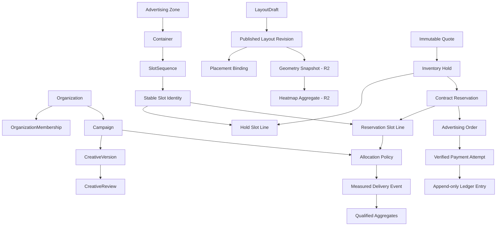

# AdPilot — Database Schema, Migrations, Indexes & Data Lifecycle Specification

**Document ID:** ADP-DOC-008  
**Filename:** `08_ADPILOT_DATABASE_SCHEMA_MIGRATIONS_INDEXES_DATA_LIFECYCLE.md`  
**Version:** 1.0.0 (proposed implementation contract)  
**Status:** Proposed — engineering/security/finance/privacy review required before migration freeze  
**Date:** 2026-10-11  
**Product:** AdPilot — Self-Service Advertising Marketplace & Behavioral Analytics for WordPress  
**Accountable owner:** Database & Data Architecture Engineer; Principal Software Architect  
**Required reviewers:** WordPress Lead, AdTech Lead, Finance Lead, Security & Privacy Leads, Analytics Lead, DevOps, UX/Frontend Lead, QA Lead  
**Implementation target:** GPT-6 High using bounded work packages, verifiable migrations and mandatory integration tests  
**Authoritative predecessors:** `ADP-DOC-001` through `ADP-DOC-007`  
**Next document:** `ADP-DOC-009` — REST API, Webhooks & Integration Contracts Specification

> **Status:** This document specifies a proposed persistence design; it is not an executed migration or a validated production schema. SQL blocks are illustrative, environment-dependent examples. The canonical business meaning of identifiers and policies remains in Documents 01–07. Approval of the database support matrix, retention periods and legal/accounting obligations remains a tracked release dependency.

---

## 1. Normative contract, precedence and scope

### 1.1 Authority

1. **ADP-DOC-001** owns `FR-*` (129), `BR-001..018`, `NFR-001..016`, `AC-001..015`, `INV-01..10`, delivery releases `R1–R4`, and decisions `DEC-*`.
2. **ADP-DOC-002** owns the corresponding `AT-*` tests, `CAP-01..18`, UI/feature catalog and `E2E-01..17`.
3. **ADP-DOC-003** owns personas, `JTBD-*`, `UJ-01..28`, `WF-01..18` and UX states.
4. **ADP-DOC-004** owns authoritative domain policies `DP-*`, `SM-*`, paid inventory invariants, audit/override rules and recovery decisions.
5. **ADP-DOC-005** owns two-plane authorization, site/organization scoping, capability semantics and protected data access.
6. **ADP-DOC-006** owns architecture, 24 `IC-*` integration contracts, module boundaries and ADR decisions.
7. **ADP-DOC-007** owns 28 `DM-*` aggregates, 28 `VO-*` types, domain/application contracts and event ownership.
8. **This document** specifies persistent representations, database read/write boundaries, indexes, concurrency, lifecycle, migration, operational recovery and database acceptance criteria; it MUST NOT redefine any predecessor.

If a proposed database mapping disagrees with a source domain policy, file a reviewed ADR/change proposal. Do not silently weaken contractual exclusivity, tenant authorization, money integrity, privacy, or paid creative review. All identifiers introduced here have prefix **`DB-*`** and are supplementary, not replacements for source requirement IDs.

### 1.2 Normative language and release boundaries

- **MUST / SHALL:** Mandatory when the covered feature exists in its assigned release.
- **SHOULD:** Strong expectation; exceptions require a signed ADR with evidence.
- **MAY:** Optional, separately approved implementation.
- **R1:** Inventory, Layout Studio, Gutenberg/theme rendering, marketplace, fixed/time-based sales, WooCommerce adapter, basic measurement, audit and tenant safety.
- **R2:** Native aggregated heatmaps, deeper viewability, diagnostics, enhanced content formats.
- **R3:** Qualified CPM/CPC, sophisticated allocations, experiments, attribution and optimization.
- **R4:** Optional replay, network federation and additional financial/service adapters.

R2–R4 tables SHALL be created only when their capabilities are activated/migrated, or during an explicitly documented forward-compatible migration. The plugin SHALL NOT claim an advanced capability exists because its table exists.

### 1.3 Explicit exclusions

This database is **not** a replacement for WordPress `users`, `usermeta`, or Media Library; WooCommerce's order storage; a general session-recording data lake; a credit card vault; a raw PII behavioral-tracking platform; an external analytical warehouse; or a guarantee of arbitrarily large database throughput. An advertisement registered to 500 logical positions is **not** 500 impressions. A browser-submitted event is **not** a billable financial fact.

### 1.4 Review and implementation responsibilities

| Role | Required decisions / checks |
|---|---|
| Database Architect | Schemas, indexes, constraints, migrations, transaction benchmarks |
| WordPress Engineer | `$wpdb`, correct table prefix, `dbDelta()` behavior, multisite lifecycle |
| Domain/Backend Lead | Repository-to-aggregate mapping, optimistic revisions and consistency |
| Finance Lead | Exact money, billing evidence, ledger postings, data retention and reconciliations |
| AdTech/Analytics Leads | Event qualification, viewability, aggregation and anti-fraud correctness |
| Security/Privacy Leads | Site/org predicates, export control, data minimization, deletion and audit |
| Frontend/UX Lead | Efficient paginated queries for Layout Studio, calendar, portal and heatmaps |
| QA/Performance/DevOps | Database matrix, concurrency tests, backups, restore drills, observability |

---

## 2. Storage architecture and approved technology envelope

### 2.1 Persistence ownership

- Use **custom WordPress-prefix-scoped tables** for commercial entities, layout/revisions, inventory, transactions, audit, event ingestion and reporting.
- Use WordPress `wp_users` / `wp_usermeta` for login identity and native attachment IDs for approved media where possible, but do not treat attachment metadata as source of creative approval.
- Use `wp_options` sparingly for bounded, non-autoloaded configuration such as current schema version and optional feature settings; never put growing events, layout arrays with thousands of slots, or ledger entries in options.
- WooCommerce orders are external authoritative commerce entities. Map their IDs into AdPilot tables using WooCommerce CRUD/HPOS-compatible APIs; never query HPOS table internals from AdPilot.
- Action Scheduler has its own store and lifecycle. Do not duplicate its internal queue tables. AdPilot persists authoritative outbox messages and processing provenance, not Action Scheduler's raw internals.
- `DbTableNameResolver` MUST derive identifiers from trusted site context and `$wpdb->get_blog_prefix($siteId)`; user-supplied SQL identifiers are never accepted.
- A network-installation feature MUST NOT create one globally shared customer table by default. R4 network services require explicit independent authorization and separate approved migrations.

### 2.2 Supported database prerequisites

Before installation or migration of paid inventory, verify that the selected MySQL/MariaDB version, table charset/collation, InnoDB, transactions, row locks, `DATETIME(6)` and selected index widths are supported. A precise support matrix and minimum versions SHALL be finalized and tested before R1 sign-off; do not infer universal support from WordPress's broad runtime compatibility. Incompatible hosts receive safe diagnostics; **unsafe exclusive checkout must be disabled**, not approximated using a read-then-write check.

### 2.3 Default design choices (`DB-DES-*`)

| ID | Choice | Reason / caveat |
|---|---|---|
| `DB-DES-01` | Per-site tables `${site_prefix}adpilot_*` | Tenant data isolation; separate R4 federation |
| `DB-DES-02` | InnoDB transactional tables | Atomic holds, payment evidence, version pointer and outbox |
| `DB-DES-03` | `BIGINT UNSIGNED` internal row IDs | Compact joins and efficient parent keys |
| `DB-DES-04` | `CHAR(26)` ASCII, binary collation for public opaque ULID-like IDs | Nonsequential external references; validate generation and collision handling; do not embed trust in ID |
| `DB-DES-05` | `BIGINT` signed exact **minor-unit amounts** + `CHAR(3)` ISO currency | Same semantics as `VO-009 Money`, never binary float |
| `DB-DES-06` | UTC `DATETIME(6)` with half-open `[start,end)` intervals | No ambiguous local booking boundaries |
| `DB-DES-07` | Text-encoded schema-versioned JSON for extensible bounded configurations | More conservative cross-MySQL/MariaDB mapping; validate in PHP; no SQL JSON dependence for critical predicates |
| `DB-DES-08` | Numeric/version/type fields outside JSON when queried or constrained | Indexability and auditable transitions |
| `DB-DES-09` | Stable, durable slot rows for **sellable** inventory; compact generator definitions for display | Exact slot locking without 500 blocks per Gutenberg layout |
| `DB-DES-10` | Immutable layout, creative, rate and ledger revisions | Prevent retroactive change of sold/approved facts |
| `DB-DES-11` | Bounded raw events + partitionable aggregate read models | Sustainable high-density analytics |
| `DB-DES-12` | Transactional outbox and idempotent downstream consumers | Atomic commit of business fact and dispatch intent |

**Money precision detail:** The string-valued `VO-009 Money.minorUnits` maps to the signed SQL `BIGINT` only after lossless boundary and scale validation. SQL range overflow, currency mismatch and unsupported currency precision MUST reject writes. Subminor-unit rate calculations can use an explicit `DECIMAL(24,8)`-style rate field/decimal library with an agreed rounding policy; final posted money is integral minor units. Multi-currency aggregation without exchange-rate provenance is prohibited.

### 2.4 Shared required columns

Unless an explicitly documented exception applies, mutable main tables SHALL include: `id BIGINT UNSIGNED AUTO_INCREMENT PRIMARY KEY`, `site_id BIGINT UNSIGNED NOT NULL` from trusted context, `public_id CHAR(26) CHARACTER SET ascii COLLATE ascii_bin NOT NULL`, `row_version INT UNSIGNED NOT NULL DEFAULT 1`, `created_at DATETIME(6) NOT NULL`, `updated_at DATETIME(6) NOT NULL`. `organization_id BIGINT UNSIGNED NOT NULL` is required for org-owned records. Use `UNIQUE KEY uq_site_public (site_id, public_id)` on exposed records.

Exceptions: join/link, immutable revision, append-only event/ledger, bucket and deduplication tables may use a composite/derived primary key without a public ID or row version. They still require reliable site scoping. Every table below describes its domain columns **in addition to shared columns unless `exception` is noted**. Domain fields listed as `nullable` permit NULL only with an explicit reason.

`DATETIME(6)` values MUST be generated/parsed as UTC by application services and cannot rely on DB session time zone or site-local `current_time()` values. No persisted PHP serialized objects. JSON envelopes must carry their own schema version and size bound. Enum-like strings use constrained application-level named sets and explicit migration for additions; prefer `VARCHAR` plus CHECK-compatible validation over SQL `ENUM` to reduce migration friction. Database CHECK support differs among versions, so do not rely on CHECK constraints alone.

---

## 3. Naming conventions, tenancy, constraints and data mapping

### 3.1 Naming and ID rules

| Element | Convention |
|---|---|
| Table | `${blog_prefix}adpilot_<plural_snake_case>`; use site-specific prefix resolver |
| Primary key | `id`, or documented composite PK for immutable event/bucket tables |
| Foreign references | `<entity>_id BIGINT UNSIGNED`; validate site/organization ownership |
| Timestamps | `<verb>_at DATETIME(6)` UTC, explicit nullable semantics |
| State | `status VARCHAR(32)` validated against authoritative state machine |
| Revision | `row_version` for optimistic concurrency; `<domain>_version` for immutable snapshots |
| Idempotency | Scoped digest `(scope, key_hash)` not raw customer tokens |
| Audit | Actor type/ID, policy version, correlation, reason and immutable before/after digests |
| JSON document | `_json LONGTEXT` plus `_schema_version SMALLINT UNSIGNED` and strict validation |
| Client output | Opaque public IDs only, never internal SQL ID as authorization basis |

Identifiers can still be enumerated or guessed; **all repository reads include trusted `site_id`, and org resources additionally enforce tenant ownership**. In per-site tables `site_id` duplicates the partition identity by design, simplifying forensic audit and preventing accidental cross-site matches. During `switch_to_blog()` use a freshly site-bound repository; do not retain a table resolver from a different site.

### 3.2 Referential integrity policy

Physical foreign keys may be introduced only if compatible with the supported WordPress/MySQL/MariaDB/migration matrix and if the owning repositories and deployment workflows can maintain them. Since `dbDelta()` is not a robust arbitrary FK migration engine, the baseline relies on **typed repository checks + correctly scoped unique/covering indexes + periodic orphan detection**; it MUST NOT call unverified references acceptable. Keys on `organization_id`, `slot_id`, `order_id` and other references must be indexed according to actual joins. Do not permit cascading deletion of financial records, sold inventory history or legally retained audit evidence.

### 3.3 Schema evolution of bounded documents

Each `_json` field requires a typed DTO schema, maximum encoded byte count, validation rules, canonical serialization, and migration/reader compatibility window. Important conditions such as slot identity, status, tenancy, currency, approval fingerprint, UTC period, billable amount and layout revision MUST NOT be hidden only inside JSON. A parser failure produces a named infrastructure/domain error, not a best-effort silently accepted contract.

### 3.4 Physical-schema version and source authority

The database schema is the source of persistence **shape**, not source of permission, quote price or delivery eligibility. `SM-*` policies remain authoritative. `IC-*` read projections are versioned and may be stale except protected current-state contracts. Do not introduce a generic “save aggregate” operation that updates `status` columns without transition preconditions.

---

## 4. Relational table inventory and ownership matrix

The tables listed below are proposed **physical persistence units**, not a demand to give each aggregate its own table. A `DM-*` aggregate may span several child tables or share an event projection. Naming and columns in §§5–7 freeze only after compatibility testing and reviewed ADRs.

| Table (`${prefix}adpilot_*`) | Owning module | Target release | Purpose |
|---|---|---|---|
| `organizations` | Advertisers | R1 | Physical owner_user_id does not authorize access without an active membership and current policy |
| `organization_memberships` | Identity | R1 | Membership is site-scoped; revision increments on grant, transfer, revoke and role changes |
| `membership_invitations` | Advertisers | R1 | If email is needed for dispatch, obtain from access-controlled transient protected store; invitation tokens never persist in plaintext |
| `zones` | Inventory | R1 | A zone is a logical inventory region, not a page occurrence |
| `containers` | Inventory | R1 | Represent 200-slot grid with compact definition, not 200 Gutenberg blocks |
| `slot_sequences` | Inventory | R1 | Bound count by configured operational quota but do not impose an arbitrary 500-slot product ceiling |
| `slots` | Inventory | R1 | Materialize each sellable stable slot before checkout |
| `placement_bindings` | Layout | R1 | Page-context bindings are not render instances; repeated on-page instances receive unique ephemeral render IDs |
| `layout_drafts` | Layout | R1 | Optimistic CAS on row_version; draft JSON not an authorization source |
| `layout_revisions` | Layout | R1 | Append only |
| `layout_active_pointers` | Layout | R1 | One row per scope; CAS pointer update in same TX as contract impact and outbox |
| `layout_contract_impacts` | Layout | R1 | Never auto-approve a sold slot relocation |
| `campaigns` | Campaigns | R1 | State columns are independent; only owner handlers may update through validated transitions |
| `creative_versions` | Creatives | R1 | Creative version payload and fingerprint immutable once submitted |
| `creative_reviews` | Creatives | R1 | Append-only exact-version approvals; resolve conflicting review decisions by state-machine sequence, not most recent arbitrary row |
| `moderation_cases` | Moderation | R1 | Case is workflow management; creative_reviews remains the authoritative approval record |
| `rate_card_versions` | Pricing | R1 | Published rate versions immutable |
| `quotes` | Pricing | R1 | Offer values immutable once submitted/accepted; status transition remains version checked |
| `inventory_holds` | Reservations | R1 | Half-open intervals |
| `hold_slot_lines` | Reservations | R1 | Locks underlying slots before insert |
| `contract_reservations` | Reservations | R1 | Never DELETE a sold contract to repair a conflict; use policy-governed amendment/remedy |
| `reservation_slot_lines` | Reservations | R1 | Temporal overlaps are NOT prevented by a UNIQUE key |
| `advertising_orders` | Commerce | R1 | Woo order state via CRUD adapter; paid_minor is a reconciled projection, not an independent truth |
| `order_lines` | Commerce | R1 | Immutable accepted line totals; financial corrections through ledger |
| `payment_attempts` | Commerce | R1 | No card PAN/CVV or secret gateway payload |
| `provider_events` | Commerce | R1 | Webhook dedup |
| `financial_ledger_entries` | Commerce | R1 | Append-only entries |
| `commercial_remedies` | Commerce | R1 | Paid creative rejection never strands funds without explicit enforceable remedy |
| `allocation_policies` | Delivery | R1 | Allocation policy cannot create commercial entitlement; recheck reservation and creative/financial gates |
| `delivery_stop_versions` | Delivery | R1 | Compact authoritative kill-switch stamp; cache invalidation must honor freshness policy |
| `event_batches` | Measurement | R1 | Collector batch transport is not a financial or viewable impression fact |
| `delivery_events` | Measurement | R1 | High-volume, short-retention facts |
| `event_deduplication` | Measurement | R1 | Insert unique dedup key before accepted event; bounded replay window, event batches recoverable |
| `measurement_qualifications` | Measurement | R1/R3 | Persistent R3 billable evidence retention policy is independent of raw-event retention |
| `stats_hourly` | Reporting | R1 | No financial revenue figure in browser stats |
| `stats_daily` | Reporting | R1 | Recompute/upsert idempotently with source checkpoint; daily numbers not presumed immutable |
| `aggregation_checkpoints` | Measurement | R1 | Progress cursor updated with aggregate writes; backfills need own run identities |
| `geometry_snapshots` | BehavioralAnalytics | R2 | Sanitized semantic anchors only; no private DOM or form contents |
| `heatmap_aggregates` | BehavioralAnalytics | R2 | No raw mouse trajectories |
| `consent_records` | Compliance | R2 | Where consent records are not legally required, do not create personal persistent tracking solely to store denial |
| `report_exports` | Reporting | R1 | Permission rechecked on download; invalidated when membership revoked |
| `notifications` | Notifications | R1 | Resolve recipient permissions at dispatch; do not store confidential rendered payload unnecessarily |
| `webhook_subscriptions` | Integrations | R4 | Destination SSRF and domain verification needed |
| `experiments` | Optimization | R3 | Statistical provenance and nonoverlapping exposure controls are application-domain duties |
| `audit_log` | Platform | R1 | Append-only; correction via additional audit fact, retained according to legal policy |
| `outbox_messages` | Platform | R1 | Created in same DB transaction as authoritative fact |
| `inbox_consumptions` | Platform | R1 | Uniqueness protects retries; keep processing state change + inbox ack atomic |
| `idempotency_records` | Platform | R1 | Same key with different request_digest => conflict; no replayed cross-actor result |
| `schema_migrations` | Platform | R1 | Migration attempts/checksums tracked; create bootstrap table first |
| `data_lifecycle_jobs` | Platform | R1 | Purge in small bounded batches; verify downstream checkpoint/hold and legal hold rules |

### 4.1 Scope, persistence granularity and release discipline

- **R1 writes:** identity, inventory, published layout, campaigns/creative, quotes/holds, orders/payments/ledger, delivery selection, short-retention measurement, aggregates, audits, outbox and migrations.
- **R2 writes:** geometry snapshots, heatmap bins, optional scoped consent receipts, and any enhanced measurement tables approved during privacy design.
- **R3 writes:** qualified billable fact extensions, experiment definitions, allocation refinements and any certified metered-billing journal—not direct modifications of settled R1 order rows.
- **R4 writes:** webhook subscription/federation extensions and optional independently stored session replay; replay data MUST NOT be placed in ordinary audit or event tables.

Do not activate feature-specific retention or reporting jobs before their migrations and privacy contracts pass tests. Read-only reports do not mutate authoritative billing or inventory rows.

---

## 5. Column-by-column relational schema contracts

**Reading these definitions:** Every listed column is in addition to the shared main-table columns from §2.4 unless the table explicitly states a different key shape. Index clauses show **requirements to realize and benchmark**, not syntactically ready `dbDelta()` DDL. For every unique constraint containing nullable columns, the implementation must account for MySQL's multiple-NULL behavior. Prefix length and collation of every indexed text field require supported-matrix verification.

### 5.1 `organizations` — Advertisers (R1)

**Purpose/invariant:** Physical owner_user_id does not authorize access without an active membership and current policy.

**Column contract:**

| Column | SQL type, meaning and rule |
|---|---|
| `legal_name` | VARCHAR(191) NOT NULL; billing/legal display after validation |
| `display_name` | VARCHAR(191) NOT NULL; storefront brand |
| `status` | VARCHAR(32) NOT NULL; pending/verified/suspended/closed |
| `owner_user_id` | BIGINT UNSIGNED NOT NULL; initial owner WP user ID, not sole grant source |
| `profile_json` | LONGTEXT NULL; bounded sanitized organization profile |
| `profile_schema_version` | SMALLINT UNSIGNED NOT NULL DEFAULT 1 |
| `verified_at` | DATETIME(6) NULL |

**Key/index contract:** `UNIQUE (site_id, public_id)`; `KEY (site_id, status, id)`; `KEY (site_id, owner_user_id)`.

**Common columns:** §2.4 main-table fields and scoped public ID where exposed.

### 5.2 `organization_memberships` — Identity (R1)

**Purpose/invariant:** Membership is site-scoped; revision increments on grant, transfer, revoke and role changes.

**Column contract:**

| Column | SQL type, meaning and rule |
|---|---|
| `organization_id` | BIGINT UNSIGNED NOT NULL |
| `user_id` | BIGINT UNSIGNED NOT NULL; WordPress user |
| `role_key` | VARCHAR(40) NOT NULL; owner/manager/analyst/billing as per Document 05 |
| `status` | VARCHAR(24) NOT NULL; invited/active/revoked/suspended |
| `granted_by` | BIGINT UNSIGNED NULL |
| `revoked_at` | DATETIME(6) NULL |
| `permission_version` | BIGINT UNSIGNED NOT NULL DEFAULT 1 |

**Key/index contract:** `UNIQUE (site_id, organization_id, user_id)`; `KEY (site_id, user_id, status)`; `KEY (site_id, organization_id, role_key, status)`.

**Common columns:** §2.4 main-table fields and scoped public ID where exposed.

### 5.3 `membership_invitations` — Advertisers (R1)

**Purpose/invariant:** If email is needed for dispatch, obtain from access-controlled transient protected store; invitation tokens never persist in plaintext.

**Column contract:**

| Column | SQL type, meaning and rule |
|---|---|
| `organization_id` | BIGINT UNSIGNED NOT NULL |
| `invitee_email_hash` | BINARY(32) NOT NULL; keyed normalized lookup hash (no plaintext email in index) |
| `role_key` | VARCHAR(40) NOT NULL |
| `token_hash` | BINARY(32) NOT NULL |
| `expires_at` | DATETIME(6) NOT NULL |
| `status` | VARCHAR(24) NOT NULL |
| `accepted_user_id` | BIGINT UNSIGNED NULL |
| `accepted_at` | DATETIME(6) NULL |

**Key/index contract:** `UNIQUE (site_id, token_hash)`; `KEY (site_id, organization_id, status, expires_at)`.

**Common columns:** §2.4 main-table fields and scoped public ID where exposed.

### 5.4 `zones` — Inventory (R1)

**Purpose/invariant:** A zone is a logical inventory region, not a page occurrence.

**Column contract:**

| Column | SQL type, meaning and rule |
|---|---|
| `zone_key` | VARCHAR(120) CHARACTER SET ascii NOT NULL; stable identifier |
| `name` | VARCHAR(191) NOT NULL |
| `status` | VARCHAR(24) NOT NULL |
| `commercial_class` | VARCHAR(40) NOT NULL |
| `description` | TEXT NULL |
| `current_layout_id` | BIGINT UNSIGNED NULL; published pointer where applicable |

**Key/index contract:** `UNIQUE (site_id, zone_key)`; `KEY (site_id, status, commercial_class)`.

**Common columns:** §2.4 main-table fields and scoped public ID where exposed.

### 5.5 `containers` — Inventory (R1)

**Purpose/invariant:** Represent 200-slot grid with compact definition, not 200 Gutenberg blocks.

**Column contract:**

| Column | SQL type, meaning and rule |
|---|---|
| `zone_id` | BIGINT UNSIGNED NOT NULL |
| `container_key` | VARCHAR(120) CHARACTER SET ascii NOT NULL |
| `layout_type` | VARCHAR(32) NOT NULL; stack/grid/row in R1 |
| `generator_json` | LONGTEXT NOT NULL; bounded slot sequence definition |
| `generator_schema_version` | SMALLINT UNSIGNED NOT NULL |
| `responsive_json` | LONGTEXT NOT NULL |
| `responsive_schema_version` | SMALLINT UNSIGNED NOT NULL |
| `status` | VARCHAR(24) NOT NULL |

**Key/index contract:** `UNIQUE (site_id, zone_id, container_key)`; `KEY (site_id, zone_id, status)`.

**Common columns:** §2.4 main-table fields and scoped public ID where exposed.

### 5.6 `slot_sequences` — Inventory (R1)

**Purpose/invariant:** Bound count by configured operational quota but do not impose an arbitrary 500-slot product ceiling.

**Column contract:**

| Column | SQL type, meaning and rule |
|---|---|
| `container_id` | BIGINT UNSIGNED NOT NULL |
| `sequence_key` | VARCHAR(120) CHARACTER SET ascii NOT NULL |
| `logical_count` | INT UNSIGNED NOT NULL |
| `generation_spec_json` | LONGTEXT NOT NULL |
| `spec_schema_version` | SMALLINT UNSIGNED NOT NULL |
| `status` | VARCHAR(24) NOT NULL |

**Key/index contract:** `UNIQUE (site_id, container_id, sequence_key)`; `KEY (site_id, container_id, status)`.

**Common columns:** §2.4 main-table fields and scoped public ID where exposed.

### 5.7 `slots` — Inventory (R1)

**Purpose/invariant:** Materialize each sellable stable slot before checkout. Lock slot rows for conflicting time intervals. Retire, never reassign a sold identity.

**Column contract:**

| Column | SQL type, meaning and rule |
|---|---|
| `zone_id` | BIGINT UNSIGNED NOT NULL |
| `container_id` | BIGINT UNSIGNED NOT NULL |
| `sequence_id` | BIGINT UNSIGNED NULL; null for manually addressed position |
| `ordinal` | INT UNSIGNED NULL; position within generated sequence |
| `slot_key` | VARCHAR(140) CHARACTER SET ascii NOT NULL; stable commercial identity |
| `status` | VARCHAR(24) NOT NULL |
| `commercial_class` | VARCHAR(40) NOT NULL |
| `capacity_units` | INT UNSIGNED NOT NULL DEFAULT 1 |
| `allocation_mode` | VARCHAR(32) NOT NULL; exclusive/shared |
| `retired_at` | DATETIME(6) NULL |

**Key/index contract:** `UNIQUE (site_id, slot_key)`; `UNIQUE (site_id, sequence_id, ordinal) [NULL allows manual rows]`; `KEY (site_id, zone_id, status, id)`; `KEY (site_id, container_id, status)`; `KEY (site_id, status, commercial_class)`.

**Common columns:** §2.4 main-table fields and scoped public ID where exposed.

### 5.8 `placement_bindings` — Layout (R1)

**Purpose/invariant:** Page-context bindings are not render instances; repeated on-page instances receive unique ephemeral render IDs.

**Column contract:**

| Column | SQL type, meaning and rule |
|---|---|
| `zone_id` | BIGINT UNSIGNED NOT NULL |
| `layout_revision_id` | BIGINT UNSIGNED NOT NULL |
| `binding_key` | VARCHAR(160) CHARACTER SET ascii NOT NULL |
| `context_type` | VARCHAR(32) NOT NULL; block/hook/template/post/shortcode |
| `context_reference` | VARCHAR(191) NOT NULL; trusted validated locator |
| `rule_json` | LONGTEXT NULL |
| `rule_schema_version` | SMALLINT UNSIGNED NOT NULL DEFAULT 1 |
| `status` | VARCHAR(24) NOT NULL |

**Key/index contract:** `UNIQUE (site_id, layout_revision_id, binding_key)`; `KEY (site_id, zone_id, status)`; `KEY (site_id, context_type, context_reference(100))`.

**Common columns:** §2.4 main-table fields and scoped public ID where exposed.

### 5.9 `layout_drafts` — Layout (R1)

**Purpose/invariant:** Optimistic CAS on row_version; draft JSON not an authorization source.

**Column contract:**

| Column | SQL type, meaning and rule |
|---|---|
| `scope_key` | VARCHAR(140) CHARACTER SET ascii NOT NULL; zone/template/page binding scope |
| `author_user_id` | BIGINT UNSIGNED NOT NULL |
| `base_revision_id` | BIGINT UNSIGNED NULL |
| `definition_json` | LONGTEXT NOT NULL |
| `definition_schema_version` | SMALLINT UNSIGNED NOT NULL |
| `validation_status` | VARCHAR(24) NOT NULL |
| `impact_digest` | BINARY(32) NULL |
| `status` | VARCHAR(24) NOT NULL |

**Key/index contract:** `UNIQUE (site_id, public_id)`; `KEY (site_id, scope_key, status)`; `KEY (site_id, author_user_id, updated_at)`.

**Common columns:** §2.4 main-table fields and scoped public ID where exposed.

### 5.10 `layout_revisions` — Layout (R1)

**Purpose/invariant:** Append only. Layout geometry reference persists after supersession.

**Column contract:**

| Column | SQL type, meaning and rule |
|---|---|
| `scope_key` | VARCHAR(140) CHARACTER SET ascii NOT NULL |
| `revision_number` | BIGINT UNSIGNED NOT NULL |
| `layout_digest` | BINARY(32) NOT NULL |
| `definition_json` | LONGTEXT NOT NULL |
| `definition_schema_version` | SMALLINT UNSIGNED NOT NULL |
| `impact_decision_id` | BIGINT UNSIGNED NULL |
| `published_by` | BIGINT UNSIGNED NOT NULL |
| `published_at` | DATETIME(6) NOT NULL |

**Key/index contract:** `UNIQUE (site_id, scope_key, revision_number)`; `KEY (site_id, scope_key, published_at)`.

**Structural exception:** Composite/special row; it does not necessarily use the full §2.4 common-column template. Actual PK/UTC fields must be resolved explicitly in its migration.

### 5.11 `layout_active_pointers` — Layout (R1)

**Purpose/invariant:** One row per scope; CAS pointer update in same TX as contract impact and outbox.

**Column contract:**

| Column | SQL type, meaning and rule |
|---|---|
| `scope_key` | VARCHAR(140) CHARACTER SET ascii NOT NULL |
| `revision_id` | BIGINT UNSIGNED NOT NULL |
| `pointer_version` | BIGINT UNSIGNED NOT NULL |
| `activated_at` | DATETIME(6) NOT NULL |

**Key/index contract:** `PRIMARY/UNIQUE (site_id, scope_key)`; `KEY (site_id, revision_id)`.

**Structural exception:** Composite/special row; it does not necessarily use the full §2.4 common-column template. Actual PK/UTC fields must be resolved explicitly in its migration.

### 5.12 `layout_contract_impacts` — Layout (R1)

**Purpose/invariant:** Never auto-approve a sold slot relocation.

**Column contract:**

| Column | SQL type, meaning and rule |
|---|---|
| `draft_id` | BIGINT UNSIGNED NOT NULL |
| `affected_reservation_id` | BIGINT UNSIGNED NOT NULL |
| `impact_type` | VARCHAR(32) NOT NULL |
| `resolution` | VARCHAR(32) NOT NULL |
| `approved_by` | BIGINT UNSIGNED NULL |
| `reason` | TEXT NULL |
| `resolved_at` | DATETIME(6) NULL |

**Key/index contract:** `UNIQUE (site_id, draft_id, affected_reservation_id)`; `KEY (site_id, affected_reservation_id, resolution)`.

**Structural exception:** Composite/special row; it does not necessarily use the full §2.4 common-column template. Actual PK/UTC fields must be resolved explicitly in its migration.

### 5.13 `campaigns` — Campaigns (R1)

**Purpose/invariant:** State columns are independent; only owner handlers may update through validated transitions.

**Column contract:**

| Column | SQL type, meaning and rule |
|---|---|
| `organization_id` | BIGINT UNSIGNED NOT NULL |
| `name` | VARCHAR(191) NOT NULL |
| `approval_state` | VARCHAR(32) NOT NULL |
| `delivery_state` | VARCHAR(32) NOT NULL |
| `contract_state` | VARCHAR(32) NOT NULL; projection/reference, not payment evidence |
| `schedule_start_at` | DATETIME(6) NULL |
| `schedule_end_at` | DATETIME(6) NULL |
| `targeting_json` | LONGTEXT NULL |
| `targeting_schema_version` | SMALLINT UNSIGNED NOT NULL DEFAULT 1 |
| `stop_revision` | BIGINT UNSIGNED NOT NULL DEFAULT 0 |

**Key/index contract:** `KEY (site_id, organization_id, approval_state, id)`; `KEY (site_id, delivery_state, schedule_start_at, schedule_end_at)`; `KEY (site_id, stop_revision)`.

**Common columns:** §2.4 main-table fields and scoped public ID where exposed.

### 5.14 `creative_versions` — Creatives (R1)

**Purpose/invariant:** Creative version payload and fingerprint immutable once submitted. Security validation before use.

**Column contract:**

| Column | SQL type, meaning and rule |
|---|---|
| `organization_id` | BIGINT UNSIGNED NOT NULL |
| `campaign_id` | BIGINT UNSIGNED NOT NULL |
| `creative_key` | VARCHAR(140) CHARACTER SET ascii NOT NULL |
| `version_number` | INT UNSIGNED NOT NULL |
| `media_attachment_id` | BIGINT UNSIGNED NULL |
| `format` | VARCHAR(32) NOT NULL |
| `destination_url` | TEXT NOT NULL; validated, no arbitrary executable URL schemes |
| `destination_digest` | BINARY(32) NOT NULL |
| `content_json` | LONGTEXT NOT NULL |
| `fingerprint` | BINARY(32) NOT NULL |
| `created_by` | BIGINT UNSIGNED NOT NULL |

**Key/index contract:** `UNIQUE (site_id, campaign_id, creative_key, version_number)`; `KEY (site_id, organization_id, campaign_id)`; `KEY (site_id, fingerprint)`.

**Structural exception:** Composite/special row; it does not necessarily use the full §2.4 common-column template. Actual PK/UTC fields must be resolved explicitly in its migration.

### 5.15 `creative_reviews` — Creatives (R1)

**Purpose/invariant:** Append-only exact-version approvals; resolve conflicting review decisions by state-machine sequence, not most recent arbitrary row.

**Column contract:**

| Column | SQL type, meaning and rule |
|---|---|
| `creative_version_id` | BIGINT UNSIGNED NOT NULL |
| `decision` | VARCHAR(24) NOT NULL |
| `reviewer_user_id` | BIGINT UNSIGNED NOT NULL |
| `fingerprint` | BINARY(32) NOT NULL |
| `policy_version` | VARCHAR(40) NOT NULL |
| `reason_code` | VARCHAR(64) NULL |
| `reason_text` | TEXT NULL |
| `decided_at` | DATETIME(6) NOT NULL |

**Key/index contract:** `UNIQUE (site_id, creative_version_id, fingerprint, decision) [if review history allows multiple decisions, use review_sequence]`; `KEY (site_id, reviewer_user_id, decided_at)`.

**Structural exception:** Composite/special row; it does not necessarily use the full §2.4 common-column template. Actual PK/UTC fields must be resolved explicitly in its migration.

### 5.16 `moderation_cases` — Moderation (R1)

**Purpose/invariant:** Case is workflow management; creative_reviews remains the authoritative approval record.

**Column contract:**

| Column | SQL type, meaning and rule |
|---|---|
| `organization_id` | BIGINT UNSIGNED NOT NULL |
| `campaign_id` | BIGINT UNSIGNED NULL |
| `creative_version_id` | BIGINT UNSIGNED NULL |
| `status` | VARCHAR(24) NOT NULL |
| `category` | VARCHAR(40) NOT NULL |
| `opened_by` | BIGINT UNSIGNED NOT NULL |
| `assigned_to` | BIGINT UNSIGNED NULL |
| `resolution_json` | LONGTEXT NULL |

**Key/index contract:** `KEY (site_id, status, created_at)`; `KEY (site_id, organization_id, status)`.

**Common columns:** §2.4 main-table fields and scoped public ID where exposed.

### 5.17 `rate_card_versions` — Pricing (R1)

**Purpose/invariant:** Published rate versions immutable. Advanced R3 prices may require exact decimal rate value with documented rounding.

**Column contract:**

| Column | SQL type, meaning and rule |
|---|---|
| `zone_id` | BIGINT UNSIGNED NULL |
| `slot_id` | BIGINT UNSIGNED NULL |
| `rate_key` | VARCHAR(120) CHARACTER SET ascii NOT NULL |
| `version_number` | INT UNSIGNED NOT NULL |
| `model` | VARCHAR(32) NOT NULL; fixed/time/sponsorship R1 |
| `currency` | CHAR(3) CHARACTER SET ascii NOT NULL |
| `unit_price_minor` | BIGINT NOT NULL |
| `parameters_json` | LONGTEXT NOT NULL |
| `effective_start_at` | DATETIME(6) NOT NULL |
| `effective_end_at` | DATETIME(6) NULL |
| `published_at` | DATETIME(6) NOT NULL |

**Key/index contract:** `UNIQUE (site_id, rate_key, version_number)`; `KEY (site_id, slot_id, effective_start_at)`; `KEY (site_id, zone_id, effective_start_at)`.

**Structural exception:** Composite/special row; it does not necessarily use the full §2.4 common-column template. Actual PK/UTC fields must be resolved explicitly in its migration.

### 5.18 `quotes` — Pricing (R1)

**Purpose/invariant:** Offer values immutable once submitted/accepted; status transition remains version checked.

**Column contract:**

| Column | SQL type, meaning and rule |
|---|---|
| `organization_id` | BIGINT UNSIGNED NOT NULL |
| `campaign_id` | BIGINT UNSIGNED NULL |
| `rate_card_version_id` | BIGINT UNSIGNED NOT NULL |
| `currency` | CHAR(3) CHARACTER SET ascii NOT NULL |
| `subtotal_minor` | BIGINT NOT NULL |
| `tax_minor` | BIGINT NOT NULL DEFAULT 0 |
| `discount_minor` | BIGINT NOT NULL DEFAULT 0 |
| `total_minor` | BIGINT NOT NULL |
| `offer_snapshot_json` | LONGTEXT NOT NULL |
| `terms_digest` | BINARY(32) NOT NULL |
| `expires_at` | DATETIME(6) NOT NULL |
| `status` | VARCHAR(24) NOT NULL |

**Key/index contract:** `KEY (site_id, organization_id, status, expires_at)`; `KEY (site_id, campaign_id, status)`.

**Common columns:** §2.4 main-table fields and scoped public ID where exposed.

### 5.19 `inventory_holds` — Reservations (R1)

**Purpose/invariant:** Half-open intervals. Expired hold never revived by late callback.

**Column contract:**

| Column | SQL type, meaning and rule |
|---|---|
| `organization_id` | BIGINT UNSIGNED NOT NULL |
| `quote_id` | BIGINT UNSIGNED NOT NULL |
| `campaign_id` | BIGINT UNSIGNED NULL |
| `starts_at` | DATETIME(6) NOT NULL |
| `ends_at` | DATETIME(6) NOT NULL |
| `expires_at` | DATETIME(6) NOT NULL |
| `status` | VARCHAR(24) NOT NULL |
| `idempotency_hash` | BINARY(32) NOT NULL |
| `consumed_at` | DATETIME(6) NULL |

**Key/index contract:** `UNIQUE (site_id, organization_id, idempotency_hash)`; `KEY (site_id, status, expires_at)`; `KEY (site_id, quote_id, status)`.

**Common columns:** §2.4 main-table fields and scoped public ID where exposed.

### 5.20 `hold_slot_lines` — Reservations (R1)

**Purpose/invariant:** Locks underlying slots before insert. Shared capacity sum includes active/qualified holds and reservations.

**Column contract:**

| Column | SQL type, meaning and rule |
|---|---|
| `hold_id` | BIGINT UNSIGNED NOT NULL |
| `slot_id` | BIGINT UNSIGNED NOT NULL |
| `units` | INT UNSIGNED NOT NULL |
| `starts_at` | DATETIME(6) NOT NULL |
| `ends_at` | DATETIME(6) NOT NULL |

**Key/index contract:** `UNIQUE (site_id, hold_id, slot_id, starts_at, ends_at)`; `KEY (site_id, slot_id, starts_at, ends_at)`.

**Structural exception:** Composite/special row; it does not necessarily use the full §2.4 common-column template. Actual PK/UTC fields must be resolved explicitly in its migration.

### 5.21 `contract_reservations` — Reservations (R1)

**Purpose/invariant:** Never DELETE a sold contract to repair a conflict; use policy-governed amendment/remedy.

**Column contract:**

| Column | SQL type, meaning and rule |
|---|---|
| `organization_id` | BIGINT UNSIGNED NOT NULL |
| `campaign_id` | BIGINT UNSIGNED NOT NULL |
| `order_id` | BIGINT UNSIGNED NOT NULL |
| `hold_id` | BIGINT UNSIGNED NULL |
| `starts_at` | DATETIME(6) NOT NULL |
| `ends_at` | DATETIME(6) NOT NULL |
| `exclusivity` | VARCHAR(24) NOT NULL |
| `status` | VARCHAR(24) NOT NULL |
| `contract_digest` | BINARY(32) NOT NULL |

**Key/index contract:** `KEY (site_id, organization_id, status)`; `KEY (site_id, order_id, status)`; `KEY (site_id, starts_at, ends_at)`.

**Common columns:** §2.4 main-table fields and scoped public ID where exposed.

### 5.22 `reservation_slot_lines` — Reservations (R1)

**Purpose/invariant:** Temporal overlaps are NOT prevented by a UNIQUE key. Serialize via slot locks and recheck.

**Column contract:**

| Column | SQL type, meaning and rule |
|---|---|
| `reservation_id` | BIGINT UNSIGNED NOT NULL |
| `slot_id` | BIGINT UNSIGNED NOT NULL |
| `units` | INT UNSIGNED NOT NULL |
| `starts_at` | DATETIME(6) NOT NULL |
| `ends_at` | DATETIME(6) NOT NULL |
| `commercial_class` | VARCHAR(40) NOT NULL |

**Key/index contract:** `UNIQUE (site_id, reservation_id, slot_id, starts_at, ends_at)`; `KEY (site_id, slot_id, starts_at, ends_at)`.

**Structural exception:** Composite/special row; it does not necessarily use the full §2.4 common-column template. Actual PK/UTC fields must be resolved explicitly in its migration.

### 5.23 `advertising_orders` — Commerce (R1)

**Purpose/invariant:** Woo order state via CRUD adapter; paid_minor is a reconciled projection, not an independent truth.

**Column contract:**

| Column | SQL type, meaning and rule |
|---|---|
| `organization_id` | BIGINT UNSIGNED NOT NULL |
| `campaign_id` | BIGINT UNSIGNED NOT NULL |
| `quote_id` | BIGINT UNSIGNED NOT NULL |
| `currency` | CHAR(3) CHARACTER SET ascii NOT NULL |
| `total_minor` | BIGINT NOT NULL |
| `paid_minor` | BIGINT NOT NULL DEFAULT 0 |
| `status` | VARCHAR(24) NOT NULL |
| `woocommerce_order_id` | BIGINT UNSIGNED NULL |
| `terms_digest` | BINARY(32) NOT NULL |

**Key/index contract:** `UNIQUE (site_id, quote_id) [or explicit multiple-attempt model; freeze ADR]`; `UNIQUE (site_id, woocommerce_order_id) [NULL permitted]`; `KEY (site_id, organization_id, status, created_at)`.

**Common columns:** §2.4 main-table fields and scoped public ID where exposed.

### 5.24 `order_lines` — Commerce (R1)

**Purpose/invariant:** Immutable accepted line totals; financial corrections through ledger.

**Column contract:**

| Column | SQL type, meaning and rule |
|---|---|
| `order_id` | BIGINT UNSIGNED NOT NULL |
| `line_number` | SMALLINT UNSIGNED NOT NULL |
| `item_type` | VARCHAR(32) NOT NULL |
| `reservation_id` | BIGINT UNSIGNED NULL |
| `description` | VARCHAR(255) NOT NULL |
| `quantity` | INT UNSIGNED NOT NULL |
| `unit_price_minor` | BIGINT NOT NULL |
| `tax_minor` | BIGINT NOT NULL DEFAULT 0 |
| `total_minor` | BIGINT NOT NULL |
| `snapshot_json` | LONGTEXT NULL |

**Key/index contract:** `UNIQUE (site_id, order_id, line_number)`; `KEY (site_id, reservation_id)`.

**Structural exception:** Composite/special row; it does not necessarily use the full §2.4 common-column template. Actual PK/UTC fields must be resolved explicitly in its migration.

### 5.25 `payment_attempts` — Commerce (R1)

**Purpose/invariant:** No card PAN/CVV or secret gateway payload. Signature validation before posting.

**Column contract:**

| Column | SQL type, meaning and rule |
|---|---|
| `order_id` | BIGINT UNSIGNED NOT NULL |
| `provider` | VARCHAR(64) NOT NULL |
| `provider_attempt_ref` | VARCHAR(191) CHARACTER SET ascii NULL |
| `provider_event_ref` | VARCHAR(191) CHARACTER SET ascii NULL |
| `currency` | CHAR(3) CHARACTER SET ascii NOT NULL |
| `amount_minor` | BIGINT NOT NULL |
| `status` | VARCHAR(32) NOT NULL |
| `evidence_hash` | BINARY(32) NOT NULL |
| `verified_at` | DATETIME(6) NULL |

**Key/index contract:** `UNIQUE (site_id, provider, provider_attempt_ref) [where non-null]`; `UNIQUE (site_id, provider, provider_event_ref) [where non-null]`; `KEY (site_id, order_id, status)`.

**Common columns:** §2.4 main-table fields and scoped public ID where exposed.

### 5.26 `provider_events` — Commerce (R1)

**Purpose/invariant:** Webhook dedup. Store only minimal redacted evidence; never raw secrets.

**Column contract:**

| Column | SQL type, meaning and rule |
|---|---|
| `provider` | VARCHAR(64) NOT NULL |
| `event_reference_hash` | BINARY(32) NOT NULL |
| `order_id` | BIGINT UNSIGNED NULL |
| `attempt_id` | BIGINT UNSIGNED NULL |
| `received_at` | DATETIME(6) NOT NULL |
| `processed_at` | DATETIME(6) NULL |
| `status` | VARCHAR(32) NOT NULL |
| `safe_evidence_json` | LONGTEXT NULL |

**Key/index contract:** `UNIQUE (site_id, provider, event_reference_hash)`; `KEY (site_id, status, received_at)`.

**Structural exception:** Composite/special row; it does not necessarily use the full §2.4 common-column template. Actual PK/UTC fields must be resolved explicitly in its migration.

### 5.27 `financial_ledger_entries` — Commerce (R1)

**Purpose/invariant:** Append-only entries. No UPDATE/DELETE of posted value. Separate signed entries or balanced double-entry design finalized by Finance ADR.

**Column contract:**

| Column | SQL type, meaning and rule |
|---|---|
| `organization_id` | BIGINT UNSIGNED NOT NULL |
| `order_id` | BIGINT UNSIGNED NOT NULL |
| `currency` | CHAR(3) CHARACTER SET ascii NOT NULL |
| `amount_minor` | BIGINT NOT NULL; signed exact delta |
| `entry_type` | VARCHAR(40) NOT NULL; capture/refund/adjustment/receivable etc |
| `source_provider_event_id` | BIGINT UNSIGNED NULL |
| `source_idempotency_hash` | BINARY(32) NOT NULL |
| `reversal_of_entry_id` | BIGINT UNSIGNED NULL |
| `posted_at` | DATETIME(6) NOT NULL |

**Key/index contract:** `UNIQUE (site_id, source_idempotency_hash)`; `KEY (site_id, order_id, posted_at)`; `KEY (site_id, organization_id, posted_at)`.

**Structural exception:** Composite/special row; it does not necessarily use the full §2.4 common-column template. Actual PK/UTC fields must be resolved explicitly in its migration.

### 5.28 `commercial_remedies` — Commerce (R1)

**Purpose/invariant:** Paid creative rejection never strands funds without explicit enforceable remedy.

**Column contract:**

| Column | SQL type, meaning and rule |
|---|---|
| `organization_id` | BIGINT UNSIGNED NOT NULL |
| `order_id` | BIGINT UNSIGNED NOT NULL |
| `campaign_id` | BIGINT UNSIGNED NOT NULL |
| `reason` | VARCHAR(64) NOT NULL |
| `status` | VARCHAR(32) NOT NULL |
| `resolution_type` | VARCHAR(32) NULL |
| `deadline_at` | DATETIME(6) NULL |
| `resolved_at` | DATETIME(6) NULL |
| `approval_ref` | BIGINT UNSIGNED NULL |

**Key/index contract:** `KEY (site_id, order_id, status)`; `KEY (site_id, deadline_at, status)`.

**Common columns:** §2.4 main-table fields and scoped public ID where exposed.

### 5.29 `allocation_policies` — Delivery (R1)

**Purpose/invariant:** Allocation policy cannot create commercial entitlement; recheck reservation and creative/financial gates.

**Column contract:**

| Column | SQL type, meaning and rule |
|---|---|
| `campaign_id` | BIGINT UNSIGNED NOT NULL |
| `reservation_id` | BIGINT UNSIGNED NOT NULL |
| `slot_id` | BIGINT UNSIGNED NOT NULL |
| `priority` | SMALLINT UNSIGNED NOT NULL DEFAULT 100 |
| `weight` | INT UNSIGNED NOT NULL DEFAULT 1 |
| `pacing_policy_json` | LONGTEXT NULL |
| `targeting_schema_version` | SMALLINT UNSIGNED NOT NULL DEFAULT 1 |
| `status` | VARCHAR(24) NOT NULL |
| `eligible_from_at` | DATETIME(6) NOT NULL |
| `eligible_until_at` | DATETIME(6) NOT NULL |

**Key/index contract:** `KEY (site_id, slot_id, status, eligible_from_at, eligible_until_at)`; `KEY (site_id, campaign_id, status)`; `UNIQUE (site_id, campaign_id, reservation_id, slot_id)`.

**Common columns:** §2.4 main-table fields and scoped public ID where exposed.

### 5.30 `delivery_stop_versions` — Delivery (R1)

**Purpose/invariant:** Compact authoritative kill-switch stamp; cache invalidation must honor freshness policy.

**Column contract:**

| Column | SQL type, meaning and rule |
|---|---|
| `campaign_id` | BIGINT UNSIGNED NOT NULL |
| `stop_revision` | BIGINT UNSIGNED NOT NULL |
| `stopped` | TINYINT(1) NOT NULL |
| `updated_at` | DATETIME(6) NOT NULL |

**Key/index contract:** `UNIQUE (site_id, campaign_id)`; `KEY (site_id, stopped, updated_at)`.

**Structural exception:** Composite/special row; it does not necessarily use the full §2.4 common-column template. Actual PK/UTC fields must be resolved explicitly in its migration.

### 5.31 `event_batches` — Measurement (R1)

**Purpose/invariant:** Collector batch transport is not a financial or viewable impression fact.

**Column contract:**

| Column | SQL type, meaning and rule |
|---|---|
| `batch_public_id` | CHAR(26) CHARACTER SET ascii NOT NULL |
| `received_at` | DATETIME(6) NOT NULL |
| `source_class` | VARCHAR(24) NOT NULL; public/test/preview |
| `schema_version` | SMALLINT UNSIGNED NOT NULL |
| `event_count` | INT UNSIGNED NOT NULL |
| `accepted_count` | INT UNSIGNED NOT NULL DEFAULT 0 |
| `rejected_count` | INT UNSIGNED NOT NULL DEFAULT 0 |
| `status` | VARCHAR(24) NOT NULL |
| `processed_at` | DATETIME(6) NULL |

**Key/index contract:** `UNIQUE (site_id, batch_public_id)`; `KEY (site_id, status, received_at)`.

**Structural exception:** Composite/special row; it does not necessarily use the full §2.4 common-column template. Actual PK/UTC fields must be resolved explicitly in its migration.

### 5.32 `delivery_events` — Measurement (R1)

**Purpose/invariant:** High-volume, short-retention facts. Do not index every dimension; avoid sensitive visitor payload.

**Column contract:**

| Column | SQL type, meaning and rule |
|---|---|
| `batch_id` | BIGINT UNSIGNED NOT NULL |
| `event_hash` | BINARY(32) NOT NULL; bounded canonical identity |
| `observed_at` | DATETIME(6) NOT NULL |
| `received_at` | DATETIME(6) NOT NULL |
| `event_type` | VARCHAR(32) NOT NULL |
| `decision_ref` | CHAR(26) CHARACTER SET ascii NOT NULL |
| `render_ref` | CHAR(26) CHARACTER SET ascii NOT NULL |
| `slot_id` | BIGINT UNSIGNED NOT NULL |
| `campaign_id` | BIGINT UNSIGNED NULL |
| `creative_version_id` | BIGINT UNSIGNED NULL |
| `layout_revision_id` | BIGINT UNSIGNED NOT NULL |
| `device_class` | VARCHAR(16) NOT NULL |
| `validation_code` | VARCHAR(40) NOT NULL |
| `qualified` | TINYINT(1) NOT NULL DEFAULT 0 |
| `metric_version` | VARCHAR(24) NOT NULL |
| `consent_purpose` | VARCHAR(32) NULL |

**Key/index contract:** `KEY (site_id, observed_at, event_type)`; `KEY (site_id, campaign_id, observed_at)`; `KEY (site_id, slot_id, observed_at)`; `KEY (site_id, batch_id)`.

**Structural exception:** Composite/special row; it does not necessarily use the full §2.4 common-column template. Actual PK/UTC fields must be resolved explicitly in its migration.

### 5.33 `event_deduplication` — Measurement (R1)

**Purpose/invariant:** Insert unique dedup key before accepted event; bounded replay window, event batches recoverable.

**Column contract:**

| Column | SQL type, meaning and rule |
|---|---|
| `event_hash` | BINARY(32) NOT NULL |
| `first_seen_at` | DATETIME(6) NOT NULL |
| `expires_at` | DATETIME(6) NOT NULL |
| `event_type` | VARCHAR(32) NOT NULL |
| `qualification_state` | VARCHAR(24) NOT NULL |

**Key/index contract:** `PRIMARY/UNIQUE (site_id, event_hash)`; `KEY (site_id, expires_at)`.

**Structural exception:** Composite/special row; it does not necessarily use the full §2.4 common-column template. Actual PK/UTC fields must be resolved explicitly in its migration.

### 5.34 `measurement_qualifications` — Measurement (R1/R3)

**Purpose/invariant:** Persistent R3 billable evidence retention policy is independent of raw-event retention.

**Column contract:**

| Column | SQL type, meaning and rule |
|---|---|
| `source_event_hash` | BINARY(32) NOT NULL |
| `campaign_id` | BIGINT UNSIGNED NOT NULL |
| `slot_id` | BIGINT UNSIGNED NOT NULL |
| `metric_version` | VARCHAR(24) NOT NULL |
| `classification` | VARCHAR(32) NOT NULL |
| `qualified_at` | DATETIME(6) NOT NULL |
| `reason_code` | VARCHAR(64) NULL |
| `billing_contract_id` | BIGINT UNSIGNED NULL |
| `reconciliation_ref` | CHAR(26) CHARACTER SET ascii NULL |

**Key/index contract:** `UNIQUE (site_id, source_event_hash, metric_version, classification)`; `KEY (site_id, campaign_id, qualified_at)`; `KEY (site_id, billing_contract_id, classification)`.

**Structural exception:** Composite/special row; it does not necessarily use the full §2.4 common-column template. Actual PK/UTC fields must be resolved explicitly in its migration.

### 5.35 `stats_hourly` — Reporting (R1)

**Purpose/invariant:** No financial revenue figure in browser stats. For NULL-free unique grain use creative_version_id=0 internal sentinel or stored grain hash with explicit review.

**Column contract:**

| Column | SQL type, meaning and rule |
|---|---|
| `bucket_start_at` | DATETIME(6) NOT NULL; aligned UTC hour |
| `campaign_id` | BIGINT UNSIGNED NOT NULL |
| `creative_version_id` | BIGINT UNSIGNED NULL |
| `slot_id` | BIGINT UNSIGNED NOT NULL |
| `layout_revision_id` | BIGINT UNSIGNED NOT NULL |
| `device_class` | VARCHAR(16) NOT NULL |
| `metric_version` | VARCHAR(24) NOT NULL |
| `served_count` | BIGINT UNSIGNED NOT NULL DEFAULT 0 |
| `rendered_count` | BIGINT UNSIGNED NOT NULL DEFAULT 0 |
| `measurable_count` | BIGINT UNSIGNED NOT NULL DEFAULT 0 |
| `viewable_count` | BIGINT UNSIGNED NOT NULL DEFAULT 0 |
| `qualified_clicks` | BIGINT UNSIGNED NOT NULL DEFAULT 0 |
| `rejected_events` | BIGINT UNSIGNED NOT NULL DEFAULT 0 |
| `completeness_state` | VARCHAR(24) NOT NULL |
| `aggregated_at` | DATETIME(6) NOT NULL |

**Key/index contract:** `UNIQUE (site_id, bucket_start_at, campaign_id, creative_version_id, slot_id, layout_revision_id, device_class, metric_version) [nullable creative requires normalized sentinel/key strategy]`; `KEY (site_id, campaign_id, bucket_start_at)`; `KEY (site_id, slot_id, bucket_start_at)`.

**Structural exception:** Composite/special row; it does not necessarily use the full §2.4 common-column template. Actual PK/UTC fields must be resolved explicitly in its migration.

### 5.36 `stats_daily` — Reporting (R1)

**Purpose/invariant:** Recompute/upsert idempotently with source checkpoint; daily numbers not presumed immutable.

**Column contract:**

| Column | SQL type, meaning and rule |
|---|---|
| `bucket_date` | DATE NOT NULL; calendar date in UTC |
| `campaign_id` | BIGINT UNSIGNED NOT NULL |
| `slot_id` | BIGINT UNSIGNED NOT NULL |
| `layout_revision_id` | BIGINT UNSIGNED NOT NULL |
| `device_class` | VARCHAR(16) NOT NULL |
| `metric_version` | VARCHAR(24) NOT NULL |
| `served_count` | BIGINT UNSIGNED NOT NULL DEFAULT 0 |
| `rendered_count` | BIGINT UNSIGNED NOT NULL DEFAULT 0 |
| `measurable_count` | BIGINT UNSIGNED NOT NULL DEFAULT 0 |
| `viewable_count` | BIGINT UNSIGNED NOT NULL DEFAULT 0 |
| `qualified_clicks` | BIGINT UNSIGNED NOT NULL DEFAULT 0 |
| `aggregate_revision` | BIGINT UNSIGNED NOT NULL DEFAULT 1 |
| `aggregated_at` | DATETIME(6) NOT NULL |

**Key/index contract:** `UNIQUE (site_id, bucket_date, campaign_id, slot_id, layout_revision_id, device_class, metric_version)`; `KEY (site_id, campaign_id, bucket_date)`; `KEY (site_id, slot_id, bucket_date)`.

**Structural exception:** Composite/special row; it does not necessarily use the full §2.4 common-column template. Actual PK/UTC fields must be resolved explicitly in its migration.

### 5.37 `aggregation_checkpoints` — Measurement (R1)

**Purpose/invariant:** Progress cursor updated with aggregate writes; backfills need own run identities.

**Column contract:**

| Column | SQL type, meaning and rule |
|---|---|
| `pipeline_key` | VARCHAR(96) CHARACTER SET ascii NOT NULL |
| `partition_key` | VARCHAR(128) CHARACTER SET ascii NOT NULL |
| `last_event_id` | BIGINT UNSIGNED NOT NULL DEFAULT 0 |
| `last_processed_at` | DATETIME(6) NULL |
| `checkpoint_version` | BIGINT UNSIGNED NOT NULL DEFAULT 1 |
| `status` | VARCHAR(24) NOT NULL |
| `error_code` | VARCHAR(64) NULL |

**Key/index contract:** `UNIQUE (site_id, pipeline_key, partition_key)`; `KEY (site_id, status, last_processed_at)`.

**Common columns:** §2.4 main-table fields and scoped public ID where exposed.

### 5.38 `geometry_snapshots` — BehavioralAnalytics (R2)

**Purpose/invariant:** Sanitized semantic anchors only; no private DOM or form contents.

**Column contract:**

| Column | SQL type, meaning and rule |
|---|---|
| `layout_revision_id` | BIGINT UNSIGNED NOT NULL |
| `page_context_hash` | BINARY(32) NOT NULL |
| `viewport_class` | VARCHAR(24) NOT NULL |
| `geometry_schema_version` | SMALLINT UNSIGNED NOT NULL |
| `geometry_digest` | BINARY(32) NOT NULL |
| `sanitized_snapshot_json` | LONGTEXT NOT NULL |
| `captured_at` | DATETIME(6) NOT NULL |
| `status` | VARCHAR(24) NOT NULL |

**Key/index contract:** `UNIQUE (site_id, layout_revision_id, page_context_hash, viewport_class, geometry_digest)`; `KEY (site_id, layout_revision_id, captured_at)`.

**Structural exception:** Composite/special row; it does not necessarily use the full §2.4 common-column template. Actual PK/UTC fields must be resolved explicitly in its migration.

### 5.39 `heatmap_aggregates` — BehavioralAnalytics (R2)

**Purpose/invariant:** No raw mouse trajectories. Minimum cohort threshold and sample suppression applied before audience access.

**Column contract:**

| Column | SQL type, meaning and rule |
|---|---|
| `bucket_date` | DATE NOT NULL |
| `geometry_snapshot_id` | BIGINT UNSIGNED NOT NULL |
| `layout_revision_id` | BIGINT UNSIGNED NOT NULL |
| `target_anchor_hash` | BINARY(32) NOT NULL |
| `device_class` | VARCHAR(16) NOT NULL |
| `metric_kind` | VARCHAR(32) NOT NULL |
| `metric_version` | VARCHAR(24) NOT NULL |
| `bin_x` | SMALLINT UNSIGNED NOT NULL |
| `bin_y` | SMALLINT UNSIGNED NOT NULL |
| `event_count` | BIGINT UNSIGNED NOT NULL DEFAULT 0 |
| `eligible_sample_count` | BIGINT UNSIGNED NOT NULL DEFAULT 0 |
| `suppressed` | TINYINT(1) NOT NULL DEFAULT 0 |
| `computed_at` | DATETIME(6) NOT NULL |

**Key/index contract:** `UNIQUE (site_id, bucket_date, geometry_snapshot_id, target_anchor_hash, device_class, metric_kind, metric_version, bin_x, bin_y)`; `KEY (site_id, layout_revision_id, bucket_date)`; `KEY (site_id, geometry_snapshot_id, metric_kind)`.

**Structural exception:** Composite/special row; it does not necessarily use the full §2.4 common-column template. Actual PK/UTC fields must be resolved explicitly in its migration.

### 5.40 `consent_records` — Compliance (R2)

**Purpose/invariant:** Where consent records are not legally required, do not create personal persistent tracking solely to store denial. Withdrawal must affect collection promptly.

**Column contract:**

| Column | SQL type, meaning and rule |
|---|---|
| `subject_key_hash` | BINARY(32) NOT NULL; purpose-limited pseudonym |
| `purpose` | VARCHAR(48) NOT NULL |
| `state` | VARCHAR(16) NOT NULL; granted/denied/withdrawn |
| `policy_version` | VARCHAR(40) NOT NULL |
| `source` | VARCHAR(40) NOT NULL |
| `effective_at` | DATETIME(6) NOT NULL |
| `expires_at` | DATETIME(6) NULL |
| `receipt_json` | LONGTEXT NULL; minimal evidence only |

**Key/index contract:** `KEY (site_id, subject_key_hash, purpose, effective_at)`; `KEY (site_id, purpose, expires_at)`.

**Structural exception:** Composite/special row; it does not necessarily use the full §2.4 common-column template. Actual PK/UTC fields must be resolved explicitly in its migration.

### 5.41 `report_exports` — Reporting (R1)

**Purpose/invariant:** Permission rechecked on download; invalidated when membership revoked.

**Column contract:**

| Column | SQL type, meaning and rule |
|---|---|
| `requested_by_user_id` | BIGINT UNSIGNED NOT NULL |
| `organization_id` | BIGINT UNSIGNED NULL |
| `scope_json` | LONGTEXT NOT NULL; validated authorized projection |
| `scope_schema_version` | SMALLINT UNSIGNED NOT NULL |
| `status` | VARCHAR(24) NOT NULL |
| `artifact_storage_key` | VARCHAR(255) NULL; private storage only |
| `artifact_sha256` | BINARY(32) NULL |
| `expires_at` | DATETIME(6) NOT NULL |
| `completed_at` | DATETIME(6) NULL |

**Key/index contract:** `KEY (site_id, requested_by_user_id, status)`; `KEY (site_id, expires_at, status)`; `KEY (site_id, organization_id, status)`.

**Common columns:** §2.4 main-table fields and scoped public ID where exposed.

### 5.42 `notifications` — Notifications (R1)

**Purpose/invariant:** Resolve recipient permissions at dispatch; do not store confidential rendered payload unnecessarily.

**Column contract:**

| Column | SQL type, meaning and rule |
|---|---|
| `source_event_id` | BIGINT UNSIGNED NOT NULL |
| `recipient_user_id` | BIGINT UNSIGNED NOT NULL |
| `organization_id` | BIGINT UNSIGNED NULL |
| `template_key` | VARCHAR(80) NOT NULL |
| `locale` | VARCHAR(16) NOT NULL |
| `status` | VARCHAR(24) NOT NULL |
| `dedup_hash` | BINARY(32) NOT NULL |
| `next_attempt_at` | DATETIME(6) NULL |
| `sent_at` | DATETIME(6) NULL |

**Key/index contract:** `UNIQUE (site_id, dedup_hash)`; `KEY (site_id, status, next_attempt_at)`; `KEY (site_id, recipient_user_id, created_at)`.

**Common columns:** §2.4 main-table fields and scoped public ID where exposed.

### 5.43 `webhook_subscriptions` — Integrations (R4)

**Purpose/invariant:** Destination SSRF and domain verification needed. Do not store plaintext webhook secret.

**Column contract:**

| Column | SQL type, meaning and rule |
|---|---|
| `organization_id` | BIGINT UNSIGNED NULL |
| `created_by_user_id` | BIGINT UNSIGNED NOT NULL |
| `event_topic` | VARCHAR(96) NOT NULL |
| `destination_url` | TEXT NOT NULL |
| `secret_reference` | VARCHAR(191) NOT NULL; pointer to protected secret store |
| `status` | VARCHAR(24) NOT NULL |
| `last_sent_at` | DATETIME(6) NULL |

**Key/index contract:** `KEY (site_id, organization_id, status)`; `KEY (site_id, event_topic, status)`.

**Common columns:** §2.4 main-table fields and scoped public ID where exposed.

### 5.44 `experiments` — Optimization (R3)

**Purpose/invariant:** Statistical provenance and nonoverlapping exposure controls are application-domain duties.

**Column contract:**

| Column | SQL type, meaning and rule |
|---|---|
| `campaign_id` | BIGINT UNSIGNED NULL |
| `slot_id` | BIGINT UNSIGNED NULL |
| `status` | VARCHAR(24) NOT NULL |
| `randomization_json` | LONGTEXT NOT NULL |
| `metric_version` | VARCHAR(24) NOT NULL |
| `starts_at` | DATETIME(6) NOT NULL |
| `ends_at` | DATETIME(6) NULL |
| `owner_user_id` | BIGINT UNSIGNED NOT NULL |

**Key/index contract:** `KEY (site_id, status, starts_at)`; `KEY (site_id, campaign_id, status)`.

**Common columns:** §2.4 main-table fields and scoped public ID where exposed.

### 5.45 `audit_log` — Platform (R1)

**Purpose/invariant:** Append-only; correction via additional audit fact, retained according to legal policy.

**Column contract:**

| Column | SQL type, meaning and rule |
|---|---|
| `actor_type` | VARCHAR(24) NOT NULL |
| `actor_user_id` | BIGINT UNSIGNED NULL |
| `organization_id` | BIGINT UNSIGNED NULL |
| `action` | VARCHAR(96) NOT NULL |
| `resource_type` | VARCHAR(64) NOT NULL |
| `resource_id` | BIGINT UNSIGNED NULL |
| `previous_digest` | BINARY(32) NULL |
| `new_digest` | BINARY(32) NULL |
| `reason_code` | VARCHAR(64) NULL |
| `policy_version` | VARCHAR(40) NOT NULL |
| `correlation_id` | CHAR(36) CHARACTER SET ascii NOT NULL |
| `occurred_at` | DATETIME(6) NOT NULL |
| `evidence_json` | LONGTEXT NULL; redacted, bounded |

**Key/index contract:** `KEY (site_id, occurred_at)`; `KEY (site_id, resource_type, resource_id, occurred_at)`; `KEY (site_id, actor_user_id, occurred_at)`; `KEY (site_id, organization_id, occurred_at)`.

**Structural exception:** Composite/special row; it does not necessarily use the full §2.4 common-column template. Actual PK/UTC fields must be resolved explicitly in its migration.

### 5.46 `outbox_messages` — Platform (R1)

**Purpose/invariant:** Created in same DB transaction as authoritative fact. Never enqueue before commit.

**Column contract:**

| Column | SQL type, meaning and rule |
|---|---|
| `event_public_id` | CHAR(26) CHARACTER SET ascii NOT NULL |
| `topic` | VARCHAR(96) NOT NULL |
| `event_schema_version` | SMALLINT UNSIGNED NOT NULL |
| `aggregate_type` | VARCHAR(64) NOT NULL |
| `aggregate_id` | BIGINT UNSIGNED NOT NULL |
| `payload_json` | LONGTEXT NOT NULL; redacted typed envelope |
| `occurred_at` | DATETIME(6) NOT NULL |
| `status` | VARCHAR(24) NOT NULL |
| `available_at` | DATETIME(6) NOT NULL |
| `attempts` | SMALLINT UNSIGNED NOT NULL DEFAULT 0 |
| `dispatched_at` | DATETIME(6) NULL |

**Key/index contract:** `UNIQUE (site_id, event_public_id)`; `KEY (site_id, status, available_at, id)`; `KEY (site_id, aggregate_type, aggregate_id)`.

**Structural exception:** Composite/special row; it does not necessarily use the full §2.4 common-column template. Actual PK/UTC fields must be resolved explicitly in its migration.

### 5.47 `inbox_consumptions` — Platform (R1)

**Purpose/invariant:** Uniqueness protects retries; keep processing state change + inbox ack atomic.

**Column contract:**

| Column | SQL type, meaning and rule |
|---|---|
| `consumer_key` | VARCHAR(96) CHARACTER SET ascii NOT NULL |
| `event_public_id` | CHAR(26) CHARACTER SET ascii NOT NULL |
| `processed_at` | DATETIME(6) NOT NULL |
| `source_outbox_id` | BIGINT UNSIGNED NULL |

**Key/index contract:** `UNIQUE (site_id, consumer_key, event_public_id)`; `KEY (site_id, processed_at)`.

**Structural exception:** Composite/special row; it does not necessarily use the full §2.4 common-column template. Actual PK/UTC fields must be resolved explicitly in its migration.

### 5.48 `idempotency_records` — Platform (R1)

**Purpose/invariant:** Same key with different request_digest => conflict; no replayed cross-actor result.

**Column contract:**

| Column | SQL type, meaning and rule |
|---|---|
| `operation_key` | VARCHAR(96) CHARACTER SET ascii NOT NULL |
| `actor_scope_hash` | BINARY(32) NOT NULL |
| `idempotency_hash` | BINARY(32) NOT NULL |
| `request_digest` | BINARY(32) NOT NULL |
| `response_ref` | VARCHAR(191) NULL |
| `status` | VARCHAR(24) NOT NULL |
| `expires_at` | DATETIME(6) NOT NULL |

**Key/index contract:** `UNIQUE (site_id, operation_key, actor_scope_hash, idempotency_hash)`; `KEY (site_id, status, expires_at)`.

**Structural exception:** Composite/special row; it does not necessarily use the full §2.4 common-column template. Actual PK/UTC fields must be resolved explicitly in its migration.

### 5.49 `schema_migrations` — Platform (R1)

**Purpose/invariant:** Migration attempts/checksums tracked; create bootstrap table first. DDL may auto-commit.

**Column contract:**

| Column | SQL type, meaning and rule |
|---|---|
| `migration_id` | VARCHAR(160) CHARACTER SET ascii NOT NULL |
| `checksum_sha256` | CHAR(64) CHARACTER SET ascii NOT NULL |
| `started_at` | DATETIME(6) NOT NULL |
| `finished_at` | DATETIME(6) NULL |
| `status` | VARCHAR(24) NOT NULL |
| `attempt_count` | SMALLINT UNSIGNED NOT NULL DEFAULT 1 |
| `error_code` | VARCHAR(64) NULL |
| `notes` | TEXT NULL |

**Key/index contract:** `UNIQUE (site_id, migration_id)`; `KEY (site_id, status, started_at)`.

**Structural exception:** Composite/special row; it does not necessarily use the full §2.4 common-column template. Actual PK/UTC fields must be resolved explicitly in its migration.

### 5.50 `data_lifecycle_jobs` — Platform (R1)

**Purpose/invariant:** Purge in small bounded batches; verify downstream checkpoint/hold and legal hold rules.

**Column contract:**

| Column | SQL type, meaning and rule |
|---|---|
| `dataset_key` | VARCHAR(96) CHARACTER SET ascii NOT NULL |
| `cursor_id` | BIGINT UNSIGNED NOT NULL DEFAULT 0 |
| `eligible_before_at` | DATETIME(6) NOT NULL |
| `job_status` | VARCHAR(24) NOT NULL |
| `last_run_at` | DATETIME(6) NULL |
| `purged_rows` | BIGINT UNSIGNED NOT NULL DEFAULT 0 |
| `error_code` | VARCHAR(64) NULL |

**Key/index contract:** `UNIQUE (site_id, dataset_key)`; `KEY (site_id, job_status, eligible_before_at)`.

**Structural exception:** Composite/special row; it does not necessarily use the full §2.4 common-column template. Actual PK/UTC fields must be resolved explicitly in its migration.

### 5.x Mandatory schema freeze for every table

Before any production migration, an engineer MUST translate every entry above into a concrete `CREATE TABLE` statement and a single machine-readable table registry recording: exact primary key, all columns including NULL/default semantics, charset and collation, every index in exact order, chosen storage engine, schema owner, retention class, release gate, backup tier, data classification, safe downgrade strategy, cross-site predicate tests, and expected query shapes. Entries marked `PRIMARY/UNIQUE`, `[nullable]`, `[or ADR]` or `[if ...]` are **unresolved design conditions**, not copy-pastable DDL. Do not let GPT-6 High improvise these during a feature ticket: freeze the choices in a reviewed migration design first.

In particular, `creative_reviews` must have a **single canonical approval decision for an immutable fingerprint** while retaining review attempts; a recommended implementation is `(creative_version_id, review_sequence)` append history plus a version-checked immutable current-decision projection. The authorization and delivery evaluator must use that canonical projection, not the latest row by timestamp alone.

---

## 6. Canonical DDL examples and implementation-ready SQL conventions

The examples below are **reference fragments** for the reviewed schema migration generator, not a license to issue unverified SQL directly on arbitrary WordPress installations. Replace `wp_` with a prefix derived from a trusted per-site resolver. Supply `$wpdb->get_charset_collate()`, check the actual engine, and run the resulting SQL against every supported MySQL/MariaDB version. Use the `dbDelta()`-compatible syntax only for operations its supported parser can handle; use explicit, guarded migrations for complex alterations.

### 6.1 Stable sellable slot with an indexed lock target

```sql
CREATE TABLE wp_adpilot_slots (
  id BIGINT UNSIGNED NOT NULL AUTO_INCREMENT,
  site_id BIGINT UNSIGNED NOT NULL,
  public_id CHAR(26) CHARACTER SET ascii COLLATE ascii_bin NOT NULL,
  zone_id BIGINT UNSIGNED NOT NULL,
  container_id BIGINT UNSIGNED NOT NULL,
  sequence_id BIGINT UNSIGNED NULL,
  ordinal INT UNSIGNED NULL,
  slot_key VARCHAR(140) CHARACTER SET ascii NOT NULL,
  status VARCHAR(24) NOT NULL,
  commercial_class VARCHAR(40) NOT NULL,
  capacity_units INT UNSIGNED NOT NULL DEFAULT 1,
  allocation_mode VARCHAR(32) NOT NULL,
  row_version INT UNSIGNED NOT NULL DEFAULT 1,
  retired_at DATETIME(6) NULL,
  created_at DATETIME(6) NOT NULL,
  updated_at DATETIME(6) NOT NULL,
  PRIMARY KEY  (id),
  UNIQUE KEY uq_site_public (site_id, public_id),
  UNIQUE KEY uq_site_slot_key (site_id, slot_key),
  UNIQUE KEY uq_sequence_ordinal (site_id, sequence_id, ordinal),
  KEY idx_zone_status (site_id, zone_id, status, id),
  KEY idx_container (site_id, container_id, status)
) ENGINE=InnoDB DEFAULT CHARSET=utf8mb4;
```

**Important:** The literal `DEFAULT CHARSET` above is an example; production DDL uses the site's tested WordPress charset/collation. For non-generated manually created slot rows, `sequence_id` and `ordinal` are both NULL and uniqueness comes from `slot_key`. Application validation rejects half-present `(sequence_id, ordinal)` pairs. Generation is deterministic; a commercial reservation MUST reference a persisted stable slot ID.

### 6.2 Holds, capacity references, and half-open interval semantics

```sql
CREATE TABLE wp_adpilot_inventory_holds (
  id BIGINT UNSIGNED NOT NULL AUTO_INCREMENT,
  site_id BIGINT UNSIGNED NOT NULL,
  public_id CHAR(26) CHARACTER SET ascii COLLATE ascii_bin NOT NULL,
  organization_id BIGINT UNSIGNED NOT NULL,
  quote_id BIGINT UNSIGNED NOT NULL,
  campaign_id BIGINT UNSIGNED NULL,
  starts_at DATETIME(6) NOT NULL,
  ends_at DATETIME(6) NOT NULL,
  expires_at DATETIME(6) NOT NULL,
  status VARCHAR(24) NOT NULL,
  idempotency_hash BINARY(32) NOT NULL,
  consumed_at DATETIME(6) NULL,
  row_version INT UNSIGNED NOT NULL DEFAULT 1,
  created_at DATETIME(6) NOT NULL,
  updated_at DATETIME(6) NOT NULL,
  PRIMARY KEY  (id),
  UNIQUE KEY uq_site_public (site_id, public_id),
  UNIQUE KEY uq_scoped_retry (site_id, organization_id, idempotency_hash),
  KEY idx_expiring (site_id, status, expires_at),
  KEY idx_quote_status (site_id, quote_id, status)
) ENGINE=InnoDB DEFAULT CHARSET=utf8mb4;

CREATE TABLE wp_adpilot_hold_slot_lines (
  id BIGINT UNSIGNED NOT NULL AUTO_INCREMENT,
  site_id BIGINT UNSIGNED NOT NULL,
  hold_id BIGINT UNSIGNED NOT NULL,
  slot_id BIGINT UNSIGNED NOT NULL,
  units INT UNSIGNED NOT NULL,
  starts_at DATETIME(6) NOT NULL,
  ends_at DATETIME(6) NOT NULL,
  created_at DATETIME(6) NOT NULL,
  PRIMARY KEY  (id),
  UNIQUE KEY uq_hold_slot_period (site_id, hold_id, slot_id, starts_at, ends_at),
  KEY idx_capacity_overlap (site_id, slot_id, starts_at, ends_at)
) ENGINE=InnoDB DEFAULT CHARSET=utf8mb4;
```

Overlap predicate: `existing.starts_at < requested_end AND requested_start < existing.ends_at`. For all shared and exclusive models, identify **qualifying** holds by current status *and* unexpired TTL inside the transaction, plus committed reservations in capacity-consuming states. Indexes improve the check but **do not enforce non-overlap**. The stable slot row locks must serialize all writers of a slot's capacity and commercial meaning.

### 6.3 Immutable published layout and active revision pointer

```sql
CREATE TABLE wp_adpilot_layout_revisions (
  id BIGINT UNSIGNED NOT NULL AUTO_INCREMENT,
  site_id BIGINT UNSIGNED NOT NULL,
  scope_key VARCHAR(140) CHARACTER SET ascii NOT NULL,
  revision_number BIGINT UNSIGNED NOT NULL,
  layout_digest BINARY(32) NOT NULL,
  definition_json LONGTEXT NOT NULL,
  definition_schema_version SMALLINT UNSIGNED NOT NULL,
  impact_decision_id BIGINT UNSIGNED NULL,
  published_by BIGINT UNSIGNED NOT NULL,
  published_at DATETIME(6) NOT NULL,
  PRIMARY KEY  (id),
  UNIQUE KEY uq_scope_rev (site_id, scope_key, revision_number),
  KEY idx_scope_date (site_id, scope_key, published_at)
) ENGINE=InnoDB DEFAULT CHARSET=utf8mb4;

CREATE TABLE wp_adpilot_layout_active_pointers (
  site_id BIGINT UNSIGNED NOT NULL,
  scope_key VARCHAR(140) CHARACTER SET ascii NOT NULL,
  revision_id BIGINT UNSIGNED NOT NULL,
  pointer_version BIGINT UNSIGNED NOT NULL,
  activated_at DATETIME(6) NOT NULL,
  PRIMARY KEY  (site_id, scope_key),
  KEY idx_revision (site_id, revision_id)
) ENGINE=InnoDB DEFAULT CHARSET=utf8mb4;
```

Layout publication uses `UPDATE ... WHERE pointer_version = :expectedVersion`. `affected_rows=0` is a conflict, not automatic last-writer-wins. Never rewrite the `definition_json` of an already published revision. Historical geometry and paid slot references MUST continue to resolve after an active pointer changes.

### 6.4 Auditable ledger entry and idempotent outbox

```sql
CREATE TABLE wp_adpilot_financial_ledger_entries (
  id BIGINT UNSIGNED NOT NULL AUTO_INCREMENT,
  site_id BIGINT UNSIGNED NOT NULL,
  organization_id BIGINT UNSIGNED NOT NULL,
  order_id BIGINT UNSIGNED NOT NULL,
  currency CHAR(3) CHARACTER SET ascii NOT NULL,
  amount_minor BIGINT NOT NULL,
  entry_type VARCHAR(40) NOT NULL,
  source_provider_event_id BIGINT UNSIGNED NULL,
  source_idempotency_hash BINARY(32) NOT NULL,
  reversal_of_entry_id BIGINT UNSIGNED NULL,
  posted_at DATETIME(6) NOT NULL,
  PRIMARY KEY  (id),
  UNIQUE KEY uq_entry_idempotency (site_id, source_idempotency_hash),
  KEY idx_order_posted (site_id, order_id, posted_at),
  KEY idx_org_posted (site_id, organization_id, posted_at)
) ENGINE=InnoDB DEFAULT CHARSET=utf8mb4;

CREATE TABLE wp_adpilot_outbox_messages (
  id BIGINT UNSIGNED NOT NULL AUTO_INCREMENT,
  site_id BIGINT UNSIGNED NOT NULL,
  event_public_id CHAR(26) CHARACTER SET ascii COLLATE ascii_bin NOT NULL,
  topic VARCHAR(96) NOT NULL,
  event_schema_version SMALLINT UNSIGNED NOT NULL,
  aggregate_type VARCHAR(64) NOT NULL,
  aggregate_id BIGINT UNSIGNED NOT NULL,
  payload_json LONGTEXT NOT NULL,
  occurred_at DATETIME(6) NOT NULL,
  status VARCHAR(24) NOT NULL,
  available_at DATETIME(6) NOT NULL,
  attempts SMALLINT UNSIGNED NOT NULL DEFAULT 0,
  dispatched_at DATETIME(6) NULL,
  PRIMARY KEY  (id),
  UNIQUE KEY uq_event (site_id, event_public_id),
  KEY idx_dispatch (site_id, status, available_at, id),
  KEY idx_aggregate (site_id, aggregate_type, aggregate_id)
) ENGINE=InnoDB DEFAULT CHARSET=utf8mb4;
```

The above ledger format is an **append-only signed activity journal**, not yet a full balanced double-entry general ledger. Finance must formally decide whether full double-entry accounts are required before advertising credit/receivable accounting (R3). Do not market an append-only activity journal as proof of formal GAAP/IFRS-compliant accounting.

### 6.5 Event deduplication and daily aggregate grain

```sql
CREATE TABLE wp_adpilot_event_deduplication (
  site_id BIGINT UNSIGNED NOT NULL,
  event_hash BINARY(32) NOT NULL,
  first_seen_at DATETIME(6) NOT NULL,
  expires_at DATETIME(6) NOT NULL,
  event_type VARCHAR(32) NOT NULL,
  qualification_state VARCHAR(24) NOT NULL,
  PRIMARY KEY  (site_id, event_hash),
  KEY idx_expiry (site_id, expires_at)
) ENGINE=InnoDB DEFAULT CHARSET=utf8mb4;

CREATE TABLE wp_adpilot_stats_daily (
  id BIGINT UNSIGNED NOT NULL AUTO_INCREMENT,
  site_id BIGINT UNSIGNED NOT NULL,
  bucket_date DATE NOT NULL,
  campaign_id BIGINT UNSIGNED NOT NULL,
  slot_id BIGINT UNSIGNED NOT NULL,
  layout_revision_id BIGINT UNSIGNED NOT NULL,
  device_class VARCHAR(16) NOT NULL,
  metric_version VARCHAR(24) NOT NULL,
  served_count BIGINT UNSIGNED NOT NULL DEFAULT 0,
  rendered_count BIGINT UNSIGNED NOT NULL DEFAULT 0,
  measurable_count BIGINT UNSIGNED NOT NULL DEFAULT 0,
  viewable_count BIGINT UNSIGNED NOT NULL DEFAULT 0,
  qualified_clicks BIGINT UNSIGNED NOT NULL DEFAULT 0,
  aggregate_revision BIGINT UNSIGNED NOT NULL DEFAULT 1,
  aggregated_at DATETIME(6) NOT NULL,
  PRIMARY KEY  (id),
  UNIQUE KEY uq_grain (site_id, bucket_date, campaign_id, slot_id,
     layout_revision_id, device_class, metric_version),
  KEY idx_campaign_date (site_id, campaign_id, bucket_date),
  KEY idx_slot_date (site_id, slot_id, bucket_date)
) ENGINE=InnoDB DEFAULT CHARSET=utf8mb4;
```

For hourly reporting with optional creative ID, prefer a required normalized creative dimension or explicit `grain_hash BINARY(32) NOT NULL`; nullable unique columns can silently permit duplicate grains. If dimensions exceed practical composite-key limits, use a collision-resistant digest **and** compare canonical dimension payload before accepting a match.

---

## 7. Relationship graph, aggregate roots and immutability



This is a domain relationship graph, not proof that all edges should be database cascade constraints. Cancellation, revocation, and retirement are state transitions with history; financial facts, immutable revisions and historic measurement interpretations cannot be deleted by ordinary user actions.

### 7.1 Mapping 28 aggregate roots (`DM-*`) to physical tables

| Aggregate | Owner | Persistent representation | Boundary guarantee |
|---|---|---|---|
| `DM-001` | Advertisers | `organizations` | Owner repository controls writes; DB records never bypass state/authorization policy |
| `DM-002` | Identity | `organization_memberships` | Owner repository controls writes; DB records never bypass state/authorization policy |
| `DM-003` | Advertisers | `membership_invitations` | Owner repository controls writes; DB records never bypass state/authorization policy |
| `DM-004` | Inventory | `zones` | Owner repository controls writes; DB records never bypass state/authorization policy |
| `DM-005` | Inventory | `containers` | Owner repository controls writes; DB records never bypass state/authorization policy |
| `DM-006` | Inventory | `slots / slot_sequences` | Owner repository controls writes; DB records never bypass state/authorization policy |
| `DM-007` | Layout | `layout_drafts` | Owner repository controls writes; DB records never bypass state/authorization policy |
| `DM-008` | Layout | `layout_revisions / layout_active_pointers` | Owner repository controls writes; DB records never bypass state/authorization policy |
| `DM-009` | Campaigns | `campaigns` | Owner repository controls writes; DB records never bypass state/authorization policy |
| `DM-010` | Creatives | `creative_versions` | Owner repository controls writes; DB records never bypass state/authorization policy |
| `DM-011` | Creatives | `creative_reviews` | Owner repository controls writes; DB records never bypass state/authorization policy |
| `DM-012` | Pricing | `rate_card_versions` | Owner repository controls writes; DB records never bypass state/authorization policy |
| `DM-013` | Pricing | `quotes` | Owner repository controls writes; DB records never bypass state/authorization policy |
| `DM-014` | Reservations | `inventory_holds / hold_slot_lines` | Owner repository controls writes; DB records never bypass state/authorization policy |
| `DM-015` | Reservations | `contract_reservations / reservation_slot_lines` | Owner repository controls writes; DB records never bypass state/authorization policy |
| `DM-016` | Commerce | `advertising_orders / order_lines` | Owner repository controls writes; DB records never bypass state/authorization policy |
| `DM-017` | Commerce | `payment_attempts / provider_events` | Owner repository controls writes; DB records never bypass state/authorization policy |
| `DM-018` | Commerce | `financial_ledger_entries` | Owner repository controls writes; DB records never bypass state/authorization policy |
| `DM-019` | Commerce | `commercial_remedies` | Owner repository controls writes; DB records never bypass state/authorization policy |
| `DM-020` | Delivery | `allocation_policies` | Owner repository controls writes; DB records never bypass state/authorization policy |
| `DM-021` | Measurement | `event_batches / delivery_events / measurement_qualifications` | Owner repository controls writes; DB records never bypass state/authorization policy |
| `DM-022` | BehavioralAnalytics | `heatmap_aggregates / geometry_snapshots` | Owner repository controls writes; DB records never bypass state/authorization policy |
| `DM-023` | Reporting | `report_exports` | Owner repository controls writes; DB records never bypass state/authorization policy |
| `DM-024` | Compliance | `consent_records` | Owner repository controls writes; DB records never bypass state/authorization policy |
| `DM-025` | Optimization | `experiments` | Owner repository controls writes; DB records never bypass state/authorization policy |
| `DM-026` | Notifications | `notifications` | Owner repository controls writes; DB records never bypass state/authorization policy |
| `DM-027` | Integrations | `webhook_subscriptions` | Owner repository controls writes; DB records never bypass state/authorization policy |
| `DM-028` | Platform | `outbox_messages / inbox_consumptions` | Owner repository controls writes; DB records never bypass state/authorization policy |

### 7.2 Immutability and deletion matrix

| Record | Mutation rule | Deletion rule |
|---|---|---|
| Layout draft | Optimistic CAS | Soft archive after safe dependency checks |
| Layout published revision | Append new, never change published payload | Retain while referenced by reservations/heatmaps/required audit |
| Slot identity | Status, permitted metadata, contract-reviewed relocation only | Retire; never reuse sold slot key |
| Creative version | Immutable upon review submission | Remove only after entitlement, data retention and audit resolution |
| Creative review | Append decision revision | No ordinary deletion |
| Quote / accepted terms | Never reprice accepted snapshot | Purge only when legally/operationally eligible |
| Hold | State transitions and TTL | Purge expired rows only after references and dispute windows resolved |
| Contract reservation | Formal amendment/remedy | Never delete to erase paid entitlement |
| Payment/provider event | Verified append/projection update | Retain per finance/legal policy; redact sensitive evidence |
| Ledger posting | Append correction/reversal | No routine deletion or amount mutation |
| Raw delivery event | Validation/qualification fact; bounded | TTL purge after safe aggregates and billing evidence complete |
| Heatmap aggregate | Recompute versioned bins | Retention/consent/threshold purge as applicable |
| Audit event | Append-only | Restricted legal retention purge with policy sign-off |

---

## 8. Transaction, lock ordering, and isolation protocols

### 8.1 Transaction preflight (`DB-TX-001`)

All sale/fulfillment commands that rely on atomicity MUST confirm the tables actually use InnoDB and that their DB connection supports transactions. Verify autocommit behavior, permissions, current site, migration state and untrusted input bounds. If not supported: fail closed for exclusive inventory purchases; allow read-only and other demonstrably safe operations. Do not rely on MySQL `GET_LOCK()` as a substitute for durable transactional invariants without a separately approved strategy.

### 8.2 Atomic exclusive or shared hold acquisition (`DB-TX-002`)

1. Resolve trusted `site_id`, current organization membership and policy; validate quote/UTC interval, slots, planned units, status, price version and current allocation rules **before starting TX**, then validate mutable facts again after locks.
2. Materialize stable sellable slot identities first through a separately safe unique-key operation (or in the same transaction before locking if modeled and proven); no locking a nonexistent phantom slot.
3. `START TRANSACTION` on the correct database connection.
4. Lock the quote/order preconditions where required and all relevant `slots` rows with `SELECT ... FOR UPDATE` in **ascending `slot_id` order**. The same order applies to all competing writers, including layout-impact changes and reservation conversions.
5. For each requested slot, query overlapping *qualifying* committed reservation lines and active, **unexpired** hold lines while locks are held. Compare capacity units, exclusivity, targeting/class and half-open UTC periods. Shared capacity rejects sums greater than `capacity_units`; exclusive rejects any relevant conflict.
6. Apply idempotency scope: same verified key + identical request replays original result; same key with different payload is a conflict. Persist hold, hold lines, audit and outbox atomically.
7. `COMMIT`, then enqueue background dispatch. On SQL failure `ROLLBACK`; retry only known transient deadlock/lock-timeout errors within a small bounded policy, with recomputation of current authorization and state.
8. Return a signed safe response containing hold expiry and quote ID. Never infer success from an HTTP redirect or pre-lock availability estimate.

**Nonoverlap correctness:** A `(slot_id, starts_at, ends_at)` unique key only rejects identical triples. It does not stop arbitrary overlapping date intervals. All writers MUST serialize on the same persistent per-slot lock target, then requery within the transaction. Readers that merely display availability may return stale estimates and must label them as such.

### 8.3 Hold-to-reservation conversion (`DB-TX-003`)

- Lock hold and referenced slots in deterministic order; validate `hold.status=active` and `expires_at > current_UTC` using one authoritative clock policy.
- Lock quote/order mapping; ensure contract snapshot, current site, ownership, allowed delivery interval and verified commercial authorization.
- Re-evaluate capacity excluding the hold's own reserved units and accounting for concurrent commitments. Consume hold, create contract reservation and reservation lines, audit, outbox in one TX.
- If payment exists but the hold expired, **do not revive** the hold. Create `CommercialRemedy` and policy-governed rebooking/refund instead.
- A retry after successful conversion returns the existing reservation if request identity and evidence match.

### 8.4 Payment evidence and financial ledger (`DB-TX-004`)

- Verify WooCommerce/gateway event authenticity outside the transaction; look up authoritative order using its supported CRUD API rather than querying Woo tables directly.
- Enter a DB TX; lock the mapped AdPilot order/attempt, detect `(site, provider, event_digest)` duplicates, verify site/order/currency/amount/status and monotonic allowed transitions.
- Persist provider event, verified payment attempt and unique ledger posting, update order projection, audit and outbox atomically.
- Keep out-of-order events as pending review or reconciled correction; never decrement/overwrite posted history. A duplicate should be an idempotent no-op with durable evidence.
- Do **not** hold the AdPilot MySQL transaction open while calling external gateways. There is no cross-system atomic guarantee with WooCommerce/gateway; use explicit intermediate states and compensating remedies.
- Where WooCommerce's underlying storage transaction is separate or callbacks can run asynchronously, record the pending reconciliation state and repair through authorized idempotent worker, not false two-phase commitment.

### 8.5 Published layout switch (`DB-TX-005`)

Lock canonical layout active-pointer row and affected sellable slot rows consistently; compute contract impact for all live/paid reservations; block publication if unresolved. Insert immutable revision, impact decisions, write new active pointer with `WHERE pointer_version = :expected`, audit/outbox and commit. The current revision's full definition is never rewritten. Bulk slot deletion and reordering MUST NOT silently change commercial slot keys or historical geometry.

### 8.6 Permissions, membership revocation, and high-risk operations (`DB-TX-006`)

Membership/role changes use row-version conditions and trusted site/org scope. Owner transfer validates replacement owner existence and all independent approval obligations. A worker carrying a previously allowed actor ID must recheck current permission when it executes; job payload is not a standing access grant. Changes to high-risk role grants, financial adjustments, sold-slot migrations and policy overrides are recorded with policy version, reason, actor, independent approver if required, audit/outbox and correlation ID.

### 8.7 Idempotent outbox/inbox (`DB-TX-007`)

Create outbox record within the authoritative local transaction. Dispatch only committed rows. Workers claim a bounded set with a proven lease/claim strategy; use bounded retries, backoff, poison-message handling and alarms. Each consumer stores `(site, consumer_key, event_public_id)` in `inbox_consumptions` in the **same transaction** as its actual side effect. Do not assume Action Scheduler gives exactly-once execution. Distinguish an outbox publication from a user-facing notification being delivered.

### 8.8 Transaction isolation and deadlocks (`DB-TX-008`)

Do not assert that the default `REPEATABLE READ` solves write conflicts automatically; locking reads and indexed ranges matter. All writer paths must obey the same index-backed lock order. Test relevant isolation levels on each supported database and record a deliberate chosen strategy. Never combine stale non-locking reads with a locking decision without understanding the database's snapshot semantics. On deadlock, roll back and retry the complete **idempotent** use case with a bounded jittered retry policy. InnoDB permits row locks via `SELECT ... FOR UPDATE`; locking reads require a transaction. The MySQL documentation describes the lock and next-key behavior. [MySQL locking reads](https://dev.mysql.com/doc/refman/8.0/en/innodb-locking-reads.html); [MySQL deadlocks](https://dev.mysql.com/doc/refman/8.0/en/innodb-deadlocks-handling.html).

### 8.9 Safe transaction boundary pseudocode

```php
/** Illustrative domain transaction adapter pseudocode: not copy/paste-ready. */
function acquireHold(AcquireHoldCommand $command): HoldResult {
    $scope = $authorizer->requirePermission($command->actor, 'inventory.hold', $command->siteId);
    $request = $requestValidator->normalizeAndHash($command);
    return $transactionManager->run(function () use ($scope, $request): HoldResult {
        $original = $idempotencyRepository->findMatchingForUpdate($request);
        if ($original !== null) return $original->verifiedResultOrConflict($request);
        $slots = $slotRepository->lockByIdsSorted($scope->siteId, $request->slotIds);
        $availability->assertEligibleUnderLocks($scope, $request, $slots);
        $hold = $holdFactory->create($scope, $request);
        $holdRepository->insert($hold);
        $holdLineRepository->insertBatch($hold->lines());
        $idempotencyRepository->recordResult($request, $hold);
        $auditRepository->append($auditFactory->forHold($scope, $hold));
        $outboxRepository->append($domainEventFactory->holdCreated($hold));
        return HoldResult::fromDomain($hold);
    });
}
```

The real implementation must provide exception handling and `ROLLBACK`, ensure that the transaction manager does not accidentally nest unsupported SQL transactions, and verify statement errors rather than relying on truthy `$wpdb` return values.

---

## 9. Query plans, pagination, and high-density access patterns

### 9.1 Query registry (`DB-Q-*`)

| Query | Consumer | Filter and required index direction | Expected access path / behavior |
|---|---|---|---|
| `DB-Q-01` | Layout Studio zone tree | `(site_id, zone_id, status)` | Page container/slot records, bounded tree |
| `DB-Q-02` | Bulk slot navigator | `(site_id, container_id, status, id)` | Keyset pagination `id > last_id`; no huge OFFSET |
| `DB-Q-03` | Slot materialization | `(site_id, sequence_id, ordinal)` unique | Insert-once deterministic identity |
| `DB-Q-04` | Published layout | `(site_id, scope_key)` active pointer | One pointer + immutable revision, cache-safe |
| `DB-Q-05` | Availability | `(site_id, slot_id, starts_at, ends_at)` | After per-slot row lock, scan relevant overlaps |
| `DB-Q-06` | Expiring holds | `(site_id, status, expires_at)` | Bounded worker batches |
| `DB-Q-07` | Advertiser campaigns | `(site_id, organization_id, approval_state, id)` | Tenant-scoped keyset page |
| `DB-Q-08` | Approved creative | `(site_id, campaign_id, creative_key, version_number)` | Resolve exact digest/version |
| `DB-Q-09` | Due campaigns | `(site_id, delivery_state, schedule_start_at, schedule_end_at)` | Batch schedule evaluation; no N+1 |
| `DB-Q-10` | Delivery candidate | `(site_id, slot_id, status, eligible_from_at, eligible_until_at)` | Group by set of slot IDs and policy version |
| `DB-Q-11` | Payment reconciliation | `(site_id, order_id, status)` and provider-event unique | No direct WooCommerce SQL |
| `DB-Q-12` | Finance ledger | `(site_id, order_id, posted_at)` | Source-of-truth order posting history |
| `DB-Q-13` | Raw event sampling | `(site_id, observed_at, event_type)` | Bounded window and columns only |
| `DB-Q-14` | Reporting trends | `(site_id, campaign_id, bucket_date)` | Aggregate-only index scan |
| `DB-Q-15` | Slot heatmap | `(site_id, geometry_snapshot_id, metric_kind)` | Privacy-suppressed bins |
| `DB-Q-16` | Export download | `(site_id, id)` + current ACL | Protected artifact, not public URL |
| `DB-Q-17` | Audit investigation | `(site_id, resource_type, resource_id, occurred_at)` | Append-only evidence with redaction |
| `DB-Q-18` | Outbox dispatch | `(site_id, status, available_at, id)` | Bounded worker claim, retry/recovery |
| `DB-Q-19` | Data lifecycle | `(site_id, expires_at)` or timestamp/date | Limit-batch purge after checkpoint |
| `DB-Q-20` | Multisite tenant check | Site-specific prefix and `site_id` in WHERE | Zero cross-site rows even for same numerical ID |

### 9.2 Index policy and query review

- Index leading columns by trusted site/org scope plus selective predicates; validate order against actual `WHERE`, ordering and cardinality.
- Do not add every possible combination of device, campaign, creative, browser, page and layout as an index to a write-heavy event table.
- Use `EXPLAIN`/`EXPLAIN ANALYZE` where supported and suitable, production-like fixtures, cardinality statistics and index size checks.
- Make sorting deterministic: `(bucket_date, id)` or `(created_at, id)` for pagination; avoid `OFFSET 100000` patterns.
- Avoid unbounded `IN (...)` query sizes; chunk safely with supported prepared placeholders, never concatenate untrusted identifiers.
- Measurement reads never scan raw delivery events to answer ordinary dashboards once aggregate projections exist.
- For `stats_*` grain, persist a nonnullable canonical creative sentinel or explicit digest, never rely on a UNIQUE containing nullable dimension.
- Index migrations must be measured for locking/blocking on large tables; use online/expand-then-contract strategies only when supported and tested.

### 9.3 500/1,000-slot execution budget contract

A page plan for 500 slots MUST derive from one bounded layout revision and a paginated/compact slot definition; do not issue 500 independent server queries, 500 synchronous ad-selection requests, or 500 independent analytics writes. The frontend rendering engine consumes batched delivery decisions, emits bounded event batches and only claims an impression when relevant measurement rules pass. Page performance budgets will be finalized in downstream benchmark documentation; no unverifiable timing guarantees are asserted here. Verify with production-like theme, DB, cache and browser conditions.

**Sample data shapes:** 4 header + 100 sidebar + 196 in-content + 200 footer, plus 1,000-slot stress configuration; tens of thousands of logical slots per large site; competing advertisers on one exclusive position; multi-month 30-day report windows; millions of synthetic events for aggregate/retention performance. Dataset scale is test input, not a claimed production capacity.

---

## 10. Event ingestion, aggregation, metric lineage and R3 billing evidence

### 10.1 Pipeline (no browser-to-money shortcut)

```text
Browser observed event (untrusted)
  -> schema / origin / site / decision validation
  -> insert bounded event-dedup identity
  -> write event batch and accepted event rows
  -> mark measured / qualifying classifications
  -> idempotent hourly/daily materializer
  -> report projections with timestamp + definition version
  -> R3 ONLY: separately reconciled billable facts
  -> finance-owned posting under verified contract and audit
```

### 10.2 Ingestion consistency matrix

| Data | Authority / data quality | Billing applicability | Retention |
|---|---|---|---|
| Configured slot | Inventory registry | None | Commercial contract/history |
| Selected decision | Delivery engine | Not independently billable | Short-lived diagnostic by policy |
| Rendered | Client observer after actual render | Not independently billable | Raw TTL → aggregate |
| Measurable | Evidence quality/eligibility validated | Possible denominator | Raw TTL → aggregate |
| Viewable | Validated threshold and eligibility | R3 CPM contract-defined only | Qualifying fact retained for dispute period |
| Click | Browser navigation/interaction event | Not automatically qualified CPC | Raw TTL → aggregate |
| Qualified click | Deduplicated policy-evaluated click | R3 CPC contract-defined only | Qualification evidence retained per contract |
| Conversion | Authorized off-site/on-site integration evidence | Attribution model dependent | Consent/contract-specific |
| Financial posting | Finance owner + verified gateway/contract | Authoritative money fact | Finance retention policy |

### 10.3 Double-counting prevention

- Unique event key scope includes site, decision/render instance, event type and accepted schema version; test collisions and ambiguous browser retries.
- The event's `decision_ref` must resolve to an eligible site/campaign/slot/creative within a bounded token validity interval. A public client cannot supply a different campaign to count it toward a paid contract.
- Filter admin/editor previews, staging, synthetic load events, and obvious nonhuman requests from revenue-bearing aggregates according to `BR-009`.
- For qualification, record metric definition/version and reason codes. The reporting engine must disclose unmeasurable, invalid, missing-consent, suppressed and excluded counts as distinct where appropriate.
- Replayed batches with the same canonical event identities produce exactly the same qualified totals after dedup/aggregation, subject to explicit versioned reclassification.
- If a raw event has been purged, reports retain adequate aggregate lineage (source window, checksum/count, metric version, completeness indicator) for permitted reconstruction or investigation; do not fabricate raw event details.

### 10.4 Idempotent aggregate materialization

Option A: deterministic recomputation for a bounded UTC bucket from retained qualified events, then version-checked overwrite of the aggregate **within one transaction** with checkpoint. Option B: insert accepted event-qualification rows uniquely, then increment aggregate precisely once with an atomically stored consumer idempotency key. Do not combine both haphazardly. Backfills use separate run ID and history/provenance, then atomically publish result revisions. A job crash between accumulator write and checkpoint must not count the same batch twice.

### 10.5 Measurement correction and refunds

Do not directly subtract a client event from paid revenue. In R3, qualification adjustments create append-only billing evidence/reclassification facts and finance-owned correcting ledger entries where due under contract. Preserve original event classification, reviewer, effective date, dispute resolution and formula version. Never silently recalculate already invoiced CPM/CPC charges from newly edited heatmap data.

---

## 11. Data classification, retention, minimization and deletion

### 11.1 Retention principles

AdPilot collects the minimum information needed to deliver ads, support verified purchases and produce aggregated performance reports. **Privacy/Legal/Finance must approve actual retention periods by jurisdiction and contract before release.** Values below are engineering *starting proposals*, not legal advice or universal mandates.

### 11.2 Proposed policy matrix (`DB-RET-*`)

| Class | Candidate initial retention | Trigger and constraints | Owner / deletion mode |
|---|---|---|---|
| `DB-RET-01` Transient delivery/dedup | 24h–7d (tunable after abuse analysis) | Respect retry/replay defense window | Measurement; bounded TTL |
| `DB-RET-02` Raw event samples | 7–30d candidate | Aggregation complete, disputes protected | Measurement; hard purge batches |
| `DB-RET-03` Hourly stats | 90–180d candidate | Preserve reporting need; aggregate rollups | Reporting; roll up or delete |
| `DB-RET-04` Daily aggregated stats | 13–25 months candidate | Contract/analytics privacy policy | Reporting; retention prune |
| `DB-RET-05` Geometry snapshots | Only while referenced and useful; candidate 90–365d | No sensitive DOM; page version lineage | Behavioral Analytics; controlled purge |
| `DB-RET-06` Heatmap bins | Candidate 90–365d | Consent/purpose, cohort suppression | Behavioral Analytics; purge/recompute |
| `DB-RET-07` Session replay (R4) | Short, opt-in, distinct policy; e.g. ≤30d candidate | Never default; sensitive masking | Replay service; deletion, encryption and limited access |
| `DB-RET-08` Quote/abandoned hold | Candidate 30–90d absent contract | Expired and no remedy/dispute/legal hold | Pricing/Reservations; purge/archive |
| `DB-RET-09` Paid contracts, orders, ledger | Applicable tax/accounting and contract periods | Jurisdiction-specific legal hold, disputes | Finance; locked/archive and redact where allowed |
| `DB-RET-10` Audit and provider evidence | Proportionate contractual/security requirements | Redacted and bounded; legal hold | Security/Finance; policy-governed retention |
| `DB-RET-11` Membership invitations | Expire token immediately on consume/expiry | Keep minimal anti-abuse evidence | Identity; secure purge |
| `DB-RET-12` Report exports | Candidate hours–days, short lived | Permission recheck at download | Reporting; delete private artifact+metadata |
| `DB-RET-13` Outbox/inbox | After all required consumers and replay window | Never prematurely delete unprocessed facts | Platform; batched purge |
| `DB-RET-14` Contact/organization profiles | While active relationship and legal obligation | Privacy requests and business retention | Advertisers; selective erasure/redaction |

### 11.3 Retention state machine

`active → retention_eligible → hold_check → queued_for_purge → purged` with `blocked_by_legal_hold`, `blocked_by_dispute`, `blocked_by_incomplete_aggregation`, or `failed_retryable` branches. Purge work is idempotent, cursor-based, checkpointed, logged in an access-controlled summary and protected against accidental future-date deletes. Never purge accounting evidence on the assumption that a user-initiated account deletion always overrides statutory retention.

### 11.4 Privacy requests and data-subject operations

- Identify records by **verified site and authorized subject** (site user, organization role, pseudonymous analytics token where legitimately resolvable).
- Support WordPress exporter/eraser callbacks where appropriate; return a meaningful explanation for retained legal-accounting records.
- Separate active consent decision from optional consent receipt history. No fallback collection after opt-out.
- Erase or detach personal identifiers from aggregates when required and feasible; if truly anonymized irreversible aggregates are retained, document the anonymization methodology and threshold.
- Invalidate exports and access tokens after membership revocation.
- Respect pending litigation/dispute holds through a transparent reviewed retention policy rather than silently bypassing deletion requests.
- Never include payment card numbers, CVV, passwords, freeform form inputs, raw private DOM, or secrets in event and audit tables.

### 11.5 Storage location for R4 session replay

If approved, replay uses a **separately secured storage provider/table family** with encryption, access/audit, purpose-limited recordings, short TTL and strict client-side masking. It SHALL NOT be embedded in `delivery_events`, `heatmap_aggregates`, `wp_postmeta`, unprotected WordPress uploads, or public report files. Do not create the replay store in R1/R2 migrations.

---

## 12. WordPress multisite and tenant isolation

### 12.1 R1 site-specific data plane

- Use per-site prefix from trusted `SiteId` and `$wpdb->get_blog_prefix($siteId)`; WordPress supports resolving blog-specific table prefixes.
- Include `site_id` on all AdPilot rows; repositories require `SiteId` and `OrganizationId` when applicable.
- `switch_to_blog()` is **context switching only**. Always pair with `restore_current_blog()` in `finally`; context switch does not give user permission.
- Never use a persisted global static `$wpdb->prefix` string in a reused singleton across sites.
- A multisite network administrator is not automatically authorized to inspect customer financial or visitor-behavior records across blogs. Use Document 05 authorization and any R4 policy-approved network roles.
- Cross-site IDs must be scoped before lookup, including deep links, exports, event tokens, background jobs and webhook callbacks.

### 12.2 Strong site-specific repository pseudocode

```php
/** Illustrative: check table identifiers against a fixed server-side whitelist. */
final class SiteTableResolver {
    public function __construct(private \wpdb $wpdb) {}
    public function name(SiteId $site, string $logical): string {
        $allowed = ['slots', 'inventory_holds', 'contract_reservations', 'financial_ledger_entries'];
        if (!in_array($logical, $allowed, true)) throw new \InvalidArgumentException('unknown_table');
        return $this->wpdb->get_blog_prefix($site->value()) . 'adpilot_' . $logical;
    }
}
```

Tenant-safe SQL queries must use prepared **values** and only allowlisted server-generated SQL identifiers. Audit every `JOIN` for `site_id` and `organization_id` correctness; a foreign org resource must not appear in results even when numerical IDs collide.

### 12.3 R4 federation boundary

If cross-site inventory pools are added in R4, use an explicit federation domain, site-scoped service authorization, durable network identity mapping and network-wide contractual ownership rules. Federation is **not** accomplished by changing `$wpdb->prefix` to `$wpdb->base_prefix` and joining all advertiser data. Mixed per-site schemas require explicit migration ownership and current scope validation.

---

## 13. Migration architecture and rollout strategy

### 13.1 Migration register

`schema_migrations` records migration ID, checksum, site, status, time, retry information and sanitized diagnostic code. The bootstrap migration creates the register first (guarded, idempotent). Track separate `database_schema_version`, `capability_schema_version`, `layout_compiler_version` and API contract versions where needed. WordPress options storing these are non-autoloaded and not financial source of truth.

### 13.2 Migration authoring rules

- Migration IDs are monotonically ordered immutable filenames, e.g. `20261011_0001_create_platform_tables.php`; add new corrective migration, never edit a released checksum.
- Each migration has prerequisites, forward SQL, data backfill if required, validation query, out-of-transaction postconditions, rollback/forward-fix classification, expected lock cost and supported versions.
- `dbDelta()` may assist with compatible table creation/additive structural changes; it has strict formatting requirements and is not a general schema version manager, rollback engine or comprehensive FK/index-change engine. Confirm actual DDL via `SHOW CREATE TABLE` and `information_schema` checks.
- DDL can auto-commit on MySQL/MariaDB. Never claim one transaction rolls back an entire multi-table DDL migration. Use forward-recoverable, idempotent steps and maintenance gating.
- Add columns/indexes in safe **expand → backfill → verify → switch readers → contract** sequence. For large tables choose migration strategy based on measured lock behavior and supported DB version.
- Never perform long, unbounded backfills during a normal site visitor request or during plugin activation. Schedule bounded WP-CLI/Action Scheduler workers with progress and operator diagnostics.
- If schema is partially upgraded, fail closed for affected financial/delivery commands and provide admin-only remediation; safe public pages must remain usable.
- Multisite: run a per-site migration loop with independent checkpoints, batching, permission/site checks, and `try/finally` context restoration.
- Upgrades are tested with backups against every previously supported schema version; removal of fields requires proven readers are no longer using them.

### 13.3 Example ordered migration phases (`DB-MIG-*`)

| Migration family | Release | Contents | Gate |
|---|---|---|---|
| `DB-MIG-001` | R1 | Platform migration register, audit/outbox/inbox, idempotency | Bootstrap idempotence |
| `DB-MIG-002` | R1 | Organization/membership/invitation | Tenant capability tests |
| `DB-MIG-003` | R1 | Zones, containers, sequences and stable slots | 500-slot generation tests |
| `DB-MIG-004` | R1 | Layout drafts/revisions/active pointers/bindings/contract impacts | CAS and sold-slot tests |
| `DB-MIG-005` | R1 | Campaigns, immutable creatives, moderation | Version approval tests |
| `DB-MIG-006` | R1 | Rate versions, quotes, holds/hold lines, reservations/slot lines | Concurrent exclusivity |
| `DB-MIG-007` | R1 | Orders/lines, payment attempts/provider events, ledger, remedies | Money/HPOS reconciliation |
| `DB-MIG-008` | R1 | Allocation, stop version, event batches, dedup, events, stats, checkpoints | Delivery/event retry tests |
| `DB-MIG-009` | R1 | Notifications, report exports, lifecycle cleanup | Security/expiry tests |
| `DB-MIG-010` | R2 | Sanitized geometry, heatmap aggregates, consent evidence only if justified | Consent and mapping tests |
| `DB-MIG-011` | R3 | Qualified billable revisions, experiments, any required metered journal | Financial certification gates |
| `DB-MIG-012` | R4 | Approved integration/federation stores; separately reviewed replay storage | Isolation and retention gates |

### 13.4 Migration pseudocode

```php
/** Illustrative: adapt to tested dbDelta syntax and an approved migration registry. */
function runOneMigration(Migration $migration, SiteId $site): void {
    $guard->assertRuntimeCompatible($site, $migration->requirements());
    $guard->acquireSiteMigrationMutex($site, $migration->id());
    try {
        $state = $registry->readCurrent($site, $migration->id());
        if ($state?->isComplete()) {
            if (!$state->checksumMatches($migration)) throw new MigrationChecksumMismatch();
            return;
        }
        $registry->markStarted($site, $migration);
        $migration->applyIdempotently($site, $wpdb);
        $migration->assertPostconditions($site, $wpdb);
        $registry->markComplete($site, $migration);
    } finally {
        $guard->releaseSiteMigrationMutex($site, $migration->id());
    }
}
```

A mutex protects migration concurrency but does not make nontransactional DDL atomic. Recover through idempotent postcondition checks and explicit manual remediation where necessary.

### 13.5 WordPress/WooCommerce schema compatibility

- WordPress documents `dbDelta()` formatting and creation/update behavior in the Plugin Handbook; it is useful for simple table creation but its parser is sensitive to line/index syntax.
- WooCommerce HPOS uses its own CRUD-compatible order stores. AdPilot must **not** access `wp_posts`, `_wc_orders`, or their metadata tables directly for order truth.
- The schema migration test matrix MUST cover WooCommerce absent, WooCommerce installed with HPOS enabled, and supported legacy order data stores where applicable. Activation itself must not require WooCommerce.

---

## 14. Backup, disaster recovery, and safe restoration

### 14.1 Recovery objectives

RPO/RTO are deployment-tier service commitments, **not values that can be invented in this specification**. Record desired targets for small/medium/large publisher tiers, test actual backup/restore time and business impact, and define whether publisher-hosted WordPress and external gateway have independent recovery windows.

### 14.2 Backup scope

- All `${prefix}adpilot_*` site tables and the related WordPress options/capabilities.
- WordPress native user/media dependencies and linked WooCommerce order records through Woo-supported backup procedures.
- Private report export artifacts if still required; encrypted/separately stored optional replay where lawful and necessary.
- Encryption keys/secret references through appropriate secret-management backup (never plaintext in documentation).
- Migration registry, schema version, binary logs or point-in-time recovery infrastructure where hosted and supported.

### 14.3 Consistent restore procedure

1. Quiesce new paid checkout and background workers or take a proven transactionally consistent backup.
2. Snapshot/restore authoritative AdPilot and WooCommerce stores with a consistent point-in-time mapping; do not restore financial projections in isolation from source orders.
3. Restore media referenced by immutable creative versions and validate digests.
4. Validate migration registry, row counts, referential checks, financial reconciliation, reservation capacities, outbox backlog and retained audit links.
5. Re-run idempotent reconciliation for gateway events received after the restored snapshot; never assume an external provider can be rolled back.
6. Rebuild nonauthoritative search/catalog/stats caches only from verified source facts or approved aggregates.
7. Resume payment and delivery in stages with an operations sign-off, failure dashboard and rollback/compensation option.

### 14.4 Disaster scenarios to rehearse

- Restore with external gateway having processed payments since DB backup.
- Partial migration with a required index missing.
- Duplicate queued capture event after worker crash.
- Corrupted active layout pointer while published revision survives.
- Analytics table loss with authoritative financial ledger intact.
- Tenant row mismatch after multisite context switch.
- Privacy purge interruption between files and database metadata.

---

## 15. Observability, auditability, and operational diagnostics

### 15.1 Health metrics

Track site-specific version status, InnoDB/transaction readiness, failed/long-running migrations, booking conflict rate, deadlocks/lock waits, outstanding hold expiry, orphan references, integrity violations, outbox age, aggregation lag, event dedup rejection count, purge backlog, table/index sizes, slow-query sample rate and per-site export artifact expiration. No secrets, raw behavioral payloads or unredacted customer data in public diagnostics.

### 15.2 Required diagnostics

- `adpilot db status`: current versions and missing objects, redacted.
- `adpilot db verify`: inspect exact indexes/schema and sample scoped integrity invariants.
- `adpilot db migrate --site=<ID> --dry-run`: print planned operations, risk, estimated locks, no financial details.
- `adpilot db repair --site=<ID>`: propose owner-reviewed safe actions, never auto-delete commercial facts.
- `adpilot db retention --site=<ID> --dry-run`: report counts and exclusion reasons.
- `adpilot db explain --query=<ID>`: privileged review of EXPLAIN for an allowlisted query template.

These are **proposed WP-CLI interfaces**, not commands that already exist. All commands need current site authorization and logging when they mutate data. Site administrators should also see a safe readable status dashboard for diagnostics.

---

## 16. UX-facing persistence requirements

Database design directly influences the quality of the user interface; these behavior contracts must be tested against the published UI specifications from Documents 02/03:

| Interface | Persistence guarantee | Failure / stale UI response |
|---|---|---|
| Layout Studio tree | Bounded filtered pagination of 500–1,000 slots | Show retained draft and resumable cursor, never freeze UI |
| Published layout preview | Exact immutable revision ID | Clearly label draft versus published, no billable preview |
| Occupancy calendar | UTC half-open intervals + owner authoritative availability | Flag estimated availability; checkout revalidates |
| Advertiser quote | Frozen currency, price and expiry | Prevent checkout of expired/stale quote, offer refresh |
| Checkout status | Verified Woo/gateway evidence only | Pending review or retry, not fake success after redirect |
| Moderation worklist | Immutable creative version/fingerprint | Block stale approval and show version conflict |
| Campaign detail | Independent approval/payment/delivery states | Display conflicting/incomplete states honestly |
| Analytics dashboard | Defined source bucket/metric revision + as-of time | Show data freshness and incomplete processing notice |
| Heatmap overlay | Layout + geometry version and cohort suppression | Disable wrong-version overlay; show reason |
| Protected export | Scope/permission version at request and download | Invalidate link on revocation/expiry |

Use stable cursor pagination and compressed projections rather than shipping full raw `LONGTEXT` JSON to every React table row. Never make a database read across thousands of slots a prerequisite for the initial layout preview.

---

## 17. Security, privacy, and operational invariants

**`DB-SEC-01`** Every read/write query uses the trusted site prefix and site-scoped predicate; protected org records include current org ownership.  
**`DB-SEC-02`** No database ID, public ID, nonce, request URL or editor block attribute alone confers authorization.  
**`DB-SEC-03`** Validate all SQL value parameters and server-allowlisted identifiers; do not interpolate untrusted table/column names.  
**`DB-SEC-04`** Prevent cross-site cache and report artifact collisions by scoping keys to site/org/permission and revision.  
**`DB-SEC-05`** Payment card data, plaintext webhook secrets and raw sensitive session content are prohibited in SQL persistence.  
**`DB-SEC-06`** Append-only finance and audit corrections require new records and documented elevated approvals.  
**`DB-SEC-07`** Deletion must honor privacy, financial, contractual, fraud/dispute and legal-hold rules simultaneously.  
**`DB-SEC-08`** Changes in consent cannot be bypassed by stale jobs or consent-insensitive aggregation.  
**`DB-SEC-09`** Production event collection and staging/editor preview must be isolated from billable metrics.  
**`DB-SEC-10`** Database repair tools cannot issue unaudited destructive operations on sold slots, orders, ledger, creative approvals or stored legal evidence.  
**`DB-SEC-11`** Sensitive exports are stored outside public URLs or behind authenticated streaming with permissions rechecked on download.  
**`DB-SEC-12`** Schema migration cannot enable a paid feature before its schema/index/transaction checks pass.

---

## 18. Database verification and acceptance scenarios (`DB-AT-*`)

The tests below are **planned** assertions, not test results. Each scenario must be executable in the project's Docker/CI supported matrix, with named fixtures, deterministic clock and repeatable parallel workers where relevant. “Expected result” is the oracle; test harness names and SQL traces should be captured in CI evidence.

| Test ID | Release | Integration/negative scenario and expected result | Principal contract |
|---|---|---|---|
| `DB-AT-001` | R1 | Unsupported storage engine disables exclusive checkout; ordinary read remains available | `DB-TX-001` |
| `DB-AT-002` | R1 | Table prefix honors non-default prefix and multisite blog ID | `DB-SEC-01` |
| `DB-AT-003` | R1 | Migration checksum tamper prevents upgrade with safe diagnostic | `DB-MIG-001` |
| `DB-AT-004` | R1 | Partial DDL migration resumes idempotently after crash | `DB-MIG-001` |
| `DB-AT-005` | R1 | Indexed WordPress charset/length permutations pass supported DB matrix | `DB-DES-02` |
| `DB-AT-006` | R1 | Plugin boots without WooCommerce and without optional analytics tables | `DB-MIG-009` |
| `DB-AT-007` | R1 | Same numerical row ID in two sites never leaks through GET/update/export | `DB-SEC-01` |
| `DB-AT-008` | R1 | Same user with two advertiser orgs cannot gain implicit union access | `DB-SEC-02` |
| `DB-AT-009` | R1 | switch_to_blog restoration survives exception and queue execution | `DB-SEC-01` |
| `DB-AT-010` | R1 | Revoked org membership blocks pending export at download time | `DB-SEC-11` |
| `DB-AT-011` | R1 | Cross-tenant REST filter, join and keyset cursor reject foreign org data | `DB-Q-20` |
| `DB-AT-012` | R1 | 500 generated slots materialize with stable unique `(sequence_id, ordinal)` | `DB-Q-03` |
| `DB-AT-013` | R1 | 1,000 generated slots do not require corresponding Gutenberg child blocks | `DB-Q-01` |
| `DB-AT-014` | R1 | Concurrent generator retry does not produce duplicate sellable slots | `DB-Q-03` |
| `DB-AT-015` | R1 | Reordering 200 footer positions preserves paid commercial slot identities | `DB-TX-005` |
| `DB-AT-016` | R1 | Paid slot move blocked until contract impact resolved and audited | `DB-TX-005` |
| `DB-AT-017` | R1 | Conflicting Layout Studio publish produces optimistic version conflict | `DB-TX-005` |
| `DB-AT-018` | R2 | Historical published layout remains available for old analytic revision | `DB-RET-05` |
| `DB-AT-019` | R1 | Repeated page bindings use distinct render identity without duplicate sold slots | `DB-Q-04` |
| `DB-AT-020` | R1 | Two buyers race for one overlapping exclusive slot; exactly one hold wins | `DB-TX-002` |
| `DB-AT-021` | R1 | Half-open touching intervals `[a,b)` and `[b,c)` both accepted | `DB-TX-002` |
| `DB-AT-022` | R1 | Partially overlapping periods rejected despite unique triple differences | `DB-TX-002` |
| `DB-AT-023` | R1 | Two shared-capacity buyers cannot exceed max units at same time | `DB-TX-002` |
| `DB-AT-024` | R1 | Multi-slot bundle locks sorted IDs without persistent deadlock | `DB-TX-002` |
| `DB-AT-025` | R1 | Expired hold cannot be extended implicitly or revived by late payment | `DB-TX-003` |
| `DB-AT-026` | R1 | Same idempotency key and request returns original hold | `DB-TX-002` |
| `DB-AT-027` | R1 | Same idempotency key with changed payload yields conflict | `DB-TX-002` |
| `DB-AT-028` | R1 | Crash between reserve and outbox commit rolls back both | `DB-TX-007` |
| `DB-AT-029` | R1 | Lock timeout retries bounded and recalculates eligibility | `DB-TX-008` |
| `DB-AT-030` | R1 | Payment redirect without verified gateway evidence never posts payment | `DB-TX-004` |
| `DB-AT-031` | R1 | Duplicate provider callback creates one provider event and one posting | `DB-TX-004` |
| `DB-AT-032` | R1 | Payment reversal after capture creates correcting entries, not rewrite | `DB-TX-004` |
| `DB-AT-033` | R1 | Mixed-currency addition rejected before database write | `DB-DES-05` |
| `DB-AT-034` | R1 | Exact amount arithmetic survives integer upper/lower boundary tests | `DB-DES-05` |
| `DB-AT-035` | R1 | Payment after expired hold triggers documented remedy, not oversell | `DB-TX-003` |
| `DB-AT-036` | R1 | WooCommerce HPOS enabled and disabled paths map same commercial order | `DB-MIG-007` |
| `DB-AT-037` | R1 | WooCommerce uninstalled blocks self-service checkout but retains admin/manual path | `DB-MIG-007` |
| `DB-AT-038` | R1 | Order vs ledger mismatch raises reconciliation alert | `DB-Q-12` |
| `DB-AT-039` | R1 | Approved creative changed URL creates new version needing approval | `DB-SEC-06` |
| `DB-AT-040` | R1 | Rejected creative cannot serve through stale decision cache | `DB-Q-10` |
| `DB-AT-041` | R1 | Campaign paused after cached plan refreshes eligibility within freshness bound | `DB-Q-09` |
| `DB-AT-042` | R1 | Moderation reviewer cannot alter billing evidence through review command | `DB-SEC-02` |
| `DB-AT-043` | R1 | One browser event ingested twice produces one accepted dedup identity | `DB-Q-13` |
| `DB-AT-044` | R1 | Editor preview and staging simulated events never become billable | `DB-SEC-09` |
| `DB-AT-045` | R1 | Missing render decision reference rejects untrusted click attribution | `DB-Q-13` |
| `DB-AT-046` | R1 | Aggregate replay after worker crash does not double count | `DB-Q-14` |
| `DB-AT-047` | R1 | Nullable creative-grain case cannot generate duplicate hourly metric row | `DB-Q-14` |
| `DB-AT-048` | R1 | 500 configured slots with 35 viewables does not report 500 views | `DB-Q-14` |
| `DB-AT-049` | R3 | R3 metered charge uses reconciled qualified evidence, not raw count | `DB-Q-12` |
| `DB-AT-050` | R2 | Heatmap coordinates remain linked to exact layout and geometry revision | `DB-Q-15` |
| `DB-AT-051` | R2 | No cross-viewport mixing of heatmap bins | `DB-Q-15` |
| `DB-AT-052` | R2 | Low-sample bins suppressed for advertiser/unauthorized report | `DB-RET-06` |
| `DB-AT-053` | R2 | Consent withdrawal stops new optional heatmap event collection | `DB-SEC-08` |
| `DB-AT-054` | R4 | Session replay tables absent and replay disabled by default in R1/R2 | `DB-RET-07` |
| `DB-AT-055` | R1 | Event retention cleanup does not purge incomplete unaggregated source batches | `DB-RET-02` |
| `DB-AT-056` | R1 | Legal hold blocks automated finance/audit purges | `DB-RET-09` |
| `DB-AT-057` | R1 | Report export artifact deleted after TTL and cannot be downloaded | `DB-RET-12` |
| `DB-AT-058` | R1 | Worker retry cannot create duplicate notification or webhook delivery intent | `DB-TX-007` |
| `DB-AT-059` | R1 | Backup restore with pending external payment reconciles without double charge | `DB-TX-004` |
| `DB-AT-060` | R1 | Fault during multisite migration does not leave current-blog context wrong | `DB-MIG-001` |
| `DB-AT-061` | R1 | Query regression exceeding approved threshold blocks CI performance gate | `DB-Q-01` |
| `DB-AT-062` | R3 | Raw event purge preserves reconciled R3 billable evidence | `DB-RET-02` |
| `DB-AT-063` | R1 | Migration with unauthorized table/index drift fails safely and reports diff | `DB-MIG-001` |
| `DB-AT-064` | R1 | Loss of analytics table does not corrupt financial ledger or break public pages | `DB-TX-004` |

### 18.1 Minimum mandatory test harnesses

- **Database compatibility**: run schemas/migrations on approved MySQL and MariaDB versions, fresh/upgrade installs, custom prefixes and non-default collations.
- **Concurrency**: 2–100 workers synchronized at a barrier, deterministic seeded slots/holds/contracts, and repeated runs under supported isolation levels; assert invariant and absence of silent deadlock errors.
- **Time travel**: frozen UTC clock and DST boundary fixtures; verify adjacent half-open reservations and hold expiry.
- **Fault injection**: crash after selected SQL writes, after commit but before dispatch, during callback, during backfill, during purge, and after a lost browser response; repeat commands with same idempotency token.
- **Multisite**: at least two blogs, same numerical IDs, memberships and different prefixes; user with membership in multiple organizations; switch context in nested try/finally.
- **Scale**: 500 and 1,000 sellable slots; batched 24-hour events and multi-period aggregate backfill; constrained memory/CPU; index EXPLAIN captured.
- **Privacy**: replay disabled, consent denied/withdrawn, protected DOM sample collection forbidden, deletion/legal hold cases and expired exports.
- **Financial**: real WooCommerce test adapters/HPOS variation, fake signed callback harness, exact money boundaries, manual complimentary campaigns, refunds/disputes and ledger balance reconciliation.

### 18.2 Release gate

A release involving paid contracts SHALL NOT ship with any failing exclusivity, authorization, finance integrity, creative safety, migration loss or mandatory privacy test. Nonfunctional query/load budgets are approved from measured baselines, not invented values. A failed optional analytics test can disable that optional feature if and only if the core product remains safe and its stated release acceptance allows it.

---

## 19. Implementation work packages for GPT-6 High (`DB-WP-*`)

Every task is bounded by a small, reviewable migration/repository/test surface. Each package must declare the baseline `FR/BR/NFR/INV/DM/IC` IDs it implements, affected tables, SQL/postcondition changes, companion frontend read model, test commands, rollback/repair path, and actual executed results. Do not claim success from code generation alone.

| Work package | Lead role | Inputs → outputs | Required completion evidence |
|---|---|---|---|
| `DB-WP-01` | DB+DevOps | Engine/version compatibility gate → capability diagnostic | InnoDB/UTC/charset tests |
| `DB-WP-02` | Platform/DB | Migration runner + registry → resumable idempotent migrations | Install/upgrade/partial DDL test |
| `DB-WP-03` | Identity/DB | Org, membership, invitation tables + repositories | Two-org and multisite denial tests |
| `DB-WP-04` | Inventory/DB | Zones/containers/slot sequences + materialization | 500/1,000-slot deterministic fixtures |
| `DB-WP-05` | Layout/DB | Drafts, immutable revisions, pointer, impact locks | CAS and sold-slot conflict tests |
| `DB-WP-06` | Campaigns/DB | Campaign versions, moderation history, exact approvals | Digest/version/kill-switch tests |
| `DB-WP-07` | Pricing/DB | Immutable rates and quotes, exact money | Currency/boundary/expiry tests |
| `DB-WP-08` | Reservations/DB | Holds, lines, contracts and slot locks | Competing buyer + overlap suite |
| `DB-WP-09` | Commerce/DB | Orders, payment events, ledger, remedies and Woo mapping | HPOS/retry/reversal/reconcile suite |
| `DB-WP-10` | Delivery/DB | Allocations, stop stamps, candidate queries | Fresh approval/contract/stop tests |
| `DB-WP-11` | Measurement/DB | Batch ingestion, dedup, event retention | Replay/preview/boundary suite |
| `DB-WP-12` | Reporting/DB | Hourly/daily aggregates, checkpoints, report exports | No-double-count, stale projection test |
| `DB-WP-13` | Privacy/Analytics | R2 geometry/heatmap, cohort policy, consent data | Coordinate/suppression/consent suite |
| `DB-WP-14` | Platform/DB | Audit, outbox/inbox, notifications, job provenance | Crash/retry/idempotency suite |
| `DB-WP-15` | DevOps/DB | Bounded purge, backups and restoration | Fault-injected restore + retention test |
| `DB-WP-16` | QA/Security | DB schema drift, indexed query and tenant test automation | CI matrix + coverage evidence |
| `DB-WP-17` | Finance/DB | R3 qualified billing and adjustment schema | Reconciliation certification tests |
| `DB-WP-18` | Integrations/DB | R4 optional federation/replay data adapters | Tenant and privacy isolation tests |

### 19.1 Standard implementation ticket template

```markdown
### Ticket DB-WP-XX / operation
Canonical requirements: FR-..., BR-..., NFR-..., INV-..., DM-..., IC-...
Release gate: R1 | R2 | R3 | R4
Authorized owner/reviewers: ...
Inputs and existing schema baseline: ...
Tables and migration filenames touched: ...
Exact command/query port: ...
Transactional invariant / lock order: ...
Data classification / retention: ...
Migration-up, postconditions, recovery/downgrade strategy: ...
Frontend/report query and pagination effects: ...
Positive, negative, concurrency, security and privacy tests: ...
Commands ACTUALLY executed and their output: ...
Remaining gaps / blockers / approved ADRs: ...
```

### 19.2 No unverified implementation claims

GPT-6 High SHALL not present DDL as tested unless it actually executed against supported database images and inspected the resulting schema. It must not claim payment idempotency without concurrent gateway callback tests or claim correct heatmap retention without source-event deletion and consent-withdrawal tests. Any uncertainty is written as a blocker with owning role and decision deadline.

---

## 20. Open decisions and sign-off register (`DB-DEC-*`)

| Decision | Owner | Required before | Safe default / blocker |
|---|---|---|---|
| `DB-DEC-01` Exact MySQL/MariaDB minimum versions, index/collation matrix | WordPress+DB Lead | R1 migrations | Disable unsafe checkout if unsupported |
| `DB-DEC-02` Physical FKs vs repository-enforced references | DB+WordPress Lead | Schema freeze | No destructive cascades; orphan audit mandatory |
| `DB-DEC-03` Public ID encoding and collision policy | DB+Security | First migration | Require unique scoped key and tested generator |
| `DB-DEC-04` Rate/rounding and currency precision policy | Finance Lead | Quote/billing | Use exact minor units, reject unsupported scale |
| `DB-DEC-05` Shared capacity and overlapping booking isolation proof | DB+AdTech | Paid sale | Lock slot row; do not sell without passing race tests |
| `DB-DEC-06` Real per-provider payment provenance and Woo reconciliation | Commerce+Security | Checkout | No browser redirect payment trust |
| `DB-DEC-07` Canonical creative review/current approval representation | Creatives+Security | Paid delivery | Default unapproved |
| `DB-DEC-08` Aggregate grain nullability and metric version policy | Measurement+DB | Reporting | Use nonnullable unique grain and provenance |
| `DB-DEC-09` Source-retention and legal/accounting retention by jurisdiction | Privacy+Finance | Production telemetry and billing | Disable optional data collection until approved |
| `DB-DEC-10` Query/load thresholds and optional table partition strategy | Performance+DB | Scale certification | Bounded raw data and progressive delivery |
| `DB-DEC-11` Migration repair and supported downgrade policy | Platform+DevOps | R1 release | Verified forward-fix + backup restore |
| `DB-DEC-12` Export secret-store and encryption provider | Security+DevOps | Exports | No unprotected export endpoint |
| `DB-DEC-13` R4 replay storage, encryption and vendor license | Privacy+Legal+Security | R4 | No replay by default |
| `DB-DEC-14` R4 federation namespace and data residency | Product+Security | R4 | Per-site isolation remains default |

---

## 21. Primary platform references and verification notes

These references establish platform constraints, not product requirements. Revalidate support and licenses at release time.

- WordPress Plugin Handbook, **Creating Tables with Plugins**: https://developer.wordpress.org/plugins/creating-tables-with-plugins/
- WordPress `$wpdb::get_blog_prefix()` (multisite prefix): https://developer.wordpress.org/reference/classes/wpdb/get_blog_prefix/
- WordPress `$wpdb::get_charset_collate()`: https://developer.wordpress.org/reference/classes/wpdb/get_charset_collate/
- WordPress `switch_to_blog()` / `restore_current_blog()`: https://developer.wordpress.org/reference/functions/switch_to_blog/
- WooCommerce, **High-Performance Order Storage (HPOS)**: https://developer.woocommerce.com/docs/features/orders/high-performance-order-storage/
- WooCommerce, **HPOS extension recipe book**: https://developer.woocommerce.com/docs/features/orders/high-performance-order-storage/recipe-book/
- MySQL 8.0, **InnoDB locking reads**: https://dev.mysql.com/doc/refman/8.0/en/innodb-locking-reads.html
- MySQL 8.0, **Transaction isolation**: https://dev.mysql.com/doc/refman/8.0/en/innodb-transaction-isolation-levels.html
- MySQL 8.0, **Deadlocks / handling**: https://dev.mysql.com/doc/refman/8.0/en/innodb-deadlocks-handling.html
- Action Scheduler FAQ: https://actionscheduler.org/faq/

---

## 22. Handoff to the next specification

**ADP-DOC-009 — REST API, Webhooks & Integration Contracts Specification** should freeze versioned endpoint contracts, request/response JSON schemas, authorization permissions, error taxonomy, ETags/revisions, job execution signatures, callback provenance, rate limits, data freshness, paging and UI-facing transport. It must use authoritative relational sources and transaction boundaries from this document, without returning internal SQL entities directly to a caller.

**Status of evidence:** Schema design, source-ID indexing and Markdown structural audits may be completed automatically for this document. No plugin code, database migration, restoration drill, authorization test, performance benchmark or payment reconciliation is represented as already executed.

---

## Appendix A — All 129 PRD functional requirements mapped to persistence

This is a **navigation crosswalk** between source `FR-*` and the likely database owner; it is not a rewrite of functional requirements or a claim that every feature must persist data in its own table. Exact acceptance oracles remain `AT-*` in ADP-DOC-002. Non-persistent UI behavior depends on referenced persistent projections and is enforced in its frontend specifications.

| Source requirement | Release | Owning module(s) | Relevant persistence | Implementer package |
|---|---|---|---|---|
| `FR-INV-001` | R1 | Inventory/Layout | zones, containers, slots, slot_sequences, layout_revisions, layout_active_pointers, placement_bindings | `DB-WP-04/05` |
| `FR-INV-002` | R1 | Inventory/Layout | zones, containers, slots, slot_sequences, layout_revisions, layout_active_pointers, placement_bindings | `DB-WP-04/05` |
| `FR-INV-003` | R1 | Inventory/Layout | zones, containers, slots, slot_sequences, layout_revisions, layout_active_pointers, placement_bindings | `DB-WP-04/05` |
| `FR-INV-004` | R1 | Inventory/Layout | zones, containers, slots, slot_sequences, layout_revisions, layout_active_pointers, placement_bindings | `DB-WP-04/05` |
| `FR-INV-005` | R1 | Inventory/Layout | zones, containers, slots, slot_sequences, layout_revisions, layout_active_pointers, placement_bindings | `DB-WP-04/05` |
| `FR-INV-006` | R1 | Inventory/Layout | zones, containers, slots, slot_sequences, layout_revisions, layout_active_pointers, placement_bindings | `DB-WP-04/05` |
| `FR-INV-007` | R1 | Inventory/Layout | zones, containers, slots, slot_sequences, layout_revisions, layout_active_pointers, placement_bindings | `DB-WP-04/05` |
| `FR-INV-008` | R1 | Inventory/Layout | zones, containers, slots, slot_sequences, layout_revisions, layout_active_pointers, placement_bindings | `DB-WP-04/05` |
| `FR-INV-009` | R1 | Inventory/Layout | zones, containers, slots, slot_sequences, layout_revisions, layout_active_pointers, placement_bindings | `DB-WP-04/05` |
| `FR-INV-010` | R1 | Inventory/Layout | zones, containers, slots, slot_sequences, layout_revisions, layout_active_pointers, placement_bindings | `DB-WP-04/05` |
| `FR-INV-011` | R1 | Inventory/Layout | zones, containers, slots, slot_sequences, layout_revisions, layout_active_pointers, placement_bindings | `DB-WP-04/05` |
| `FR-INV-012` | R2 | Inventory/Layout | zones, containers, slots, slot_sequences, layout_revisions, layout_active_pointers, placement_bindings | `DB-WP-04/05` |
| `FR-INV-013` | R1 | Inventory/Layout | zones, containers, slots, slot_sequences, layout_revisions, layout_active_pointers, placement_bindings | `DB-WP-04/05` |
| `FR-INV-014` | R1 | Inventory/Layout | zones, containers, slots, slot_sequences, layout_revisions, layout_active_pointers, placement_bindings | `DB-WP-04/05` |
| `FR-INT-001` | R1 | Integration/Layout | placement_bindings, layout_revisions, delivery_stop_versions | `DB-WP-05/06/10` |
| `FR-INT-002` | R1 | Integration/Layout | placement_bindings, layout_revisions, delivery_stop_versions | `DB-WP-05/06/10` |
| `FR-INT-003` | R1 | Integration/Layout | placement_bindings, layout_revisions, delivery_stop_versions | `DB-WP-05/06/10` |
| `FR-INT-004` | R1 | Integration/Layout | placement_bindings, layout_revisions, delivery_stop_versions | `DB-WP-05/06/10` |
| `FR-INT-005` | R1 | Integration/Layout | placement_bindings, layout_revisions, delivery_stop_versions | `DB-WP-05/06/10` |
| `FR-INT-006` | R1 | Integration/Layout | placement_bindings, layout_revisions, delivery_stop_versions | `DB-WP-05/06/10` |
| `FR-INT-007` | R1 | Integration/Layout | placement_bindings, layout_revisions, delivery_stop_versions | `DB-WP-05/06/10` |
| `FR-INT-008` | R1 | Integration/Layout | placement_bindings, layout_revisions, delivery_stop_versions | `DB-WP-05/06/10` |
| `FR-INT-009` | R1 | Integration/Layout | placement_bindings, layout_revisions, delivery_stop_versions | `DB-WP-05/06/10` |
| `FR-INT-010` | R1 | Integration/Layout | placement_bindings, layout_revisions, delivery_stop_versions | `DB-WP-05/06/10` |
| `FR-INT-011` | R2 | Integration/Layout | placement_bindings, layout_revisions, delivery_stop_versions | `DB-WP-05/06/10` |
| `FR-INT-012` | R1 | Integration/Layout | placement_bindings, layout_revisions, delivery_stop_versions | `DB-WP-05/06/10` |
| `FR-MKT-001` | R1 | Advertisers/Commerce | organizations, organization_memberships, membership_invitations, advertising_orders | `DB-WP-03/09` |
| `FR-MKT-002` | R1 | Advertisers/Commerce | organizations, organization_memberships, membership_invitations, advertising_orders | `DB-WP-03/09` |
| `FR-MKT-003` | R1 | Advertisers/Commerce | organizations, organization_memberships, membership_invitations, advertising_orders | `DB-WP-03/09` |
| `FR-MKT-004` | R1 | Advertisers/Commerce | organizations, organization_memberships, membership_invitations, advertising_orders | `DB-WP-03/09` |
| `FR-MKT-005` | R1 | Advertisers/Commerce | organizations, organization_memberships, membership_invitations, advertising_orders | `DB-WP-03/09` |
| `FR-MKT-006` | R1 | Advertisers/Commerce | organizations, organization_memberships, membership_invitations, advertising_orders | `DB-WP-03/09` |
| `FR-MKT-007` | R1 | Advertisers/Commerce | organizations, organization_memberships, membership_invitations, advertising_orders | `DB-WP-03/09` |
| `FR-MKT-008` | R1 | Advertisers/Commerce | organizations, organization_memberships, membership_invitations, advertising_orders | `DB-WP-03/09` |
| `FR-MKT-009` | R1 | Advertisers/Commerce | organizations, organization_memberships, membership_invitations, advertising_orders | `DB-WP-03/09` |
| `FR-MKT-010` | R2 | Advertisers/Commerce | organizations, organization_memberships, membership_invitations, advertising_orders | `DB-WP-03/09` |
| `FR-CAM-001` | R1 | Campaigns/Creatives | campaigns, creative_versions, creative_reviews, moderation_cases | `DB-WP-06` |
| `FR-CAM-002` | R1 | Campaigns/Creatives | campaigns, creative_versions, creative_reviews, moderation_cases | `DB-WP-06` |
| `FR-CAM-003` | R1 | Campaigns/Creatives | campaigns, creative_versions, creative_reviews, moderation_cases | `DB-WP-06` |
| `FR-CAM-004` | R1 | Campaigns/Creatives | campaigns, creative_versions, creative_reviews, moderation_cases | `DB-WP-06` |
| `FR-CAM-005` | R1 | Campaigns/Creatives | campaigns, creative_versions, creative_reviews, moderation_cases | `DB-WP-06` |
| `FR-CAM-006` | R1 | Campaigns/Creatives | campaigns, creative_versions, creative_reviews, moderation_cases | `DB-WP-06` |
| `FR-CAM-007` | R1 | Campaigns/Creatives | campaigns, creative_versions, creative_reviews, moderation_cases | `DB-WP-06` |
| `FR-CAM-008` | R1 | Campaigns/Creatives | campaigns, creative_versions, creative_reviews, moderation_cases | `DB-WP-06` |
| `FR-CAM-009` | R2 | Campaigns/Creatives | campaigns, creative_versions, creative_reviews, moderation_cases | `DB-WP-06` |
| `FR-CAM-010` | R1 | Campaigns/Creatives | campaigns, creative_versions, creative_reviews, moderation_cases | `DB-WP-06` |
| `FR-COM-001` | R1 | Pricing/Reservations/Commerce | quotes, inventory_holds, contract_reservations, advertising_orders, payment_attempts, financial_ledger_entries | `DB-WP-07/08/09` |
| `FR-COM-002` | R1 | Pricing/Reservations/Commerce | quotes, inventory_holds, contract_reservations, advertising_orders, payment_attempts, financial_ledger_entries | `DB-WP-07/08/09` |
| `FR-COM-003` | R1 | Pricing/Reservations/Commerce | quotes, inventory_holds, contract_reservations, advertising_orders, payment_attempts, financial_ledger_entries | `DB-WP-07/08/09` |
| `FR-COM-004` | R1 | Pricing/Reservations/Commerce | quotes, inventory_holds, contract_reservations, advertising_orders, payment_attempts, financial_ledger_entries | `DB-WP-07/08/09` |
| `FR-COM-005` | R1 | Pricing/Reservations/Commerce | quotes, inventory_holds, contract_reservations, advertising_orders, payment_attempts, financial_ledger_entries | `DB-WP-07/08/09` |
| `FR-COM-006` | R1 | Pricing/Reservations/Commerce | quotes, inventory_holds, contract_reservations, advertising_orders, payment_attempts, financial_ledger_entries | `DB-WP-07/08/09` |
| `FR-COM-007` | R1 | Pricing/Reservations/Commerce | quotes, inventory_holds, contract_reservations, advertising_orders, payment_attempts, financial_ledger_entries | `DB-WP-07/08/09` |
| `FR-COM-008` | R1 | Pricing/Reservations/Commerce | quotes, inventory_holds, contract_reservations, advertising_orders, payment_attempts, financial_ledger_entries | `DB-WP-07/08/09` |
| `FR-COM-009` | R1 | Pricing/Reservations/Commerce | quotes, inventory_holds, contract_reservations, advertising_orders, payment_attempts, financial_ledger_entries | `DB-WP-07/08/09` |
| `FR-COM-010` | R1 | Pricing/Reservations/Commerce | quotes, inventory_holds, contract_reservations, advertising_orders, payment_attempts, financial_ledger_entries | `DB-WP-07/08/09` |
| `FR-COM-011` | R3 | Pricing/Reservations/Commerce | quotes, inventory_holds, contract_reservations, advertising_orders, payment_attempts, financial_ledger_entries | `DB-WP-07/08/09` |
| `FR-COM-012` | R4 | Pricing/Reservations/Commerce | quotes, inventory_holds, contract_reservations, advertising_orders, payment_attempts, financial_ledger_entries | `DB-WP-07/08/09` |
| `FR-COM-013` | R1 | Pricing/Reservations/Commerce | quotes, inventory_holds, contract_reservations, advertising_orders, payment_attempts, financial_ledger_entries | `DB-WP-07/08/09` |
| `FR-COM-014` | R1 | Pricing/Reservations/Commerce | quotes, inventory_holds, contract_reservations, advertising_orders, payment_attempts, financial_ledger_entries | `DB-WP-07/08/09` |
| `FR-DEL-001` | R1 | Delivery/Measurement | allocation_policies, delivery_stop_versions, delivery_events, stats_hourly | `DB-WP-10/11` |
| `FR-DEL-002` | R1 | Delivery/Measurement | allocation_policies, delivery_stop_versions, delivery_events, stats_hourly | `DB-WP-10/11` |
| `FR-DEL-003` | R1 | Delivery/Measurement | allocation_policies, delivery_stop_versions, delivery_events, stats_hourly | `DB-WP-10/11` |
| `FR-DEL-004` | R1 | Delivery/Measurement | allocation_policies, delivery_stop_versions, delivery_events, stats_hourly | `DB-WP-10/11` |
| `FR-DEL-005` | R1 | Delivery/Measurement | allocation_policies, delivery_stop_versions, delivery_events, stats_hourly | `DB-WP-10/11` |
| `FR-DEL-006` | R1 | Delivery/Measurement | allocation_policies, delivery_stop_versions, delivery_events, stats_hourly | `DB-WP-10/11` |
| `FR-DEL-007` | R1 | Delivery/Measurement | allocation_policies, delivery_stop_versions, delivery_events, stats_hourly | `DB-WP-10/11` |
| `FR-DEL-008` | R1 | Delivery/Measurement | allocation_policies, delivery_stop_versions, delivery_events, stats_hourly | `DB-WP-10/11` |
| `FR-DEL-009` | R1 | Delivery/Measurement | allocation_policies, delivery_stop_versions, delivery_events, stats_hourly | `DB-WP-10/11` |
| `FR-DEL-010` | R1 | Delivery/Measurement | allocation_policies, delivery_stop_versions, delivery_events, stats_hourly | `DB-WP-10/11` |
| `FR-DEL-011` | R1 | Delivery/Measurement | allocation_policies, delivery_stop_versions, delivery_events, stats_hourly | `DB-WP-10/11` |
| `FR-DEL-012` | R2/R3 | Delivery/Measurement | allocation_policies, delivery_stop_versions, delivery_events, stats_hourly | `DB-WP-10/11` |
| `FR-DEL-013` | R1 | Delivery/Measurement | allocation_policies, delivery_stop_versions, delivery_events, stats_hourly | `DB-WP-10/11` |
| `FR-MET-001` | R1 | Measurement | event_batches, event_deduplication, delivery_events, measurement_qualifications, stats_hourly | `DB-WP-11/12` |
| `FR-MET-002` | R1 | Measurement | event_batches, event_deduplication, delivery_events, measurement_qualifications, stats_hourly | `DB-WP-11/12` |
| `FR-MET-003` | R1 | Measurement | event_batches, event_deduplication, delivery_events, measurement_qualifications, stats_hourly | `DB-WP-11/12` |
| `FR-MET-004` | R1 | Measurement | event_batches, event_deduplication, delivery_events, measurement_qualifications, stats_hourly | `DB-WP-11/12` |
| `FR-MET-005` | R1 | Measurement | event_batches, event_deduplication, delivery_events, measurement_qualifications, stats_hourly | `DB-WP-11/12` |
| `FR-MET-006` | R1 | Measurement | event_batches, event_deduplication, delivery_events, measurement_qualifications, stats_hourly | `DB-WP-11/12` |
| `FR-MET-007` | R2 | Measurement | event_batches, event_deduplication, delivery_events, measurement_qualifications, stats_hourly | `DB-WP-11/12` |
| `FR-MET-008` | R2 | Measurement | event_batches, event_deduplication, delivery_events, measurement_qualifications, stats_hourly | `DB-WP-11/12` |
| `FR-MET-009` | R3 | Measurement | event_batches, event_deduplication, delivery_events, measurement_qualifications, stats_hourly | `DB-WP-11/12` |
| `FR-MET-010` | R3 | Measurement | event_batches, event_deduplication, delivery_events, measurement_qualifications, stats_hourly | `DB-WP-11/12` |
| `FR-MET-011` | R3 | Measurement | event_batches, event_deduplication, delivery_events, measurement_qualifications, stats_hourly | `DB-WP-11/12` |
| `FR-HEAT-001` | R2 | BehavioralAnalytics | geometry_snapshots, heatmap_aggregates, consent_records | `DB-WP-13` |
| `FR-HEAT-002` | R2 | BehavioralAnalytics | geometry_snapshots, heatmap_aggregates, consent_records | `DB-WP-13` |
| `FR-HEAT-003` | R2 | BehavioralAnalytics | geometry_snapshots, heatmap_aggregates, consent_records | `DB-WP-13` |
| `FR-HEAT-004` | R2 | BehavioralAnalytics | geometry_snapshots, heatmap_aggregates, consent_records | `DB-WP-13` |
| `FR-HEAT-005` | R2 | BehavioralAnalytics | geometry_snapshots, heatmap_aggregates, consent_records | `DB-WP-13` |
| `FR-HEAT-006` | R2 | BehavioralAnalytics | geometry_snapshots, heatmap_aggregates, consent_records | `DB-WP-13` |
| `FR-HEAT-007` | R2 | BehavioralAnalytics | geometry_snapshots, heatmap_aggregates, consent_records | `DB-WP-13` |
| `FR-HEAT-008` | R2 | BehavioralAnalytics | geometry_snapshots, heatmap_aggregates, consent_records | `DB-WP-13` |
| `FR-HEAT-009` | R2 | BehavioralAnalytics | geometry_snapshots, heatmap_aggregates, consent_records | `DB-WP-13` |
| `FR-HEAT-010` | R4 | BehavioralAnalytics | geometry_snapshots, heatmap_aggregates, consent_records | `DB-WP-13` |
| `FR-HEAT-011` | R2 | BehavioralAnalytics | geometry_snapshots, heatmap_aggregates, consent_records | `DB-WP-13` |
| `FR-REP-001` | R1 | Reporting | stats_hourly, stats_daily, aggregation_checkpoints, report_exports | `DB-WP-12` |
| `FR-REP-002` | R1 | Reporting | stats_hourly, stats_daily, aggregation_checkpoints, report_exports | `DB-WP-12` |
| `FR-REP-003` | R1 | Reporting | stats_hourly, stats_daily, aggregation_checkpoints, report_exports | `DB-WP-12` |
| `FR-REP-004` | R1 | Reporting | stats_hourly, stats_daily, aggregation_checkpoints, report_exports | `DB-WP-12` |
| `FR-REP-005` | R2 | Reporting | stats_hourly, stats_daily, aggregation_checkpoints, report_exports | `DB-WP-12` |
| `FR-REP-006` | R3 | Reporting | stats_hourly, stats_daily, aggregation_checkpoints, report_exports | `DB-WP-12` |
| `FR-REP-007` | R3 | Reporting | stats_hourly, stats_daily, aggregation_checkpoints, report_exports | `DB-WP-12` |
| `FR-REP-008` | R2 | Reporting | stats_hourly, stats_daily, aggregation_checkpoints, report_exports | `DB-WP-12` |
| `FR-REP-009` | R2 | Reporting | stats_hourly, stats_daily, aggregation_checkpoints, report_exports | `DB-WP-12` |
| `FR-REP-010` | R1 | Reporting | stats_hourly, stats_daily, aggregation_checkpoints, report_exports | `DB-WP-12` |
| `FR-UX-001` | R1 | Presentation/Platform | layout_drafts, report_exports, organizations, campaigns, stats_daily | `DB-WP-03/05/12` |
| `FR-UX-002` | R1 | Presentation/Platform | layout_drafts, report_exports, organizations, campaigns, stats_daily | `DB-WP-03/05/12` |
| `FR-UX-003` | R1 | Presentation/Platform | layout_drafts, report_exports, organizations, campaigns, stats_daily | `DB-WP-03/05/12` |
| `FR-UX-004` | R1 | Presentation/Platform | layout_drafts, report_exports, organizations, campaigns, stats_daily | `DB-WP-03/05/12` |
| `FR-UX-005` | R1 | Presentation/Platform | layout_drafts, report_exports, organizations, campaigns, stats_daily | `DB-WP-03/05/12` |
| `FR-UX-006` | R1 | Presentation/Platform | layout_drafts, report_exports, organizations, campaigns, stats_daily | `DB-WP-03/05/12` |
| `FR-UX-007` | R1 | Presentation/Platform | layout_drafts, report_exports, organizations, campaigns, stats_daily | `DB-WP-03/05/12` |
| `FR-UX-008` | R1 | Presentation/Platform | layout_drafts, report_exports, organizations, campaigns, stats_daily | `DB-WP-03/05/12` |
| `FR-UX-009` | R1 | Presentation/Platform | layout_drafts, report_exports, organizations, campaigns, stats_daily | `DB-WP-03/05/12` |
| `FR-UX-010` | R2/R4 | Presentation/Platform | layout_drafts, report_exports, organizations, campaigns, stats_daily | `DB-WP-03/05/12` |
| `FR-UX-011` | R1 | Presentation/Platform | layout_drafts, report_exports, organizations, campaigns, stats_daily | `DB-WP-03/05/12` |
| `FR-OPS-001` | R1 | Platform/Operations | schema_migrations, outbox_messages, inbox_consumptions, data_lifecycle_jobs | `DB-WP-01/02/14/15/16` |
| `FR-OPS-002` | R1 | Platform/Operations | schema_migrations, outbox_messages, inbox_consumptions, data_lifecycle_jobs | `DB-WP-01/02/14/15/16` |
| `FR-OPS-003` | R1 | Platform/Operations | schema_migrations, outbox_messages, inbox_consumptions, data_lifecycle_jobs | `DB-WP-01/02/14/15/16` |
| `FR-OPS-004` | R1 | Platform/Operations | schema_migrations, outbox_messages, inbox_consumptions, data_lifecycle_jobs | `DB-WP-01/02/14/15/16` |
| `FR-OPS-005` | R1 | Platform/Operations | schema_migrations, outbox_messages, inbox_consumptions, data_lifecycle_jobs | `DB-WP-01/02/14/15/16` |
| `FR-OPS-006` | R1 | Platform/Operations | schema_migrations, outbox_messages, inbox_consumptions, data_lifecycle_jobs | `DB-WP-01/02/14/15/16` |
| `FR-OPS-007` | R1 | Platform/Operations | schema_migrations, outbox_messages, inbox_consumptions, data_lifecycle_jobs | `DB-WP-01/02/14/15/16` |
| `FR-OPS-008` | R1 | Platform/Operations | schema_migrations, outbox_messages, inbox_consumptions, data_lifecycle_jobs | `DB-WP-01/02/14/15/16` |
| `FR-OPS-009` | R1 | Platform/Operations | schema_migrations, outbox_messages, inbox_consumptions, data_lifecycle_jobs | `DB-WP-01/02/14/15/16` |
| `FR-OPS-010` | R1 | Platform/Operations | schema_migrations, outbox_messages, inbox_consumptions, data_lifecycle_jobs | `DB-WP-01/02/14/15/16` |
| `FR-OPS-011` | R4 | Platform/Operations | schema_migrations, outbox_messages, inbox_consumptions, data_lifecycle_jobs | `DB-WP-01/02/14/15/16` |
| `FR-OPS-012` | R1 | Platform/Operations | schema_migrations, outbox_messages, inbox_consumptions, data_lifecycle_jobs | `DB-WP-01/02/14/15/16` |
| `FR-OPS-013` | R1 | Platform/Operations | schema_migrations, outbox_messages, inbox_consumptions, data_lifecycle_jobs | `DB-WP-01/02/14/15/16` |

## Appendix B — Exact baseline business rules and DB enforcement crosswalk

| Rule | Canonical source wording (ADP-DOC-002) | DB enforcement anchor | Principal test(s) |
|---|---|---|---|
| `BR-001` | Inventory sale is permitted only for an active, publishable placement with sufficient eligible capacity. | `DB-TX-002` | `DB-AT-020/021/022/023` |
| `BR-002` | A temporary hold expires after its configured TTL; extension requires an explicit transaction. | `DB-TX-003` | `DB-AT-025` |
| `BR-003` | A successful online payment does not bypass creative moderation. | `DB-TX-004` | `DB-AT-030/040` |
| `BR-004` | If a paid campaign is rejected, revision/refund/cancellation options follow recorded policy; never silently keep funds without an enforceable fulfillment path. | `DB-TX-004` | `DB-AT-035` |
| `BR-005` | An exclusive reservation cannot be double sold over overlapping contract time. | `DB-TX-002` | `DB-AT-020/022/023` |
| `BR-006` | Changes to a slot's commercial meaning require impact analysis and resolution of affected contracts. | `DB-TX-005` | `DB-AT-015/016` |
| `BR-007` | A rejected or unapproved creative cannot serve; approved prior versions may serve only if contract and policy permit. | `DB-Q-08` | `DB-AT-039/040` |
| `BR-008` | Delivery eligibility is recomputed against current authoritative campaign state, not based solely on a stale cached creative. | `DB-Q-09/10` | `DB-AT-041` |
| `BR-009` | Ad-preview, administrator-editing and synthetic load-test events are excluded from revenue-bearing analytics. | `DB-SEC-09` | `DB-AT-044/048` |
| `BR-010` | Advertising density policies and ad-network restrictions are configurable; default warnings should discourage excessive clutter and inadvertent clicks. | `DB-Q-01/10` | `DB-AT-012` |
| `BR-011` | Advertiser reports show validated aggregate outcomes, not visitor-level session content. | `DB-SEC-02` | `DB-AT-010/051` |
| `BR-012` | Raw events have finite retention and are not a permanent financial source of truth; reconciled financial entries are independently retained under applicable policy. | `DB-RET-02/09` | `DB-AT-055/062` |
| `BR-013` | Conversion and performance claims distinguish observed facts, attribution models, estimates and projections. | `DB-Q-14` | `DB-AT-046/047` |
| `BR-014` | Currency arithmetic uses precise decimal/minor-unit representations, never floating point for ledger authority. | `DB-DES-05` | `DB-AT-033/034` |
| `BR-015` | Timestamps are stored in UTC; contract terms display user-selected time zone and daylight-saving behavior explicitly. | `DB-TX-002` | `DB-AT-021` |
| `BR-016` | Accessibility and mobile usability may constrain a particular layout even when there is ample logical inventory capacity. | `DB-Q-01` | `DB-AT-013` |
| `BR-017` | Any third-party tracking, behavioral replay, or remote conversion adapter requires disclosure, consent gating where appropriate, and documented data flows. | `DB-SEC-08` | `DB-AT-053` |
| `BR-018` | Manual administrator overrides of paid placement allocation require reason, authorization and audit logging. | `DB-SEC-06` | `DB-AT-015/016` |

## Appendix C — Individually indexed source invariants, NFRs and acceptance criteria

All entries below remain defined **only in their original PRD**; these annotations state DB evidence rather than changing their wording.

### C.1 Product invariants `INV-01..10`

| Invariant | Source invariant (verbatim) | Database enforcement evidence |
|---|---|---|
| `INV-01` | A campaign cannot serve until required approval, financial, scheduling, allocation and targeting gates hold. | `DB-Q-10 / DB-AT-040/041` |
| `INV-02` | Inventory reservation operations cannot oversell exclusive capacity under concurrent transactions. | `DB-TX-002 / DB-AT-020/023` |
| `INV-03` | A logical slot keeps a stable identifier across noncontract-breaking layout changes; breaking changes need impact review. | `DB-TX-005 / DB-AT-015/016` |
| `INV-04` | Multiple render occurrences of a zone have distinct DOM/render identities and correct measurement attribution. | `DB-Q-04 / DB-AT-019` |
| `INV-05` | A placement configured in layout is not automatically a rendered, viewable, or billable impression. | `DB-Q-14 / DB-AT-048` |
| `INV-06` | Editorial previews, bots filtered by policy, and staging environments do not generate production-billable events. | `DB-SEC-09 / DB-AT-044` |
| `INV-07` | An advertiser cannot inspect or change any other advertiser's confidential resources. | `DB-SEC-01/02 / DB-AT-007/011` |
| `INV-08` | A browser-generated event by itself is insufficient to create a final charge. | `DB-TX-004 / DB-AT-030/049` |
| `INV-09` | Optional tracking refusal does not disable safe baseline ad rendering, subject to applicable regional policies. | `DB-SEC-08 / DB-AT-053` |
| `INV-10` | No untrusted advertiser JavaScript receives unrestricted first-party execution privileges. | `DB-SEC-05 / DB-AT-039` |

### C.2 Nonfunctional requirements `NFR-001..016`

| NFR | Original PRD subject | Database evidence or dependent UI evidence |
|---|---|---|
| `NFR-001` | Architecture | Owner-separated persistence; `DB-WP-02/16` schema/contract checks |
| `NFR-002` | Maintainability | Typed repository migrations, maintainability CI, cross-version DDL diff |
| `NFR-003` | Rendering | `DB-Q-01/02/03` paginated slot plan; `DB-AT-012/013/048` |
| `NFR-004` | Performance | `EXPLAIN`, benchmarked 500/1,000 slots, p75/p95 query/queue budgets |
| `NFR-005` | Reliability | `DB-TX-004/007/008`; `DB-AT-028/029/031/064` |
| `NFR-006` | Financial correctness | `DB-TX-002/003/004`; `DB-AT-020/023/031/033/034` |
| `NFR-007` | Security | Site/org scoped SQL, authorized exports, creative version records, audit logs |
| `NFR-008` | Privacy | `DB-RET-*`, `DB-SEC-08`, protected export and consent rules |
| `NFR-009` | Accessibility | Paged/stale-aware projections; keyboard-accessible alternative to heatmap visualization in UI |
| `NFR-010` | Compatibility | Migration matrix, site prefix, WooCommerce CRUD/HPOS mode tests |
| `NFR-011` | Internationalization | UTC `DATETIME(6)` and interval test; localized presentation policy |
| `NFR-012` | Observability | Audit/diagnostics/status projections with redaction and operator alerting |
| `NFR-013` | Extensibility | Versioned public API DTO projections and backward-compatible repository ports |
| `NFR-014` | Licensing | Software-license register and GPL-compatible distribution checks for DB tooling |
| `NFR-015` | Upgrade safety | Checksummed idempotent migration runner, backup and safe uninstall/retention |
| `NFR-016` | Usability | Correct loading, conflict, stale, retry and recovery UI projections for user task testing |

### C.3 Product acceptance criteria `AC-001..015`

| PRD criterion | Original acceptance obligation (concise faithful text) | Required database evidence |
|---|---|---|
| `AC-001` | Publisher creates and publishes a 500-slot page consisting of 4 header, 100 sidebar, 196 in-content and 200 footer logical slots. Layout Studio remains usable; publishing and responsive preview succeed.   | `DB-AT-012/013/015/017` + Layout Studio UX acceptance |
| `AC-002` | One `adpilot/ad-zone` block can reference a 200-slot footer container without storing 200 Gutenberg blocks.   | `DB-AT-013` + saved Gutenberg block attribute inspection |
| `AC-003` | Four supported integration paths (Gutenberg, PHP function, shortcode, and supported hook binding) render through one policy-aware engine with correct per-occurrence identifiers.   | `DB-AT-019` + four integration path E2E rendering tests |
| `AC-004` | Public page initially loads bounded creatives near viewport and does not miscount 500 configured slots as impressions.   | `DB-AT-048` + bounded delivery/browser instrumentation |
| `AC-005` | Advertiser can discover an available slot, obtain a quote, reserve, pay through configured WooCommerce, upload creative, request review and observe activation when approved.   | `DB-AT-020/030/036/039/041` + storefront/checkout E2E |
| `AC-006` | Two concurrent buyers cannot successfully reserve the same exclusive inventory over overlapping time windows.   | `DB-AT-020/022` concurrent lock evidence |
| `AC-007` | Duplicate payment callbacks and campaign activation retries do not double-allocate, double-invoice or double-activate.   | `DB-AT-026/028/031/041` idempotent callbacks/jobs |
| `AC-008` | Creative changes requiring reapproval cannot bypass review and cannot serve in an unapproved state.   | `DB-AT-039/040` immutable creative exact-version review |
| `AC-009` | Advertiser A cannot access advertiser B's campaigns, invoices, raw behavioral data or privileged reports through UI or direct API calls.   | `DB-AT-007/008/010/011` tenant-isolated queries and exports |
| `AC-010` | Classic theme, block theme, common caching setup and supported WooCommerce HPOS mode pass the declared compatibility suite.   | `DB-AT-002/005/036` plus cache and theme compatibility suite |
| `AC-011` | Broken analytics endpoint does not crash the public site, block reading content or silently produce fictitious billable events.   | `DB-AT-064` analytics failure-isolation test |
| `AC-012` | Privacy-sensitive pages/inputs are excluded from collection; denied consent prevents prohibited collection.   | `DB-AT-053` (R2 optional analytics) + R1 privacy exclusion tests |
| `AC-013` | All primary application workflows pass agreed manual accessibility and usability gates.   | DB query response state correctness; separate UXA accessibility/usability tests |
| `AC-014` | Installer works without WooCommerce for nonpayment functions and provides an accurate diagnostic for unavailable online checkout.   | `DB-AT-006/037` no-WooCommerce safe mode |
| `AC-015` | Release contains reproducible build, automated tests, license notices, migrations and administrator/developer documentation. | `DB-AT-003/004/063` + reproducible release/package/license suite |

## Appendix D — DDL readiness and database release checklist

The final DDL migration bundle must be reviewed with each item marked with its actual evidence, not an aspirational checkbox:

- [ ] Database engine/runtime matrix approved and exercised on supported MySQL/MariaDB versions.
- [ ] Every table has complete tested DDL, correct per-site prefix, explicit PK and index definitions.
- [ ] All `_json` fields have bounds, schema versions and validated readers/writers.
- [ ] Every public and internal key has clear uniqueness and site/org scope.
- [ ] All `NULL` + `UNIQUE` traps have a nonnullable normalized-grain or other tested remedy.
- [ ] Booking lock rows exist before conflicts are evaluated; all lock paths use deterministic ordering.
- [ ] Quote, hold, reservation and refund transactions use idempotency and ledger evidence.
- [ ] Approved creative fingerprint and current decision cannot be bypassed by older rows.
- [ ] Layout pointer publication prevents sold-slot entitlement migration without approval.
- [ ] Delivery stop/approval and contract eligibility read current authoritative state.
- [ ] Billing metrics never come directly from unverified browser event counters.
- [ ] Analytics aggregation and purge are safe under worker crash and replay.
- [ ] Heatmaps respect geometry version, consent and cohort suppression.
- [ ] All site/org reads and joins prevent cross-tenant access.
- [ ] WP-CLI migration, backup/restore, health and retention tooling are covered by tests.
- [ ] High-density query/index benchmarks recorded for 500 and 1,000 slot fixtures.
- [ ] Retention and financial/accounting/legal-hold periods explicitly approved.
- [ ] WooCommerce HPOS adapter uses supported CRUD APIs and both storage modes tested.
- [ ] All mandatory `DB-AT-*`, `AT-*`, `E2E-*`, `BR-*` acceptance obligations are traced.
- [ ] No production-ready or compliance claims made without real execution evidence.

---

**Document-end checkpoint:** Proposed schema contract completed. Detailed REST resource and webhook specification continues in **ADP-DOC-009**. All open policy or DDL design choices remain visible and must be approved before deployment.

