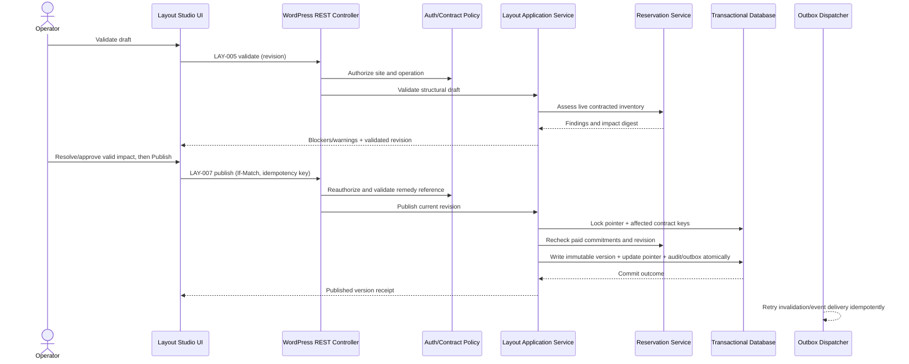
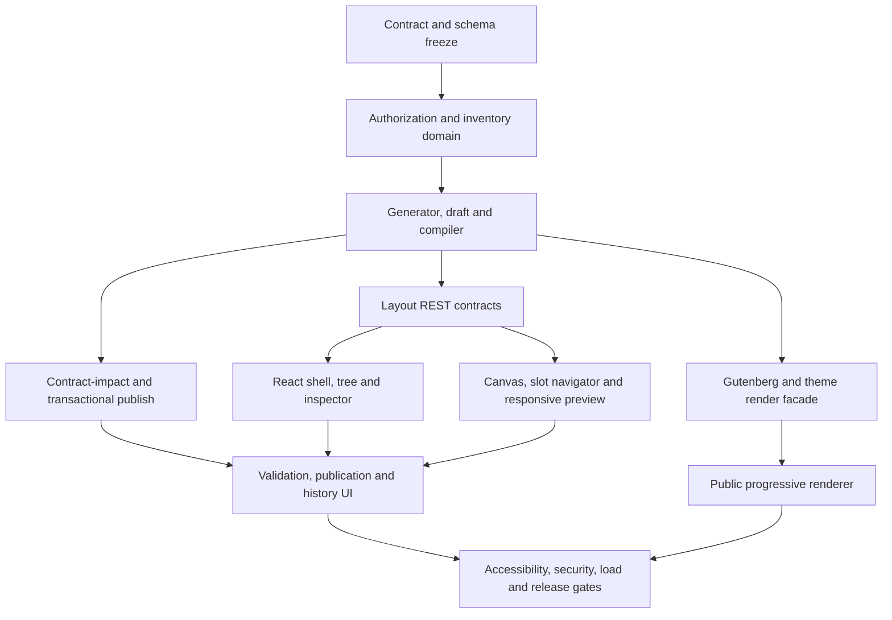

# AdPilot — Layout Studio: Visual Advertising Inventory, High-Density Containers & Placement Designer Specification

**Document ID:** `ADP-DOC-015`  
**Filename:** `15_ADPILOT_LAYOUT_STUDIO_VISUAL_INVENTORY_HIGH_DENSITY_PLACEMENT_DESIGNER.md`  
**Version:** 1.0.0 (proposed implementation specification)  
**Status:** Proposed; subject to Product, Architecture, UX, AdTech, Security, Finance, Accessibility and QA sign-off  
**Date:** 2026-10-12  
**Implementation target:** GPT-6 High; bounded, testable work packages  
**Owner:** UX Lead + WordPress Technical Lead  
**Primary implementers:** React/TypeScript, WordPress/PHP, Gutenberg, browser-rendering, inventory, database, accessibility, performance, AdTech, QA and security engineers  
**Normative predecessors:** `ADP-DOC-001..014`  
**Successor:** `ADP-DOC-016` — Gutenberg Blocks, Editor Integration & Site Editor Specification (proposed)

> **Implementation status.** This document specifies a product that has not yet been implemented. API names and IDs explicitly inherited from previous documents are authoritative references; new `LS15-*` identifiers are supplementary and must not replace upstream identifiers. Any code blocks here are implementation illustrations until tested against the approved WordPress/PHP support matrix. No usability, performance, financial or accessibility tests are asserted as executed.

---

## 1. Mission, boundaries and precedence

### 1.1 Mission

Create a professional, accessible visual authoring environment where a publisher can define advertising regions, generate hundreds to thousands of **logical slots** through compact container specifications, inspect reservation and commercial impact, preview realistic responsive layouts and publish immutable, correctly bound versions without compromising paid contracts or visitor performance. The same published layout must render consistently through Gutenberg, classic/block themes, PHP functions, shortcodes and automatic adapters.

### 1.2 The canonical 500-slot scenario

| Region | Configuration | Logical slots |
|---|---|---:|
| Header | One row, 4 cells | 4 |
| Sidebar | One stack, 100 generated addresses | 100 |
| In-content | Multiple sequences/interleaved containers | 196 |
| Footer | One responsive grid, 200 generated addresses | 200 |
| **Total** | **Four regions across a vertically scrollable document** | **500** |

The editor must also support stress configurations of at least 1,000 logical slots. This is **not** an obligation to insert 500 creatives into the initial browser DOM or issue 500 served/viewed events at page load. A contracted slot and an actual visible render occurrence are separate entities. An operational quota may be configured by hosting/performance policy, but **no product constant shall arbitrarily cap the count at 500**.

### 1.3 In-scope

R1: authorized zone/container/slot/sequence authoring, responsive single/row/stack/grid layouts, context bindings, preview, occupancy overview, bulk editing, draft/version lifecycle, validation, sold-inventory conflict review, controlled publish/rollback, limited real-page preview, Gutenberg and theme interoperability, performance and accessible editing. R2: carousel/masonry/sticky/conditional enhanced presentations, richer insertion diagnostics and analytical overlays where separately enabled. R2 heatmaps are an Analytics Explorer responsibility, not required for R1 editor publication. R3: billing- and pacing-dependent allocation visualization where implemented. R4: network-wide federation or advanced replay only through explicitly approved integrations.

### 1.4 Out-of-scope and non-goals

Do not build a generic WordPress page builder, a CSS code executor, a replacement theme editor, a billing authority, a payment gateway, an arbitrary JavaScript injection interface, or an unbounded click-tracking recorder. Layout Studio configures the presentation and addressable inventory; Pricing/Reservations define commercial rights, Campaigns/Creatives define approval, Delivery chooses eligible creatives, and Measurement records qualified outcomes. The browser preview cannot authoritatively approve, bill, reserve, or serve a campaign.

### 1.5 Source order and conflict process

1. `ADP-DOC-001`: 129 `FR-*`, 18 `BR-*`, 16 `NFR-*`, 15 `AC-*`, 10 `INV-*`, releases R1–R4.
2. `ADP-DOC-002`: 18 capability groups, acceptance cases `AT-*`, `E2E-01..17`.
3. `ADP-DOC-003`: 20 `UI-*` screens, 28 `UJ-*` journeys, 18 `WF-*` workflows, 28 `UXA-*`.
4. `ADP-DOC-004`: policy `DP-*`, state machines `SM-*`, sold-layout and override gates.
5. `ADP-DOC-005`: WordPress capabilities, advertiser ownership and multisite isolation.
6. `ADP-DOC-006..010`: module/contract ownership, schema, API, outbox and jobs.
7. `ADP-DOC-011..014`: interaction patterns, component tokens, admin UX and advertiser UX.
8. This document elaborates Layout Studio only. If a conflict is identified, record `LS15-DEC-*`, nominate an owner, block affected implementation and amend the governing source through formal change control; never silently reinterpret `FR-*` semantics.

### 1.6 Normative language

`MUST/SHALL`: release-mandatory; `SHOULD`: strong preference with approved documented exception; `MAY`: optional. `R1/R2/R3/R4` denote product release stages, not completion states. `configured`, `sellable`, `held`, `reserved`, `allocated`, `rendered`, `measurable`, `viewable`, and `billable` are different measurements and must be labelled accordingly.

---

## 2. Owners and design decision rights

| Decision | Accountable | Required review | Evidence |
|---|---|---|---|
| Workspace information architecture | UX Lead | Product, accessibility, React | Task-based prototype sign-off |
| Visual tokens/interaction components | Design System Lead | UX, accessibility | Conformance with ADP-DOC-012 |
| Stable slot address generation | Inventory Domain Lead | Database, finance, QA | Uniqueness and migration test |
| Draft/published layout contract | Technical Lead | Inventory, DB, API | State machine and CAS tests |
| Contract-impact analysis | AdTech + Finance | Layout, legal/policy, security | Paid-slot scenario evidence |
| Publish permissions/elevation | Security Lead | Product, access control | Permission and audit tests |
| Responsive renderer | Frontend Rendering Lead | QA, accessibility, theme engineer | Browser/performance matrix |
| Gutenberg/template integration | WordPress Lead | React, security, editor QA | Cross-entrypoint equivalence |
| Browser preview isolation | Measurement Lead | Security, privacy | Zero production billable events |
| Release approval | Product + Technical Leads | UX, QA, finance, security | Complete gate evidence |

Decisions touching financial entitlements, site/organization scope, irreversible publication, or privacy cannot be settled solely by visual design preference.

---

## 3. Language and domain identity model

### 3.1 Entities and responsibility

| Entity | Meaning | Stable? | Owned by |
|---|---|---|---|
| `PageContext` | Site-bound WordPress post/page/archive/template/query instance | Contextual | WordPress / Integration |
| `PlacementBinding` | Authorized reference connecting context/entrypoint to one zone | Versioned | Layout |
| `Zone` | Logical inventory family such as `footer-sponsors` | Yes, immutable opaque ID | Inventory |
| `Container` | Ordered layout strategy and constraints inside zone | Yes within versioned configuration | Inventory/Layout |
| `SlotSequence` | Compact rule expressing a range of stable logical slots | Generator-versioned | Inventory |
| `Slot` | Commercially addressable identity and attributes | Yes across reorder/breakpoints | Inventory |
| `LayoutDraft` | Mutable workspace with optimistic `draft_revision` | Revisions | Layout |
| `PublishedLayoutVersion` | Immutable geometry/binding definition | Immutable | Layout |
| `RenderInstance` | One occurrence of a slot on a rendered page | Ephemeral unique per occurrence | Delivery/Renderer |
| `Allocation` | Campaign eligibility for sellable inventory | Contract-governed | Delivery/Reservations |
| `Reservation` | Confirmed commercial claim across a time window | Audited | Reservations |
| `ImpactAssessment` | Server assessment of proposed change to commitments | Short-lived/version-bound | Layout + Reservations |
| `DeliveryDecision` | Chosen creative for a render opportunity | Ephemeral | Delivery |

**Identity invariant:** CSS order, grid row, DOM position and breakpoint do not form slot identity. A slot's public opaque ID or stable key is derived from a persisted mapping, not recomputed from its current visual index. A generated slot range intended to be sellable must materialize persistent identities atomically before purchase. A user changing `columns` from 4 to 5 shall not reissue or reorder those identities for financial records.

### 3.2 Three different counts

- **Configured slot count**: logical positions in the approved layout definition.
- **Commercial capacity**: eligible opportunities or contract units after exclusivity/availability/allocation policy.
- **Observed delivery**: actual decisions, renders, measurable/viewable impressions after real visitor behavior.

The admin UI must never imply equality among these counts. Preview is neither commercial availability guarantee nor a production impression.

### 3.3 Recurring zone placement

When the same zone is intentionally bound twice to a page, it produces two render occurrences with distinct occurrence IDs. Whether that represents two sellable impressions for the same slot is a **commercial policy decision**, not a front-end optimization. Default: repeated bindings require an explicit occurrence policy; unexpected duplicates are warned and blocked where conflict-sensitive, while approved repeats retain independent per-instance tracking. A unique browser DOM `id` must never be shared between repeated instances.

### 3.4 Versioning dimensions

Persist and distinguish `layout_schema_version`, `layout_compiler_version`, `slot_generator_version`, `published_layout_version`, `draft_revision`, `binding_revision`, `resource_version`, and analytics `geometry_version` where relevant. An API `If-Match` value protects a resource; a pending layout version is not interchangeable with an active published version. Published versions and commercial audit evidence are immutable.

---

## 4. Layout Studio information architecture (`UI-03`)

### 4.1 WordPress navigation and deep links

`AdPilot > Inventory > Layout Studio` opens authorized `UI-03` from `UI-02`; selected zone, layout draft, breakpoint and valid non-sensitive view filters can be represented by deep-linkable navigation state. Editing privileges use `adpilot_manage_inventory`; publishing requires `adpilot_publish_layout`; impact remedies use `adpilot_approve_layout_remedy`. The editor must not use an unrestricted `manage_options` shortcut in place of these capabilities. Deep links revalidate permission and current site context.

### 4.2 Desktop workspace composition

```text
┌──────────────────────────────────────────────────────────────────────────────┐
│ AdPilot  / Inventory / Layout Studio  · Site scope · Draft status · Help    │
├──────────────────────────────────────────────────────────────────────────────┤
│ Layout: Homepage / Draft r21    Desktop | Tablet | Mobile    Save Validate │
├────────────────┬────────────────────────────────┬──────────────────────────┤
│ ZONE TREE      │ VISUAL PAGE / CONTAINER PREVIEW│ PROPERTY INSPECTOR       │
│ Search         │ zoom / pan / fit / select       │ Identity / Layout       │
│ Header 4       │ 4 header | Content | Sidebar   │ Responsive / Inventory  │
│ Main 196       │ footer grid preview sampled    │ Contracts / Tracking    │
│ Sidebar 100    │ selection/occupancy overlays    │ Advanced                │
│ Footer 200     │ keyboard alternative available │ Validations / Help      │
├────────────────┴────────────────────────────────┴──────────────────────────┤
│ Impact: 0 blockers • 3 warnings • 24 contracted slots   [Review] [Publish]│
└──────────────────────────────────────────────────────────────────────────────┘
```

The left tree is a logical hierarchy, not a one-node-per-generated-slot tree. The center canvas is a faithful but bounded representation; actual theme preview may be a separate validated, sanitized contextual view. The right inspector is selection-specific and avoids destructive actions in routine layout panels. Panels may be resized within minimum/maximum bounds. Restoreable user preference for panel sizes is a site/user-specific convenience and never authoritative document state.

### 4.3 Responsive and zoomed UI

| Environment | Presentation | Required alternative |
|---|---|---|
| Wide desktop | Three independently scrollable panels plus action bar | List/table controls always available |
| 1024px class | Collapsible property pane or selected-zone overlay | Keyboard inspector navigation |
| Tablet | Two-pane or explicit panel switcher | Searchable tree and property tabs |
| Narrow mobile / 400% zoom | `Zones / Preview / Properties / Validation` single-surface switcher | All critical edit/validate/publish operations work without dragging |
| RTL | Logical-start tree/inspector placement, preserved reading sequence | Correct keyboard arrow semantics and labels |

Never force horizontal whole-page scrolling for the primary task at 320 CSS px / 400% zoom when feasible under WCAG reflow exceptions. Canvas itself may pan, but an equivalent structured editor is mandatory.

### 4.4 App shell and actions

Page header includes context breadcrumbs, currently edited layout and site, unsaved state, authoritative draft revision, last saved timestamp, validation status, and help. High-risk actions require descriptive confirmation and permission recheck. The persistent status region distinguishes local unsaved edits, pending server save, saved draft, validating, blocked, ready, publishing, published, conflict, and unavailable.

### 4.5 Empty and onboarding states

No layouts → guided creation using one of: header row, article sequence, sidebar stack or footer grid. Sample templates must be marked examples, never published automatically into existing site templates without explicit consent. No site bindings → show live-slot preview with instructions to insert via Gutenberg/theme PHP/shortcode. No sold inventory → contract panel shows `No active paid commitments`; it must not fabricate bookings.

---

## 5. Complete user tasks and interaction contracts

### 5.1 Create a new zone

Preconditions: actor has inventory-management capability for the current site; current schema version supported. Wizard collects internal name, immutable initial code/slug, business category, intended contexts, initial container strategy, display labels, and fallback behavior. Server allocates canonical opaque IDs. On create, show zone detail and safe draft; do not silently bind it to pages or make it publicly sellable until publish requirements are met.

Errors: duplicate code, invalid characters, concurrent create, unauthorized site, unavailable DB transaction, or unsupported strategy show per-field feedback. Retry must not create duplicate zones. Provide a duplicate-as-new-zone operation preserving presentation style but generating independent identities and no inherited paid entitlement.

### 5.2 Design a container

Fields: `layout_type`, count, named layout preset, order, gap, alignment, minimum cell width, intrinsic aspect behavior, responsive breakpoint rules, visibility/inclusion, placeholder policy, density guard, and allowed creative formats. Controls show inheritance and override badges. Changing structural settings produces a live **nonbillable** preview and a potential contractual-impact indicator.

A container is not a CSS selector. It is a versioned logical specification that the shared renderer compiles into safe markup and CSS. Size constraints reflect creative eligibility and contract obligations.

### 5.3 Generate 100/200/500+ slots

- A slot-count input accepts validated integer values supported by configured quota; controls must support keyboard text entry, not slider alone.
- Display generation preview: requested count, projected persistent records, affected commercial capacity, operational cost warning and creation status.
- Use server-authoritative generation and idempotency. The client never fabricates persisted IDs.
- Materialize sellable identities in bounded, resumable transactions, with conflict handling when a generator revision already owns some indices.
- Return summary plus cursors; do not return 1,000 full mutable slot records unconditionally.
- New entries inherit only explicitly allowed defaults. No state change to an existing paid slot is permitted as a side effect.
- If the generation job is asynchronous, show progress based on durable job state; if interrupted, resume or reconcile without duplicates.

### 5.4 Inspect, select and edit slot ranges

Provide slot navigator with filters `status`, `container`, `commercial class`, `reserved`, `eligible`, `unavailable`, `creative format`, `binding`, `conflict` and stable sort by ordinal/key. Cursor pagination or virtualization is required for large results. Selection supports single, shift-range, query-based bulk selection (with explicit scope) and keyboard operation. The inspector separates editable presentation metadata from immutable ID and reserved commercial fields.

Bulk operation preview reports `selected`, `eligible`, `blocked`, `would-change`, and `unchanged` counts. Mixed-result operations use an explicit all-or-nothing or allowed partial mode; report item-level failures with downloadable safe error details. Changing sold inventory requires prior impact resolution. No optimistic green completion before API confirmation.

### 5.5 Bind zones to contexts

Binding editor supports post/page IDs, content types and taxonomy rules where implemented, archive/search contexts, Gutenberg block references, template parts, allowlisted theme hook names, PHP façade and shortcodes, and explicit automatic insertion adapters. Validate scope and precedence. Warn for overlapping rules; reject ambiguous duplicates when they violate contract policy. Disabled/incompatible hooks are recorded as diagnostic warnings, not injected by arbitrary selector scripts without approval.

A Gutenberg editor with post editing rights may choose a published zone only if `adpilot_insert_blocks` policy allows it; this grants no right to modify inventory or access private billing data. Block attributes contain only validated public references and allowed overrides. Previews do not emit paid impressions.

### 5.6 Reorder and responsive redesign

Dragging moves layout metadata and presentation order; stable slot keys remain attached to their commercial objects. Keyboard controls offer `Move up`, `Move down`, `Move before…`, `Move to container…` where legal. For a slot transferred between containers, contract-impact validation checks the commercial meaning, dimensions and targeted page contexts before approving the transfer. Move operations have undo in the local draft but no retroactive undo of a published version; a published reversal creates a new version.

### 5.7 Preview, validate, publish and restore

A draft can always be previewed in safe synthetic mode even when publication is blocked; preview uses marked placeholders and no billable tracking. `Validate` computes structural errors, responsive conflicts, duplicate bindings, accessibility/density findings, active reservation impacts, unsupported integrations and schema mismatches. Each finding has identifier, severity, subject, remediation and policy owner. Publishing requires current server revalidation, capability authorization, expected revision, current active pointer and conflict/impact approval. Restore is creation/publication of **a new version based on an old snapshot**, not resurrection by mutating history.

### 5.8 Collaborative conflict recovery

When another operator modifies the draft or paid commitment after the client loaded it, show `Your draft is out of date` with read-only difference summary, `Reload`, `Copy your unsaved changes`, and a guarded reapply path. Never overwrite the server unconditionally. A `409` or `412` is actionable and never converted into generic failure. If permissions are revoked, stop protected reads/mutations and clear privileged cached data.

### 5.9 Troubleshooting/integration review

Expose a list of unresolved bindings, missing theme hooks, duplicate injections, inactive zones and incompatible layouts. R1 core publish validation and a basic diagnostics state are mandatory; advanced R2 integration diagnostics can add theme-selector inspection and richer analysis without changing existing R1 decisions. Offer developer snippets through a read-only copy control, not arbitrary executable code entry.

---

## 6. Container and responsive-layout specification

### 6.1 Release-specific strategy registry

| Strategy | Availability | Description | Required constraints |
|---|---|---|---|
| `single` | R1 | One slot | Dimension/aspect policy; fallback |
| `row` | R1 | Several slots across one row | Wrap rules, order, min width |
| `stack` | R1 | Vertical stream, e.g., 100 sidebar slots | Incremental load, spacing, scroll flow |
| `grid` | R1 | Responsive rows/columns, e.g., 200 footer slots | Per-breakpoint columns, width, gap, layout stability |
| `repeater` | R1 insertion behavior | Rule-based blocks between eligible content | Eligible anchors, interval, max, exclusions; only approved adapters |
| `carousel` | R2 | Rotating or paginated visible ads | Keyboard, announcements, pause, motion policy |
| `masonry` | R2 | Variable-height tiles | Reading order, masonry fallback, height stability |
| `sticky` | R2 | Sticky position | Density, viewport obstruction, mobile restrictions |
| `conditional` | R2 | Context-based presentation | Policy-gated evaluation, safe fallbacks |

`adpilot/ad-repeater` Gutenberg block is an R1 integration. It does not imply every advanced `conditional`/carousel strategy is R1. Advanced strategies must fail closed or show an authorized unsupported-state message when the feature is disabled.

### 6.2 Canonical responsive model

Prefer named breakpoints with approved pixel ranges from ADP-DOC-012. Store a breakpoint-independent slot identity and per-breakpoint presentation attributes: min cell width, max columns, gap, ordering policy, visibility, aspect-ratio constraints, and optional safe override. Never assume client-reported viewport is a trustworthy financial targeting input. Server must determine which creative formats could fit each declared presentation configuration; final actual rendering adapts to CSS layout.

Recommended CSS concepts: container queries where supported; `display:grid; grid-template-columns:repeat(var(--adp-columns),minmax(0,1fr))`, safe `minmax` sizing, `aspect-ratio`, logical `margin-inline` and `padding-block`, `overflow-wrap`, and dedicated namespaced `.adp-*` rules. Prevent fixed-width creatives exceeding their slot; offer scaled or rejected format mode per contract. Define predictable keyboard/screen-reader order that matches visual order unless documented exception applies.

### 6.3 Large-page scroll and layout integrity

Reserve stable frame dimensions for planned creatives wherever possible. Lazy fetches may replace placeholders but should not unpredictably alter the document height. Collapsible empty slots need an explicit policy that accounts for later materialization and any sticky offsets. If height is genuinely unknown, provide an explicit conservative placeholder and measured adjustment logic, with CLS evidence. Offscreen advertising must not steal tab focus, autoplay intrusive media, or force a scroll jump.

### 6.4 Quotas and safe limit design

A configurable `max_logical_slots_per_layout` may be an **operational guardrail**, not a hidden hard-coded product ceiling. If a site requests above its configured threshold, explain resource implications, offer safe phased generation and route an authorized override through policy. A test environment must be able to configure 1,000+ logical slots. Bound API page sizes, DOM nodes, preview tiles, network requests and persistence batches separately; those are not logical inventory ceilings.

### 6.5 Fallback and density

Supported R1 empty-slot policies: reserve blank space, collapse when safe, and choose an approved house creative. Fallback advertising must respect ad quality and click safety; tracking uses actual measured events only. Density/spacing guardrails flag excessively cluttered pages and restrictive network policies. The plugin should not promise that an extreme dense page is compliant or usable simply because technically renderable.

---

## 7. Visual editor behavior and UI state model

### 7.1 Selection and focus coordination

The selected logical entity is the single source of truth for tree, canvas, breadcrumb, inspector and slot navigator. Canvas hover is transient and must not overwrite committed selection. Selection changes must never be mistaken for data mutation. On keyboard selection, move focus intentionally and announce the entity's role/name/status; do not spontaneously hijack focus on background API updates.

### 7.2 Interaction state matrix

| State | UI treatment | Allowed actions | Persistence |
|---|---|---|---|
| `idle` | Current published/draft summary | Inspect/create as permitted | None |
| `loading` | Skeleton and preserved navigation | Cancel/retry where safe | None |
| `draft_clean` | Saved revision and time | Edit/preview/validate | Authoritative server draft |
| `draft_dirty` | Unsaved changes warning | Save/revert | Local uncommitted changes |
| `saving` | In-progress save | Avoid duplicate mutation; allow safe navigation warning | Pending CAS mutation |
| `save_conflict` | Compare/reload/reapply | No blind overwrite | Authoritative server retained |
| `validating` | Progress and stale-warning notice | Cancel/retry policy | No commercial mutation |
| `blocked` | Findings with path links | Correct/reassess | Draft stays editable |
| `publish_ready` | Validation freshness and impact summary | Publish if allowed | Short-lived assessed token |
| `publishing` | Single in-flight command | Recover state via GET if timeout | Transactional server command |
| `published` | New immutable version receipt | Start new draft, view history | Active version pointer |
| `access_denied` | Safe explanation and return route | None privileged | Clear protected caches |
| `degraded` | Dependency failure and correlation ID | Read cached-safe summary or retry | No unsafe publication |

A client success toast is not proof of publication; show the authoritative `published_layout_version_id` from a verified server response or status read.

### 7.3 Inspector groups

`Identity` (IDs, names, descriptions), `Layout` (strategy, order, spacing, size), `Responsive` (breakpoint columns/visibility), `Inventory` (states and sellability), `Commercial` (reservations/contract effects, read-only except governed flows), `Integration` (binding and occurrence policy), `Delivery` (loading priority, fallback, format limits), `Tracking` (measurement preview, no billing controls), `Advanced` (allowed classes/extension fields), `Validation` (actionable findings). Reuse ADP-DOC-012 form, tabs, field feedback, status badge and dialog components.

### 7.4 Color, symbols and data semantics

Colors are semantic tokens only. Never encode `reserved`, `sold`, `warning`, `blocked`, `focused`, `selected` or `live` solely by color. Use icons, visible text, outlines and patterns. A preview's synthetic data must be visibly labeled `Example / Not live` and not use apparently real revenue values.

### 7.5 Undo/redo

Local undo/redo applies only to draft editor commands with a known reversible representation. A successful inventory bulk mutation, contract remedy, publish operation, or other transactional server action is **not** reversed by a local keyboard shortcut. Show an audit-based compensating action or new draft instead.

### 7.6 Collaboration and autosave

Use debounced autosave only for non-destructive draft edits, with CAS and recoverable offline status. Do not autosave commercial remedy approvals or authoritative publish calls. If two editors collaborate, show current server revision and exact conflicts; no silent last-write-wins merge. Draft hydration must validate schema version and remove stale privileged data on organization/site context change.

---

## 8. Domain/application architecture for Layout Studio

### 8.1 Module ownership

`Inventory` owns zones, containers, slot identities, slot generators and sellability. `Layout` owns drafts, versions, placement bindings, layout compiler and active publication pointer. `Reservations` owns booking commitments and contract intervals. `Pricing` owns rate cards; `Delivery` owns runtime choices; `Measurement` owns observed events; `Integration` owns Gutenberg/theme/public API adapters; `Identity` owns authorization; `Platform` owns persistence/queues/audits. No frontend call directly writes inventory SQL or changes authoritative reservation status.

### 8.2 Proposed PHP application services

```php
namespace AdPilot\Modules\Layout\Application\Contracts;

interface LayoutStudioService {
    public function createDraft(CreateLayoutDraftCommand $command): LayoutDraftView;
    public function updateDraft(UpdateLayoutDraftCommand $command): LayoutDraftView;
    public function validateDraft(ValidateLayoutDraftQuery $query): LayoutValidationResult;
    public function previewDraft(PreviewLayoutDraftQuery $query): SafePreviewManifest;
    public function assessContractImpact(AssessLayoutImpactQuery $query): ContractImpactResult;
    public function publish(PublishLayoutCommand $command): PublishedLayoutReceipt;
    public function restoreAsNewVersion(RestoreLayoutCommand $command): PublishedLayoutReceipt;
}
```

Illustrative signatures only; domain types, imports and authorization decorators must be aligned with ADP-DOC-007. Application handlers validate actor, trusted site scope, expected revisions, target ownership, current reservations and policy. `LayoutStudioService` is not a new independent DB owner; it orchestrates owner module interfaces.

### 8.3 Layout compiler pipeline

1. Resolve trusted site and allowed page/template context.
2. Read immutable active version and its allowed placement bindings.
3. Validate schema/compiler version and disallow unsupported strategies.
4. Resolve layout tree and sequence ranges without unbounded expansion.
5. Map stable slot IDs and responsive constraints to a bounded render plan.
6. Apply density/format/exclusion rules and emit safe placeholder manifest.
7. Produce occurrence IDs per rendered embedding, not per logical slot alone.
8. Deliver ad decisions later through the shared eligible runtime; editor preview remains nonbillable.

This compiler must be a pure/side-effect-controlled service as much as practical, independently fixture-testable. A draft preview is not an active published render plan.

### 8.4 Contracts across modules

| Caller → owner | Contract | Mandatory consistency boundary |
|---|---|---|
| React Layout Studio → REST/Layout | `IC-004` via `LAY-*` | Validate expected draft revision |
| Layout → Inventory | `IC-003` via `INV-*` | Stable slot identity and generator version |
| Layout → Reservations | `IC-008` | Authoritative holds/reservations/current contract impact |
| Layout → Authorization | `IC-019` | Trusted site and current capability |
| Integration → Layout | `IC-004` | Only active published version for public use |
| Delivery → Inventory/Layout | `IC-003/004` | Bounded, immutable render plan |
| Diagnostics → Platform | `IC-020..024` as applicable | Redacted health/audit/outbox |
| Analytics → Layout snapshots | Approved reporting boundary | Version-matched historical geometry |

All identifiers above are references to existing ADP-DOC-006/009 architecture contracts, not newly invented service endpoints.

### 8.5 Application commands and invariants

- `CreateZone`: valid site, authorized actor, unique code, no implicit publication.
- `ConfigureContainer`: legal strategy for release, version-checked draft, bounded serializable values.
- `GenerateSlotRange`: generator version and operation idempotency; atomic stable keys.
- `UpdateSlotsBulk`: per-item policy evaluation and deterministic partial-failure semantics.
- `BindZone`: binding authorization, compatible context, duplicate policy.
- `ValidateDraft`: read-only and nonbillable; finding references exact revision.
- `PublishLayout`: transactional pointer swap after revalidation, sold-contract checks and authorized approvals.
- `RestoreLayout`: new version from old immutable snapshot after fresh validation.
- `ArchiveZone`: no active contracts invalidated without approved remedy.

---

## 9. HTTP API integration: exact previously defined routes

All routes are below `/wp-json/adpilot/v1/`. The registry is authoritative in ADP-DOC-009; Document 15 maps existing routes to screen behavior and must not silently introduce routes with the same functions under different names.

| ID | HTTP | Path | Role/capability | UI use |
|---|---|---|---|---|
| `INV-001` | GET | `/admin/zones` | `adpilot_view_inventory` | Zone tree/catalog |
| `INV-002` | POST | `/admin/zones` | `adpilot_manage_inventory` | Create zone |
| `INV-003` | GET | `/admin/zones/{zone_id}` | `adpilot_view_inventory` | Zone inspector |
| `INV-004` | PATCH | `/admin/zones/{zone_id}` | `adpilot_manage_inventory` | Version-checked update |
| `INV-005` | POST | `/admin/zones/{zone_id}/actions/archive` | `adpilot_manage_inventory` | Governed archive |
| `INV-006` | GET | `/admin/containers` | `adpilot_view_inventory` | Container list |
| `INV-007` | POST | `/admin/containers` | `adpilot_manage_inventory` | Create container |
| `INV-008` | PATCH | `/admin/containers/{container_id}` | `adpilot_manage_inventory` | Update container |
| `INV-009` | GET | `/admin/slots` | `adpilot_view_inventory` | Paginated slot navigator |
| `INV-010` | GET | `/admin/slots/{slot_id}` | `adpilot_view_inventory` | Slot inspector |
| `INV-011` | POST | `/admin/slots/bulk-generate` | `adpilot_manage_inventory` | Resumable generation |
| `INV-012` | POST | `/admin/slots/bulk-update` | `adpilot_manage_inventory` | Bulk edit |
| `LAY-001` | GET | `/admin/layouts` | `adpilot_view_inventory` | Layout selector |
| `LAY-002` | POST | `/admin/layouts/drafts` | `adpilot_manage_inventory` | Create draft |
| `LAY-003` | GET | `/admin/layouts/drafts/{draft_id}` | `adpilot_view_inventory` | Hydrate draft + ETag |
| `LAY-004` | PATCH | `/admin/layouts/drafts/{draft_id}` | `adpilot_manage_inventory` | CAS save |
| `LAY-005` | POST | `/admin/layouts/drafts/{draft_id}/actions/validate` | `adpilot_manage_inventory` | Read-only server validation |
| `LAY-006` | POST | `/admin/layouts/drafts/{draft_id}/actions/preview` | `adpilot_view_inventory` | Safe preview |
| `LAY-007` | POST | `/admin/layouts/drafts/{draft_id}/actions/publish` | `adpilot_publish_layout` | Atomic publish |
| `LAY-008` | GET | `/admin/layouts/{layout_id}/revisions` | `adpilot_view_inventory` | Version history |
| `LAY-009` | GET | `/admin/layouts/{layout_id}/revisions/{version_id}` | `adpilot_view_inventory` | Read-only version |
| `LAY-010` | POST | `/admin/layouts/{layout_id}/actions/restore` | `adpilot_publish_layout` | Controlled restore-as-new |
| `LAY-011` | GET | `/admin/layouts/{layout_id}/contract-impacts` | `adpilot_view_inventory` | Sold inventory analysis |
| `LAY-012` | POST | `/admin/layouts/{layout_id}/contract-impacts/{impact_id}/actions/resolve` | `adpilot_approve_layout_remedy` | Governed remedy |
| `BLOCK-001` | GET | `/editor/zones` | `adpilot_insert_blocks` | Gutenberg zone chooser |
| `BLOCK-002` | GET | `/editor/zones/{zone_id}/preview` | `adpilot_insert_blocks` | Nonbillable editor preview |

No mutable resource uses an unversioned blind overwrite. For appropriate writes, supply `If-Match`, request preconditions, and `Idempotency-Key` according to ADP-DOC-009. A browser-sent `site_id`, `organization_id`, `paid`, `approved`, `slot_count_billed`, or `override=true` must not grant commercial authority.

### 9.1 Proposed example of publish request (contract shape)

```http
POST /wp-json/adpilot/v1/admin/layouts/drafts/draft_123/actions/publish
If-Match: "layout-draft-revision-21"
Idempotency-Key: publish-siteA-draft123-revision21-unique
Content-Type: application/json
X-WP-Nonce: <authenticated-editor-nonce>

{
  "expected_draft_revision": 21,
  "expected_active_layout_version": "layout_v20",
  "validated_impact_id": "impact_opaque_42",
  "approved_remedy_ref": null,
  "reason": "Publish corrected responsive footer arrangement"
}
```

Payload/ID are illustrations and must match the exact DTO and validation rules in ADP-DOC-009. The nonce is CSRF protection for an authenticated cookie session, never substitute authorization. Response includes authoritative published version, active pointer revision, identity map hash, contract-impact summary and audit ID.

### 9.2 Error handling

| HTTP / condition | User meaning | Recovery |
|---|---|---|
| 400/422 invalid layout | A field/rule is incorrect | Go directly to named inspector field |
| 401 unauthenticated | Session expired | Reauthenticate, preserve only safe local draft |
| 403 forbidden | Permission revoked or never granted | Exit protected view, clear restricted data |
| 404 scoped resource absent | Missing or inaccessible site-scoped record | Safe inventory landing |
| 409 state conflict | Sold inventory, active pointer, generator race | Fresh impact analysis and safe reapply |
| 412 stale ETag | Another edit superseded your revision | Compare/reload and retry with current version |
| 429 rate limited | Too many requests | Respect backoff and non-destructive retry |
| 5xx dependency failure | Operation not confirmed | Read authoritative state before retrying mutation |

No `200 OK` from editor preview means a live campaign has served, and no frontend validation success overrides authoritative publication checks.

---

## 10. Database/storage and generator semantics

Use ADP-DOC-008's existing logical tables: `zones`, `containers`, `slots`, `slot_sequences`, `placement_bindings`, `layout_revisions`, `layout_active_pointers`, reservation/allocation tables and immutable audit/outbox tables. They are physically `$wpdb->prefix . 'adpilot_' . <table>` in the correct site context; never assume `wp_` or reuse a repository across `switch_to_blog()` with the wrong site prefix.

### 10.1 Slot identity mapping

Persist `slot_id`, `site_id`, `zone_id`, `container_id`, `generator_version` and `slot_key` as required by approved schema. `slot_key` is stable and not derived from changing CSS `row`/`column`. A deterministic generator should derive a candidate stable key only from a persisted sequence + unchanging ordinal/namespace; unique scoped DB constraints and idempotency still define truth. Reordering changes presentation order and possibly a separate ordinal, not identity.

### 10.2 Bulk generation protocol

1. Authorize site and lock target sequence/config revision.
2. Validate count, contract locks and operational quota.
3. Reserve/derive stable immutable keys using approved generator version.
4. Write records in bounded transactional batches with scoped uniqueness.
5. Emit safe progress/journal/outbox event as designed in ADP-DOC-010.
6. Verify count and identity mapping against expected revision.
7. Return summary and cursor; do not return full unbounded arrays.

Crash after a committed batch is handled by an idempotent retry that skips already materialized keys. A sequence-shrink operation cannot orphan a paid slot; such a mutation becomes impact-governed and may be blocked pending remedy.

### 10.3 Draft publication protocol

- Acquire a scoped, deterministic lock/transaction boundary for layout pointer plus potentially affected commercial inventory.
- Read current draft, active pointer, current entitlements, latest creative/placement constraints and authorizations.
- Validate contract-impact approval references are current and bound to the same draft/source snapshot; fail closed if outdated.
- Persist immutable `layout_revisions` snapshot; atomically advance `layout_active_pointers` conditional on expected current pointer/revision.
- Write audit and transactional outbox event in the same transaction when hosting supports required guarantees.
- Invalidate cache by versioned key or documented coherence mechanism; no stale serving beyond approved bound.
- Emit publish receipt only after commit; an unconfirmed timeout triggers an idempotent status check, not a duplicate publish.

If the supported storage engine cannot provide required concurrency guarantees, disable unsafe commercial publication actions with an actionable diagnostic instead of claiming a safe transaction occurred.

### 10.4 Version immutability and rollback

All published versions remain queryable for authorized history/analytics. Rollback reads old version and creates **another** active version via the current validation protocol. Do not mutate past geometry snapshots or unlink referenced paid contracts. Deletion follows retention/legal rules and cannot drop required booking/audit evidence.

---

## 11. Frontend React/TypeScript implementation architecture

```text
frontend/layout-studio/
  app/
    LayoutStudioApp.tsx
    StudioRouter.tsx
    StudioProviders.tsx
  features/
    layout-list/
    zone-tree/
    canvas/
    slot-navigator/
    inspector/
    responsive-presets/
    context-bindings/
    contract-impact/
    validation/
    revisions/
    publish/
  state/
    editor-reducer.ts
    selection-state.ts
    optimistic-edit-log.ts
    server-resource-cache.ts
  services/
    layout-api.ts
    inventory-api.ts
    preview-api.ts
    schema-validators.ts
    diff.ts
  components/
    StudioToolbar.tsx
    SplitPane.tsx
    ZoneNode.tsx
    SlotRangeRow.tsx
    PreviewCanvas.tsx
    PropertyInspector.tsx
    ValidationDrawer.tsx
    PublishReviewDialog.tsx
  styles/
    layout-studio.css
  tests/
    unit/
    integration/
    accessibility/
    e2e/
```

### 11.1 State topology

Keep authoritative remote state (server draft/version, occupancy and entitlements), local editable draft state, ephemeral selection/zoom/pane state, and validation findings in separate stores. Derive selected-node details from stable IDs and revision; never duplicate a 1,000-slot mutable array across multiple components. Query/cache keys include site scope, permission fingerprint where needed, layout/draft revision, and filters. Dispose protected caches on permission/site switch or logout. Do not persist secrets or visitor data in local storage.

### 11.2 Component contract

| Component | Inputs | Events | Accessibility |
|---|---|---|---|
| `LayoutStudioApp` | Current scope, policy projection | Navigation / protected invalidation | Landmark and skip link |
| `ZoneTree` | Hierarchy summaries, selection | Select, reorder, open context menu | Tree/list keyboard and labels |
| `PreviewCanvas` | Safe geometry/preview manifest | Select, pan, zoom | Explicit nonvisual editor equivalent |
| `SlotNavigator` | Cursor pages, filters, selected keys | Bulk selection/edit | Real table semantics, range controls |
| `PropertyInspector` | Selected object, revision, grants | Validated field mutations | Associated labels/errors/help |
| `BreakpointSwitcher` | Named responsive specs | Set preview breakpoint | Radios/tabs with clear state |
| `OccupancyOverlay` | Authorized aggregate occupancy only | Open slot detail | Legend + text, not color-only |
| `ValidationDrawer` | Findings with entity refs | Navigate to failing field | Announced summary, linked findings |
| `ImpactReview` | Current impacted contracts, remedy options | Reassess/resolve | Financially meaningful confirmation |
| `PublishReviewDialog` | Verified preconditions | Submit idempotent publish | Focus trap/recovery, reason context |
| `RevisionTimeline` | Immutable summaries | Compare/restore draft | Keyboard accessible list |

### 11.3 Avoid runaway renders

- Render only a bounded sample of slot boxes on canvas; list remaining ranges as summary tiles.
- Use stable React keys from persisted IDs, not array indices or CSS coordinates.
- Memoize tree selectors and geometry views based on immutable version hashes.
- Move expensive geometry projection or diff calculation off the synchronous keystroke path where feasible; if using workers, package locally and maintain a no-worker fallback.
- Cancel obsolete draft-preview reads via abortable requests; never cancel a commit merely because a modal closes.
- Lazy-load specialized modules; do not bundle heatmap/replay engines into R1 Layout Studio.
- React component counts, browser memory, long tasks and keystroke latency must be measured under the approved benchmark profile.

### 11.4 Design system integration

Reuse components/tokens in ADP-DOC-012 (e.g., accessible buttons, tabs, validation summaries, dialogs, data tables, status labels). WordPress `@wordpress/components` is the default for stable wp-admin patterns; experimental WordPress UI dependencies require explicit approval and pinned compatibility. Public ad renderer uses small, scoped assets and must not enqueue the Layout Studio application. Workspace CSS is namespaced; no global `div`, `button`, `p`, heading or font overrides affecting the active theme or WordPress shell.

---

## 12. Gutenberg and theme integration handoff

`adpilot/ad-zone` saves a zone reference plus allowlisted overrides; not a cloned array of generated 200 slots. `adpilot/ad-slot`, `adpilot/ad-repeater`, and `adpilot/ad-showcase` similarly use validated dynamic server rendering. Registration uses `block.json`, PHP `render_callback`/`render.php` and core wrapper APIs where applicable. Editor previews use `BLOCK-002`, are bounded and explicitly synthetic/nonbillable. Refer to ADP-DOC-001 `FR-INT-001..012` and the planned dedicated ADP-DOC-016 for complete block contracts.

PHP functions (`adpilot_render_zone`, `adpilot_render_slot`, `adpilot_render_container`), shortcodes and approved WordPress hooks all delegate to the same published layout resolution and delivery eligibility pipeline. A theme's public output context is not permission to read advertiser-private campaign records. Repeated function calls create distinct render occurrence IDs; legitimate repeats must carry explicit inventory semantics.

### 12.1 Theme compatibility matrix

| Site type | Layout binding strategy | Required test |
|---|---|---|
| Classic theme | PHP template call / shortcode / widget area / allowed hook | No global CSS regressions or duplicate injections |
| Block theme | Dynamic blocks and template parts | Correct block context and versioned zone reference |
| Theme with page builder | Explicit registered adapter | No unsupported arbitrary deep DOM injection |
| WooCommerce product/archive | Approved post/product context adapters | Site-scoped page context and density policy |
| Multisite | Per-site binding/version resolution | No cross-site leakage or wrong DB prefix |
| Full page cache + CDN | Public safe placeholders and on-demand decisions | No stale paid ads or wrong audience targeting |
| RTL theme | Logical CSS and order rules | Correct focus/visual order |

### 12.2 Automatic insertion safety

Avoid arbitrary ad insertion into page builders using unvalidated selectors. Insertion policy must specify allowed anchor type, interval, maximum count, canonical source context, duplicate detection and fallback. The plugin must not manipulate an unrelated block tree silently or require a custom theme for ordinary setup.

---

## 13. Nonbillable preview and delivery/runtime separation

### 13.1 Preview contract

The editor requests an authenticated, read-only preview manifest representing a draft. It includes synthetic/placeholding creatives with dimensions, responsive rules, slot labels, occupancy summaries and diagnostics; it excludes private visitor events, unapproved media execution, billing tokens and actual impression/click collection. A visible `PREVIEW — NOT LIVE` watermark or region label stays present. If an authorized real creative thumbnail is shown, do not execute external scripts or tracking pixels.

### 13.2 Public delivery contract

Published layout compiler returns lightweight placeholder structures, then a shared public runtime uses batched eligible ad decisions with viewport-based prefetch (`IntersectionObserver`) and bounded concurrency. Public ad serving still checks active campaign state, approved creative version, financial entitlement and reservations; it cannot trust the editor's saved `slot_key` or old cached creative alone. Offscreen configured slots cannot count as viewed. `RenderInstance` and per-decision IDs remain unique for repeated embeddings.

### 13.3 Scrolling and viewport scenarios

- Visitor opens a 500-slot page: only eligible above-/near-fold ads fetched initially.
- Visitor rapidly scrolls to footer: cancel obsolete optional prefetch, prioritize needed footer slots; avoid jumping layout.
- Visitor returns to top: reuse safe assets and avoid duplicate viewable-event billing from transient measurement state without authoritative event definition.
- Visitor uses keyboard: skipped/unloaded ad containers do not trap focus; available content remains reachable in document order.
- Network failure: content page stays usable; empty/ad fallback and diagnostics use documented policy.
- Browser JS disabled: provide a documented content-safe fallback; billing never assumes browser viewability.

### 13.4 Heatmap/geometry handoff

Every public placement exposes sanitized, stable logical-slot metadata and a unique render-instance marker suitable for future privacy-governed R2 aggregation. Layout version and responsive geometry are included as permitted. No raw mouse path or private user-session replay belongs in Layout Studio. When layout revision changes after a measurement period, analytics must query the appropriate historical geometry, not project all older events onto the newest layout.

---

## 14. Accessibility, localization and internationalization

Target WCAG 2.2 AA for custom UI. Native semantic controls first; avoid introducing ARIA grid/tree complexity if an accessible list and disclosure structure is sufficient. All critical operations must be possible without dragging, clicking small canvas shapes, or distinguishing colors. Press `Tab` through predictable focus order; use arrow keys only within a documented accessible widget pattern. Escape dismisses nonblocking dialogs and restores focus, but must not cancel an already-committed transaction.

Provide field labels, contextual examples, help/error association, `aria-live` for appropriate save/validation updates, and a compact keyboard shortcuts help dialog. Announce slot count and current selection in text. For a 100-slot sidebar, allow cursor navigation and range selection using a tabular navigator rather than 100 focusable boxes. Ensure all dialogs have a descriptive title, actionable confirm/cancel language, visible financial consequences and focus restoration.

Support RTL using CSS logical properties, reading-order-aware panels, locale-aware integer/unit/date formatting and translated error messages. Store UTC timestamps and half-open booking intervals. Validate Japanese/Chinese/Arabic/Persian long labels and numbers with thousands separators; never parse localized display strings as authoritative quantities. At 200%/400% zoom, primary draft-save, validate, impact-review and publish paths must remain accessible.

---

## 15. Security, tenant isolation and privacy

### 15.1 Access control

Every protected REST route implements server-side capability checks and site-scoped object authorization. Do not rely on `wp-admin` menu visibility, editor field disabling, `X-WP-Nonce`, block attributes, CSS, or client-side route guard as authority. Multisite operations derive trusted `site_id` from the authenticated context. Reject IDOR, role escalation and stale grants; revoke rights on the next authoritative request. Preview responses contain only fields approved for that role.

### 15.2 Input validation and creative isolation

Validate labels, slugs, counts, allowed presentation enums, CSS classes, hooks, context selectors, content-template references, geometry sizes, breakpoint arrays and JSON configuration size on the server. Never accept user-provided PHP or unbounded executable JavaScript/CSS in a layout payload. URL destinations and creative bytes are handled by the Creative and Moderation modules; editor preview must not bypass those policies. Reject unsafe markup and render namespaced sanitized HTML.

### 15.3 Abuse and request safety

Rate-limit bulk generation, preview/validate spam and expensive impact queries; bound request size/depth and nesting. Implement idempotency for retried large mutations. Audit site, actor, operation, old/new revision, correlation ID, reason, impacted contracts, and remediation approvals. Avoid leaking campaign private data in public placeholders, screenshots, caches, logs or shareable preview links. Optional screenshot integrations must be explicit, privacy-reviewed and self-hostable where possible; native sanitized mock previews are the default.

### 15.4 Consent and protected events

Do not trigger measurement in editor mode, screenshots or synthetic load tests. Privacy-related visitor recording belongs to the separately governed Analytics modules and releases. Admin operator analytics may capture only proportionate operational telemetry and must not ingest private creative or financial data into a third-party SaaS by default.

---

## 16. Performance budgets and benchmark methodology

### 16.1 Scenarios

| Benchmark | Input | Required evidence |
|---|---|---|
| `LS15-PERF-01` | 4 header ads | Correct 4 responsive logical positions |
| `LS15-PERF-02` | 100-slot sidebar stack | Navigator/editing stays usable, scroll stable |
| `LS15-PERF-03` | 200-slot footer grid | 5→3→1 columns without slot-ID churn |
| `LS15-PERF-04` | 196 content ads across sequences | Injection spacing and cap rules obeyed |
| `LS15-PERF-05` | 500 slots total | Bounded canvas nodes and no bulk creative eager load |
| `LS15-PERF-06` | 1,000+ logical slots | Configurable operational quota, graceful pagination |
| `LS15-PERF-07` | Two editors + active reservations | CAS conflict and contract-impact publication gate |
| `LS15-PERF-08` | Simulated slow 3G + mobile CPU | Input/save recovery, no navigation deadlock |
| `LS15-PERF-09` | Layout iteration 100× | Stable memory trend, no accumulating observers |
| `LS15-PERF-10` | Deep vertical scroll + viewport changes | Stable document geometry and truthful events |

### 16.2 Measure rather than invent thresholds

Capture p50/p75/p95 interaction latency, browser memory, mounted React count, long tasks, JS payload, request count, SQL query count, compiler time, DOM nodes, CLS, LCP/INP where applicable, and event/backlog rates. Record browsers, operating system, hosting, active theme, network profile and creative fixtures. Numeric performance pass/fail thresholds belong to the approved `ADP-DOC-035` / performance budget and benchmark hardware matrix; do not invent universal promises for 1,000-slot pages. Independent qualitative gates remain mandatory: editor is keyboard usable, no infinite blocking UI, no unbounded `slots[]` payload, no 500 concurrent ad fetches, no false billing.

### 16.3 Scale controls

- Separate logical slot quota from number of rendered previews, network batch size and worker batch size.
- Fetch cursored metadata and summarize large ranges; do not mount one rich inspector per slot.
- Build shared observation rather than one observer or handler per ad.
- Debounce noncommercial draft writes and abort superseded GET requests.
- Normalize/clamp inspector inputs; avoid 1,000 repeated DOM measurements per keystroke.
- Use stable geometry snapshots and only schedule re-layout when affecting fields actually change.
- Treat browser zoom, font scaling, consent restrictions and reduced motion as required benchmark dimensions.

---

## 17. Data/API fixture catalog

The QA suite must build independently resettable fixtures:

| Fixture | Contents | Primary use |
|---|---|---|
| `LS15-FX-01` | Fresh WP + empty AdPilot inventory | Onboarding |
| `LS15-FX-02` | 4-slot header, no sales | Row preview |
| `LS15-FX-03` | 100-slot sidebar stack | Progressive editing |
| `LS15-FX-04` | 200-slot footer, 5/3/1 columns | Responsive identity |
| `LS15-FX-05` | 196 content slots, 12 sequences | Repeater/spacing |
| `LS15-FX-06` | All 500 configured slots in one page | End-to-end publisher scenario |
| `LS15-FX-07` | 1,200 generated slots | Operational stress |
| `LS15-FX-08` | 24 active paid bookings; 5 overlapping holds | Contract impacts |
| `LS15-FX-09` | Two operators editing one draft | CAS |
| `LS15-FX-10` | Publisher observer without edit capability | Read-only authority |
| `LS15-FX-11` | Ad Ops editor without publish capability | Permission distinctions |
| `LS15-FX-12` | Repeated binding through Gutenberg + PHP | Occurrence identity |
| `LS15-FX-13` | Classic theme + block theme + RTL theme | Integration and CSS |
| `LS15-FX-14` | Old layout v8, draft v9 with sold-slot changes | Immutable version history |
| `LS15-FX-15` | Browser offline/slow requests | Save/recovery |
| `LS15-FX-16` | Missing theme hook/invalid selector | Binding diagnostics |
| `LS15-FX-17` | Reduced motion, high contrast, keyboard-only | A11y |
| `LS15-FX-18` | Two multisite blogs with colliding opaque local IDs | Isolation |
| `LS15-FX-19` | Invalid/malicious creative/HTML overrides | Sanitization |
| `LS15-FX-20` | Long-page geometry revisions and analytics placeholders | Nonbillable R2 handoff |

Fixtures never emit billable statistics unless specifically a segregated measurement/billing test that verifies safe exclusion from production.

---
## 18. Detailed reference contracts and implementation examples

### 18.1 Proposed compact layout configuration (illustrative)

```json
{
  "layout_schema_version": 1,
  "layout_id": "lay_home_v2",
  "draft_revision": 21,
  "scope": { "context_type": "page", "context_ref": "page-home" },
  "zones": [
    {
      "zone_ref": "zone_header",
      "containers": [{
        "container_ref": "c_hdr",
        "strategy": "row",
        "slot_sequence_ref": "seq_hdr_4",
        "slot_count": 4,
        "responsive": { "desktop": { "columns": 4 }, "tablet": { "columns": 2 }, "mobile": { "columns": 1 } }
      }]
    },
    {
      "zone_ref": "zone_sidebar",
      "containers": [{
        "container_ref": "c_sidebar",
        "strategy": "stack",
        "slot_sequence_ref": "seq_side_100",
        "slot_count": 100,
        "loading": { "mode": "near_viewport", "max_concurrent_batches": 2 }
      }]
    },
    {
      "zone_ref": "zone_main",
      "containers": [{
        "container_ref": "c_main_repeat",
        "strategy": "repeater",
        "slot_sequence_ref": "seq_content_196",
        "slot_count": 196,
        "insertion": { "anchor": "approved_paragraph_blocks", "interval": 4, "max_per_context": 196 }
      }]
    },
    {
      "zone_ref": "zone_footer",
      "containers": [{
        "container_ref": "c_footer",
        "strategy": "grid",
        "slot_sequence_ref": "seq_footer_200",
        "slot_count": 200,
        "responsive": { "desktop": { "columns": 5, "gap_px": 12 }, "tablet": { "columns": 3, "gap_px": 10 }, "mobile": { "columns": 1, "gap_px": 8 } }
      }]
    }
  ],
  "preview": { "synthetic": true, "limit_per_container": 12 }
}
```

**Important:** Field names and references are conceptual, not an alternate production API schema. Freeze names from `ADP-DOC-009`, `ADP-DOC-008`, and the final versioned layout schema before generating code; do not allow an AI implementer to adopt the example as a second DTO definition. `scope.context_ref` is validated using a trusted WordPress context resolver. The repeater's requested capacity does not guarantee that a short article actually contains 196 eligible insertion anchors. Its contract must distinguish *configured possible capacity* from *realized placements* and advertiser promises.

### 18.2 React state example (illustrative)

```typescript
type StudioPhase =
  | 'loading' | 'editing' | 'saving' | 'conflict'
  | 'validating' | 'blocked' | 'ready' | 'publishing'
  | 'published' | 'access_denied' | 'degraded';

type StudioSelection =
  | { kind: 'zone'; id: string }
  | { kind: 'container'; id: string }
  | { kind: 'slot'; id: string }
  | { kind: 'slot_range'; containerId: string; from: number; to: number }
  | null;

interface StudioViewState {
  phase: StudioPhase;
  draftId: string;
  draftRevision: number;
  selected: StudioSelection;
  breakpoint: 'desktop' | 'tablet' | 'mobile';
  dirty: boolean;
  validationRevision: number | null;
  serverConflict?: { resourceVersion: string; correlationId: string };
}
```

The final TypeScript types must be generated or checked against versioned API DTOs. Server state is authoritative; a client-side reducer cannot mark a layout published without an acknowledged, verified server result. Use remote-query caching for read models but not as an authorization engine.

### 18.3 Safe layout publish choreography



The diagram omits retry/error branches for readability. Failure scenarios are separately specified below. A validation token/digest expires or becomes invalid when draft revision, active pointer, reservations or relevant policy change; publish must re-check rather than trust a stale token.

### 18.4 Slot identity proof obligation

Given two versions of the same published layout and a set of contracted slots `C`, the stable business identifiers of each contracted slot must remain identical or a contract-governed migration must provide an explicit mapping and remedy. This is stronger than preserving equal array indices. Layout version history stores both visual order and stable IDs. An impact validator must compare actual commercial attributes (zone, booked page context, slot class, dimensions/format eligibility, exclusivity, guarantee) rather than only JSON byte differences.

### 18.5 R1 acceptance for layout visual fidelity

R1 requires accurate responsive layout and stable identity, not a pixel-perfect reproduction of every conceivable theme. Theme-neutral preview may use sanitized generic content. If a theme-specific preview is provided, avoid running external advertising pixels, processing private user content, or promising compatibility with arbitrary CSS/JavaScript. The preview should label `Theme-context verified` versus `Synthetic representation` and link to validation details. Future enhanced diagnostics require their own release approvals.

---
## 19. Executable acceptance and adversarial test catalog

All `LS15-T-*` tests are **new** Document 15 cases, not replacements for `AT-*`, `AR-T-*`, `UXA-*`, `ADM13-T-*`, `E2E-*`, or the source `BR-*` tests. Each test must be automated where practical, supplemented by recorded manual accessibility, visual and performance evidence. R2 cases are gated; a test for rejecting an unavailable feature belongs in R1 while a positive carousel/heatmap test belongs in R2.

| ID | Domain / release | Given | When | Then — measurable oracle | Parent anchors |
|---|---|---|---|---|---|
| `LS15-T-001` **Zone creates draft only** | Layout foundation / R1 | site AdOps is authorized and inventory empty | create zone named Header with row strategy | stable ID and draft returned; no active public binding or sold availability | `FR-INV-001`, `FR-INV-002` |
| `LS15-T-002` **Duplicate code rejection** | Layout foundation / R1 | zone with code header exists | submit another create with same code | field error and no additional zone | `FR-INV-001` |
| `LS15-T-003` **Clone independent inventory** | Layout foundation / R1 | published zone contains unsold slots | clone zone | new zone and keys; no inherited bookings or active placement bindings | `FR-INV-001` |
| `LS15-T-004` **Unauthorized archive denied** | Layout foundation / R1 | Ad Ops has read-only inventory permission | archive zone via direct REST | 403 and unchanged data; server audit as appropriate | `FR-INV-001` |
| `LS15-T-005` **Active booked archive blocked** | Layout foundation / R1 | zone has current exclusive reservation | archive without approved remedy | 409 contract conflict and no lost reservation | `BR-006` |
| `LS15-T-006` **Zone text sanitization** | Layout foundation / R1 | actor sends script markup in zone label | save zone | safe rejection or escaped stored text; no JS execution | `NFR-007` |
| `LS15-T-007` **Four-column header** | Container / R1 | zone has four logical slots | set row desktop four columns and preview | four cells and stable slot identities | `FR-INV-002` |
| `LS15-T-008` **Vertical hundred** | Container / R1 | container has 100 generated slots | show sidebar preview | one logical stack; bounded rich DOM and virtualized navigator | `FR-INV-004` |
| `LS15-T-009` **Two-hundred footer** | Container / R1 | container has 200 slots | set desktop 5 tablet 3 mobile 1 | responsive layout previews; slot ID stable | `FR-INV-004`, `FR-INV-005` |
| `LS15-T-010` **Invalid negative count** | Container / R1 | draft exists | set slot_count to -1 or fraction | 422 with field help and no write | `FR-INV-003` |
| `LS15-T-011` **Operational quota message** | Container / R1 | quota below requested 1200 slots | request 1200 generation | clear configured quota explanation; no silent truncation | `FR-INV-003` |
| `LS15-T-012` **1000-slot stress** | Container / R1 | site performance quota permits 1200 | generate 1200 keys and open Studio | complete without one rich mounted widget per key | `FR-INV-003` |
| `LS15-T-013` **Unsupported carousel release** | Container / R1 | R2 strategy disabled | create carousel in R1 | feature gate refuses with safe explanation, no partial publish | `FR-INV-012` |
| `LS15-T-014` **Nested unknown strategy** | Container / R1 | draft JSON contains unregistered strategy | validate | block publish, identify path, no code execution | `NFR-007` |
| `LS15-T-015` **Creative width constraint** | Container / R1 | creative type exceeds cell min width | run responsive validation | actionable format/overflow warning or blocker per policy | `FR-INV-005` |
| `LS15-T-016` **Desktop to mobile switch** | Responsive / R1 | 200-footer grid has paid stable slots | switch breakpoints repeatedly | same slot IDs and proper keyboard reading order | `FR-INV-005` |
| `LS15-T-017` **RTL layout order** | Responsive / R1 | RTL locale with sidebar/footer zones | switch to RTL and edit | logical CSS, correct source/focus reading order | `NFR-011` |
| `LS15-T-018` **400 percent zoom** | Responsive / R1 | operator at 400 percent browser zoom | edit gap and publish permitted draft | no lost critical controls or pointer-only requirement | `NFR-009` |
| `LS15-T-019` **Viewport threshold simulation** | Responsive / R1 | breakpoint exactly at specified boundary | resize through threshold | deterministic presentation and unchanged contract ID | `FR-INV-005` |
| `LS15-T-020` **Hidden mobile placement** | Responsive / R1 | contract guarantees mobile exposure | hide slot only on mobile | contract impact blocker until governed remedy | `BR-006` |
| `LS15-T-021` **Idempotent bulk request** | Slot generation / R1 | container has 100 generated keys | repeat same idempotency request | identical logical records and one effective operation | `FR-INV-010` |
| `LS15-T-022` **Collision across sequences** | Slot generation / R1 | two ranges have overlapping ordinal values | materialize keys | distinct persisted IDs scoped by sequence and site | `FR-INV-004` |
| `LS15-T-023` **Crash after partial batches** | Slot generation / R1 | generation stops after third committed batch | retry same operation | fills missing records without duplicates | `NFR-005` |
| `LS15-T-024` **Shrink sequence with booking** | Slot generation / R1 | slot 91 has exclusive contract | shrink 100 slots to 80 | block or initiate policy-approved remedy | `FR-INV-009` |
| `LS15-T-025` **Bulk partial failures** | Slot generation / R1 | selected 30, 2 sold | bulk edit in explicit partial mode | 28 successful 2 blocked, audited item details | `FR-INV-010` |
| `LS15-T-026` **Bulk all-or-nothing** | Slot generation / R1 | mixed eligible and blocked selection | bulk edit in atomic mode | no item mutates and clear failure summary | `FR-INV-010` |
| `LS15-T-027` **Keyboard slot selection** | Slot generation / R1 | 500-slot navigator | select slots 20–80 without pointer | same selection/output as pointer and accessible announcement | `NFR-009` |
| `LS15-T-028` **Cursor scope change** | Slot generation / R1 | slot list filtered by zone A | reuse cursor with zone B query | cursor rejected or restarted without leakage | `NFR-007` |
| `LS15-T-029` **No unbounded response** | Slot generation / R1 | query requests page_size=500000 | call INV-009 | server clamps/rejects; returns bounded paginated results | `FR-INV-010` |
| `LS15-T-030` **Tree and canvas sync** | Editor flow / R1 | selected slot exists in two views | choose in tree | canvas/inspector/navigator highlight same ID | `FR-INV-007` |
| `LS15-T-031` **Hover does not mutate** | Editor flow / R1 | draft is saved, no edit | hover ten slot tiles | no dirty state, no network save | `NFR-016` |
| `LS15-T-032` **Unsaved draft guard** | Editor flow / R1 | inspector edited but not saved | navigate to campaigns | warn and offer safe save/discard/continue | `NFR-016` |
| `LS15-T-033` **Autosave CAS** | Editor flow / R1 | two editors edit draft v8 | both save independently | one version conflict; never silently overwrite | `FR-INV-008` |
| `LS15-T-034` **Offline draft safety** | Editor flow / R1 | offline browser with local draft edits | attempt save | display pending/error, preserve safe local draft, never claim server saved | `NFR-005` |
| `LS15-T-035` **Reopen draft** | Editor flow / R1 | user returns after successful save | open exact draft | new remote revision reconstructed without losing slot refs | `FR-INV-008` |
| `LS15-T-036` **Inspector immutable ID** | Editor flow / R1 | booked slot selected | edit display order | slot id stays noneditable and unchanged | `FR-INV-009` |
| `LS15-T-037` **Keyboard reorder** | Editor flow / R1 | two containers in zone | move via accessible menu | same versioned reorder as drag-and-drop | `NFR-009` |
| `LS15-T-038` **Local undo safe** | Editor flow / R1 | edit unsaved spacing | Ctrl-Z | local draft restored; no out-of-band DB command reversed | `NFR-016` |
| `LS15-T-039` **Published undo prohibited** | Editor flow / R1 | layout already published | press undo | published version remains immutable | `FR-INV-008` |
| `LS15-T-040` **Gutenberg reference** | Binding / R1 | editor can insert block but not manage layout | select published zone in block | allowed reference only; no layout management grant | `FR-INT-001`, `FR-INT-010` |
| `LS15-T-041` **PHP/shortcode equivalence** | Binding / R1 | zone is bound via three integrations | render under same policy and context | same eligibility and placeholder semantics | `FR-INT-007` |
| `LS15-T-042` **Missing theme hook** | Binding / R1 | theme lacks approved hook | validate binding | warn unsupported; no runtime fatal | `FR-INT-008` |
| `LS15-T-043` **Unintended duplicate** | Binding / R1 | one zone auto inserted twice by overlapping rules | run binding analysis | detect unintended collision and avoid duplicate serving | `FR-INV-014` |
| `LS15-T-044` **Intentional duplicate** | Binding / R1 | policy explicitly permits two occurrences | render through two blocks | distinct render IDs; configured commercial semantics enforced | `FR-INV-014` |
| `LS15-T-045` **Cross-site binding ID** | Binding / R1 | site A and B share local numeric record ID | request binding in B using A identity | deny/not-found and no cross-site data | `NFR-007` |
| `LS15-T-046` **Unsafe selector** | Binding / R1 | binding contains executable payload selector | save | reject unsafe payload and audit as necessary | `FR-INT-010` |
| `LS15-T-047` **Unsupported product-grid adapter** | Binding / R1 | Woo adapter not enabled | configure Woo insertion | clear unsupported result; no arbitrary DOM insertion | `FR-INT-004` |
| `LS15-T-048` **Nonbillable sample** | Preview / R1 | admin clicks preview 500-slot draft | open preview and scroll | zero production eligible billable events | `BR-009` |
| `LS15-T-049` **Sample selection** | Preview / R1 | 200 footer slots configured | open canvas | only bounded examples and truthful total count | `FR-INV-007` |
| `LS15-T-050` **Preview with private creative** | Preview / R1 | operator has no creative-private capability | view zone preview | no secret creative metadata or personal records | `NFR-007` |
| `LS15-T-051` **Unsafe creative execution** | Preview / R1 | creative contains prohibited script | preview | script not executed, marked unsafe state | `FR-CAM-008` |
| `LS15-T-052` **Expired validation** | Preview / R1 | draft validated then edited | click publish | revalidation demanded; old findings not accepted as fresh | `FR-INV-008` |
| `LS15-T-053` **No created impression** | Preview / R1 | browser viewport observes placeholder | simulate visual preview | analytics counters unchanged | `BR-009` |
| `LS15-T-054` **Valid empty draft** | Publish / R1 | no paid commitments, valid layout | validate and publish | immutable version and pointer updated, audit/outbox emitted | `FR-INV-008` |
| `LS15-T-055` **Publisher without grant** | Publish / R1 | manager lacks publish capability | call LAY-007 direct | 403, pointer unchanged | `NFR-007` |
| `LS15-T-056` **Sold position moved** | Publish / R1 | paid slot changes position/class | validate | contract-impact blocker with impacted contracts | `BR-006` |
| `LS15-T-057` **Impact digest invalidated** | Publish / R1 | remedy approved for revision 3 then revision 4 created | publish revision 4 using old remedy | reject and require reassessment | `BR-018` |
| `LS15-T-058` **Fresh booking race** | Publish / R1 | validate with no sold slots then new booking occurs | publish | transaction recheck blocks or authorized remedy applies | `BR-005`, `BR-006` |
| `LS15-T-059` **Concurrent publishers** | Publish / R1 | two users publish drafts based on active v4 | submit both | one expected-pointer wins, other conflict | `FR-INV-008` |
| `LS15-T-060` **Interrupted response** | Publish / R1 | commit succeeds but browser times out | retry same idempotency key | same receipt, no second published version | `NFR-005` |
| `LS15-T-061` **Restore as new** | Publish / R1 | old v4 and current v8 exist | request restore v4 | publish new v9 after current impact review | `FR-INV-008` |
| `LS15-T-062` **Failed transaction** | Publish / R1 | storage cannot ensure atomic pointer and audit | attempt publish | fail closed, no half-active version | `NFR-006` |
| `LS15-T-063` **Denied self approval** | Publish / R1 | operator initiated commercial impact and lacks remedy authority | approve own remedy | policy denies, audit attempt | `BR-018` |
| `LS15-T-064` **Live cache coherence** | Publish / R1 | layout v5 live, v6 published | load next page within freshness policy | new active version / bounded safe fallback | `BR-008` |
| `LS15-T-065` **Fast scroll to footer** | Runtime / R1 | 500-slot page loads top only | jump to 200-slot footer | needed near-view slots load without 200 eager decisions | `NFR-003` |
| `LS15-T-066` **Track truth under partial scroll** | Runtime / R1 | 500 slots configured, only 30 near viewport | scroll shallowly | no 500 viewable/billable events fabricated | `BR-009` |
| `LS15-T-067` **Layout shift** | Runtime / R1 | lazy creative has predictable aspect ratio | load in viewport | reserved geometry and CLS within approved budget | `NFR-003` |
| `LS15-T-068` **JS disabled** | Runtime / R1 | public client JavaScript disabled | load page | content works, safe placeholder fallback, no false viewability | `NFR-003` |
| `LS15-T-069` **Ad decision backend down** | Runtime / R1 | delivery endpoint times out | open long page | document usable, policy fallback, safe diagnostic event | `NFR-005` |
| `LS15-T-070` **Repeated occurrence tracking** | Runtime / R1 | same slot legally rendered twice | interact each independently | distinct render IDs, dedup under measurement policy | `FR-INV-014` |
| `LS15-T-071` **Preview vs prod context** | Runtime / R1 | admin theme preview open alongside live page | scroll preview/live | preview excluded, live events qualified independently | `BR-009` |
| `LS15-T-072` **Screen reader reading order** | Runtime / R1 | responsive grid changes columns | navigate ad links | source/focus order coherent with document order | `NFR-009` |
| `LS15-T-073` **Theme style isolation** | Runtime / R1 | theme has button/grid globals | render ad zone | AdPilot scoped styles cause no global regression | `FR-INT-009` |
| `LS15-T-074` **No WooCommerce** | Runtime / R1 | WooCommerce inactive | bootstrap and render published zone | renderer works; commerce control gated separately | `FR-OPS-012` |
| `LS15-T-075` **Carousel disabled in R1** | R2 advanced / R1 | feature flag R2 false | attempt carousel config | unsupported state, no draft corruption | `FR-INV-012` |
| `LS15-T-076` **Carousel accessibility** | R2 advanced / R2 | R2 carousel feature approved | navigate via keyboard with reduced motion | pause/controls/announcements operable | `FR-INV-012` |
| `LS15-T-077` **Layout diagnostics** | R2 advanced / R2 | theme hook unresolved | open enhanced diagnostic viewer | actionable binding evidence and safe fallback | `FR-INT-011` |
| `LS15-T-078` **Heatmap version mismatch** | R2 advanced / R2 | heatmap geometry recorded for old layout | open newer layout with overlay | mismatch visible; no misleading re-projection | `FR-HEAT-001` |
| `LS15-T-079` **Analytics restricted** | R2 advanced / R2 | advertiser analyst opens publisher heatmap | request UI-17 | 403 and zero visitor-level leakage | `BR-011` |
| `LS15-T-080` **Nonce only** | Security / R1 | unauthorized user sends valid CSRF nonce | publish layout | 403 capability/object policy, no mutation | `NFR-007` |
| `LS15-T-081` **Malicious CSS/JS** | Security / R1 | actor adds script/stylesheet injection in override field | save/preview | deny or sanitize, nothing executes | `NFR-007` |
| `LS15-T-082` **Huge JSON payload** | Security / R1 | actor submits deeply nested 100MB draft | update | bounded input rejected without server resource exhaustion | `NFR-007` |
| `LS15-T-083` **Stale privilege** | Security / R1 | role revoked while editor open | trigger save | 403 and purge privileged client data | `NFR-007` |
| `LS15-T-084` **Cross-blog repository leakage** | Security / R1 | switch_to_blog from site A to B | list zones | only site B with correct prefix and scope | `NFR-007` |
| `LS15-T-085` **Export private inventory** | Security / R1 | user only has public marketplace permission | download detailed layout export | deny and redact internal commercial data | `BR-011` |
| `LS15-T-086` **Migration failure** | Ops / R1 | layout schema migration interrupted | load Studio | read-safe diagnostic, no unsafe paid publishing | `NFR-005` |
| `LS15-T-087` **Queue delayed** | Ops / R1 | slot generation or cache invalidation delayed | inspect job status | honest pending/lag indicator and safe retry | `NFR-005` |
| `LS15-T-088` **Read-only DB** | Ops / R1 | database loses write capability | save/publish | safe actionable error and no claimed success | `NFR-005` |
| `LS15-T-089` **Validation determinism** | Ops / R1 | same immutable draft + policy inputs | validate twice | same canonical findings sorted stably | `FR-INV-008` |
| `LS15-T-090` **No network to proprietary SaaS** | Ops / R1 | external tools unavailable | edit and publish basic layout | core works self-hosted | `NFR-013` |

### 19.1 Testing layers and result format
Use PHP unit tests for domain validation; DB integration tests for SQL constraints and transaction races; REST contract tests for authorization, revision and idempotency behavior; React component tests for editor states; Playwright E2E for multi-step usability, Gutenberg/theme rendering and responsive behavior; and browser profiling for dense page performance. Property-based tests should generate randomized slot reorderings, version changes, and overlapping contract intervals.

Each execution result must include **fixture ID, test ID, environment, code revision, expected outcome, actual outcome, pass/fail, logs/traces, screenshot or HAR where useful, and bug link**. Never mark a test passed because an AI model wrote its description. Capture failures without leaking advertiser finances, protected layout drafts or visitor telemetry.

### 19.2 Independent release safety gates
R1 must pass high-density logical-slot, commercial consistency, preview-nonbilling, same-core theme/Gutenberg equivalence, access-control and keyboard-path tests. R2 advanced containers and heatmap layout overlays may not be released without independent accessibility, consent, geometry and performance checks. R3 metered billing must not use unqualified browser display counters. R4 cross-site federation and replay require separate isolation/privacy acceptance.

---

## 20. GPT-6 High implementation work packages

Execute in dependency order and keep each work package bounded. If required contracts are unavailable or contradictory, produce an issue/ADR rather than synthesizing an unrelated implementation. Each package includes PHP/TS code, tests, migration impact, accessibility/UX evidence, API schema synchronization, documentation, and a concise completion report with commands actually run.

| Package | Deliverable | Owners | Scope / implementation contract | Primary targets | Completion gate | Verification examples |
|---|---|---|---|---|---|---|
| `LS15-WP-01` | **Canon/schema alignment** | Architect, Product, AdTech | Freeze layout compiler schema/version naming; map 18 domain modules and 24 integration contracts | `ADP-DOC-006/007/008/009, validator reference` | No duplicate endpoint, table or business truth; review sign-off | `LS15-T-001..010` |
| `LS15-WP-02` | **Site-aware authorization** | Security, WordPress | Policy decorators, trusted site, role-affordance projection and revocation | `src/Presentation/Rest + src/Modules/Identity` | Cross-site, CSRF nonce-only and revoked permission tests pass | `LS15-T-070..079` |
| `LS15-WP-03` | **Zone and container domain** | Inventory, Database | Create/update/archive/clone with immutable identity and versioned fields | `src/Modules/Inventory` | Authorized CRUD + sold archive block | `LS15-T-001..009` |
| `LS15-WP-04` | **Slot generator** | Inventory, Database, Reliability | Stable scoped keys, generator version, bounded resumable writes | `src/Modules/Inventory + database migration tests` | 500 and 1200 keys unique, idempotent, retry-safe | `LS15-T-020..030` |
| `LS15-WP-05` | **Draft aggregate / revisions** | Layout, Backend | State, CAS revisions, safe draft save, immutable published snapshots | `src/Modules/Layout` | Two editors cannot last-write-wins | `LS15-T-030..041` |
| `LS15-WP-06` | **Layout compiler** | Layout, Ad Delivery | Compiled bounded plan, context resolver, responsive policies | `src/Modules/Layout/Compiler` | Deterministic plan and no unbounded eager materialization | `LS15-T-010..020` |
| `LS15-WP-07` | **Context and binding registry** | WordPress, Integration | Page/template/hook/shortcode and approved block bindings | `src/Modules/Integrations + Layout` | No duplicate unintended injection or unsafe selector | `LS15-T-040..050` |
| `LS15-WP-08` | **Contract impact engine** | Reservations, Finance, AdTech | Classify changes to sold rights and produce version-bound impact | `src/Modules/Layout/Policy` | Paid moves blocked pending explicit review | `LS15-T-050..065` |
| `LS15-WP-09` | **Transactional publish and restore** | Backend, Database, Reliability | Atomic pointer swap/audit/outbox with expected revisions and remedial permissions | `src/Modules/Layout + Infrastructure` | Race, retry, timeout and rollback scenarios | `LS15-T-050..067` |
| `LS15-WP-10` | **REST adapters** | API, Security | Implement existing INV/LAY/BLOCK route schemas, pagination and versions | `src/Presentation/Rest` | Matches ADP-DOC-009 registry and error schemas | `LS15-T-020..065` |
| `LS15-WP-11` | **Studio app shell** | React, UX | Route, breadcrumb, split panes, status, accessible layout | `frontend/layout-studio/app` | Responsive pane and keyboard tasks | `LS15-T-029..041` |
| `LS15-WP-12` | **Zone tree and search** | React, UX, Accessibility | Lazy hierarchy, selection sync, filter and menu actions | `frontend/layout-studio/features/zone-tree` | 1000 slots shown through summary not dense tree | `LS15-T-029..036` |
| `LS15-WP-13` | **Canvas and geometry** | React, UI, Frontend Perf | Bounded preview, overlays, pan/zoom and safe synthetic thumbnails | `frontend/layout-studio/features/canvas` | No production tracking, no DOM explosion | `LS15-T-041..053` |
| `LS15-WP-14` | **Slot navigator** | React, Accessibility | Cursor table, range selection, bulk edit and per-item errors | `frontend/layout-studio/features/slot-navigator` | Keyboard same as pointer; all-or-nothing and partial actions | `LS15-T-020..030` |
| `LS15-WP-15` | **Inspector and responsive editor** | UI, React | Inspector tabs, breakpoint rules, validation messages, CSS previews | `frontend/layout-studio/features/inspector` | 4/100/196/200 example and 5/3/1 footer | `LS15-T-010..020` |
| `LS15-WP-16` | **Validation and findings UI** | React, Layout, UX | Severity paths, impact panel, draft correction and freshness | `frontend/layout-studio/features/validation` | No unsupported publish or stale validation | `LS15-T-050..061` |
| `LS15-WP-17` | **Publish workflow UI** | React, Security, Finance | Idempotent publish, progress, review dialogs and state recovery | `frontend/layout-studio/features/publish` | Unconfirmed timeout never claims publication | `LS15-T-050..067` |
| `LS15-WP-18` | **Version history** | Layout, React | Compare versions, diff, restore-as-new and protected archive | `frontend/layout-studio/features/revisions` | Old versions immutable and accessible | `LS15-T-060..068` |
| `LS15-WP-19` | **Gutenberg bridge** | Gutenberg, WP | Validated zone references, editor safe preview and saved block integration | `blocks/ad-zone + src/Presentation/Gutenberg` | No paid event and no direct inventory management grant | `LS15-T-041..050` |
| `LS15-WP-20` | **Theme/public rendering bridge** | Frontend Renderer, WordPress | PHP/shortcode/hook equivalence, progressive slot loading and safe CSS | `src/Presentation/Theme + frontend/public-renderer` | Deep-scroll truth and layout stability | `LS15-T-068..088` |
| `LS15-WP-21` | **Integration/RTL/a11y verification** | Accessibility, QA, UI | Manual AT, RTL, zoom, themes, browsers, focus alternatives | `tests/Accessibility + tests/E2E` | No pointer-only critical action | `LS15-T-015..020,LS15-T-067..084` |
| `LS15-WP-22` | **Perf and resilience verification** | Perf, QA, DevOps | 100/200/500/1200 stress, load/scroll, browser memory, queues | `tests/Performance + docs/operations` | Measured budgets and truthful degraded states | `LS15-T-070..090` |
| `LS15-WP-23` | **Licensing and packaging** | Legal, Release | GPL compatibility notices, bundled asset scan, build splitting | `LICENSE + THIRD-PARTY-NOTICES.md + build` | No mandatory proprietary service and license review | `LS15-T-080..090` |
| `LS15-WP-24` | **Release readiness and handoff** | Product, Tech Lead, QA | Traceability, open-decision resolution, CI evidence, docs and sign-offs | `docs/architecture + docs/ux + changelog` | R1 gate complete; R2 gated | `LS15-T-001..090` |

### 20.1 Suggested dependency graph



### 20.2 Mandatory GPT-6 High package prompt contract
A task issued to GPT-6 High SHALL specify the exact package ID, governing source documents and current file tree, immutable `FR/BR/NFR/INV` invariants, expected modules/files, inputs/outputs and public contracts, precise negative tests, required approval gates, and execution/reporting format. Require the agent to inspect existing repository code first, avoid rewriting unrelated modules, avoid stubs/TODO behavior behind working-looking UI, and report missing prerequisites. One package ends with actual test results and a diff summary, not just an assertion that implementation is done.

---

## 21. Canonical requirements and cross-document traceability

This mapping is a navigation aid, not a redefinition of upstream contract language. `Direct` means a primary Layout Studio obligation; `Integrated` involves layout rendering or its UX interfaces; `Dependent` is governed chiefly by another module; `Later release` remains feature-gated. An inherited requirement can be completely referenced here yet still require extensive work in its owning document.

### 21.1 Full 129 functional-requirement crosswalk

| Canonical FR | Release | Normative intent (abbreviated from PRD) | Layout Studio responsibility | UI / API reference | Verification anchors |
|---|---|---|---|---|---|
| `FR-INV-001` | `R1` | Authorized administrators SHALL create, rename, archive, clone and search zones with stable unique IDs and descriptions. | **Direct** — inventory authoring, stable IDs, binding, impact/publish via Inventory/Layout | `UI-02/UI-03/UI-04` / `INV-*/LAY-*` | `LS15-T-001..030,LS15-T-050..069` |
| `FR-INV-002` | `R1` | Zones SHALL contain multiple containers; containers SHALL support single, row, vertical stack and responsive grid configu… | **Direct** — inventory authoring, stable IDs, binding, impact/publish via Inventory/Layout | `UI-02/UI-03/UI-04` / `INV-*/LAY-*` | `LS15-T-001..030,LS15-T-050..069` |
| `FR-INV-003` | `R1` | Administrators SHALL configure slot count without a hard-coded 500-slot product maximum. Tested baseline: 500 logical slo… | **Direct** — inventory authoring, stable IDs, binding, impact/publish via Inventory/Layout | `UI-02/UI-03/UI-04` / `INV-*/LAY-*` | `LS15-T-001..030,LS15-T-050..069` |
| `FR-INV-004` | `R1` | A single container SHALL generate 100 sidebar or 200 footer slots from a compact configuration, not 100/200 manually pers… | **Direct** — inventory authoring, stable IDs, binding, impact/publish via Inventory/Layout | `UI-02/UI-03/UI-04` / `INV-*/LAY-*` | `LS15-T-001..030,LS15-T-050..069` |
| `FR-INV-005` | `R1` | Responsive layouts SHALL support desktop/tablet/mobile column count, minimum width, aspect ratio, gaps and visibility rul… | **Direct** — inventory authoring, stable IDs, binding, impact/publish via Inventory/Layout | `UI-02/UI-03/UI-04` / `INV-*/LAY-*` | `LS15-T-001..030,LS15-T-050..069` |
| `FR-INV-006` | `R1` | The system SHALL resolve placement bindings for posts, pages, archives, search contexts, product pages where integrated, … | **Direct** — inventory authoring, stable IDs, binding, impact/publish via Inventory/Layout | `UI-02/UI-03/UI-04` / `INV-*/LAY-*` | `LS15-T-001..030,LS15-T-050..069` |
| `FR-INV-007` | `R1` | Administrators SHALL preview zones and slots with availability, reservation occupancy, breakpoint and empty-state informa… | **Direct** — inventory authoring, stable IDs, binding, impact/publish via Inventory/Layout | `UI-02/UI-03/UI-04` / `INV-*/LAY-*` | `LS15-T-001..030,LS15-T-050..069` |
| `FR-INV-008` | `R1` | Layout edits SHALL support draft, preview, validate, publish, immutable version history and controlled rollback. | **Direct** — inventory authoring, stable IDs, binding, impact/publish via Inventory/Layout | `UI-02/UI-03/UI-04` / `INV-*/LAY-*` | `LS15-T-001..030,LS15-T-050..069` |
| `FR-INV-009` | `R1` | Changes affecting reserved/sold inventory SHALL warn, block or initiate explicit migration/reapproval before publication. | **Direct** — inventory authoring, stable IDs, binding, impact/publish via Inventory/Layout | `UI-02/UI-03/UI-04` / `INV-*/LAY-*` | `LS15-T-001..030,LS15-T-050..069` |
| `FR-INV-010` | `R1` | Administrators SHALL bulk assign, unassign, edit, duplicate and filter generated slots using paginated/virtualized controls. | **Direct** — inventory authoring, stable IDs, binding, impact/publish via Inventory/Layout | `UI-02/UI-03/UI-04` / `INV-*/LAY-*` | `LS15-T-001..030,LS15-T-050..069` |
| `FR-INV-011` | `R1` | Slots SHALL have explicit inactive, eligible, reserved, occupied and unavailable states where applicable. | **Direct** — inventory authoring, stable IDs, binding, impact/publish via Inventory/Layout | `UI-02/UI-03/UI-04` / `INV-*/LAY-*` | `LS15-T-001..030,LS15-T-050..069` |
| `FR-INV-012` | `R2` | Container types SHOULD extend to carousel, masonry, sticky and conditional/repeater presentations with accessibility and … | **Direct** — inventory authoring, stable IDs, binding, impact/publish via Inventory/Layout | `UI-02/UI-03/UI-04` / `INV-*/LAY-*` | `LS15-T-001..030,LS15-T-050..069` |
| `FR-INV-013` | `R1` | On empty eligible inventory, configurable house creative, collapsed placeholder or reserved blank layout space SHALL be p… | **Direct** — inventory authoring, stable IDs, binding, impact/publish via Inventory/Layout | `UI-02/UI-03/UI-04` / `INV-*/LAY-*` | `LS15-T-001..030,LS15-T-050..069` |
| `FR-INV-014` | `R1` | The system SHALL detect duplicate unintended injection and distinguish it from permitted repeated rendering. | **Direct** — inventory authoring, stable IDs, binding, impact/publish via Inventory/Layout | `UI-02/UI-03/UI-04` / `INV-*/LAY-*` | `LS15-T-001..030,LS15-T-050..069` |
| `FR-INT-001` | `R1` | Register dynamic blocks adpilot/ad-slot, adpilot/ad-zone, adpilot/ad-repeater, adpilot/ad-showcase using block.json and s… | **Direct/integrated** — shared renderer, editor/shortcode/theme handoff | `UI-03/UI-05` / `BLOCK-* and shared renderer` | `LS15-T-041..050,LS15-T-068..088` |
| `FR-INT-002` | `R1` | Each block SHALL expose relevant configuration, accessible editor controls, responsive preview and bounded representative… | **Direct/integrated** — shared renderer, editor/shortcode/theme handoff | `UI-03/UI-05` / `BLOCK-* and shared renderer` | `LS15-T-041..050,LS15-T-068..088` |
| `FR-INT-003` | `R1` | adpilot/ad-zone SHALL store a compact stable zone reference and permitted overrides instead of one block per generated slot. | **Direct/integrated** — shared renderer, editor/shortcode/theme handoff | `UI-03/UI-05` / `BLOCK-* and shared renderer` | `LS15-T-041..050,LS15-T-068..088` |
| `FR-INT-004` | `R1` | Repeater behavior SHALL support explicit interval policies for eligible content contexts; integrations into query loops, … | **Direct/integrated** — shared renderer, editor/shortcode/theme handoff | `UI-03/UI-05` / `BLOCK-* and shared renderer` | `LS15-T-041..050,LS15-T-068..088` |
| `FR-INT-005` | `R1` | Provide public PHP functions adpilot_render_slot(), adpilot_render_zone(), and adpilot_render_container() with stable, do… | **Direct/integrated** — shared renderer, editor/shortcode/theme handoff | `UI-03/UI-05` / `BLOCK-* and shared renderer` | `LS15-T-041..050,LS15-T-068..088` |
| `FR-INT-006` | `R1` | Provide corresponding shortcodes, e.g. [adpilot_slot], [adpilot_zone], [adpilot_repeater], and [adpilot_showcase]. | **Direct/integrated** — shared renderer, editor/shortcode/theme handoff | `UI-03/UI-05` / `BLOCK-* and shared renderer` | `LS15-T-041..050,LS15-T-068..088` |
| `FR-INT-007` | `R1` | Provide extensible action/filter hooks and a capability-gated REST API; all integration paths SHALL invoke the same autho… | **Direct/integrated** — shared renderer, editor/shortcode/theme handoff | `UI-03/UI-05` / `BLOCK-* and shared renderer` | `LS15-T-041..050,LS15-T-068..088` |
| `FR-INT-008` | `R1` | Support classic themes, block themes, template parts and traditional widget areas through appropriately scoped adapters. | **Direct/integrated** — shared renderer, editor/shortcode/theme handoff | `UI-03/UI-05` / `BLOCK-* and shared renderer` | `LS15-T-041..050,LS15-T-068..088` |
| `FR-INT-009` | `R1` | Avoid overriding theme global styles; use scoped styles and namespaced classes/CSS variables. | **Direct/integrated** — shared renderer, editor/shortcode/theme handoff | `UI-03/UI-05` / `BLOCK-* and shared renderer` | `LS15-T-041..050,LS15-T-068..088` |
| `FR-INT-010` | `R1` | No shortcode, Gutenberg parameter or PHP template option SHALL bypass purchased inventory, creative approval, commercial … | **Direct/integrated** — shared renderer, editor/shortcode/theme handoff | `UI-03/UI-05` / `BLOCK-* and shared renderer` | `LS15-T-041..050,LS15-T-068..088` |
| `FR-INT-011` | `R2` | Provide layout/theme diagnostics for unresolved hooks, unsupported selectors, duplicates and rendering conflicts. | **Direct/integrated** — shared renderer, editor/shortcode/theme handoff | `UI-03/UI-05` / `BLOCK-* and shared renderer` | `LS15-T-041..050,LS15-T-068..088` |
| `FR-INT-012` | `R1` | Documentation SHALL give minimal working examples for each supported theme integration path. | **Direct/integrated** — shared renderer, editor/shortcode/theme handoff | `UI-03/UI-05` / `BLOCK-* and shared renderer` | `LS15-T-041..050,LS15-T-068..088` |
| `FR-MKT-001` | `R1` | Advertisers SHALL browse a public, filterable catalog of published placements and packages, with dimensions, format eligi… | **Dependent** — owner: Marketplace; no authority moved into editor | `UI-06/UI-07` / `INV-001, published layout read-model` | `LS15-T-001,LS15-T-050` |
| `FR-MKT-002` | `R1` | Published placement pages SHALL include sanitized preview, responsive context and measured historical estimates when avai… | **Dependent** — owner: Marketplace; no authority moved into editor | `UI-06/UI-07` / `INV-001, published layout read-model` | `LS15-T-001,LS15-T-050` |
| `FR-MKT-003` | `R1` | Authorized advertisers SHALL register, manage business profiles, view their campaigns, invoices and notifications, and re… | **Dependent** — owner: Marketplace; no authority moved into editor | `UI-06/UI-07` / `INV-001, published layout read-model` | `LS15-T-001,LS15-T-050` |
| `FR-MKT-004` | `R1` | Advertiser organizations SHALL support owner/manager/analyst/billing membership with least-privilege permissions and secu… | **Dependent** — owner: Marketplace; no authority moved into editor | `UI-06/UI-07` / `INV-001, published layout read-model` | `LS15-T-001,LS15-T-050` |
| `FR-MKT-005` | `R1` | Campaign wizard SHALL guide placement selection, creative upload, targeting where allowed, scheduling, quote review, subm… | **Dependent** — owner: Marketplace; no authority moved into editor | `UI-06/UI-07` / `INV-001, published layout read-model` | `LS15-T-001,LS15-T-050` |
| `FR-MKT-006` | `R1` | The wizard SHALL provide validation and clear recoverable errors, maintain drafts and preserve state during normal naviga… | **Dependent** — owner: Marketplace; no authority moved into editor | `UI-06/UI-07` / `INV-001, published layout read-model` | `LS15-T-001,LS15-T-050` |
| `FR-MKT-007` | `R1` | Advertisers SHALL see distinguishable approval, payment and delivery states. | **Dependent** — owner: Marketplace; no authority moved into editor | `UI-06/UI-07` / `INV-001, published layout read-model` | `LS15-T-001,LS15-T-050` |
| `FR-MKT-008` | `R1` | Public catalog SHALL expose no advertiser-private, financial-sensitive or visitor-personal records. | **Dependent** — owner: Marketplace; no authority moved into editor | `UI-06/UI-07` / `INV-001, published layout read-model` | `LS15-T-001,LS15-T-050` |
| `FR-MKT-009` | `R1` | Administrators SHALL manage advertisers, verify organizations where configured, suspend accounts, and audit changes. | **Dependent** — owner: Marketplace; no authority moved into editor | `UI-06/UI-07` / `INV-001, published layout read-model` | `LS15-T-001,LS15-T-050` |
| `FR-MKT-010` | `R2` | Campaign renewal, duplication, packaged purchasing and organization reporting enhancements SHOULD be available. | **Dependent** — owner: Marketplace; no authority moved into editor | `UI-06/UI-07` / `INV-001, published layout read-model` | `LS15-T-001,LS15-T-050` |
| `FR-CAM-001` | `R1` | Campaigns SHALL have separately managed approval, financial and delivery state machines. | **Dependent** — owner: Campaigns/Creatives; no authority moved into editor | `UI-11/UI-12` / `approved creative & delivery eligibility` | `LS15-T-041..050,LS15-T-068..088` |
| `FR-CAM-002` | `R1` | Campaigns SHALL support drafts, submission, review, changes requested, approval, rejection, schedule, activation, pause, … | **Dependent** — owner: Campaigns/Creatives; no authority moved into editor | `UI-11/UI-12` / `approved creative & delivery eligibility` | `LS15-T-041..050,LS15-T-068..088` |
| `FR-CAM-003` | `R1` | Creatives SHALL support safe raster images and text/native ad templates; file dimensions, format, size, destination URL a… | **Dependent** — owner: Campaigns/Creatives; no authority moved into editor | `UI-11/UI-12` / `approved creative & delivery eligibility` | `LS15-T-041..050,LS15-T-068..088` |
| `FR-CAM-004` | `R1` | Advertisers SHALL upload multiple creative versions and request edits; policy-relevant changes require reapproval before … | **Dependent** — owner: Campaigns/Creatives; no authority moved into editor | `UI-11/UI-12` / `approved creative & delivery eligibility` | `LS15-T-041..050,LS15-T-068..088` |
| `FR-CAM-005` | `R1` | Moderators SHALL approve/reject with reasons, maintain audit trails and support emergency stop. | **Dependent** — owner: Campaigns/Creatives; no authority moved into editor | `UI-11/UI-12` / `approved creative & delivery eligibility` | `LS15-T-041..050,LS15-T-068..088` |
| `FR-CAM-006` | `R1` | Paid placement SHALL not imply automatic creative approval; rejection SHALL invoke documented revision, cancellation and … | **Dependent** — owner: Campaigns/Creatives; no authority moved into editor | `UI-11/UI-12` / `approved creative & delivery eligibility` | `LS15-T-041..050,LS15-T-068..088` |
| `FR-CAM-007` | `R1` | Native/sponsored formats SHALL expose sponsorship disclosure and appropriate link attributes. | **Dependent** — owner: Campaigns/Creatives; no authority moved into editor | `UI-11/UI-12` / `approved creative & delivery eligibility` | `LS15-T-041..050,LS15-T-068..088` |
| `FR-CAM-008` | `R1` | Arbitrary advertiser-controlled JavaScript, unsanitized SVG and unrestricted HTML SHALL be prohibited. Safe interactive/s… | **Dependent** — owner: Campaigns/Creatives; no authority moved into editor | `UI-11/UI-12` / `approved creative & delivery eligibility` | `LS15-T-041..050,LS15-T-068..088` |
| `FR-CAM-009` | `R2` | Video and interactive advertising MAY be supported subject to explicit format, security, performance and accessibility ac… | **Dependent** — owner: Campaigns/Creatives; no authority moved into editor | `UI-11/UI-12` / `approved creative & delivery eligibility` | `LS15-T-041..050,LS15-T-068..088` |
| `FR-CAM-010` | `R1` | Campaign audit trail SHALL record high-value actions including owner, time, previous/new state, and safe explanation. | **Dependent** — owner: Campaigns/Creatives; no authority moved into editor | `UI-11/UI-12` / `approved creative & delivery eligibility` | `LS15-T-041..050,LS15-T-068..088` |
| `FR-COM-001` | `R1` | Support fixed-price, time-based and exclusive sponsorship price plans with clear units and rate-card version. | **Dependent** — owner: Commerce/Reservations; no authority moved into editor | `UI-13/UI-14` / `IC-008 commercial impact` | `LS15-T-050..067` |
| `FR-COM-002` | `R1` | Availability SHALL be calculated from binding, capacity, exclusions, reservations and active allocations for the requeste… | **Dependent** — owner: Commerce/Reservations; no authority moved into editor | `UI-13/UI-14` / `IC-008 commercial impact` | `LS15-T-050..067` |
| `FR-COM-003` | `R1` | Reservation creation SHALL be concurrency-safe, have bounded expiry and be idempotent on retries. | **Dependent** — owner: Commerce/Reservations; no authority moved into editor | `UI-13/UI-14` / `IC-008 commercial impact` | `LS15-T-050..067` |
| `FR-COM-004` | `R1` | Quote SHALL include currency, units, dates/time zone, inventory, discounts, taxes where configured, expiration and applic… | **Dependent** — owner: Commerce/Reservations; no authority moved into editor | `UI-13/UI-14` / `IC-008 commercial impact` | `LS15-T-050..067` |
| `FR-COM-005` | `R1` | WooCommerce adapter SHALL map AdPilot commercial orders to WooCommerce orders using supported WooCommerce CRUD/HPOS-compa… | **Dependent** — owner: Commerce/Reservations; no authority moved into editor | `UI-13/UI-14` / `IC-008 commercial impact` | `LS15-T-050..067` |
| `FR-COM-006` | `R1` | Payment status SHALL be obtained only from authoritative commerce/gateway callbacks, not browser redirect success alone. | **Dependent** — owner: Commerce/Reservations; no authority moved into editor | `UI-13/UI-14` / `IC-008 commercial impact` | `LS15-T-050..067` |
| `FR-COM-007` | `R1` | Duplicate, delayed and out-of-order callbacks SHALL not double-allocate inventory or duplicate invoices/charges. | **Dependent** — owner: Commerce/Reservations; no authority moved into editor | `UI-13/UI-14` / `IC-008 commercial impact` | `LS15-T-050..067` |
| `FR-COM-008` | `R1` | Refunds, cancellation, payment reversals, expired quotes and declined creatives SHALL have explicit policy-governed workf… | **Dependent** — owner: Commerce/Reservations; no authority moved into editor | `UI-13/UI-14` / `IC-008 commercial impact` | `LS15-T-050..067` |
| `FR-COM-009` | `R1` | Financial records SHALL maintain auditable adjustments and reconciliation against commercial orders. | **Dependent** — owner: Commerce/Reservations; no authority moved into editor | `UI-13/UI-14` / `IC-008 commercial impact` | `LS15-T-050..067` |
| `FR-COM-010` | `R1` | Administrators SHALL view order, payment, reservation and fulfillment discrepancies. | **Dependent** — owner: Commerce/Reservations; no authority moved into editor | `UI-13/UI-14` / `IC-008 commercial impact` | `LS15-T-050..067` |
| `FR-COM-011` | `R3` | Qualified, reconciled CPM/CPC, spending caps, credits and share-of-voice contracts SHALL be introduced only after measure… | **Dependent** — owner: Commerce/Reservations; no authority moved into editor | `UI-13/UI-14` / `IC-008 commercial impact` | `LS15-T-050..067` |
| `FR-COM-012` | `R4` | Additional payment/billing providers MAY be implemented without entangling the core inventory and campaign domains. | **Dependent** — owner: Commerce/Reservations; no authority moved into editor | `UI-13/UI-14` / `IC-008 commercial impact` | `LS15-T-050..067` |
| `FR-COM-013` | `R1` | When WooCommerce is absent, product SHALL still support administrator-approved complimentary/manual campaigns and all non… | **Dependent** — owner: Commerce/Reservations; no authority moved into editor | `UI-13/UI-14` / `IC-008 commercial impact` | `LS15-T-050..067` |
| `FR-COM-014` | `R1` | Time ranges SHALL be stored in UTC, rendered in selected site/account timezone, and tested across daylight-saving transit… | **Dependent** — owner: Commerce/Reservations; no authority moved into editor | `UI-13/UI-14` / `IC-008 commercial impact` | `LS15-T-050..067` |
| `FR-DEL-001` | `R1` | Delivery decisions SHALL gate on approved creative, valid contract, active schedule, available allocation, policy eligibi… | **Integrated** — owner: Delivery/Targeting; no authority moved into editor | `UI-15` / `published RenderPlan` | `LS15-T-068..088` |
| `FR-DEL-002` | `R1` | Support fixed assignment, priority, weighted rotation and house-ad fallback with auditable selection rules. | **Integrated** — owner: Delivery/Targeting; no authority moved into editor | `UI-15` / `published RenderPlan` | `LS15-T-068..088` |
| `FR-DEL-003` | `R1` | Eligible targeting SHALL include page, post type, category/taxonomy, device/breakpoint and locale; advanced geo/audience … | **Integrated** — owner: Delivery/Targeting; no authority moved into editor | `UI-15` / `published RenderPlan` | `LS15-T-068..088` |
| `FR-DEL-004` | `R1` | Layout markup SHALL reserve predictable space or use controlled collapsing to minimize layout shifts. | **Integrated** — owner: Delivery/Targeting; no authority moved into editor | `UI-15` / `published RenderPlan` | `LS15-T-068..088` |
| `FR-DEL-005` | `R1` | Load creatives progressively as slots approach the viewport and batch backend decisions; do not fetch every heavy creativ… | **Integrated** — owner: Delivery/Targeting; no authority moved into editor | `UI-15` / `published RenderPlan` | `LS15-T-068..088` |
| `FR-DEL-006` | `R1` | Limit in-flight fetches, observers and event handlers; reuse shared browser primitives where appropriate. | **Integrated** — owner: Delivery/Targeting; no authority moved into editor | `UI-15` / `published RenderPlan` | `LS15-T-068..088` |
| `FR-DEL-007` | `R1` | Different occurrences of the same slot/zone on a page SHALL have unique render identifiers and correct event attribution. | **Integrated** — owner: Delivery/Targeting; no authority moved into editor | `UI-15` / `published RenderPlan` | `LS15-T-068..088` |
| `FR-DEL-008` | `R1` | Integration SHALL be resilient to full-page caching and common CDNs and shall not cache visitor-specific sensitive decisi… | **Integrated** — owner: Delivery/Targeting; no authority moved into editor | `UI-15` / `published RenderPlan` | `LS15-T-068..088` |
| `FR-DEL-009` | `R1` | Failure of delivery/analytics endpoints SHALL not break the containing WordPress page. | **Integrated** — owner: Delivery/Targeting; no authority moved into editor | `UI-15` / `published RenderPlan` | `LS15-T-068..088` |
| `FR-DEL-010` | `R1` | Admin previews, editor screens, tests and staging mode SHALL be flagged as nonbillable/nonproduction. | **Integrated** — owner: Delivery/Targeting; no authority moved into editor | `UI-15` / `published RenderPlan` | `LS15-T-068..088` |
| `FR-DEL-011` | `R1` | Ad density, slot count and large creative configurations SHALL produce configurable UX/performance warnings; supported lo… | **Integrated** — owner: Delivery/Targeting; no authority moved into editor | `UI-15` / `published RenderPlan` | `LS15-T-068..088` |
| `FR-DEL-012` | `R2/R3` | Advanced frequency caps, pacing, viewability-aware delivery and spend-limited allocation SHALL be implemented with explic… | **Integrated** — owner: Delivery/Targeting; no authority moved into editor | `UI-15` / `published RenderPlan` | `LS15-T-068..088` |
| `FR-DEL-013` | `R1` | A page SHALL remain navigable and accessible with JavaScript disabled, with documented limitations to dynamic filling and… | **Integrated** — owner: Delivery/Targeting; no authority moved into editor | `UI-15` / `published RenderPlan` | `LS15-T-068..088` |
| `FR-MET-001` | `R1` | Separate ad requested, selected/served, browser rendered, click observed, click qualified and billable event types. | **Integrated/dependent** — the reporting/measurement owner retains the authoritative event and query contracts; Studio supplies immutable layout IDs and safe preview flags | `UI-15/UI-16/UI-17` / `ADP-DOC-006..010` | `LS15-T-048..053,LS15-T-065..079` |
| `FR-MET-002` | `R1` | Distinguish counts and denominators in UI/API; metrics SHALL not silently conflate served with viewable. | **Integrated/dependent** — the reporting/measurement owner retains the authoritative event and query contracts; Studio supplies immutable layout IDs and safe preview flags | `UI-15/UI-16/UI-17` / `ADP-DOC-006..010` | `LS15-T-048..053,LS15-T-065..079` |
| `FR-MET-003` | `R1` | Validate events server-side for schema, origin/context where practicable, bounded payload and rate limits. | **Integrated/dependent** — the reporting/measurement owner retains the authoritative event and query contracts; Studio supplies immutable layout IDs and safe preview flags | `UI-15/UI-16/UI-17` / `ADP-DOC-006..010` | `LS15-T-048..053,LS15-T-065..079` |
| `FR-MET-004` | `R1` | Provide event IDs and bounded deduplication/aggregation with at-least-once delivery assumptions. | **Integrated/dependent** — the reporting/measurement owner retains the authoritative event and query contracts; Studio supplies immutable layout IDs and safe preview flags | `UI-15/UI-16/UI-17` / `ADP-DOC-006..010` | `LS15-T-048..053,LS15-T-065..079` |
| `FR-MET-005` | `R1` | Exclude editor previews, testing traffic and known invalid automation under defined rules. | **Integrated/dependent** — the reporting/measurement owner retains the authoritative event and query contracts; Studio supplies immutable layout IDs and safe preview flags | `UI-15/UI-16/UI-17` / `ADP-DOC-006..010` | `LS15-T-048..053,LS15-T-065..079` |
| `FR-MET-006` | `R1` | Aggregate campaign, creative, page, zone and slot statistics by time bucket without requiring an unbounded raw-event history. | **Integrated/dependent** — the reporting/measurement owner retains the authoritative event and query contracts; Studio supplies immutable layout IDs and safe preview flags | `UI-15/UI-16/UI-17` / `ADP-DOC-006..010` | `LS15-T-048..053,LS15-T-065..079` |
| `FR-MET-007` | `R2` | Measure viewability with explicit observable-browser thresholds and time-in-view; document unsupported/browser-limited me… | **Integrated/dependent** — the reporting/measurement owner retains the authoritative event and query contracts; Studio supplies immutable layout IDs and safe preview flags | `UI-15/UI-16/UI-17` / `ADP-DOC-006..010` | `LS15-T-048..053,LS15-T-065..079` |
| `FR-MET-008` | `R2` | Report measurable vs nonmeasurable impressions and reasons where known. | **Integrated/dependent** — the reporting/measurement owner retains the authoritative event and query contracts; Studio supplies immutable layout IDs and safe preview flags | `UI-15/UI-16/UI-17` / `ADP-DOC-006..010` | `LS15-T-048..053,LS15-T-065..079` |
| `FR-MET-009` | `R3` | CPC/CPM billing SHALL be based on qualified, reconciled events and contract-specific rules, not client-reported counters … | **Integrated/dependent** — the reporting/measurement owner retains the authoritative event and query contracts; Studio supplies immutable layout IDs and safe preview flags | `UI-15/UI-16/UI-17` / `ADP-DOC-006..010` | `LS15-T-048..053,LS15-T-065..079` |
| `FR-MET-010` | `R3` | Maintain invalid-traffic investigation and adjustment workflow without claiming perfect fraud detection. | **Integrated/dependent** — the reporting/measurement owner retains the authoritative event and query contracts; Studio supplies immutable layout IDs and safe preview flags | `UI-15/UI-16/UI-17` / `ADP-DOC-006..010` | `LS15-T-048..053,LS15-T-065..079` |
| `FR-MET-011` | `R3` | Off-site conversions SHALL require advertiser-installed or otherwise authorized integrations, with attribution model/wind… | **Integrated/dependent** — the reporting/measurement owner retains the authoritative event and query contracts; Studio supplies immutable layout IDs and safe preview flags | `UI-15/UI-16/UI-17` / `ADP-DOC-006..010` | `LS15-T-048..053,LS15-T-065..079` |
| `FR-HEAT-001` | `R2` | Provide click/tap, scroll-depth and element/slot-visibility heatmaps, with an optional attention-time **proxy** view; nev… | **R2/R4 dependency** — versioned geometry and protected heatmap integration only | `UI-17` / `historical geometry/version` | `LS15-T-084..090` |
| `FR-HEAT-002` | `R2` | Admin SHALL inspect full-page, zone, container and slot-level overlays on vertically scrollable pages. | **R2/R4 dependency** — versioned geometry and protected heatmap integration only | `UI-17` / `historical geometry/version` | `LS15-T-084..090` |
| `FR-HEAT-003` | `R2` | Browser collector SHALL use normalized coordinates plus stable semantic element/slot references. | **R2/R4 dependency** — versioned geometry and protected heatmap integration only | `UI-17` / `historical geometry/version` | `LS15-T-084..090` |
| `FR-HEAT-004` | `R2` | Aggregates SHALL be segmented by page layout version and responsive device class; incompatible geometries shall not be co… | **R2/R4 dependency** — versioned geometry and protected heatmap integration only | `UI-17` / `historical geometry/version` | `LS15-T-084..090` |
| `FR-HEAT-005` | `R2` | Editor SHALL show selected date range, event sample size, sampling status, denominator, measurement limitations and empty… | **R2/R4 dependency** — versioned geometry and protected heatmap integration only | `UI-17` / `historical geometry/version` | `LS15-T-084..090` |
| `FR-HEAT-006` | `R2` | Administrators SHALL filter by eligible campaign, creative, zone, page/template, device and reporting period. | **R2/R4 dependency** — versioned geometry and protected heatmap integration only | `UI-17` / `historical geometry/version` | `LS15-T-084..090` |
| `FR-HEAT-007` | `R2` | Support side-by-side comparison of compatible layout periods and numeric accessible alternatives to color-only heatmaps. | **R2/R4 dependency** — versioned geometry and protected heatmap integration only | `UI-17` / `historical geometry/version` | `LS15-T-084..090` |
| `FR-HEAT-008` | `R2` | Tracking SHALL be consent-aware where required, exclude protected/sensitive content, and minimize visitor identifiers. | **R2/R4 dependency** — versioned geometry and protected heatmap integration only | `UI-17` / `historical geometry/version` | `LS15-T-084..090` |
| `FR-HEAT-009` | `R2` | Changing page geometry, infinite scroll or AJAX insertion SHALL not silently assign historical events to the wrong placement. | **R2/R4 dependency** — versioned geometry and protected heatmap integration only | `UI-17` / `historical geometry/version` | `LS15-T-084..090` |
| `FR-HEAT-010` | `R4` | Optional sampled session replay SHALL be disabled by default, separately permissioned, sensitive-content-safe, retention-… | **R2/R4 dependency** — versioned geometry and protected heatmap integration only | `UI-17` / `historical geometry/version` | `LS15-T-084..090` |
| `FR-HEAT-011` | `R2` | Heatmap tracking and visualization SHALL operate without mandating Hotjar, Clarity or another proprietary hosted service. | **R2/R4 dependency** — versioned geometry and protected heatmap integration only | `UI-17` / `historical geometry/version` | `LS15-T-084..090` |
| `FR-REP-001` | `R1` | Administrator dashboard SHALL surface revenue/order state, active/pending campaigns, placement occupancy, basic delivery … | **Integrated/dependent** — the reporting/measurement owner retains the authoritative event and query contracts; Studio supplies immutable layout IDs and safe preview flags | `UI-15/UI-16/UI-17` / `ADP-DOC-006..010` | `LS15-T-048..053,LS15-T-065..079` |
| `FR-REP-002` | `R1` | Advertiser dashboard SHALL expose only their own campaigns, approval/payment status, qualified statistics and invoices wh… | **Integrated/dependent** — the reporting/measurement owner retains the authoritative event and query contracts; Studio supplies immutable layout IDs and safe preview flags | `UI-15/UI-16/UI-17` / `ADP-DOC-006..010` | `LS15-T-048..053,LS15-T-065..079` |
| `FR-REP-003` | `R1` | Reports SHALL support period, campaign, creative, zone/slot and device filters where data is available. | **Integrated/dependent** — the reporting/measurement owner retains the authoritative event and query contracts; Studio supplies immutable layout IDs and safe preview flags | `UI-15/UI-16/UI-17` / `ADP-DOC-006..010` | `LS15-T-048..053,LS15-T-065..079` |
| `FR-REP-004` | `R1` | Report values SHALL identify units, currencies, denominators, time zone and data freshness. | **Integrated/dependent** — the reporting/measurement owner retains the authoritative event and query contracts; Studio supplies immutable layout IDs and safe preview flags | `UI-15/UI-16/UI-17` / `ADP-DOC-006..010` | `LS15-T-048..053,LS15-T-065..079` |
| `FR-REP-005` | `R2` | Add viewability, scroll, placement exposure and heatmap summaries; export aggregate CSV/JSON as allowed. | **Integrated/dependent** — the reporting/measurement owner retains the authoritative event and query contracts; Studio supplies immutable layout IDs and safe preview flags | `UI-15/UI-16/UI-17` / `ADP-DOC-006..010` | `LS15-T-048..053,LS15-T-065..079` |
| `FR-REP-006` | `R3` | Add conversion attribution, finance reconciliations, experiments, anomaly analysis and evidence-based placement recommend… | **Integrated/dependent** — the reporting/measurement owner retains the authoritative event and query contracts; Studio supplies immutable layout IDs and safe preview flags | `UI-15/UI-16/UI-17` / `ADP-DOC-006..010` | `LS15-T-048..053,LS15-T-065..079` |
| `FR-REP-007` | `R3` | Forecasts and estimates SHALL be visually labeled and accompanied by assumptions and uncertainty. | **Integrated/dependent** — the reporting/measurement owner retains the authoritative event and query contracts; Studio supplies immutable layout IDs and safe preview flags | `UI-15/UI-16/UI-17` / `ADP-DOC-006..010` | `LS15-T-048..053,LS15-T-065..079` |
| `FR-REP-008` | `R2` | Long-running report exports SHALL use queued background processing and scoped download authorization. | **Integrated/dependent** — the reporting/measurement owner retains the authoritative event and query contracts; Studio supplies immutable layout IDs and safe preview flags | `UI-15/UI-16/UI-17` / `ADP-DOC-006..010` | `LS15-T-048..053,LS15-T-065..079` |
| `FR-REP-009` | `R2` | Administrators SHALL review pending jobs, delivery/aggregation health and retention cleanup status. | **Integrated/dependent** — the reporting/measurement owner retains the authoritative event and query contracts; Studio supplies immutable layout IDs and safe preview flags | `UI-15/UI-16/UI-17` / `ADP-DOC-006..010` | `LS15-T-048..053,LS15-T-065..079` |
| `FR-REP-010` | `R1` | Operational metrics, raw behavioral data and replay recordings SHALL not be exposed through ordinary advertiser reporting. | **Integrated/dependent** — the reporting/measurement owner retains the authoritative event and query contracts; Studio supplies immutable layout IDs and safe preview flags | `UI-15/UI-16/UI-17` / `ADP-DOC-006..010` | `LS15-T-048..053,LS15-T-065..079` |
| `FR-UX-001` | `R1` | Provide distinct admin console, advertiser portal, public storefront, Gutenberg block controls and Layout Studio, under o… | **Integrated** — owner: UX/Accessibility; no authority moved into editor | `UI-03` / `ADP-DOC-011/012` | `LS15-T-015..020,LS15-T-029..041` |
| `FR-UX-002` | `R1` | Every primary workflow SHALL specify empty/loading/error/success/confirmation states and recovery paths. | **Integrated** — owner: UX/Accessibility; no authority moved into editor | `UI-03` / `ADP-DOC-011/012` | `LS15-T-015..020,LS15-T-029..041` |
| `FR-UX-003` | `R1` | Layout Studio SHALL use visual canvas + zone tree + inspector, while also supporting keyboard-accessible and nonvisual ed… | **Integrated** — owner: UX/Accessibility; no authority moved into editor | `UI-03` / `ADP-DOC-011/012` | `LS15-T-015..020,LS15-T-029..041` |
| `FR-UX-004` | `R1` | Screens containing hundreds of slots SHALL display summarized/paginated controls rather than hundreds of simultaneously m… | **Integrated** — owner: UX/Accessibility; no authority moved into editor | `UI-03` / `ADP-DOC-011/012` | `LS15-T-015..020,LS15-T-029..041` |
| `FR-UX-005` | `R1` | Advertiser wizard SHALL autosave drafts, show a transparent cost/approval summary, and avoid silent loss of changes. | **Integrated** — owner: UX/Accessibility; no authority moved into editor | `UI-03` / `ADP-DOC-011/012` | `LS15-T-015..020,LS15-T-029..041` |
| `FR-UX-006` | `R1` | Primary interface SHALL meet WCAG 2.2 AA as a project target, with automated and manual verification. | **Integrated** — owner: UX/Accessibility; no authority moved into editor | `UI-03` / `ADP-DOC-011/012` | `LS15-T-015..020,LS15-T-029..041` |
| `FR-UX-007` | `R1` | Use WordPress localization APIs; support RTL/LTR layouts, locale-aware dates, numbers and currency presentation. | **Integrated** — owner: UX/Accessibility; no authority moved into editor | `UI-03` / `ADP-DOC-011/012` | `LS15-T-015..020,LS15-T-029..041` |
| `FR-UX-008` | `R1` | Responsive controls and page previews SHALL work across phone, tablet and desktop representative widths. | **Integrated** — owner: UX/Accessibility; no authority moved into editor | `UI-03` / `ADP-DOC-011/012` | `LS15-T-015..020,LS15-T-029..041` |
| `FR-UX-009` | `R1` | Avoid unnecessary global theme CSS/JS and unrelated plugin side effects. | **Integrated** — owner: UX/Accessibility; no authority moved into editor | `UI-03` / `ADP-DOC-011/012` | `LS15-T-015..020,LS15-T-029..041` |
| `FR-UX-010` | `R2/R4` | Offer richer saved report views, white-label/site branding and advanced multisite workflows subject to individual release… | **Integrated** — owner: UX/Accessibility; no authority moved into editor | `UI-03` / `ADP-DOC-011/012` | `LS15-T-015..020,LS15-T-029..041` |
| `FR-UX-011` | `R1` | AdPilot SHALL expose high-quality diagnostic feedback rather than generic fatal errors for configuration and integration … | **Integrated** — owner: UX/Accessibility; no authority moved into editor | `UI-03` / `ADP-DOC-011/012` | `LS15-T-015..020,LS15-T-029..041` |
| `FR-OPS-001` | `R1` | Apply capability checks plus resource ownership to every sensitive REST/UI/CLI operation. | **Integrated** — owner: Platform/Ops; no authority moved into editor | `UI-20` / `schema/outbox/site context` | `LS15-T-080..090` |
| `FR-OPS-002` | `R1` | Validate and sanitize inputs, escape output by context, use prepared SQL and defend against CSRF, XSS, SSRF, upload abuse… | **Integrated** — owner: Platform/Ops; no authority moved into editor | `UI-20` / `schema/outbox/site context` | `LS15-T-080..090` |
| `FR-OPS-003` | `R1` | Audit financial changes, campaign approval, placement publication, account membership and emergency pause. | **Integrated** — owner: Platform/Ops; no authority moved into editor | `UI-20` / `schema/outbox/site context` | `LS15-T-080..090` |
| `FR-OPS-004` | `R1` | Enable privacy policy guidance, configurable retention, eligible data export/deletion and consent integration points. | **Integrated** — owner: Platform/Ops; no authority moved into editor | `UI-20` / `schema/outbox/site context` | `LS15-T-080..090` |
| `FR-OPS-005` | `R1` | Exclude sensitive DOM/form/payment values from any analytics collection; absence of user consent must prevent collection … | **Integrated** — owner: Platform/Ops; no authority moved into editor | `UI-20` / `schema/outbox/site context` | `LS15-T-080..090` |
| `FR-OPS-006` | `R1` | Provide diagnostics, explicit job retries, failed-job reporting, queue monitoring and supportable system cron/WP-CLI exec… | **Integrated** — owner: Platform/Ops; no authority moved into editor | `UI-20` / `schema/outbox/site context` | `LS15-T-080..090` |
| `FR-OPS-007` | `R1` | Implement schema-versioned installation/upgrades, data-preserving deactivation, intentional uninstall behavior and upgrad… | **Integrated** — owner: Platform/Ops; no authority moved into editor | `UI-20` / `schema/outbox/site context` | `LS15-T-080..090` |
| `FR-OPS-008` | `R1` | Distributable libraries, assets and source code SHALL have documented GPL-compatible licensing; generate dependency regis… | **Integrated** — owner: Platform/Ops; no authority moved into editor | `UI-20` / `schema/outbox/site context` | `LS15-T-080..090` |
| `FR-OPS-009` | `R1` | Use a versioned REST namespace and stable hooks/shortcodes/PHP APIs; changes SHALL follow documented deprecation policy. | **Integrated** — owner: Platform/Ops; no authority moved into editor | `UI-20` / `schema/outbox/site context` | `LS15-T-080..090` |
| `FR-OPS-010` | `R1` | Expose structured, redacted logs, health checks, and safe administrator diagnostic exports. | **Integrated** — owner: Platform/Ops; no authority moved into editor | `UI-20` / `schema/outbox/site context` | `LS15-T-080..090` |
| `FR-OPS-011` | `R4` | Support optional independently deployed workers/analytics integrations without a forced redesign of core WordPress services. | **Integrated** — owner: Platform/Ops; no authority moved into editor | `UI-20` / `schema/outbox/site context` | `LS15-T-080..090` |
| `FR-OPS-012` | `R1` | Plugin bootstrap SHALL not require WooCommerce or proprietary remote services merely to load. | **Integrated** — owner: Platform/Ops; no authority moved into editor | `UI-20` / `schema/outbox/site context` | `LS15-T-080..090` |
| `FR-OPS-013` | `R1` | Plugin activation SHALL create only documented, owned resources and SHALL avoid modifying unrelated existing pages/settin… | **Integrated** — owner: Platform/Ops; no authority moved into editor | `UI-20` / `schema/outbox/site context` | `LS15-T-080..090` |

### 21.2 All 18 original business rules

| Rule | Original requirement summary | Layout enforcement / dependency | Evidence |
|---|---|---|---|
| `BR-001` | Inventory active/publishable before sale | Enforce through authoritative owning services; Studio shows only permitted projection | `LS15-T-068..090` and `AT-BR-001` |
| `BR-002` | Hold TTL never controlled by UI | Enforce through authoritative owning services; Studio shows only permitted projection | `LS15-T-068..090` and `AT-BR-002` |
| `BR-003` | Paid status does not approve creatives | Enforce through authoritative owning services; Studio shows only permitted projection | `LS15-T-042..052` and `AT-BR-003` |
| `BR-004` | Paid rejection requires governed remedy | Enforce through authoritative owning services; Studio shows only permitted projection | `LS15-T-068..090` and `AT-BR-004` |
| `BR-005` | Exclusive reservation overlap prevented transactionally | Enforce through authoritative owning services; Studio shows only permitted projection | `LS15-T-051..067` and `AT-BR-005` |
| `BR-006` | Sold slot commercial meaning protected on layout edits | Enforce through authoritative owning services; Studio shows only permitted projection | `LS15-T-051..067` and `AT-BR-006` |
| `BR-007` | Unapproved creative versions cannot serve | Enforce through authoritative owning services; Studio shows only permitted projection | `LS15-T-042..052` and `AT-BR-007` |
| `BR-008` | Delivery eligibility rechecked after layout publish | Enforce through authoritative owning services; Studio shows only permitted projection | `LS15-T-068..090` and `AT-BR-008` |
| `BR-009` | Editor/staging/synthetic preview is nonbillable | Enforce through authoritative owning services; Studio shows only permitted projection | `LS15-T-042..052` and `AT-BR-009` |
| `BR-010` | Density rules and network constraints enforced | Enforce through authoritative owning services; Studio shows only permitted projection | `LS15-T-068..090` and `AT-BR-010` |
| `BR-011` | Advertiser sees validated aggregate metrics only | Enforce through authoritative owning services; Studio shows only permitted projection | `LS15-T-042..052` and `AT-BR-011` |
| `BR-012` | Retention and ledger are separate from transient events | Enforce through authoritative owning services; Studio shows only permitted projection | `LS15-T-068..090` and `AT-BR-012` |
| `BR-013` | Measured vs inferred analytics labeled honestly | Enforce through authoritative owning services; Studio shows only permitted projection | `LS15-T-042..052` and `AT-BR-013` |
| `BR-014` | Exact money stored/handled by finance owner | Enforce through authoritative owning services; Studio shows only permitted projection | `LS15-T-068..090` and `AT-BR-014` |
| `BR-015` | Time schedules use UTC and DST-aware input | Enforce through authoritative owning services; Studio shows only permitted projection | `LS15-T-068..090` and `AT-BR-015` |
| `BR-016` | Accessibility/responsive usability | Enforce through authoritative owning services; Studio shows only permitted projection | `LS15-T-068..090` and `AT-BR-016` |
| `BR-017` | Third-party data disclosure and governance | Enforce through authoritative owning services; Studio shows only permitted projection | `LS15-T-042..052` and `AT-BR-017` |
| `BR-018` | Audited overrides with approval boundaries | Enforce through authoritative owning services; Studio shows only permitted projection | `LS15-T-051..067` and `AT-BR-018` |

### 21.3 All 16 nonfunctional requirements

| Requirement | Canonical PRD wording / theme | Studio implementation/evidence |
|---|---|---|
| `NFR-001` | Modular-monolith design with explicit domain/application/infrastructure/presentation boundaries; PHP WordPress host; no mandatory external application server in R1. | Benchmark, review and test via `LS15-PERF-*`, `LS15-T-*` and ADP-DOC-034/035 quality gates |
| `NFR-002` | WordPress Coding Standards, PHP static analysis, TypeScript strict mode, clear module APIs, source-level documentation and reviewed dependencies. | Benchmark, review and test via `LS15-PERF-*`, `LS15-T-*` and ADP-DOC-034/035 quality gates |
| `NFR-003` | A 500-logical-slot page must not eagerly fetch or paint 500 heavy creatives. Browser work and network concurrency must be bounded; no per-slot PHP query pattern. | Benchmark, review and test via `LS15-PERF-*`, `LS15-T-*` and ADP-DOC-034/035 quality gates |
| `NFR-004` | Establish and validate environment-specific p75/p95 budgets for request overhead, Core Web Vitals, query count, JS bundle size, browser memory, batching and queue lag; dec… | Benchmark, review and test via `LS15-PERF-*`, `LS15-T-*` and ADP-DOC-034/035 quality gates |
| `NFR-005` | Idempotent payment webhooks and jobs; resilient scheduler; safe fallback if ad delivery or analytics endpoint fails. | Benchmark, review and test via `LS15-PERF-*`, `LS15-T-*` and ADP-DOC-034/035 quality gates |
| `NFR-006` | Database-enforced uniqueness/capacity controls, concurrency testing, reconciliation, immutable adjustment trail and precise currency arithmetic. | Benchmark, review and test via `LS15-PERF-*`, `LS15-T-*` and ADP-DOC-034/035 quality gates |
| `NFR-007` | Threat model, dependency scans, permission tests, hardened creative handling, secure REST, server-side validation and emergency shutdown. | Benchmark, review and test via `LS15-PERF-*`, `LS15-T-*` and ADP-DOC-034/035 quality gates |
| `NFR-008` | Data minimization, regional consent policy, no sensitive input collection, finite behavioral-event retention and protected access. | Benchmark, review and test via `LS15-PERF-*`, `LS15-T-*` and ADP-DOC-034/035 quality gates |
| `NFR-009` | WCAG 2.2 AA target for critical UIs, including nonvisual alternatives to heatmaps and drag/drop interactions. | Benchmark, review and test via `LS15-PERF-*`, `LS15-T-*` and ADP-DOC-034/035 quality gates |
| `NFR-010` | Validated WordPress/PHP/MySQL/MariaDB matrix; support classic and block themes, modern browsers, WooCommerce HPOS when commerce adapter enabled. | Benchmark, review and test via `LS15-PERF-*`, `LS15-T-*` and ADP-DOC-034/035 quality gates |
| `NFR-011` | Translation-ready strings, RTL/LTR support, reliable date/time-zone and currency displays. | Benchmark, review and test via `LS15-PERF-*`, `LS15-T-*` and ADP-DOC-034/035 quality gates |
| `NFR-012` | Logs, queue metrics, failed-event reporting, health diagnostics, financial discrepancy alerts and safe support exports. | Benchmark, review and test via `LS15-PERF-*`, `LS15-T-*` and ADP-DOC-034/035 quality gates |
| `NFR-013` | Versioned REST API, documented hooks, stable PHP and shortcode contracts, adapter interfaces and deprecation policy. | Benchmark, review and test via `LS15-PERF-*`, `LS15-T-*` and ADP-DOC-034/035 quality gates |
| `NFR-014` | GPL-compatible distribution, recorded license texts/notices, transitive dependency screening, no unclear copyrighted assets. | Benchmark, review and test via `LS15-PERF-*`, `LS15-T-*` and ADP-DOC-034/035 quality gates |
| `NFR-015` | Idempotent migrations, version compatibility checks, reliable backup guidance, data-preserving deactivation and explicit uninstall. | Benchmark, review and test via `LS15-PERF-*`, `LS15-T-*` and ADP-DOC-034/035 quality gates |
| `NFR-016` | Critical flows verified through task-based usability tests; major actions provide comprehensible states, feedback and undo/recovery when feasible. | Benchmark, review and test via `LS15-PERF-*`, `LS15-T-*` and ADP-DOC-034/035 quality gates |

### 21.4 All 15 product acceptance criteria

| Requirement | Original PRD acceptance wording / summary | Layout Studio role |
|---|---|---|
| `AC-001` | Publisher creates and publishes a 500-slot page consisting of 4 header, 100 sidebar, 196 in-content and 200 footer logical slots. Layout Studio remains usable; publishing and r… | Direct for inventory/embedding/layout; supporting evidence for non-Layout features |
| `AC-002` | One `adpilot/ad-zone` block can reference a 200-slot footer container without storing 200 Gutenberg blocks. | Direct for inventory/embedding/layout; supporting evidence for non-Layout features |
| `AC-003` | Four supported integration paths (Gutenberg, PHP function, shortcode, and supported hook binding) render through one policy-aware engine with correct per-occurrence identifiers. | Direct for inventory/embedding/layout; supporting evidence for non-Layout features |
| `AC-004` | Public page initially loads bounded creatives near viewport and does not miscount 500 configured slots as impressions. | Direct for inventory/embedding/layout; supporting evidence for non-Layout features |
| `AC-005` | Advertiser can discover an available slot, obtain a quote, reserve, pay through configured WooCommerce, upload creative, request review and observe activation when approved. | Direct for inventory/embedding/layout; supporting evidence for non-Layout features |
| `AC-006` | Two concurrent buyers cannot successfully reserve the same exclusive inventory over overlapping time windows. | Direct for inventory/embedding/layout; supporting evidence for non-Layout features |
| `AC-007` | Duplicate payment callbacks and campaign activation retries do not double-allocate, double-invoice or double-activate. | Direct for inventory/embedding/layout; supporting evidence for non-Layout features |
| `AC-008` | Creative changes requiring reapproval cannot bypass review and cannot serve in an unapproved state. | Direct for inventory/embedding/layout; supporting evidence for non-Layout features |
| `AC-009` | Advertiser A cannot access advertiser B's campaigns, invoices, raw behavioral data or privileged reports through UI or direct API calls. | Direct for inventory/embedding/layout; supporting evidence for non-Layout features |
| `AC-010` | Classic theme, block theme, common caching setup and supported WooCommerce HPOS mode pass the declared compatibility suite. | Direct for inventory/embedding/layout; supporting evidence for non-Layout features |
| `AC-011` | Broken analytics endpoint does not crash the public site, block reading content or silently produce fictitious billable events. | Direct for inventory/embedding/layout; supporting evidence for non-Layout features |
| `AC-012` | Privacy-sensitive pages/inputs are excluded from collection; denied consent prevents prohibited collection. | Direct for inventory/embedding/layout; supporting evidence for non-Layout features |
| `AC-013` | All primary application workflows pass agreed manual accessibility and usability gates. | Direct for inventory/embedding/layout; supporting evidence for non-Layout features |
| `AC-014` | Installer works without WooCommerce for nonpayment functions and provides an accurate diagnostic for unavailable online checkout. | Direct for inventory/embedding/layout; supporting evidence for non-Layout features |
| `AC-015` | Release contains reproducible build, automated tests, license notices, migrations and administrator/developer documentation. | Direct for inventory/embedding/layout; supporting evidence for non-Layout features |

### 21.5 User journey/screen/atomic workflow alignment

| Canonical ID | Scope | Layout Studio implementation link |
|---|---|---|
| `UJ-01` | Related cross-product journey (owned in ADP-DOC-003) | Direct owner if layout/edit/integration; otherwise dependency and release gate in ADP-DOC-003 |
| `UJ-02` | Related cross-product journey (owned in ADP-DOC-003) | Direct owner if layout/edit/integration; otherwise dependency and release gate in ADP-DOC-003 |
| `UJ-03` | Related cross-product journey (owned in ADP-DOC-003) | Direct owner if layout/edit/integration; otherwise dependency and release gate in ADP-DOC-003 |
| `UJ-04` | Related cross-product journey (owned in ADP-DOC-003) | Direct owner if layout/edit/integration; otherwise dependency and release gate in ADP-DOC-003 |
| `UJ-05` | Related cross-product journey (owned in ADP-DOC-003) | Direct owner if layout/edit/integration; otherwise dependency and release gate in ADP-DOC-003 |
| `UJ-06` | Related cross-product journey (owned in ADP-DOC-003) | Direct owner if layout/edit/integration; otherwise dependency and release gate in ADP-DOC-003 |
| `UJ-07` | Related cross-product journey (owned in ADP-DOC-003) | Direct owner if layout/edit/integration; otherwise dependency and release gate in ADP-DOC-003 |
| `UJ-08` | Related cross-product journey (owned in ADP-DOC-003) | Direct owner if layout/edit/integration; otherwise dependency and release gate in ADP-DOC-003 |
| `UJ-09` | 500-slot zone design | Direct owner if layout/edit/integration; otherwise dependency and release gate in ADP-DOC-003 |
| `UJ-10` | booked slot change and conflict resolution | Direct owner if layout/edit/integration; otherwise dependency and release gate in ADP-DOC-003 |
| `UJ-11` | Gutenberg editor placement | Direct owner if layout/edit/integration; otherwise dependency and release gate in ADP-DOC-003 |
| `UJ-12` | theme PHP/shortcode integration | Direct owner if layout/edit/integration; otherwise dependency and release gate in ADP-DOC-003 |
| `UJ-13` | deep-scroll/ad delivery | Direct owner if layout/edit/integration; otherwise dependency and release gate in ADP-DOC-003 |
| `UJ-14` | Related cross-product journey (owned in ADP-DOC-003) | Direct owner if layout/edit/integration; otherwise dependency and release gate in ADP-DOC-003 |
| `UJ-15` | Related cross-product journey (owned in ADP-DOC-003) | Direct owner if layout/edit/integration; otherwise dependency and release gate in ADP-DOC-003 |
| `UJ-16` | Related cross-product journey (owned in ADP-DOC-003) | Direct owner if layout/edit/integration; otherwise dependency and release gate in ADP-DOC-003 |
| `UJ-17` | Related cross-product journey (owned in ADP-DOC-003) | Direct owner if layout/edit/integration; otherwise dependency and release gate in ADP-DOC-003 |
| `UJ-18` | Related cross-product journey (owned in ADP-DOC-003) | Direct owner if layout/edit/integration; otherwise dependency and release gate in ADP-DOC-003 |
| `UJ-19` | Related cross-product journey (owned in ADP-DOC-003) | Direct owner if layout/edit/integration; otherwise dependency and release gate in ADP-DOC-003 |
| `UJ-20` | Related cross-product journey (owned in ADP-DOC-003) | Direct owner if layout/edit/integration; otherwise dependency and release gate in ADP-DOC-003 |
| `UJ-21` | Related cross-product journey (owned in ADP-DOC-003) | Direct owner if layout/edit/integration; otherwise dependency and release gate in ADP-DOC-003 |
| `UJ-22` | high-density responsive revision | Direct owner if layout/edit/integration; otherwise dependency and release gate in ADP-DOC-003 |
| `UJ-23` | Related cross-product journey (owned in ADP-DOC-003) | Direct owner if layout/edit/integration; otherwise dependency and release gate in ADP-DOC-003 |
| `UJ-24` | Related cross-product journey (owned in ADP-DOC-003) | Direct owner if layout/edit/integration; otherwise dependency and release gate in ADP-DOC-003 |
| `UJ-25` | Related cross-product journey (owned in ADP-DOC-003) | Direct owner if layout/edit/integration; otherwise dependency and release gate in ADP-DOC-003 |
| `UJ-26` | Related cross-product journey (owned in ADP-DOC-003) | Direct owner if layout/edit/integration; otherwise dependency and release gate in ADP-DOC-003 |
| `UJ-27` | Related cross-product journey (owned in ADP-DOC-003) | Direct owner if layout/edit/integration; otherwise dependency and release gate in ADP-DOC-003 |
| `UJ-28` | Related cross-product journey (owned in ADP-DOC-003) | Direct owner if layout/edit/integration; otherwise dependency and release gate in ADP-DOC-003 |
| `UI-01` | Other product screen | `Integrated/dependent` |
| `UI-02` | Inventory | `Direct` |
| `UI-03` | Layout Studio | `Direct` |
| `UI-04` | Slot navigator | `Direct` |
| `UI-05` | Gutenberg/integration | `Direct` |
| `UI-06` | Other product screen | `Integrated/dependent` |
| `UI-07` | Other product screen | `Integrated/dependent` |
| `UI-08` | Other product screen | `Integrated/dependent` |
| `UI-09` | Other product screen | `Integrated/dependent` |
| `UI-10` | Other product screen | `Integrated/dependent` |
| `UI-11` | Other product screen | `Integrated/dependent` |
| `UI-12` | Other product screen | `Integrated/dependent` |
| `UI-13` | Reservation calendar | `Integrated/dependent` |
| `UI-14` | Other product screen | `Integrated/dependent` |
| `UI-15` | Delivery diagnostics | `Integrated/dependent` |
| `UI-16` | Other product screen | `Integrated/dependent` |
| `UI-17` | Heatmap Explorer (R2) | `Integrated/dependent` |
| `UI-18` | Other product screen | `Integrated/dependent` |
| `UI-19` | Other product screen | `Integrated/dependent` |
| `UI-20` | Other product screen | `Integrated/dependent` |
| `WF-01` | Original atomic workflow in ADP-DOC-003 | Preserve source preconditions and failure recovery; see `UI-03` and `LS15-T-*` |
| `WF-02` | Original atomic workflow in ADP-DOC-003 | Preserve source preconditions and failure recovery; see `UI-03` and `LS15-T-*` |
| `WF-03` | Original atomic workflow in ADP-DOC-003 | Preserve source preconditions and failure recovery; see `UI-03` and `LS15-T-*` |
| `WF-04` | Original atomic workflow in ADP-DOC-003 | Preserve source preconditions and failure recovery; see `UI-03` and `LS15-T-*` |
| `WF-05` | Original atomic workflow in ADP-DOC-003 | Preserve source preconditions and failure recovery; see `UI-03` and `LS15-T-*` |
| `WF-06` | Original atomic workflow in ADP-DOC-003 | Preserve source preconditions and failure recovery; see `UI-03` and `LS15-T-*` |
| `WF-07` | Original atomic workflow in ADP-DOC-003 | Preserve source preconditions and failure recovery; see `UI-03` and `LS15-T-*` |
| `WF-08` | Original atomic workflow in ADP-DOC-003 | Preserve source preconditions and failure recovery; see `UI-03` and `LS15-T-*` |
| `WF-09` | Original atomic workflow in ADP-DOC-003 | Preserve source preconditions and failure recovery; see `UI-03` and `LS15-T-*` |
| `WF-10` | Original atomic workflow in ADP-DOC-003 | Preserve source preconditions and failure recovery; see `UI-03` and `LS15-T-*` |
| `WF-11` | Original atomic workflow in ADP-DOC-003 | Preserve source preconditions and failure recovery; see `UI-03` and `LS15-T-*` |
| `WF-12` | Original atomic workflow in ADP-DOC-003 | Preserve source preconditions and failure recovery; see `UI-03` and `LS15-T-*` |
| `WF-13` | Original atomic workflow in ADP-DOC-003 | Preserve source preconditions and failure recovery; see `UI-03` and `LS15-T-*` |
| `WF-14` | Original atomic workflow in ADP-DOC-003 | Preserve source preconditions and failure recovery; see `UI-03` and `LS15-T-*` |
| `WF-15` | Original atomic workflow in ADP-DOC-003 | Preserve source preconditions and failure recovery; see `UI-03` and `LS15-T-*` |
| `WF-16` | Original atomic workflow in ADP-DOC-003 | Preserve source preconditions and failure recovery; see `UI-03` and `LS15-T-*` |
| `WF-17` | Original atomic workflow in ADP-DOC-003 | Preserve source preconditions and failure recovery; see `UI-03` and `LS15-T-*` |
| `WF-18` | Original atomic workflow in ADP-DOC-003 | Preserve source preconditions and failure recovery; see `UI-03` and `LS15-T-*` |

### 21.6 Main existing technical contract references

| Source | Linked contract IDs / entity family | Ownership to preserve |
|---|---|---|
| ADP-DOC-006 | IC-003, IC-004, IC-008, IC-019, IC-020..024 | Owner module calls; no cross-module table writes |
| ADP-DOC-007 | Domain inventory/layout aggregate and service ports | Enforce immutable published snapshots and authorized commands |
| ADP-DOC-008 | zones, containers, slots, slot_sequences, layout_revisions, layout_active_pointers, placement_bindings | Site-safe persistence and transaction protocol |
| ADP-DOC-009 | INV-001..012, LAY-001..012, BLOCK-001..002 | Exact existing REST API and permission contracts |
| ADP-DOC-010 | Transactional outbox, recovery jobs, event lineage | Idempotent processing and truthful status |
| ADP-DOC-011 | UI-03, UX11-F-01 | Interaction hierarchy and accessible mobile mode |
| ADP-DOC-012 | Component library, semantic tokens and WCAG rules | No new conflicting visual token system |
| ADP-DOC-013 | ADM13-S-03, ADM13-WP-06/WP-07 | Admin console shell and protected navigation |
| ADP-DOC-014 | Advertiser marketplace placement previews | Published/public inventory projection only |

---

## 22. Open decisions and sign-off register

| Decision | Required choice | Owner | Deadline | Conservative interim rule |
|---|---|---|---|---|
| `LS15-DEC-01` | Final supported WordPress/PHP/browser versions and editor compatibility | Technical Lead | Before build toolchain freeze | Use baseline-supported runtime; do not infer unsupported core features |
| `LS15-DEC-02` | Slot generator stable key representation and safe migration algorithm | Inventory + DB | Before persistent slot generation | Do not derive key from mutable CSS coordinates |
| `LS15-DEC-03` | Actual hosting-tier operational quota default for slot generation | Product + Perf | Before public controls ship | Transparent guard with stress override, no 500 product ceiling |
| `LS15-DEC-04` | Exact responsive breakpoint and density values from approved design tokens | UX + UI | Before rendering acceptance | Use ADP-DOC-012 token sources, not invented standards |
| `LS15-DEC-05` | Commercial definition of intentional repeated slot occurrence | AdTech + Finance | Before duplicate serving | Block commercially ambiguous repeated occurrence |
| `LS15-DEC-06` | What sold-position changes qualify as contract materiality | Legal + AdTech + Finance | Before impact approvals | Fail closed on rights-affecting changes |
| `LS15-DEC-07` | Dual control for significant paid-slot migration or refund-related overrides | Security + Finance | Before high-risk remedial flows | No unapproved self authorization |
| `LS15-DEC-08` | Atomic publish and DDL engine transactional support compatibility | DB + Architecture | Before financial inventory use | Disable unsafe publish on unsupported storage |
| `LS15-DEC-09` | Synthetic versus theme-context preview implementation and privacy boundary | UX + Security | Before preview beta | Only sanitized, nonbillable preview by default |
| `LS15-DEC-10` | Autosave frequency and conflict UI reconciliation policy | UX + Backend | Before collaborative QA | CAS + no last-write-wins |
| `LS15-DEC-11` | Theme automatic-insertion adapter support list | WordPress Lead | Before compatibility matrix | Only verified contexts/adapters |
| `LS15-DEC-12` | Safe export of layout configurations and commercial redaction fields | Security + Product | Before exports | No private reservation/financial leakage |
| `LS15-DEC-13` | Advanced R2 carousel/masonry/sticky/repeater affordances | Product + Accessibility | R2 feature design | R1 stays limited; no untested carousel |
| `LS15-DEC-14` | Geometry snapshots and R2 heatmap cross-version matching confidence | Measurement + Privacy | Before R2 overlay | No false attribution to new position |
| `LS15-DEC-15` | Performance budgets with benchmark host/device configuration | Perf + QA | Before R1 release gate | Record measured p75/p95 rather than invented universal thresholds |
| `LS15-DEC-16` | Multisite delegation and global publisher controls | Security + WordPress | Before multisite release | Site-local isolation is mandatory even in R1 |
| `LS15-DEC-17` | Open-source dependency review for drag/drop, pan/zoom and canvas libraries | Legal + Frontend | Before dependency addition | Prefer native APIs or GPL-compatible permissively licensed packages |
| `LS15-DEC-18` | Cross-document outbound webhook release discrepancy from ADP-DOC-010 | Architecture + Product | Before related integration delivery | No silent R1/R4 decision; out of scope of core Layout Studio |
| `LS15-DEC-19` | R3 disputes/finance API scope noted in ADP-DOC-013/014 | Commerce + Architecture | Before R3 UI | Do not invent missing endpoint contracts |
| `LS15-DEC-20` | Accessibility screen reader/browser test matrix and exact supported list | Accessibility + QA | Before release verification | WCAG 2.2 AA target with actual AT evidence |

No item above is considered approved merely because documented. Store the final decision, rationale, alternatives, affected documents, owner signature/date, and acceptance changes in the shared ADR/decision ledger.

---

## 23. Quality gates, Definition of Done and successor contract

### 23.1 Feature Definition of Done
For every source requirement in a work package: business invariant implemented by authoritative server owner; UI matches ADP-DOC-011/012; scoped REST contracts reuse ADP-DOC-009; DB operations align with ADP-DOC-008; error/empty/loading/stale/unauthorized states visible; accessibility and RTL reviewed; negative tests run; 500-slot fixture benchmark captured; source IDs carried into test report; licenses approved; support documentation updated. No disabled-but-visible placeholder action is treated as implemented.

### 23.2 R1 release gate
A publisher with valid rights can author and publish a header of 4, sidebar of 100, content sequences of 196 and footer of 200 on the same page, with stable slot identities, correct responsive presentation, sufficient commercial protections, protected API calls and nonbillable previews. The slot navigator handles at least 1,000 configured addresses on approved test hardware; only approaching creatives load in the public renderer; actual event counts correspond to observed and validated delivery. Both Gutenberg and theme integration work. All critical keyboard, permission, concurrency, migration and financial-conflict tests have real evidence. Failed dependencies degrade safely.

### 23.3 Stop-the-line defects
Do not approve release with: paid exclusive inventory silently moved/deleted, identity churn on breakpoint, editor preview appearing as billed impression, unsecured creative execution, cross-site/organization leakage, arbitrary PHP/JS execution from layout fields, blind overwrite of another editor, nontransactional active-pointer inconsistency, misleading metrics, broken keyboard publish path, or large-page renderer firing hundreds of unnecessary requests. Unresolved issues require clear triage and corrective verification.

### 23.4 Deliverables checklist
Required repository artifacts: `src/Modules/Inventory` and `src/Modules/Layout` domain/application/infrastructure code; WordPress REST adapters; `frontend/layout-studio` React/TypeScript application; shared compiled `RenderPlan`/theme binding facade; `blocks/ad-zone` integration (other block contracts completed in ADP-DOC-016); schema migrations; seed fixtures; authorization/audit tests; browser/RTL/a11y/performance results; error catalog; developer guide; operational rollback instructions; and package-by-package completion evidence.

### 23.5 Next document — ADP-DOC-016
**Gutenberg Blocks, Editor Integration & Site Editor Specification.** It must define `adpilot/ad-slot`, `adpilot/ad-zone`, `adpilot/ad-repeater` and `adpilot/ad-showcase` in full detail, including block metadata, attributes, editor controls, dynamic PHP rendering, keyboard behavior, themes/template parts, safe preview, render-instance identity, source API alignment and acceptance tests. It must not change the Layout Studio commercial policy or immutable IDs.

### 23.6 References for implementation verification
- WordPress dynamic block rendering: https://developer.wordpress.org/block-editor/getting-started/fundamentals/static-dynamic-rendering/
- WordPress `block.json` registration and asset separation: https://developer.wordpress.org/block-editor/getting-started/fundamentals/block-json/
- WordPress block supports and wrappers: https://developer.wordpress.org/block-editor/reference-guides/block-api/block-supports/
- WordPress REST route registration and permissions: https://developer.wordpress.org/reference/functions/register_rest_route/
- WordPress REST endpoint authorization: https://developer.wordpress.org/rest-api/extending-the-rest-api/adding-custom-endpoints/
- WordPress block variations: https://developer.wordpress.org/block-editor/reference-guides/block-api/block-variations/
- WCAG 2.2: https://www.w3.org/TR/WCAG22/
- MDN Intersection Observer: https://developer.mozilla.org/en-US/docs/Web/API/Intersection_Observer_API
- WordPress.org plugin guidelines / license: https://developer.wordpress.org/plugins/wordpress-org/detailed-plugin-guidelines/

---
**Document-end checkpoint:** ADP-DOC-015 provides a design and implementation specification only. It does not assert that the plugin exists or that any acceptance tests were executed. Domain, REST, database, UX, security and release discrepancies must be resolved via documented sign-off before code and packaging are approved.
