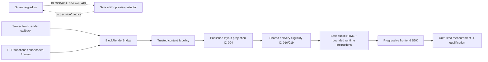
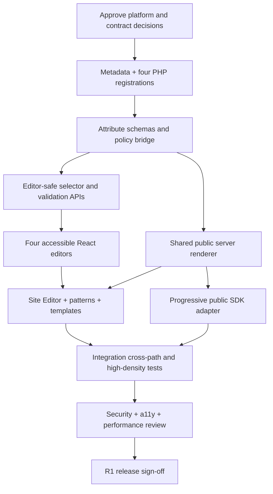

# AdPilot — Gutenberg Blocks, Editor Integration & Site Editor Specification

**Document ID:** `ADP-DOC-016`  
**Filename:** `16_ADPILOT_GUTENBERG_BLOCKS_EDITOR_INTEGRATION_SITE_EDITOR.md`  
**Version:** 1.0.0 — proposed implementation specification  
**Status:** Proposed for Product Owner, Technical Lead, Gutenberg/WordPress Lead, AdTech Lead, Security, Accessibility, Privacy, Finance and QA review  
**Date:** 2026-10-12  
**Product:** AdPilot — Self-Service Advertising Marketplace & Behavioral Analytics for WordPress  
**Owner:** WordPress/Gutenberg Engineering Lead and UX Lead  
**Implementation target:** GPT-6 High using independently verifiable work packages  
**Normative predecessors:** `ADP-DOC-001` through `ADP-DOC-015`  
**Suggested successor:** `ADP-DOC-017` — Theme Integration, PHP Rendering API, Shortcodes & Hooks Specification

> **Specification, not implementation evidence.** The block definitions, PHP/TypeScript snippets, interface names, example REST payloads, benchmark procedures and acceptance cases in this document are instructions/proposed contracts. They are not claims that the product, blocks, endpoints, or tests already exist. Examples deliberately omit application-specific bootstrap wiring and require implementation, static review, end-to-end testing, and approved platform/version verification. Existing source identifiers are never redefined.

---

## 1. Executive mandate, scope, precedence, vocabulary

### 1.1 Purpose

Implement four independently insertable, native-feeling **dynamic server-rendered Gutenberg blocks**:

1. `adpilot/ad-slot` — one stable sellable logical advertising slot;
2. `adpilot/ad-zone` — a reusable, published zone/container layout including 100/200/500+ logical slots through **one compact block**;
3. `adpilot/ad-repeater` — governed interval-based placement in explicitly supported eligible content contexts;
4. `adpilot/ad-showcase` — a curated presentation of approved advertising inventory with R1-compatible grid/static display and future R2 enhancements.

The same **published** Layout/Inventory definition and Delivery eligibility service must drive all block results, alongside PHP functions, shortcodes, supported hooks, and classic/block-theme adapters. A block is an *embedding reference and presentation adapter*, not an independent creative editor, ad server, booking engine, HTML injection escape hatch, or commercial authority.

### 1.2 Authority and conflict resolution

| Source | Binding obligations and scope |
|---|---|
| `ADP-DOC-001` | Meaning/release of 129 `FR-*`, `BR-001..018`, `NFR-001..016`, `AC-001..015`, `INV-01..10`, `DEC-001..012`; the four block names are immutable R1 requirements. |
| `ADP-DOC-002` | `AT-*`, `AT-BR-*`, `CAP-01..18`, `E2E-01..17`, `UI-01..20`. |
| `ADP-DOC-003` | `UJ-11` editor journey, `UJ-12` theme integration; all relevant `UXA-*`, recovery and accessibility scenarios. |
| `ADP-DOC-004` | `DP-*` eligibility/auth and 15 independent `SM-*` workflows; commercial and approval gates. |
| `ADP-DOC-005` | `adpilot_insert_blocks`, WordPress per-object edit rights, site/organization boundaries, preview status and impersonation restrictions. |
| `ADP-DOC-006` | 18 modules, `IC-001..024` boundaries, shared rendering path and module dependency limits. |
| `ADP-DOC-007` | Domain aggregate ownership, value objects, application commands/queries, approved creative/version and render-occurrence definitions. |
| `ADP-DOC-008` | Physical storage, immutable published layout versions, scope-safe repositories, event/finance retention. |
| `ADP-DOC-009` | `/wp-json/adpilot/v1` logical REST namespace and `BLOCK-001..004` authenticated editor routes. |
| `ADP-DOC-010` | Async processing, outbox, event qualification; editor is not a measurement producer. |
| `ADP-DOC-011` | Six-surface UX architecture, especially `UI-05`; accessible editor controls and bounded previews. |
| `ADP-DOC-012` | `--adp-*` design tokens, AdPilot component contracts, CSS isolation, contrast, RTL and reduced-motion rules. |
| `ADP-DOC-013/014` | Publisher/advertiser UIs do not grant block editors inventory, finance or advertiser authority. |
| `ADP-DOC-015` | Layout Studio zones/containers/slot compiler, stable IDs, draft/publish, impact review, 500/1,000+ benchmarks. |
| **This document** | Operationalizes Gutenberg metadata, registration, inspector/editor experience, Site Editor and template integrations, frontend bridge, test and release gates. |

An inconsistency must create a `GB16-DEC-*` review item, identify source documents and blocking effect, and be approved by the source owner. Do **not** “solve” it by changing `FR-*` meaning, endpoint names or release scope.

### 1.3 Release interpretation

| Release | Gutenberg integration promise |
|---|---|
| **R1** | All four dynamic blocks, validated selectors, bounded nonbillable preview, compact zone serialization, explicit interval repeater, R1-safe grid/static showcase, Site Editor/template-part insertion, PHP/shortcode/theme equivalence, accessibility. |
| **R2** | Optional carousel/masonry/sticky/conditional presentation strategies and richer theme diagnostics/heatmap overlay through separately enabled modules and accessibility gates. |
| **R3** | Advanced pacing/CPM/CPC related representations may annotate placement selection but never turn block attributes into billing authority. |
| **R4** | Network governance/optional replay integrations do not change the canonical block contract or enable cross-site tenant leakage. |

`MUST/SHALL` are mandatory in the enabled release; `SHOULD` needs recorded justification to depart; `MAY` is optional. Absent modules must show editor-only explanation and safe frontend fallback, not silently enable newer functionality.

### 1.4 Semantic distinctions

- **LogicalSlotId** survives responsive reorder and nonbreaking layout revisions; it is not a DOM ID, template part ID, block `clientId`, array index or slot ordinal.
- **ZoneId** references a publisher-owned zone; **PublishedLayoutRevisionId** denotes an immutable commercial/presentation snapshot.
- **RenderInstanceId** is unique for each *actual occurrence* on a page, including repeated template parts and permitted duplicate blocks; it is created by trusted server/runtime coordination, not stored in content.
- **Block editor preview** is bounded synthetic/nonbillable output. **Frontend rendering** is an eligible public presentation opportunity. **Served/rendered/viewable/billable** are independently qualified measurement states.
- **Block attribute** is editor-managed untrusted input. **Published layout**, current authorization and creative/financial approvals are authoritative on the server.

### 1.5 Explicit non-goals

Do not implement a generic page builder, an untrusted CSS/JS box, a WP role editor, an advertiser checkout inside Gutenberg, a replacement for Layout Studio, a private financial inspector, or a universal manipulator of arbitrary query loops. Do not require WooCommerce/proprietary SaaS for four blocks to register or render safe empty states.

---

## 2. Engineering responsibilities, decisions and proof

| Role | Responsibilities | Sign-off evidence |
|---|---|---|
| Technical Lead | Enforce module boundaries, release gates, version compatibility and integration design | ADR reviews, dependency tests |
| WordPress/Gutenberg Lead | Metadata, PHP registration, Site Editor, block context, deprecated/missing block handling | WP integration matrix |
| React/TypeScript Lead | Native editor controls, inspector state, typed selectors, preview requests and request cancellation | RTL/accessibility/component tests |
| Inventory/Layout Lead | Stable slot and zone IDs; 200-slot compact reference; sold-impact gates | Serialization and revision tests |
| Ad Serving Lead | Shared renderer, occurrence IDs, bounded frontend SDK and safe fallback | Equivalence and concurrency tests |
| Application Security Lead | Capability/object checks, attribute allowlists, abuse resistance, output escaping | Mutation, IDOR, XSS and multisite negative tests |
| Privacy/Measurement Lead | Nonbillable preview, no event leaks, purpose/consent controls | Zero-billable-preview evidence |
| UX/Accessibility Lead | Discoverability, empty/errors, keyboard, nonvisual preview, mobile and responsive inspector | WCAG 2.2 AA assessment |
| Performance Lead | Editor virtualization, zone summaries, SDK batching, CSS scoping | 500/1,000+ tests, profiling traces |
| QA Lead | Fixtures, automated paths, compatibility version matrix and regression gates | CI artifacts and reproducible cases |
| Release/Documentation Lead | Migration, downgrade, changelogs, examples, support matrix | Release checklist |

**Stop conditions:** unavailable canonical contracts, unapproved scope-changing decisions, unbounded preview loading, unrestricted block-provided URLs/scripts, inability to distinguish billable production from preview/staging, or broken contract-safe layout publishing.

---

## 3. WordPress, Gutenberg and packaging compatibility

### 3.1 Runtime support proposal

The final minimum supported WordPress/PHP/database versions must be approved against the platform matrix in ADP-DOC-006/008; this document **does not impose an undocumented minimum**. For environments satisfying the approved matrix, the implementation targets `block.json` API version 3 (`apiVersion: 3`), which WordPress introduced in 6.3. Test both iframe and non-iframe post editor conditions when relevant to supported releases, plus the always-iframed Site Editor. Do not build against an unapproved Gutenberg plugin nightly or require experimental editor APIs for any R1 critical feature.

Use stable public packages and supported `@wordpress/*` APIs. Dependencies must be audited for license, version compatibility and package weight. Do not ship an entire React runtime or a full advertising SPA to every public page. Conditional block asset loading and editor-only bundles are mandatory.

### 3.2 Proposed package layout

```text
plugin/
  src/
    Modules/Integration/WordPress/Gutenberg/
      BlockRegistrar.php
      BlockRenderBridge.php
      EditorCapabilityPolicy.php
      BlockAttributeNormalizer.php
      EditorPreviewController.php
      ContextResolver.php
      RepeaterAdapterRegistry.php
      LegacyBlockMigration.php
    Modules/Presentation/Rendering/  # shared contract from Doc 06/07
  assets/blocks/src/
    shared/
      api.ts, types.ts, preview.ts, error-state.tsx,
      selectors.tsx, controls.tsx, accessibility.ts
    ad-slot/    edit.tsx, index.ts, editor.scss, frontend.scss, block.json
    ad-zone/    edit.tsx, index.ts, editor.scss, frontend.scss, block.json
    ad-repeater/ edit.tsx, index.ts, editor.scss, frontend.scss, block.json
    ad-showcase/ edit.tsx, index.ts, editor.scss, frontend.scss, block.json
  build/blocks/
    ad-slot/     block.json, index.js, index.asset.php, editor.css, style.css
    ad-zone/     block.json, index.js, index.asset.php, editor.css, style.css
    ad-repeater/ block.json, index.js, index.asset.php, editor.css, style.css
    ad-showcase/ block.json, index.js, index.asset.php, editor.css, style.css
  tests/
    Unit/Blocks/, Integration/Blocks/, E2E/Editor/,
    Performance/Blocks/, Accessibility/Blocks/
```

Bundle shared editor components where build tooling can safely deduplicate dependency; do not create four global event stores or force every block to ship a copy of all design-system code. The exact directory location may follow the approved MVC skeleton without changing logical ownership.

### 3.3 Block type registration and lifecycle

- Register on `init` using metadata folders, e.g. `register_block_type( $metadata_path, [ 'render_callback' => $handler ] )`. The callback approach is chosen here so all four blocks share the one injected `BlockRenderBridge`; **do not also specify `render: file:./render.php` for those same blocks** unless one explicitly approved alternative is adopted.
- `block.json` is authoritative for name, API version, allowed attributes, supports, editors and asset handles. Use generated `.asset.php` dependencies/version files from the build; never enqueue missing bundles.
- Names and slugs MUST exactly match all four canonical IDs; guard against duplicate registration and report recoverable plugin activation diagnostics if a third party registered a colliding name.
- Use internationalized strings via WordPress package functions / `textdomain` and PHP translation; do not insert raw localized text into stored commercial IDs.
- `save()` returns `null` for all four blocks: serialized content contains only Gutenberg block comment/attributes, no live creative HTML or copied grid children. WordPress's dynamic block output remains the server authority. Existing malformed/deprecated content has explicit migration/fallback handling; do not delete stored blocks on load.
- Register an `adpilot` inserter category using the supported `block_categories_all` hook and preserve existing categories. Make blocks searchable via editorial synonyms but do not place commercial editor APIs on the public site.

### 3.4 Server entry point registration example (architectural template)

```php
<?php
// Illustrative DI-aware registrar, not complete production wiring.
namespace AdPilot\Modules\Integration\WordPress\Gutenberg;

final class BlockRegistrar {
    public function __construct(
        private BlockRenderBridge $renderer,
        private string $buildRoot,
    ) {}

    public function register(): void {
        foreach (['ad-slot', 'ad-zone', 'ad-repeater', 'ad-showcase'] as $slug) {
            $folder = $this->buildRoot . '/blocks/' . $slug;
            $type = register_block_type($folder, [
                'render_callback' => fn(array $attributes, string $content, \WP_Block $block): string =>
                    $this->renderer->render('adpilot/' . $slug, $attributes, $content, $block),
            ]);
            if (false === $type) {
                // Fail safely and publish a redacted administrator diagnostic.
            }
        }
    }
}
// Bootstrap: add_action('init', [$registrar, 'register']);
```

The block bridge must validate and scope attributes, resolve trusted rendering context and call the shared application renderer; it may not query payment tables directly or create its own delivery eligibility logic. `get_block_wrapper_attributes()` should be used for block wrappers where supported; additional attributes must be escaped and every HTML fragment must have a reviewed trusted-HTML ownership/escaping boundary.

### 3.5 Editor architecture and iframe contract

`useBlockProps()` must decorate a real native DOM element (or forwarding wrapper) in the editor; do not put it on fragments or server-side-render placeholder components. Use `InspectorControls`, `BlockControls`, WordPress components, and stable public stores. Editor content iframe CSS and outer-UI inspector CSS must be loaded in their correct places. Test `wp_template`, `wp_template_part`, posts, pages and supported custom post types. Never infer production context from `window`, a spoofable `preview: true` attribute, or `is_admin()` alone.

---

## 4. Cross-cutting block contract: metadata, security and rendering

### 4.1 Attribute design rules

1. Persist only opaque stable object references, controlled presentation preferences, and supported insertion policies. No raw HTML, advertiser-provided script, untrusted stylesheet, payment override, creative approval flag, currency/price, eligibility or targeting decision may be stored as a block attribute.
2. A declared attribute type is only a **first validation gate**. Validate enumerations, lengths, site ownership, active/published status, object rights, quota, layout-version policy and business constraints server-side.
3. Identifiers are site-local by default. Stored block content must not gain an arbitrary `siteId` selector; site scope comes from trusted WordPress context.
4. Nullable/empty references are legal only as *unconfigured editor states*, not invitations to render random inventory.
5. Renderer accepts unknown attributes from old post content only through a documented migration/allowlist; silently ignore or reject unknown unsafe keys according to severity and expose editor diagnostics.
6. Overrides may affect alignment/spacing/visibility only within approved policy and accessible limits; never reclassify a sold slot, force an unapproved campaign, or produce a false viewable impression.

### 4.2 Common saved attributes and public DTO contract

| Field | Type | Persistent? | Rule |
|---|---|---|---|
| `refId` | string (opaque) | Yes | Actual meaning is block-specific (`slotId`, `zoneId`, `showcaseId`); empty shows safe editor configure prompt. Prefer semantic fields in concrete metadata. |
| `displayLabel` | bounded string | Optional | Editor-only, user-facing label, escaped; never a new identity or visible ad disclosure override. |
| `appearance` | enum | Optional | Approved presentation variant; never arbitrary CSS class or remote URL. |
| `responsivePreset` | enum | Optional | Reference to approved breakpoint style; cannot override contractual dimensions. |
| `visibility` | enum | Optional | Authorized presentation preference, not billing/targeting authority. |
| `blockClientId` | editor ephemeral string | **No** | Gutenberg editor selection identity only; changes on clone/transform. |
| `renderInstanceId` | runtime opaque string | **No** | Server/runtime-generated fresh occurrence identity. |
| `preview`/`isPaid`/`forceServe` | client flags | **Never** | Rejected or ignored as server authority; documented negative tests. |

Metadata samples below intentionally have narrow supports; any added schema field requires schema-contract review in ADP-DOC-009 and cross-version migration tests.

### 4.3 Rendering dependency graph



**Crucial difference:** editor selectors and previews use authenticated sanitized *editor projections*, while a public render uses published `IC-004` and current eligibility. They do not share a privileged data-transfer object or create financial facts. Block output cannot be used to directly access restricted measurement, billing or org data.

### 4.4 Trust boundaries and current authority

| Boundary | Required checks |
|---|---|
| Inserter | Core WordPress content/template-edit rights **and** `adpilot_insert_blocks` policy; no rights inferred from editor UI alone. |
| Editor API | Valid WP session/nonce (CSRF), per-object permission, current site, zone/slot allowlist and capability; `permission_callback` always present. |
| Saved post content | Treat block attributes as untrusted even if saved by an administrator; no authority expansion by embedded JSON. |
| PHP render | Trusted site/context resolution; **public-safe** projection; no assumption caller has admin rights. |
| Public decision SDK | Site-bound token, bounded scope/rate, current eligibility, approval, financial/scheduling and consent checks as required. |
| Review/staging | Server-authenticated preview provenance; no billable event pipeline; no R4 replay side effects. |
| Multisite | Per-site repository/prefix, no implicit network user data union, `switch_to_blog()` isolated/restored in `try/finally`. |

### 4.5 Unified output envelope

Each public rendered instance should expose *only safe, necessary* data such as `data-adp-zone`, `data-adp-slot`, opaque `data-adp-instance`, revision/decision configuration reference, and role/ARIA metadata. Never include private advertiser identity, consent strings, raw visitor data, purchase details, gateway IDs, API nonces, internal DB IDs or signed privileged operation tokens. The renderer generates namespaced classes (`adp-*`) and `--adp-*` CSS variables; never mutate global theme variables. Any runtime identifier is short-lived and page/instance scoped where the delivery protocol requires it.

### 4.6 Empty, disabled and unavailable results

- Public: approved fallback of reserved blank, safe house creative or collapsed space under published layout policy. Do not show administrator stack traces or IDs to visitors.
- Editor: clear reason (`not configured`, `not published`, `archived`, `not allowed in this context`, `missing adapter`, `R2 unavailable`), non-destructive repair action, link to help/authorized Layout Studio if permitted.
- Network/API failure: local editor explanation + retry; public content unaffected or safe empty. No loading spinner becomes permanent.
- Disabled/uninstalled plugin: saved comments remain editable/migratable; WordPress may show a missing-block UI, but never destructive automatic removal.

---
## 5. `adpilot/ad-slot`: individual placement specification

### 5.1 Intended task, constraints and invariants

An editor inserts **one logical slot** by selecting a publisher-published, content-compatible slot. It is not a one-off arbitrary ad: creative selection, contract/approval and schedule remain server-owned. The inspector clearly distinguishes “slot selected” from “ad currently eligible” and “paid.” A deleted/archived/sold-invalid slot must not silently remap to another slot. Duplicate copies preserve logical reference but have distinct render occurrence IDs; production duplicate policies decide whether both may serve.

### 5.2 `block.json` contract example

```json
{
  "$schema": "https://schemas.wp.org/trunk/block.json",
  "apiVersion": 3,
  "name": "adpilot/ad-slot",
  "version": "1.0.0",
  "title": "AdPilot Slot",
  "category": "adpilot",
  "description": "Place one published advertising slot.",
  "keywords": ["advertising", "ad", "slot", "placement"],
  "textdomain": "adpilot",
  "attributes": {
    "slotId": { "type": "string", "default": "" },
    "appearance": { "type": "string", "default": "default" },
    "responsivePreset": { "type": "string", "default": "inherit" },
    "displayLabel": { "type": "string", "default": "" }
  },
  "usesContext": ["postId", "postType"],
  "supports": {
    "html": false,
    "customClassName": false,
    "anchor": false,
    "align": false,
    "multiple": true
  },
  "editorScript": "file:./index.js",
  "editorStyle": "file:./editor.css",
  "style": "file:./style.css"
}
```

The `slotId` is site-local and authorized by `BLOCK-003`. Allowlisted `appearance` values proposed: `default`, `minimal`, `framed` (publisher display policy may narrow them). `responsivePreset`: `inherit`, `compact`, `fluid` when approved; these affect only CSS/presentation limits, never commercial slot shape. `displayLabel` is editor metadata: do not output it as visitor-facing ad-copy replacement.

### 5.3 Editor inspector and toolbar

| Group | Control | Source / validation | State semantics |
|---|---|---|---|
| Placement | Searchable slot selector | Inventory safe projection; public/published IDs only; `BLOCK-003` validation | Search, loading, none eligible, selected, stale/deleted |
| Overview | Slot name, zone, format, status, reserved/occupied summary | Editor projection, no advertiser/customer secrets | All labels explain what they measure |
| Appearance | Supported frame/label variants | Block schema + server policy | An unsupported option is shown as unavailable, not rendered anyway |
| Responsive | Approved preset preview | Layout revision geometry | Breakpoint controls do not mutate underlying slot |
| Toolbar | Replace selection; inspector; safe preview | Native `BlockControls` | Cannot bypass commercial approval |
| Diagnostics | Duplicate or disabled reference | Server validation and local context | Warn/repair, never auto-change target ID |

Keyboard selection and search must work without mouse. Announce asynchronous result count in a non-noisy live region; selected ID has human-readable summary. Preview image must not load external advertiser tracking pixels.

### 5.4 Frontend/render behavior and acceptance

Resolve current active published binding + slot and context. If contract-authorized and currently eligible, render stable presentation frame and lightweight runtime descriptor; otherwise render chosen safe fallback. Never derive ad from a saved creative URL. Constrain content geometry to published layout and skip tracking for server-verified previews/staging. Tests: selection stability through layout reorder, duplicate occurrence identity, archived slot handling, cross-site guessed ID denial, nonbillable preview, and theme style collision resistance.

Example saved comment (illustrative):

```html
<!-- wp:adpilot/ad-slot {"slotId":"slot_01ABC","appearance":"default","responsivePreset":"inherit"} /-->
```

---

## 6. `adpilot/ad-zone`: scalable published-zone embedding

### 6.1 Core premise

This block is the preferred embedding interface for a large zone. It persists **one** opaque `zoneId` and a few presentation overrides even where the published zone contains 200 footer cells, 100 sidebar cells, or several hundred generated logical slots. The editor must never append a Gutenberg block for every generated slot. It uses the `IC-004` published layout snapshot and compiles visible slot ranges via the same engine as Layout Studio.

### 6.2 `block.json` contract example

```json
{
  "$schema": "https://schemas.wp.org/trunk/block.json",
  "apiVersion": 3,
  "name": "adpilot/ad-zone",
  "version": "1.0.0",
  "title": "AdPilot Zone",
  "category": "adpilot",
  "description": "Embed one published advertising zone using a compact reference.",
  "keywords": ["advertising", "zone", "ads", "grid", "footer"],
  "textdomain": "adpilot",
  "attributes": {
    "zoneId": { "type": "string", "default": "" },
    "appearance": { "type": "string", "default": "default" },
    "responsivePreset": { "type": "string", "default": "inherit" },
    "displayLabel": { "type": "string", "default": "" }
  },
  "usesContext": ["postId", "postType"],
  "supports": {
    "html": false,
    "customClassName": false,
    "anchor": false,
    "align": false,
    "multiple": true
  },
  "editorScript": "file:./index.js",
  "editorStyle": "file:./editor.css",
  "style": "file:./style.css"
}
```

`appearance` may be `default`, `quiet`, `framed`; `responsivePreset` may only reference a named, authorized layout profile. Do not persist responsive `columnsDesktop`, `columnsMobile`, ad targeting, slot arrays, `creativeIds`, `price`, or `booked` as local block attributes: those are published layout, inventory or delivery facts. **Slot count changes occur in Layout Studio, not in this block.**

### 6.3 Editor summary/preview design

1. Header: zone title, stable zone reference, immutable published revision number/time, configured logical-slot count, number of containers and permitted active states.
2. Representative bounded preview: sample first/last/high-value cells and abstract geometry. Cap representative thumbnails and DOM nodes with separately benchmarked thresholds; **do not render 200 cards, fetch 200 creatives, or fire 200 decisions**.
3. Responsive tabs: `desktop / tablet / mobile` as documented design tokens, a truthful structural layout summary, `hidden` vs `not eligible` labels.
4. Slot-summary actions: open authorized Layout Studio in separate view, view status/format requirements, replace zone through search.
5. Conflict/error states: source archived, unpublished, stale revision, missing selected zone, double injection, contract-breaking change pending, unavailable approval.
6. For unaffiliated but editable posts, selector returns only approved published zones compatible with target context; never show private orders or pricing negotiations.

### 6.4 Serialisation and compiler bound

```html
<!-- wp:adpilot/ad-zone {"zoneId":"zone_footer_01","appearance":"default"} /-->
```

The complete serialized block remains **O(1) in generated slot count**. The shared compiler may stream/paginate logical slot indexes and output bounded initial frames. If the same zone occurs in header and footer, separate runtime occurrence keys and DOM identifiers are mandatory (`INV-04`); reuse logical slot IDs only where the policy accepts it. A true commercial duplicate is never made legitimate merely by generating a different DOM ID.

### 6.5 One zone, 200-slot and 1,000-slot tests

Capture saved `post_content` after adding a footer zone with exactly 200 generated slots. Assert **one** `adpilot/ad-zone` block and no 200 child blocks or copied creatives. Render with the same HTML-to-policy pipeline as `adpilot_render_zone()`, `[adpilot_zone]`, and supported theme binding. Stress at 1,000+ slots under approved resource policy; sample editor must stay bounded, public initial fetch/DOM cost must be bounded, and configured slots must not be counted as served/viewable.

---

## 7. `adpilot/ad-repeater`: controlled interval insertion

### 7.1 R1 definition and non-universality

The repeater expresses a **versioned insertion intent**: for an allowlisted rendering adapter/context, place eligible published zone or slot references at explicit intervals among eligible content anchors. It does not recursively transform arbitrary Gutenberg trees, silently override every `core/query`, modify third-party page builders, or create new sellable slots in response to browsing. The R1 repeater provides governed interval insertion independent of the R2 `conditional`, `carousel`, `masonry` and `sticky` presentation strategies.

### 7.2 `block.json` contract example

```json
{
  "$schema": "https://schemas.wp.org/trunk/block.json",
  "apiVersion": 3,
  "name": "adpilot/ad-repeater",
  "version": "1.0.0",
  "title": "AdPilot Repeater",
  "category": "adpilot",
  "description": "Apply explicit interval-based ad placement in supported content.",
  "keywords": ["advertising", "repeater", "after paragraph", "interval"],
  "textdomain": "adpilot",
  "attributes": {
    "sourceType": { "type": "string", "default": "zone" },
    "sourceId": { "type": "string", "default": "" },
    "insertionMode": { "type": "string", "default": "after_eligible" },
    "interval": { "type": "number", "default": 3 },
    "startAfter": { "type": "number", "default": 0 },
    "maxInsertions": { "type": "number", "default": 3 },
    "adapter": { "type": "string", "default": "post_content_v1" }
  },
  "usesContext": ["postId", "postType"],
  "supports": {
    "html": false,
    "customClassName": false,
    "anchor": false,
    "align": false,
    "multiple": true
  },
  "editorScript": "file:./index.js",
  "editorStyle": "file:./editor.css",
  "style": "file:./style.css"
}
```

`sourceType` must be `zone` or `slot` (only if implementation/QA approve both). `interval`, `startAfter`, `maxInsertions` are **nonnegative safe integers under validated limits**, `interval >= 1`, and `maxInsertions >= 0`. `maxInsertions` MUST have a configured upper safety bound; treat `0` as *no insertions*, not unlimited. Never accept attacker-controlled regex, SQL, CSS selectors, HTML fragments, PHP functions or arbitrary classnames. Adapter slugs are registry IDs, not executable callbacks supplied in markup.

### 7.3 Eligibility and counting semantics

Define a deterministic anchor stream from an approved rendering adapter; example for R1 post content: count only eligible top-level paragraphs or approved `core/paragraph`/`core/group` descendants according to the adapter policy. Exclude headings, embeds, forms, navigation, paid posts, protected/irrelevant content and explicit no-ad blocks as configured. Define traversal and nesting policy once in the adapter; avoid double-counting when a paragraph appears in both an ancestor and descendant iteration. Never count a block just because its markup resembles a `<p>` string.

**Proposed insertion algorithm** (to ratify with the approved adapter policy): skip `startAfter` eligible anchors, then insert after every `interval` eligible anchors until `maxInsertions`, an interruption rule or end-of-content. For example 14 eligible paragraphs, startAfter=2, interval=3, maxInsertions=3 means insert after eligible anchors **5, 8, 11**. If position 5 is forbidden by a binding/spacing/density policy, log/skip or defer according to a **documented chosen policy**, not an ad hoc client decision.

Block-level placement context must resolve the parent post/template safely; if no eligible content stream is available (e.g. isolated template part without a controlled content adapter), the editor shows `This context does not support interval insertion`. Frontend fails to a safe empty placeholder; it must not scan the entire DOM and insert unreviewed ads after user interaction.

### 7.4 Adapter registry and supported contexts

| Context | R1 policy | Reason / verification |
|---|---|---|
| `post_content_v1` — approved static post/page body | **Required baseline** in eligible post/page editor context | Deterministic parse/injection, no DOM mutation, recursive guard |
| `template_content_v1` — bounded template content anchor | Proposed opt-in after template-specific tests | Site Editor context may not provide current post ID |
| `core/query` Query Loop items | **Adapter-gated**; not automatically supported | Each query item has separate item context and multiplicity |
| WooCommerce product grids | **Adapter-gated**; no universal promise | HPOS/product card context and ads-density rules differ |
| Third-party builders/content filters | **Unavailable by default** | Untrusted output, recursion, caching, no reliable anchors |
| Email/RSS/feed or AMP-like outputs | **Unavailable by default** | Format/safety and measurement semantics differ |

A supported adapter declares its `context_types`, traversal version, eligible anchor kinds, skip rules, parent/child ordering, maximum complexity, recursion tokens and test fixtures. Public filter extensions may **narrow** eligible anchors but may not weaken mandatory disclosure, commercial, security or privacy gates. Registration of a new adapter is an audited site-level integration change, not editable by advertiser organizations.

### 7.5 Rendering and recursion prevention

Do not directly call a `render_block()` variant that re-enters the same repeater without a recursion guard. Use immutable parsed-content snapshots (or an approved bounded render pipeline), explicit insertion markers, and an occurrence-local key `(site, post/template, canonical binding, adapter version, anchor ordinal, block occurrence)`. Repeater-generated slots still resolve existing published logical IDs via the same renderer, but each actual render has a fresh occurrence ID. Duplication detection distinguishes intentional permitted repeated renders from unintended placement overlap.

A repeated zone may contain many logical slots. `maxInsertions` counts **insertion positions**, not logical slots, and UI labels both dimensions separately. If 3 insertions × 100-slot zone, report `3 possible zone occurrences` and `100 logical slots per zone`, not `300 paid impressions`.

### 7.6 Editor workflow and sample

Inspector: source selector, adapter/context picker, interval stepper **plus text entry**, start offset, max insertions, exclusions preview, estimated anchors and conflict legend. Show representative insertion markers at a bounded number of anchor positions; never inject actual live ads into editor paragraphs. If source changes or content edit changes anchor count, refresh estimates with debounced authorized calls. Keyboard users can navigate positions via ordered list, and screen readers receive textual placement summaries.

```html
<!-- wp:adpilot/ad-repeater {"sourceType":"zone","sourceId":"zone_inline_01","adapter":"post_content_v1","interval":3,"startAfter":2,"maxInsertions":3} /-->
```

Save does not persist a list of 300 expanded blocks or individual placements. The adapter query and/or established placement binding may require Layout Studio configuration and must honor its immutable published snapshot.

---

## 8. `adpilot/ad-showcase`: curated accessible advertising presentation

### 8.1 Functional scope

A showcase references an approved published *collection definition*, not advertiser-authored executable code or an unreviewed set of creative URLs. R1 supports stable **grid/list/static** curated presentation, approved labeling/disclosure, responsive columns within authorized layout options, and server-selected eligible creatives. R2 may add carousel-style interaction only after separate accessibility, pause/reduced-motion, measurement and commercial-densities sign-off. Avoid misleading a showcase with 12 cards as 12 views before actual rendering and qualification.

### 8.2 `block.json` contract example

```json
{
  "$schema": "https://schemas.wp.org/trunk/block.json",
  "apiVersion": 3,
  "name": "adpilot/ad-showcase",
  "version": "1.0.0",
  "title": "AdPilot Showcase",
  "category": "adpilot",
  "description": "Display an approved curated advertising collection.",
  "keywords": ["advertising", "sponsors", "showcase", "collection"],
  "textdomain": "adpilot",
  "attributes": {
    "showcaseId": { "type": "string", "default": "" },
    "presentation": { "type": "string", "default": "grid" },
    "responsivePreset": { "type": "string", "default": "inherit" },
    "heading": { "type": "string", "default": "" }
  },
  "usesContext": ["postId", "postType"],
  "supports": {
    "html": false,
    "customClassName": false,
    "anchor": false,
    "align": false,
    "multiple": true
  },
  "editorScript": "file:./index.js",
  "editorStyle": "file:./editor.css",
  "style": "file:./style.css"
}
```

`showcaseId`: stable publisher-approved collection/presentation reference (final storage owner to be confirmed in domain migration review; see decision register); `presentation`: R1 `grid` or `list`, R2 `carousel` only after feature-enabled proof; `heading`: bounded escaped textual heading, no rich HTML, and cannot suppress mandatory sponsored disclosure. `responsivePreset`: approved publisher preset only.

### 8.3 Editor and frontend policy

The inspector offers approved collections, thumbnail-safe descriptions, format restrictions, heading, grid/list preference, and read-only expected bounds. The preview shows **approved sanitized representative cards or neutral skeleton cards**, never calls billable tracking or embeds pixels. A collection version may be revoked; the block displays repair instructions rather than silently selecting a different sponsor. Public rendering reevaluates each creative's approved exact version, campaign state, purchased slot/allocation, schedule, density and consent/targeting rules before displaying any eligible item.

Interactive carousel when R2 enabled: control buttons use accessible names, keyboard/arrow policy documented and tested, autoplay off by default, pause and reduced motion controls, no infinite roving focus trap, correct announcement frequency, reflow-safe card geometry, and viewability measured for actually visible items only. Keep carousel script out of R1 bundles and out of pages without that feature.

```html
<!-- wp:adpilot/ad-showcase {"showcaseId":"showcase_partners_01","presentation":"grid","heading":"Our sponsors"} /-->
```

### 8.4 Design decision requiring explicit domain owner

Earlier documents require the showcase block but do not conclusively freeze whether its authoritative collection is a distinct aggregate/table or a view over approved zones and curated campaigns. **Do not invent an unrelated mutable sponsor table or read creative rows directly from the block.** Propose `ShowcaseProjection` over published layout+curation policy (`IC-003/004/009/010`), then obtain a Product/Inventory/Creative Lead decision (`GB16-DEC-003`) before migration or route additions. A safe placeholder implementation is acceptable until the contract is approved; a fake populated showcase is not.

---

## 9. Complete block behaviors and states

| State | Slot | Zone | Repeater | Showcase | Production behavior |
|---|---|---|---|---|---|
| `unconfigured` | No slot selected | No zone selected | Missing source/context | No collection selected | Editor setup call-to-action; public safe empty |
| `loading` | Selector pending | Summary pending | Anchor estimate pending | Collection pending | Accessible busy status, cancel stale requests |
| `configured` | Valid selected slot | Valid published zone | Supported adapter and source | Published collection | Editor summary; no billing |
| `stale` | Slot archived/changed | Draft newer than published | Anchor count drift | Collection revision changed | Explain latest status; do not auto-rebind |
| `forbidden` | Object denied | Current user can't select | Adapter denied | Collection denied | Redacted editor status; server rejects use |
| `unsupported` | Format conflict | Invalid breakpoint override | Unsupported Query Loop | R2 carousel in R1 | Typed error and safe fallback |
| `unavailable` | No eligible campaign | No eligible inventory | No eligible anchors | No approved creatives | Policy fallback; zero false events |
| `conflict` | Duplicate identity | Duplicate binding | Reentrant insertion | Density/label conflict | Corrective action; production policy enforced |
| `network-error` | Selector failed | Preview unavailable | Estimate timed out | Preview failed | Retry editor; do not break post content |
| `ready` | Current contract satisfied | Published zone resolved | Eligible anchored insertions | Approved safe projection | Public renderer still reevaluates gates |

State labels must distinguish *authoring readiness*, *publication readiness*, and *delivery eligibility*. A green editor checkmark is never “guaranteed ad will serve” or “payment succeeded.” Display detailed diagnostics only to eligible site operators, not to public visitors.

---
## 10. InspectorControls, editor UI and frontend application contracts

### 10.1 Component anatomy and data source

Each edit function must have five explicitly separate regions:

1. Native WordPress block wrapper from `useBlockProps()`, selected-state title, type indicator and one compact preview surface.
2. `BlockControls` toolbar with context-appropriate replace/inspect actions that can be reached by keyboard.
3. `InspectorControls` grouped into *Placement*, *Display*, *Responsive*, *Validation* and *Help* as applicable. No giant financial/targeting inspector.
4. Reusable authorized selector, validation summary and recovery UI; use `@wordpress/components` and `@wordpress/i18n` where supported.
5. State and freshness footer: `Preview only · not a live impression`, published revision, selected zone/slot count, warning count and last successful validation.

No per-block homegrown drag-and-drop design system is needed. Ad layout authoring and commercial adjustments belong in Layout Studio. Editor inspector controls use ADP-DOC-012 design tokens and WordPress-native field spacing, focus and ARIA patterns.

### 10.2 Editing data model and selectors

| Client object | Authoritative source | Cache key and invalidation |
|---|---|---|
| `EditorPrincipal` | WordPress session + site/plugin capability query | Current site/editor object and active session; clear on logout/site switch |
| `PublishedZoneOption` | `BLOCK-001` | Site ID + target post/template context + cursor/query + permission epoch |
| `EditorZonePreview` | `BLOCK-002` | Site + zoneId + layout revision + sanitized context; short-lived only |
| `PlacementValidation` | `BLOCK-003` | Attribute digest + context + published layout generation; no stale authorization reuse |
| `PlacementPresets` | `BLOCK-004` | Site + capability/feature epoch + supported WP revision |
| `Published slot projection` | Inventory editor-safe query per ADP-DOC-009 | **Gap:** if no adequate existing route exists, document/approve a scoped additional selector route before production, not fabricate a URL |
| `Showcase selector projection` | Approved collection endpoint / adapter | **Gap:** route+aggregate owner requires GB16-DEC-003/004 before a live selector |

Never store API nonces, private organization responses, user tokens or payment evidence in block attributes or accessible static page caches.

### 10.3 Exact inherited REST route mapping

All paths are relative to the base `rest_url('adpilot/v1/')`, not literal hardcoded deployment URLs.

| Route ID | Method / logical path | Block(s) | Permission and purpose |
|---|---|---|---|
| `BLOCK-001` | `GET /editor/zones` | Zone, Slot (zone-filtered), Repeater, Showcase (compatibility metadata) | `adpilot_insert_blocks` plus target-edit check; safe published zone selectors |
| `BLOCK-002` | `GET /editor/zones/{zone_id}/preview` | Zone, Repeater, Slot via selected zone | Same current permission; **synthetic nonbillable** bounded preview |
| `BLOCK-003` | `POST /editor/placement-config/validate` | **All four** | Validate attributes, context, active revision, density and selected policy; never mutate inventory |
| `BLOCK-004` | `GET /editor/placement-presets` | **All four** | Allowed presentation presets, adapter availability, release flags |
| `LAY-013` | `GET /admin/placement-bindings` | Operator diagnostics only | `adpilot_view_inventory`; ordinary content editor must not rely on it |
| `LAY-014..016` | Admin bindings mutations | **Not directly called by content editor** | `adpilot_manage_inventory`; Layout Studio authority only |
| `INV-*` | Publisher inventory API | Layout Studio/privileged adapters | Content editor **must not** call protected write routes as a selection workaround |

The API document does not conclusively assign separate publicly stable `slot catalog` and `showcase catalog` editor routes. Request a schema-governed addition or an approved extension to `BLOCK-001/004` before implementing those controls. **Never** return full advertiser-finance or hidden draft inventory through a convenience selector.

### 10.4 Recommended TypeScript types (UI DTOs only)

```ts
export type EditorBlockKind =
  | 'adpilot/ad-slot'
  | 'adpilot/ad-zone'
  | 'adpilot/ad-repeater'
  | 'adpilot/ad-showcase';

export type EditorAvailability =
  | 'ready' | 'unconfigured' | 'unavailable' | 'forbidden'
  | 'unsupported' | 'stale' | 'conflict';

export interface EditorSafeReference {
  id: string;            // opaque site-local publisher ID
  label: string;         // escaped by React when displayed
  kind: 'slot' | 'zone' | 'showcase';
  publishedRevision?: string;
  configuredSlotCount?: number;
  supportedFormats?: readonly string[];
  availability: EditorAvailability;
}

export interface EditorPreviewProjection {
  reference: EditorSafeReference;
  sampledCells: readonly {
    key: string;
    label: string;
    format: string;
    approximateBounds: { aspectRatio: number };
  }[];
  isSynthetic: true;    // client may display it, but cannot attest to billing mode
  sampledCount: number;
  configuredCount: number;
  warningCodes: readonly string[];
  asOfUtc: string;
}

export interface PlacementValidationRequest {
  block: EditorBlockKind;
  attributes: Readonly<Record<string, unknown>>;
  editorContext: { objectType: string; objectId?: string };
}
```

`EditorPreviewProjection` is an intentionally **proposed client-facing shape**. Before implementation, match exact field names and REST envelope semantics to ADP-DOC-009 (including envelope, errors, pagination, version headers); do not create parallel divergent wire formats. The constant `isSynthetic: true` is a UI modeling aid, not server trust or a reason to turn off financial validation.

### 10.5 Minimal React edit example

```tsx
import { useEffect, useState } from '@wordpress/element';
import { useBlockProps, InspectorControls } from '@wordpress/block-editor';
import { PanelBody, TextControl, Notice, Spinner } from '@wordpress/components';
import { __ } from '@wordpress/i18n';

// Illustrative subset; implement the approved authenticated selector and schema client.
export function AdZoneEdit({ attributes, setAttributes }: {
  attributes: { zoneId: string };
  setAttributes: (next: Partial<{ zoneId: string }>) => void;
}) {
  const blockProps = useBlockProps({ className: 'adp-block-editor adp-block-editor--zone' });
  const [state, setState] = useState<'idle'|'loading'|'ready'|'error'>('idle');
  const [summary, setSummary] = useState<string>('');

  useEffect(() => {
    if (!attributes.zoneId) { setState('idle'); setSummary(''); return; }
    const controller = new AbortController();
    setState('loading');
    // Replaced in production by typed apiFetch client using rest_url-provided root,
    // current authenticated context, required headers, schema guards and error mapping.
    loadAuthorizedEditorZoneSummary(attributes.zoneId, { signal: controller.signal })
      .then((dto) => { if (!controller.signal.aborted) {
        setSummary(dto.label + ' — ' + dto.configuredSlotCount + ' configured slots');
        setState('ready');
      } })
      .catch(() => { if (!controller.signal.aborted) setState('error'); });
    return () => controller.abort();
  }, [attributes.zoneId]);

  return <div {...blockProps}>
    <InspectorControls>
      <PanelBody title={__('Placement', 'adpilot')} initialOpen>
        <TextControl
          label={__('Zone reference', 'adpilot')}
          help={__('Use the authorized selector in the complete implementation.', 'adpilot')}
          value={attributes.zoneId}
          onChange={(zoneId) => setAttributes({ zoneId })}
        />
      </PanelBody>
    </InspectorControls>
    <strong>{__('AdPilot Zone', 'adpilot')}</strong>
    {state === 'loading' && <Spinner />}
    {state === 'ready' && <p>{summary}</p>}
    {state === 'error' && <Notice status="warning" isDismissible={false}>
      {__('Preview unavailable. Your saved block reference is unchanged.', 'adpilot')}
    </Notice>}
    <small>{__('Editor preview only — no billable ad delivery.', 'adpilot')}</small>
  </div>;
}

// Illustrative function is intentionally unimplemented here; see API work package.
declare function loadAuthorizedEditorZoneSummary(
  zoneId: string, options: { signal: AbortSignal }
): Promise<{ label: string; configuredSlotCount: number }>;
```

**Do not ship this `TextControl` as the only picker.** It demonstrates wrapper/async-safe state, not the final selection UX. Production must use a searchable keyboard-accessible, authorized picker, typed request failures, server validation and stale-response protection. In particular, user-provided opaque IDs must never be used to assert rights or commercial validity.

### 10.6 Loading, concurrency and stale responses

- Cancel superseded selector/preview requests using `AbortController`; compare reference+context+revision before committing a response to local state.
- Use an accessible debounced search input; maintain focused option under results reordering; preserve search term and error message after transient failure.
- A `401/403` results in revoked-access UI and purge of cached privileged editor projections, not silent retention of data.
- A `404` for another-tenant object should reveal no whether-it-exists signal beyond policy-approved masking.
- A `409/412` from upstream schema/state mismatch shows a revision conflict and safe refresh path; never overwrite saved block identity automatically.
- Loading data must never make the post unsavable; saving an invalid block reference may be allowed as a draft but publication rendering must remain safe and editors must see a specific repair notice.

---

## 11. Site Editor, templates, template parts and Query Loop contracts

### 11.1 Context matrix

| Surface | Allowed R1 use | Context and right checks | Distinct hazard |
|---|---|---|---|
| Post Editor: post/page | Four blocks in eligible content | `edit_post` target + `adpilot_insert_blocks` | Unprivileged editor may guess foreign zone ID |
| Custom post type editor | Blocks only where editor enabled + policy allows | CPT edit meta cap, content support, site scope | Private/protected content targeting rules |
| Site Editor: `wp_template` | Slot, Zone, Showcase; Repeater with approved context adapter | Site Editor capability/`edit_theme_options`, concrete resource edit rights where applicable, AdPilot cap | One template renders across many posts: page-context resolution differs |
| Site Editor: `wp_template_part` | Slot, Zone, Showcase; bounded Repeater only with approved adapter | Site/template-part rights + plugin cap | Reused header/footer appears multiple times per page |
| Query Loop item template | Slot/Zone if context safe; Repeater adapter-gated | Actual inherited post context, block tree, density and cache policy | N items may create N occurrences, not one logical impression |
| Classic theme widget/block widget | Dynamic blocks where WP supports block widgets | Widget management to edit, plugin cap for choosing, public-safe renderer | Widget preview and live sidebar context differ |
| Reusable/synced pattern | Allow reference with publication/duplicate warnings | Editing rights to pattern resource and plugin cap | One edit changes many public placements |
| Locked template or content-only editor | Respect templateLock and editing mode | Core user+resource capability and plugin cap | UI must not re-enable locked placement changes |
| HTML/classic editor fallback | PHP/shortcode only where supported | Server authorization on commercial operations | No Gutenberg inspector available |

Site Editor availability and editor capabilities vary with installed theme and WordPress version; detect capabilities and stable editor feature flags rather than assume a block theme or Site Editor always exists. Block insertion does not itself grant authority to **publish layouts** or modify rates.

### 11.2 Block context resolution order

1. Resolve trusted active `blog_id` / site context before repository access.
2. Determine entry point: post editor, template, template part, live public HTML, authenticated preview or block widget.
3. If available, use approved WordPress block context (`postId`/`postType`) and editor resource context, **then verify it** against trusted object state. Do not treat arbitrary parent-supplied context as privileged authority.
4. For template parts, resolve placement semantics from published binding+actual public page request; authoring preview uses synthetic representative page context.
5. For Query Loop, use actual current repeated item context only where tested; derive separate render occurrence for each item and obey frequency/density rules. Rendering 20 query results does not automatically mean 20 billable views.
6. Explicit context override from block attributes is prohibited unless independently approved as an allowlisted nonprivileged presentation option. No `site_id` override.

### 11.3 Repeatable template parts and duplicate policy

If a template part containing one `adpilot/ad-zone` renders twice on a page (e.g. reusable footer component in two regions), retain a stable **zone identity**, create two **distinct occurrence identities**, and check published duplicate-binding/density rules. The plugin must distinguish a legitimate intentional repetition from accidental hooks+blocks injecting the same exclusive commercial inventory twice. Editor should show a warning when detection is possible; server remains authoritative and can suppress an unintended duplicate.

### 11.4 Pattern and template change lifecycle

- Templates and patterns may store compact block comments; they must never copy published layout revision records into content.
- Template edits follow WordPress autosave/revisions and template locks; AdPilot's commercial layout publication is a separate state transition.
- A template or synced pattern containing archived IDs is not automatically deleted. Show repair notices to authorized editors.
- Site Editor preview is always **nonbillable** even when a valid public layout exists. A saved template update does not implicitly approve a sold-slot migration; Layout Studio contract-impact gate remains mandatory.
- Block themes, classic themes with block widgets, and unsupported editor configurations have explicit acceptance fixture coverage.

### 11.5 Block variations, patterns, transforms and hooks

R1 may provide useful *variations* (e.g. `Sidebar Ads` = one `adpilot/ad-zone` with preset appearance) and curated block patterns that reference an editor-selected zone; variations must not hardcode another publisher's production zone IDs. Only adopt variations/patterns if they add value without hiding the four canonical blocks in the inserter.

Avoid automatically inserting ads through WordPress `blockHooks` in R1: hooking a shared template can duplicate or broaden commercial placements unexpectedly. If later adopted, hook rules must resolve approved placement bindings, publication state, duplicate detection and theme support; editing a pattern cannot create a paid placement right. Transform from legacy shortcode to block may be offered only with safe parse/ID validation; reverse transform retains exact semantics and no unauthorized HTML.

---

## 12. PHP render bridge, markup, delivery and measurement

### 12.1 Trusted service responsibilities

`BlockRenderBridge` SHOULD implement:

```text
render(blockName, untrustedAttributes, savedContent, WP_Block)
  -> validate blockName and normalize attribute schema
  -> infer trusted site/context/entrypoint
  -> load published layout/current inventory projection IC-003/004
  -> confirm placement binding and policy IC-019/024
  -> build occurrence-scoped placement plan
  -> derive truthful fallback, finite public HTML frame + passive runtime descriptor
  -> server-side sanitize/escape all boundary values
  -> return rendered HTML string
```

It must NOT mutate a quote, hold, order, campaign approval, financial ledger, creative version or analytics count. These are different service authorities and are never bypassed by an editor. The delivery SDK may request approved creative batches later; no impression is inferred merely because PHP generated a placeholder.

### 12.2 PHP render callback example (illustrative)

```php
<?php
namespace AdPilot\Modules\Integration\WordPress\Gutenberg;

final class BlockRenderBridge {
    public function __construct(
        private BlockAttributeNormalizer $normalizer,
        private TrustedRenderContextResolver $contexts,
        private PublicPlacementRenderer $renderer,
    ) {}

    public function render(
        string $blockName,
        array $attributes,
        string $savedContent,
        \WP_Block $block,
    ): string {
        // Name+schema allowlist, no acceptance of custom payment or script fields.
        $options = $this->normalizer->forBlock($blockName, $attributes);
        if (!$options->isConfigured()) {
            return ''; // Public safe empty; editor projection handles setup UX.
        }
        $context = $this->contexts->fromWordPress($block); // Not a browser flag.
        return $this->renderer->renderPublicSafe($context, $options);
    }
}
```

Names above are **proposed adapter interfaces** whose implementations must be reconciled with `IC-*` and `UC-INT-*` contracts in Documents 06–07. Returning `''` publicly in a missing-config case is permitted, but published layout fallback (reserved blank/approved house/collapse) remains authoritative for a configured, eligible slot. If the common renderer returns trusted markup, document and test that trust boundary; do not apply `esc_html()` to an entire reviewed markup tree or emit raw arbitrary strings with a PHPCS suppression as the only guarantee.

### 12.3 Wrapper and minimal semantic HTML example

```php
<?php
// Example only: ID minted by trusted runtime; values verified and escaped.
$extras = array(
    'class'             => 'adp-placement adp-placement--zone',
    'data-adp-zone'     => $safe_zone_id,
    'data-adp-instance' => $safe_instance_id,
);
$wrapper = get_block_wrapper_attributes($extras);
?>
<section <?php echo $wrapper; // Reviewed WP-generated escaped attribute markup. ?>
         aria-label="<?php echo esc_attr__('Sponsored content', 'adpilot'); ?>">
  <span class="adp-placement__disclosure">
    <?php echo esc_html__('Advertisement', 'adpilot'); ?>
  </span>
  <?php // Approved compact render-plan frames go here via escaped renderer. ?>
</section>
```

The final semantic element may be `<div>`, `<aside>` or another appropriate element based on content context and approved accessibility spec; avoid invalid nesting such as `<section>` inside paragraphs where the editor would serialize illegal HTML. Guarantee unique HTML `id` attributes per occurrence if IDs are emitted. Any HTML/ARIA user strings undergo context-specific escaping and translated strings are reviewed for RTL. `get_block_wrapper_attributes()` is used only in valid WordPress block render scope.

### 12.4 Public runtime and progressive delivery

- Initial PHP output generates bounded structural shells for the placement plan. R1 500-slot layout must **not** synchronously fetch 500 creatives, insert 500 image elements or count 500 delivery events.
- A small publicly shared SDK batches decision calls (`IC-013`) for relevant viewport/proximity groups with configurable budget, rate and abort behavior. If browser scripting is disabled, fallback follows published policy and may render limited non-tracking content where approved.
- Intersection/viewability logic observes actual rendered DOM and distinguishes `configured`, `decision`, `creative_loaded`, `rendered`, `viewable`, and qualified billable states under the Measurement module. A block's server render callback cannot claim a viewable impression.
- The decision endpoint recalculates current campaign/creative/financial/scheduling/targeting eligibility; cache is bounded and invalidated by authoritatively critical changes. Approval/contract gates never rely solely on serialized block markup or old public CDN HTML.
- Preserve `LogicalSlotId` and unique `RenderInstanceId` in event attribution, plus immutable `PublishedLayoutRevisionId`, approved geometry anchors, and site-scoped identifiers. Do not leak customer/advertiser-private details or unrestricted first-party script execution.
- R2 consent-gated heatmap collection and R4 replay remain independently feature-gated. Optional tracking denial does not disable safe baseline advertising (subject to regional policy).

### 12.5 Failure, preview and duplicates

| Trigger | Safe behavior |
|---|---|
| WordPress REST preview or authenticated editor mode | Editor-safe projection, no billable instrumentation; never infer from spoofable query string alone |
| Public request with no eligible campaign | Approved house/blank/collapse policy; zero false paid count |
| Repeated shortcode + zone block | Occurrence identity unique; duplicate commercial policy detects accidental overlap |
| Paused campaign after page cache created | Fresh delivery eligibility rejects serving; safe fallback |
| Creative rejected or new version pending | Reject unapproved version; prior approved version only if contract permits |
| Invalid source ID or cross-tenant reference | Safe empty/typed authorized-editor warning; no private resource oracle |
| JS blocked or ad delivery API down | Layout remains stable; safe placeholder/no false count |
| Visitor declines optional measurement consent | Safe baseline ad may render; no forbidden optional analytics/replay |
| Editor swaps layout revisions during preview | Stale version warning; no auto-rewrite of block source |

---

## 13. Styles, design tokens, responsive presentation and CSS isolation

The public surface must respect WordPress theme typography and layout while protecting AdPilot placement frames. Load scoped stylesheet when needed; do not use a full CSS reset, global `body`, `a`, `button` or theme `--wp-*` overrides. Use `adp-*` classes and `--adp-*` semantic/component tokens from ADP-DOC-012. Any `theme.json` mapping must be additive and version-compatible; do not rewrite global styles.

```css
/* Illustrative isolated CSS; production values originate in Doc 12 tokens. */
.adp-placement {
  box-sizing: border-box;
  min-width: 0;
  max-width: 100%;
  color: var(--adp-color-fg-primary, inherit);
}
.adp-placement__grid {
  display: grid;
  grid-template-columns: repeat(var(--adp-grid-columns, 1), minmax(0, 1fr));
  gap: var(--adp-placement-gap, 1rem);
  min-width: 0;
}
.adp-placement__cell {
  min-width: 0;
  overflow-wrap: anywhere;
  aspect-ratio: var(--adp-slot-aspect-ratio, auto);
}
.adp-placement__disclosure {
  display: inline-block;
  font-size: var(--adp-disclosure-font-size, .75rem);
}
@media (prefers-reduced-motion: reduce) {
  .adp-placement, .adp-placement * { animation-duration: 0.01ms; transition-duration: 0.01ms; }
}
```

Document responsive `grid/row/stack/single` presentation in terms of published breakpoint model, min widths, gaps, aspect ratios and visibility; never derive commercial identity from CSS column, viewport width or rendered ordinal. Offscreen lazy cells may be virtualized or deferred, but keyboard tab order and reading order must remain coherent, and dynamically inserted creatives must not steal focus or cause large layout shifts. The editor preview may show a synthetic condensed layout, **explicitly labeled**; don't conceal the difference from public geometry.

RTL uses CSS logical properties, `dir`-aware icons/labels and locale-specific numbers; chart/slot-order semantics should not reverse business IDs just because visual direction changes. Test mobile narrow inspector, 200%/400% zoom/reflow, reduced motion, dark theme, forced colors, Windows/high-DPI and available browsers per support matrix.

---

## 14. Accessibility, editorial safety and inclusive interaction

### 14.1 Baseline WCAG 2.2 AA checklist

- Navigation, block insertion, selector, inspector and all editing actions must be operable from the keyboard without inaccessible drag-and-drop.
- Visible focus, sufficient contrast, programmatic labels, exposed error/validation descriptions, predictable dialogs, adequate target size and correct focus return on modal close.
- Announce loading and error states; do not continually announce every synthetic preview tile in a 200-slot grid.
- A summary text/table expresses zone counts, placement status and conflict; screenshots alone do not convey critical information.
- Do not use color alone to distinguish `available`, `held`, `booked`, `unavailable`, `archived`, `preview only` or contract-blocked states.
- Mark advertising/sponsored content clearly in frontend and preview; disclosure cannot be disabled by block attribute.
- Decorative placeholder images use appropriate empty alt; meaningful creative media uses approved descriptive text consistent with advertiser copy policy, not the slot technical ID.
- Never autofocus a newly lazy-loaded creative, trap tab focus within rotating cards, autoplay intrusive media or scroll the viewport after a decision result.
- Repeater anchor preview is an ordered textual list with insertion number, source and relative content position so nonvisual users can validate it.
- Error notices offer an explicit repair action or state why action is unavailable; an editor without permission may view safe info without receiving a broken UI.

### 14.2 Interaction recovery scripts

**Case: archived zone after editor opened.** User edits content; API returns stale/unavailable revision. Keep block comments, show `Selected zone is no longer published`; offer `Choose another published zone` only if currently authorized. Do not silently select a commercially different zone.

**Case: role revoked while editing.** New selector request returns 403; cancel loaded privileged requests, clear restricted summaries, show role-revoked explanation. WordPress content editing may still work; unauthorized source changes cannot be validated or served.

**Case: footer zone too large to visually inspect.** Show `200 configured logical slots, 4 containers` + five representative cells + accessible table/count summary and an authorized Layout Studio link. Preserve no 200 element requirement.

**Case: repeater unsupported in `core/query`.** Show `This Query Loop requires a configured insertion adapter` and safe no-insertion output. No silent DOM injection or false success label.

**Case: showcase R2 carousel requested on R1.** Display locked feature with accessible explanation and safe R1 grid fallback only if explicitly allowed by display policy; never ship fake rotating behavior.

---
## 15. Security, threat model, authorization and privacy assurance

### 15.1 Required defense layers

| Attack or defect | Exposure | Mitigation / test oracle |
|---|---|---|
| IDOR by replacing `zoneId` in saved post content | Other site's/private layout or ad selection | Trusted current site, scoped lookup, published/public-safe projection, no protected data leak; authorized editor error masks existence |
| Editor nonce mistaken for authorization | Escalation from content edit to layout management | WordPress login+nonce for CSRF plus `edit_post`/template capability and AdPilot site capability; own `permission_callback` |
| Stored XSS through displayLabel/heading/style | Public/editor executable code | Schema length/enum allowlist, context-specific escaping, no raw HTML, CSP-friendly runtime, sandbox risky creatives |
| Malicious shortcode/block attrs `forceServe`, `approved`, `paid` | Serving unapproved unpaid campaign | Reject unknown authority attributes; current `IC-009/010/019` and allocation re-evaluation |
| Script injected through showcased creative | Arbitrary first-party execution | No untrusted first-party JS; media type/destination policy, strict sanitizer/approved iframe policy when separately supported |
| Query Loop injection recursion | Time/memory blowup or repeated ad billing | Bounded traversal, depth/cycle guard, versioned adapter registry, max insertions, duplicate event qualification |
| Stale publisher decision cache after emergency pause | Disallowed served ad | Authoritative state/version refresh, invalidation, tested bounded fail-closed path |
| Replay of editor-preview response as live production | Analytics pollution or monetary harm | Editor previews contain no production-billable decision/measurement tokens; runtime provenance validates path/server state |
| Private data in post content | Leakage to revisions, REST public content, exports | Persist only public references + UI-safe preferences, no finance/visitor/account payloads |
| Public site/style override through CSS attributes | Clickjacking, accidental clicks, brand damage | Avoid arbitrary style/text fields; approved tokens, ad disclosures, size/density rules |
| Multisite `switch_to_blog` leakage | Cross-site inventory query and option/cache confusion | Per-site container/repository scope, `try/finally`, cache key site prefix, tests with same opaque ID across sites |
| Cross-surface permission confusion | Editor can approve campaigns or override contracts | Presentation adapters have read/render-only ports, server policy gates all writes, no unauthorized console links |
| Unauthorized conditional/carousel in R1 | Feature leaks and wrong billing | Server `IC-024` release/feature gate; disabled inspector choices; public safe fallback |
| Third-party filter weakens placement rules | Mandatory policies bypassed | Extension validation and immutable policy gate after adapter hooks, audit integration registrations |
| Enumeration/rate amplification | Public decision overload | Bounded batch, signed scoped references if used, throttling, request budgets, no privileged token in HTML |
| Visitor tracking without consent | Privacy/legal violation | Purpose/consent policy at collection, nonbillable editor, R2/R4 feature gates, retention schedule |

### 15.2 Capability implementation guidance

Check `adpilot_insert_blocks` in the site-plane capability service with normal post/template edit rights; when using `current_user_can( 'edit_post', $id )`, verify the resource truly belongs to trusted current site and matches the editor object context. `allowed_block_types_all` may **hide insertion controls** for unauthorized contexts, but saved blocks can still exist, so the server callback **must not treat inserter visibility as authorization**. If adding a filter, preserve other plugins' allowlists rather than replace them and accidentally re-enable disallowed blocks.

Site admins managing inventory need `adpilot_manage_inventory` / `adpilot_publish_layout` as documented; those powers cannot be inferred from `adpilot_insert_blocks`. The renderer may safely render a published placement to anonymous visitors without requiring them to hold an editor capability; public rendering is a constrained read-only delivery operation, not an administrative content access grant. High-risk approved layout/finance changes must remain separately audited.

### 15.3 Privacy and data minimization

Editor preview requests should include only selected block type, current post/template context, reference/allowlisted overrides and bounded preview hints. Log administrative validation with minimal identifiers, redacted payloads and a correlation ID. Do not store drafts of visitor telemetry, IP addresses or consent payloads in Gutenberg post revisions. Public measurement retains only qualified event data according to ADP-DOC-008/010; editorial preview events are excluded before financial reporting, not merely hidden from charts.

### 15.4 Extension and plugin interoperability safeguards

- All filters used in public rendering must explicitly document mutability, payload schema, output escaping and whether they run before or after mandatory eligibility checks. Hooks may customize safe display or narrow policy, never force unapproved ads.
- Untrusted block styles inserted by other editor plugins must not override accessibility disclosure or position creatives to induce accidental clicks. Document tested precedence and fail-safe ad frame styles.
- Gutenberg's block bindings can be used only for allowed presentation metadata after compatibility review. A generic `core/post-meta` binding must not grant dynamic access to untrusted pricing, financial or private targeting fields.
- Never depend on undocumented core private selectors, mutable WordPress editor internals or experimental package fields for R1 critical behavior.

---

## 16. Performance, resource budgets and observability

### 16.1 Budget method

Define measurable budgets in concert with `NFR-003/004`, ADP-DOC-006 and performance sign-off. Do not invent passing metrics or universal millisecond thresholds from hardware that has not been profiled. Set an agreed baseline environment, record p50/p75/p95, and require regression comparison against a control page and a 500-slot reference page.

| Area | Required invariant | Measurement |
|---|---|---|
| Editor opening | Registered blocks do not load public serving SDK | JS request/network waterfall, package analyzer |
| Zone selector | Search/list paginates and never fetches all 1,000 IDs by default | Network transfer, objects returned, cache keys |
| 200-slot editor preview | Representative DOM count bounded independently from logical-slot count | DOM node count, long tasks, React profiler |
| 500-slot public page | Initial network/DOM cost bounded to eligible visible/nearby placements | Initial resource waterfall, decisions, DOM+CLS |
| 1,000+ stress page | Resource guardrail yields actionable diagnostics rather than hard-coded product ceiling | Stress fixture with configurable quota |
| Duplicate zones/template parts | Separate occurrence ID without duplicate accidental ad billing | DOM IDs, event dedupe, eligibility traces |
| Responsive resize | Reflow does not mutate slot IDs or silently change sold placement meaning | Snapshot diff, slot identity map |
| High-density scrolling | No focus theft, low layout shift and batch abort on navigation | Web Vitals trace, keyboard/video profiling |
| PHP render | Bounded query count and cache key validity by revision/site | Query Monitor/DB profile, p95 render trace |
| Disabled R2/R4 features | No carousel/replay/heatmap code shipped to basic block pages | Asset manifest and network assertion |

### 16.2 Caching and invalidation

Cache immutable published **layout projections** keyed by site/zone/revision, not by raw mutable editor post attributes. Public eligibility cache requires much shorter freshness/policy checks and is invalidated on campaign pause, creative approval change, commercial contract change and site policy update. Cache keys must include tenant/site, feature and revision context; no cached privileged selector payload may be reused across users, sites or permission epochs. CDN/page HTML cache should carry only safe public placeholders and bounded runtime descriptors, never a permanently preapproved ad decision beyond published eligibility expiry.

### 16.3 Frontend stability

Pre-allocate approved aspect ratio/height where possible; reserve layout space to prevent content jumping. Empty-slot collapse must use explicit fallback policy and avoid scroll jumps after measurement. Lazy creative images use appropriate loading/decoding hints; prevent direct external third-party tracking without consent/policy. Public block frontend should not depend on React hydration merely to display a static frame; only a small on-demand runtime supports progressive delivery where needed.

### 16.4 Observability contract

Site operators see **redacted** metrics: block registration status, metadata version/hash, selector request latency, blocked schema validation, published zone reference failures, duplicate binding count, render timing, runtime batch failures and preview rejection rates. Correlate editor validation, render plan and delivery result by IDs without exposing visitor-level data. Recording a missing block or invalid reference is not a license to store all page content, campaign payments or visitor sessions in logs.

---

## 17. Implementation workflow and release hard gates

### 17.1 Ordered workstream dependencies



Release gates are cumulative; do not declare a block done because it appears in the inserter or has a screenshot. The public renderer must match theme/shortcode/PHP policy behavior. Test fixtures must run under the approved WP/PHP/DB versions with clean install and upgrade paths, including multisite configurations where supported.

### 17.2 Definition of done for each block

Every block must ship with: versioned metadata; server registration; serialized attribute schema; working authorized selector or explicit contract-backed read-only fallback; native Inspector/Toolbar controls; editor-safe nonbillable preview; published frontend renderer; semantic markup and scoped CSS; mobile/RTL/A11y coverage; migration/invalid-reference diagnostics; security/IDOR/feature gate tests; public/Editor network assertion; linked requirement and acceptance test evidence.

### 17.3 Acceptance evidence artifacts

Attach in CI/release dossier: registration enumeration, serialized post fixture before/after upgrade, API request/response snapshots with redaction, block editor keyboard recording, template part duplicate run, 200-slot `post_content` size and number of blocks, 500-slot page profiling, 1,000-slot stress profiling, staging/editor zero-billing records, denied site/org request logs, and updated traceability table with test status. Never mark an unexecuted test “pass.”

---

## 18. Reproducible fixture catalog

| Fixture | Scenario | Required setup | Proof target |
|---|---|---|---|
| `GB16-FX-01` | Blank plugin install | WordPress without WooCommerce | Four blocks register, public empty safe |
| `GB16-FX-02` | R1 no publisher inventory | Editor with plugin cap; no zones | Configure prompt, no invented slot |
| `GB16-FX-03` | Published one-slot header | One site/zone/slot, no active campaign | Stable slot selection and fallback |
| `GB16-FX-04` | 100-slot sidebar | One stack, 100 generated logical identities | One compact zone block |
| `GB16-FX-05` | 200-slot footer | Published 200-cell grid | Bounded preview and post-content size |
| `GB16-FX-06` | 500-slot mixed page | 4 header +100 sidebar+196 in-content+200 footer | No initial 500 ad billings |
| `GB16-FX-07` | 1,024 logical slots | High-density stress, quota configured | No hidden 500 hard cap |
| `GB16-FX-08` | Archived source | Saved block references retired zone | Recoverable error, no auto-rebind |
| `GB16-FX-09` | Sold-slot layout impact | Paid exclusive reservation, layout revision proposed | Block cannot bypass impact gates |
| `GB16-FX-10` | Two identical zone blocks | Same post, repeated occurrence | Unique occurrence IDs; duplicate policy |
| `GB16-FX-11` | Synced template part twice | Header/footer part reused | Correct context, unique occurrence |
| `GB16-FX-12` | Unauthorized editor | WP edit right but no `adpilot_insert_blocks` | Inserter & editor API denial, safe existing content |
| `GB16-FX-13` | Cross-site collision | Site A and B share test opaque suffix | No cross-site selector/render leak |
| `GB16-FX-14` | Creative rejected after payment | Paid campaign, version in review/rejected | No unapproved serving |
| `GB16-FX-15` | Preview/staging traffic | Authorized editor, admin preview, staging | Zero billable records |
| `GB16-FX-16` | Repeater 14 paragraphs | skip=2, every 3, max=3 | Positions 5, 8, 11 only |
| `GB16-FX-17` | Repeater nested content | Deep groups, embed, query item | Deterministic bounded traversal |
| `GB16-FX-18` | Unsupported Query Loop | Query context no approved adapter | Explicit no-insertion state |
| `GB16-FX-19` | R1 showcase grid | Approved curated media, no carousel feature | Safe grid/list, valid disclosure |
| `GB16-FX-20` | R2 disabled features | Attempt carousel/conditional in R1 | Feature-gated without JS leak |
| `GB16-FX-21` | RTL and 400% zoom | Persian/Arabic translation and mobile viewport | Operable inputs and correct focus order |
| `GB16-FX-22` | Revocation mid-edit | Actor loses plugin site capability | Cache purge, API 403, no silent authority |
| `GB16-FX-23` | API offline | Preview route blocked, production backend available | Existing saved reference retained |
| `GB16-FX-24` | JS-disabled public visitor | Static public HTML and safe fallback | No crash/no false event |
| `GB16-FX-25` | Content migration | Old/unknown attrs, missing-block view | Non-destructive controlled resolution |
| `GB16-FX-26` | Conflict across languages | RTL editor/LTR theme and bidirectional content | Layout and IDs stable |

**Fixture isolation:** Every fixture must be reproducible on a disposable DB/site and must not write paid production records. Use deterministic site/user/zone/slot/layout IDs in fixture data where feasible; distinguish fixture labels from actual DB keys. Do not expose seeded customer/PII data in screenshots.

---
## 19. Detailed acceptance and adversarial test matrix (`GB16-T-*`)

**Interpretation:** The following are prescribed test scenarios, not executed results. Every test must have deterministic fixture, setup, action, expected behavior, release assignment, owner and an artifact (e.g., Jest/PHPUnit/Playwright trace, network capture, DOM inspection or SQL invariant proof). Expected results below describe observable oracles; engineers must connect to existing `AT-*`, `AT-BR-*`, `E2E-*`, `LS15-T-*`, and domain tests without overwriting them. A test may require both browser and server/database evidence to prove nonbillability.

| Test ID | Release | Area | Fixture / action | Required outcome |
|---|---|---|---|---|
| `GB16-T-001` | R1 | Registration | GB16-FX-01: activate plugin without WooCommerce | All four named dynamic block types register exactly once with metadata and PHP callbacks; no commerce dependency. |
| `GB16-T-002` | R1 | Registration | GB16-FX-01: inspect four block.json files | Each has correct namespace/name, supported apiVersion, declared attrs and assets; no unbounded children. |
| `GB16-T-003` | R1 | Registration | Build and enqueue editor only | Only editor bundles run in Gutenberg; public page does not load inspector React app. |
| `GB16-T-004` | R1 | Registration | Insert each canonical block into a page | Native inserter finds names, appropriate descriptions, translations and no duplicate collision. |
| `GB16-T-005` | R1 | Registration | Select any block and edit properties | useBlockProps wrapper, InspectorControls and BlockControls remain valid in iframe and non-iframe supported editor paths. |
| `GB16-T-006` | R1 | Registration | Serialize then reparse dynamic blocks | Only compact block comments/attributes persist; save returns null and no creative HTML copied. |
| `GB16-T-007` | R1 | Registration | Simulate one failed metadata build asset | Plugin surfaces redacted admin diagnostic and safe fallback, not a PHP fatal in public rendering. |
| `GB16-T-008` | R1 | Registration | Upgrade registration metadata with existing content | Legacy saved attrs remain nondestructive; schema migrations tested; four original slugs unchanged. |
| `GB16-T-009` | R1 | Schema | Inject forceServe/isPaid/paid/creativeJs block attributes | Authoritative renderer rejects or ignores forbidden fields; no elevated delivery. |
| `GB16-T-010` | R1 | Schema | Save invalid zone/slot ID types and excessive lengths | Strict server normalization yields typed error and safe empty, without SQL errors. |
| `GB16-T-011` | R1 | Schema | Tamper with nested unknown object attributes | Unknown complex data neither leaks into DOM nor mutates domain entities. |
| `GB16-T-012` | R1 | Schema | Select unsupported appearance/responsive enum | BLOCK-003 returns actionable validation; frontend only approved fallback. |
| `GB16-T-013` | R1 | Schema | Save remote URL or raw CSS as heading | Output escapes strings; no executable style/script or broken disclosure. |
| `GB16-T-014` | R1 | Schema | Use IDs with Unicode/control bytes and URL encoding | Canonical ID parser rejects out-of-contract references; no decoded path traversal. |
| `GB16-T-015` | R1 | Schema | Clone a valid block multiple times | Saved stable object IDs may match but runtime IDs are distinct; duplicate commercial policy applies. |
| `GB16-T-016` | R1 | Schema | Test template revision rollback on a block with old attributes | Old content retains reference, is normalized compatibly or flagged, never silently substituted. |
| `GB16-T-017` | R1 | Permissions | GB16-FX-12: editor lacks adpilot_insert_blocks | Inserter hides AdPilot without altering unrelated blocks; BLOCK-001..004 deny selection. |
| `GB16-T-018` | R1 | Permissions | User has adpilot_insert_blocks but cannot edit target post | BLOCK routes deny target context; no inference of object edit rights from plugin cap alone. |
| `GB16-T-019` | R1 | Permissions | User has post editing right but attempts layout publication | LAY-007/action forbidden; block UI has no mutation bypass. |
| `GB16-T-020` | R1 | Permissions | Forge X-WP-Nonce or reuse nonce under different actor | Authentication/CSRF and object permissions fail; nonce is not standalone authorization. |
| `GB16-T-021` | R1 | Permissions | GB16-FX-13: reference another multisite site ID | No cross-site selection/render leaks; site-scoped caches and repositories correct. |
| `GB16-T-022` | R1 | Permissions | GB16-FX-22: revoke capability while editor open | Next request denies and local protected state clears; existing saved content not erased. |
| `GB16-T-023` | R1 | Permissions | Guess unpublished/private advertiser resource ID | No private resource enumeration; editor-safe 404/403 according to masking policy. |
| `GB16-T-024` | R1 | Permissions | Manipulate allowed_block_types_all through concurrent plugin | Respect explicit third-party allowlist and template lock; do not re-enable forbidden block. |
| `GB16-T-025` | R1 | Slot | GB16-FX-03: select eligible published slot | Saved slot ID stable; editor summary shows format/status and nonbillable preview. |
| `GB16-T-026` | R1 | Slot | GB16-FX-08: archived slot in saved post | Repairable stale alert; live fallback; no silent auto-selection of another inventory item. |
| `GB16-T-027` | R1 | Slot | Modify slot commercial dimensions through override | Schema/policy denies material change even if client displays an override option. |
| `GB16-T-028` | R1 | Slot | Change format and responsive preset | Only allowed CSS presentation changes; logicalSlotId unchanged through breakpoint. |
| `GB16-T-029` | R1 | Slot | Create two slot blocks referencing same slot | Render occurrences differ and duplicate/density policy enforced. |
| `GB16-T-030` | R1 | Slot | Deliver a slot whose only creative is unapproved | No serving; exact approved-version and campaign status gate holds. |
| `GB16-T-031` | R1 | Slot | Admin tries to edit a block as surrogate quote override | Prices/holds/orders immutable from block attributes. |
| `GB16-T-032` | R1 | Slot | Disable JS for slot block frontend | Stable semantic fallback; no fabricated impression. |
| `GB16-T-033` | R1 | Zone | GB16-FX-04: embed stack of 100 slots | Exactly one zone block serialized; representative preview remains bounded. |
| `GB16-T-034` | R1 | Zone | GB16-FX-05: embed grid of 200 slots | Serialized content contains no 200 child ad blocks or creative copies; count truthful. |
| `GB16-T-035` | R1 | Zone | GB16-FX-06: render 500-slot mixed page | No 500 immediate billable/rendered events; progressively bounded public runtime. |
| `GB16-T-036` | R1 | Zone | GB16-FX-07: compile 1,024 slots under configured quota | No hard-coded 500 ceiling; safe streaming/paging and measured safeguards. |
| `GB16-T-037` | R1 | Zone | Change published layout column order | Stable logical slot identities; updated presentation revision and attribution. |
| `GB16-T-038` | R1 | Zone | GB16-FX-09: publish breaking sold-slot change | Impact validation blocks unauthorized publish/rollback; stored block cannot override. |
| `GB16-T-039` | R1 | Zone | GB16-FX-10: duplicate zone block on same page | Fresh per-occurrence IDs and server-governed accidental duplicate suppression. |
| `GB16-T-040` | R1 | Zone | Zone with zero eligible inventory | House/blank/collapse policy, no false served or paid count. |
| `GB16-T-041` | R1 | Repeater | GB16-FX-16: 14 eligible paragraphs offset 2 step 3 cap 3 | Insertions correspond to anchors 5/8/11; saved attrs compact. |
| `GB16-T-042` | R1 | Repeater | Set interval=0, negative or fractional | Schema rejects bad interval and restores safe default/diagnostic per contract. |
| `GB16-T-043` | R1 | Repeater | Set maxInsertions to huge value | Configured bounded upper limit enforced server-side; no memory exhaustion. |
| `GB16-T-044` | R1 | Repeater | GB16-FX-17: nested Group and paragraph anchors | Deterministic traversal; each allowed paragraph counted once; excluded nodes ignored. |
| `GB16-T-045` | R1 | Repeater | GB16-FX-18: unsupported Query Loop context | Warn in editor; public safe no-insertion; no arbitrary DOM scan. |
| `GB16-T-046` | R1 | Repeater | Inject unknown adapter name or PHP callback-like slug | Registry denies; no eval, arbitrary PHP hook, regex or selector execution. |
| `GB16-T-047` | R1 | Repeater | Nested repeaters / recursive render_block call | Depth/cycle guard terminates; no duplicate paid events. |
| `GB16-T-048` | R1 | Repeater | Place two repeaters on overlapping anchor streams | Duplicate binding policy resolves/suppresses conflicting allocations, preserving safe output. |
| `GB16-T-049` | R1 | Showcase | GB16-FX-19: select approved collection and grid | Accessible responsive curated cards; only eligible exact creative versions shown. |
| `GB16-T-050` | R1 | Showcase | Present collection with an unapproved creative | Unapproved creative excluded; safe fallback and no false billing. |
| `GB16-T-051` | R1 | Showcase | GB16-FX-20: request R2 carousel in R1 | Server feature gate denies or uses approved safe grid; no carousel JS loaded. |
| `GB16-T-052` | R1 | Showcase | Set arbitrary heading HTML/script | Heading escaped; required sponsor disclosure persists. |
| `GB16-T-053` | R1 | Showcase | Delete/revoke selected curated collection | Editor actionable stale reference; no automatic sponsor substitution. |
| `GB16-T-054` | R1 | Showcase | Test collection across two sites with same external name | Scoped resolver prevents cross-site creative/organization leakage. |
| `GB16-T-055` | R2 | Showcase | R2 carousel when enabled: keyboard and reduced motion | Pause/reduced-motion and focus order satisfy accessibility; no autoplay default. |
| `GB16-T-056` | R2 | Showcase | R2 carousel changes visible cards without scrolling | Only actually eligible/visible cards may earn qualified viewability; no all-cards billing. |
| `GB16-T-057` | R1 | Site Editor | Edit a wp_template with a published zone | Allowed actor edits template; public contexts resolve real page binding. |
| `GB16-T-058` | R1 | Site Editor | GB16-FX-11: duplicate template part in one document | Per-occurrence DOM IDs distinct; publisher inventory policy decides repetition. |
| `GB16-T-059` | R1 | Site Editor | Open iframe Site Editor with four blocks | Editor CSS loads in iframe and inspector correctly; no global theme reset. |
| `GB16-T-060` | R1 | Site Editor | Edit Query Loop with per-item post context | Supported adapters use real item context; no cross-item identity or billing confusion. |
| `GB16-T-061` | R1 | Site Editor | Edit a content-locked/synced pattern | Core lock/edit permissions honored; plugin cannot re-enable controls. |
| `GB16-T-062` | R1 | Site Editor | Switch block theme to classic theme | Content stays renderable via shared callback and supported widget area/shortcode. |
| `GB16-T-063` | R1 | Site Editor | Use RTL site locale and LTR theme content | Controls/focus and logical positioning remain correct, references stable. |
| `GB16-T-064` | R1 | Site Editor | Remove AdPilot plugin temporarily then reinstall | Saved Gutenberg comments remain recoverable; no automatic content loss. |
| `GB16-T-065` | R1 | Shared renderer | Compare Gutenberg/PHP/shortcode/hook same published zone | Equivalent eligibility and safe presentation; separate occurrence IDs. |
| `GB16-T-066` | R1 | Shared renderer | Inject bought-but-rejected campaign creative | Cannot serve via block, shortcode, PHP or hook. |
| `GB16-T-067` | R1 | Shared renderer | Pause campaign after cache warm | Next eligible decision fails closed despite stale rendered HTML/cache. |
| `GB16-T-068` | R1 | Shared renderer | Try unauthorized ad delivery through guessed ID | No privilege escalation, no private creative or finance fields. |
| `GB16-T-069` | R1 | Shared renderer | Render plugin block in wrong active blog context | Correct current site prefix and scoped runtime services; restore context. |
| `GB16-T-070` | R1 | Shared renderer | Produce two identical DOM HTML IDs from repeated block | Unique sanitized runtime IDs; no invalid repeated ID. |
| `GB16-T-071` | R1 | Shared renderer | Use invalid HTML nesting or foreign attribute | Valid semantic markup in post, template and inline context; tests pass. |
| `GB16-T-072` | R1 | Shared renderer | Temporarily disable API backend but keep page render | No fatal/white screen; safe public placeholder and retry budget. |
| `GB16-T-073` | R1 | Measurement/privacy | GB16-FX-15: editor open and preview multiple blocks | Zero production-billable events and no session replay. |
| `GB16-T-074` | R1 | Measurement/privacy | Staging visit with production-like plugin configuration | Staging provenance excludes revenue measurement regardless of spoofed parameter. |
| `GB16-T-075` | R1 | Measurement/privacy | Page with 500 configured logical slots at first paint | Configured != served/rendered/viewable/billable; counters remain segregated. |
| `GB16-T-076` | R1 | Measurement/privacy | Duplicate template and renderer calls | Attribution respects logical slot, render occurrence and dedupe policy. |
| `GB16-T-077` | R1 | Measurement/privacy | Client submits fake viewability for offscreen creative | Untrusted event cannot directly create settled money charge. |
| `GB16-T-078` | R1 | Measurement/privacy | Visitor refuses optional measurement consent | Safe baseline ad follows regional policy; forbidden optional collection suppressed. |
| `GB16-T-079` | R1 | Measurement/privacy | R2 heatmap off and R4 replay off | No heatmap/replay collection, preview tracking or bundled capture code. |
| `GB16-T-080` | R1 | Measurement/privacy | Render creative with third-party tracking pixel | Creative policy blocks forbidden uncontrolled pixel/JS execution. |
| `GB16-T-081` | R1 | Accessibility | Keyboard only: insert all four blocks | Accessible inserter/search and inspector controls, no pointer-only actions. |
| `GB16-T-082` | R1 | Accessibility | Screen reader: navigate 200-slot zone preview | Bounded representative cells and textual count/table; no 200-item announcement flood. |
| `GB16-T-083` | R1 | Accessibility | GB16-FX-21: 400% zoom on narrow viewport | No clipped essential actions; reflow and focus visible. |
| `GB16-T-084` | R1 | Accessibility | Dark/high contrast modes for preview statuses | Text/controls meet applicable ratios and statuses not color-only. |
| `GB16-T-085` | R1 | Accessibility | Repeater stepper and insertion location list | Keyboard numeric input and clear ordered nonvisual anchor descriptions. |
| `GB16-T-086` | R1 | Accessibility | Modal opens then closes, permission failure occurs | Focus management and announcements correct; no inaccessible stale dialog. |
| `GB16-T-087` | R1 | Accessibility | Public ad disclosure with theme style override | Mandatory sponsor disclosure remains perceivable and legible. |
| `GB16-T-088` | R1 | Accessibility | RTL localization for blocks, headings and numbers | Translated labels correct; mixed-direction IDs do not corrupt UI or business ID. |
| `GB16-T-089` | R1 | Performance/migration | Inspect 200-slot zone editor browser profile | Bounded preview DOM, no full-slot creative fetch or paid SDK. |
| `GB16-T-090` | R1 | Performance/migration | Profile 500-slot initial public render | Bounded requests/DOM, stable CLS and explicit benchmark evidence. |
| `GB16-T-091` | R1 | Performance/migration | Stress 1,024-slot render on approved host | Configurable quota diagnostics and no uncontrolled memory/time explosion. |
| `GB16-T-092` | R1 | Performance/migration | Activate R1 with no WooCommerce present | All four registration/editor views work; optional commerce integration absent. |
| `GB16-T-093` | R1 | Performance/migration | Concurrent published revision change during editing | Stale preview invalidates; safe conflict notice, no silent lost update. |
| `GB16-T-094` | R1 | Performance/migration | Restore older saved post with deprecated attributes | Reviewed migration path, retained IDs or explicit unresolved diagnostic. |
| `GB16-T-095` | R1 | Performance/migration | Revoke selected zone and flush caches | No continued bad eligible rendering from stale selector/decision cache. |
| `GB16-T-096` | R1 | Performance/migration | Build/upgrade package across WP supported matrix | PHPCS, PHPStan, tsc, Jest, PHP integration, Playwright and WCAG evidence captured. |

### 19.1 Enforcement and evidence assignment

- PHPUnit integration proves registration, rendering, WP capability/object checks, immutable revisions and direct PHP/shortcode policy equivalence.
- TypeScript/Jest/React Testing Library proves inspector state transitions, API cancellation/decoding, locale, accessible controls and upgrade migration.
- Playwright/WordPress E2E proves insertion, serialization, Site Editor/template part behavior, repeated content, keyboard flows and high-density preview.
- Security tests prove cross-site IDOR denial, output escaping, untrusted creative policy, preview provenance and missing permission after revocation.
- Profiling tests prove 200-slot editor boundedness, 500-slot page measured characteristics, and 1,000+ guardrail safety on declared resource budgets.
- Finance/Measurement integration proves **zero** billable records for editor/staging and no final charge from raw fabricated client events. A browser-only test is insufficient for this claim.

---

## 20. GPT-6 High implementation work packages (`GB16-WP-*`)

Every package is a **small shippable increment** with preconditions, exact output, negative tests and review. Do not combine all packages in one uncontrolled code generation step. First inspect the repository and canonical docs, establish actual class/file names and existing tests, and produce a diff/acceptance report after each package. Do not silently implement an unresolved source contract.

| ID | Scope and accountable role | Required implementation output | Key test gates |
|---|---|---|---|
| `GB16-WP-01` | Version and dependency matrix — WP Lead / Release | Approved WordPress/PHP/node support matrix, compatible public package list, bundled asset strategy | `GB16-T-001..008, GB16-T-096` |
| `GB16-WP-02` | Four block metadata files — Gutenberg Lead | Exact four block.json files with v3, asset paths, bounded schemas and versioning | `GB16-T-001..005, GB16-T-009..016` |
| `GB16-WP-03` | DI-aware PHP registry — WP Lead | Init bootstrap, registrar, category, duplicate collision/asset failure diagnostics | `GB16-T-001..008` |
| `GB16-WP-04` | Attribute normalizer/allowlist — Security / WP | Typed per-block schemas, safe migration, context and enum checks | `GB16-T-009..016, GB16-T-025..032` |
| `GB16-WP-05` | Permission-aware insertion — Security / Gutenberg | allowed_block_types_all strategy, object rights and current capability query | `GB16-T-017..024` |
| `GB16-WP-06` | Shared BlockRenderBridge — Backend / AdTech | All four callbacks -> IC-003/004/009/010/019/024 and safe HTML | `GB16-T-065..072` |
| `GB16-WP-07` | Editor API typed adapter — API / React | BLOCK-001..004 typed fetch, authorization and error decoding | `GB16-T-017..024, GB16-T-089` |
| `GB16-WP-08` | Shared editor selector components — UX / React | A11y typeahead, pagination, bounded result states, refresh/abort | `GB16-T-017..032, GB16-T-081..088` |
| `GB16-WP-09` | Slot block editor — Gutenberg / React | Editor wrapper, one-slot picker, status, preview, responsive allowed controls | `GB16-T-025..032` |
| `GB16-WP-10` | Zone block editor — Gutenberg / React | Zone selector, published summary, bounded 200-slot representative preview | `GB16-T-033..040` |
| `GB16-WP-11` | Repeater interval engine — Backend / Inventory | Adapter registry, stable deterministic traversal, cycle/size guard | `GB16-T-041..048` |
| `GB16-WP-12` | Repeater editor controls — Gutenberg / UX | Interval/offset/max inspector, supported-context summary and anchor list | `GB16-T-041..048, GB16-T-085` |
| `GB16-WP-13` | Showcase domain decision — Product / Architect | Approved curated source/owner and selector API gap closure | `GB16-T-049..056` |
| `GB16-WP-14` | Showcase grid/list block — React / AdTech | R1 approved collection projection, sponsored disclosures, grid/list | `GB16-T-049..053` |
| `GB16-WP-15` | Site Editor integrations — WP / Frontend | wp_template, wp_template_part, patterns, locks, widget contexts | `GB16-T-057..064` |
| `GB16-WP-16` | Public progressive shells — Frontend / AdTech | Light frame markup, lazy decision batching and fallback integration | `GB16-T-065..080, GB16-T-090` |
| `GB16-WP-17` | R1 CSS token isolation — Design System / CSS | adp styles, responsive geometry, iframe/editor scope and RTL | `GB16-T-081..088` |
| `GB16-WP-18` | Preview provenance enforcement — Security / Measurement | Server-trusted synthetic preview, no production paid events | `GB16-T-073..080` |
| `GB16-WP-19` | Duplicate occurrence and insertion — Inventory / AdTech | Stable slot refs, unique render IDs, binding policy and diagnostics | `GB16-T-033..040, GB16-T-065..072` |
| `GB16-WP-20` | Legacy/upgrades and migrations — WP / QA | Deprecated attrs strategy, missing-plugin recovery and saved content fixtures | `GB16-T-006..008, GB16-T-094..096` |
| `GB16-WP-21` | Accessibility acceptance — A11y / QA | Keyboard, screen-reader, high contrast, reduced-motion and zoom evidence | `GB16-T-081..088` |
| `GB16-WP-22` | Security negative suite — AppSec / QA | IDOR, nonce misuse, XSS, adapter injection, cross-site/stale denial | `GB16-T-009..024, GB16-T-041..048, GB16-T-065..080` |
| `GB16-WP-23` | Performance benchmark suite — Performance / QA | 200 editor, 500 mixed page, 1,024 stress, public SDK and asset budget | `GB16-T-033..040, GB16-T-089..096` |
| `GB16-WP-24` | Release and integration documentation — Tech Writer / Lead | PHP/shortcode/theme examples, matrix, upgrade guide, runbook, final evidence | `GB16-T-001..096, AT-INT-001..012` |

### 20.1 Mandatory GPT-6 High execution protocol

For each `GB16-WP-*` package:

1. Read the controlling `FR-*`, `AT-*`, `BR-*`, `DP-*`, `IC-*`, `BLOCK-*` and matching `GB16-T-*`; cite exact source IDs in the work log.
2. Inspect actual repository topology and existing coding conventions. Prefer modifying a single well-defined module and adding tests over replacing a working plugin scaffold.
3. State preconditions, unresolved approval dependencies and assumed versions. If a blocking decision is not approved, implement a safe bounded placeholder/test and mark the package blocked rather than fake feature completeness.
4. Define input/output interfaces; implement narrow changes with security and WordPress conventions; never bypass shared renderer or duplicate monetary state machines.
5. Add positive and negative tests, including relevant WordPress multisite and Gutenberg iframe context.
6. Run applicable PHP lint, WordPress Coding Standards, PHPUnit, static analysis, TypeScript typecheck, unit/Playwright suites, accessibility checks and integration tests; attach actual commands and results.
7. Document files changed, code review notes, compatibility impact, whether tests were *actually run*, defects remaining, next package and cross-document change proposals.
8. Stop if new behavior would break commercial slot identity, billed-impression truth, capability separation, release gating or saved-content compatibility.

### 20.2 Required deliverables per release

**R1 complete:** four blocks and dynamic registration; approved selector/validation API; accurate editor-preview/provenance; stable block comments; one zone block for 200+ slots; deterministic R1 repeater with approved adapter; grid/list showcase (or documented blocking collection decision, not false claim of shipped completion); classic and block themes; template parts; PHP/shortcode/hook equivalence; full security and accessibility gates.

**R2 upgrade:** approved optional carousel/masonry/sticky/conditional presentation, richer conflict diagnostics and opt-in heatmap overlays. **R3:** no block-side monetary authority; analytics/billing remains its own module. **R4:** network/replay opt-in with no silent cross-site serialization change.

---

## 21. Open design decisions and cross-document risk register

`GB16-DEC-*` entries are **proposals or acknowledged gaps**, not approved ADRs. Decisions remain owned by upstream documents when they affect product or business behavior. Each must have an owner, sign-off, compatibility review, testing implication and release-blocking classification.

| ID | Open issue / proposed resolution | Owner | Release effect |
|---|---|---|---|
| `GB16-DEC-001` | Exact minimum WP/PHP versions and editor-iframe matrix | Architecture/WP Lead | Block v3 support and supported fallback; block release on approval |
| `GB16-DEC-002` | Editor-safe per-slot picker route | API/Inventory/Access Lead | Avoid inventing BLOCK-005; approve BLOCK-001 extension or new route; R1 slot picker blocked until contract |
| `GB16-DEC-003` | Showcase collection aggregate/projection and safe selector | Product/Inventory/Creatives | Decide read-model owner and lifecycle; R1 showcase live content blocked until approved |
| `GB16-DEC-004` | Showcase selector REST path and fields | API/Security | Add approved editor-safe projection preserving org/site masking; R1 live selector blocked |
| `GB16-DEC-005` | Repeater R1 supported adapter definition | Gutenberg/Inventory | Approve eligible anchor grammar/traversal; R1 repeater blocked without tested context |
| `GB16-DEC-006` | Repeater skip versus defer when placement blocked | AdTech/UX/Policy | Choose deterministic policy and account for density; R1 acceptance dependency |
| `GB16-DEC-007` | Editor preview provenance across Gutenberg contexts | Security/Measurement/WP | Trusted flag/path and no-billing proof incl. Site Editor; security release gate |
| `GB16-DEC-008` | Block default fallback and empty zone semantics | Product/AdTech | Agree with published layout fallback policy; R1 rendering acceptance |
| `GB16-DEC-009` | Appearance enum/preset exact values | Design System/Layout | Align ADP-DOC-012 token map; R1 visual design gate |
| `GB16-DEC-010` | Multiple placement instances / double-injection policy | Inventory/AdTech | Distinguish intended repeated rendering and accidental duplicate billing; R1 invariant |
| `GB16-DEC-011` | Site Editor template capability and locked template behavior | WP/Security | Specify post/template per-object checks and supported versions; R1 security gate |
| `GB16-DEC-012` | Auto block hooking or variations | Product/WP | R1 optional/disabled by default; future feature must pass density and conflict review |
| `GB16-DEC-013` | R2 carousel and theme pattern semantics | UX/AdTech | Feature-gate, keyboard/pause and accurate viewability; R2 only |
| `GB16-DEC-014` | Scoped CSS interoperability with theme.json | Design System/WP | Approve style tokens fallback/contrast and editor iframe assets; R1 visual gate |
| `GB16-DEC-015` | Post editor and public SDK bundle budgets | Frontend/Performance | Ratify p75/p95 on benchmark host; R1 perf gate |
| `GB16-DEC-016` | Widget area and classic editor support range | WP Lead | Confirm WordPress compatibility and shortcode fallback; R1 integration gate |
| `GB16-DEC-017` | Deprecated attrs/older block versions | WP/Release | Decide migrations preserving legacy post comments and backups; upgrade gate |
| `GB16-DEC-018` | Consent and nonbillable staging criteria | Privacy/Measurement | Review regional policy and preview provenance; R1 mandatory gate |

### 21.1 Conflict handling and approval

The canonical REST document defines `BLOCK-001..004` but does not guarantee a complete distinct slot/showcase editor catalog contract. The R1 requirement to ship **four usable blocks** is therefore not waived; implementers must obtain explicit API/domain sign-off for a safe selector before declaring R1 complete. A design mock or plain text ID input is insufficient production usability.

The canonical product requires one `adpilot/ad-showcase` block in R1, while advanced `carousel` presentation is R2. This specification intentionally defines R1 grid/list and does not claim R1 carousel availability. Treat any disagreement in earlier prose/UI mockups as needing change control rather than adding R2 JS in R1.

The `adpilot/ad-repeater` block must exist and support explicit R1 intervals; generic advanced conditional/repeater container strategies remain separately gated R2 as described in Document 15. R1 is satisfied by an approved deterministic content adapter, not a universal third-party builder rewrite.

---

## 22. Traceability policy for all product requirements

This appendix preserves every canonical `FR-*` ID and release label, linking its likely relevance to Gutenberg implementation. **Direct** means the block integration implements the behavior itself; **Integrated** means Gutenberg must honor or interoperate with the upstream owner; **Protected dependency** means block implementation must not introduce a bypass or falsely claim ownership. None of these rows changes the source acceptance tests or takes ownership away from the upstream module.

### 22.1 Canonical functional requirement crosswalk (`129/129` expected)

| Requirement | Source release | Source contract (verbatim) | Gutenberg relevance | Implementation / verification |
|---|---|---|---|---|
| `FR-INV-001` | `R1` | Authorized administrators SHALL create, rename, archive, clone and search zones with stable unique IDs and descriptions. | Direct/integrated | `GB16-WP-10/11/15/19/23; GB16-T-033..048`; source `AT-INV-001` |
| `FR-INV-002` | `R1` | Zones SHALL contain multiple containers; containers SHALL support single, row, vertical stack and responsive grid configurations. | Direct/integrated | `GB16-WP-10/11/15/19/23; GB16-T-033..048`; source `AT-INV-002` |
| `FR-INV-003` | `R1` | Administrators SHALL configure slot count without a hard-coded 500-slot product maximum. Tested baseline: 500 logical slots on one page; stress test: 1,000+. Hosting-specific safe limits MAY be enforced with transparent diagnostics. | Direct/integrated | `GB16-WP-10/11/15/19/23; GB16-T-033..048`; source `AT-INV-003` |
| `FR-INV-004` | `R1` | A single container SHALL generate 100 sidebar or 200 footer slots from a compact configuration, not 100/200 manually persisted Gutenberg blocks. | Direct/integrated | `GB16-WP-10/11/15/19/23; GB16-T-033..048`; source `AT-INV-004` |
| `FR-INV-005` | `R1` | Responsive layouts SHALL support desktop/tablet/mobile column count, minimum width, aspect ratio, gaps and visibility rules without mutating contractual slot identity. | Direct/integrated | `GB16-WP-10/11/15/19/23; GB16-T-033..048`; source `AT-INV-005` |
| `FR-INV-006` | `R1` | The system SHALL resolve placement bindings for posts, pages, archives, search contexts, product pages where integrated, template parts and approved custom hooks. | Direct/integrated | `GB16-WP-10/11/15/19/23; GB16-T-033..048`; source `AT-INV-006` |
| `FR-INV-007` | `R1` | Administrators SHALL preview zones and slots with availability, reservation occupancy, breakpoint and empty-state information. | Direct/integrated | `GB16-WP-10/11/15/19/23; GB16-T-033..048`; source `AT-INV-007` |
| `FR-INV-008` | `R1` | Layout edits SHALL support draft, preview, validate, publish, immutable version history and controlled rollback. | Direct/integrated | `GB16-WP-10/11/15/19/23; GB16-T-033..048`; source `AT-INV-008` |
| `FR-INV-009` | `R1` | Changes affecting reserved/sold inventory SHALL warn, block or initiate explicit migration/reapproval before publication. | Direct/integrated | `GB16-WP-10/11/15/19/23; GB16-T-033..048`; source `AT-INV-009` |
| `FR-INV-010` | `R1` | Administrators SHALL bulk assign, unassign, edit, duplicate and filter generated slots using paginated/virtualized controls. | Direct/integrated | `GB16-WP-10/11/15/19/23; GB16-T-033..048`; source `AT-INV-010` |
| `FR-INV-011` | `R1` | Slots SHALL have explicit inactive, eligible, reserved, occupied and unavailable states where applicable. | Direct/integrated | `GB16-WP-10/11/15/19/23; GB16-T-033..048`; source `AT-INV-011` |
| `FR-INV-012` | `R2` | Container types SHOULD extend to carousel, masonry, sticky and conditional/repeater presentations with accessibility and density constraints. | Direct presentation strategy, R2 only | `GB16-WP-10/11/15/19/23; GB16-T-033..048`; source `AT-INV-012` |
| `FR-INV-013` | `R1` | On empty eligible inventory, configurable house creative, collapsed placeholder or reserved blank layout space SHALL be possible without falsely counting impressions. | Direct/integrated | `GB16-WP-10/11/15/19/23; GB16-T-033..048`; source `AT-INV-013` |
| `FR-INV-014` | `R1` | The system SHALL detect duplicate unintended injection and distinguish it from permitted repeated rendering. | Direct/integrated | `GB16-WP-10/11/15/19/23; GB16-T-033..048`; source `AT-INV-014` |
| `FR-INT-001` | `R1` | Register dynamic blocks `adpilot/ad-slot`, `adpilot/ad-zone`, `adpilot/ad-repeater`, `adpilot/ad-showcase` using `block.json` and server-rendered output. | Direct | `GB16-WP-02..19; GB16-T-001..096`; source `AT-INT-001` |
| `FR-INT-002` | `R1` | Each block SHALL expose relevant configuration, accessible editor controls, responsive preview and bounded representative rendering; editor previews SHALL not count as paid ad delivery. | Direct | `GB16-WP-02..19; GB16-T-001..096`; source `AT-INT-002` |
| `FR-INT-003` | `R1` | `adpilot/ad-zone` SHALL store a compact stable zone reference and permitted overrides instead of one block per generated slot. | Direct | `GB16-WP-02..19; GB16-T-001..096`; source `AT-INT-003` |
| `FR-INT-004` | `R1` | Repeater behavior SHALL support explicit interval policies for eligible content contexts; integrations into query loops, product grids and third-party layouts SHALL be adapter-controlled, not assumed universal. | Direct | `GB16-WP-02..19; GB16-T-001..096`; source `AT-INT-004` |
| `FR-INT-005` | `R1` | Provide public PHP functions `adpilot_render_slot()`, `adpilot_render_zone()`, and `adpilot_render_container()` with stable, documented argument and return/error semantics. | Direct | `GB16-WP-02..19; GB16-T-001..096`; source `AT-INT-005` |
| `FR-INT-006` | `R1` | Provide corresponding shortcodes, e.g. `[adpilot_slot]`, `[adpilot_zone]`, `[adpilot_repeater]`, and `[adpilot_showcase]`. | Direct | `GB16-WP-02..19; GB16-T-001..096`; source `AT-INT-006` |
| `FR-INT-007` | `R1` | Provide extensible action/filter hooks and a capability-gated REST API; all integration paths SHALL invoke the same authorization/eligibility/rendering core. | Direct | `GB16-WP-02..19; GB16-T-001..096`; source `AT-INT-007` |
| `FR-INT-008` | `R1` | Support classic themes, block themes, template parts and traditional widget areas through appropriately scoped adapters. | Direct | `GB16-WP-02..19; GB16-T-001..096`; source `AT-INT-008` |
| `FR-INT-009` | `R1` | Avoid overriding theme global styles; use scoped styles and namespaced classes/CSS variables. | Direct | `GB16-WP-02..19; GB16-T-001..096`; source `AT-INT-009` |
| `FR-INT-010` | `R1` | No shortcode, Gutenberg parameter or PHP template option SHALL bypass purchased inventory, creative approval, commercial restrictions, or security rules. | Direct | `GB16-WP-02..19; GB16-T-001..096`; source `AT-INT-010` |
| `FR-INT-011` | `R2` | Provide layout/theme diagnostics for unresolved hooks, unsupported selectors, duplicates and rendering conflicts. | Direct, R2 only | `GB16-WP-02..19; GB16-T-001..096`; source `AT-INT-011` |
| `FR-INT-012` | `R1` | Documentation SHALL give minimal working examples for each supported theme integration path. | Direct | `GB16-WP-02..19; GB16-T-001..096`; source `AT-INT-012` |
| `FR-MKT-001` | `R1` | Advertisers SHALL browse a public, filterable catalog of published placements and packages, with dimensions, format eligibility, price, schedule and clear terms. | Protected: marketplace policy | `GB16-WP-06/22; GB16-T-017..032`; source `AT-MKT-001` |
| `FR-MKT-002` | `R1` | Published placement pages SHALL include sanitized preview, responsive context and measured historical estimates when available, labeled as estimates rather than guarantees. | Protected: marketplace policy | `GB16-WP-06/22; GB16-T-017..032`; source `AT-MKT-002` |
| `FR-MKT-003` | `R1` | Authorized advertisers SHALL register, manage business profiles, view their campaigns, invoices and notifications, and resume saved drafts. | Protected: marketplace policy | `GB16-WP-06/22; GB16-T-017..032`; source `AT-MKT-003` |
| `FR-MKT-004` | `R1` | Advertiser organizations SHALL support owner/manager/analyst/billing membership with least-privilege permissions and secure invitations. | Protected: marketplace policy | `GB16-WP-06/22; GB16-T-017..032`; source `AT-MKT-004` |
| `FR-MKT-005` | `R1` | Campaign wizard SHALL guide placement selection, creative upload, targeting where allowed, scheduling, quote review, submission and checkout. | Protected: marketplace policy | `GB16-WP-06/22; GB16-T-017..032`; source `AT-MKT-005` |
| `FR-MKT-006` | `R1` | The wizard SHALL provide validation and clear recoverable errors, maintain drafts and preserve state during normal navigation. | Protected: marketplace policy | `GB16-WP-06/22; GB16-T-017..032`; source `AT-MKT-006` |
| `FR-MKT-007` | `R1` | Advertisers SHALL see distinguishable approval, payment and delivery states. | Protected: marketplace policy | `GB16-WP-06/22; GB16-T-017..032`; source `AT-MKT-007` |
| `FR-MKT-008` | `R1` | Public catalog SHALL expose no advertiser-private, financial-sensitive or visitor-personal records. | Protected: marketplace policy | `GB16-WP-06/22; GB16-T-017..032`; source `AT-MKT-008` |
| `FR-MKT-009` | `R1` | Administrators SHALL manage advertisers, verify organizations where configured, suspend accounts, and audit changes. | Protected: marketplace policy | `GB16-WP-06/22; GB16-T-017..032`; source `AT-MKT-009` |
| `FR-MKT-010` | `R2` | Campaign renewal, duplication, packaged purchasing and organization reporting enhancements SHOULD be available. | Protected: marketplace policy | `GB16-WP-06/22; GB16-T-017..032`; source `AT-MKT-010` |
| `FR-CAM-001` | `R1` | Campaigns SHALL have separately managed approval, financial and delivery state machines. | Protected: campaign approval | `GB16-WP-06/22; GB16-T-025..032/065..072`; source `AT-CAM-001` |
| `FR-CAM-002` | `R1` | Campaigns SHALL support drafts, submission, review, changes requested, approval, rejection, schedule, activation, pause, completion and cancellation/suspension paths. | Protected: campaign approval | `GB16-WP-06/22; GB16-T-025..032/065..072`; source `AT-CAM-002` |
| `FR-CAM-003` | `R1` | Creatives SHALL support safe raster images and text/native ad templates; file dimensions, format, size, destination URL and alt text SHALL be validated. | Protected: campaign approval | `GB16-WP-06/22; GB16-T-025..032/065..072`; source `AT-CAM-003` |
| `FR-CAM-004` | `R1` | Advertisers SHALL upload multiple creative versions and request edits; policy-relevant changes require reapproval before serving. | Protected: campaign approval | `GB16-WP-06/22; GB16-T-025..032/065..072`; source `AT-CAM-004` |
| `FR-CAM-005` | `R1` | Moderators SHALL approve/reject with reasons, maintain audit trails and support emergency stop. | Protected: campaign approval | `GB16-WP-06/22; GB16-T-025..032/065..072`; source `AT-CAM-005` |
| `FR-CAM-006` | `R1` | Paid placement SHALL not imply automatic creative approval; rejection SHALL invoke documented revision, cancellation and refund policies. | Protected: campaign approval | `GB16-WP-06/22; GB16-T-025..032/065..072`; source `AT-CAM-006` |
| `FR-CAM-007` | `R1` | Native/sponsored formats SHALL expose sponsorship disclosure and appropriate link attributes. | Protected: campaign approval | `GB16-WP-06/22; GB16-T-025..032/065..072`; source `AT-CAM-007` |
| `FR-CAM-008` | `R1` | Arbitrary advertiser-controlled JavaScript, unsanitized SVG and unrestricted HTML SHALL be prohibited. Safe interactive/sandboxed formats may be separately designed for later release. | Protected: campaign approval | `GB16-WP-06/22; GB16-T-025..032/065..072`; source `AT-CAM-008` |
| `FR-CAM-009` | `R2` | Video and interactive advertising MAY be supported subject to explicit format, security, performance and accessibility acceptance tests. | Protected: campaign approval | `GB16-WP-06/22; GB16-T-025..032/065..072`; source `AT-CAM-009` |
| `FR-CAM-010` | `R1` | Campaign audit trail SHALL record high-value actions including owner, time, previous/new state, and safe explanation. | Protected: campaign approval | `GB16-WP-06/22; GB16-T-025..032/065..072`; source `AT-CAM-010` |
| `FR-COM-001` | `R1` | Support fixed-price, time-based and exclusive sponsorship price plans with clear units and rate-card version. | Protected: finance/reservation | `GB16-WP-06/18/22; GB16-T-025..040/073..080`; source `AT-COM-001` |
| `FR-COM-002` | `R1` | Availability SHALL be calculated from binding, capacity, exclusions, reservations and active allocations for the requested period. | Protected: finance/reservation | `GB16-WP-06/18/22; GB16-T-025..040/073..080`; source `AT-COM-002` |
| `FR-COM-003` | `R1` | Reservation creation SHALL be concurrency-safe, have bounded expiry and be idempotent on retries. | Protected: finance/reservation | `GB16-WP-06/18/22; GB16-T-025..040/073..080`; source `AT-COM-003` |
| `FR-COM-004` | `R1` | Quote SHALL include currency, units, dates/time zone, inventory, discounts, taxes where configured, expiration and applicable approval/refund conditions. | Protected: finance/reservation | `GB16-WP-06/18/22; GB16-T-025..040/073..080`; source `AT-COM-004` |
| `FR-COM-005` | `R1` | WooCommerce adapter SHALL map AdPilot commercial orders to WooCommerce orders using supported WooCommerce CRUD/HPOS-compatible APIs. | Protected: finance/reservation | `GB16-WP-06/18/22; GB16-T-025..040/073..080`; source `AT-COM-005` |
| `FR-COM-006` | `R1` | Payment status SHALL be obtained only from authoritative commerce/gateway callbacks, not browser redirect success alone. | Protected: finance/reservation | `GB16-WP-06/18/22; GB16-T-025..040/073..080`; source `AT-COM-006` |
| `FR-COM-007` | `R1` | Duplicate, delayed and out-of-order callbacks SHALL not double-allocate inventory or duplicate invoices/charges. | Protected: finance/reservation | `GB16-WP-06/18/22; GB16-T-025..040/073..080`; source `AT-COM-007` |
| `FR-COM-008` | `R1` | Refunds, cancellation, payment reversals, expired quotes and declined creatives SHALL have explicit policy-governed workflows. | Protected: finance/reservation | `GB16-WP-06/18/22; GB16-T-025..040/073..080`; source `AT-COM-008` |
| `FR-COM-009` | `R1` | Financial records SHALL maintain auditable adjustments and reconciliation against commercial orders. | Protected: finance/reservation | `GB16-WP-06/18/22; GB16-T-025..040/073..080`; source `AT-COM-009` |
| `FR-COM-010` | `R1` | Administrators SHALL view order, payment, reservation and fulfillment discrepancies. | Protected: finance/reservation | `GB16-WP-06/18/22; GB16-T-025..040/073..080`; source `AT-COM-010` |
| `FR-COM-011` | `R3` | Qualified, reconciled CPM/CPC, spending caps, credits and share-of-voice contracts SHALL be introduced only after measurement/billing certification tests. | Protected: finance/reservation | `GB16-WP-06/18/22; GB16-T-025..040/073..080`; source `AT-COM-011` |
| `FR-COM-012` | `R4` | Additional payment/billing providers MAY be implemented without entangling the core inventory and campaign domains. | Protected: finance/reservation | `GB16-WP-06/18/22; GB16-T-025..040/073..080`; source `AT-COM-012` |
| `FR-COM-013` | `R1` | When WooCommerce is absent, product SHALL still support administrator-approved complimentary/manual campaigns and all non-checkout functions; online self-service payment UI SHALL clearly state its prerequisite. | Protected: finance/reservation | `GB16-WP-06/18/22; GB16-T-025..040/073..080`; source `AT-COM-013` |
| `FR-COM-014` | `R1` | Time ranges SHALL be stored in UTC, rendered in selected site/account timezone, and tested across daylight-saving transitions. | Protected: finance/reservation | `GB16-WP-06/18/22; GB16-T-025..040/073..080`; source `AT-COM-014` |
| `FR-DEL-001` | `R1` | Delivery decisions SHALL gate on approved creative, valid contract, active schedule, available allocation, policy eligibility and budget/hold rules. | Integrated: shared renderer | `GB16-WP-06/16/18/19; GB16-T-065..080`; source `AT-DEL-001` |
| `FR-DEL-002` | `R1` | Support fixed assignment, priority, weighted rotation and house-ad fallback with auditable selection rules. | Integrated: shared renderer | `GB16-WP-06/16/18/19; GB16-T-065..080`; source `AT-DEL-002` |
| `FR-DEL-003` | `R1` | Eligible targeting SHALL include page, post type, category/taxonomy, device/breakpoint and locale; advanced geo/audience policies require privacy/legal review. | Integrated: shared renderer | `GB16-WP-06/16/18/19; GB16-T-065..080`; source `AT-DEL-003` |
| `FR-DEL-004` | `R1` | Layout markup SHALL reserve predictable space or use controlled collapsing to minimize layout shifts. | Integrated: shared renderer | `GB16-WP-06/16/18/19; GB16-T-065..080`; source `AT-DEL-004` |
| `FR-DEL-005` | `R1` | Load creatives progressively as slots approach the viewport and batch backend decisions; do not fetch every heavy creative upfront on a 500-slot page. | Integrated: shared renderer | `GB16-WP-06/16/18/19; GB16-T-065..080`; source `AT-DEL-005` |
| `FR-DEL-006` | `R1` | Limit in-flight fetches, observers and event handlers; reuse shared browser primitives where appropriate. | Integrated: shared renderer | `GB16-WP-06/16/18/19; GB16-T-065..080`; source `AT-DEL-006` |
| `FR-DEL-007` | `R1` | Different occurrences of the same slot/zone on a page SHALL have unique render identifiers and correct event attribution. | Integrated: shared renderer | `GB16-WP-06/16/18/19; GB16-T-065..080`; source `AT-DEL-007` |
| `FR-DEL-008` | `R1` | Integration SHALL be resilient to full-page caching and common CDNs and shall not cache visitor-specific sensitive decisions in shared contexts. | Integrated: shared renderer | `GB16-WP-06/16/18/19; GB16-T-065..080`; source `AT-DEL-008` |
| `FR-DEL-009` | `R1` | Failure of delivery/analytics endpoints SHALL not break the containing WordPress page. | Integrated: shared renderer | `GB16-WP-06/16/18/19; GB16-T-065..080`; source `AT-DEL-009` |
| `FR-DEL-010` | `R1` | Admin previews, editor screens, tests and staging mode SHALL be flagged as nonbillable/nonproduction. | Integrated: shared renderer | `GB16-WP-06/16/18/19; GB16-T-065..080`; source `AT-DEL-010` |
| `FR-DEL-011` | `R1` | Ad density, slot count and large creative configurations SHALL produce configurable UX/performance warnings; supported logical capacity does not equal permission to show all creatives simultaneously. | Integrated: shared renderer | `GB16-WP-06/16/18/19; GB16-T-065..080`; source `AT-DEL-011` |
| `FR-DEL-012` | `R2/R3` | Advanced frequency caps, pacing, viewability-aware delivery and spend-limited allocation SHALL be implemented with explicit data-collection constraints. | Integrated: shared renderer | `GB16-WP-06/16/18/19; GB16-T-065..080`; source `AT-DEL-012` |
| `FR-DEL-013` | `R1` | A page SHALL remain navigable and accessible with JavaScript disabled, with documented limitations to dynamic filling and metrics. | Integrated: shared renderer | `GB16-WP-06/16/18/19; GB16-T-065..080`; source `AT-DEL-013` |
| `FR-MET-001` | `R1` | Separate ad requested, selected/served, browser rendered, click observed, click qualified and billable event types. | Protected: measurement integrity | `GB16-WP-16/18/22; GB16-T-073..080`; source `AT-MET-001` |
| `FR-MET-002` | `R1` | Distinguish counts and denominators in UI/API; metrics SHALL not silently conflate served with viewable. | Protected: measurement integrity | `GB16-WP-16/18/22; GB16-T-073..080`; source `AT-MET-002` |
| `FR-MET-003` | `R1` | Validate events server-side for schema, origin/context where practicable, bounded payload and rate limits. | Protected: measurement integrity | `GB16-WP-16/18/22; GB16-T-073..080`; source `AT-MET-003` |
| `FR-MET-004` | `R1` | Provide event IDs and bounded deduplication/aggregation with at-least-once delivery assumptions. | Protected: measurement integrity | `GB16-WP-16/18/22; GB16-T-073..080`; source `AT-MET-004` |
| `FR-MET-005` | `R1` | Exclude editor previews, testing traffic and known invalid automation under defined rules. | Protected: measurement integrity | `GB16-WP-16/18/22; GB16-T-073..080`; source `AT-MET-005` |
| `FR-MET-006` | `R1` | Aggregate campaign, creative, page, zone and slot statistics by time bucket without requiring an unbounded raw-event history. | Protected: measurement integrity | `GB16-WP-16/18/22; GB16-T-073..080`; source `AT-MET-006` |
| `FR-MET-007` | `R2` | Measure viewability with explicit observable-browser thresholds and time-in-view; document unsupported/browser-limited measurement. | Protected: measurement integrity | `GB16-WP-16/18/22; GB16-T-073..080`; source `AT-MET-007` |
| `FR-MET-008` | `R2` | Report measurable vs nonmeasurable impressions and reasons where known. | Protected: measurement integrity | `GB16-WP-16/18/22; GB16-T-073..080`; source `AT-MET-008` |
| `FR-MET-009` | `R3` | CPC/CPM billing SHALL be based on qualified, reconciled events and contract-specific rules, not client-reported counters alone. | Protected: measurement integrity | `GB16-WP-16/18/22; GB16-T-073..080`; source `AT-MET-009` |
| `FR-MET-010` | `R3` | Maintain invalid-traffic investigation and adjustment workflow without claiming perfect fraud detection. | Protected: measurement integrity | `GB16-WP-16/18/22; GB16-T-073..080`; source `AT-MET-010` |
| `FR-MET-011` | `R3` | Off-site conversions SHALL require advertiser-installed or otherwise authorized integrations, with attribution model/windows explicitly labeled. | Protected: measurement integrity | `GB16-WP-16/18/22; GB16-T-073..080`; source `AT-MET-011` |
| `FR-HEAT-001` | `R2` | Provide click/tap, scroll-depth and element/slot-visibility heatmaps, with an optional attention-time **proxy** view; never label proxies as eye tracking. | Protected R2/R4 gating; no R1 analytics unlock | `GB16-WP-06/17/18; GB16-T-073..080`; source `AT-HEAT-001` |
| `FR-HEAT-002` | `R2` | Admin SHALL inspect full-page, zone, container and slot-level overlays on vertically scrollable pages. | Protected R2/R4 gating; no R1 analytics unlock | `GB16-WP-06/17/18; GB16-T-073..080`; source `AT-HEAT-002` |
| `FR-HEAT-003` | `R2` | Browser collector SHALL use normalized coordinates plus stable semantic element/slot references. | Protected R2/R4 gating; no R1 analytics unlock | `GB16-WP-06/17/18; GB16-T-073..080`; source `AT-HEAT-003` |
| `FR-HEAT-004` | `R2` | Aggregates SHALL be segmented by page layout version and responsive device class; incompatible geometries shall not be combined silently. | Protected R2/R4 gating; no R1 analytics unlock | `GB16-WP-06/17/18; GB16-T-073..080`; source `AT-HEAT-004` |
| `FR-HEAT-005` | `R2` | Editor SHALL show selected date range, event sample size, sampling status, denominator, measurement limitations and empty states. | Protected R2/R4 gating; no R1 analytics unlock | `GB16-WP-06/17/18; GB16-T-073..080`; source `AT-HEAT-005` |
| `FR-HEAT-006` | `R2` | Administrators SHALL filter by eligible campaign, creative, zone, page/template, device and reporting period. | Protected R2/R4 gating; no R1 analytics unlock | `GB16-WP-06/17/18; GB16-T-073..080`; source `AT-HEAT-006` |
| `FR-HEAT-007` | `R2` | Support side-by-side comparison of compatible layout periods and numeric accessible alternatives to color-only heatmaps. | Protected R2/R4 gating; no R1 analytics unlock | `GB16-WP-06/17/18; GB16-T-073..080`; source `AT-HEAT-007` |
| `FR-HEAT-008` | `R2` | Tracking SHALL be consent-aware where required, exclude protected/sensitive content, and minimize visitor identifiers. | Protected R2/R4 gating; no R1 analytics unlock | `GB16-WP-06/17/18; GB16-T-073..080`; source `AT-HEAT-008` |
| `FR-HEAT-009` | `R2` | Changing page geometry, infinite scroll or AJAX insertion SHALL not silently assign historical events to the wrong placement. | Protected R2/R4 gating; no R1 analytics unlock | `GB16-WP-06/17/18; GB16-T-073..080`; source `AT-HEAT-009` |
| `FR-HEAT-010` | `R4` | Optional sampled session replay SHALL be disabled by default, separately permissioned, sensitive-content-safe, retention-controlled, and never a prerequisite for regular ad serving. | Protected R2/R4 gating; no R1 analytics unlock | `GB16-WP-06/17/18; GB16-T-073..080`; source `AT-HEAT-010` |
| `FR-HEAT-011` | `R2` | Heatmap tracking and visualization SHALL operate without mandating Hotjar, Clarity or another proprietary hosted service. | Protected R2/R4 gating; no R1 analytics unlock | `GB16-WP-06/17/18; GB16-T-073..080`; source `AT-HEAT-011` |
| `FR-REP-001` | `R1` | Administrator dashboard SHALL surface revenue/order state, active/pending campaigns, placement occupancy, basic delivery status and operational alerts. | Integrated: report semantics | `GB16-WP-18/24; GB16-T-073..080`; source `AT-REP-001` |
| `FR-REP-002` | `R1` | Advertiser dashboard SHALL expose only their own campaigns, approval/payment status, qualified statistics and invoices where available. | Integrated: report semantics | `GB16-WP-18/24; GB16-T-073..080`; source `AT-REP-002` |
| `FR-REP-003` | `R1` | Reports SHALL support period, campaign, creative, zone/slot and device filters where data is available. | Integrated: report semantics | `GB16-WP-18/24; GB16-T-073..080`; source `AT-REP-003` |
| `FR-REP-004` | `R1` | Report values SHALL identify units, currencies, denominators, time zone and data freshness. | Integrated: report semantics | `GB16-WP-18/24; GB16-T-073..080`; source `AT-REP-004` |
| `FR-REP-005` | `R2` | Add viewability, scroll, placement exposure and heatmap summaries; export aggregate CSV/JSON as allowed. | Integrated: report semantics | `GB16-WP-18/24; GB16-T-073..080`; source `AT-REP-005` |
| `FR-REP-006` | `R3` | Add conversion attribution, finance reconciliations, experiments, anomaly analysis and evidence-based placement recommendations. | Integrated: report semantics | `GB16-WP-18/24; GB16-T-073..080`; source `AT-REP-006` |
| `FR-REP-007` | `R3` | Forecasts and estimates SHALL be visually labeled and accompanied by assumptions and uncertainty. | Integrated: report semantics | `GB16-WP-18/24; GB16-T-073..080`; source `AT-REP-007` |
| `FR-REP-008` | `R2` | Long-running report exports SHALL use queued background processing and scoped download authorization. | Integrated: report semantics | `GB16-WP-18/24; GB16-T-073..080`; source `AT-REP-008` |
| `FR-REP-009` | `R2` | Administrators SHALL review pending jobs, delivery/aggregation health and retention cleanup status. | Integrated: report semantics | `GB16-WP-18/24; GB16-T-073..080`; source `AT-REP-009` |
| `FR-REP-010` | `R1` | Operational metrics, raw behavioral data and replay recordings SHALL not be exposed through ordinary advertiser reporting. | Integrated: report semantics | `GB16-WP-18/24; GB16-T-073..080`; source `AT-REP-010` |
| `FR-UX-001` | `R1` | Provide distinct admin console, advertiser portal, public storefront, Gutenberg block controls and Layout Studio, under one coherent design system. | Integrated: editor UI | `GB16-WP-07..14/17/21; GB16-T-081..088`; source `AT-UX-001` |
| `FR-UX-002` | `R1` | Every primary workflow SHALL specify empty/loading/error/success/confirmation states and recovery paths. | Integrated: editor UI | `GB16-WP-07..14/17/21; GB16-T-081..088`; source `AT-UX-002` |
| `FR-UX-003` | `R1` | Layout Studio SHALL use visual canvas + zone tree + inspector, while also supporting keyboard-accessible and nonvisual editing. | Integrated: editor UI | `GB16-WP-07..14/17/21; GB16-T-081..088`; source `AT-UX-003` |
| `FR-UX-004` | `R1` | Screens containing hundreds of slots SHALL display summarized/paginated controls rather than hundreds of simultaneously mounted edit widgets. | Integrated: editor UI | `GB16-WP-07..14/17/21; GB16-T-081..088`; source `AT-UX-004` |
| `FR-UX-005` | `R1` | Advertiser wizard SHALL autosave drafts, show a transparent cost/approval summary, and avoid silent loss of changes. | Integrated: editor UI | `GB16-WP-07..14/17/21; GB16-T-081..088`; source `AT-UX-005` |
| `FR-UX-006` | `R1` | Primary interface SHALL meet WCAG 2.2 AA as a project target, with automated and manual verification. | Integrated: editor UI | `GB16-WP-07..14/17/21; GB16-T-081..088`; source `AT-UX-006` |
| `FR-UX-007` | `R1` | Use WordPress localization APIs; support RTL/LTR layouts, locale-aware dates, numbers and currency presentation. | Integrated: editor UI | `GB16-WP-07..14/17/21; GB16-T-081..088`; source `AT-UX-007` |
| `FR-UX-008` | `R1` | Responsive controls and page previews SHALL work across phone, tablet and desktop representative widths. | Integrated: editor UI | `GB16-WP-07..14/17/21; GB16-T-081..088`; source `AT-UX-008` |
| `FR-UX-009` | `R1` | Avoid unnecessary global theme CSS/JS and unrelated plugin side effects. | Integrated: editor UI | `GB16-WP-07..14/17/21; GB16-T-081..088`; source `AT-UX-009` |
| `FR-UX-010` | `R2/R4` | Offer richer saved report views, white-label/site branding and advanced multisite workflows subject to individual release scopes. | Integrated: editor UI | `GB16-WP-07..14/17/21; GB16-T-081..088`; source `AT-UX-010` |
| `FR-UX-011` | `R1` | AdPilot SHALL expose high-quality diagnostic feedback rather than generic fatal errors for configuration and integration failures. | Integrated: editor UI | `GB16-WP-07..14/17/21; GB16-T-081..088`; source `AT-UX-011` |
| `FR-OPS-001` | `R1` | Apply capability checks plus resource ownership to every sensitive REST/UI/CLI operation. | Integrated: platform/ops | `GB16-WP-01/03/20/23/24; GB16-T-089..096`; source `AT-OPS-001` |
| `FR-OPS-002` | `R1` | Validate and sanitize inputs, escape output by context, use prepared SQL and defend against CSRF, XSS, SSRF, upload abuse, replay and broken object authorization. | Integrated: platform/ops | `GB16-WP-01/03/20/23/24; GB16-T-089..096`; source `AT-OPS-002` |
| `FR-OPS-003` | `R1` | Audit financial changes, campaign approval, placement publication, account membership and emergency pause. | Integrated: platform/ops | `GB16-WP-01/03/20/23/24; GB16-T-089..096`; source `AT-OPS-003` |
| `FR-OPS-004` | `R1` | Enable privacy policy guidance, configurable retention, eligible data export/deletion and consent integration points. | Integrated: platform/ops | `GB16-WP-01/03/20/23/24; GB16-T-089..096`; source `AT-OPS-004` |
| `FR-OPS-005` | `R1` | Exclude sensitive DOM/form/payment values from any analytics collection; absence of user consent must prevent collection where required. | Integrated: platform/ops | `GB16-WP-01/03/20/23/24; GB16-T-089..096`; source `AT-OPS-005` |
| `FR-OPS-006` | `R1` | Provide diagnostics, explicit job retries, failed-job reporting, queue monitoring and supportable system cron/WP-CLI execution. | Integrated: platform/ops | `GB16-WP-01/03/20/23/24; GB16-T-089..096`; source `AT-OPS-006` |
| `FR-OPS-007` | `R1` | Implement schema-versioned installation/upgrades, data-preserving deactivation, intentional uninstall behavior and upgrade testing. | Integrated: platform/ops | `GB16-WP-01/03/20/23/24; GB16-T-089..096`; source `AT-OPS-007` |
| `FR-OPS-008` | `R1` | Distributable libraries, assets and source code SHALL have documented GPL-compatible licensing; generate dependency register/SBOM and required notices. | Integrated: platform/ops | `GB16-WP-01/03/20/23/24; GB16-T-089..096`; source `AT-OPS-008` |
| `FR-OPS-009` | `R1` | Use a versioned REST namespace and stable hooks/shortcodes/PHP APIs; changes SHALL follow documented deprecation policy. | Integrated: platform/ops | `GB16-WP-01/03/20/23/24; GB16-T-089..096`; source `AT-OPS-009` |
| `FR-OPS-010` | `R1` | Expose structured, redacted logs, health checks, and safe administrator diagnostic exports. | Integrated: platform/ops | `GB16-WP-01/03/20/23/24; GB16-T-089..096`; source `AT-OPS-010` |
| `FR-OPS-011` | `R4` | Support optional independently deployed workers/analytics integrations without a forced redesign of core WordPress services. | Integrated: platform/ops | `GB16-WP-01/03/20/23/24; GB16-T-089..096`; source `AT-OPS-011` |
| `FR-OPS-012` | `R1` | Plugin bootstrap SHALL not require WooCommerce or proprietary remote services merely to load. | Integrated: platform/ops | `GB16-WP-01/03/20/23/24; GB16-T-089..096`; source `AT-OPS-012` |
| `FR-OPS-013` | `R1` | Plugin activation SHALL create only documented, owned resources and SHALL avoid modifying unrelated existing pages/settings without authorization. | Integrated: platform/ops | `GB16-WP-01/03/20/23/24; GB16-T-089..096`; source `AT-OPS-013` |

### 22.2 Business rules

The exact source statement remains authoritative; this table adds integration enforcement and evidence without redefining the rule.

| ID | Source text (verbatim) | Gutenberg enforcement / evidence |
|---|---|---|
| `BR-001` | Inventory sale is permitted only for an active, publishable placement with sufficient eligible capacity. | Shared rendering/eligibility and nonbillable editor preview; `GB16-T-065..080` plus original `AT-BR-001` |
| `BR-002` | A temporary hold expires after its configured TTL; extension requires an explicit transaction. | Shared rendering/eligibility and nonbillable editor preview; `GB16-T-065..080` plus original `AT-BR-002` |
| `BR-003` | A successful online payment does not bypass creative moderation. | Shared rendering/eligibility and nonbillable editor preview; `GB16-T-065..080` plus original `AT-BR-003` |
| `BR-004` | If a paid campaign is rejected, revision/refund/cancellation options follow recorded policy; never silently keep funds without an enforceable fulfillment path. | Shared rendering/eligibility and nonbillable editor preview; `GB16-T-065..080` plus original `AT-BR-004` |
| `BR-005` | An exclusive reservation cannot be double sold over overlapping contract time. | Shared rendering/eligibility and nonbillable editor preview; `GB16-T-065..080` plus original `AT-BR-005` |
| `BR-006` | Changes to a slot's commercial meaning require impact analysis and resolution of affected contracts. | Shared rendering/eligibility and nonbillable editor preview; `GB16-T-065..080` plus original `AT-BR-006` |
| `BR-007` | A rejected or unapproved creative cannot serve; approved prior versions may serve only if contract and policy permit. | Shared rendering/eligibility and nonbillable editor preview; `GB16-T-065..080` plus original `AT-BR-007` |
| `BR-008` | Delivery eligibility is recomputed against current authoritative campaign state, not based solely on a stale cached creative. | Shared rendering/eligibility and nonbillable editor preview; `GB16-T-065..080` plus original `AT-BR-008` |
| `BR-009` | Ad-preview, administrator-editing and synthetic load-test events are excluded from revenue-bearing analytics. | Shared rendering/eligibility and nonbillable editor preview; `GB16-T-065..080` plus original `AT-BR-009` |
| `BR-010` | Advertising density policies and ad-network restrictions are configurable; default warnings should discourage excessive clutter and inadvertent clicks. | Shared rendering/eligibility and nonbillable editor preview; `GB16-T-065..080` plus original `AT-BR-010` |
| `BR-011` | Advertiser reports show validated aggregate outcomes, not visitor-level session content. | Shared rendering/eligibility and nonbillable editor preview; `GB16-T-065..080` plus original `AT-BR-011` |
| `BR-012` | Raw events have finite retention and are not a permanent financial source of truth; reconciled financial entries are independently retained under applicable policy. | Shared rendering/eligibility and nonbillable editor preview; `GB16-T-065..080` plus original `AT-BR-012` |
| `BR-013` | Conversion and performance claims distinguish observed facts, attribution models, estimates and projections. | Shared rendering/eligibility and nonbillable editor preview; `GB16-T-065..080` plus original `AT-BR-013` |
| `BR-014` | Currency arithmetic uses precise decimal/minor-unit representations, never floating point for ledger authority. | Shared rendering/eligibility and nonbillable editor preview; `GB16-T-065..080` plus original `AT-BR-014` |
| `BR-015` | Timestamps are stored in UTC; contract terms display user-selected time zone and daylight-saving behavior explicitly. | Shared rendering/eligibility and nonbillable editor preview; `GB16-T-065..080` plus original `AT-BR-015` |
| `BR-016` | Accessibility and mobile usability may constrain a particular layout even when there is ample logical inventory capacity. | Shared rendering/eligibility and nonbillable editor preview; `GB16-T-065..080` plus original `AT-BR-016` |
| `BR-017` | Any third-party tracking, behavioral replay, or remote conversion adapter requires disclosure, consent gating where appropriate, and documented data flows. | Shared rendering/eligibility and nonbillable editor preview; `GB16-T-065..080` plus original `AT-BR-017` |
| `BR-018` | Manual administrator overrides of paid placement allocation require reason, authorization and audit logging. | Shared rendering/eligibility and nonbillable editor preview; `GB16-T-065..080` plus original `AT-BR-018` |

### 22.3 Nonfunctional requirements

The exact source statement remains authoritative; this table adds integration enforcement and evidence without redefining the rule.

| ID | Source text (verbatim) | Gutenberg enforcement / evidence |
|---|---|---|
| `NFR-001` | Architecture: Modular-monolith design with explicit domain/application/infrastructure/presentation boundaries; PHP WordPress host; no mandatory external application server in R1. | Block/editor/render quality gate; `GB16-T-081..096` and original NFR benchmark owner |
| `NFR-002` | Maintainability: WordPress Coding Standards, PHP static analysis, TypeScript strict mode, clear module APIs, source-level documentation and reviewed dependencies. | Block/editor/render quality gate; `GB16-T-081..096` and original NFR benchmark owner |
| `NFR-003` | Rendering: A 500-logical-slot page must not eagerly fetch or paint 500 heavy creatives. Browser work and network concurrency must be bounded; no per-slot PHP query pattern. | Block/editor/render quality gate; `GB16-T-081..096` and original NFR benchmark owner |
| `NFR-004` | Performance: Establish and validate environment-specific p75/p95 budgets for request overhead, Core Web Vitals, query count, JS bundle size, browser memory, batching and queue lag; declare benchmark hardware, creative sizes and cache configuration. | Block/editor/render quality gate; `GB16-T-081..096` and original NFR benchmark owner |
| `NFR-005` | Reliability: Idempotent payment webhooks and jobs; resilient scheduler; safe fallback if ad delivery or analytics endpoint fails. | Block/editor/render quality gate; `GB16-T-081..096` and original NFR benchmark owner |
| `NFR-006` | Financial correctness: Database-enforced uniqueness/capacity controls, concurrency testing, reconciliation, immutable adjustment trail and precise currency arithmetic. | Block/editor/render quality gate; `GB16-T-081..096` and original NFR benchmark owner |
| `NFR-007` | Security: Threat model, dependency scans, permission tests, hardened creative handling, secure REST, server-side validation and emergency shutdown. | Block/editor/render quality gate; `GB16-T-081..096` and original NFR benchmark owner |
| `NFR-008` | Privacy: Data minimization, regional consent policy, no sensitive input collection, finite behavioral-event retention and protected access. | Block/editor/render quality gate; `GB16-T-081..096` and original NFR benchmark owner |
| `NFR-009` | Accessibility: WCAG 2.2 AA target for critical UIs, including nonvisual alternatives to heatmaps and drag/drop interactions. | Block/editor/render quality gate; `GB16-T-081..096` and original NFR benchmark owner |
| `NFR-010` | Compatibility: Validated WordPress/PHP/MySQL/MariaDB matrix; support classic and block themes, modern browsers, WooCommerce HPOS when commerce adapter enabled. | Block/editor/render quality gate; `GB16-T-081..096` and original NFR benchmark owner |
| `NFR-011` | Internationalization: Translation-ready strings, RTL/LTR support, reliable date/time-zone and currency displays. | Block/editor/render quality gate; `GB16-T-081..096` and original NFR benchmark owner |
| `NFR-012` | Observability: Logs, queue metrics, failed-event reporting, health diagnostics, financial discrepancy alerts and safe support exports. | Block/editor/render quality gate; `GB16-T-081..096` and original NFR benchmark owner |
| `NFR-013` | Extensibility: Versioned REST API, documented hooks, stable PHP and shortcode contracts, adapter interfaces and deprecation policy. | Block/editor/render quality gate; `GB16-T-081..096` and original NFR benchmark owner |
| `NFR-014` | Licensing: GPL-compatible distribution, recorded license texts/notices, transitive dependency screening, no unclear copyrighted assets. | Block/editor/render quality gate; `GB16-T-081..096` and original NFR benchmark owner |
| `NFR-015` | Upgrade safety: Idempotent migrations, version compatibility checks, reliable backup guidance, data-preserving deactivation and explicit uninstall. | Block/editor/render quality gate; `GB16-T-081..096` and original NFR benchmark owner |
| `NFR-016` | Usability: Critical flows verified through task-based usability tests; major actions provide comprehensible states, feedback and undo/recovery when feasible. | Block/editor/render quality gate; `GB16-T-081..096` and original NFR benchmark owner |

### 22.4 Product acceptance criteria

The exact source statement remains authoritative; this table adds integration enforcement and evidence without redefining the rule.

| ID | Source text (verbatim) | Gutenberg enforcement / evidence |
|---|---|---|
| `AC-001` | Publisher creates and publishes a 500-slot page consisting of 4 header, 100 sidebar, 196 in-content and 200 footer logical slots. Layout Studio remains usable; publishing and responsive preview succeed. | R1 integrated acceptance; `GB16-T-001..096` plus original `E2E-*` where applicable |
| `AC-002` | One `adpilot/ad-zone` block can reference a 200-slot footer container without storing 200 Gutenberg blocks. | R1 integrated acceptance; `GB16-T-001..096` plus original `E2E-*` where applicable |
| `AC-003` | Four supported integration paths (Gutenberg, PHP function, shortcode, and supported hook binding) render through one policy-aware engine with correct per-occurrence identifiers. | R1 integrated acceptance; `GB16-T-001..096` plus original `E2E-*` where applicable |
| `AC-004` | Public page initially loads bounded creatives near viewport and does not miscount 500 configured slots as impressions. | R1 integrated acceptance; `GB16-T-001..096` plus original `E2E-*` where applicable |
| `AC-005` | Advertiser can discover an available slot, obtain a quote, reserve, pay through configured WooCommerce, upload creative, request review and observe activation when approved. | R1 integrated acceptance; `GB16-T-001..096` plus original `E2E-*` where applicable |
| `AC-006` | Two concurrent buyers cannot successfully reserve the same exclusive inventory over overlapping time windows. | R1 integrated acceptance; `GB16-T-001..096` plus original `E2E-*` where applicable |
| `AC-007` | Duplicate payment callbacks and campaign activation retries do not double-allocate, double-invoice or double-activate. | R1 integrated acceptance; `GB16-T-001..096` plus original `E2E-*` where applicable |
| `AC-008` | Creative changes requiring reapproval cannot bypass review and cannot serve in an unapproved state. | R1 integrated acceptance; `GB16-T-001..096` plus original `E2E-*` where applicable |
| `AC-009` | Advertiser A cannot access advertiser B's campaigns, invoices, raw behavioral data or privileged reports through UI or direct API calls. | R1 integrated acceptance; `GB16-T-001..096` plus original `E2E-*` where applicable |
| `AC-010` | Classic theme, block theme, common caching setup and supported WooCommerce HPOS mode pass the declared compatibility suite. | R1 integrated acceptance; `GB16-T-001..096` plus original `E2E-*` where applicable |
| `AC-011` | Broken analytics endpoint does not crash the public site, block reading content or silently produce fictitious billable events. | R1 integrated acceptance; `GB16-T-001..096` plus original `E2E-*` where applicable |
| `AC-012` | Privacy-sensitive pages/inputs are excluded from collection; denied consent prevents prohibited collection. | R1 integrated acceptance; `GB16-T-001..096` plus original `E2E-*` where applicable |
| `AC-013` | All primary application workflows pass agreed manual accessibility and usability gates. | R1 integrated acceptance; `GB16-T-001..096` plus original `E2E-*` where applicable |
| `AC-014` | Installer works without WooCommerce for nonpayment functions and provides an accurate diagnostic for unavailable online checkout. | R1 integrated acceptance; `GB16-T-001..096` plus original `E2E-*` where applicable |
| `AC-015` | Release contains reproducible build, automated tests, license notices, migrations and administrator/developer documentation. | R1 integrated acceptance; `GB16-T-001..096` plus original `E2E-*` where applicable |

### 22.5 Gutenberg-focused source requirement / interface map

| Canonical anchor | Focus | This document and test anchor |
|---|---|---|
| `FR-INT-001`, `AT-INT-001` | Four dynamic blocks metadata/registration | §§3–8; `GB16-T-001..008` |
| `FR-INT-002`, `AT-INT-002` | Native editor controls, bounded preview, nonbillable | §§5–10/14; `GB16-T-025..056/073..088` |
| `FR-INT-003`, `AT-INT-003`, `AC-002` | One compact zone for 200 footer slots | §6; `GB16-T-033..040` |
| `FR-INT-004`, `AT-INT-004` | Governed repeater intervals and adapter support | §7; `GB16-T-041..048` |
| `FR-INT-005..007` | Shared PHP/shortcode/hook/API policy | §§4/10/12; `GB16-T-065..080` |
| `FR-INT-008..010` | Classic/block themes, style safety, eligibility | §§11–15; `GB16-T-057..088` |
| `FR-INT-011` | R2 advanced theme/binding diagnostics | §§11/16/21, **R2-only** |
| `FR-INT-012` | Working theme integration examples | Appendix A; `GB16-WP-24` |
| `FR-INV-003..005`, `AC-001..004` | High-density 500 slots, responsive identities, genuine counts | §§6/12/16; `GB16-T-033..040/073..080/089..096` |
| `INV-01..10`, `BR-001..018` | Mandatory business/measurement invariants | §§1/4/12/15 and §22.2 |
| `BLOCK-001..004` | Authenticated editor projections | §10; `GB16-T-009..024` |
| `IC-001/003/004/009/010/013/014/019/024` | Identity, layout, creative, delivery, event, policy boundaries | §§4/10/12/15; `GB16-T-065..080` |
| `UJ-11`, `UI-05`, `E2E-02/03/04` | Gutenberg experience, compact slots, integration and truthful measurements | §§5–14, `GB16-T-001..096` |

### 22.6 UI, journey and workflow linkage

- `UI-05` — Gutenberg and theme integration help is a **direct** UX owner; links to authorization-aware Layout Studio `UI-03` and publisher diagnostics when currently permitted.
- `UJ-11` / `UXA-11` — editorial insertion of four blocks, compact 200-slot zone, preview vs published eligibility, error recovery and upgrade migration are direct acceptance anchors.
- `UJ-12` / `UXA-12` — trusted developer uses PHP, shortcode and hooks; equivalent shared policy verified but the full public API contract remains owned by the successor document.
- `UJ-09/13/22`, `E2E-02/03/04` — layout authoring, high-density rendering and truthful measurement are integrated; no Gutenberg authoring tool may create or weaken sold inventory.
- `WF-01..18` — Gutenberg does not redefine commercial workflows; editor authoring and content publication are separate from quote/hold/payment/approval/delivery state machines.
- `UI-01..20` — the primary direct interface is `UI-05`; other screens remain accountable to Documents 11–15 even when they share design tokens or safe projections.

---

## 23. Technical references and version verification

Review these official sources against the implementation's pinned minimum supported WordPress version, not just against latest trunk. Verify the public stable API and availability when implementing.

1. Block metadata (`block.json`): https://developer.wordpress.org/block-editor/reference-guides/block-api/block-metadata/
2. Block API versions and iframe requirements: https://developer.wordpress.org/block-editor/reference-guides/block-api/block-api-versions/
3. Dynamic rendering: https://developer.wordpress.org/block-editor/getting-started/fundamentals/static-dynamic-rendering/
4. Block edit/save and `useBlockProps`: https://developer.wordpress.org/block-editor/reference-guides/block-api/block-edit-save/
5. Block context: https://developer.wordpress.org/block-editor/reference-guides/block-api/block-context/
6. Theme and editor styles: https://developer.wordpress.org/block-editor/how-to-guides/themes/theme-support/
7. Block variations: https://developer.wordpress.org/block-editor/reference-guides/block-api/block-variations/
8. `register_block_type()` PHP: https://developer.wordpress.org/reference/functions/register_block_type/
9. `allowed_block_types_all` permissions/inserter filter: https://developer.wordpress.org/reference/hooks/allowed_block_types_all/
10. `get_block_wrapper_attributes()` PHP: https://developer.wordpress.org/reference/functions/get_block_wrapper_attributes/
11. Block Bindings (optional and explicitly gated): https://developer.wordpress.org/block-editor/reference-guides/block-api/block-bindings/
12. WP REST: https://developer.wordpress.org/rest-api/extending-the-rest-api/adding-custom-endpoints/
13. WCAG 2.2 AA: https://www.w3.org/TR/WCAG22/

---

## 24. Final review and release handoff checklist

- [ ] Four canonical block slugs and versioned `block.json` files register on all approved WordPress variants.
- [ ] The four actual editor inspectors use approved native controls, exact API schema, permission and responsive preview semantics; any missing slot/showcase selector contract is formally resolved.
- [ ] `save()` remains dynamic/null; stored post content cannot become 200 child ad blocks or copied creatives.
- [ ] A published 200-slot footer zone is represented by one compact block reference; 500 baseline and 1,000+ stress scenarios have empirical evidence.
- [ ] R1 repeater implements bounded deterministic adapter interval and documented exclusions; unsupported contexts refuse safely.
- [ ] Showcase uses approved curated source and R1 grid/list; R2 interactive modes remain separately gated.
- [ ] Theme, shortcode, PHP and Gutenberg paths use the same current commercial/creative/policy/eligibility renderer.
- [ ] Different render occurrences have distinct DOM/event identities without fabricating legitimate duplicate paid delivery.
- [ ] Editorial/staging preview and template preview produce **zero** revenue-bearing events, verified in persistence/finance tests.
- [ ] Script injection, IDOR, unauthorized edits, unsafe filters, and cross-site reads are denied through the server.
- [ ] Theme/global CSS is not overridden; public runtime is lightweight; iframe styles, keyboard, RTL, zoom and reduced motion pass approved acceptance testing.
- [ ] Change-control register captures and resolves blocking decisions; no absent R2–R4 feature appears as shipped R1 functionality.
- [ ] All 129 `FR-*`, 18 `BR-*`, 16 `NFR-*`, 15 `AC-*` and `INV-01..10` are traced without changing upstream meaning.
- [ ] `GB16-T-001..096` tests have actual status/evidence; neither screenshots nor this document itself establish implementation success.
- [ ] Release owner records QA sign-offs and any deviations in a durable migration/release log.

**End-of-document status:** Documentation implementation specification authored; code execution, compatibility tests, paid-event verification, customer usability validation, WordPress security audit and commercial release sign-off are pending.

---

## Appendix A — Minimal working theme integration examples and equivalence

These are illustrative API usage patterns reflecting `FR-INT-005..008/012`; the **canonical PHP signature/return/error contract must be frozen in the subsequent theme integration document before claiming a production-ready implementation**. The examples assume that stable IDs have been configured in Layout Studio; they do not confer permission to select unapproved campaigns.

### A.1 Classic theme PHP template: one slot

```php
<?php
// e.g. a child theme's sidebar.php after plugin availability check.
if (function_exists('adpilot_render_slot')) {
    // Signature proposed in Document 07: ID + approved bounded options.
    // Render markup is sanitized and escaped by the shared AdPilot facade.
    echo adpilot_render_slot('slot_sidebar_01');
}
```

### A.2 Classic theme PHP template: compact published zone

```php
<?php
if (function_exists('adpilot_render_zone')) {
    // One call may represent a 200-slot footer grid; use published zone config.
    echo adpilot_render_zone('zone_footer_01', ['appearance' => 'default']);
}
```

### A.3 Container function

```php
<?php
if (function_exists('adpilot_render_container')) {
    echo adpilot_render_container('container_sidebar_01');
}
```

**Error and output contract to approve:** These functions return safe public markup string or empty string/specified typed result on failure; never echo raw credentials, silently mutate campaign state, or return advertiser-private DTOs. If the approved prior contract adopts `WP_Error` instead of a string, the wrapper must handle that explicitly and the documentation/tests must be updated before release. `echo` above is only appropriate after the trusted renderer's escaping contract is verified in code review; a generic plugin cannot assume arbitrary user-supplied HTML is safe.

### A.4 Shortcode equivalents

```text
[adpilot_slot id="slot_sidebar_01"]
[adpilot_zone id="zone_footer_01"]
[adpilot_repeater source_type="zone" source_id="zone_inline_01" interval="3" max_insertions="3"]
[adpilot_showcase id="showcase_partners_01" presentation="grid"]
```

Shortcode attributes have an independently documented allowlist and are never a way to override payment/creative approval/delivery policy. A repeater shortcode requires the **same supported content adapter** as its Gutenberg counterpart. Exact shortcode argument spellings remain proposals until the successor theme API contract is approved. A shortcode preview in WP editor is nonbillable.

### A.5 Gutenberg and Site Editor compact insertion

```html
<!-- wp:adpilot/ad-zone {"zoneId":"zone_footer_01"} /-->
<!-- wp:adpilot/ad-slot {"slotId":"slot_sidebar_01"} /-->
<!-- wp:adpilot/ad-showcase {"showcaseId":"showcase_partners_01","presentation":"grid"} /-->
```

Add through the native Inserter. `adpilot/ad-zone` is **one Gutenberg block**, even though it refers to a 200-slot grid. Post/page or template save stores these references, not expanded creative HTML. In a template part that renders more than once, each occurrence uses fresh runtime ID and duplicate policy.

### A.6 Supported hook binding (conceptual; not a generic automatic selector)

An authorized publisher defines a placement binding in Layout Studio for a registered and allowlisted hook supplied by its theme. At runtime a server-side AdPilot adapter resolves the active binding, validates the exact theme/site context, and invokes the shared renderer. It may not register itself against arbitrary HTML selectors without an approved integration. A code snippet should show the **actual installed hook name** once verified; fabricating `mytheme_*` names in the shipping UI would mislead customers. Hooks remain safe-empty when their context is unresolved.

### A.7 Integration parity oracle

Using fixture `GB16-FX-05` and four paths (Gutenberg zone, PHP facade, shortcode, approved theme hook), verify **equivalent policy gates**, safe structural content, published zone count, renderer class prefixes, targeting/privacy behavior, and zero permission bypass. Exact HTML can differ in wrapper class or occurrence ID. It **must** differ in occurrence IDs where multiple calls appear on one page; equality of billable counts without observed actual ad delivery is not a valid parity result.

---

## Appendix B — Proposed editorial usability walkthroughs

### B.1 Ten-minute insertion workflow

1. Editor opens an ordinary eligible page with editing rights and `adpilot_insert_blocks`.
2. Searches for AdPilot, chooses **Zone**, opens searchable authorized picker, selects `Footer · 200 configured slots`.
3. Inspector displays published revision, capacity summary, responsive presets and a bounded synthetic preview, clearly labeled `No live delivery`.
4. Editor saves. Serialized post content contains **one** dynamic zone block, without slot child arrays.
5. Editor previews the page; actual analytics ledger shows zero new billable events from the editor preview.
6. Public page uses layout's true published responsive geometry and progressive delivery. Unapproved or unpaid campaigns stay filtered.
7. Editor duplicates block intentionally; UI explains duplicate occurrence and policy check; public markup gets new `RenderInstanceId` while preserving the same zone identity.

### B.2 Repeater workflow with 14 paragraphs

1. Author chooses approved post-content adapter, published zone, `startAfter=2`, `interval=3`, `maxInsertions=3`.
2. UI lists synthetic anchor placements after eligible paragraph positions **5, 8, 11**. Nested/excluded paragraphs are only counted if approved adapter grammar includes them.
3. Publishing stores source reference and interval values only; server revalidates actual eligible anchor list and density on rendering.
4. Unknown Query Loop context displays an actionable adapter limitation and does not inject ads blindly.
5. The app records unique runtime render occurrence IDs for each actual inserted placement, while financial qualification remains separate.

### B.3 Accessibility acceptance workflow

Perform every control operation with keyboard only and repeat with a screen reader, high-contrast mode, RTL text, 400% zoom and reduced motion. All four blocks must have a discoverable label, defined current values, valid/failure state descriptions, appropriate focus return on dialogs, and nonvisual representation of slot counts or insertion anchors. Verify mandatory sponsored disclosure on public rendering; do not treat a canvas or screenshot as the sole validation surface.

---

**End of ADP-DOC-016.** This is an implementation and validation specification for GPT-6 High. Its content and examples do not constitute completed plugin functionality, executed QA, or approved business/commercial decisions.
