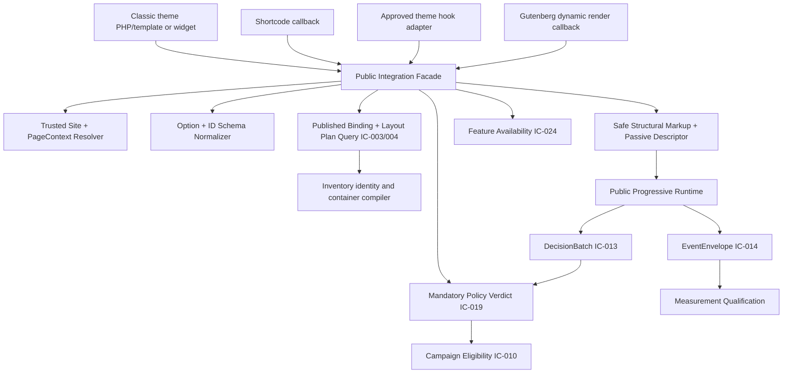

# AdPilot — Theme Integration, PHP Rendering API, Shortcodes & Hooks Specification

**Document ID:** ADP-DOC-017  
**Filename:** `17_ADPILOT_THEME_INTEGRATION_PHP_RENDERING_API_SHORTCODES_HOOKS.md`  
**Version:** 1.0.0 — implementation contract proposal  
**Status:** Proposed; subject to architecture, WordPress compatibility, security, AdTech, privacy, and accessibility sign-off  
**Date:** 2026-10-12  
**Product:** AdPilot — Self-Service Advertising Marketplace & Behavioral Analytics for WordPress  
**Accountable owner:** WordPress Integration Lead + Principal Software Architect  
**Primary reviewers:** WordPress/Gutenberg Lead, Domain/Delivery Lead, Layout Lead, Frontend/Accessibility Lead, Security/Privacy Lead, Finance Lead, QA Lead, DevOps Lead and Product Owner  
**Implementation target:** GPT-6 High, work-package-by-work-package implementation with independent verification  
**Normative predecessor documents:** `ADP-DOC-001` through `ADP-DOC-016`  
**Suggested successor:** `ADP-DOC-018` — Advertising Delivery Engine, Targeting, Selection & Runtime SDK Specification (subject to documentation-plan approval)

> **Status notice.** This is a complete *proposed specification*, not a claim that the PHP functions, shortcodes, WordPress hooks or tests already exist. Public API spellings proposed below resolve the explicit open issue in Document 16 **only if the required owners approve them**. No example code is certified production-ready; production implementations must provide full dependency injection, supported runtime checks, escaping, error handling, tests and security review.

---

## 1. Executive contract and governing order

### 1.1 Product guarantee

A publisher who embeds a published AdPilot placement via a **Gutenberg dynamic block**, **classic theme PHP template**, **block theme template part**, **WordPress shortcode**, **approved theme hook**, or **supported widget area** receives semantically equivalent inventory, layout, eligibility, accessibility and measurement behavior for the *same site and page context*. An integration is an **entry point**, not a separate ad server or permission system. The public document remains useful if JavaScript, AdPilot's measurement service, or an optional commerce extension is unavailable. It must never turn a configured slot into an assumed paid impression.

### 1.2 Document authority and non-regression

| Source | Binding authority inherited by Document 17 |
|---|---|
| `ADP-DOC-001` | All 129 `FR-*`, `BR-001..018`, `NFR-001..016`, `AC-001..015`, `INV-01..10`, `DEC-001..012`; R1–R4 scope |
| `ADP-DOC-002` | `CAP-01..18`, 129 requirement tests `AT-*`, `AT-BR-001..018`, `E2E-01..17` |
| `ADP-DOC-003` | `UJ-11` editor and `UJ-12` theme integration; 20 `UI-*` screens, 18 `WF-*` workflows and 28 `UXA-*` |
| `ADP-DOC-004` | Server-enforced `DP-*` policies, independent state machines `SM-*`, reservation/creative/policy invariants |
| `ADP-DOC-005` | Site-plane WordPress privileges, organization-scoped membership, per-object checks, explicit multisite scoping |
| `ADP-DOC-006` | Modular-monolith boundaries, shared public render pipeline and `IC-001..IC-024` integration contracts |
| `ADP-DOC-007` | Module ownership and `UC-INT-Q01`, `UC-INT-C01..03`, `UC-INT-Q02`; shared renderer interfaces |
| `ADP-DOC-008` | Site-prefixed persistent layout/inventory tables; revision, cache and transaction assumptions |
| `ADP-DOC-009` | Versioned REST endpoint inventory; `DecisionBatch` and measurement/preview distinction |
| `ADP-DOC-010` | Authoritative state-change/outbox jobs; event qualification and asynchronous failure behavior |
| `ADP-DOC-011` | Information architecture, 20 screen contracts, accessibility/RTL interaction standards |
| `ADP-DOC-012` | Scoped design tokens, WordPress visual integration, WCAG target and CSS isolation |
| `ADP-DOC-013..014` | Publisher/advertiser UI boundaries, controlled finance/moderation, safe public marketplace |
| `ADP-DOC-015` | Layout Studio compiler, 500+/1,000+ slot stress, stable logical identity, binding version controls |
| `ADP-DOC-016` | Four `block.json` dynamic blocks, block attributes, Site Editor scope, nonbillable editor previews and integration parity |

**Conflict policy:** Do not change an upstream requirement by choosing a convenient shortcode behavior. Any mismatch is logged with its `FR/BR/IC/GB16/LS15/API` cross-references and remains blocked until accepted by the owners. Proposed `TI17-*` names are *supplemental*, not replacements for original IDs. Existing R1 obligations remain R1; R2 heatmaps, R3 metered billing, and R4 replay/network federation must remain release-gated.

### 1.3 Non-negotiable constraints

1. A theme integration must never let the caller choose arbitrary advertiser-owned creatives, override price/payment, self-approve media, force eligibility, bypass targeting/privacy/density rules, or fabricate events.
2. Public rendering is **read-oriented**. Any auditing needed for an operational fault is a separately bounded operational concern; never post a sale/ledger transaction or viewability fact during the synchronous render callback.
3. The authoritative site comes from the current verified WordPress site context, **not** an `id`, shortcode parameter, browser header or query string supplied by a visitor.
4. A layout draft, editor preview and current public **published** revision are distinct. Public integrations use the published revision, regardless of who invoked the theme helper.
5. Every actual occurrence has a unique `render_instance_id`; multiple occurrences can share one `logical_slot_id`, but intentional repetitions still require eligibility and duplicate-binding policy.
6. On pages with 500 logical placements, the initial HTML/JS/media work is bounded, deduplicated and progressively activated. Support for 500 definitions is not a license to display 500 heavy images or track 500 paid impressions.
7. AdPilot can boot without WooCommerce or proprietary hosted analytics. Disabling/uninstalling the plugin must fail safely, with theme developers advised to check helper existence.
8. Public CSS, JS, HTML identifiers, WordPress hooks and options use explicit `adpilot`/`adp` namespacing to limit conflict with theme and plugin ecosystems.
9. Saved shortcodes may remain visible as text if AdPilot is deactivated and WordPress no longer recognizes them; do not promise invisible removal in uninstalled states.
10. Never promote a proposed unsupported auto-insertion/third-party builder adapter into a universal guaranteed feature.

## 2. Scope, releases and delivery responsibilities

| Release | Integration deliverables | Explicit exclusions |
|---|---|---|
| **R1** | Three PHP helper functions; `adpilot_slot`, `adpilot_zone`, `adpilot_repeater`, `adpilot_showcase` shortcodes; allowlisted R1 hook bindings; classic/block theme support; widget area support; compact zones; shared public renderer; accessible markup; progressive runtime; theme-safe CSS; example templates; diagnostics for known failures | Unbounded DOM/CSS selector insertion; arbitrary theme PHP execution; privileged visitor APIs; R2 visualization |
| **R2** | Advanced missing-hook/selector/duplicate integration diagnostics per `FR-INT-011`, optional R2 consent-aware heatmap geometry support and later container types per relevant feature gates | Session replay, universal cross-builder promises |
| **R3** | Existing rendering adapters consume approved metered allocations/qualified measurement rules through the unchanged shared facade; no independent R3 shortcode charging semantics | Theme-only CPC/CPM price calculation |
| **R4** | Explicitly approved cross-site network abstractions and optional replay still use site-scoped adapter contracts | Default cross-blog render privileges or replay collection |

| Role | Responsible for | Acceptance evidence |
|---|---|---|
| WordPress Integration Lead | Public function bootstrap, shortcodes, widget/hook adapters, template API compatibility | WP integration tests + compatibility matrix |
| Domain/Delivery Lead | Policy/eligibility bridge, current decision freshness, fallback semantics | Parity/eligibility tests |
| Layout/Inventory Lead | Published compiled plans, stable IDs, commercial duplicate rules, binding applicability | Stable-version and contract-aware tests |
| Gutenberg Lead | Block-to-PHP equivalence, Site Editor and Query Loop context | Editor/block parity runs |
| Frontend Performance Lead | Public SDK, intersection batching, tokenized CSS, containment | 500/1,000-slot workload traces |
| Security/Privacy Lead | Escaping, no privilege bypass, hook trust boundary, consent-aware collection | Negative tests and data-flow approval |
| QA/Accessibility Lead | No-JS, RTL, keyboard, AT, multilingual contexts and all `TI17-T-*` | Automated + manual findings |
| DevOps/Support Lead | Caching, invalidation, PHP error monitoring, inactive/migrating plugin behavior | Incident rehearsal and redacted diagnostics |

## 3. Terminology and public rendering semantics

| Term | Definition and implementation consequence |
|---|---|
| `SiteId` | Trusted WordPress blog/site, derived server side (`get_current_blog_id()` where appropriate). |
| `PageContext` | Validated contextual descriptor: concrete post, page, taxonomy, archive, search, Woo product (if present), template part or supported query item, URL classification and locale; may include privacy-safe device class. |
| `LogicalSlotId` | Stable site-local sellable placement identity; **not** the DOM ID or placement occurrence ID. |
| `ZoneId` / `ContainerId` | Published inventory references owned by AdPilot; a single zone may define 200 logical slots. |
| `PublishedLayoutRevisionId` | Immutable layout revision actually eligible for public render. A draft revision is never a public contract. |
| `RenderInstanceId` | Fresh occurrence-scoped opaque ID for every rendered instance and repeated logical slot occurrence; not a monetary event ID. |
| `PlacementBinding` | Publisher-approved rule attaching a published placement to eligible site/page/template/hook context with duplicate policy. |
| `PlacementPlan` | Sanitized public structural plan from Layout/Inventory; holds bounds/identities/format/labels, not private financial ledger records. |
| `DeliveryDecision` | Fresh server-approved choice or no-fill for a specific decision request, after mandatory policy gates. |
| `EmptyFrame` | House/blank/collapse approved fallback, with zero paid impression and stable geometry as required. |
| `NonbillablePreview` | Editor/admin/test/staging mode determined by a trusted server context, never just a user-supplied `preview=true`. |
| `RenderingParity` | Equivalent policy, eligible logical positions, valid geometry, presentation and event semantics across integration paths—not byte-identical markup or IDs. |
| `PassiveDescriptor` | Allowlisted bounded `data-adp-*`/JSON configuration for public runtime, never secrets, billing data or a privileged API credential. |

### 3.1 Five distinct count layers

**Configured**: number of logical slot definitions in a published layout. **Selected/decisioned**: positions considered/answered by the ad decision service. **Rendered**: actual creative presentation completed, not a PHP placeholder. **Viewable**: measured according to qualified viewability protocol and consent/purpose. **Billable**: independently qualified financial basis under applicable contract (R3 metering only when enabled). None can be derived by simply counting shortcode or PHP helper executions. Editor previews, load-test modes and known administrative inspections must be nonbillable.

## 4. Runtime topology, service ownership and dependency direction



**No** theme, Gutenberg, shortcode or integration module may directly query mutable commerce tables or output an advertiser's unreviewed creative. `IC-001..024` continue to define underlying module boundaries. `UC-INT-Q01` remains the integration read use case; `UC-INT-C01..03` remain privileged integration management operations and are **not public PHP facade functions**. The common facade is the only permitted entry point to `PublishedPlacementPlanQuery`/`PublicPlacementRenderer` from WordPress theme code.

### 4.1 Execution order

1. WordPress boots AdPilot in supported state and registers functions, shortcodes, blocks and hook providers at appropriate WordPress lifecycles; no premature assumption about `is_singular()` before the main query is set.
2. Entrypoint normalizes an allowlisted `PlacementReference`, presentation overrides and a source flag derived **internally**; reject incompatible IDs or options without leaking resource details.
3. Resolve trusted site and page/post/template/query context (including current loop item when explicitly supported). Never trust arbitrary visitor-supplied post IDs to impersonate another page.
4. Resolve active published layout/binding, feature gate and site-scoped slot range; do not use a draft as public content.
5. Apply context compatibility, duplicate/density constraints, mandatory policy verdict and server-safe fallback.
6. Mint page-local unique render instance IDs; emit accessible, escaped structural HTML with stable logical refs, version and a bounded passive runtime descriptor.
7. Public SDK batches deferred creative decisions and measurement separately. **Fresh** decision-side authoritative checks reject paused/rejected/expired campaigns even when cached HTML includes an earlier slot shell.
8. On cache/plugin/endpoint failure, preserve the WordPress document and avoid false paid metrics; record only minimized redacted operational diagnostics.

### 4.2 Allowed dependency shape

```text
WordPress public PHP facade / shortcode / approved hook / dynamic block
  -> integration application contract
     -> site/context identity (authoritative)
     -> Inventory + Layout published read model
     -> Delivery + mandatory policy adapter
     -> Presentation safe renderer
     -> Public descriptor assembler
  -> HTML string

Public SDK -> bounded DecisionBatch and untrusted EventEnvelope endpoint
Public SDK -X-> private editor, finance, moderation or approval REST routes
```

Architecture tests SHALL reject cross-module `wpdb` access from theme adapters, direct mutable creative lookup, direct ledger writes, runtime bypass flags and divergent rendering algorithms.

## 5. Public PHP facade (`TI17-PHP-*`)

### 5.1 Stable proposed signatures

```php
<?php
/**
 * Render one published logical advertising slot.
 * @param string $slot_id Opaque site-local logical slot ID.
 * @param array<string, scalar> $options Presentation-only overrides from §5.3.
 * @return string Safe, self-contained public HTML fragment, or '' on recoverable no-output.
 */
function adpilot_render_slot(string $slot_id, array $options = []): string;

/** @return string Safe public HTML fragment or '' on recoverable no-output. */
function adpilot_render_zone(string $zone_id, array $options = []): string;

/** @return string Safe public HTML fragment or '' on recoverable no-output. */
function adpilot_render_container(string $container_id, array $options = []): string;
```

These are **proposed frozen R1 signatures** to approve against `FR-INT-005`, Document 07's `UC-INT-Q01` and Document 16's open implementation contract. The interface always **returns** HTML; it never echoes, returns a collection of objects or returns `WP_Error`. A public adapter catches expected `DomainIntegrationFailure`/`UnavailablePlacement` and maps to `''` or the approved safe fallback, with a redacted diagnostic. In exceptional programming/system failures, do not suppress fatal bugs silently in development; front-end recovery and observability must be implemented without exposing internals to visitors. All three functions have the same options normalization and safety behavior.

The functions are declared conditionally in the AdPilot bootstrap (`if (!function_exists(...))`) with collision detection. **Do not** silently attach a conflicting definition if another plugin or theme already owns `adpilot_render_slot`; record install-health failure and present an actionable administrator diagnostic. A plugin-free theme MUST guard calls with `function_exists()` for graceful deactivation.

### 5.2 ID validation contract

- Accept **string only**; IDs are opaque site-local identifiers, not WordPress post IDs, arbitrary SQL or CSS selectors.
- Reject empty, non-UTF-8/binary, whitespace control, oversize, forbidden punctuation and cross-site resource refs according to canonical `SlotId` / `ZoneId` / `ContainerId` value objects; exact regex must match approved domain IDs, **not a newly invented incompatible pattern**.
- Never permit `site_id`, `organization_id`, `creative_id`, `campaign_id`, `approval_id`, `contract_id`, `order_id`, `invoice_id` or arbitrary query parameters as an authority-bearing render option.
- A nonexistent, archived, unpublished or foreign-site ID produces safe empty/fallback publicly; logged-in authorized editor interfaces may expose additional sanitized diagnostics through protected APIs, not public markup.
- Published zone counts compile from inventory definitions, not serialized arrays supplied in `$options`.

### 5.3 Allowlists of presentation-only options

| Key | Slot | Zone | Container | Accepted values | Meaning / boundary |
|---|---|---|---|---|---|
| `appearance` | Yes | Yes | Yes | `default`, `minimal`, `framed`, `quiet` only where kind permits | Restricts styling within publisher-approved variants; no size/price override |
| `responsive_preset` | Yes | Yes | Yes | `inherit`, `compact`, `fluid` if approved for selected kind | CSS-only preset and bounded layout behavior, not slot count or sold dimension change |
| `aria_label` | Optional | Optional | Optional | sanitized bounded plain text; site policy may disable | Accessibility description, **not** a paid/ad disclosure replacement or `aria-hidden` bypass |
| `class` | Optional | Optional | Optional | small list of namespaced `adp-u-*` allowlisted tokens | Host-provided cosmetic class only; never raw style/HTML/string injection |
| `diagnostic_context` | No | No | No | **not accepted publicly** | Must originate from a trusted editor diagnostics context, not theme parameters |
| Any unlisted key | No | No | No | rejected/ignored with internal diagnostic | Includes `force`, `creative`, `paid`, `auto_approve`, `tracking_disabled`, `layout_version`, `capacity` |

Use a consistent `InvalidPublicRenderOption` policy: unknown keys SHALL be rejected from typed application inputs; for compatibility at the exported public façade, map invalid public options to a safe `''` and redacted log by default. No unknown key may alter a policy gate; document whether a strict development flag surfaces a developer warning outside production. The existing Gutenberg attributes use `responsivePreset`/`displayLabel`, so the **WordPress BlockRenderBridge must explicitly map** approved camelCase attributes to canonical option objects. **Do not** feed arbitrary saved block attributes into the facade and accidentally grant extra options. Appearance enumerations are reconciled with Document 16 per block, not uniformly enabled without review.

### 5.4 Additional proposed internal interfaces (not a new global public API)

```php
<?php
namespace AdPilot\Modules\Integration\Application\Contracts;

interface PublicPlacementFacade
{
    public function render(PublicPlacementRequest $request): SafeHtmlFragment;
}

interface TrustedRenderContextResolver
{
    public function resolve(string $source, ?\WP_Post $loopPost = null): PublicPageContext;
}

interface PublicOptionNormalizer
{
    public function normalize(string $kind, array $values): PublicPresentationOptions;
}

interface OccurrenceRegistry
{
    /** Generate a new unique occurrence, then validate duplicate binding policy. */
    public function reserve(PublicPageContext $context, PlacementReference $reference): RenderOccurrence;
}
```

`SafeHtmlFragment` is an internally reviewed value object, **not** user-provided raw HTML or a generic bypass of escaping. Its constructor must be inaccessible to arbitrary third-party hook callbacks. `PublicPlacementRequest` is assembled only after trusted context resolution and normalizer validation. `source` is internal (`php`, `shortcode`, `block`, `hook`, `widget`, `fallback`) and cannot be supplied to HTTP for privileged behavior. Code samples are interface sketches, not complete PSR-4/autoload/build files.

### 5.5 Render behavior truth table

| Input/condition | Public result | Diagnostic behavior | Billable/measurement effect |
|---|---|---|---|
| Active published, compatible and eligible | Approved structural placement plan | Optional trace ID, sampled | Zero until qualified actual downstream events |
| Active published but no eligible advertiser | Approved house/blank/collapse fallback | No sensitive reason leaked | Zero paid events |
| Valid reference, unpublished/inactive | `''` or configured safe blank per publisher policy | Publisher-only explanation | Zero |
| Missing/deleted/foreign ID | `''`, no resource enumeration | Scoped redacted warning | Zero |
| Bad option/unsafe markup | `''`; never reflect value | Sanitized integration error | Zero |
| Integration called before trusted query ready | Safe no-op / explicitly documented deferred adapter | Development notice where appropriate | Zero |
| Database/policy unavailable | Fail closed on paid delivery, graceful page output | Health incident and bounded log | Zero false served/billed |
| Editor/staging trusted preview | Representative safe projection (editor API) or nonbillable public frame | Editor-only status | Never paid |
| JavaScript disabled | Consistent placement fallback with approved no-JS policy | No JS-specific fatal | No invented viewability |

### 5.6 Examples (safe caller contract)

```php
<?php
// themes/acme-child/sidebar.php — guarded optional integration.
if ( function_exists( 'adpilot_render_slot' ) ) {
    echo adpilot_render_slot( 'slot_sidebar_01', array( 'appearance' => 'minimal' ) );
    // SafeHtmlFragment was escaped and compiled by AdPilot; no second esc_html() here.
}
```

```php
<?php
// themes/acme-child/template-parts/footer/ads.php — one call, 200 logical slots.
if ( function_exists( 'adpilot_render_zone' ) ) {
    echo adpilot_render_zone( 'zone_footer_01', array( 'responsive_preset' => 'inherit' ) );
}
```

```php
<?php
if ( function_exists( 'adpilot_render_container' ) ) {
    echo adpilot_render_container( 'container_sidebar_01' );
}
```

**Developer warning:** These example IDs are sample fixtures, not guaranteed identifiers or implicit default placements. Exact identifiers must come from a published Layout Studio resource on that **site**. Do not set arbitrary options to bypass delivery. Avoid a theme's own ad impressions analytics on the same injected output unless reconciled by a supported, qualified measurement adapter.

### 5.7 PHP behavior across re-entrant contexts

- Template part repeated in one request: a new occurrence per call; same logical ref; density/duplicate-binding logic retains authority.
- WooCommerce product context: derive actual queried product / loop item only if Woo is installed and adapter declared; no unconditional Woo dependency.
- `wp_head`/early plugin-init call: do not assume query is ready. Register logic at `init`, but placement rendering generally occurs after WordPress queried object exists. An approved specialized early context adapter must explicitly supply trusted context.
- AJAX/REST callback rendering: public facade does not grant REST permission; derive authoritative request context by a validated server-side resolver or reject if context missing. Do not invoke arbitrary `switch_to_blog()` or accept browser-supplied context as authoritative.
- Multisite context switches: use `try/finally`, rebind site-scoped services/caches and verify explicit operation policy; a public theme can render only the active site's published inventory unless R4 federation is explicitly implemented/approved.

## 6. Shortcode API (`TI17-SC-*`)

### 6.1 Shortcode registry and initial syntax

| Shortcode | Required attributes | Optional attributes | Delegation |
|---|---|---|---|
| `[adpilot_slot id="slot_sidebar_01"]` | `id` | `appearance`, `responsive_preset`, `aria_label`, `class` (allowlisted per kind) | `adpilot_render_slot()` via normalizer |
| `[adpilot_zone id="zone_footer_01"]` | `id` | `appearance`, `responsive_preset`, `aria_label`, `class` (allowlisted) | `adpilot_render_zone()` |
| `[adpilot_repeater source_type="zone" source_id="zone_inline_01" interval="3" max_insertions="3"]` | `source_type`, `source_id`, `interval` | `max_insertions`, `anchor_adapter` (approved) | Supported bounded repeater placement service, not a top-level PHP public facade |
| `[adpilot_showcase id="showcase_partners_01" presentation="grid"]` | `id` | `presentation`=`grid`/`list` (per R1 capability), `aria_label` | Approved showcase query/render service, not arbitrary media |

`source_type` for repeater is proposed as `zone` in R1; extension to `slot` or other source types requires approved adapter semantics and identifier test fixtures. Repeater `interval` is a positive bounded integer within a publisher configured ceiling; `max_insertions` likewise. `anchor_adapter` must reference a registered **known provider** and may be omitted only if the current safe content context has a documented default. Shortcode callback never invokes a visitor-supplied named PHP function. The `adpilot_showcase` shortcode is R1-safe static/grid/list presentation; R2 carousel and advanced layouts are governed separately.

### 6.2 Registration and evaluation

- Register tags using `add_shortcode()` at/after `init`, once; detect collisions through `$shortcode_tags` before registration and issue admin health diagnostics if conflicting. `adpilot_*` prefixes reduce but cannot eliminate conflicts.
- WordPress normalizes shortcode attribute **names** to lowercase. Canonical shortcode names use snake_case; do not assume Gutenberg camelCase attrs are forwarded unchanged.
- Use `shortcode_atts()` with a **narrow allowlist**, then validate before converting into an internally trusted render request. `shortcode_atts()` alone is not a security validator; unknown flags must not be silently accepted into a downstream generic options array.
- Shortcode callbacks **return strings** and never echo. They must not mutate order/approval state, enqueue unbounded creatives, perform remote payment calls or call privileged WordPress REST routes with admin credentials.
- Standard supported shortcode usage is self-closing with no `content`. Reject/ignore an enclosing `$content` rather than treating it as untrusted ad HTML or evaluating it with nested `do_shortcode()`; document this limitation.
- Evaluate shortcodes in the actual eligible content filter/request context, not an arbitrary third-party `the_content` filter added on all site text. Prevent repeated processing of same content cycle, editor/revision/REST previews, and recursion.

### 6.3 Illustrative registration and normalized dispatch

```php
<?php
add_action( 'init', function () {
    $registry = array(
        'adpilot_slot'     => 'slot',
        'adpilot_zone'     => 'zone',
        'adpilot_repeater' => 'repeater',
        'adpilot_showcase' => 'showcase',
    );

    foreach ( $registry as $tag => $kind ) {
        // Production version must check tag collision and record health status.
        add_shortcode( $tag, function ( $raw_atts, $content = null, $actual_tag = '' ) use ( $kind ) {
            // Plugin container resolves the injected ShortcodeBridge instance.
            return adpilot_shortcode_bridge()->render( $kind, (array) $raw_atts, $content );
        } );
    }
} );
```

The helper `adpilot_shortcode_bridge()` above is an **illustrative internal service resolver**, not a newly promised public stable function. Production bootstrap must avoid global singleton pollution and must honor dependency registration/migration health checks. The bridge must implement same eligibility and return contracts as §5 and §8.

### 6.4 Shortcode reject/accept matrix

| Input | Correct behavior |
|---|---|
| ID of another site or not published | Safe empty/no enumeration |
| `[adpilot_slot id="..."]` in post body | Eligible page-context rendering + unique occurrence |
| `force_paid="1"`, `creative_id="..."`, `campaign_id="..."` | Unknown authority attrs cannot reach domain service; reject/ignore safe, diagnostic |
| `appearance="../../etc"`, CSS `url(javascript:...)` | Reject invalid variant/class, no reflected injection |
| `[adpilot_zone id="..."][adpilot_zone id="..."]` | Two instances only if permitted duplicate policy; do not double allocate inventory |
| Shortcode in site editor preview | Nonbillable, bounded representative projection |
| Repeater run twice on same content, recursive content filter | Recursion budget/insertion dedupe, no runaway loop |
| Repeater on unsupported product grid/third-party builder | Safe no-op and authorized diagnostic, no universal insertion claim |
| Showcase requested carousel in R1 | Render approved R1 fallback or reject unsupported variant; do not masquerade as approved carousel |
| Multisite A page with site B ID | Site-local safe failure |

## 7. WordPress action and filter extension registry

### 7.1 Compatibility policy for plugin-owned hooks

The hooks in this section are **proposed stable public extension points** and require formal signature/version sign-off. They do **not** authorize a filter subscriber to override domain authority. Default hook args are immutable copies/scalars/DTOs or restrictive allowlisted inputs. Hooks are invoked by the approved integration layer at documented deterministic phases. Third-party callbacks may be untrusted; validate their results after *every* extension point. Do not `eval()` returned content, instantiate callback class names supplied by visitors, or echo third-party raw strings as approved HTML.

All public hooks are prefixed `adpilot_`; avoid overloading WordPress core hooks with private domain DTOs. If a hook is absent from this registry, it is not guaranteed stable or publicly supported. Use `apply_filters()` for controlled transformations, `do_action()` for non-authoritative notifications. Side effects requiring transactions/outbox are **not** performed from a public rendering hook.

### 7.2 Proposed documented filter contracts (`TI17-FLT-*`)

| ID | Proposed hook | Input → Output | Timing and strict guard |
|---|---|---|---|
| `TI17-FLT-001` | `adpilot_public_render_options` | Validated immutable options + reference/context summary → narrower allowed options | After normalization, before plan selection; forbidden authority fields stripped/rejected |
| `TI17-FLT-002` | `adpilot_binding_candidates` | Readonly site/page binding candidate IDs → subset of candidate IDs | Before binding selection; may **remove** only, never add unpublished candidates |
| `TI17-FLT-003` | `adpilot_public_context_labels` | Sanitized public context labels → sanitized labels | Before markup, no query/site/permission mutation |
| `TI17-FLT-004` | `adpilot_placement_classes` | Allowlisted CSS class tokens → allowlisted token subset/addition | After approved presentation, no arbitrary inline CSS/scripts |
| `TI17-FLT-005` | `adpilot_disclosure_text` | Localized text + locale → reviewed safe plain-text disclosure | Cannot hide sponsored disclosure or replace with empty string |
| `TI17-FLT-006` | `adpilot_empty_state_variant` | Approved house/blank/collapse option + policy → approved narrower variant | No paid creative injection, respects shift/density constraints |
| `TI17-FLT-007` | `adpilot_slot_visibility_policy` | Published eligibility flags and provider restrictions → policy **narrowing** | Never turn prohibited slot visible/paid |
| `TI17-FLT-008` | `adpilot_public_batch_size` | Safe configured batch limit → bounded smaller/equal limit | Cannot lift resource/DDoS ceiling |
| `TI17-FLT-009` | `adpilot_public_resource_budget` | Whitelisted numeric resource ceilings → lower/equal limits | Never override server security limits |
| `TI17-FLT-010` | `adpilot_repeater_anchor_allowlist` | Registered eligible anchor IDs → safe subset | Prevent unauthorized Query Loop/builder injection |
| `TI17-FLT-011` | `adpilot_template_hook_bindings` | Validated approved site hook bindings → subset | Cannot introduce arbitrary theme hooks or auto-bindings |
| `TI17-FLT-012` | `adpilot_public_markup_attributes` | Reviewed safe attribute map → allowlisted added attributes | Only namespaced `data-*`, safe `aria-*`, classes; no event handlers |
| `TI17-FLT-013` | `adpilot_output_locale` | Validated site/page output locale → supported formatting locale | No mutation to commercial schedule's UTC reference |
| `TI17-FLT-014` | `adpilot_integration_diagnostics` | Redacted codes/labels → more restrictive redacted projection | Admin-only health UI, not public data disclosure |
| `TI17-FLT-015` | `adpilot_slot_placement_priority` | Bounded presentation priority for approved candidates → constrained priority | Cannot override purchased placement rights or priority allocations |
| `TI17-FLT-016` | `adpilot_public_asset_policy` | Approved bundle/asset policy → approved no-more-invasive policy | Cannot add arbitrary third-party analytics origin |

**No hook** named `adpilot_force_approved`, `adpilot_bypass_payment`, `adpilot_override_eligibility` or equivalent may exist. Changes to canonical campaign eligibility require approved domain commands, not frontend extension filters. Any filters returning arbitrary `WP_Error`, strange types, exceptions or expensive data produce safe fallback and a sampled redacted diagnostic; policy evaluation runs **after** filters.

### 7.3 Proposed action contracts (`TI17-ACT-*`)

| ID | Proposed action | Fired when | Payload & restrictions |
|---|---|---|---|
| `TI17-ACT-001` | `adpilot_public_render_requested` | Validated public call begins | Site/context/reference/public source only; informational, not authority |
| `TI17-ACT-002` | `adpilot_public_render_plan_resolved` | Published plan and mandatory restrictions checked | Immutable public plan summary, no advertiser financial records |
| `TI17-ACT-003` | `adpilot_public_render_completed` | Safe HTML returned | Context, reference, elapsed budget, occurrence count, no raw HTML/secrets |
| `TI17-ACT-004` | `adpilot_public_render_skipped` | Expected no-op, unavailable ref or policy | Safe reason code; never raw ID enumeration to unauthenticated consumers |
| `TI17-ACT-005` | `adpilot_theme_binding_conflict` | Duplicate/hook collision detected | Site/site-scoped refs; detailed notice visible only to authorized diagnostics |
| `TI17-ACT-006` | `adpilot_public_assets_enqueued` | Runtime/styles enqueued once | Public asset handles and version, no sensitive user data |
| `TI17-ACT-007` | `adpilot_widget_context_resolved` | Approved widget invocation classified | Trusted sanitized widget/container identifier |
| `TI17-ACT-008` | `adpilot_supported_adapter_registered` | Publisher-approved provider registered | Registry ID/version and capability-safe metadata; no executable user code |
| `TI17-ACT-009` | `adpilot_theme_integration_health_changed` | Operator-observable integration status changes | Redacted status summary; actual audit through Platform service |
| `TI17-ACT-010` | `adpilot_theme_binding_validated` | Approved binding validated during publish workflow | Validation outcome and immutable resource/version refs; cannot change result |

Hooks may be triggered multiple times under caching/re-entrant WordPress rendering. Consumers must be idempotent and avoid relying on these presentation actions to create financial or measurement facts. If a required authoritative event needs durable delivery, use the **Document 10 domain outbox**, not a public theme `do_action()` callback.

### 7.4 Illustrative safe filter adapter

```php
<?php
add_filter( 'adpilot_placement_classes', function ( array $class_tokens, array $public_context ): array {
    if ( isset( $public_context['placement_kind'] )
        && 'zone' === $public_context['placement_kind'] ) {
        $class_tokens[] = 'adp-u-rounded'; // Must be allowlisted by AdPilot.
    }
    return $class_tokens;
}, 10, 2 );
```

The example is a proposed hook signature. Production implementation SHALL **re-normalize** the class tokens, apply immutable mandatory policy afterwards and continue safely if a callback returns the wrong type. `apply_filters()` cannot be treated as a trusted authorization source.

### 7.5 Action/filter compatibility and deprecation

- A stable public hook's name, argument order, meaning and value types form a versioned contract; add optional context fields compatibly and test previously supported consumers.
- Publish an explicit hook compatibility matrix and deprecation notice before replacement; when feasible issue `_deprecated_hook()` with the correct WordPress compatibility behavior and retain a migration period per signed-off policy.
- Never change a filter from policy-narrowing to policy-expanding under the same name.
- Document allowed execution phases and whether code may run while no main WordPress query is available.
- Hook callbacks cannot be trusted to be cheap, exception-free, privacy-safe or valid; use defensive validation and bounded invocation where possible. WordPress PHP cannot terminate arbitrarily slow hostile callbacks safely without broader process limits, so explicitly warn integrators.
- Extension hooks shall not expose raw session replay, visitor PII, payment source tokens, unapproved media, tenant-secret IDs or private reporting records.

## 8. One shared rendering engine: authoritative pipeline (`TI17-RND-*`)

### 8.1 Structural phases and immutability

```text
IntegrationEntrypoint (PHP | shortcode | Gutenberg | approved hook | widget)
 -> normalize kind, site-local reference, bounded public display options
 -> TrustedContextResolver(active blog, main query/approved loop item, locale, source)
 -> FeatureAvailability (IC-024), site-scope checks (IC-001)
 -> PublishedPlacementPlanQuery (IC-003/004) + registered binding
 -> Layout/Inventory compiler: stable generated slot ranges and published geometry
 -> DuplicateBindingPolicy + DensityGuard + MandatoryPolicyVerdict (IC-019)
 -> if no eligible plan: site-configured house/blank/collapse, never invented revenue
 -> OccurrenceRegistry: fresh per-render IDs, same stable logical slot refs
 -> SafePublicRenderer: valid semantic structure + namespace + disclosure
 -> Optional passive `data-adp-*` descriptor, no secret/financial field
 -> return safe string; enqueue public SDK once via WordPress lifecycle
 -> SDK: intersection scheduling, batch decisions (IC-013), qualified events (IC-014)
```

### 8.2 Renderer API neutrality

Define `renderForEntrypoint(reference, trustedPageContext, presentationOptions)` as the internal application boundary. The pipeline accepts identical reference and policy operands regardless of which supported integration calls it. *Only* wrapper-level metadata differs: WordPress block wrapper classes, theme container semantics, user-controlled inert ARIA labels. A filter may safely remove a candidate, but mandatory policy is always applied **after** extension processing, and the same restriction must be expressible consistently across entry paths.

### 8.3 Time, consent, cache and emergency changes

- Campaign schedule and contract periods use canonical UTC half-open intervals with explicit timezone presentation. A browser/theme locale never changes schedule eligibility.
- Emergency pause, creative rejection, expired hold/payment failure and policy changes invalidate or make irrelevant prior shared render plans; creative decisions always revalidate current authority.
- A public cache may retain generic **structural** layout shells under safe site/layout/context keys, never per-visitor consent, private organization/finance records, signed provider secrets or a stale preapproved creative entitlement.
- Consent-aware optional event collection is governed by the compliant runtime and policy service, not WordPress shortcode attributes; ad delivery may continue safely when optional measurement is denied where policy allows.
- R2 heatmap geometry references the published layout revision and actual occurrence; R4 replay remains disabled by default and cannot be activated by a PHP facade option.

### 8.4 Placement occurrence identity and dedupe

Use page-request-local `OccurrenceRegistry` with `site_id`, `published_layout_revision`, stable `logical_slot_id`, approved binding key, source, template-part path/context and monotonically unique or random occurrence token. Separate the logical slot's contract identity from a page occurrence ID. Detect unintended duplicated injections of the **same approved placement binding** across block+hook, PHP+shortcode, repeated template parts and re-entry. Outcomes: safe suppress, approved multirender semantics or publisher-visible warning per business policy. Never avoid duplicate detection by simply assigning a new `id`.

### 8.5 Deterministic fallback hierarchy

1. Invalid/unpublished reference: no private information shown; generally `''`.
2. Valid published slot with no eligible paid creative: publisher-approved house creative if *eligible, safe and policy-compliant*, else reserved blank with preserved geometry or safe collapse.
3. Temporarily unavailable decision endpoint: nonbillable house/blank/collapse; no false paid counters and no blocked content.
4. Browser JS disabled: safe semantic no-JS fallback and documented absence/limits of active decisions, interaction and viewability measurement.
5. R2/R4 optional analytics absent: R1-compatible public rendering remains intact.

### 8.6 Why server-side preselection must be restricted

Do not synchronously run one heavyweight ad decision per generated logical slot during a PHP render. A 200-cell footer needs a *compact* published plan and bounded structural frames; the browser selectively requests active decisions near the viewport through shared batching. Any approved server-side house creative/fallback must meet safe rendering/metrics exclusions. HTML render and actual in-viewport creative display are separate events, and display is not automatically billable.

## 9. Approved theme hooks and provider adapters (`TI17-HOOK-*`)

### 9.1 Explicit site-admin registration flow

1. A developer documents a concrete theme-owned hook name and expected invocation context (`wp_body_open`, theme-provided action, template part location, or safe provider-defined hook).
2. A site-level AdPilot administrator with the appropriate integration capabilities registers a **named allowlisted provider adapter** (if not already packaged) with a semantic version, renderer-safe context contract and supported theme/version matrix.
3. Layout Studio binds an approved `ZoneId`/`SlotId`/`ContainerId` and immutable published version semantics to that hook and site context.
4. Publish validation confirms the provider exists, the placement is compatible, density/duplicate rules pass and paid contracts are not degraded. Missing provider is an actionable warning/block as policy requires.
5. At the actual theme action invocation the adapter computes trusted context, asks the shared facade to render and emits **only its safe HTML**.
6. When the theme changes/removes hook, output fails safe and an authorized diagnostic identifies the missing provider; never scrape arbitrary DOM selectors in R1 to force insertion.

### 9.2 Provider registry schema (proposed)

| Field | Requirement |
|---|---|
| `provider_key` | Stable namespaced internal adapter ID; not a visitor-supplied hook name |
| `theme_stylesheet` and version range | Site-controlled installed theme (or reviewed core integration) |
| `wordpress_action` | Exact allowlisted action name; never dynamic `call_user_func` from shortcodes |
| `context_types` | Explicit `singular`, `archive`, `search`, `product`, `template_part` etc. |
| `multiplicity` | `once`, `allow_repeated_with_policy`, or declared bounded repetition |
| `binding_key` | Stable site/publisher-approved binding reference |
| `priority` / `accepted_args` | Frozen reviewed args; bounded and collision-aware |
| `capability` | Current site-level integration authority for registration/update |
| `adapter_version` | Compatibility and migration provenance |
| `status` | pending approval / enabled / disabled / incompatible; no raw function injection |

### 9.3 Example integration with a *known* theme-owned action

```php
<?php
// In a theme template (explicit hook is controlled by the theme author).
do_action( 'acme_after_primary_content' );
```

```php
<?php
// Plugin integration adapter, only after provider+binding have been approved.
add_action( 'acme_after_primary_content', static function (): void {
    // Internal site-scoped integration registry verifies this is an approved
    // provider invocation and resolves a published placement binding.
    $approved = adpilot_get_approved_hook_binding('acme_after_primary_content');
    if (null === $approved) { return; }
    // Internal helper names are illustrative and NOT public API.
    echo adpilot_public_binding_renderer()->renderApprovedBinding($approved);
}, 20 );
```

`adpilot_get_approved_hook_binding()` and `adpilot_public_binding_renderer()` are **illustrative internal bridge names**, not guaranteed stable public helpers. The actual implementation MUST use service-container dependencies, validate existing context and return only reviewed safe output; code above is not sufficient to authorize an arbitrary externally registered hook. Avoid hook provider recursion (calling the same action from inside its own handler); bound nesting depth and detect current binding on the stack.

### 9.4 Supported versus unsupported automation

| Context | R1 classification | Justification |
|---|---|---|
| Explicit theme `do_action()` with registered provider | Supported with publisher-reviewed binding | Deterministic insertion point and authorization |
| Classic template `adpilot_render_*()` | Supported | Developer-controlled intentional placement |
| Gutenberg dynamic block/template part | Supported | `block.json` contract and current editor context |
| WP widget area using approved shortcode/text or registered safe widget | Supported with capability/context tests | Conventional classic theme area |
| `wp_body_open` generic auto-insertion | Proposed opt-in only after theme/context compatibility review | Multiplicity/position variation; no silent universal auto insert |
| Arbitrary CSS selector injection into DOM | Not guaranteed R1 | Unstable semantic anchor, CSS/theme conflicts, hydration and geometry skew |
| Third-party page builder auto injection | Not supported unless reviewed adapter | Unknown lifecycle, caches, repeated mounts, privacy and markup |
| WooCommerce product grid insertion | Adapter only where installed/approved | Woo conditional context and product-query stability |
| WordPress `blockHooks` auto insertion everywhere | Not default R1 | Risk of duplicate commercialization in shared templates |

## 10. Classic themes, child themes and widget areas

### 10.1 Theme template map

| Classic template/area | Preferred integration | Verified context requirement |
|---|---|---|
| `header.php` | Direct published zone call or approved theme hook | Main query exists, one header binding per intended location |
| `sidebar.php` | Slot/zone/container facade or shortcode via registered widget | Distinguish sidebar reuse/archives/singular |
| `single.php` / `page.php` | Bounded `adpilot_render_zone()` at explicit template point | Current queried post and editing/nonbillable preview differ |
| `archive.php` / `category.php` | Published archive binding and recognized context | Use actual taxonomy/post type, no random post impersonation |
| `search.php` | Approved search-context placement; privacy-safe query classification | No raw sensitive search query in descriptor/analytics |
| `footer.php` | Compact footer zone, e.g. 200 logical slots | Initial DOM/creative load bounded, responsive grid geometry |
| `woocommerce/single-product.php` | Reviewed Woo adapter where present | Genuine product context; safe when Woo disabled |
| Traditional widget area | Approved shortcode or optional packaged widget | Return-only shortcode, no unexpected global widget filters |

### 10.2 Child theme rollout checklist

- Use a child theme where appropriate; avoid modifying a third-party vendor parent theme's updates directly.
- Insert a guarded helper at an explicit, deterministic point in the template. Confirm the same zone is not already inserted from a Gutenberg template part or registered automatic theme hook.
- Record the published site zone ID and source of truth; avoid translating slugs automatically into a second commercial identity.
- Inspect DOM, mobile geometry, disclosures, actual decision requests and nonbillable status before production.
- Disable fallback CSS resets from the plugin. Classes use `.adp-` prefixes; theme styles should customize documented CSS variables only.
- Test theme switching, deactivation, RTL language, alternate page contexts, cache hit and no-JS behavior.

### 10.3 Widget implementation policy

If supplying `AdPilot_Placement_Widget` for classic sites, register it at `widgets_init`, provide a capability-gated configuration UI for allowed published references, serialize **only** stable reference + presentation override, and ensure `widget()` delegates to the shared facade. Widget title must not replace sponsored disclosure. Widget preview/admin is nonbillable. `WP_Widget` lifecycle, customizer preview and block-based Widgets editor require compatibility testing; do not assume classic widgets are always present. If shortcode is used in a `core/shortcode` block or text widget, ensure WordPress actually evaluates it in that context and does not double-evaluate nested filters. No automatic invocation of `do_shortcode()` across all content strings.

## 11. Block themes, Site Editor, patterns and template parts

### 11.1 Allowed binding patterns

- Preferred: `adpilot/ad-slot`, `adpilot/ad-zone`, `adpilot/ad-repeater`, `adpilot/ad-showcase` from Document 16. A single `adpilot/ad-zone` corresponds to an entire published compact zone.
- Site Editor `wp_template` / `wp_template_part` references must resolve using actual front-end page context, not the editor's template object ID as if it were the visitor page ID.
- A synced pattern or template part inserted multiple times must preserve stable logical reference but mint fresh instance IDs and honor duplicate/density policy.
- The editor iframe is a **nonbillable** preview. Editor-selected media never becomes ad approval. A saved template is not permission to publish a new sold-slot layout revision.
- Site Editor can be unavailable with classic themes; support classic fallback. If a block is removed/deactivated, preserve serialized content and make recovery possible on reinstall.

### 11.2 Query Loop, repeater and per-post context

For a Query Loop inner post, take trusted contextual `postId`/`postType` only from the WordPress block processing context verified by the approved adapter. Never take an arbitrary numeric shortcode `post_id` to access another user's private page/targeting. A zone may be reused across each visible query item with new occurrence ID and policy-bounded iteration. High multiplicity and inadvertent duplicate purchase presentation must be detected; a 20-post loop should not quietly run 20 heavyweight decision calls during PHP rendering. Repeater support is opt-in per anchor adapter, with explicit loop depth, max insertions and skip rules, not a universal parser of every block tree.

### 11.3 Pattern and FSE editor behavior

- A block's saved markup contains references and bounded display attributes only, not serialized creative HTML, pricing or hundreds of generated slots.
- On missing resource/permission, editor shows an actionable warning if viewer can diagnose the resource; public site shows safe empty/fallback without enumeration.
- Respect theme block styles without overriding global `theme.json` presets; scope public AdPilot classes/variables.
- Blocks must behave in both iframe and non-iframe editor contexts where applicable; script/style loading needs built assets and supported API registration, not ad hoc inline injection.
- `get_block_wrapper_attributes()` is used only inside a real block render callback/context; PHP theme facade output must not assume that function's block supports context exists. This prevents malformed markup/empty wrappers in direct PHP or shortcode paths.

## 12. Repeater and dynamic insertion rules

### 12.1 Shared repeater contract

The shortcode repeater and Gutenberg repeater share `RepeaterPlacementService`. Inputs: approved placement source, bounded interval, maximum inserts, supported adapter, content-context identity and recursion token. The algorithm enumerates **eligible semantic anchors** in a constrained stream, counts only admitted anchors, inserts after every `interval` anchors up to `max_insertions`, rejects insertion into sensitive content and invalid HTML nesting, and makes each occurrence unique. It never runs arbitrary regex replacement on unbounded rendered HTML by default.

### 12.2 Anchor adapter contract

| Property | Requirement |
|---|---|
| `id` and `version` | Stable, reviewable, registered type/version |
| `supported_contexts` | Actual post content, bounded block tree, approved template/query contexts |
| `eligible_nodes` | Explicit node types, structural selectors, skip rules |
| `security_exclusions` | Inputs/forms/commerce/medical/sensitive/private widgets, interactive button/links |
| `max_depth` / `max_nodes` / `max_insertions` | Hard operational ceilings; independent of visitor input |
| `serialize_strategy` | Safe parsed-block insertions or approved semantic node composer |
| `nonvisual_order` | Keyboard/screen-reader order matches intended DOM reading order |
| `dedupe_key` | Site/context/content revision + adapter + anchor ordinal + binding revision |
| `test_fixtures` | Nested blocks, short content, malformed blocks, multilingual, loop, no JS |

### 12.3 Example and limits

```text
[adpilot_repeater source_type="zone" source_id="zone_inline_01" interval="3" max_insertions="3"]
```

The bare shortcode does **not** magically have access to the rendered HTML of its parent's full post. It requires an approved `the_content`/parsed-block adapter that knows the relevant source content, insertion context and whether a repeater plan is already applied. If that adapter is not registered for the context, fail closed with a helpful publisher diagnostic; do not silently return a false promise of insertion. An embedded Gutenberg repeater is likewise subject to its Document 16 adapter and can never self-reenter indefinitely.

## 13. HTML semantics, CSS tokens and theme collision control

### 13.1 Proposed public markup outline

```html
<div class="adp-placement adp-placement--zone" data-adp-zone="zone_footer_01"
     data-adp-layout-revision="published_rev_7" data-adp-instance="opaque_runtime_id">
  <span class="adp-placement__disclosure">Advertisement</span>
  <div class="adp-placement__grid" role="group" aria-label="Advertisement placements">
    <div class="adp-slot" data-adp-slot="opaque_slot_id" data-adp-instance="unique_slot_occurrence">
      <div class="adp-slot__fallback" aria-hidden="true"></div>
    </div>
    <!-- Further bounded structural shells or approved virtualized ranges. -->
  </div>
</div>
```

This sample is illustrative; actual output **must** be formed by trusted server builders and escaped per HTML text/attribute/URL/CSS contexts. Values like `published_rev_7`, IDs and labels are examples only. A blank slot may be hidden from assistive tech only if it contains no meaningful disclosed content; never conceal an actual approved ad or its disclosure. Do not add invalid landmark repetition for hundreds of slots or create hundreds of heading nodes. DOM `id` is optional; if emitted, unique across the actual document.

### 13.2 Disclosure and accessible presentation

- Sponsored/advertisement disclosure is visually clear and semantically available where applicable to the creative/ad unit; no extension filter may make it invisible to sighted or nonvisual users.
- Reserve layout space or safely collapse according to published zone rules to control cumulative layout shift. If a slot becomes visible dynamically, do not steal keyboard focus or push readers through unexpected interactive controls.
- Native ad links receive approved security rel attributes (`sponsored`, `noopener`, `noreferrer` as policy dictates); use appropriate URL validation and allowlisted protocols, not unsanitized destinations or open redirect query strings.
- Keyboard interactive order follows semantic DOM order; grid visual reordering must not change logical reading order invisibly.
- Respect reduced motion, forced colors, text scaling, high contrast and RTL logical properties; avoid pointer/hover-only placement controls on public pages.
- Advertising disclosure, labels, status messages and examples are translatable through WordPress i18n functions; currency/number presentation does not recalculate billing.

### 13.3 Styling interface and selectors

| Surface | CSS strategy | Forbidden global behavior |
|---|---|---|
| Public markup | `.adp-placement`, `.adp-slot`, `.adp-showcase`, `--adp-*` tokens | No `body`, `p`, `.button`, `img` blanket styles, theme layout resets |
| Gutenberg edit preview | iframe-aware editor stylesheet scoped to `.editor-styles-wrapper .adp-*` when required | No leaking editor styles to visitor pages |
| Layout Studio admin | Scoped design-system bundle per Document 12 | No global wp-admin override |
| Classic theme widget | Isolated `.widget .adp-*` namespaced styles | No widget title/heading resets |
| Block theme | Native block wrapper + `.adp-*`, `theme.json` compatibility | No uncontrolled global style registration |

Public default CSS SHOULD use logical properties (`margin-inline`, `padding-block`, `inset-inline-start`, etc.), responsive grid `minmax(0,1fr)`, container-bound sizing, `aspect-ratio` only where approved and visual containment when compatible with accessibility. Avoid inline `style` injection from shortcode attributes. Hash/bundle CSS and apply cache-busted versions for plugin upgrades.

## 14. JavaScript runtime lifecycle, enqueue and progressive loading

### 14.1 Public assets

- Register versioned lightweight frontend runtime handles on `init`/`wp_enqueue_scripts` as appropriate; enqueue **once** for rendered public AdPilot placements, not every admin and non-AdPilot page.
- Rendering can occur after `wp_enqueue_scripts` (e.g., a footer/widget or late template callback). Use a WordPress-supported asset strategy that registers early and safely enqueues before the footer output; if uncertain or incompatible with approved themes, define/document a conservative enqueue policy (small static loader on eligible contexts) rather than output scripts in random HTML fragments.
- Use the approved build system and WordPress asset dependency metadata, translations, compatibility checks and dependency versioning.
- Do not expose protected REST nonces or administrator capability grants in public `wp_localize_script` data; public decision endpoints may use anonymous anti-abuse tokens only under the approved API contract.
- Do not expose visitor consent fingerprints, private advertiser IDs, approved creative raw payload or billing totals in passive descriptors.

### 14.2 Batching, observation and failures

One `IntersectionObserver` per compatible root/configuration group where feasible, bounded pending queue, bounded concurrent fetches, in-flight cancellation on navigations and page hide, exponential bounded retries only for safe idempotent requests. Measure actual exposed placements rather than guessing visibility from server-side placeholders. Use small JS and CSS budgets that are established by the product performance team and verified at representative host conditions; do not invent a universal millisecond budget absent test environment.

When JavaScript is blocked, no viewability claim exists. When ad blockers block runtime, the WordPress document remains accessible; the plugin does not use deceptive DOM bypass strategies or consent workarounds. Consent/region preferences are respected before optional R2 heatmap/R4 replay collection. Navigation via AJAX/SPA fragments or lazy content must register/unregister actual occurrences explicitly and avoid double counting, with a public integration API only after security/privacy design approval.

## 15. Caching, CDNs, critical invalidation and multisite

### 15.1 Cache partitioning

| Layer | Safe cache keys | Unsafe cache content |
|---|---|---|
| Published layout compilation | site, immutable layout revision, zone/container, supported page-context classification, compiler schema version | Draft or unpublished revisions exposed to public |
| Structural HTML shell | site, published revision, page/template identity class, presentation option digest, safe locale | Visitor-specific entitlements, private token, personal targeting, current creative approval assumed forever |
| Decision service | Per approved policy/security model; bounded freshness; authoritative invalidation | Stale paid creative entitlement after moderation pause |
| Public asset files | Hashed/versioned build paths and integrity where available | Inline mutable code from users |
| Preview/admin | Private/no-store as appropriate | Shared CDN cached admin/financial/editor projections |

- If a site uses full-page HTML caching, the injected structural placement shells remain safe and independently request fresh decisions. Do not assume invalidating the full-page cache is immediate or complete.
- Emergency stop, suspension and revoked approval are **delivery-side authoritative** even when stale HTML still displays empty structure.
- Cache keys always include trusted **site** and relevant policy/schema versions. Do not use a shared static site-blind singleton across `switch_to_blog()` boundaries.
- Expose redacted cache freshness/last invalidation in authorized diagnostics; do not expose public advertiser secrets.

### 15.2 Multisite safety

Per-site table prefixes and scoped service-container bindings are authoritative. Plugin should operate on each site with its own published bindings, domain policies and cache namespace; crossing sites requires R4 approved federation and explicit legal/authorization review. A `switch_to_blog()` context switch must be paired with `restore_current_blog()` in `finally`, followed by appropriate site-level service invalidation/rebinding. No helper accepts a public `site_id` argument; visitors cannot render another site's paid placements by guessing IDs.

## 16. Security and threat model (`TI17-SEC-*`)

| Threat | Entry vector | Mandatory mitigation |
|---|---|---|
| Cross-site or cross-org data disclosure | Guessed slot ID in PHP/shortcode/HTML | Site-scoped repository, public allowlisted DTOs, no private resource oracle |
| Privilege escalation | `force`, `approved`, `paid`, `organization_id` option | Strict option schema; authoritative policy later in pipeline |
| XSS/HTML injection | `class`, `aria_label`, creative copy, hook markup | Context-specific escaping and approved HTML allowlist, reject events/scripts |
| Open redirect | Ad click destination | Approved destination validation/redirect policy at decision-time; no arbitrary scheme |
| Shared cache leakage | CDN caches visitor-specific decisions | Cache structural shells only; sensitive decisions never public-shared |
| Unauthorized tracking | Preview, admin page, denied consent | Verified context; optional collection gated; paid event qualification server owned |
| Third-party hook manipulation | `apply_filters` returns creative/policy bypass | Filter schema validation; policy-narrowing only; mandatory last check |
| Denial of service | 1,000+ slots / malicious repeater interval | Hard bounded compiler, queue, recursion, output and concurrency limits |
| Hook loop | Theme action reenters same binding | Request-scoped recursion/occurrence registry; deterministic safe bailout |
| DOM namespace collision | Duplicate HTML IDs and scripts | Fresh opaque occurrence IDs, scoped classes, test repeated template parts |
| Layout-contract tamper | Publisher moves sold slot without impact review | Immutable versioning, publish validation, contract-aware hold/reallocation |
| Ad content script execution | User-provided HTML/media | Safe supported creative types and sanitization, no executable uploads by default |
| Data disclosure through logs | Shortcode errors, raw URI/search query, hook payload | Redact, hash/aggregate where appropriate, classify retention |
| Unauthorized cross-blog rendering | `switch_to_blog()` misuse | Explicit site policy; separate site-scoped dependencies and caches |
| PHP callback collision | Another plugin uses same shortcode/function | Collision detection, admin warning, graceful no-op, maintain install integrity |
| Unauthorized SDK integration | Third-party builder sends fake viewed events | Event Envelope validation, server dedup/qualification, replay & abuse control |

### 16.1 REST, cookies and nonces

Public render functions do not require a visitor login and do **not** automatically gain permission to invoke privileged API routes. WordPress nonces are CSRF mitigations for authenticated state-changing operations; they are not authorization or replay-proof financial evidence. All published read projections remain minimal, and background jobs use authenticated internal principals under Document 10. Never convert a hook/filter callback into a privileged REST service invocation without the separately approved security contract.

### 16.2 Content security policy and third-party creatives

Creative HTML/JS and third-party embeds are not generally allowed in R1 unless explicitly specified by the approved creative policy. Prefer first-party safe image/text/native templates. Define an approved CSP compatibility approach that accounts for strict publisher security headers; avoid inline script injection, `eval`, unsafe global objects or uncontrolled remote tracking origins. Destination and media URL data must be escaped per context and approved by creative moderation and click redirect validation.

## 17. Performance, high density and resource ceilings

### 17.1 Workloads that must be benchmarked

| Workload | Setup | Required proof |
|---|---|---|
| Single slot | One site, one published binding | Function/block/shortcode/hook parity + no overhead on unrelated routes |
| Compact 100-slot sidebar | One zone, generated container | One shortcode/call returns bounded shell, not 100 DB round trips |
| Compact 200-slot footer | One zone, grid/repeater geometry | One reference, responsive and no 200 eager creatives |
| 500-slot mixed page | 4 header + 100 sidebar + 196 content + 200 footer | Stable identity, bounded DB/DOM/JS, meaningful UX warning; scroll/visibility truth |
| 1,000+ logical-slot stress | Variable host limits and safe resource policies | No O(N²) renderer, bounded controller/DOM/decision batching, graceful diagnostics |
| Duplicate template parts | Same zone in multiple contexts | Unique occurrence IDs and correct duplicate commercial policy |
| Full-page cache hit | Shared HTML delivered with runtime | No visitor leakage; fresh eligibility still enforced |
| No-JS / delivery outage | Block runtime or decision service | WordPress content usable, zero false paid events |
| RTL/translated theme | LTR/RTL and translated labels | Correct logical layout and accessibility |

### 17.2 Complexity constraints

- Domain query/compilation for one zone must be bounded by published range and cached normalized structure; avoid per-slot database reads (`N+1`) and per-render hooks exploding by number of slots.
- Repeater parser must cap recursion depth, node visitation, output bytes and insertion count at approved tested maxima; abort with safe localized diagnostics and unaffected article content.
- Runtime creates the minimum practical observer/fetch machinery, schedules near-viewport selection, does not request all images on page load, and cleans up detached elements.
- On the 500-slot scenario, separately measure structural shell bytes, total DOM nodes, PHP query count, PHP memory/time, JS transfer/eval, request concurrency, CLS and page interaction impact across mobile and desktop. Baselines/thresholds must be approved with environment conditions; do not claim budgets as proven before tests.
- Where a publisher's selected 1,000-slot layout exceeds tested safe resource policy, show a controlled publisher-visible warning/stop rather than silently dropping contractual IDs or opening security/performance risk.

## 18. Diagnostics, developer ergonomics and supportability

### 18.1 Required redacted diagnostic codes (proposed)

| Code | User-visible authorized description | Safe recovery |
|---|---|---|
| `TI17-DIAG-001` | Plugin inactive or facade collision | Confirm extension status and PHP name conflict |
| `TI17-DIAG-002` | Slot/zone/container reference missing or unpublished | Re-select published ID in Layout Studio |
| `TI17-DIAG-003` | Approved hook provider unavailable | Reconcile installed theme and binding |
| `TI17-DIAG-004` | Template part inserted same binding unexpectedly twice | Review duplicate binding policy |
| `TI17-DIAG-005` | Unsupported context/repeater adapter | Use a documented eligible adapter |
| `TI17-DIAG-006` | Presentation override invalid | Choose allowlisted display preset |
| `TI17-DIAG-007` | Required renderer migration/read model unavailable | Finish upgrade/recovery before serving |
| `TI17-DIAG-008` | Excessive configured density/asset cost | Edit publisher layout/limit concurrent creatives |
| `TI17-DIAG-009` | Delivery endpoint failed and fallback applied | Check service health, cache and network |
| `TI17-DIAG-010` | Hook/shortcode name conflict | Resolve plugin/provider collision safely |
| `TI17-DIAG-011` | Context changed, expected published binding absent | Verify template/query/page binding |
| `TI17-DIAG-012` | Site-scoped reference mismatch in multisite | Correct per-site placement selection |
| `TI17-DIAG-013` | Optional analytics disabled by consent/feature gate | No action needed for basic rendering |
| `TI17-DIAG-014` | Cache/version mismatch recovered or gated | Purge approved cache/version and retry |

Do not display internal site, publisher/advertiser private order IDs, raw captured behavioral events, tokens, secret environment configuration or non-allowlisted stack traces to visitors. Diagnostics exist through protected admin UI/REST under Documents 05/09 and operator logs. Public markup should not expose a reason distinguishing another organization's nonexistent resource from its private resource.

### 18.2 Developer snippet UX

Layout Studio should show read-only, copyable snippets for PHP, shortcodes and Gutenberg references, with the current published ID, escape/guard guidance, supported context, and a clear “published vs draft” notice. Provide a contextual link to binding diagnostics and usage documentation. Do not emit PHP `eval`, arbitrary JS, dangerous file paths or commands that modify existing theme files automatically. A user unfamiliar with PHP should be able to use Gutenberg; a developer can choose template helpers without duplicating the monetization rules.

## 19. Packaging, versioning, internationalization and compatibility

- Ship WordPress-plugin-owned PHP functions, shortcode bridges and hook adapters under one namespace/PSR-4 module with static analyzers and WordPress coding standards; global functions are a deliberately tiny compatibility facade.
- Do not install or require WooCommerce to load AdPilot. Detect Woo HPOS/API compatibility only for relevant optional integration.
- WordPress, PHP and MariaDB/MySQL minimum versions remain governed by the approved platform matrix in Documents 06/08/16; a sample `PHP 8.2+` type sketch must not redefine a final support policy without approval.
- Prefix public constants/asset handles/functions, safeguard repeated plugin bootstrap and multisite activation/upgrade paths.
- Provide domain-level semver and documented deprecations. Version PHP helper signatures and shortcode attribute contracts under explicit policy, not undocumented breaking changes.
- WP localization domain is `adpilot`; strings are translator-friendly and include meaningful context when ambiguous. Readability and contrast remain consistent for LTR/RTL.
- Integration results must not depend on a specific page builder, proprietary analytics SaaS or special theme as a prerequisite to R1.
- Provide starter examples for classic themes, child themes, Site Editor, widget areas, shortcode placements, approved hooks, and Woo product contexts where installed.

## 20. Illustrative folder ownership and composer/testing interfaces

```text
adpilot/
  adpilot.php
  src/
    Modules/
      Integration/
        Application/
          Contracts/PublicPlacementFacade.php
          RenderPublicPlacement.php
          Normalization/PublicOptionNormalizer.php
        Infrastructure/
          WordPress/Bootstrap/PublicFunctions.php
          WordPress/Shortcodes/ShortcodeBridge.php
          WordPress/Hooks/ApprovedThemeHookRegistry.php
          WordPress/Widgets/PlacementWidget.php
          WordPress/Context/TrustedRenderContextResolver.php
          WordPress/Assets/PublicAssetRegistrar.php
          WordPress/Diagnostics/IntegrationHealthReporter.php
      Layout/Application/PublishedPlacementPlanQuery.php
      Inventory/Application/InventoryQuery.php
      Delivery/Application/PublicDecisionEligibility.php
      Compliance/Application/MandatoryPolicyVerdict.php
    Presentation/
      Public/Html/SafePublicRenderer.php
      Public/Descriptors/PublicDescriptorAssembler.php
      Public/Css/adpilot-public.css
      Public/Js/adpilot-public-runtime.ts
  tests/
    Unit/Integration/OptionNormalizerTest.php
    Unit/Integration/ShortcodeAttributeTest.php
    Integration/WordPress/PublicFunctionTest.php
    Integration/WordPress/ApprovedHookTest.php
    Integration/WordPress/GutenbergParityTest.php
    Integration/WordPress/MultisiteContextTest.php
    E2E/Frontend/PublicDeliveryParity.spec.ts
    E2E/Frontend/HighDensityAndAccessibility.spec.ts
```

Paths are proposed module boundaries, not an instruction to duplicate domain services or bypass `ADP-DOC-006`. Keep generated distributable assets bundled with the plugin; maintain license-compatible dependencies and deterministic build scripts. The exact namespace and folder names can be aligned through reviewed ADR without changing externally contracted behavior.

---

## 21. Reproducible integration fixture catalog (`TI17-FX-*`)

Every fixture uses deterministic WordPress test installation state and a site-scoped immutable published revision. Test datasets are *hypothetical fixtures*, not existing demo content installed automatically. Prepare machine-readable seeders, teardown scripts and expected assertions without mutating unrelated WordPress content.

| ID | Controlled fixture | Expected emphasis |
|---|---|---|
| `TI17-FX-001` | Fresh single-site with AdPilot off, then enabled, no published inventory | `function_exists` guards, activation and no-op rendering |
| `TI17-FX-002` | Single published slot, approved R1 image creative, active paid entitlement | PHP/shortcode/block/hook parity and public disclosure |
| `TI17-FX-003` | One published zone with 100 sidebar slots | Compact zone compiler and bounded initialization |
| `TI17-FX-004` | One published footer zone with 200 generated logical slots | Shortcode/PHP serialization cost and progressive loading |
| `TI17-FX-005` | 4 header + 100 sidebar + 196 content + 200 footer = 500 slots | Exact logical count, identity and deep-scroll events |
| `TI17-FX-006` | 1,200 logical slots across repeaters and grid containers | Stress test ceiling diagnostics and no quadratic work |
| `TI17-FX-007` | Identical zone via block+shortcode+theme hook on one page | Intentional vs accidental duplicate rule |
| `TI17-FX-008` | Immutable published revision v7 and unpublished draft v8 with sold slot | Draft isolation and contract-safe version changes |
| `TI17-FX-009` | Paid campaign approved; new creative version rejected; campaign paused | Current eligibility / stale cache protection |
| `TI17-FX-010` | No-fill slot with approved house fallback; alternate blank/collapse policy | No false paid count and geometry |
| `TI17-FX-011` | Active editor, logged-in admin, staging and synthetic test contexts | Nonbillable previews and run-mode classification |
| `TI17-FX-012` | Two advertiser organizations with cross-guessed resource IDs | Public data minimization and denied privilege expansion |
| `TI17-FX-013` | Two-site multisite, same label IDs, distinct active policies | Site-prefix and cache isolation |
| `TI17-FX-014` | Classic theme header/sidebar/footer plus child override | Guarded facade and template reuse |
| `TI17-FX-015` | Block theme Site Editor with header/footer parts, synced patterns, Query Loop | Block context and repeated occurrence integrity |
| `TI17-FX-016` | Classic Text widget and block Widgets screen with shortcode | Idempotent shortcode evaluation, contextual safety |
| `TI17-FX-017` | Theme hook registered; hook later removed or renamed after theme upgrade | Publish diagnostics and no unsafe auto selector |
| `TI17-FX-018` | Third-party `adpilot_placement_classes` callback returns unsafe attributes | Revalidation and XSS prevention |
| `TI17-FX-019` | Unsupported repeater anchor, nested blocks, recursion and large content | Bounded algorithm and eligible-node handling |
| `TI17-FX-020` | WooCommerce active with HPOS, then deactivated | Optional product context without boot failure |
| `TI17-FX-021` | Full-page CDN cache hit with emergency creative suspension | Fresh delivery gate and visitor-neutral shell |
| `TI17-FX-022` | JavaScript disabled, network offline, measurement endpoint failing | Content preservation and no fabricated metrics |
| `TI17-FX-023` | RTL language, screen reader, 200%/400% zoom and reduced motion | Accessible semantics and no global theme CSS collision |
| `TI17-FX-024` | Nonce/permission revocation with WP user in editor and public page | Restricted editor diagnostics; nonprivileged public output |
| `TI17-FX-025` | Huge shortcode attributes, illegal CSS, HTML tags, foreign site ID | Validation, bounded work, no info leak |
| `TI17-FX-026` | AJAX fragment insertion, multiple JS mounts and removed DOM nodes | Runtime idempotency and occurrence teardown |
| `TI17-FX-027` | Plugin/shortcode/function name collision from third-party extension | Detect conflict and fail safely with health notice |
| `TI17-FX-028` | WP_Query custom loop with queried vs loop-post identity diverging | Trusted page and supported loop context correctness |

## 22. Detailed acceptance and adversarial test matrix (`TI17-T-*`)

### 22.1 Required execution protocol

Each case below becomes an executable test with: fixture ID, WordPress/PHP/database version, plugin feature flags, requesting site/context, input, expected safe HTML or error, expected ledger/measurement **non-effect**, operator log assertion, and cleanup. Failures cannot be hidden behind theme screenshots. For dynamic HTML compare **semantic projections** (published logical references, eligibility, structure, disclosure, empty-state and actual measurement results), not byte identity; occurrence IDs are *expected* to differ. Pair shortcodes and public helpers with Gutenberg and approved hook output. Every negative test must prove that no privileged write, unauthorized serving or extra paid impression occurred.

| ID | Release | Area | Stimulus and input | Required observable oracle |
|---|---|---|---|---|

| `TI17-T-001` | R1 | Lifecycle | TI17-FX-001: activate on clean WordPress site | Functions/shortcodes registered once; no unrelated options/pages silently changed |
| `TI17-T-002` | R1 | Lifecycle | Load AdPilot with WooCommerce deactivated | Plugin and core render helpers boot without Woo classes |
| `TI17-T-003` | R1 | Lifecycle | Deactivate AdPilot and load child-theme guarded PHP templates | Page loads with no undefined-function fatal |
| `TI17-T-004` | R1 | Lifecycle | Define colliding public function in fixture before plugin load | Conflict recorded; no redeclaration fatal or silent override |
| `TI17-T-005` | R1 | Lifecycle | Pre-register `adpilot_zone` shortcode from another provider | Collision reported; no accidental overwrite |
| `TI17-T-006` | R1 | Lifecycle | Call facade before trusted query exists | Safe no-op/deferred path; no fabricated post/placement context |
| `TI17-T-007` | R1 | Lifecycle | Upgrade plugin to compatible renderer revision | Contract and theme invocation remain valid under versioned migrations |
| `TI17-T-008` | R1 | Lifecycle | Run plugin with declined optional heatmap/replay feature | R1 renders without R2/R4 dependencies |
| `TI17-T-009` | R1 | Lifecycle | Check `widgets_init` on block and classic theme | No duplicates; supported widget registers only when capability exists |
| `TI17-T-010` | R1 | Lifecycle | Switch current theme from block to classic | Saved block/shortcode remains safely recoverable and template helpers function |
| `TI17-T-011` | R1 | PHP facade | Render known published slot via `adpilot_render_slot` | Returns safe markup string and never echoes spontaneously |
| `TI17-T-012` | R1 | PHP facade | Render 100-slot sidebar through `adpilot_render_zone` | Single compact reference; no per-slot database query storm |
| `TI17-T-013` | R1 | PHP facade | Render 200-slot footer through `adpilot_render_zone` | Responsive geometry; no 200 eager creatives |
| `TI17-T-014` | R1 | PHP facade | Render published container via `adpilot_render_container` | Uses same slot identity and rendering policy |
| `TI17-T-015` | R1 | PHP facade | Pass empty ID to public facade | Safe empty/no-output and no leaked resource detail |
| `TI17-T-016` | R1 | PHP facade | Pass foreign site ID to current-site facade | No private site resource rendered or enumerated |
| `TI17-T-017` | R1 | PHP facade | Pass inactive/unpublished zone | No unapproved creative; publisher-only diagnostic |
| `TI17-T-018` | R1 | PHP facade | Pass unknown option `approved=true` | Option rejected/ignored; domain policy unchanged |
| `TI17-T-019` | R1 | PHP facade | Pass `appearance=minimal` for valid slot | Allowed styling only; unchanged commercial identity |
| `TI17-T-020` | R1 | PHP facade | Pass invalid variant or oversized class list | Safe fallback and redacted diagnostic, no unsafe classes |
| `TI17-T-021` | R1 | PHP facade | Pass `aria_label` with quotes/tags/controls | Escaped bounded text; mandatory disclosure retained |
| `TI17-T-022` | R1 | PHP facade | Pass draft revision ID in unsupported options | Active published revision selected; draft not served |
| `TI17-T-023` | R1 | PHP facade | Call helper repeatedly in one template | Fresh occurrence identity for each render |
| `TI17-T-024` | R1 | PHP facade | Invoke direct facade and block on same logical zone | Duplicate policy protects accidental double injection |
| `TI17-T-025` | R1 | PHP facade | Try to render advertiser creative ID as slot ID | No direct creative selection; no paid rendering |
| `TI17-T-026` | R1 | PHP facade | Call public API while transaction/DB unready | Safe page output and zero false payment events |
| `TI17-T-027` | R1 | PHP facade | Render approved house fallback with no sold contract | House presentation is nonbillable |
| `TI17-T-028` | R1 | PHP facade | Render in authenticated editor preview state | Nonbillable result, even if campaign paid |
| `TI17-T-029` | R1 | PHP facade | Render with malformed UTF-8/unsafe control string in ID | Resource rejected before query or HTML output |
| `TI17-T-030` | R1 | PHP facade | Override `site_id` in PHP options | Ignored/rejected, stays in trusted active blog scope |
| `TI17-T-031` | R1 | Shortcodes | Run `[adpilot_slot id="..."]` in post content | Return same eligibility/presentation as PHP slot facade |
| `TI17-T-032` | R1 | Shortcodes | Run `[adpilot_zone id="..."]` inside core/shortcode block | Single zone reference and safe structure |
| `TI17-T-033` | R1 | Shortcodes | Run `[adpilot_showcase id="..."]` with R1 grid | Approved curated selection only; no raw ad HTML |
| `TI17-T-034` | R1 | Shortcodes | Request R2 carousel presentation on R1 site | Rejected/approved R1 fallback; no unsupported carousel |
| `TI17-T-035` | R1 | Shortcodes | Run `[adpilot_repeater ...]` on eligible article anchors | Deterministic bounded interval insertion, no invalid nested markup |
| `TI17-T-036` | R1 | Shortcodes | Run repeater on unsupported third-party content adapter | Safe no-op and authorized actionable diagnostic |
| `TI17-T-037` | R1 | Shortcodes | Run repeater interval 0, negative or huge | Input rejected, no unbounded loop |
| `TI17-T-038` | R1 | Shortcodes | Run repeater with `max_insertions` exceeding policy | Cap/reject and report safe diagnostic |
| `TI17-T-039` | R1 | Shortcodes | Give shortcode nested body containing scripts | No `do_shortcode` recursion or executable HTML |
| `TI17-T-040` | R1 | Shortcodes | Try unknown shortcodes `force_paid`, `creative_id` | Mandatory gates unchanged |
| `TI17-T-041` | R1 | Shortcodes | Pass uppercase attribute names through parser | WordPress lowercasing correctly normalized |
| `TI17-T-042` | R1 | Shortcodes | Place same shortcode twice in a widget/text cycle | No unexpected duplicate counting/recursive callbacks |
| `TI17-T-043` | R1 | Shortcodes | Render shortcode in cached HTML twice | Fresh runtime decision eligibility; no duplicated paid event |
| `TI17-T-044` | R1 | Shortcodes | Try unapproved anchor adapter name | Deny arbitrary PHP callback and safe no-op |
| `TI17-T-045` | R1 | Shortcodes | Shortcode missing required `id` | Safe no-output and local diagnosis for editor |
| `TI17-T-046` | R1 | Shortcodes | Inject CSS/HTML into shortcode `class` | HTML/CSS attack excluded by allowlist |
| `TI17-T-047` | R1 | Hooks and providers | Register known theme action and approved binding | Approved hook resolves and renders same plan as facade |
| `TI17-T-048` | R1 | Hooks and providers | Provide unknown theme hook string from visitor | Never registers or executes dynamic hook |
| `TI17-T-049` | R1 | Hooks and providers | Remove action hook from theme after update | Safe missing output; authorized diagnostic describes mismatch |
| `TI17-T-050` | R1 | Hooks and providers | Register same binding at block and theme hook | Duplicate policy chooses safe suppress/explicit approval |
| `TI17-T-051` | R1 | Hooks and providers | Fire hook twice from reusable template | Unique instances; bounded/repetition policy applied |
| `TI17-T-052` | R1 | Hooks and providers | Return unsafe `<script>` from placement class filter | Invalid data rejected and mandatory policy enforced |
| `TI17-T-053` | R1 | Hooks and providers | Filter candidate binding IDs to empty subset | No fill; cannot re-add unpublished refs |
| `TI17-T-054` | R1 | Hooks and providers | Filter tries to add unpublished/foreign binding | Post-filter authoritative validation rejects expansion |
| `TI17-T-055` | R1 | Hooks and providers | Attempt to remove sponsored disclosure via filter | Disclosure guard restores/rejects mutation |
| `TI17-T-056` | R1 | Hooks and providers | Reduce resource batch size through approved filter | Bounded smaller resource setting takes effect |
| `TI17-T-057` | R1 | Hooks and providers | Increase batch size above policy through filter | Clamped/rejected; upper bound retained |
| `TI17-T-058` | R1 | Hooks and providers | Throw exception/wrong type from filter | Safe fallback and redacted diagnostic, no visitor stack leak |
| `TI17-T-059` | R1 | Hooks and providers | Call presentation action hook repeatedly | No authoritative payment/impression side effect |
| `TI17-T-060` | R1 | Hooks and providers | Re-enter same theme action recursively | Recursion guard terminates deterministically |
| `TI17-T-061` | R1 | Hooks and providers | Disable feature flag after approved hook registration | Feature unavailable prevents serving despite hook presence |
| `TI17-T-062` | R1 | Themes and contexts | Place zone in `header.php`/`footer.php` | Actual trusted page context and consistent responsive placement |
| `TI17-T-063` | R1 | Themes and contexts | Place slot in `sidebar.php` reused on archive | Archive target classification honored; no arbitrary post |
| `TI17-T-064` | R1 | Themes and contexts | Place approved placement in search template | Sensitive raw query not exported in passive descriptor |
| `TI17-T-065` | R1 | Themes and contexts | Render before main query initialized | Safe context-unavailable behavior; no guessed URL targeting |
| `TI17-T-066` | R1 | Themes and contexts | Render in supported custom WP_Query loop | Uses approved queried vs loop item context |
| `TI17-T-067` | R1 | Themes and contexts | Insert in synced template part rendered twice | Unique occurrences and duplicate-binding checks |
| `TI17-T-068` | R1 | Themes and contexts | Use block `adpilot/ad-zone` inside Site Editor template | Public rendering matches PHP zone policy |
| `TI17-T-069` | R1 | Themes and contexts | Render within nested Query Loop adapter | Bounded depth/multiplicity, correct per-item ref |
| `TI17-T-070` | R1 | Themes and contexts | Use classic widget-area shortcode | No double HTML escaping or nested evaluation |
| `TI17-T-071` | R1 | Themes and contexts | Deactivate WooCommerce after product placement created | Plugin remains active; unavailable product adapter fails safe |
| `TI17-T-072` | R1 | Themes and contexts | Register approved WooCommerce product adapter with HPOS | No direct order-table dependency in render context |
| `TI17-T-073` | R1 | Themes and contexts | Switch language/RTL on same published placement | IDs/contract unchanged; visible text/layout localized |
| `TI17-T-074` | R1 | Cache, runtime and events | Serve full-page cache hit with previously paid creative now paused | Fresh delivery declines paused creative despite old HTML |
| `TI17-T-075` | R1 | Cache, runtime and events | Publish new layout while CDN retains old shell | Safe stale-shell handling; no unauthorized new creative |
| `TI17-T-076` | R1 | Cache, runtime and events | Switch to second blog then back in multisite | Correct per-site repository/cache; restore original blog |
| `TI17-T-077` | R1 | Cache, runtime and events | Try to pass another blog id as a render option | No cross-blog information or rendering privilege |
| `TI17-T-078` | R1 | Cache, runtime and events | Render 500 published logical slots | Initial request/DOM/media bounded; no 500 eager decisions |
| `TI17-T-079` | R1 | Cache, runtime and events | Deep-scroll from top through page | Near-viewport decision scheduling, real render/viewability qualification |
| `TI17-T-080` | R1 | Cache, runtime and events | Disconnect delivery API on viewport entry | Safe house/blank/collapse; content remains usable |
| `TI17-T-081` | R1 | Cache, runtime and events | Disconnect measurement API after valid render | No false billable events; safe bounded retry |
| `TI17-T-082` | R1 | Cache, runtime and events | Disable JavaScript in browser | Accessible non-JS fallback; no invented viewability |
| `TI17-T-083` | R1 | Cache, runtime and events | Remount AJAX fragment with same DOM container | No duplicate runtime observers or paid attribution |
| `TI17-T-084` | R1 | Cache, runtime and events | Remove observed component from DOM | Observer/listener detached; memory does not monotonically leak |
| `TI17-T-085` | R1 | Cache, runtime and events | Replay same client event envelope twice | Ingestion dedupe/qualification prevents double counting |
| `TI17-T-086` | R1 | Cache, runtime and events | Visitor denies optional behavioral tracking | No prohibited R2/R4 event stream; R1 policy-safe rendering |
| `TI17-T-087` | R1 | Cache, runtime and events | Load site through full-page CDN from second visitor | No first visitor targeting or sensitive payload leaked |
| `TI17-T-088` | R1 | Security and UX | Attempt to choose unapproved draft creative via shortcode | Domain eligibility refuses serving |
| `TI17-T-089` | R1 | Security and UX | Attempt to show unpaid/rejected campaign via public hook | Approval and contract guards refuse serving |
| `TI17-T-090` | R1 | Security and UX | Pass unescaped URL in creative rendering fixture | Approved destination and context-specific URL escaping |
| `TI17-T-091` | R1 | Security and UX | Add hundreds of landmarks and headings via zone | Semantic structure remains navigable for assistive tech |
| `TI17-T-092` | R1 | Security and UX | Keyboard traverse real approved ad creatives | Predictable focus order; no unexpected focus jump |
| `TI17-T-093` | R1 | Security and UX | At 400% zoom with narrow viewport | No essential content clipped without scrolling/access alternative |
| `TI17-T-094` | R1 | Security and UX | Switch reduced motion and high contrast preferences | Animations suppressed/contrast remains usable |
| `TI17-T-095` | R1 | Security and UX | Render inside RTL/LTR mixed language page | Logical CSS and labels remain correct |
| `TI17-T-096` | R1 | Security and UX | Insert unsafe scripts via hook callback attributes | No event handler/script insertion in output |
| `TI17-T-097` | R1 | Security and UX | Inspect source/logs for secrets and private IDs | No privileged auth material, payment tokens or PII |
| `TI17-T-098` | R1 | Security and UX | Revoke editor rights then refresh editor selector | Editor controls/diagnostics reauthorize; public payload remains safe |
| `TI17-T-099` | R1 | Security and UX | Set staging mode through spoofable URL flag alone | Not trusted as authoritative preview/financial mode |
| `TI17-T-100` | R2 | Diagnostics | Open integration inspector for unresolved theme hook | R2 diagnostics give actionable provider/theme references without secrets |
| `TI17-T-101` | R2 | Diagnostics | Compare two layout geometries in authorized heatmap | Layout revisions separated and normalized correctly |
| `TI17-T-102` | R2 | Diagnostics | Inspect duplicate binding from block+hook in diagnostics | Authorized operator sees reason and remedy; no visitor oracle |
| `TI17-T-103` | R2 | Diagnostics | Uninstall/reinstall plugin with saved shortcode still in post | Saved syntax preserved/recoverable, no auto editor content rewrite |
| `TI17-T-104` | R3 | Metering | Enable R3 qualified metered allocation | Renderer uses shared current eligibility and independent financial qualification |
| `TI17-T-105` | R3 | Metering | Disable R3 after policy rollback | No client-side shortcode pricing or meter bypass remains |
| `TI17-T-106` | R4 | Network/replay | Attempt cross-site render before approved federation | Denied without changing site or borrowing admin rights |
| `TI17-T-107` | R4 | Network/replay | Disable replay while R4 module installed | No replay collected; R1 integration functions still operate |

### 22.2 Non-negotiable cross-adapter parity gate

For each `TI17-FX-002/003/004/005/007/008/009/010/013/015` repeat an equivalent published resource under `adpilot_render_slot/zone/container()`, registered shortcodes, an approved hook and the corresponding Gutenberg block where that concept exists. Compare: (a) logical identities and layout version, (b) current allowed eligibility, (c) valid accessibility/advertising disclosure, (d) page-context/consent classification, (e) duplicate policies, (f) viewability/click attribution and no false events, (g) fallback, (h) redacted error behavior. Expect **distinct** render instance IDs per actual occurrence. A test asserting identical HTML bytes is invalid.

### 22.3 Release sign-off thresholds

- R1 gate: all applicable `TI17-T-*` cases labeled R1 pass on approved WordPress/PHP/DB compatibility matrix, with both classic and block themes, and one multisite isolation run if multisite claimed supported.
- R2 gate: R2 diagnostics and consent-aware heatmap tests pass **without** collecting unauthorized visitor data; baseline R1 parity reruns.
- R3 gate: metered delivery is proven independent of shortcode/PHP calls and tied to qualified events/immutable ledger semantics.
- R4 gate: explicit federation policy and replay opt-in tests pass; no cross-site helper privilege by default.
- Accessibility target is WCAG 2.2 AA for critical interfaces/outputs, requiring automated plus manual keyboard/screen-reader checks; no claim of compliance from axe alone.
- A missing/test-blocked case is an explicit release blocker or an approved documented deviation with impact, owner, and downstream remediation. Never mark an unexecuted test green.

## 23. GPT-6 High implementation packages (`TI17-WP-*`)

The model MUST implement only the identified package and its declared dependencies at a time, run corresponding tests, report changed files and evidence, and request architectural sign-off for unresolved high-risk decisions. It must not rewrite Document 01's requirement meaning or create unaudited APIs. Each package produces implementation files, test fixtures, relevant documentation changes and a bounded test report. No "completed" label without a passing reproducible test.

| ID | Package | Required artifacts | Main dependencies | Hard acceptance |
|---|---|---|---|---|

| `TI17-WP-01` | **Compatibility/bootstrap** | WP/PHP support detection, collision health registry, conditional global functions | Platform container, ADP-DOC-006 | No activation/facade conflict fatal; WPCS clean |
| `TI17-WP-02` | **Canonical value objects** | PlacementReference and presentation option validators, safe error types | Domain IDs ADP-DOC-007 | No unknown authority option reaches policy |
| `TI17-WP-03` | **Trusted page resolver** | Site/context resolver for singular, archive, search, template parts | WP query APIs, Identity | No cross-site or arbitrary post impersonation |
| `TI17-WP-04` | **Public render service** | Integration facade to published layout + policy + delivery bridge | IC-003/004/010/019/024 | No direct ledger/creative DB access |
| `TI17-WP-05` | **Safe HTML builder** | Escaping/semantic markup, disclosure, runtime descriptors | Design tokens, policies | No XSS or omission of disclosures |
| `TI17-WP-06` | **Public PHP helpers** | Three stable functions and no-output behavior | packages 01–05 | Return string; safe guarded theme calls |
| `TI17-WP-07` | **Shortcode registry** | Four shortcode callbacks and attr maps | public render service, repeater/showcase | No echo, nested processing or bypass |
| `TI17-WP-08` | **Slot/zone/container parity** | Repeatable equivalence harness | block renderer, public facade | Consistent eligibility and occurrence identity |
| `TI17-WP-09` | **Showcase adapter** | Publisher-approved R1 static/grid/list rendering | Creatives, Integration | No unsafe media or R2 carousel claim |
| `TI17-WP-10` | **Repeater adapter registry** | Validated parser/semantic anchor providers + recursion guards | Layout, Gutenberg | No unbounded insertion or arbitrary PHP |
| `TI17-WP-11` | **Approved hook registry** | Site-level registration/bind validation/lifecycle | Permissions, Layout Studio | Unknown hooks never auto-execute |
| `TI17-WP-12` | **Public WordPress filters** | 16 filter hooks, immutable policy, validation | Policies, public renderer | Cannot bypass mandatory gates |
| `TI17-WP-13` | **Public WordPress actions** | 10 action hooks with safe read-only context | Event/outbox boundary | No financial/measurement writes |
| `TI17-WP-14` | **Classic theme examples** | Guarded header/sidebar/footer/singular/archive templates | facade, context resolver | Works across child-theme context |
| `TI17-WP-15` | **Widgets and optional Woo adapter** | Widget/shortcode area + product contexts | Woo optional, WP Widget | Safe without WooCommerce |
| `TI17-WP-16` | **Site Editor integration** | Template parts, Query Loop, synced patterns | ADP-DOC-016 | Fresh occurrences; editor nonbillable |
| `TI17-WP-17` | **Public frontend assets** | Scoped CSS and progressive JS runtime bootstrap | DecisionBatch runtime | No global collision, bounded lazy work |
| `TI17-WP-18` | **Caching/invalidation** | Published plan keys, stale HTML safety, site partition | Platform cache, Delivery | Pause/revoke current eligibility wins |
| `TI17-WP-19` | **Multisite safety** | Site service rebind, switch restore, isolation tests | Identity and migrations | No site ID impersonation |
| `TI17-WP-20` | **Security/privacy** | Threat checks, consent boundaries, CORS/CSP checks | Compliance, security | Negative cases fail closed |
| `TI17-WP-21` | **Accessibility/RTL** | Semantic, translated, keyboard and visual parity | Design system | WCAG target manual + auto evidence |
| `TI17-WP-22` | **Developer diagnostics** | Protected health and Layout Studio snippets | Operations, Admin UI | Actionable redacted integration status |
| `TI17-WP-23` | **Performance and 1,000 stress** | Query/DOM/network/JS/CLS benchmarks | High-density compiler | Bounded resources and documented test env |
| `TI17-WP-24` | **Full R1 release gate** | Cross-adapter parity, documentation, CI smoke + regression | all earlier packages | Every applicable R1 TI17-T test executed and assessed |

### 23.1 GPT-6 High scoped execution prompt (portable work-package template)

```text
ROLE: Act as WordPress Integration Lead, PHP Architect, Domain/Delivery Engineer,
Frontend Runtime Engineer, Accessibility Reviewer, Security Reviewer and QA Lead.
SOURCE: Treat ADP-DOC-001..017 as normative in their documented precedence.
TASK: Implement only TI17-WP-<nn> and its approved prerequisites.
DO NOT: Change canonical FR/BR/NFR/AC/INV semantics; bypass approval/payment/
policy/consent; invent new REST paths or permanent public hook APIs; edit
unrelated plugin files; claim tests executed without reproducible evidence.
FIRST: Identify source file/module owners, versions, typed interfaces, feature
flags, cross-module dependencies, security/privacy gates, and matching test IDs.
IMPLEMENT: Small reviewable PHP/JS changes with WPCS, typed DTOs, optional-Woo
compatibility, site-scoped cache keys, safe output and layered architecture.
VERIFY: Unit, WordPress integration, frontend E2E, negative security, accessibility,
multisite and high-density tests as applicable; include fixture names and actual output.
REPORT: Files changed, test commands and results, coverage/known failures,
contract deviations/ADRs, performance conditions, sign-off blockers, next package.
STOP: If authoritative finance/layout/security constraints are unresolved, block
the unsafe production path and preserve safe R1 output while reporting the decision.
```

## 24. Open cross-document decisions and risk register (`TI17-DEC-*`)

These are **proposals or unresolved items**, not automatically accepted ADRs. Decisions require named owner and evidence. Reconcile with the upstream `DEC-*`, `AR-ADR-*`, `D08-*`, `API-*`, `GB16-*`, and `LS15-*` records rather than renumbering them.

| ID | Decision required | Proposed safe interim behavior | Accountable reviewers |
|---|---|---|---|
| `TI17-DEC-001` | Freeze public PHP function signatures/return contract | `string` HTML or `''`; no echo/`WP_Error`; internal typed failures | WordPress, Architect, QA |
| `TI17-DEC-002` | Exact canonical allowed placement ID format | Use Document 07 value objects, never new regex-only IDs | Domain, DB, WordPress |
| `TI17-DEC-003` | Final `appearance` and `responsive_preset` compatibility per kind | Intersection of approved block variants and publisher policy | UX, Gutenberg, Layout |
| `TI17-DEC-004` | Stable shortcode syntax and optional `aria_label`/`class` | Minimal required ID only until allowed values approved | WordPress, UX, Security |
| `TI17-DEC-005` | Public filter/action stable name and argument sign-off | Implement internal hooks first; don't promise third-party public compatibility before review | Architect, Security, Integrations |
| `TI17-DEC-006` | Theme hook provider registration and ownership UX | Explicit publisher-admin allowlist only | WordPress, Permissions, Product |
| `TI17-DEC-007` | Context resolution before main WordPress query ready | No-op / defer only in supported adapter | WordPress, QA |
| `TI17-DEC-008` | Widget class packaging on block-only sites | Optional classic widget; block inserter remains primary | WP Compatibility, UX |
| `TI17-DEC-009` | Repeater anchor source and supported adapters | R1 recognized parsed content only; unknown adapters refuse | Gutenberg, Layout, Security |
| `TI17-DEC-010` | Public runtime enqueue after header completed | Early registration, footer-safe loader or bounded eligible-site strategy | Frontend, WordPress, Performance |
| `TI17-DEC-011` | Unique occurrence registry/cache-hit identity generation | No cross-visitor cached instance secret; safe client/server occurrence protocol | AdTech, Frontend, Privacy |
| `TI17-DEC-012` | Duplicate paid placement policy for intentional template repeats | Deny inadvertent doubles, require publisher intent and contract validation | AdTech, Inventory, Finance |
| `TI17-DEC-013` | No-JS house creative/render policy | Safe accessible blank or approved house; zero invented events | Product, Policy, Accessibility |
| `TI17-DEC-014` | Performance ceilings for 500/1,000+ slots | Benchmark and show controlled publisher warning; no hard-coded product 500 cap | Performance, Product, QA |
| `TI17-DEC-015` | Theme marketplace and third-party builder support matrix | Claim support only after provider integration test | Integrations, Product |
| `TI17-DEC-016` | Extended R2 theme diagnostics versus R1 basic errors | R1 safe warnings; R2 advanced viewer feature-gated | Product, UX, Operations |
| `TI17-DEC-017` | Full-page caching, consent and SDK cache key model | Cache public shells, revalidate delivery and measurement separately | Security, Privacy, AdTech |
| `TI17-DEC-018` | Hook/filter deprecation timetable and semver | No breaking API change without documented migration | Architect, Product |
| `TI17-DEC-019` | PHP/WP/DB matrix and optional theme dependencies | Respect Documents 06/08/16; do not invent new minimum versions | DevOps, WordPress |
| `TI17-DEC-020` | External outbound webhook release inconsistency noted in Docs 08–10 | No scope shift within theme API; unresolved server integration separately gated | Integration, Product |
| `TI17-DEC-021` | Editor-safe selector API gap noted in Doc 16 | No fabricated endpoint; use existing approved selectors or block completion | Gutenberg, API, Security |
| `TI17-DEC-022` | Multisite cross-network ad placement semantics | No cross-site public helpers in R1–R3; R4 formal review | Security, Finance, Architect |

## 25. Architecture and acceptance traceability

### 25.1 Direct foundation IDs and enforcement

| Foundation | Document 17 enforcement | Proof anchors |
|---|---|---|
| `IC-001..004` | Trusted scope/context and published inventory/binding plan | `TI17-WP-02..05`, tests on site/layout context |
| `IC-005..008` | Advisory availability not converted into sold entitlement by rendering | Public no-sale assertions and duplicate tests |
| `IC-009..010` | Approved creative/current campaign eligibility at decision time | Paused/rejected creative tests |
| `IC-011..012` | Payment evidence and ledger remain solely Commerce-owned | No PHP/shortcode side-effect tests |
| `IC-013..015` | Batched decisions, untrusted events and qualified metrics separate from HTML | SDK, no-JS and dedupe tests |
| `IC-016..018` | Layout revision geometry and protected exports (R2) | R2 diagnostic/heatmap optional tests |
| `IC-019` | Mandatory policy verdict after all restrictive filters | Hook bypass and no-fill tests |
| `IC-020..023` | Background/event/diagnostics remain separately owned, not theme-hook commits | Idempotency + redaction |
| `IC-024` | Release and readiness fail-closed at every entrypoint | R1–R4 feature gate tests |
| `GB16-T-065..068` | Shared block/PHP/shortcode/hook parity and rejection | Cross-adapter parity fixtures |
| `LS15-T-041..042` | PHP/shortcode equivalent rendering and unresolved hook diagnostics | Site hook/theme fixture |
| `FR-INT-005..010` | Direct public helpers, shortcodes, hooks, theme support and strict policy | See 129-FR crosswalk below |
| `FR-INT-011` | R2 advanced diagnostics only | R2 tests only |
| `FR-INT-012` | Working integration examples | Document 17 §§5–12 and developer snippets |

### 25.2 Business-rule and invariant matrix

| Canonical ID | Non-negotiable theme integration consequence |
|---|---|

| `BR-001` | Only active publishable inventory with genuine eligible capacity; theme embed not sale. |
| `BR-002` | Hold TTL and explicit extension; PHP view never creates or revives holds. |
| `BR-003` | Paid order does not bypass review; shortcode cannot force creative. |
| `BR-004` | Paid rejection remediation owned by Commerce; no silent creative substitution by template. |
| `BR-005` | Exclusive contract overlaps are prevented in Reservations; repeated rendering is not double sale. |
| `BR-006` | Sold-layout commercial changes must pass versioned impact validation. |
| `BR-007` | Rejected/unapproved creative version never served; prior approved version only under policy. |
| `BR-008` | Fresh eligibility wins over cached markup or layout shells. |
| `BR-009` | Editor/admin/synthetic requests excluded from revenue-bearing events. |
| `BR-010` | Configurable ad density and network safety retained in any integration. |
| `BR-011` | Advertiser reports remain aggregate; public descriptors contain no session details. |
| `BR-012` | Finance ledger facts independent of measurement count; no fake invoice from HTML renders. |
| `BR-013` | Heatmap/attention proxies labeled with measurement limitations, not eye tracking. |
| `BR-014` | Currency precision and financial arithmetic never delegated to PHP shortcodes. |
| `BR-015` | UTC schedule and timezone/DST policy remain authoritative. |
| `BR-016` | Accessibility/responsiveness hold under classic/block/widget integration. |
| `BR-017` | Third-party callbacks and tracking data flows governed by security/privacy. |
| `BR-018` | Allocation overrides audited/authorized via domain commands, not theme filters. |

### 25.3 NFR and release acceptance crosswalk

All `NFR-*` and `AC-*` identifiers below are **inherited** rather than rewritten. Exact normative text remains in Document 01.

| Canonical ID | Theme-level proof obligation |
|---|---|

| `NFR-001` | Layered modular architecture: no database/finance coupling in theme facade. |
| `NFR-002` | Code maintenance: typed options, stable contracts, static analysis and WPCS. |
| `NFR-003` | Predictable progressive rendering and bounded initial markup. |
| `NFR-004` | Performance benchmarking on 500/1,000+ slot pages and representative host. |
| `NFR-005` | Reliable safe outage/deactivation behavior and no false events. |
| `NFR-006` | Financial correctness: read-only rendering cannot alter bookings or ledger. |
| `NFR-007` | Security: trusted site scope, safe markup, hook callback validation. |
| `NFR-008` | Privacy: consent, finite collection, no visitor secrets in descriptors. |
| `NFR-009` | WCAG 2.2 AA target with manual screen reader/keyboard checks. |
| `NFR-010` | Compatibility across approved WP/PHP/DB/themes, Woo optional. |
| `NFR-011` | Responsive layout stable under CSS/theming and device breakpoints. |
| `NFR-012` | Operational monitorability, redacted logs, cache diagnostics and recovery. |
| `NFR-013` | Versioned public PHP/shortcode/hook interfaces with deprecation policy. |
| `NFR-014` | Large-slot scalability, site-scoped caching and server-side batching. |
| `NFR-015` | Localization, UTC schedule, RTL and locale semantics. |
| `NFR-016` | Reproducible tests, documentation evidence and nonregression gates. |

| `AC-001` | Public rendering, reservations and commercial eligibility; inherited release gate must pass without weakening source acceptance definition. |
| `AC-002` | Public rendering, reservations and commercial eligibility; inherited release gate must pass without weakening source acceptance definition. |
| `AC-003` | Public rendering, reservations and commercial eligibility; inherited release gate must pass without weakening source acceptance definition. |
| `AC-004` | Public rendering, reservations and commercial eligibility; inherited release gate must pass without weakening source acceptance definition. |
| `AC-005` | Public rendering, reservations and commercial eligibility; inherited release gate must pass without weakening source acceptance definition. |
| `AC-006` | UX and integration / editor resilience; inherited release gate must pass without weakening source acceptance definition. |
| `AC-007` | UX and integration / editor resilience; inherited release gate must pass without weakening source acceptance definition. |
| `AC-008` | UX and integration / editor resilience; inherited release gate must pass without weakening source acceptance definition. |
| `AC-009` | UX and integration / editor resilience; inherited release gate must pass without weakening source acceptance definition. |
| `AC-010` | UX and integration / editor resilience; inherited release gate must pass without weakening source acceptance definition. |
| `AC-011` | Security, reporting, privacy and release readiness; inherited release gate must pass without weakening source acceptance definition. |
| `AC-012` | Security, reporting, privacy and release readiness; inherited release gate must pass without weakening source acceptance definition. |
| `AC-013` | Security, reporting, privacy and release readiness; inherited release gate must pass without weakening source acceptance definition. |
| `AC-014` | Security, reporting, privacy and release readiness; inherited release gate must pass without weakening source acceptance definition. |
| `AC-015` | Security, reporting, privacy and release readiness; inherited release gate must pass without weakening source acceptance definition. |

### 25.4 Canonical invariant preservation

| ID | Theme/PHP API implication |
|---|---|

| `INV-01` | No payment or contract bypass through rendering.; authoritative source meaning remains ADP-DOC-001. |
| `INV-02` | Independent approval and financial/delivery states.; authoritative source meaning remains ADP-DOC-001. |
| `INV-03` | Publisher-paid slot identity and immutable sold-placement commitments.; authoritative source meaning remains ADP-DOC-001. |
| `INV-04` | Stable logical identity with fresh occurrence identities.; authoritative source meaning remains ADP-DOC-001. |
| `INV-05` | Current eligibility and privacy-sensitive serving policy.; authoritative source meaning remains ADP-DOC-001. |
| `INV-06` | Preview and synthetic traffic nonbillable.; authoritative source meaning remains ADP-DOC-001. |
| `INV-07` | No invalid overlapping exclusive commitments from duplicate insertion.; authoritative source meaning remains ADP-DOC-001. |
| `INV-08` | Immutable versioning and responsive geometry compatibility.; authoritative source meaning remains ADP-DOC-001. |
| `INV-09` | Tenant/site isolation across REST/hooks/shortcodes/templates.; authoritative source meaning remains ADP-DOC-001. |
| `INV-10` | Operational reliability and safe failure across every entrypoint.; authoritative source meaning remains ADP-DOC-001. |

### 25.5 One-to-one functional requirement crosswalk (all 129 source `FR-*`)

This appendix copies the requirement **ID, release tag and concise source wording** directly from `ADP-DOC-001`. It maps each to a theme-integration implementation owner/proof without reassigning R1/R2/R3/R4. Items outside the primary integration scope are **dependencies**, not features newly owned by theme code.

| Requirement | Release | Canonical source summary | Theme integration responsibility | Verification |
|---|---|---|---|---|

| `FR-INV-001` | `R1` | Authorized administrators SHALL create, rename, archive, clone and search zones with stable unique IDs and descriptions. | Published inventory identity, compact zone/container compilation and binding contexts | TI17-T-011..034; TI17-T-054..066 |
| `FR-INV-002` | `R1` | Zones SHALL contain multiple containers; containers SHALL support single, row, vertical stack and responsive grid… | Published inventory identity, compact zone/container compilation and binding contexts | TI17-T-011..034; TI17-T-054..066 |
| `FR-INV-003` | `R1` | Administrators SHALL configure slot count without a hard-coded 500-slot product maximum. Tested baseline: 500 logical… | Direct integration — 500+/100/200 compact slot rendering, stability and duplicate policy | TI17-T-011..034; TI17-T-054..066 |
| `FR-INV-004` | `R1` | A single container SHALL generate 100 sidebar or 200 footer slots from a compact configuration, not 100/200 manually… | Direct integration — 500+/100/200 compact slot rendering, stability and duplicate policy | TI17-T-011..034; TI17-T-054..066 |
| `FR-INV-005` | `R1` | Responsive layouts SHALL support desktop/tablet/mobile column count, minimum width, aspect ratio, gaps and visibility… | Published inventory identity, compact zone/container compilation and binding contexts | TI17-T-011..034; TI17-T-054..066 |
| `FR-INV-006` | `R1` | The system SHALL resolve placement bindings for posts, pages, archives, search contexts, product pages where integrated,… | Published inventory identity, compact zone/container compilation and binding contexts | TI17-T-011..034; TI17-T-054..066 |
| `FR-INV-007` | `R1` | Administrators SHALL preview zones and slots with availability, reservation occupancy, breakpoint and empty-state… | Published inventory identity, compact zone/container compilation and binding contexts | TI17-T-011..034; TI17-T-054..066 |
| `FR-INV-008` | `R1` | Layout edits SHALL support draft, preview, validate, publish, immutable version history and controlled rollback. | Published inventory identity, compact zone/container compilation and binding contexts | TI17-T-011..034; TI17-T-054..066 |
| `FR-INV-009` | `R1` | Changes affecting reserved/sold inventory SHALL warn, block or initiate explicit migration/reapproval before publication. | Published inventory identity, compact zone/container compilation and binding contexts | TI17-T-011..034; TI17-T-054..066 |
| `FR-INV-010` | `R1` | Administrators SHALL bulk assign, unassign, edit, duplicate and filter generated slots using paginated/virtualized controls. | Published inventory identity, compact zone/container compilation and binding contexts | TI17-T-011..034; TI17-T-054..066 |
| `FR-INV-011` | `R1` | Slots SHALL have explicit inactive, eligible, reserved, occupied and unavailable states where applicable. | Published inventory identity, compact zone/container compilation and binding contexts | TI17-T-011..034; TI17-T-054..066 |
| `FR-INV-012` | `R2` | Container types SHOULD extend to carousel, masonry, sticky and conditional/repeater presentations with accessibility and… | Published inventory identity, compact zone/container compilation and binding contexts | TI17-T-011..034; TI17-T-054..066 |
| `FR-INV-013` | `R1` | On empty eligible inventory, configurable house creative, collapsed placeholder or reserved blank layout space SHALL be… | Published inventory identity, compact zone/container compilation and binding contexts | TI17-T-011..034; TI17-T-054..066 |
| `FR-INV-014` | `R1` | The system SHALL detect duplicate unintended injection and distinguish it from permitted repeated rendering. | Direct integration — 500+/100/200 compact slot rendering, stability and duplicate policy | TI17-T-011..034; TI17-T-054..066 |
| `FR-INT-001` | `R1` | Register dynamic blocks adpilot/ad-slot, adpilot/ad-zone, adpilot/ad-repeater, adpilot/ad-showcase using block.json and… | Direct ownership — stable facade/shortcode/hook/theme contract + guarded shared renderer | TI17-T-011..075 |
| `FR-INT-002` | `R1` | Each block SHALL expose relevant configuration, accessible editor controls, responsive preview and bounded representative… | Direct ownership — stable facade/shortcode/hook/theme contract + guarded shared renderer | TI17-T-011..075 |
| `FR-INT-003` | `R1` | adpilot/ad-zone SHALL store a compact stable zone reference and permitted overrides instead of one block per generated slot. | Direct ownership — stable facade/shortcode/hook/theme contract + guarded shared renderer | TI17-T-011..075 |
| `FR-INT-004` | `R1` | Repeater behavior SHALL support explicit interval policies for eligible content contexts; integrations into query loops,… | Direct ownership — stable facade/shortcode/hook/theme contract + guarded shared renderer | TI17-T-011..075 |
| `FR-INT-005` | `R1` | Provide public PHP functions adpilot_render_slot(), adpilot_render_zone(), and adpilot_render_container() with stable,… | Direct ownership — stable facade/shortcode/hook/theme contract + guarded shared renderer | TI17-T-011..075 |
| `FR-INT-006` | `R1` | Provide corresponding shortcodes, e.g. [adpilot_slot], [adpilot_zone], [adpilot_repeater], and [adpilot_showcase]. | Direct ownership — stable facade/shortcode/hook/theme contract + guarded shared renderer | TI17-T-011..075 |
| `FR-INT-007` | `R1` | Provide extensible action/filter hooks and a capability-gated REST API; all integration paths SHALL invoke the same… | Direct ownership — stable facade/shortcode/hook/theme contract + guarded shared renderer | TI17-T-011..075 |
| `FR-INT-008` | `R1` | Support classic themes, block themes, template parts and traditional widget areas through appropriately scoped adapters. | Direct ownership — stable facade/shortcode/hook/theme contract + guarded shared renderer | TI17-T-011..075 |
| `FR-INT-009` | `R1` | Avoid overriding theme global styles; use scoped styles and namespaced classes/CSS variables. | Direct ownership — stable facade/shortcode/hook/theme contract + guarded shared renderer | TI17-T-011..075 |
| `FR-INT-010` | `R1` | No shortcode, Gutenberg parameter or PHP template option SHALL bypass purchased inventory, creative approval, commercial… | Direct ownership — stable facade/shortcode/hook/theme contract + guarded shared renderer | TI17-T-011..075 |
| `FR-INT-011` | `R2` | Provide layout/theme diagnostics for unresolved hooks, unsupported selectors, duplicates and rendering conflicts. | Direct ownership — stable facade/shortcode/hook/theme contract + guarded shared renderer | TI17-T-011..075 |
| `FR-INT-012` | `R1` | Documentation SHALL give minimal working examples for each supported theme integration path. | Direct ownership — stable facade/shortcode/hook/theme contract + guarded shared renderer | TI17-T-011..075 |
| `FR-MKT-001` | `R1` | Advertisers SHALL browse a public, filterable catalog of published placements and packages, with dimensions, format… | Domain-owned dependency — facade must not bypass data/policy authority | TI17-T-034..066 |
| `FR-MKT-002` | `R1` | Published placement pages SHALL include sanitized preview, responsive context and measured historical estimates when… | Domain-owned dependency — facade must not bypass data/policy authority | TI17-T-034..066 |
| `FR-MKT-003` | `R1` | Authorized advertisers SHALL register, manage business profiles, view their campaigns, invoices and notifications, and… | Domain-owned dependency — facade must not bypass data/policy authority | TI17-T-034..066 |
| `FR-MKT-004` | `R1` | Advertiser organizations SHALL support owner/manager/analyst/billing membership with least-privilege permissions and… | Domain-owned dependency — facade must not bypass data/policy authority | TI17-T-034..066 |
| `FR-MKT-005` | `R1` | Campaign wizard SHALL guide placement selection, creative upload, targeting where allowed, scheduling, quote review,… | Domain-owned dependency — facade must not bypass data/policy authority | TI17-T-034..066 |
| `FR-MKT-006` | `R1` | The wizard SHALL provide validation and clear recoverable errors, maintain drafts and preserve state during normal… | Domain-owned dependency — facade must not bypass data/policy authority | TI17-T-034..066 |
| `FR-MKT-007` | `R1` | Advertisers SHALL see distinguishable approval, payment and delivery states. | Domain-owned dependency — facade must not bypass data/policy authority | TI17-T-034..066 |
| `FR-MKT-008` | `R1` | Public catalog SHALL expose no advertiser-private, financial-sensitive or visitor-personal records. | Domain-owned dependency — facade must not bypass data/policy authority | TI17-T-034..066 |
| `FR-MKT-009` | `R1` | Administrators SHALL manage advertisers, verify organizations where configured, suspend accounts, and audit changes. | Domain-owned dependency — facade must not bypass data/policy authority | TI17-T-034..066 |
| `FR-MKT-010` | `R2` | Campaign renewal, duplication, packaged purchasing and organization reporting enhancements SHOULD be available. | Domain-owned dependency — facade must not bypass data/policy authority | TI17-T-034..066 |
| `FR-CAM-001` | `R1` | Campaigns SHALL have separately managed approval, financial and delivery state machines. | Domain-owned dependency — facade must not bypass data/policy authority | TI17-T-080..096 |
| `FR-CAM-002` | `R1` | Campaigns SHALL support drafts, submission, review, changes requested, approval, rejection, schedule, activation, pause,… | Domain-owned dependency — facade must not bypass data/policy authority | TI17-T-080..096 |
| `FR-CAM-003` | `R1` | Creatives SHALL support safe raster images and text/native ad templates; file dimensions, format, size, destination URL… | Domain-owned dependency — facade must not bypass data/policy authority | TI17-T-080..096 |
| `FR-CAM-004` | `R1` | Advertisers SHALL upload multiple creative versions and request edits; policy-relevant changes require reapproval before… | Domain-owned dependency — facade must not bypass data/policy authority | TI17-T-080..096 |
| `FR-CAM-005` | `R1` | Moderators SHALL approve/reject with reasons, maintain audit trails and support emergency stop. | Domain-owned dependency — facade must not bypass data/policy authority | TI17-T-080..096 |
| `FR-CAM-006` | `R1` | Paid placement SHALL not imply automatic creative approval; rejection SHALL invoke documented revision, cancellation and… | Domain-owned dependency — facade must not bypass data/policy authority | TI17-T-080..096 |
| `FR-CAM-007` | `R1` | Native/sponsored formats SHALL expose sponsorship disclosure and appropriate link attributes. | Domain-owned dependency — facade must not bypass data/policy authority | TI17-T-080..096 |
| `FR-CAM-008` | `R1` | Arbitrary advertiser-controlled JavaScript, unsanitized SVG and unrestricted HTML SHALL be prohibited. Safe… | Domain-owned dependency — facade must not bypass data/policy authority | TI17-T-080..096 |
| `FR-CAM-009` | `R2` | Video and interactive advertising MAY be supported subject to explicit format, security, performance and accessibility… | Domain-owned dependency — facade must not bypass data/policy authority | TI17-T-080..096 |
| `FR-CAM-010` | `R1` | Campaign audit trail SHALL record high-value actions including owner, time, previous/new state, and safe explanation. | Domain-owned dependency — facade must not bypass data/policy authority | TI17-T-080..096 |
| `FR-COM-001` | `R1` | Support fixed-price, time-based and exclusive sponsorship price plans with clear units and rate-card version. | Domain-owned dependency — facade must not bypass data/policy authority | TI17-T-027..034; TI17-T-080..096 |
| `FR-COM-002` | `R1` | Availability SHALL be calculated from binding, capacity, exclusions, reservations and active allocations for the… | Domain-owned dependency — facade must not bypass data/policy authority | TI17-T-027..034; TI17-T-080..096 |
| `FR-COM-003` | `R1` | Reservation creation SHALL be concurrency-safe, have bounded expiry and be idempotent on retries. | Domain-owned dependency — facade must not bypass data/policy authority | TI17-T-027..034; TI17-T-080..096 |
| `FR-COM-004` | `R1` | Quote SHALL include currency, units, dates/time zone, inventory, discounts, taxes where configured, expiration and… | Domain-owned dependency — facade must not bypass data/policy authority | TI17-T-027..034; TI17-T-080..096 |
| `FR-COM-005` | `R1` | WooCommerce adapter SHALL map AdPilot commercial orders to WooCommerce orders using supported WooCommerce… | Domain-owned dependency — facade must not bypass data/policy authority | TI17-T-027..034; TI17-T-080..096 |
| `FR-COM-006` | `R1` | Payment status SHALL be obtained only from authoritative commerce/gateway callbacks, not browser redirect success alone. | Domain-owned dependency — facade must not bypass data/policy authority | TI17-T-027..034; TI17-T-080..096 |
| `FR-COM-007` | `R1` | Duplicate, delayed and out-of-order callbacks SHALL not double-allocate inventory or duplicate invoices/charges. | Domain-owned dependency — facade must not bypass data/policy authority | TI17-T-027..034; TI17-T-080..096 |
| `FR-COM-008` | `R1` | Refunds, cancellation, payment reversals, expired quotes and declined creatives SHALL have explicit policy-governed… | Domain-owned dependency — facade must not bypass data/policy authority | TI17-T-027..034; TI17-T-080..096 |
| `FR-COM-009` | `R1` | Financial records SHALL maintain auditable adjustments and reconciliation against commercial orders. | Domain-owned dependency — facade must not bypass data/policy authority | TI17-T-027..034; TI17-T-080..096 |
| `FR-COM-010` | `R1` | Administrators SHALL view order, payment, reservation and fulfillment discrepancies. | Domain-owned dependency — facade must not bypass data/policy authority | TI17-T-027..034; TI17-T-080..096 |
| `FR-COM-011` | `R3` | Qualified, reconciled CPM/CPC, spending caps, credits and share-of-voice contracts SHALL be introduced only after… | Domain-owned dependency — facade must not bypass data/policy authority | TI17-T-027..034; TI17-T-080..096 |
| `FR-COM-012` | `R4` | Additional payment/billing providers MAY be implemented without entangling the core inventory and campaign domains. | Domain-owned dependency — facade must not bypass data/policy authority | TI17-T-027..034; TI17-T-080..096 |
| `FR-COM-013` | `R1` | When WooCommerce is absent, product SHALL still support administrator-approved complimentary/manual campaigns and all… | Domain-owned dependency — facade must not bypass data/policy authority | TI17-T-027..034; TI17-T-080..096 |
| `FR-COM-014` | `R1` | Time ranges SHALL be stored in UTC, rendered in selected site/account timezone, and tested across daylight-saving… | Domain-owned dependency — facade must not bypass data/policy authority | TI17-T-027..034; TI17-T-080..096 |
| `FR-DEL-001` | `R1` | Delivery decisions SHALL gate on approved creative, valid contract, active schedule, available allocation, policy… | Progressive runtime, safe disclosure, current decision and render-instance metrics | TI17-T-067..092 |
| `FR-DEL-002` | `R1` | Support fixed assignment, priority, weighted rotation and house-ad fallback with auditable selection rules. | Progressive runtime, safe disclosure, current decision and render-instance metrics | TI17-T-067..092 |
| `FR-DEL-003` | `R1` | Eligible targeting SHALL include page, post type, category/taxonomy, device/breakpoint and locale; advanced geo/audience… | Progressive runtime, safe disclosure, current decision and render-instance metrics | TI17-T-067..092 |
| `FR-DEL-004` | `R1` | Layout markup SHALL reserve predictable space or use controlled collapsing to minimize layout shifts. | Progressive runtime, safe disclosure, current decision and render-instance metrics | TI17-T-067..092 |
| `FR-DEL-005` | `R1` | Load creatives progressively as slots approach the viewport and batch backend decisions; do not fetch every heavy… | Progressive runtime, safe disclosure, current decision and render-instance metrics | TI17-T-067..092 |
| `FR-DEL-006` | `R1` | Limit in-flight fetches, observers and event handlers; reuse shared browser primitives where appropriate. | Progressive runtime, safe disclosure, current decision and render-instance metrics | TI17-T-067..092 |
| `FR-DEL-007` | `R1` | Different occurrences of the same slot/zone on a page SHALL have unique render identifiers and correct event attribution. | Progressive runtime, safe disclosure, current decision and render-instance metrics | TI17-T-067..092 |
| `FR-DEL-008` | `R1` | Integration SHALL be resilient to full-page caching and common CDNs and shall not cache visitor-specific sensitive… | Progressive runtime, safe disclosure, current decision and render-instance metrics | TI17-T-067..092 |
| `FR-DEL-009` | `R1` | Failure of delivery/analytics endpoints SHALL not break the containing WordPress page. | Progressive runtime, safe disclosure, current decision and render-instance metrics | TI17-T-067..092 |
| `FR-DEL-010` | `R1` | Admin previews, editor screens, tests and staging mode SHALL be flagged as nonbillable/nonproduction. | Progressive runtime, safe disclosure, current decision and render-instance metrics | TI17-T-067..092 |
| `FR-DEL-011` | `R1` | Ad density, slot count and large creative configurations SHALL produce configurable UX/performance warnings; supported… | Progressive runtime, safe disclosure, current decision and render-instance metrics | TI17-T-067..092 |
| `FR-DEL-012` | `R2/R3` | Advanced frequency caps, pacing, viewability-aware delivery and spend-limited allocation SHALL be implemented with… | Progressive runtime, safe disclosure, current decision and render-instance metrics | TI17-T-067..092 |
| `FR-DEL-013` | `R1` | A page SHALL remain navigable and accessible with JavaScript disabled, with documented limitations to dynamic filling and… | Progressive runtime, safe disclosure, current decision and render-instance metrics | TI17-T-067..092 |
| `FR-MET-001` | `R1` | Separate ad requested, selected/served, browser rendered, click observed, click qualified and billable event types. | Untrusted measurement only after actual qualified browser event; no PHP paid count | TI17-T-071..098 |
| `FR-MET-002` | `R1` | Distinguish counts and denominators in UI/API; metrics SHALL not silently conflate served with viewable. | Untrusted measurement only after actual qualified browser event; no PHP paid count | TI17-T-071..098 |
| `FR-MET-003` | `R1` | Validate events server-side for schema, origin/context where practicable, bounded payload and rate limits. | Untrusted measurement only after actual qualified browser event; no PHP paid count | TI17-T-071..098 |
| `FR-MET-004` | `R1` | Provide event IDs and bounded deduplication/aggregation with at-least-once delivery assumptions. | Untrusted measurement only after actual qualified browser event; no PHP paid count | TI17-T-071..098 |
| `FR-MET-005` | `R1` | Exclude editor previews, testing traffic and known invalid automation under defined rules. | Untrusted measurement only after actual qualified browser event; no PHP paid count | TI17-T-071..098 |
| `FR-MET-006` | `R1` | Aggregate campaign, creative, page, zone and slot statistics by time bucket without requiring an unbounded raw-event history. | Untrusted measurement only after actual qualified browser event; no PHP paid count | TI17-T-071..098 |
| `FR-MET-007` | `R2` | Measure viewability with explicit observable-browser thresholds and time-in-view; document unsupported/browser-limited… | Untrusted measurement only after actual qualified browser event; no PHP paid count | TI17-T-071..098 |
| `FR-MET-008` | `R2` | Report measurable vs nonmeasurable impressions and reasons where known. | Untrusted measurement only after actual qualified browser event; no PHP paid count | TI17-T-071..098 |
| `FR-MET-009` | `R3` | CPC/CPM billing SHALL be based on qualified, reconciled events and contract-specific rules, not client-reported counters… | Untrusted measurement only after actual qualified browser event; no PHP paid count | TI17-T-071..098 |
| `FR-MET-010` | `R3` | Maintain invalid-traffic investigation and adjustment workflow without claiming perfect fraud detection. | Untrusted measurement only after actual qualified browser event; no PHP paid count | TI17-T-071..098 |
| `FR-MET-011` | `R3` | Off-site conversions SHALL require advertiser-installed or otherwise authorized integrations, with attribution… | Untrusted measurement only after actual qualified browser event; no PHP paid count | TI17-T-071..098 |
| `FR-HEAT-001` | `R2` | Provide click/tap, scroll-depth and element/slot-visibility heatmaps, with an optional attention-time **proxy** view;… | Dependency only — geometry/consent bridge when this requirement release is enabled | TI17-T-100..110 |
| `FR-HEAT-002` | `R2` | Admin SHALL inspect full-page, zone, container and slot-level overlays on vertically scrollable pages. | Dependency only — geometry/consent bridge when this requirement release is enabled | TI17-T-100..110 |
| `FR-HEAT-003` | `R2` | Browser collector SHALL use normalized coordinates plus stable semantic element/slot references. | Dependency only — geometry/consent bridge when this requirement release is enabled | TI17-T-100..110 |
| `FR-HEAT-004` | `R2` | Aggregates SHALL be segmented by page layout version and responsive device class; incompatible geometries shall not be… | Dependency only — geometry/consent bridge when this requirement release is enabled | TI17-T-100..110 |
| `FR-HEAT-005` | `R2` | Editor SHALL show selected date range, event sample size, sampling status, denominator, measurement limitations and empty… | Dependency only — geometry/consent bridge when this requirement release is enabled | TI17-T-100..110 |
| `FR-HEAT-006` | `R2` | Administrators SHALL filter by eligible campaign, creative, zone, page/template, device and reporting period. | Dependency only — geometry/consent bridge when this requirement release is enabled | TI17-T-100..110 |
| `FR-HEAT-007` | `R2` | Support side-by-side comparison of compatible layout periods and numeric accessible alternatives to color-only heatmaps. | Dependency only — geometry/consent bridge when this requirement release is enabled | TI17-T-100..110 |
| `FR-HEAT-008` | `R2` | Tracking SHALL be consent-aware where required, exclude protected/sensitive content, and minimize visitor identifiers. | Dependency only — geometry/consent bridge when this requirement release is enabled | TI17-T-100..110 |
| `FR-HEAT-009` | `R2` | Changing page geometry, infinite scroll or AJAX insertion SHALL not silently assign historical events to the wrong placement. | Dependency only — geometry/consent bridge when this requirement release is enabled | TI17-T-100..110 |
| `FR-HEAT-010` | `R4` | Optional sampled session replay SHALL be disabled by default, separately permissioned, sensitive-content-safe,… | Dependency only — geometry/consent bridge when this requirement release is enabled | TI17-T-100..110 |
| `FR-HEAT-011` | `R2` | Heatmap tracking and visualization SHALL operate without mandating Hotjar, Clarity or another proprietary hosted service. | Dependency only — geometry/consent bridge when this requirement release is enabled | TI17-T-100..110 |
| `FR-REP-001` | `R1` | Administrator dashboard SHALL surface revenue/order state, active/pending campaigns, placement occupancy, basic delivery… | Domain-owned dependency — facade must not bypass data/policy authority | TI17-T-089..105 |
| `FR-REP-002` | `R1` | Advertiser dashboard SHALL expose only their own campaigns, approval/payment status, qualified statistics and invoices… | Domain-owned dependency — facade must not bypass data/policy authority | TI17-T-089..105 |
| `FR-REP-003` | `R1` | Reports SHALL support period, campaign, creative, zone/slot and device filters where data is available. | Domain-owned dependency — facade must not bypass data/policy authority | TI17-T-089..105 |
| `FR-REP-004` | `R1` | Report values SHALL identify units, currencies, denominators, time zone and data freshness. | Domain-owned dependency — facade must not bypass data/policy authority | TI17-T-089..105 |
| `FR-REP-005` | `R2` | Add viewability, scroll, placement exposure and heatmap summaries; export aggregate CSV/JSON as allowed. | Domain-owned dependency — facade must not bypass data/policy authority | TI17-T-089..105 |
| `FR-REP-006` | `R3` | Add conversion attribution, finance reconciliations, experiments, anomaly analysis and evidence-based placement… | Domain-owned dependency — facade must not bypass data/policy authority | TI17-T-089..105 |
| `FR-REP-007` | `R3` | Forecasts and estimates SHALL be visually labeled and accompanied by assumptions and uncertainty. | Domain-owned dependency — facade must not bypass data/policy authority | TI17-T-089..105 |
| `FR-REP-008` | `R2` | Long-running report exports SHALL use queued background processing and scoped download authorization. | Domain-owned dependency — facade must not bypass data/policy authority | TI17-T-089..105 |
| `FR-REP-009` | `R2` | Administrators SHALL review pending jobs, delivery/aggregation health and retention cleanup status. | Domain-owned dependency — facade must not bypass data/policy authority | TI17-T-089..105 |
| `FR-REP-010` | `R1` | Operational metrics, raw behavioral data and replay recordings SHALL not be exposed through ordinary advertiser reporting. | Domain-owned dependency — facade must not bypass data/policy authority | TI17-T-089..105 |
| `FR-UX-001` | `R1` | Provide distinct admin console, advertiser portal, public storefront, Gutenberg block controls and Layout Studio, under… | Responsive accessible/RTL frontend and nonbillable editor diagnosis | TI17-T-053..105 |
| `FR-UX-002` | `R1` | Every primary workflow SHALL specify empty/loading/error/success/confirmation states and recovery paths. | Responsive accessible/RTL frontend and nonbillable editor diagnosis | TI17-T-053..105 |
| `FR-UX-003` | `R1` | Layout Studio SHALL use visual canvas + zone tree + inspector, while also supporting keyboard-accessible and nonvisual… | Responsive accessible/RTL frontend and nonbillable editor diagnosis | TI17-T-053..105 |
| `FR-UX-004` | `R1` | Screens containing hundreds of slots SHALL display summarized/paginated controls rather than hundreds of simultaneously… | Responsive accessible/RTL frontend and nonbillable editor diagnosis | TI17-T-053..105 |
| `FR-UX-005` | `R1` | Advertiser wizard SHALL autosave drafts, show a transparent cost/approval summary, and avoid silent loss of changes. | Responsive accessible/RTL frontend and nonbillable editor diagnosis | TI17-T-053..105 |
| `FR-UX-006` | `R1` | Primary interface SHALL meet WCAG 2.2 AA as a project target, with automated and manual verification. | Responsive accessible/RTL frontend and nonbillable editor diagnosis | TI17-T-053..105 |
| `FR-UX-007` | `R1` | Use WordPress localization APIs; support RTL/LTR layouts, locale-aware dates, numbers and currency presentation. | Responsive accessible/RTL frontend and nonbillable editor diagnosis | TI17-T-053..105 |
| `FR-UX-008` | `R1` | Responsive controls and page previews SHALL work across phone, tablet and desktop representative widths. | Responsive accessible/RTL frontend and nonbillable editor diagnosis | TI17-T-053..105 |
| `FR-UX-009` | `R1` | Avoid unnecessary global theme CSS/JS and unrelated plugin side effects. | Responsive accessible/RTL frontend and nonbillable editor diagnosis | TI17-T-053..105 |
| `FR-UX-010` | `R2/R4` | Offer richer saved report views, white-label/site branding and advanced multisite workflows subject to individual release… | Responsive accessible/RTL frontend and nonbillable editor diagnosis | TI17-T-053..105 |
| `FR-UX-011` | `R1` | AdPilot SHALL expose high-quality diagnostic feedback rather than generic fatal errors for configuration and integration… | Responsive accessible/RTL frontend and nonbillable editor diagnosis | TI17-T-053..105 |
| `FR-OPS-001` | `R1` | Apply capability checks plus resource ownership to every sensitive REST/UI/CLI operation. | Feature gate, multisite, caching, safe bootstrap and diagnostics | TI17-T-001..010; TI17-T-067..104 |
| `FR-OPS-002` | `R1` | Validate and sanitize inputs, escape output by context, use prepared SQL and defend against CSRF, XSS, SSRF, upload… | Feature gate, multisite, caching, safe bootstrap and diagnostics | TI17-T-001..010; TI17-T-067..104 |
| `FR-OPS-003` | `R1` | Audit financial changes, campaign approval, placement publication, account membership and emergency pause. | Feature gate, multisite, caching, safe bootstrap and diagnostics | TI17-T-001..010; TI17-T-067..104 |
| `FR-OPS-004` | `R1` | Enable privacy policy guidance, configurable retention, eligible data export/deletion and consent integration points. | Feature gate, multisite, caching, safe bootstrap and diagnostics | TI17-T-001..010; TI17-T-067..104 |
| `FR-OPS-005` | `R1` | Exclude sensitive DOM/form/payment values from any analytics collection; absence of user consent must prevent collection… | Feature gate, multisite, caching, safe bootstrap and diagnostics | TI17-T-001..010; TI17-T-067..104 |
| `FR-OPS-006` | `R1` | Provide diagnostics, explicit job retries, failed-job reporting, queue monitoring and supportable system cron/WP-CLI… | Feature gate, multisite, caching, safe bootstrap and diagnostics | TI17-T-001..010; TI17-T-067..104 |
| `FR-OPS-007` | `R1` | Implement schema-versioned installation/upgrades, data-preserving deactivation, intentional uninstall behavior and… | Feature gate, multisite, caching, safe bootstrap and diagnostics | TI17-T-001..010; TI17-T-067..104 |
| `FR-OPS-008` | `R1` | Distributable libraries, assets and source code SHALL have documented GPL-compatible licensing; generate dependency… | Feature gate, multisite, caching, safe bootstrap and diagnostics | TI17-T-001..010; TI17-T-067..104 |
| `FR-OPS-009` | `R1` | Use a versioned REST namespace and stable hooks/shortcodes/PHP APIs; changes SHALL follow documented deprecation policy. | Feature gate, multisite, caching, safe bootstrap and diagnostics | TI17-T-001..010; TI17-T-067..104 |
| `FR-OPS-010` | `R1` | Expose structured, redacted logs, health checks, and safe administrator diagnostic exports. | Feature gate, multisite, caching, safe bootstrap and diagnostics | TI17-T-001..010; TI17-T-067..104 |
| `FR-OPS-011` | `R4` | Support optional independently deployed workers/analytics integrations without a forced redesign of core WordPress services. | Feature gate, multisite, caching, safe bootstrap and diagnostics | TI17-T-001..010; TI17-T-067..104 |
| `FR-OPS-012` | `R1` | Plugin bootstrap SHALL not require WooCommerce or proprietary remote services merely to load. | Feature gate, multisite, caching, safe bootstrap and diagnostics | TI17-T-001..010; TI17-T-067..104 |
| `FR-OPS-013` | `R1` | Plugin activation SHALL create only documented, owned resources and SHALL avoid modifying unrelated existing… | Feature gate, multisite, caching, safe bootstrap and diagnostics | TI17-T-001..010; TI17-T-067..104 |

### 25.6 Traceability interpretation and prohibition

The crosswalk does **not** claim all 129 features are implemented by the theme module. It proves no upstream ID is lost and defines the integration's obligation or domain dependency. Test anchor ranges identify related coverage **families**; exact one-to-one `AT-*` acceptance oracles in Document 02 and domain-specific tests still govern. When a feature is future-release, it remains behind the product gate and may appear only as an optional extension contract. Implementation must never equate “referenced in this document” with “delivered in R1.”

## 26. WordPress official development references and verification notes

These resources are authoritative background for platform behavior, **not a substitute for test runs**. Recheck exact compatibility against the supported WordPress release at implementation time.

- WordPress `add_shortcode()`: https://developer.wordpress.org/reference/functions/add_shortcode/ — unique callback per tag, lowercase attribute names, callbacks should **return** text.
- WordPress `do_shortcode()`: https://developer.wordpress.org/reference/functions/do_shortcode/ — context-dependent evaluation; do not invoke recursively or across all markup blindly.
- WordPress `register_block_type()`/metadata: https://developer.wordpress.org/reference/functions/register_block_type/ and https://developer.wordpress.org/block-editor/reference-guides/block-api/block-metadata/ — dynamic PHP block registration patterns.
- WordPress `get_block_wrapper_attributes()`: https://developer.wordpress.org/reference/functions/get_block_wrapper_attributes/ — only in suitable block render callback context.
- WordPress `wp_kses()`: https://developer.wordpress.org/reference/functions/wp_kses/ — reviewed allowlist HTML sanitizer; does not eliminate the need for context-specific escaping.
- WordPress Shortcode API handbook: https://developer.wordpress.org/plugins/shortcodes/ — registration, attributes and callback behavior.
- WordPress Hook API: https://developer.wordpress.org/plugins/hooks/ — actions and filters; extension callbacks are not trusted domain authority.
- WordPress Theme Handbook: https://developer.wordpress.org/themes/ — classic/block themes, template parts and compatibility.

Do not claim runtime APIs have been verified solely because a code excerpt parses. Automated unit/integration tests, theme fixtures, real WordPress rendering, browser E2E and security review are required.

## 27. Final definition of done and implementation handoff

### 27.1 Required proof checklist

- [ ] Upstream contract registry and unresolved `TI17-DEC-*` entries reviewed with owners.
- [ ] Public PHP function signature, return/error, options and deprecation rules approved.
- [ ] Four shortcode contracts, hook/filter signatures and safe validation registered.
- [ ] Single shared domain renderer proven across PHP/Gutenberg/shortcode/hook/widget.
- [ ] 100-slot/200-slot compact references tested; 500-slot baseline and 1,000+ stress documented.
- [ ] `render_instance_id` fresh per occurrence; stable `logical_slot_id`; duplicate binding rules applied.
- [ ] Public decisions recheck current eligibility; full-page caching cannot revive paused campaigns.
- [ ] No paid impression from PHP output, editor preview, unknown browser event or unsafe fallback.
- [ ] Trusted WordPress context; site/org privacy isolation and optional Woo behavior tested.
- [ ] Approved theme hook registry cannot be configured by advertisers or visitor parameters.
- [ ] Responsive/RTL/forced-colors/reduced-motion, screen-reader and no-JS regression evidence.
- [ ] Scoped CSS/JS, no global collisions, idle pages and performance instrumentation reviewed.
- [ ] Repeater anchors constrained, recursion and duplicate injection bounded.
- [ ] Public descriptors and redacted logs contain no private finance, advertiser or visitor secrets.
- [ ] R2/R3/R4 features behind server-enforced flags and individual release sign-off.
- [ ] Applicable `TI17-T-*`, canonical `AT-*`, `AT-BR-*`, `E2E-*`, `GB16-*` and `LS15-*` tests executed and archived.
- [ ] Backward compatibility, plugin absence, upgrades, rollback and site migration rehearsed.
- [ ] Real benchmark parameters stated; no fabricated performance or test execution claims.
- [ ] Change log and public integration developer documentation published alongside code.

### 27.2 Reconciliation procedure

If an inherited contract is unimplemented, ambiguous or inconsistent: (1) cite exact source ID; (2) isolate the smallest affected API, entrypoint and release; (3) propose alternatives with compatibility, accessibility, privacy, financial and performance consequences; (4) block unsafe commercialization; (5) obtain Product/Architecture/Security/Finance sign-off as applicable; (6) update all referenced documents/tests through explicit change control; (7) rerun old and new adapter parity tests. Never silently delete obligations because a model cannot implement all scopes in one iteration.

### 27.3 Outcome

After approval and implementation, AdPilot publishers can embed the **same immutable published advertising inventory** from classic PHP templates, shortcode content, approved theme hooks, widget areas, block templates and Gutenberg dynamic blocks. All adapters remain safe and performant across large layouts, consent modes, responsive contexts and future commercial releases. The **same authoritative eligibility** service makes final delivery decisions; HTML rendering alone never grants campaign approval, creates a booking or generates a charge.

---

**Document end — `ADP-DOC-017`, proposed implementation baseline.**

