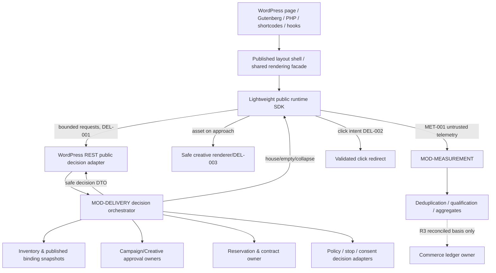
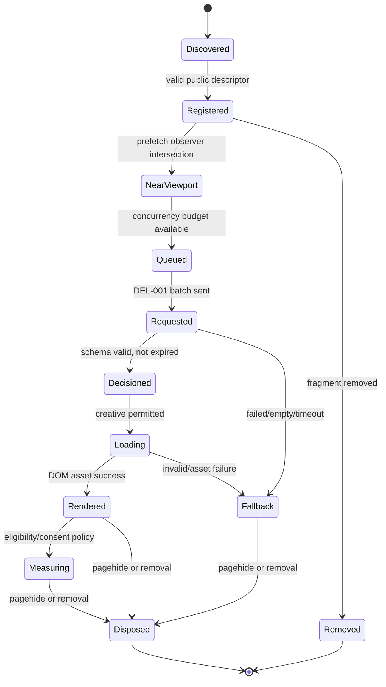

# AdPilot — Advertising Delivery Engine, Targeting, Selection & Runtime SDK Specification

**Document ID:** `ADP-DOC-018`  
**Filename:** `18_ADPILOT_ADVERTISING_DELIVERY_ENGINE_TARGETING_SELECTION_RUNTIME_SDK.md`  
**Version:** 1.0.0 — proposed implementation specification  
**Status:** Proposed; approval required from Product, AdTech, Architecture, Privacy/Security, Finance, UX/Accessibility, Performance and QA owners  
**Date:** 2026-10-12  
**Product:** AdPilot — Self-Service Advertising Marketplace & Behavioral Analytics for WordPress  
**Audience:** GPT-6 High implementation agent, WordPress/PHP engineers, browser runtime engineers, AdTech/backend engineers, measurement/data engineers, QA/performance/security engineers and technical owners  
**Normative predecessors:** `ADP-DOC-001..017`; read all before implementation.  
**Release horizon:** R1 fixed/time-based serving, contextual matching and measurement foundation; R2 viewability/heatmaps plus supported advanced frequency policies only when approved; R3 metered CPC/CPM, advanced pacing/frequency and financial qualification; R4 optional federation/replay.  
**Next document candidate:** `ADP-DOC-019` — Measurement, Attribution & Analytics Processing Specification (subject to roadmap approval).

> **Contract discipline:** This document specifies behavior to IMPLEMENT; it does not assert that server routes, PHP classes, JavaScript, database migrations, algorithms or tests already exist. Names beginning `DE18-*` are newly proposed identifiers. Names `FR-*`, `BR-*`, `NFR-*`, `INV-*`, `IC-*`, `UC-*`, `DEL-*`, `MET-*`, `DM-*`, `EV-*`, `LS15-*`, `GB16-*` and `TI17-*` remain governed by their original documents. Code excerpts are blueprints, not paste-and-run production packages. Policy- and jurisdiction-dependent settings remain unresolved until formal approval.

---

## 1. Charter, source-of-truth hierarchy and non-negotiable guarantees

### 1.1 Why this document exists

Define the **single authoritative delivery engine** and **one lightweight browser runtime** used by AdPilot's server-rendered Gutenberg blocks, classic/block themes, PHP helper functions, shortcodes, theme hooks, Layout Studio previews and future approved publisher adapters. This document specifies eligibility, targeting, ad selection, concurrency, allocation, response validation, creative delivery, progressive activation, fallback, telemetry boundaries, debugging, security, observability and completion evidence for high-density pages.

A publisher's ability to configure 500–1,000+ logical slots is **not** a commitment to fetch, display, animate, record or charge for that many advertisements. The engine SHALL enforce current commercial and safety constraints even when the containing WordPress page is cached, the browser sends forged state, or the same logical slot appears more than once.

### 1.2 Precedence

1. `ADP-DOC-001` defines 129 canonical `FR-*` obligations, `BR-001..018`, `NFR-001..016`, `INV-01..10`, `AC-001..015`, release gates and the `DEC-*` register.
2. `ADP-DOC-002..005` define acceptance, journeys, states, independent payment/approval/delivery transitions and multi-tenant authorization.
3. `ADP-DOC-006..010` govern module boundaries, `IC-*` contracts, application services, SQL ownership, REST route IDs, transactional outbox and asynchronous qualification.
4. `ADP-DOC-011..015` govern accessible UX, tokens, administrator and advertiser workflows and stable slot/layout compilation.
5. `ADP-DOC-016..017` govern four Gutenberg blocks, PHP/public rendering, shortcodes, hook extension and the nonbillable preview contract.
6. This document refines delivery and runtime internals only. If proposed details conflict, preserve the upstream contract, register the question in §25, and block only affected work until approved.

### 1.3 Delivery invariants (`DE18-INV-*`)

| ID | Mandatory invariant and accountable owner |
|---|---|
| `DE18-INV-01` | A paid creative may receive a positive decision only after a fresh, server-side eligibility verdict for current site, published slot/binding, contract, campaign, creative **version**, moderation, account, schedule, allocation and applicable policy (Delivery Lead). |
| `DE18-INV-02` | Fixed priority/weight/house fallback is a **selection policy**, not authority to override `DE18-INV-01` (AdTech Lead). |
| `DE18-INV-03` | Every served occurrence is scoped by the tuple `(site, published_layout_revision, logical_slot, render_instance, decision_ref)` with distinct logical vs occurrence identities (Layout/Delivery Leads). |
| `DE18-INV-04` | `configured`, `requested`, `selected`, `served`, `rendered`, `measurable`, `viewable`, `click_observed`, `click_qualified` and `billable` are noninterchangeable metrics with documented denominators (Measurement Lead). |
| `DE18-INV-05` | WordPress/Gutenberg/editor/preview/synthetic/staging activity SHALL never turn into a revenue-bearing measurement fact (Finance + QA). |
| `DE18-INV-06` | A cached shell, creative URL, signed decision or browser state SHALL never defeat an emergency stop or revoked approval at the applicable authoritative decision/asset validation point (Security + Delivery). |
| `DE18-INV-07` | Failure of the ad runtime, measurement collector, network or third-party asset SHALL preserve page navigation, text content and keyboard accessibility (Frontend Lead). |
| `DE18-INV-08` | The server owns billing qualification and money; the browser only proposes bounded, untrusted observation events (Measurement + Finance). |
| `DE18-INV-09` | Public decision response and cache keys never expose protected organization, financial, account, visitor or cross-site data (Security + Privacy). |
| `DE18-INV-10` | Selection and load limits enforce publisher density/network restrictions regardless of thousands of configured placeholders; warnings do not bypass hard restrictions (AdTech + UX). |
| `DE18-INV-11` | A denied tracking purpose means no prohibited R2/R4 data collection; ordinary serving may continue under the approved regional legal policy (Privacy Lead). |
| `DE18-INV-12` | A duplicate, retried or reordered event can never create duplicate qualified metering/ledger postings; R3 billing requires trusted reconciliation, not JS counters (Finance). |
| `DE18-INV-13` | A source reference in a block/shortcode/hook cannot impersonate an advertiser, site, campaign, approved creative, paid allocation or publisher permission (Security). |
| `DE18-INV-14` | All render paths share the same application eligibility and safe creative projection; adapter formatting may vary but commercial semantics do not (Architecture). |
| `DE18-INV-15` | Fixed/time-based R1 serving remains independently functional when WooCommerce, R2 heatmaps, R3 metering, R4 replay or proprietary SaaS integrations are absent (Platform). |
| `DE18-INV-16` | Unresolved decisions (thresholds, geo, network rules, consent, ad frequency, identity, cache invalidation SLA) do not become invented product defaults (Product/Privacy). |

### 1.4 Naming and release tags

`R1` = base self-service inventory and live delivery; `R2` = advanced measurement/aggregated heatmaps; `R3` = metered billing and advanced allocation; `R4` = approved network-level extensions and separately governed replay. `R2/R3` on `FR-DEL-012` is **not permission** to enable spend-limited metering in R2; each feature facet has its own gate. Every feature gate must exist on both server and UI; hiding a control is not sufficient enforcement.

---

## 2. Architecture, components, ports and dependency direction

### 2.1 System context



`MOD-DELIVERY` decides; `MOD-MEASUREMENT` qualifies; `MOD-COMMERCE` alone posts money; `MOD-INVENTORY`, `MOD-RESERVATIONS`, `MOD-CAMPAIGNS`, and `MOD-CREATIVES` own their authoritative facts. The browser SDK MUST NOT create bookings, change approval, mutate ledger entries or authorize cross-site access. Direct DB joins for fast delivery are implementation-specific *read projections* and must preserve module-owned truth plus freshness limits.

### 2.2 Required PHP contracts and owners

| Proposed port/service | Owner module | Responsibility | No-go boundary |
|---|---|---|---|
| `DecideAdsBatchHandler` | Delivery | Parse trusted context and bounded slot requests, produce safe decision DTOs | No finance writes or org authority from browser |
| `PublishedPlacementReader` | Inventory/Layout | Resolve site-scoped published layout and bindings | No draft/public leakage |
| `CampaignEligibilityReader` | Campaigns | Read current status, schedule and account/policy gates | No implicit cache of forever-active states |
| `CreativeApprovalReader` | Creatives | Verify exact immutable version/digest and safe format | No arbitrary HTML/JS acceptance |
| `ContractEntitlementReader` | Reservations | Validate contracted period and exclusivity/allocation | No unlocked inventory mutation |
| `TargetingEvaluator` | Delivery | Contextual predicates from approved policy version | No raw IP/secret data necessary for R1 |
| `AllocationSelector` | Delivery | Fixed/priority/weight ordering after eligibility | Cannot resurrect excluded candidate |
| `StopVersionReader` | Delivery | Emergency stop and invalidation generation | Fail closed when stale on sensitive decision |
| `DecisionReferenceCodec` | Delivery/Security | Opaque tamper-resistant short-lived reference | Not an authentication or billing token |
| `SafeCreativePresenter` | Creatives/Rendering | Allowlisted HTML/asset/URI projection | No executable third-party creative injection |
| `PageOccurrenceRegistry` | Rendering/Layout | Track distinct DOM occurrences and duplicate bindings | Not a commercial allocation source |
| `MeasurementIngestionPort` | Measurement | Validate untrusted event batches and provenance | No browser-authoritative billable flag |
| `PrivacyPurposePolicyPort` | Compliance | Context-specific collection permission and minimization | No consent bypass from block/theme option |
| `DecisionDiagnosticsSink` | Platform | Redacted reason/count/timing metrics | No PII/secret/creative payload logging |

Service names are proposed implementation contracts and SHALL be reconciled with `UC-DEL-Q01..Q04`, `UC-DEL-C01` and `UC-MET-C01..C03` in Document 07 before classes are frozen. No infrastructure adapters are constructed from HTTP handlers ad hoc; obtain site-bound application services through the approved composition root.

### 2.3 Integration matrix

| Entry point | Server work | Browser work | Identity | Preview billing |
|---|---|---|---|---|
| `adpilot/ad-slot` | Shell via shared facade | Lazy decision for one occurrence | Fixed logical ID + unique render ID | Prohibited |
| `adpilot/ad-zone` | Compile compact zone shell | Register generated occurrences selectively | Distinct per generated slot | Prohibited |
| `adpilot/ad-repeater` | Approved insertion anchors only | Register fragment/repetition without double counting | Slot + template/query occurrence | Prohibited |
| `adpilot/ad-showcase` | Published curated bindings | Safe image/grid presentation + eligible decision | Per item and display occurrence | Prohibited |
| PHP facade | Validate public binding and context | Same SDK client | Separate helper provenance | Prohibited |
| Shortcode | Strict attr schema before facade | Same SDK client | Separate shortcode provenance | Prohibited |
| Approved theme hook | Registered provider + dedupe | Same SDK client | Registered binding + occurrence | Prohibited |
| Gutenberg editor preview | Authenticated nonpublic snapshot | Simulation-only affordances | Preview-only ref | **Always excluded** |
| Layout Studio preview | Publisher private layout draft | Diagnostic simulated view | Draft/version marker | **Always excluded** |

### 2.4 Absolute trust boundaries

Never trust page-supplied `site_id`, `organization_id`, `approved`, `paid`, `billing_mode`, `creative_html`, `targeting_filter`, `force`, `rate_card`, `allocation_remaining`, campaign state or monetary totals. On the public endpoint, derive site from routing/WordPress context, match slot to published layout and validated public context, enforce request budgets, sanitize every projection and suppress resource-existence side channels where feasible. Browser viewport/device hints are advisory and bounded; no special grant derives from a valid signature alone.

---

## 3. Vocabulary, canonical state separation and identity model

### 3.1 Glossary

| Term | Normative meaning |
|---|---|
| `LogicalSlotId` | Stable sellable placement identity in a site; may appear more than once. |
| `RenderInstanceId` | Fresh occurrence ID per actual placement DOM instance; not stable across page views. |
| `PublishedLayoutRevisionId` | Immutable authoritative revision; historical event geometry/report references retain it. |
| `BindingRevision` | Contracted relationship of zone/slot/context to a published layout; changing it requires impact analysis. |
| `Candidate` | An approved-typed reference examined for this decision, **not** necessarily eligible. |
| `EligibleCandidate` | Candidate passing all mandatory live gates at a specified policy generation. |
| `Decision` | Server response selecting paid/house/empty/collapse with bounded TTL; not proof of render/view/billing. |
| `DecisionRef` | Opaque signed or server-backed reference to a decision, time-limited and scope-bound. |
| `SelectionPolicyVersion` | Immutable revision of strategy and targeting policy, separately from publication revision. |
| `StopVersion` | Site/organization/campaign/creative revocation generation and associated changed-at time. |
| `HouseCreative` | Publisher-approved fallback, **not** a paid campaign and not automatically revenue bearing. |
| `MetricDefinitionVersion` | Version of server-side event eligibility and reporting denominator definition. |
| `ContextualTargeting` | Content/post/taxonomy/device/breakpoint/locale matching without unapproved visitor profiling. |
| `AdvancedTargeting` | Future geo/audience/device identity features requiring legal and data-processing decisions. |

### 3.2 Counts and state progression

`configured_slots → activated_instances → requests → positive_decisions → assets_rendered → measurable_instances → verified_viewable_instances → qualified_clicks → (R3 only) reconciled_billable_events` is *not* a simple one-to-one funnel; batches, suppression, timeouts, retries, house ads and repeated occurrences produce different denominators. Every dashboard SHALL state its denominator, metric version, incomplete-window status, site/org scope, and UTC/timezone conversion.

### 3.3 Separate state machines

Independent authoritative state sources: published inventory, booking/hold, payment settlement, campaign moderation/approval, creative **version** approval, campaign delivery, allocation/stop and event qualification. The engine reads their conjunction; it MUST NOT collapse "paid" into "approved" or infer "active" from a checkout redirect. Expired holds never revive from late notifications. Paid rejected creatives follow approved remedy workflow, not arbitrary serving.

---

## 4. Decision request and response wire contracts (`DE18-WIRE-*`)

### 4.1 Existing HTTP endpoints only

| Canonical ID | HTTP endpoint | Release | Role and invariants |
|---|---|---|---|
| `DEL-001` | `POST /wp-json/adpilot/v1/delivery/decisions` | R1 | Public bounded batch; all eligibility server-side |
| `DEL-002` | `POST /wp-json/adpilot/v1/delivery/click` | R1 | Validates click decision, approved destination, expiration, abuse controls; safe redirect/deny |
| `DEL-003` | `GET /wp-json/adpilot/v1/delivery/creative/{decision_ref}` | R1 | Safe public creative; current stop/approval validation and short TTL |
| `MET-001` | `POST /wp-json/adpilot/v1/measurement/events` | R1 | Untrusted event submission, `202 Accepted` ≠ qualified/billable |
| `MET-002` | `GET /wp-json/adpilot/v1/measurement/client-config` | R1 | Public minimized policy/config, no secrets |
| `MET-003` | `GET /wp-json/adpilot/v1/admin/measurement/health` | R1 | Capability-checked diagnostic projection only |

Use exactly Document 09 path/verb/namespace/route identifiers. **Do not invent a new endpoint** for R2 or R3 features merely to simplify the SDK; raise change control with API owner. WordPress route registration occurs on `rest_api_init` and includes a `permission_callback` (for public routes, a callback returning true still requires request budgets and domain policy).

### 4.2 Accepted request shape

```json
{
  "published_layout_ref": "layout_current_hint",
  "page_context_ref": "public_page_context_reference",
  "requested_slots": [
    {"slot_id":"01JSLOTDEMO000000000000001", "render_instance_id":"ri_0001"},
    {"slot_id":"01JSLOTDEMO000000000000002", "render_instance_id":"ri_0002"}
  ]
}
```

`published_layout_ref` and `page_context_ref` are **hints validated against published server data**, not trusted claims. Batch size, byte size, slot IDs, occurrence cardinality, origin policy and burst rate are bounded by server config published through `MET-002` only where safe. Reject duplicate `render_instance_id` within a batch or normalize under an explicitly documented dedup policy. Do not reveal rejected hidden campaign details.

### 4.3 Accepted response shape

```json
{
  "data": {
    "batch_ref": "db_opaque",
    "expires_at": "2026-10-12T00:01:00Z",
    "decisions": [
      {"slot_id":"01JSLOTDEMO000000000000001", "render_instance_id":"ri_0001", "result":"creative", "decision_ref":"dr_opaque_signed", "creative":{"format":"image", "asset_url":"https://example.test/wp-content/uploads/safe-banner.webp", "alt":"Sponsor", "disclosure":"Advertisement"}},
      {"slot_id":"01JSLOTDEMO000000000000002", "render_instance_id":"ri_0002", "result":"empty"}
    ]
  },
  "meta": {"request_id":"req_example", "api_version":"v1", "server_time_utc":"2026-10-12T00:00:00Z"}
}
```

This is the upstream Document 09 example. `result` values: `creative`, `empty` and additional *approved* fallback/collapse descriptors only when backwards-compatible schema is explicitly updated. Do not add `billable`, `verified_viewable`, `funds_available`, private `advertiser_id`, internal score, exact targeting rejection detail or a visitor profile to public JSON. The decision reference must not be persisted as a permanent transferable identity.

### 4.4 Error/partial success contracts

A single invalid request body fails with the API standard error envelope. Valid batch with individually ineligible slots returns bounded per-slot `empty` outcomes when omission could leak private campaign existence. For malformed IDs, unknown site, replay/abuse, oversize batch, expired context and unsupported format, use the Document 09 error taxonomy, redacted correlation ID and `Retry-After` where applicable. When the entire service is unavailable, client uses safe fallback without exposing a stack trace.

### 4.5 Wire compatibility and version policy

- Preserve `adpilot/v1` routes until a versioned migration exists; additive optional fields require consumer tests.
- Server and SDK advertise supported schema/features by safe allowlist. Unknown fields are rejected or ignored only according to the approved per-endpoint policy; no silent security-sensitive coercion.
- Use UTC ISO 8601 instants; contractual intervals are half-open `[start,end)`; budget/financial amounts never come from a public decision request.
- Public decision `Cache-Control` SHALL reflect safe freshness and visitor-specific leak risk; do not apply blanket shared-CDN caching to dynamic entitlement responses.

---

## 5. Eligibility pipeline: mandatory ordered gates (`DE18-GATE-*`)

Selection MUST operate on fully eligible candidates. Proposed ordered gates below are logical; performance implementations may batch reads/reorder safe *checks* if outcomes, auditability and revocation safety remain identical.

| Gate | Verification and authoritative owner | Failure behavior |
|---|---|---|
| `DE18-GATE-01` | Site exists, plugin active on this blog, no site emergency stop (Platform/Delivery) | Empty/nonpaid fallback |
| `DE18-GATE-02` | Layout revision published; slot/binding exists and is publicly publishable (Inventory/Layout) | Empty or reserved shell |
| `DE18-GATE-03` | Binding commercial semantics/contract changes already resolved; no invalid migration (Inventory/Reservations) | Exclude affected paid candidate |
| `DE18-GATE-04` | Organization/publisher accounts satisfy active/eligible policies (Identity) | Exclude |
| `DE18-GATE-05` | Campaign approval, delivery status and legal/operational suspension currently allow service (Campaigns) | Exclude |
| `DE18-GATE-06` | Exact creative version/digest has current approval, safe asset, supported format, approved destination (Creatives) | Exclude |
| `DE18-GATE-07` | Valid reservation/contract, slot entitlement, exclusivity and contracted allocation for requested UTC instant (Reservations) | Exclude |
| `DE18-GATE-08` | Commercial payment/settlement entitlement matches applicable R1 order policy, without assuming payment implies approval (Commerce port) | Exclude/approved safe remedy path |
| `DE18-GATE-09` | Campaign and creative scheduling passes UTC half-open windows (Campaigns) | Exclude |
| `DE18-GATE-10` | Allowed contextual targeting filters match server-resolved page/device/locale (Delivery) | Exclude |
| `DE18-GATE-11` | Creative dimensions and disclosure satisfy slot, device, density and network policy (Layout/Compliance) | Exclude |
| `DE18-GATE-12` | Allocation capacity/rotation weight/contract priority available under current generation (Delivery) | Exclude or lower-priority fallback |
| `DE18-GATE-13` | Approved frequency, pacing, budget ceilings for *enabled* release, using lawful counters (R2/R3) | Exclude or throttle (later release) |
| `DE18-GATE-14` | Final emergency stop and creative approval revision recheck immediately before emitting a paid decision (Delivery/Creatives) | Fail closed |

### 5.1 Mandatory ordering at trust boundaries

Targeting filters, hooks and optional plugins may **narrow** a candidate set, not introduce candidates which never passed mandatory gates. Any algorithm extension returns candidate IDs or ranking preferences, not unrestricted HTML. Apply invariant gate after any third-party filter. All deny/fallback reasons exposed to the browser are generic; privileged diagnostics may see redacted reason-code counts with current authorization.

### 5.2 Decision-time concurrency and account state

The decision endpoint does not lock booking inventory for the duration of a page view and cannot create new financial entitlement. It reads an authoritative committed snapshot. Where allocation is a decrementing quota, use transactional/atomic capacity claims appropriate to that metric; if a safe reservation cannot be acquired, treat candidate as ineligible rather than overserve. R1 fixed/time products do not accidentally become CPC/CPM debit-on-selection products. Placement exclusivity is created by the Reservation module (not this selector).

### 5.3 Stop and revocation generations

Persist and expose to internal decisions a revocation generation for site, account, campaign and creative/approval version (`delivery_stop_versions` in Document 08). Within the approved measurable freshness bound, a new decision may not use a revoked creative. Avoid indefinitely cached positive decisions. Public creatives with stale URLs or references must be suppressed or served according to explicitly documented cache/asset revocation semantics; if truly immediate hard revocation cannot be guaranteed on uncontrolled CDNs, do not claim it is. Provide a kill-switch drill proving the actual upper bound on supported hosting.

### 5.4 Eligibility pseudo-code

```php
<?php
// Illustrative domain-level pseudocode; interfaces and DTO imports omitted.
final class DecideAdsBatchHandler {
    public function __construct(
        private PublishedPlacementReader $placements,
        private CampaignEligibilityReader $campaigns,
        private CreativeApprovalReader $creatives,
        private ContractEntitlementReader $contracts,
        private TargetingEvaluator $targeting,
        private AllocationSelector $selector,
        private StopVersionReader $stops,
        private DecisionReferenceCodec $references
    ) {}

    public function decide(PublicDecisionBatch $input, TrustedSiteContext $site): DecisionBatch {
        $bounded = $input->validateBounds();
        $placements = $this->placements->loadPublishedForSite($site, $bounded);
        $snapshot = $this->stops->currentForSite($site);
        $output = [];
        foreach ($placements as $placement) {
            $candidates = $this->campaigns->forPlacement($site, $placement);
            $eligible = [];
            foreach ($candidates as $candidate) {
                if (!$this->contracts->allows($candidate, $placement)) continue;
                if (!$this->creatives->approvedExactVersion($candidate)) continue;
                if (!$this->targeting->matches($candidate, $placement, $bounded->pageContext())) continue;
                if (!$this->campaigns->currentlyDeliverable($candidate)) continue;
                if (!$snapshot->allows($candidate)) continue;
                $eligible[] = $candidate;
            }
            $chosen = $this->selector->pick($eligible, $placement);
            // Mandatory policies must be checked AGAIN after extensibility/selection.
            $output[] = $chosen && $this->allFinalGatesStillPass($chosen, $placement, $site)
                ? $this->references->safeDecisionFor($chosen, $placement)
                : Decision::empty($placement->occurrence());
        }
        return DecisionBatch::from($output);
    }
}
```

In real code, the handler uses the original `UC-*` ports, bulk-hydrates candidates, enforces strict request/response budgets and checks site context at repository boundaries. The example is not a fully safe transaction or performance implementation and intentionally has no direct SQL.

---

## 6. Targeting policy, precedence and privacy (`DE18-TGT-*`)

### 6.1 R1 allowed contextual predicates

| Policy field | Trusted source | Match semantics | Edge cases |
|---|---|---|---|
| Site/blog | WordPress resolved site context | Exact equality | Never accept browser-supplied other site |
| Published layout and binding | Layout repository | Immutable revision + qualified binding | Preview/draft excluded |
| Page and post | Server-resolved page reference | Stable ID/type relation | Password-protected pages may be excluded |
| Post type | Registered WordPress type | Allowlist/denylist, explicit unknown | Custom types, archives |
| Taxonomy/category | WordPress taxonomy relations | Explicit ANY/ALL/NOT modes | Hierarchical terms, unassigned posts |
| URL/page class | Server-derived canonical context | Home, archive, search, product, etc. | Canonical/preview URLs, query params |
| Device class/breakpoint | Responsive runtime bounded hint + server policy | Supported coarse group, deterministic fallback | Spoofable device hint cannot increase privilege |
| Locale/language | WordPress locale plus approved translation integration | Normalized BCP-47 or approved locale list | RTL is presentation, not targeting permission |
| Creative format/aspect | Approved creative descriptor | Size, density and disclosure compatibility | Too-large asset or mismatch suppressed |
| Day/time scheduling | Current server UTC time | `[start,end)` interval with stored timezone intent | DST gaps/overlaps and cutover |

### 6.2 Boolean rule model

A rule-set is a bounded AND of field predicates with explicitly bounded OR lists; conflicting allow/deny resolves to **deny**. Example: `(post_type ∈ {post,page}) AND (taxonomy.category ANY {news,finance}) AND (locale ∈ {en-US})`. Unspecified predicate fields mean no restriction only when approved by inventory/advertiser policy; missing trusted data never becomes a privileged wildcard. Validate field names, cardinality, operator, taxonomy existence and maximum serialized length before publication. Preserve policy version in decision metadata for audits.

### 6.3 Precedence and change control

Network/legal/density exclusion > emergency stop > site publisher restriction > binding commercial terms > advertiser campaign restrictions > creative compatibility > optional optimization preferences. Advertisers may restrict their own targeting within a publisher-approved sellable scope, but cannot widen the publisher's exclusions; administrators cannot override legal or financial entitlements via a generic filter.

### 6.4 Advanced audience and geography, not silently R1

IP geolocation, precise location, behavioral profiles, cross-site identifiers, remarketing, probabilistic identity, fingerprinting or sensitive inference are **not** R1 defaults. Any future geo/audience policy requires approved purpose/legal basis, explicit data category and retention, regional controls, accuracy/consent limitations, documentation, opt-out, third-party flow review and data-minimization proof. Treat IP as infrastructure anti-abuse data only within approved legal limits; do not persist raw IP for campaign targeting by default. Unsupported requests fail as unsupported feature, not silently collect more data.

### 6.5 Semantic context integrity

A cached page may contain a layout hint older than current publication. The server must reconcile to the current compatible published version or return a safe no-ad response. Do not attach an ad intended for a different post, taxonomy, canonical language, WooCommerce product or page template to a repeated DOM node solely because its `data-adp-slot` matches.

---

## 7. Selection policies: fixed, priority, weighted and fallback (`DE18-SEL-*`)

### 7.1 Common pool and hard-gate distinction

Build eligible candidate pool `E(slot, context, instant, policy_version)`. Apply policy only to `E`. The pool is defined after entitlement and approval; a weight never grants entitlement. Reject non-finite, negative, out-of-range weights, and campaigns with no compatible approved creative. Version the policy and record selector mode + candidate-set digest in privileged decision diagnostics, not in public payloads.

### 7.2 Fixed assignment (R1)

`fixed`: when a contracted exclusive slot binds an eligible campaign/creative revision, return that binding; if ineligible, evaluate publisher-approved fallback rather than selling to another paid buyer without a valid contractual alternative. If multiple fixed bindings overlap contrary to exclusivity, **fail closed**, log inventory violation, alert admin; do not choose arbitrarily. Honor creative revision approval at decision time.

### 7.3 Priority selection (R1)

`priority`: order eligible candidates by explicit publisher/contract-approved priority tier (lower/higher semantics documented in config), then stable deterministic tie-break defined below. Do not permit unbounded advertiser-controlled self-priority. Contract-exclusive commitments take precedence over opportunistic fill; house ads never displace a guaranteed paid eligible reservation.

### 7.4 Weighted rotation (R1)

`weighted`: choose among eligible candidates in a tier using validated nonnegative integer weights (zero = excluded or explicitly prohibited; must be specified). Proposed test algorithm: compute total positive weight with overflow-safe arithmetic; choose uniform integer ticket from cryptographically sound or otherwise approved unbiased randomness and map cumulative ranges to candidate. For deterministic tests inject a seedable RNG; do not use deterministic predictable seeds to infer visitor identity or systematically favor an advertiser. An implementation can use a tested alias method for large pools, but must prove statistical fairness, stable policy version, no overflow and identical eligibility.

**Statistical contract:** With unchanged context, policies and sufficient independent selections, empirical shares should fall within documented confidence intervals in simulation. Do not promise per-session exact ratios; tiny sample sizes will vary. Selection audit logs should be aggregated and redacted.

### 7.5 Fallback and no-fill (R1)

Fallback chain: eligible paid candidate → eligible publisher-approved house creative → reserved blank/controlled collapse. House creatives must pass format, safety, density, current stop and disclosure policies; their counts are never paid-impression facts. If layout mandates preserved geometry, do not collapse simply because no ad filled. House selection shall never fabricate financial revenue or imply a paid contract.

### 7.6 Tie breaks and reproducibility

Candidate order must not depend on arbitrary database row iteration. For exact-priority ties, use a clearly documented deterministic stable field or authorized weighted policy; logging should include algorithm version and policy digest. Switching selector versions during a paid period must be commercially reviewed if expected share changes. Domain tests cover equal weights, single candidate, empty candidate, zero total, very large integer weights and paused candidate.

### 7.7 R2/R3 optimization extensions

Advanced caps, viewability-aware targeting, contractual pacing, spend-limited allocation, share-of-voice and CPC/CPM optimization are separately gated features. R2 may add observable-browser viewability and eligible privacy-aware counters, but must not debit CPM/CPC finance; R3 introduces bounded budget/spend allocation and reconciled billing under its own approval. Never optimize by unapproved sensitive attributes, unqualified client counters or opaque third-party tracking. No reinforcement-learning feedback loops in R1.

---

## 8. Allocation, overdelivery and contract compliance (`DE18-ALC-*`)

### 8.1 R1 versus R3 money

In R1, **contractual fixed/time reservations** are the source of sellability; a decision indicates permissible delivery within contract dates but is not a new inventory sale. The Reservation module alone commits exclusivity and deal capacity. In R3, accounting for metered impression/click commitment adds separate concurrency-safe counters, qualification and reconciliation. Both periods obey UTC half-open scheduling and site-specific commercial policy.

### 8.2 Allocation relationship

`AllocationPolicy` and `delivery_stop_versions` tables defined in Document 08 are read through owner repositories. Each candidate must map to an allowed reservation or other explicitly approved publisher product type. If the same campaign is bound to several placements, each decision must carry the correct binding/slot dimension. Do not silently apply campaign-wide quotas as if they were exclusive slot inventory, or assume each occurrence gets its own paid commercial entitlement.

### 8.3 Oversupply, undersupply and forecasting

Distinguish logical configured slots, eligible impressions, delivered creatives, viewable opportunities and contracted units. Publisher dashboard may show underdelivery risk only from versioned aggregates and stated assumptions; never promise future impressions on high-density pages based solely on 500 configured placements. Under/over-delivery remediation needs authorized audit and, when commercial rights change, reservation/finance approval.

### 8.4 R3 limit enforcement, exactly-once financial effects

For metered products, enforce authorized max spend/units with atomic reservation, reconciliation and expiry according to approved contract. Race-test parallel batch decisions and event qualification. A browser retries an event; deduplication must make the financial outcome idempotent. Under high volume, uncertain qualified counts fail closed or enter a governed pending state; do not issue unearned charges or leak unlimited delivery beyond a hard cap. R3 meter pricing does not authorize mutation of existing R1 fixed-time reservations.

---

## 9. Public rendering shell, assets and creative sandbox (`DE18-REN-*`)

### 9.1 Safe shell is not an impression

The PHP rendering facade returns stable semantic structural markup with slot ID, unique occurrence ID, published layout ref, approved binding context, fallback geometry and ad disclosure when appropriate. It may enqueue one public SDK bundle. The shell alone does not mean a creative was selected, downloaded, rendered, viewable or billable. A 200-cell zone is compiled compactly from immutable published inventory, not 200 synchronous PHP decisions.

### 9.2 Creative format registry

| Format | R1 policy | Renderer/accessibility conditions |
|---|---|---|
| Image (PNG/JPEG/WebP/AVIF as compatibility permits) | Allow approved safe assets | Validated URL/MIME/dimensions, descriptive `alt`, width/height, lazy loading |
| Text/native-style sponsor tile | Allow approved text-only | Escaped text, discernible label/destination, no deceptive styling |
| HTML5 interactive/third-party tags | **Not implicitly allowed** | Dedicated sandbox, strict CSP/origin/privacy and legal review, separate ADR |
| Video/audio | Future/explicit gated if not canonical R1 | User control, captions, no surprise autoplay/sound, bandwidth budget |
| SVG | Restrict until sanitizer and media security approval | Script/event/foreignObject risks; no arbitrary uploaded SVG markup |
| House creative | May display as safe fallback | Separate accounting marker and compliant disclosure |

### 9.3 Safe DOM contract

Proposed non-normative example (final classes/attributes must reconcile with Document 17):

```html
<div class="adpilot-slot" data-adp-slot="slot-stable-123"
     data-adp-render-instance="ri-opaque-456"
     data-adp-layout-revision="layout-immutable-7"
     aria-label="Advertisement placement">
  <div class="adpilot-slot__frame" style="--adp-slot-ratio: 4 / 1">
    <span class="adpilot-slot__status" aria-hidden="true"></span>
  </div>
</div>
```

Passive attributes are not trusted by the server and MUST NOT contain secrets, full targeting expressions or business entitlements. Never insert user creative via raw `innerHTML`. Controlled approved markup is produced by the safe presenter and sanitized again at output context. DOM IDs are occurrence-unique; no same-ID collisions in footer/Query Loop repeats.

### 9.4 Layout stability and no-JS fallback

Reserve dimensions based on approved responsive layout constraints and asset aspect ratio; collapse only when container policy allows and without disruptive shifts. Without JS, a safe disclosure/fallback shell or eligible server-approved house fallback may remain; dynamic paid selection/viewability is limited. No click-bait overlap, surprise motion or content obstruction. Accessibility must not rely on seeing empty skeletons.

### 9.5 Safe click path

Clickable creative links use server-issued approved destination semantics and existing `DEL-002`; never trust arbitrary `href` returned by an extension hook. Validate destination scheme/origin/path against approved creative revision, reject open-redirect parameters, prevent redirect loops, bound TTL and log event validity without exposing private target details. `target="_blank"` uses `rel="noopener noreferrer"` where appropriate; links have discernible accessible names.

---

## 10. Browser runtime SDK architecture (`DE18-SDK-*`)

### 10.1 Requirements

One self-hosted, lightweight TypeScript SDK compiles to a browser-compatible JS bundle; it is not the React administrator application. No mandatory jQuery, external telemetry vendor or WooCommerce dependency. Feature detection and graceful degradation, scoped `data-adp-*` descriptors, one bootstrap per page, and explicit cleanup on fragment unload. Compilation/build artifacts follow Document 12/17 asset versioning and licensing requirements.

### 10.2 Proposed SDK modules

| Module | Responsibility | Test injection seam |
|---|---|---|
| `bootstrap` | Feature flags, runtime singleton/namespace, safe initialization | Mock document ready and repeated boot |
| `registry` | Register/unregister occurrences, stable slot vs occurrence identity, duplicates | Synthetic DOM/Query Loop clones |
| `observer` | Shared IntersectionObserver pools and fallback | Controlled intersections, hidden document |
| `scheduler` | Near-viewport priority, batch coalescing and concurrency ceilings | Fake clock/network/visibility |
| `transport` | Canonical DEL/MET routes, AbortController, request budgets, response schema | Fake fetch/error/timeout |
| `decision-cache` | Short-lived occurrence-bound decision state, TTL and revocation hints | Expired/malformed decisions |
| `presenter` | Safe asset nodes, geometry and disclosure, no unsafe HTML injection | CSP and malformed creative |
| `measurement` | Untrusted event envelopes, IDs, dedupe, consent gating | Duplicate/out-of-order events |
| `click` | Existing validated click route, accessible UX and fallback | Malicious click/redirect |
| `lifecycle` | Visibility, pagehide, SPA fragments and cleanup | Remove/insert 500 nodes |
| `diagnostics` | Privacy-safe counters and capability-gated debug, no PII console dumps | Production vs debug |

### 10.3 Exact browser lifecycle



No transition can jump from `Registered` to `billable`; `rendered` is an observation proposal, not a server-qualified state. Decision response contains no final accounting verdict.

### 10.4 Progressive request priority

Maintain a **small shared observer pool** keyed by root/configuration. A positive `rootMargin` may prefetch ads approaching view, but prefetch crossing is **not** viewability. Prioritize current viewport and next viewport ahead of far-below-fold cells; coalesce nearby positions into bounded requests. Batch, pending and concurrent limits are centrally configurable and benchmarked, never multiplied per shortcode/block. Stop work on page hide/AbortSignal, expiry or removal. Avoid polling all 500 elements every animation frame.

### 10.5 Example TypeScript scheduler (illustrative)

```ts
type Occurrence = { slotId: string; renderInstanceId: string; node: HTMLElement };
type PublicDecisionResult = { slot_id: string; render_instance_id: string; result: 'creative' | 'empty'; decision_ref?: string };

export class DecisionScheduler {
  private pending = new Map<string, Occurrence>();
  private inFlight = 0;
  constructor(private readonly transport: (items: Occurrence[], signal: AbortSignal) => Promise<PublicDecisionResult[]>,
              private readonly maxBatch: number, private readonly maxInFlight: number) {}
  enqueue(occurrence: Occurrence): void {
    this.pending.set(occurrence.renderInstanceId, occurrence);
    this.pump();
  }
  private async pump(): Promise<void> {
    if (this.inFlight >= this.maxInFlight || this.pending.size === 0) return;
    const batch = [...this.pending.values()].slice(0, this.maxBatch);
    for (const item of batch) this.pending.delete(item.renderInstanceId);
    const controller = new AbortController();
    this.inFlight++;
    try { await this.transport(batch, controller.signal); /* validated results dispatched separately */ }
    catch { /* report redacted health + render safe fallback, never block page */ }
    finally { this.inFlight--; if (this.pending.size) void this.pump(); }
  }
}
```

The example intentionally omits priority ordering, timeout lifetime management, retries, abort ownership, schema checking, DOM presentation and visibility tracking; the production code MUST implement those with tests. `maxBatch` and `maxInFlight` are centrally clamped positive values from approved measured budgets, never arbitrary inline options.

### 10.6 Dynamic DOM and reentrancy

Provide a **private** registry API that can be called after Gutenberg frontend changes, WP fragment replacement, infinite scrolling, Query Loop paging or theme AJAX injection. If later published as a developer API, use Document 17 versioning and security review. MutationObserver, if required, watches narrow roots with debounced processing rather than the entire document indefinitely. Each removed node unregisters observers, aborts work and clears per-occurrence data; if reinserted, identity/version rules determine whether a genuinely new render occurs. A duplicated shortcode binding never wins a second contract by changing its DOM ID.

### 10.7 Visibility and browser support

Feature-detect `IntersectionObserver`, `AbortController`, `fetch`, document visibility and `navigator.sendBeacon`. On unsupported browsers choose approved conservative fallback and label events as nonmeasurable; do not synthesize viewability. Hidden/background tabs must not accrue viewable dwell. Track text zoom, reduced-motion, RTL orientation and nested scroll containers without hardcoding left-to-right geometry. Modern experimental observer `trackVisibility` is **optional with browser compatibility/fallback validation**, not a mandatory feature.

### 10.8 Loading states and accessibility

Status semantics: `uninitialized`, `scheduled`, `loading`, `rendered`, `empty`, `house`, `failed-safe`, `disposed` (internal SDK states). Avoid flashing busy announcements per ad; keep announcements minimal, stable and relevant. Creative destination is reachable by keyboard, focus order matches DOM, motion respects `prefers-reduced-motion`, disclosures readable, error placeholders never trap focus. Enforce density and tap-target spacing on narrow viewports.

---

## 11. High-density performance and resource budgets (`DE18-PERF-*`)

### 11.1 Workload tiers and truthfulness

| Workload | Example | Budget implication |
|---|---|---|
| Small page | 4 header + 6 body slots | Usable without performance regression |
| Standard dense | 4 header + 100 sidebar + 196 content + 200 footer = **500 logical slots** | Bounded first-view fetch/DOM/media and shared observers |
| Stress page | 1,000–1,200 configured logical slots | Successful layout compilation, navigation and degradation under measured ceilings |
| Repeated template | Query Loop 100 posts × selected bindings | Unique occurrences, duplicate policy, bounded API concurrency |
| Embedded/fragmented | AJAX navigation and cached CDN shell | Idempotent registration and scope-safe decision requests |

### 11.2 Performance acceptance must measure, not assume

Propose budgets only after collecting baseline against hosting tiers and mobile hardware defined by the Performance Lead. At minimum record JS transfer/compressed size, parsed main-thread cost, initial HTML bytes, node count, first-view decision latency p50/p95, API batches, peak in-flight requests, asset decoded bytes, CLS, long tasks, memory peak and measurement queue size. Metrics must be captured with 0%, 25%, 50% and 100% scroll journeys and network outages; a passing average cannot hide catastrophic p95 regressions.

### 11.3 Hard protection controls

- Limit the number of requested slots, candidate IDs and response bytes *per batch*; limits are site-configured under policy and never overridden by browser.
- Limit observers; reuse by compatible root/threshold, and disconnect on pagehide/destroy.
- Bound in-flight fetches, retries, event queues, buffered assets, concurrency in workers and timeouts.
- Limit individual media bytes, dimensions, animated payload, decode concurrency and cumulative rendered ads per viewport/density policy.
- Serve only sanitized/versioned assets and safe public JSON; asset errors cannot cascade to blocking page scripts.
- Prefer read-model bulk hydration and indexed lookups; eliminate N+1 candidate queries for 200-slot zones.
- Admin and publisher controls display configurable density warnings and hard prohibitions before publish.

### 11.4 Caching and page cache strategy

Static structural shells cache by `(trusted_site, published_layout_revision, page-context class, locale, safe presentation options, compiler schema)`. Dynamic eligible paid decisions are requested separately and require bounded authoritative freshness. Never store visitor-specific decision JSON in shared CDN cache or put administrator REST nonce into public inline attributes. Cache keys include site/policy generation; network stop invalidation needs measurable supported behavior. On broken cache, prefer empty/house rather than stale paid content.

### 11.5 Stress response degradation matrix

| Bottleneck | Allowed degradation | Forbidden behavior |
|---|---|---|
| High queue depth | Defer below-fold slots; drop optional telemetry before essential reading experience | Fire 500 parallel paid fetches |
| Slow decision endpoint | Preserve shell; eligible safe house/blank fallback | Block page hydration/navigation |
| Low-memory mobile | Reduce prefetch radius and media concurrency | Display oversized animations anyway |
| Ad blocker | Continue reading page; no deceptive bypass | Rewrite site content to force ads |
| Offline page | Keep page accessible; no fabricated server decisions | Assume offline browser events are qualified money |
| Heatmap collector unavailable | Degrade optional R2 overlays | Disable essential R1 serving |

---

## 12. Measurement events and server qualification (`DE18-MET-*`)

### 12.1 Existing event ownership

`MET-001` receives browser-proposed events. `MOD-MEASUREMENT` validates schema, origin where feasible, timestamp bounds, decision reference, occurrence identity, valid site/layout scope, active policy, preview exclusion, deduplication and legal purpose. The pipeline from Document 10 persists qualifications and aggregate projections asynchronously; Finance independently reconciles R3 metering. Do not reimplement accounting inside SDK.

### 12.2 Event progression and definitions

| Event/metric | Trigger | What it proves | What it never proves |
|---|---|---|---|
| `requested` | Server receives bounded slot request | Demand/attempt | Creative delivered |
| `selected` | Server emits positive eligible decision | Authorized candidate at decision time | Browser loaded asset |
| `served` | Approved public creative response issued | Server response action (defined policy) | Painted or viewed |
| `rendered` | Browser confirms safe creative DOM/media ready | Browser claims visible presentation DOM exists | Viewable/billable |
| `visibility_milestone` | Browser records bounded ratio/duration where supported | Untrusted visibility evidence | A verified view by itself |
| `measurable` | Qualification confirms applicable browser and context | Opportunity could be measured | Threshold met |
| `viewable` | R2 server-approved threshold and continuous time rule met | Qualified observable-browser proxy | Human attention or eye tracking |
| `click_observed` | Interaction initiates validated click path | User agent attempted action | Qualified click/billing |
| `click_qualified` | Server de-duplicates and checks policy/anti-abuse | Qualified click by versioned method | Conversion or legitimate unique person |
| `billable` | R3 finance reconciles eligible qualified event with contract | Accounting charge basis | No later adjustment/dispute |

**Note:** `configured` is a **layout fact**, not a runtime event. `selected` and `served` definitions must be reconciled with Documents 01/09 and recorded in the metric dictionary; report rows never relabel counts without changing metric-definition version.

### 12.3 Canonical browser event envelope

```json
{
  "schema_version":"1.0",
  "events":[
    {"event_id":"evt_opaque1", "event_type":"rendered", "decision_ref":"dr_opaque_signed", "render_instance_id":"ri_0001", "occurred_at":"2026-10-12T00:00:05Z"},
    {"event_id":"evt_opaque2", "event_type":"visibility_milestone", "decision_ref":"dr_opaque_signed", "render_instance_id":"ri_0001", "occurred_at":"2026-10-12T00:00:07Z", "measures":{"visible_ratio":"0.60", "continuous_visible_ms":1200}}
  ]
}
```

This is the Document 09 `MET-001` example, not a signed statement of billability. `202 Accepted` means syntactically accepted for asynchronous verification only. Never return a `billable: true` field from ingestion.

### 12.4 R2 viewability without false claims

Proposal: configurable `ratio ≥ r` continuously for `d` milliseconds while document visible, with small-ad/large-ad distinctions considered only after metrics/legal owner approval. **No invented universal 50%/1-second contract** is imposed here; if the product later adopts an industry definition, identify the exact version and test it. IntersectionObserver intersection ratio alone does not prove unobscured visibility, human attention or advertising-standard compliance. Record `measurable`, `nonmeasurable`, `reason`, threshold policy version, browser limitations and sampling; attention-time proxy in heatmaps is not eye tracking.

### 12.5 Batch buffering, retries and privacy

Assign opaque event IDs; dedupe on `(site, event_id, type/policy scope)` per approved database design. Send batches over `fetch`; `sendBeacon` may be used for eligible minimal unload events if the browser supports it and consent allows it. `sendBeacon` delivery is best-effort, not a guaranteed finalization signal. Do not use localStorage to accumulate persistent behavioral trails without legal/privacy approval. Backpressure may drop optional analytics with a transparent completeness flag. Client-supplied timestamps are bounded and correlated against trusted server time; client clocks are never financial truth.

### 12.6 Preview and synthetic exclusions

Recognize authenticated Gutenberg and Layout Studio previews, administrator editing, staging contexts and approved synthetic load-test markers via server-resolved context, never just a caller-provided `is_preview` boolean. Prevent generated screenshots/tests from inflating performance numbers. Client-side `document.visibilityState` may aid measurement but cannot alone prevent fraudulent billing; server qualification performs independent tests.

### 12.7 R3 event-to-money separation

R3 CPC and CPM charges originate in immutable qualified evidence, contract-specific definition, bounded duplicate scope and financial ledger transaction. Invalid-traffic investigation yields append-only adjustments; a browser bug or worker retry cannot double debit. Attribution/off-site conversions need explicitly approved advertiser integration and R3 model/window; the SDK does not inject unapproved pixels or collect third-party visitor data by default.

---

## 13. Safety, consent, anti-abuse and threat boundaries (`DE18-SEC-*`)

### 13.1 Threat matrix

| Attack or failure | Entry | Required prevention and proof |
|---|---|---|
| Forged slot/context | `DEL-001` body | Published site-bound resolution, canonical page proof, bounded public hints, no secret detail leaks |
| Forged decision ref | `DEL-003`, `DEL-002`, `MET-001` | MAC or server-backed nonce, expiry, scope binding, version and anti-replay policy |
| Creative approval revoked | Stale CDN HTML/URL | Current stop/approval generation at relevant decision and safe asset validation; tested revocation bound |
| XSS/JS in creative | Advertiser upload/HTML | Format allowlist, safe HTML construction, media validation, CSP and sandbox only if approved |
| Click farming and bots | Click/event endpoint | Rate limits, dedup, policy checks, monitoring, no guarantee of perfect fraud detection |
| Billing fraud | Client `billable`, forged event ratios | Ignore client charge flags; backend qualification + immutable finance ledger |
| Accidental click overlay | Layout/creative CSS | Density and spacing rules, click target safety, no deceptive ad styling |
| Cross-site data leakage | Multisite static caches | Site prefix + trusted blog context + cache generation + repository scope |
| Privacy bypass | Consent-independent R2 collector | Purpose-specific gating, sensitive page/input exclusion, finite retention, no replay R1 |
| Enumeration/DoS | 100k requested slots, huge event batch | Strict schema, request bytes, rate and time budgets, generic denials |
| SSRF/external exfiltration | Creative asset/destination | URL allowlist/scheme, safe remote fetch policy, validated redirects, no arbitrary fetch |
| SDK supply-chain compromise | Hosted JS/CDN | First-party versioned build, dependency audit, no required vendor SaaS |
| Replay and duplicated occurrence | DOM clones, retries | Binding dedupe + occurrence ID + event dedup and financial idempotency |
| Hidden/private content leakage | Publisher preview and password pages | Public context allowlist, nonpublic exclusions, protected response cache rules |
| Time tampering | Browser clock | Trusted UTC time, interval semantics, bounded skew |

### 13.2 Consent and purpose matrix

| Data/purpose | R1 default | R2 | R3 | R4 |
|---|---|---|---|---|
| Generic contextual delivery | Allowed only as legally/policy permitted | Same | Same | Same |
| Operational anti-abuse counters | Minimized, governed retention | Same | Same | Same |
| Essential R1 aggregate reporting | Qualified purpose and minimal event scope | Same | Same | Same |
| Viewability/heatmap event collection | **Not deployed** | Purpose/region consent or valid alternative lawful basis as approved | Same | Same |
| R3 metered qualified events | **Not deployed** | **Not deployed** | Contract/legal gating + finance rules | Same |
| Optional session replay | **Not deployed** | **Not deployed** | **Not deployed** | Off by default, separately consented/permissioned |

Legal basis and region policy are **decision inputs**, not assumptions made by the SDK. Protected pages, form contents, credentials, personal text entry and sensitive/health/finance fields are excluded under existing privacy policies.

### 13.3 Information minimization

Do not expose campaign owner IDs, private inventory terms, user IDs, authenticated nonces, raw client IP, hidden targeting policy trees, counters used for bot thresholds, signing keys or decrypted credentials in public descriptors or responses. The ability to load public creative is not permission to request arbitrary creative ID. Privileged diagnostics require capability checks and sanitized log views.

---

## 14. PHP/WordPress, REST and multisite integration (`DE18-WP-*`)

### 14.1 WordPress platform rules

Use supported WordPress hooks for route registration (`rest_api_init`), asset registration/enqueue, block dynamic render callbacks and frontend integration. Public endpoints have explicit `permission_callback` but also internal request limits and policy gates. Database queries use `$wpdb` site-specific prefix and approved repositories; do not store high-volume events in autoloaded options/postmeta. Integrate with core users/media and optional WooCommerce without loading WooCommerce code unconditionally.

### 14.2 Deployment and caching

Run on common WP + PHP hosting with safe initial request budgets. Action Scheduler or approved queue adapter handles async metric aggregation and retries, never holds the frontend waiting for a complete report. Page caches and CDN keep only safe structural content; anonymous ad decisions do not leak private entitlements. If third-party cache purge fails, public new decisions remain governed by current stop versions. Support `WP_DEBUG` diagnostics without production PII leakage.

### 14.3 Multisite isolation

Resolve blog ID from WordPress runtime, use corresponding site-bound composition root and table prefix, and include site in idempotency/cache keys. After `switch_to_blog()`/`restore_current_blog()` rebind or invalidate site-local services in a `try/finally`. Any central R4 network capability remains separately authorized; R1 visitors cannot supply a foreign blog ID to `DEL-001`.

### 14.4 Compatibility interfaces

Gutenberg `adpilot/ad-slot`, `adpilot/ad-zone`, `adpilot/ad-repeater` and `adpilot/ad-showcase`; PHP `adpilot_render_slot`, `adpilot_render_zone`, `adpilot_render_container`; shortcodes `[adpilot_slot]`, `[adpilot_zone]`, `[adpilot_repeater]`, `[adpilot_showcase]`. The adapter identity must not change delivery eligibility, event thresholds or commercial logic. All public helpers return safely escaped HTML or empty result per Document 17; they do not perform standalone privilege checks for paid overrides.

---

## 15. Observability, quality of service and incident operations (`DE18-OBS-*`)

### 15.1 Required counters and distributions

Measure `decision_requests`, `decision_slots`, `eligible_candidates`, `empty_reason_count` (privileged), `paid_decisions`, `house_decisions`, `asset_failures`, `emergency_stop_applied`, `sdk_bootstrap`, `sdk_registered`, `sdk_active`, `decision_api_p50/p95`, `sdk_fetch_inflight_peak`, `payload_bytes`, `observer_count`, `measurement_accepted`, `measurement_qualified`, `measurement_rejected`, `dedup_hit`, `aggregation_lag`, `cache_age`, `privacy_policy_rejection` and `campaign_deliverability_freshness` with cardinality controls.

No raw visitor identifier, URL query secret, email, signing key, precise geo, unredacted provider payload or creative markup belongs in logs. Store reason-category metrics with site and policy-version scope; do not label billable counts based on raw decision requests.

### 15.2 Health dashboard and alerting

Use existing `MET-003` and authorized operational diagnostics for redacted collection/delivery health where supported. Alert on unexpected rise in empty decisions, invalid approvals, stale stop generations, high timeout/asset error rates, queue backlog, dedup anomalies, payment/contract mismatch, index/DB slowdown and abnormal client error rates. Specify owner and runbook action for each alert; avoid alerting on every ad-blocked request.

### 15.3 Degradation and recovery runbooks

| Incident | Immediate behavior | Investigation | Restore evidence |
|---|---|---|---|
| Decision endpoint timeout | House/blank; page remains usable | Route latency, DB reads, cache stop version, rate limit | P95 and fallback rate normal, no paid stale creative |
| Revoked creative still visible | Emergency stop/asset invalidation | CDN TTL, decision reference, approval version | Reproduction cannot get new paid decision; revocation bound measured |
| Analytics backlog | Essential ad rendering continues, queue flagged incomplete | Worker schedule, dedupe/DB capacity | Reprocess without duplicate qualified events |
| Suspicious clicks | Throttle/qualify, no immediate charge | Event provenance, decision ref, bot signals | Review + adjustment ledger R3 |
| 500-slot mobile freeze | Limit concurrency, disable expensive media | CPU/DOM memory/profile | Benchmark within approved budgets |
| Consent platform offline | Apply defined restrictive policy to optional tracking | Consent mapping, jurisdiction | No prohibited collector events |
| Full-page stale layout | Published resolution and no ad for incompatible binding | Cached shell version | New correct slots and protected contracts |

### 15.4 Operational safety switches

Site-wide, advertiser-account, campaign and creative emergency-stop actions must be authorized/audited. They invalidate new positive decisions within measured bounds and have manual restore workflow and protected status view. A feature-flag disable of R2/R3 optional processing must not erase financial or retention obligations. Never silently resume paused campaigns on cache warmup.

---

## 16. Diagnostics, preview simulation and advertiser transparency (`DE18-UX-*`)

### 16.1 Admin diagnostics

Publisher can inspect slot, context, policy version, candidate count, high-level exclusion reason categories, delivery stop generation and last-updated time **only with Document 05 permissions**. Do not surface another advertiser's private targeting/finance details to unrelated advertisers. Redacted debug overlays require authenticated non-public views; they are excluded from measurement and not cached publicly.

### 16.2 Advertiser campaign status

Display paid vs approved vs scheduled vs serving as separate axes, not one green "active" badge. When a creative is rejected after payment, show governed revision/refund/cancellation state and remediation instructions. When targeting has no eligible placements, show a generic actionable mismatch rather than promising reserved paid delivery. Reports identify selected/served/rendered/viewable/billable metrics and available release state without false claims.

### 16.3 Layout Studio and Gutenberg preview

A dry-run evaluator can explain policy exclusion without issuing any real billable decision, merchant debit or persistent visitor telemetry. UI conveys live vs simulated data, current published revision vs draft, selected device class, and pending change conflict. Use accessible test/evidence panels for designers and QA. Do not make an editor reload write a billing record.

---

## 17. API, DB, event and UI contract crosswalk (`DE18-IC-*`)

| Upstream contract | Delivery-specific owner and exact integration obligation |
|---|---|
| `IC-004` | Read published inventory and stable slot ID, never draft/unpublished placement |
| `IC-005/007/008` | Reservation/contract eligibility and sold-slot impact are authoritative, not chosen by selector |
| `IC-009` | Safe creative immutable revision and approval |
| `IC-010` | Targeting and optional strategy policy ownership |
| `IC-011/012` | Commerce settlement/ledger remains separate; R3 reconciliation only |
| `IC-013` | Public batch decision and creative transport via `DEL-001..003` |
| `IC-014` | Browser event ingestion and measurement qualification via `MET-001..003` |
| `IC-015` | Report read models distinguish data freshness and qualification |
| `IC-019` | Authentication/privacy/site scope and public minimized projection |
| `IC-024` | Config/privacy purpose evaluation without secret exposure |
| `UC-DEL-Q01` | Build eligible set across approvals/contracts/current publication |
| `UC-DEL-Q02` | Decide bounded batch with selection + fallback |
| `UC-DEL-Q03` | Read current policy and stop generations |
| `UC-DEL-Q04` | Safe creative renderer only |
| `UC-DEL-C01` | Emergency stop with audit and cache coherence |
| `UC-MET-C01/C02/C03` | Ingest → qualify → aggregate as separate stages |
| `DM-020..DM-022` | Consult Document 07 for exact aggregate ownership before persistence |
| `delivery_stop_versions` | Read current stop generation, not a stale global static singleton |
| `allocation_policies` | Scoped strategy/config snapshots; never finance ledger |
| `delivery_events`, `event_deduplication` | Untrusted event storage and dedup, not invoice authority |
| `measurement_qualifications`, `aggregation_checkpoints` | Versioned server qualification and progress |
| `EV-001..EV-030` | Domain outbox events belong to their owner; browser telemetry isn't a domain event |
| `TI17-*`, `GB16-*`, `LS15-*` | Rendering parity, editor preview exclusion and stable compiled slots |

**Review requirement:** Before implementation, compare every row to original source definitions and correct any overly broad mapping through an explicit change proposal; this table is a navigation aid, not a source of new ownership authority.

---

## 18. Reference code contracts and static typing (`DE18-CODE-*`)

### 18.1 PHP domain DTOs

```php
<?php
namespace AdPilot\Modules\Delivery\Domain;

final readonly class TrustedDeliveryContext {
    public function __construct(
        public int $siteId,
        public string $publishedLayoutId,
        public string $serverResolvedPageContextId,
        public string $locale,
        public \DateTimeImmutable $instantUtc,
        public string $policyVersion
    ) {}
}

final readonly class DecisionSlotRequest {
    public function __construct(
        public string $logicalSlotId,
        public string $renderInstanceId
    ) {}
}

final readonly class SafePublicCreative {
    public function __construct(
        public string $format,
        public string $safeAssetUrl,
        public string $alt,
        public string $disclosure
    ) {}
}

interface DecisionBatchPort {
    /** @param list<DecisionSlotRequest> $slots */
    public function decide(TrustedDeliveryContext $context, array $slots): DecisionBatchResult;
}
```

The DTO sketch is intentionally minimal: production validation must enforce object construction invariants, ULID/string length bounds, context authenticity, request size, site-bound relationships and PHP/WordPress compatibility. `readonly` requires an appropriately selected PHP runtime baseline; if older PHP is supported, replace syntax without weakening immutability behavior.

### 18.2 TypeScript untrusted DTO validation

```ts
interface PublicCreativeDto { format: 'image' | 'text'; asset_url?: string; alt: string; disclosure: string }
interface PublicDecisionDto { slot_id: string; render_instance_id: string; result: 'creative' | 'empty'; decision_ref?: string; creative?: PublicCreativeDto }
function isValidDecision(x: unknown): x is PublicDecisionDto {
  if (typeof x !== 'object' || x === null) return false;
  const obj = x as Record<string, unknown>;
  return typeof obj.slot_id === 'string' && typeof obj.render_instance_id === 'string' &&
    (obj.result === 'empty' || obj.result === 'creative') &&
    (obj.result !== 'creative' || (typeof obj.decision_ref === 'string' &&
      typeof obj.creative === 'object' && obj.creative !== null));
}
```

This example is **not sufficient alone**: production must validate every field, `asset_url` protocol/host policy, strings/lengths, decision expiry, instance binding and server provenance before constructing DOM. Treat all response JSON as untrusted until fully schema-validated.

### 18.3 Error mapping

| Condition | Internal result | Public behavior | Test evidence |
|---|---|---|---|
| Invalid published layout | `layout_unpublished` | Empty, no hidden inventory details | Layout after rollback |
| Creative revoked | `approval_revoked` | Empty/eligible house, no paid render | Kill-switch concurrent stress |
| Contract inactive | `contract_not_current` | Empty, don't charge | UTC boundary |
| Density exceeded | `density_exclusion` | Safely skip/collapse | 500-slot viewport |
| Targeting mismatch | `context_mismatch` | Empty, not revealing private tree | Taxonomy/device variants |
| Feature disabled | `release_gate_off` | Safe unsupported state | R1 R2/R3 toggles |
| Measurement failure | `measurement_unavailable` | Keep ad/content; mark lag | Network blackhole |
| Bad public JSON | `invalid_public_descriptor` | Safe no-op | Fuzzed attributes |
| Expired decision | `expired_reference` | Re-decide if budget allows, else fallback | Time travel fixture |

---

## 19. Release gates and feature dependency matrix

| Function | R1 | R2 | R3 | R4 | Prerequisite / failure behavior |
|---|---|---|---|---|---|
| Fixed, priority, weighted selection | **Required** | Retained | Retained | Retained | Current contract + moderation |
| Contextual page/post/taxonomy/device/locale | **Required** | Retained | Retained | Retained | Privacy-safe server context |
| Shared runtime, batch API, progressive load | **Required** | Retained | Retained | Retained | `DEL-001..003` |
| Rendered/click observations + safe reporting | **Required** | Retained | Retained | Retained | `MET-001`, server qualifier |
| House fallback / reserved blank / safe collapse | **Required** | Retained | Retained | Retained | Publisher policy |
| Nonbillable previews and synthetic exclusions | **Required** | Retained | Retained | Retained | Strong context validation |
| Observable-browser viewability | Not claimed | **Required** | Retained | Retained | Threshold + purpose approval |
| Heatmaps / attention-time **proxy** | Not deployed | **Required** | Retained | Retained | Layout-version geometry + privacy |
| Advanced frequency caps | Not enabled | Only approved privacy-safe facet | Full governed policy | Retained | Source requirement R2/R3 facets, decision |
| Share pacing, spend limit, CPC/CPM billing | Not enabled | No money posting | **Required as released** | Retained | Reconciled ledger + race tests |
| Advanced audience/geo | Not a default | Only explicit approved feature | Optional reviewed | Optional reviewed | Legal/consent and policy ADR |
| Federated cross-site selection | Not deployed | Not deployed | Not deployed | Optional approved | No implicit cross-tenant grants |
| Session replay | Not deployed | Not deployed | Not deployed | Optional/off by default | Separate safety/consent controls |

---

## 20. Performance and capacity proof plan (`DE18-BENCH-*`)

### 20.1 Reproducible environments

Run Docker/matrix tests against the approved PHP, WordPress, MariaDB/MySQL and browser versions; record all exact versions, plugin inventory, site theme, page-cache/CDN settings, DB storage engine, client CPU/memory profile and network shaping. Fixtures cover a plain Gutenberg theme, a classic theme, WooCommerce optional absent/present and two-site multisite. Test on a constrained mobile-class device and a desktop reference. No benchmark numbers are fabricated in this document.

### 20.2 Benchmark matrix

| ID | Scenario | Proof required |
|---|---|---|
| `DE18-BENCH-01` | 500 configured, top viewport only | Initial network requests, DOM, JS parse, CLS, p95 and memory |
| `DE18-BENCH-02` | 500 configured, 25% page scroll | Fetch coalescing; bounded observers; next-viewport priority |
| `DE18-BENCH-03` | 500 configured, full-page scroll | No missing slot identity, duplicate events or runaway listeners |
| `DE18-BENCH-04` | 1,200 configured stress page | Safe degradation; no uncontrolled parallel fetch/stall |
| `DE18-BENCH-05` | 100 repeated Query Loop instances | Occurrence uniqueness and duplicate-binding policy |
| `DE18-BENCH-06` | CDN full-page cached shell, pause campaign | No new invalid paid decisions after approved revocation bound |
| `DE18-BENCH-07` | Database slow and 1,000 concurrent decisions | API bounds/eligibility; no reservation/finance corruption |
| `DE18-BENCH-08` | Collector offline and 100 queued events | Page usable, bounded queues, no false qualification |
| `DE18-BENCH-09` | JS disabled, ad blocker and reduced motion | Readability/keyboard navigation/disclosures preserved |
| `DE18-BENCH-10` | Separate two-site blogs / locale/RTL | No scope leakage or layout/memory cross-contamination |
| `DE18-BENCH-11` | 100 concurrent click/metric repeats | Idempotency/invalid traffic classification, R3 ledger proof |
| `DE18-BENCH-12` | Mixed creative dimensions and asset failures | Safe visual stability and no script injection |

### 20.3 Acceptance budget governance

Architecture/Performance Leads SHALL approve environment-specific ceilings for request count, bytes, p95 latency, memory and CLS *before* claiming "fast" or production-ready. Benchmarks failing the agreed p95/low-end-device ceiling block release even if unit tests pass. Performance optimizations shall not weaken correctness; benchmark artifacts include flamegraphs/traces/SQL plans where allowed and redacted summaries.

---

## 21. Automated tests, fixtures and adversarial matrix — instructions

### 21.1 Test architecture

For every case in Appendix A, implement (a) deterministic unit/policy tests, (b) REST/WordPress integration tests with actual repository and site context, (c) Playwright/browser end-to-end tests for DOM, lifecycle and accessibility, and (d) concurrency/performance tests when applicable. Use PHP unit tests for domain decisions, TypeScript strict type tests and bounded property-based input generation. Record commands and environment. Every security-sensitive test requires a negative control.

### 21.2 Fixture registry

| Fixture | Construction and expected invariant |
|---|---|
| `DE18-FX-01` | Site A with 4 header + 100 sidebar + 196 content + 200 footer slots, published revision |
| `DE18-FX-02` | Site B with intentionally colliding logical identifiers; no cross-blog reads |
| `DE18-FX-03` | Campaign A approved, paid, scheduled and exclusive to slot 001 |
| `DE18-FX-04` | Campaign B paid but creative version rejected; never served |
| `DE18-FX-05` | Campaign C previously approved then emergency-paused mid-request |
| `DE18-FX-06` | Quoted inventory and expired hold, late callback without new reservation |
| `DE18-FX-07` | Published layout revision v5, draft v6 changes sold dimensions |
| `DE18-FX-08` | Two repeated occurrences of the same logical slot in separate template parts |
| `DE18-FX-09` | Candidate weights `{1,3,6}` with injectable deterministic RNG |
| `DE18-FX-10` | Equal priority with stable approved tie-break |
| `DE18-FX-11` | RTL locale + nested overflow scroll container |
| `DE18-FX-12` | 1,200 slots in dynamic grid, mixed media sizes, low-memory browser |
| `DE18-FX-13` | Malicious creative URL, `javascript:` redirect and mixed-content asset |
| `DE18-FX-14` | Forged/expired decision refs and cross-site signatures |
| `DE18-FX-15` | Duplicate, delayed, future, out-of-order R1/R2 telemetry and replayed clicks |
| `DE18-FX-16` | Editor and staging preview with synthetic traffic and duplicate render |
| `DE18-FX-17` | Offline, 429, 500, malformed JSON, timeout, abort and ad-blocker responses |
| `DE18-FX-18` | Privacy consent denied/unknown/approved with protected form fields |
| `DE18-FX-19` | Viewability R2 fixtures for threshold, page hide, occlusion and nonmeasurable |
| `DE18-FX-20` | R3 qualified click/CPM evidence and budget limit under concurrency |
| `DE18-FX-21` | CDN cache holds old shell; current site stop generation changed |
| `DE18-FX-22` | WooCommerce absent, failed payment adapter and cached order page |
| `DE18-FX-23` | AJAX fragment removed and reinserted 50 times; no observer leaks |
| `DE18-FX-24` | Query Loop repeating a block, shortcode and theme-hook placement |
| `DE18-FX-25` | Active density policy permits fewer creatives than configured slots |
| `DE18-FX-26` | Advanced geo/audience requested in R1; denied without collection |
| `DE18-FX-27` | House creative safe fallback, no financial attribution |
| `DE18-FX-28` | Staff member with revoked permission opens privileged diagnosis |
| `DE18-FX-29` | DST ambiguous and nonexistent local times normalized via UTC |
| `DE18-FX-30` | Measurement aggregation backlog and retry, with dedupe + completeness flags |

### 21.3 Test result grading

Each test records fixture IDs, upstream FR/BR/INV/AC IDs, executed command, before/after state, observed evidence, expected oracle, release applicability, security classification and outcome (`pass`, `fail`, `blocked`, `not-applicable`). `Not-applicable` is allowed only for future-release feature not shipped. A skipped required R1 negative test fails the release gate. Never report these test definitions as executed tests.

---

## Appendix A — Detailed acceptance and negative-test catalog (`DE18-T-001..120`)

**Status:** Proposed, **not executed**. An oracle describes the evidence an implementation MUST produce. Fixtures from §21 include multiple sites and state versions. Tests tagged R2/R3 are required when that capability ships, and MAY be run earlier as explicit gate-off tests.

### A.1 Eligibility and activation

| Test ID | Scenario | Objective test oracle | Fixture | Release / anchor |
|---|---|---|---|---|
| `DE18-T-001` | Paid but creative approval pending | Never emit positive paid decision; return empty/approved house | `DE18-FX-04` | `R1` / `BR-003/007` |
| `DE18-T-002` | Campaign active but exact creative version rejected | Exclude rejected revision even if prior version was approved | `DE18-FX-04` | `R1` / `BR-007` |
| `DE18-T-003` | Revocation happens after candidate hydration | Final gate detects changed stop generation and suppresses candidate | `DE18-FX-05` | `R1` / `BR-008` |
| `DE18-T-004` | Payment successful but contract reservation missing | No delivery without current entitlement; audit discrepancy | `DE18-FX-06` | `R1` / `BR-001/003` |
| `DE18-T-005` | Expired hold with late settlement callback | No implicit hold revival or new paid decision | `DE18-FX-06` | `R1` / `BR-002/005` |
| `DE18-T-006` | Published slot is archived | No paid candidate despite matching campaign | `DE18-FX-07` | `R1` / `BR-001/006` |
| `DE18-T-007` | Draft slot present only in preview | No public decision or billable event | `DE18-FX-07` | `R1` / `BR-009` |
| `DE18-T-008` | Exact UTC contract end boundary | End-exclusive decision returns no paid creative | `DE18-FX-29` | `R1` / `BR-015` |
| `DE18-T-009` | Creative approved only for a different slot/size | Reject incompatible binding or format | `DE18-FX-03` | `R1` / `BR-001/016` |
| `DE18-T-010` | Campaign paused during cached shell lifetime | Fresh decision denies campaign; shell remains harmless | `DE18-FX-21` | `R1` / `BR-008` |
| `DE18-T-011` | Inactive advertiser organization | No delivery despite historical reservation | `DE18-FX-03` | `R1` / `BR-001` |
| `DE18-T-012` | Conflicting exclusive assignments | Fail closed, trigger privileged inventory diagnostic | `DE18-FX-03` | `R1` / `BR-005` |

### A.2 Context and targeting

| Test ID | Scenario | Objective test oracle | Fixture | Release / anchor |
|---|---|---|---|---|
| `DE18-T-013` | Post type matching registered custom post type | Respect registered type and approved rule operator | `DE18-FX-01` | `R1` / `FR-DEL-003` |
| `DE18-T-014` | Taxonomy ANY group with matching term | Candidate included after all mandatory gates | `DE18-FX-01` | `R1` / `FR-DEL-003` |
| `DE18-T-015` | Taxonomy ALL group missing one term | Candidate excluded deterministically | `DE18-FX-01` | `R1` / `FR-DEL-003` |
| `DE18-T-016` | Advertiser denylist conflicts with publisher allow | Deny wins; no privilege expansion | `DE18-FX-01` | `R1` / `FR-DEL-003` |
| `DE18-T-017` | Locale en-US vs fa-IR alternate site | No ad delivered to disallowed locale | `DE18-FX-11` | `R1` / `FR-DEL-003` |
| `DE18-T-018` | RTL text with matching contextual policy | Rendering correct; RTL alone not different authorization | `DE18-FX-11` | `R1` / `NFR-011` |
| `DE18-T-019` | Device breakpoint hint forged to bypass hard safety | Hard density constraints unchanged | `DE18-FX-12` | `R1` / `FR-DEL-011` |
| `DE18-T-020` | Canonical page context mismatched to client hint | Re-resolve or return safe empty | `DE18-FX-21` | `R1` / `FR-DEL-003` |
| `DE18-T-021` | Password-protected WordPress post | No private context or paid analytics leak | `DE18-FX-01` | `R1` / `NFR-008` |
| `DE18-T-022` | Unsupported geo segmentation in R1 | Feature gate denies, stores no visitor profile | `DE18-FX-26` | `R1` / `FR-DEL-003` |
| `DE18-T-023` | Target rule requests unknown taxonomy | Reject invalid rule before publication | `DE18-FX-01` | `R1` / `FR-DEL-003` |
| `DE18-T-024` | Huge OR list in contextual targeting | Bounded parser rejects without expensive query | `DE18-FX-01` | `R1` / `NFR-004` |

### A.3 Fixed, priority and weighted allocation

| Test ID | Scenario | Objective test oracle | Fixture | Release / anchor |
|---|---|---|---|---|
| `DE18-T-025` | Single fixed exclusive eligible campaign | Exact approved campaign selected; never competing paid fill | `DE18-FX-03` | `R1` / `FR-DEL-002` |
| `DE18-T-026` | Fixed exclusive fails moderation | Eligible house or reserved blank only | `DE18-FX-04` | `R1` / `FR-DEL-002` |
| `DE18-T-027` | Two eligible priority tiers | Higher contract-approved tier always selected | `DE18-FX-10` | `R1` / `FR-DEL-002` |
| `DE18-T-028` | Equal priority stable tie break | Deterministic documented tie strategy across DB order | `DE18-FX-10` | `R1` / `FR-DEL-002` |
| `DE18-T-029` | Weighted pool 1:3:6 with seeded generator | Deterministic ticket mapping at boundaries | `DE18-FX-09` | `R1` / `FR-DEL-002` |
| `DE18-T-030` | Weighted rotation statistical simulation | Empirical share within pre-agreed confidence interval | `DE18-FX-09` | `R1` / `FR-DEL-002` |
| `DE18-T-031` | Zero/negative/non-finite weight | Configuration rejected or candidate excluded by policy | `DE18-FX-09` | `R1` / `FR-DEL-002` |
| `DE18-T-032` | Integer weight arithmetic overflow attempt | No overflow, biased choice or fatal error | `DE18-FX-09` | `R1` / `NFR-006` |
| `DE18-T-033` | Publisher house fallback after zero paid candidates | Clearly nonpaid decision; no revenue event | `DE18-FX-27` | `R1` / `FR-DEL-002` |
| `DE18-T-034` | Empty inventory with preserve-space policy | Safe reserved blank remains stable | `DE18-FX-27` | `R1` / `FR-DEL-004` |
| `DE18-T-035` | Empty inventory with approved collapse policy | Controlled collapse; no overlap or adverse CLS | `DE18-FX-27` | `R1` / `FR-DEL-004` |
| `DE18-T-036` | Selector plugin returns unapproved ID | Mandatory final policy excludes candidate | `DE18-FX-04` | `R1` / `BR-007` |

### A.4 Batch API and response contracts

| Test ID | Scenario | Objective test oracle | Fixture | Release / anchor |
|---|---|---|---|---|
| `DE18-T-037` | Two valid requested slots in one DEL-001 call | Return two ordered/correlated safe outcomes | `DE18-FX-01` | `R1` / `DEL-001` |
| `DE18-T-038` | A 500-slot request sent despite small batch budget | Reject or enforce explicit limit; bounded work | `DE18-FX-01` | `R1` / `FR-DEL-005` |
| `DE18-T-039` | Mixed unknown and eligible slots | Safe nonenumerable per-slot outcomes | `DE18-FX-01` | `R1` / `DEL-001` |
| `DE18-T-040` | Duplicate occurrence ID inside batch | Documented rejection/dedup behavior, never double telemetry | `DE18-FX-08` | `R1` / `FR-DEL-007` |
| `DE18-T-041` | Malformed layout reference hint | Resolve published safely or deny without data leak | `DE18-FX-21` | `R1` / `DEL-001` |
| `DE18-T-042` | Forged signed decision token | DEL-003 and click path deny, no private detail | `DE18-FX-14` | `R1` / `DEL-003` |
| `DE18-T-043` | Cross-site token reuse | Scope validation rejects at all three public routes | `DE18-FX-02` | `R1` / `NFR-007` |
| `DE18-T-044` | Expired token after stop change | No paid creative asset; safe fallback | `DE18-FX-21` | `R1` / `BR-008` |
| `DE18-T-045` | Huge response/JSON corruption | Client schema checker fails safe without content break | `DE18-FX-17` | `R1` / `NFR-005` |
| `DE18-T-046` | HTTP 429 retry-after backpressure | Client bounded requeue, no retry storm | `DE18-FX-17` | `R1` / `FR-DEL-006` |
| `DE18-T-047` | HTTP 500 and timeout | Site content usable, no invented paid counters | `DE18-FX-17` | `R1` / `FR-DEL-009` |
| `DE18-T-048` | No public request permission_callback | Automated route registration lint/test fails | `DE18-FX-17` | `R1` / `NFR-007` |

### A.5 Browser SDK and dynamic DOM

| Test ID | Scenario | Objective test oracle | Fixture | Release / anchor |
|---|---|---|---|---|
| `DE18-T-049` | Second bootstrap invocation | One effective shared runtime; no duplicate listeners | `DE18-FX-01` | `R1` / `FR-DEL-006` |
| `DE18-T-050` | Register 500 placeholders above/below fold | Limited initial activation only | `DE18-FX-01` | `R1` / `FR-DEL-005` |
| `DE18-T-051` | Scroll to footer with 200 logical slots | Requests coalesced and bounded; no 200 parallel fetches | `DE18-FX-01` | `R1` / `FR-DEL-005` |
| `DE18-T-052` | Clone template part containing slot | Unique occurrence IDs, correct logical slot | `DE18-FX-08` | `R1` / `FR-DEL-007` |
| `DE18-T-053` | Duplicate shortcode + theme hook binding | Policy-safe suppress or approved multi-render | `DE18-FX-24` | `R1` / `FR-INT-010` |
| `DE18-T-054` | Remove AJAX fragment while request pending | Abort or ignore stale response, unregister observers | `DE18-FX-23` | `R1` / `NFR-005` |
| `DE18-T-055` | Reinsert same fragment fifty times | No growth in listeners/observers or event double count | `DE18-FX-23` | `R1` / `NFR-004` |
| `DE18-T-056` | Tab background while visibility timer running | Pause timer, no false viewable duration | `DE18-FX-19` | `R2` / `FR-MET-007` |
| `DE18-T-057` | Nested overflow container intersection | Activation honors actual clipping/root | `DE18-FX-11` | `R1` / `FR-DEL-005` |
| `DE18-T-058` | JS disabled and stale page shell | Page navigable and accessible, no false billable claims | `DE18-FX-17` | `R1` / `FR-DEL-013` |
| `DE18-T-059` | Ad blocker prevents fetch and event send | Main document fully functional | `DE18-FX-17` | `R1` / `FR-DEL-009` |
| `DE18-T-060` | Reduced motion + RTL while loading | No forced animation, correct focus/reading order | `DE18-FX-11` | `R1` / `NFR-009` |

### A.6 Creative safety, clicks and density

| Test ID | Scenario | Objective test oracle | Fixture | Release / anchor |
|---|---|---|---|---|
| `DE18-T-061` | Approved image has correct MIME/size | Safe image with alt/disclosure and stable size | `DE18-FX-03` | `R1` / `FR-DEL-004` |
| `DE18-T-062` | Asset URL contains javascript scheme | Reject before markup/click and alert if appropriate | `DE18-FX-13` | `R1` / `NFR-007` |
| `DE18-T-063` | Advertiser attempts SVG script payload | Reject or sanitize per restricted format policy | `DE18-FX-13` | `R1` / `NFR-007` |
| `DE18-T-064` | Advertiser HTML contains inline script | No first-party executable output | `DE18-FX-13` | `R1` / `NFR-007` |
| `DE18-T-065` | Redirect destination swapped after approval | Reject click; compare approved revision/destination | `DE18-FX-13` | `R1` / `DEL-002` |
| `DE18-T-066` | Click tracking sent from unrelated decision | Deny/flag, do not qualify | `DE18-FX-14` | `R1` / `DEL-002` |
| `DE18-T-067` | Repeated clicks on same decision | Qualification dedup/suspicious-class policy applied | `DE18-FX-15` | `R1` / `FR-MET-004` |
| `DE18-T-068` | 500 cells exceed viewport density threshold | Bounded visible paid creatives; editor warning exists | `DE18-FX-25` | `R1` / `BR-010` |
| `DE18-T-069` | House creative shown as guaranteed paid sponsor | Accounting remains house/nonpaid | `DE18-FX-27` | `R1` / `FR-DEL-002` |
| `DE18-T-070` | Missing alternative text or disclosure | Creative validation blocks or supplies approved accessible fallback | `DE18-FX-03` | `R1` / `NFR-009` |
| `DE18-T-071` | Cross-origin unsafe asset response | Safe URL/MIME/CSP checks, no script injection | `DE18-FX-13` | `R1` / `NFR-007` |
| `DE18-T-072` | Link opens new tab | Accessible label and safe rel attributes | `DE18-FX-03` | `R1` / `NFR-009` |

### A.7 Measurement and qualification

| Test ID | Scenario | Objective test oracle | Fixture | Release / anchor |
|---|---|---|---|---|
| `DE18-T-073` | Rendered event without matching live decision | Reject or quarantine; never qualify | `DE18-FX-14` | `R1` / `FR-MET-003` |
| `DE18-T-074` | Forged visibility ratio with missing context | Reject under server rules | `DE18-FX-15` | `R2` / `FR-MET-007` |
| `DE18-T-075` | Duplicate event IDs across retries | At most one qualified event and aggregate effect | `DE18-FX-15` | `R1` / `FR-MET-004` |
| `DE18-T-076` | Out-of-order rendered/click events | Reconciliation preserves provenance; no double count | `DE18-FX-15` | `R1` / `FR-MET-004` |
| `DE18-T-077` | Future client timestamp | Reject/mark invalid under bounded skew | `DE18-FX-15` | `R1` / `FR-MET-003` |
| `DE18-T-078` | Editor preview event submitted as ordinary browser | Trusted preview exclusion prevents revenue metric | `DE18-FX-16` | `R1` / `BR-009` |
| `DE18-T-079` | Staging marker spoofed as production | Server recognizes environment; nonbillable | `DE18-FX-16` | `R1` / `BR-009` |
| `DE18-T-080` | Measurement endpoint unavailable | Delivery still works; completeness reported | `DE18-FX-17` | `R1` / `AC-011` |
| `DE18-T-081` | Viewability ratio passes briefly but dwell fails | Not viewable under versioned R2 policy | `DE18-FX-19` | `R2` / `FR-MET-007` |
| `DE18-T-082` | Browser cannot measure occlusion | Mark nonmeasurable/uncertain, no eye-tracking claim | `DE18-FX-19` | `R2` / `FR-MET-008` |
| `DE18-T-083` | R3 duplicate qualified click at finance boundary | At most one applicable ledger effect | `DE18-FX-20` | `R3` / `FR-MET-009` |
| `DE18-T-084` | Reporting raw requested as viewable | UI/API test rejects denominator mislabel | `DE18-FX-30` | `R2` / `BR-013` |

### A.8 Consent, privacy and security

| Test ID | Scenario | Objective test oracle | Fixture | Release / anchor |
|---|---|---|---|---|
| `DE18-T-085` | Consent denied for R2 heatmap | No protected collector event or stored geometry trail | `DE18-FX-18` | `R2` / `BR-017` |
| `DE18-T-086` | Consent unknown for restricted purpose | Restrictive policy followed; no premature collection | `DE18-FX-18` | `R2` / `FR-HEAT-008` |
| `DE18-T-087` | Sensitive form field interaction | No field values or target geometry retained in protected area | `DE18-FX-18` | `R2` / `NFR-008` |
| `DE18-T-088` | Session replay toggled in R1 | Feature absent and collector disabled | `DE18-FX-18` | `R1` / `FR-HEAT-010` |
| `DE18-T-089` | Third-party beacon appears in creative | Rejected absent documented data-flow authorization | `DE18-FX-13` | `R2` / `BR-017` |
| `DE18-T-090` | Public descriptor contains advertiser financial metadata | Sanitization strips and logs validation failure | `DE18-FX-13` | `R1` / `NFR-007` |
| `DE18-T-091` | Site A public client hints request site B slot | Only site A resolver; cannot access B result | `DE18-FX-02` | `R1` / `NFR-007` |
| `DE18-T-092` | Privileged diagnostic after capability revocation | Denied despite cached UI state | `DE18-FX-28` | `R1` / `NFR-007` |
| `DE18-T-093` | High-rate IP/event abuse | Budget limiter bounds work; redacted logs | `DE18-FX-17` | `R1` / `FR-MET-003` |
| `DE18-T-094` | Fingerprinting field added by SDK patch | Static privacy test rejects unapproved data category | `DE18-FX-18` | `R1` / `NFR-008` |
| `DE18-T-095` | Private preview cached in public CDN | Cache headers and integration tests prevent leak | `DE18-FX-21` | `R1` / `NFR-007` |
| `DE18-T-096` | Ads loaded on password-protected page | Sensitive-context policy defaults safe | `DE18-FX-01` | `R1` / `NFR-008` |

### A.9 Commercial, schedules, release gates

| Test ID | Scenario | Objective test oracle | Fixture | Release / anchor |
|---|---|---|---|---|
| `DE18-T-097` | Two simultaneous buyers for exclusive slot | Only one reservation; delivery sees committed owner | `DE18-FX-03` | `R1` / `BR-005` |
| `DE18-T-098` | Layout edit changes sold inventory dimensions | Publication blocked without remedy review | `DE18-FX-07` | `R1` / `BR-006` |
| `DE18-T-099` | UTC DST clock gap/timezone conversion | No extra/missing contractual interval | `DE18-FX-29` | `R1` / `BR-015` |
| `DE18-T-100` | Campaign enters approved state but order unpaid | Separate axes: no delivery entitlement | `DE18-FX-22` | `R1` / `BR-003` |
| `DE18-T-101` | Late payment event after expired hold | Remedy state, no automatic renewed allocation | `DE18-FX-06` | `R1` / `BR-002` |
| `DE18-T-102` | R1 advanced pacing configured by malformed payload | Feature gate off, no financial metering | `DE18-FX-20` | `R1` / `FR-DEL-012` |
| `DE18-T-103` | R2 viewability enabled without purpose decision | Collection disabled; product records blocker | `DE18-FX-18` | `R2` / `FR-HEAT-008` |
| `DE18-T-104` | R3 spend cap reached concurrently | Atomic governing cap prevents unapproved extra charge | `DE18-FX-20` | `R3` / `FR-DEL-012` |
| `DE18-T-105` | Metered event disallowed billing metric version | No ledger effect; clear reconciliation error | `DE18-FX-20` | `R3` / `FR-MET-009` |
| `DE18-T-106` | R4 federation flag sent by R1 browser | No network cross-site decision | `DE18-FX-02` | `R1` / `NFR-007` |
| `DE18-T-107` | WooCommerce missing on noncommerce serving site | Public runtime and house/fixed eligible path loads safely | `DE18-FX-22` | `R1` / `FR-OPS-012` |
| `DE18-T-108` | Campaign deleted while new decision in flight | Final authoritative gate returns safe no-ad | `DE18-FX-05` | `R1` / `BR-008` |

### A.10 Incident and operational recovery

| Test ID | Scenario | Objective test oracle | Fixture | Release / anchor |
|---|---|---|---|---|
| `DE18-T-109` | Stop-version cache stale | Fail closed or force authoritative recheck within bound | `DE18-FX-21` | `R1` / `BR-008` |
| `DE18-T-110` | Decision endpoint p95 regression | Benchmark fails agreed gate, never waive policy checks | `DE18-FX-01` | `R1` / `NFR-004` |
| `DE18-T-111` | 1,200-slot mobile stress | No crash; bounded bytes/in-flight/observers | `DE18-FX-12` | `R1` / `FR-DEL-006` |
| `DE18-T-112` | Fullpage CDN cache after slot rename | Unknown old slot cannot select new paid campaign | `DE18-FX-21` | `R1` / `BR-006` |
| `DE18-T-113` | Measurement queue reprocesses one batch twice | One aggregate effect with explicit provenance | `DE18-FX-30` | `R1` / `FR-MET-004` |
| `DE18-T-114` | Pagehide triggers sendBeacon but network drops it | Completeness flagged, no invented guaranteed delivery | `DE18-FX-17` | `R1` / `NFR-005` |
| `DE18-T-115` | Browser clock changes mid-session | Event time bounded, no schedule bypass | `DE18-FX-29` | `R1` / `BR-015` |
| `DE18-T-116` | Ad payload media decoding fails | Space stable, safe fallback, no rendered event | `DE18-FX-13` | `R1` / `FR-DEL-004` |
| `DE18-T-117` | Third-party theme filter adds blocked creative | Final gate strips unauthorized choice | `DE18-FX-13` | `R1` / `BR-007` |
| `DE18-T-118` | Emergency stop then authorized restore | Audit both, restored serving only after valid policies | `DE18-FX-05` | `R1` / `BR-018` |
| `DE18-T-119` | Nonproduction dashboard samples overlap paid stats | Synthetic exclusions isolated and auditable | `DE18-FX-16` | `R1` / `BR-009` |
| `DE18-T-120` | No-JS lighthouse/accessibility pass | Core text and navigation independent of runtime | `DE18-FX-17` | `R1` / `AC-013` |

## 22. Implementation work packages (`DE18-WP-*`)

### 22.1 Execution rules for GPT-6 High

1. Read ADP-DOC-001..017 in numeric order and extract matching `FR/BR/NFR/INV/AC/UC/IC/API/DB/EV/GB16/TI17/LS15` contracts into a working compliance ledger before editing code. Do not invent source behavior if a contract cannot be found.
2. Follow the dependency ordering below. Do not attempt the entire feature in one unverified code-generation step. Each package finishes with static analysis, deterministic unit tests, negative authorization tests, relevant browser tests, and a succinct evidence report.
3. Use the approved WordPress MVC/DDD modular monolith architecture and existing repository patterns. New PHP/TS code must be production-ready (strict typing where practical, secure escaping, dependency injection, read models, errors, tests, license).
4. Implement feature gates at API, service, SDK and UI boundaries. Document upstream decision blockers; do not mark a package as completed if it depends on unresolved product/legal/finance approvals.
5. Do not alter public route signatures, table names, existing block markup contracts, PHP function arguments or release assignments without an approved change ledger entry.
6. For every completed package emit: changed files, API/schema compatibility report, implemented tests and output, performance/artifact pointers, deployment/migration effects, security/privacy review, known limitations, rollback plan and review sign-offs.

### 22.2 Package matrix

| Work package | Scope / concrete tasks | Minimum evidence and exit criteria | Release | Owner |
|---|---|---|---|---|
| `DE18-WP-01` — Baseline inventory | Map Documents 01–17 IDs, existing classes/routes and release gates; record decisions and blockers. | Source ID ledger, dependency diagram, no undocumented overrides. | All | Architect/Product |
| `DE18-WP-02` — PHP module skeleton | Create delivery module facade, service graph, port interfaces and typed DTOs. | Dependency/static analysis + isolated unit test. | R1 | PHP Architect |
| `DE18-WP-03` — Published slot resolver | Bulk resolve site/layout/zone/slot/binding and occurrence scope. | Two-site negative tests, versioned layout fixtures. | R1 | Inventory Lead |
| `DE18-WP-04` — Live campaign and account reader | Read current campaign/account status, schedules and policy versions. | Pause/revoke/DST/suspension test suite. | R1 | Campaign Lead |
| `DE18-WP-05` — Creative approval and safe projection | Exact creative digest/version, validated assets, disclosure and safe URLs. | XSS/URI/format rejection suite. | R1 | Creative/Security |
| `DE18-WP-06` — Contract entitlement facade | Read committed holds/reservations, exclusive bindings and paid entitlement. | Concurrency and expired-hold tests. | R1 | Reservations Lead |
| `DE18-WP-07` — Contextual targeting policy | Typed predicates, taxonomy/post/locale/device/page canonicalization. | Policy truth tables + malformed rules. | R1 | Delivery Lead |
| `DE18-WP-08` — Selection strategies | Fixed/priority/weighted/house/empty, deterministic RNG injection. | Boundary and statistical distribution tests. | R1 | AdTech Lead |
| `DE18-WP-09` — Mandatory final gate and stop versions | Revocation generations and post-hook policy revalidation. | Emergency pause during selection, CDN cache cases. | R1 | Security/Delivery |
| `DE18-WP-10` — Batch decision REST adapter | Complete existing DEL-001 with budgets, DTO schema and correlation. | REST auth, oversize, malformed, cross-site tests. | R1 | API Lead |
| `DE18-WP-11` — Creative and click REST adapters | Complete DEL-002/003 validation, link and safe redirect. | Forged/expired refs, approved destination, safety tests. | R1 | API/Security |
| `DE18-WP-12` — PHP shell & adapter parity | Shared facade output from blocks, shortcodes, PHP and theme hooks. | Structural diff, dedupe, nonbillable preview. | R1 | WP Integration |
| `DE18-WP-13` — Frontend bootstrap and registry | Typed SDK singleton, descriptors, occurrence state machine, teardown. | Reentrant/query-loop/SPA lifecycle browser tests. | R1 | Frontend Lead |
| `DE18-WP-14` — Shared observer and scheduler | Near-viewport priority, bounded batching and concurrent fetches. | 500/1,200-slot, scroll and background-tab tests. | R1 | Performance Lead |
| `DE18-WP-15` — Creative presenter and fallback UX | Safe DOM, disclosure, responsive geometry, no-JS and failure states. | CLS, a11y, XSS, asset timeout tests. | R1 | Frontend/UX |
| `DE18-WP-16` — R1 measurement SDK | Opaque event IDs, buffer, transport, context and preview protections. | Dedup/failure/consent tests, nonbillable preview. | R1 | Measurement |
| `DE18-WP-17` — Ingestion and qualification bridge | Reuse MET-001..003 plus existing jobs/data tables. | Async qualification, aggregation, 202 semantics. | R1 | Backend/Data |
| `DE18-WP-18` — Status and diagnostics UX | Redacted publisher troubleshooting, advertiser status and freshness. | Permissions, reader/accessibility and no PII. | R1 | UX/Security |
| `DE18-WP-19` — Load performance and hardening | SQL EXPLAIN, microbenchmarks, CDN, mobile, adblock resilience. | Complete DE18-BENCH suite with signed budgets. | R1 | Performance/QA |
| `DE18-WP-20` — R2 viewability adapter | Observable threshold policy, measurable/nonmeasurable and hidden-tab clock. | Cross-browser, purpose/consent and geometry tests. | R2 | Measurement/Privacy |
| `DE18-WP-21` — R2 heatmap instrumentation | Layout snapshot references, normalized coordinates, optional proxy. | Sensitive input excluded; no eye-tracking claim. | R2 | Behavioral Analytics |
| `DE18-WP-22` — R2 controlled frequency facet | Implement only approved frequency policy within lawful identity scope. | TTL/counter/optout/residence and feature-gate tests. | R2/R3 | Privacy/AdTech |
| `DE18-WP-23` — R3 pacing and metered eligibility | Atomic spend/contract caps, controlled future selection extensions. | Parallel load and spend-cap proof. | R3 | Finance/Delivery |
| `DE18-WP-24` — R3 finance reconciliation | Qualified event metric versions, ledger append/adjust and disputes. | Exactly-once financial effects under retries. | R3 | Finance Lead |
| `DE18-WP-25` — R4 federation gating | Optional site-network adapter and legal/authz gating. | Cross-site negative and capability tests. | R4 | Network/Security |
| `DE18-WP-26` — R4 replay isolation | Optional independently permissioned sampled replay, off by default. | Privacy/consent/masking/deletion tests. | R4 | Privacy Lead |
| `DE18-WP-27` — Release audit | Full source ID regression, release-gate, license, backup and rollback audit. | Signed coverage and reproducible commands. | Each | QA/Architect |

### 22.3 Dependency graph

```mermaid
flowchart LR
 A[WP-01 contract baseline] --> B[WP-02 module skeleton]
 B --> C[WP-03..06 authoritative readers]
 C --> D[WP-07 targeting and WP-08 selection]
 D --> E[WP-09 stop and final gates]
 E --> F[WP-10..11 REST adapters]
 F --> G[WP-12 rendering parity]
 G --> H[WP-13..15 browser SDK]
 H --> I[WP-16..17 measurement]
 I --> J[WP-18..19 diagnostics/performance]
 J --> K[WP-20..22 R2 gated]
 K --> L[WP-23..24 R3 gated]
 L --> M[WP-25..26 R4 optional]
 M --> N[WP-27 release audit]
```



The graph indicates safe sequencing, not a mandate to ship R4 or wait for R4 before releasing R1. `WP-27` gates **each** release separately. AdPilot must boot and serve R1 when the subsequent optional work packages are not installed/enabled.

---

## 23. Conflict and open-decision register (`DE18-DEC-*`)

| Decision ID | Open question and cross-document effect | Owner / required sign-off | Blocker and safe interim behavior |
|---|---|---|---|
| `DE18-DEC-01` | Definitive supported PHP/WP/browser/DB version matrix | Platform/QA | Do not use unsupported readonly syntax/bundles |
| `DE18-DEC-02` | Exact decision freshness/revocation SLA with uncontrolled CDN assets | Delivery/Security/Operations | Use positive decision TTL and fail closed; no unsupported immediate-revocation guarantee |
| `DE18-DEC-03` | Concrete R1 frequency vs R2/R3 feature-facet boundary for `FR-DEL-012` | Product/AdTech/Privacy | Do not ship advanced caps in R1 |
| `DE18-DEC-04` | R2 observable-browser viewability definition: ratio, dwell, occlusion and comparability | Measurement/QA/Legal | Mark unapproved viewability counters unavailable |
| `DE18-DEC-05` | Stable contextual page identity for full-page CDN with dynamic requests | WordPress/Architecture | Reject unmatched context hints |
| `DE18-DEC-06` | Public decision ref encoding, lifetime, key rotation and replay scope | Security/Delivery | Opaque short-lived bound reference; no assumption of approval rights |
| `DE18-DEC-07` | Supported formats and third-party creative sandbox (if any) | Security/Privacy/UX | Restrict to safe image/text/native creative |
| `DE18-DEC-08` | Density hard caps per viewport/vertical/network agreement | Product/Publisher/UX | Enforce existing restrictions; warn and reject unsafe configuration |
| `DE18-DEC-09` | Winner selection priority semantics, weighted tie rules and audit retention | AdTech/Finance | Deterministic injection for testing; no unauthorized bias |
| `DE18-DEC-10` | R3 pacing, quota reservation and spend-limit source of truth | Finance/AdTech/DB | Feature off in R1/R2 |
| `DE18-DEC-11` | Geo/audience targeting data legality and provider processing | Privacy/Legal/Security | Not collected/enabled by default |
| `DE18-DEC-12` | Client optional event queue persistence and unload behavior | Privacy/Frontend | In-memory bounded buffer, best effort only |
| `DE18-DEC-13` | Site-specific public endpoint anti-abuse threshold and CDN support | Security/Operations | Conservative bounded defaults approved in environment |
| `DE18-DEC-14` | Decision and metric definition provenance public vs admin fields | Measurement/API | Public minimized; admin redacted scoped diagnostics |
| `DE18-DEC-15` | Whether house events participate in any nonrevenue report and denominator | Reporting/Finance | House excluded from paid metrics |
| `DE18-DEC-16` | Runtime support of cached pages with noncurrent layout hints | Layout/API/Operations | Fresh lookup or safe empty; preserve historical refs |
| `DE18-DEC-17` | Cross-block dedupe semantics for intentionally repeated bindings | Product/Layout/Legal | Documented safe suppress/approved multirender only |
| `DE18-DEC-18` | What counts as `served` for asset fetch vs decision issuance | Measurement/Reporting | Label definition version explicitly and avoid conflation |
| `DE18-DEC-19` | Strong typing and REST safe schema for future click/view expansion | API/Security | Reuse canonical DEL/MET routes only |
| `DE18-DEC-20` | Privacy/sensitive page exclusions under varying legal regimes | Privacy/Legal | Reject optional telemetry until decision |
| `DE18-DEC-21` | R3 financial anti-fraud, adjustments and cap reconciliation | Finance/Risk | No browser-originated money writes |
| `DE18-DEC-22` | Multisite centralized stop/feed model in R4 | Network/Security | Per-site R1 isolation until approved |
| `DE18-DEC-23` | Asset cache purge support and allowable long-lived creative URLs | Security/Delivery/DevOps | Do not advertise unverified instant removal |
| `DE18-DEC-24` | Browser support for IntersectionObserver experimental `trackVisibility` | Frontend/QA | Feature detection/fallback, no dependence |
| `DE18-DEC-25` | Viewport performance target reference hardware and budgets | Performance/UX/Product | Benchmarks block untested target assertions |
| `DE18-DEC-26` | Alignment of `DM-*` aggregate mapping and database projection fields from Docs 07–08 | Backend/DB/Architecture | Read canonical source before schema changes |

**Disposition policy:** each record has a decision author, review date, impact list, approver signatures, code reference, migration/version consequences and test. Approval must propagate to source documents and consumers; deleting an open decision from this table without a decision record is prohibited.

---

## 24. Normative references and specification sources

- `ADP-DOC-001..017` — AdPilot canonical project documentation in this numbered series. Normative for product/business contracts.
- [WordPress REST API: register_rest_route](https://developer.wordpress.org/reference/functions/register_rest_route/) — public and authenticated WordPress route registration conventions (accessed 2026-10-12).
- [WordPress REST API: routes and endpoints](https://developer.wordpress.org/rest-api/extending-the-rest-api/routes-and-endpoints/) — callbacks, permissions and response handling (accessed 2026-10-12).
- [MDN Intersection Observer API](https://developer.mozilla.org/en-US/docs/Web/API/Intersection_Observer_API) — asynchronous intersection geometry, root margins and browser limitations (accessed 2026-10-12).
- [MDN IntersectionObserver constructor](https://developer.mozilla.org/en-US/docs/Web/API/IntersectionObserver/IntersectionObserver) — threshold/root/options and optional visibility tracking browser limits (accessed 2026-10-12).

External references are implementation aids, **not** permission to change AdPilot release/business requirements. Follow current official platform documentation and record the actual verified target version at build time.

---

## 25. Completion criteria and sign-off checklist

- [ ] All R1 required eligibility, selection, rendering, browser scheduling and reporting semantics implemented and tested.
- [ ] All supported entry paths share the same decision engine and do not permit direct billable events or bypasses.
- [ ] Canonical `DEL-001..003` and `MET-001..003` route signatures and policy gates preserved.
- [ ] Real-time campaign/creative stops tested against cached shell, CDN, DB read projection and late client state.
- [ ] No false claims of viewability, audience profiling, heatmaps, replay or R3 billing in R1.
- [ ] 500-slot functional and 1,200-slot stress benchmarks captured on approved devices and hosting tiers.
- [ ] R1 editor/staging/synthetic/house tests conclusively nonbillable.
- [ ] Browser accessibility, keyboard, responsive/RTL, reduced-motion, JS-off and ad-blocker acceptance passed.
- [ ] Multi-site and cross-organization negative tests passed; no privileged data in public events/caches.
- [ ] All 120 `DE18-T-*` scenarios classified and executed when release-applicable; no skipped required negative tests.
- [ ] Domain owner and Finance approve all R3 accounting evidence/adjustments **before** enabling metering.
- [ ] Privacy/Legal approve R2 heatmap and optional R4 replay collection **before** feature activation.
- [ ] Open `DE18-DEC-*` blockers formally resolved, explicitly deferred with protective behavior, or feature-gated.
- [ ] Static analysis, builds, migrations, unit/integration/E2E, concurrency, performance and security reports archived.
- [ ] Reproducible release/rollback plan and supported WordPress matrix approved.

---

## Appendix B — Full functional requirement traceability (`FR-*`)

Every ID from ADP-DOC-001 must appear **once** with its original release label; this table maps a requirement to delivery-engine applicability. `Direct` means this document has normative behavior for the feature; `Adjacent` means a dependent domain/module remains the owner; `Cross-cutting` means a required security/UX/deployment check applies. This mapping does not transfer ownership from the original module or promote future features into R1.

| Canonical FR ID | Original release | Original PRD requirement (verbatim) | Delivery relationship | Implementation/test anchor |
|---|---|---|---|---|
| `FR-INV-001` | `R1` | Authorized administrators SHALL create, rename, archive, clone and search zones with stable unique IDs and descriptions. | Eligibility dependency | §§5, 8, 14; `DE18-T-001..012` |
| `FR-INV-002` | `R1` | Zones SHALL contain multiple containers; containers SHALL support single, row, vertical stack and responsive grid configurations. | Eligibility dependency | §§5, 8, 14; `DE18-T-001..012` |
| `FR-INV-003` | `R1` | Administrators SHALL configure slot count without a hard-coded 500-slot product maximum. Tested baseline: 500 logical slots on one page; stress test: 1,000+. Hosting-specific safe limits MAY be enforced with transparent diagnostics. | Eligibility dependency | §§5, 8, 14; `DE18-T-001..012` |
| `FR-INV-004` | `R1` | A single container SHALL generate 100 sidebar or 200 footer slots from a compact configuration, not 100/200 manually persisted Gutenberg blocks. | Eligibility dependency | §§5, 8, 14; `DE18-T-001..012` |
| `FR-INV-005` | `R1` | Responsive layouts SHALL support desktop/tablet/mobile column count, minimum width, aspect ratio, gaps and visibility rules without mutating contractual slot identity. | Eligibility dependency | §§5, 8, 14; `DE18-T-001..012` |
| `FR-INV-006` | `R1` | The system SHALL resolve placement bindings for posts, pages, archives, search contexts, product pages where integrated, template parts and approved custom hooks. | Eligibility dependency | §§5, 8, 14; `DE18-T-001..012` |
| `FR-INV-007` | `R1` | Administrators SHALL preview zones and slots with availability, reservation occupancy, breakpoint and empty-state information. | Eligibility dependency | §§5, 8, 14; `DE18-T-001..012` |
| `FR-INV-008` | `R1` | Layout edits SHALL support draft, preview, validate, publish, immutable version history and controlled rollback. | Eligibility dependency | §§5, 8, 14; `DE18-T-001..012` |
| `FR-INV-009` | `R1` | Changes affecting reserved/sold inventory SHALL warn, block or initiate explicit migration/reapproval before publication. | Eligibility dependency | §§5, 8, 14; `DE18-T-001..012` |
| `FR-INV-010` | `R1` | Administrators SHALL bulk assign, unassign, edit, duplicate and filter generated slots using paginated/virtualized controls. | Eligibility dependency | §§5, 8, 14; `DE18-T-001..012` |
| `FR-INV-011` | `R1` | Slots SHALL have explicit inactive, eligible, reserved, occupied and unavailable states where applicable. | Eligibility dependency | §§5, 8, 14; `DE18-T-001..012` |
| `FR-INV-012` | `R2` | Container types SHOULD extend to carousel, masonry, sticky and conditional/repeater presentations with accessibility and density constraints. | Eligibility dependency | §§5, 8, 14; `DE18-T-001..012` |
| `FR-INV-013` | `R1` | On empty eligible inventory, configurable house creative, collapsed placeholder or reserved blank layout space SHALL be possible without falsely counting impressions. | Eligibility dependency | §§5, 8, 14; `DE18-T-001..012` |
| `FR-INV-014` | `R1` | The system SHALL detect duplicate unintended injection and distinguish it from permitted repeated rendering. | Eligibility dependency | §§5, 8, 14; `DE18-T-001..012` |
| `FR-INT-001` | `R1` | Register dynamic blocks `adpilot/ad-slot`, `adpilot/ad-zone`, `adpilot/ad-repeater`, `adpilot/ad-showcase` using `block.json` and server-rendered output. | Direct integration | §§2, 9–10, 14; `DE18-T-049..072` |
| `FR-INT-002` | `R1` | Each block SHALL expose relevant configuration, accessible editor controls, responsive preview and bounded representative rendering; editor previews SHALL not count as paid ad delivery. | Direct integration | §§2, 9–10, 14; `DE18-T-049..072` |
| `FR-INT-003` | `R1` | `adpilot/ad-zone` SHALL store a compact stable zone reference and permitted overrides instead of one block per generated slot. | Direct integration | §§2, 9–10, 14; `DE18-T-049..072` |
| `FR-INT-004` | `R1` | Repeater behavior SHALL support explicit interval policies for eligible content contexts; integrations into query loops, product grids and third-party layouts SHALL be adapter-controlled, not assumed universal. | Direct integration | §§2, 9–10, 14; `DE18-T-049..072` |
| `FR-INT-005` | `R1` | Provide public PHP functions `adpilot_render_slot()`, `adpilot_render_zone()`, and `adpilot_render_container()` with stable, documented argument and return/error semantics. | Direct integration | §§2, 9–10, 14; `DE18-T-049..072` |
| `FR-INT-006` | `R1` | Provide corresponding shortcodes, e.g. `[adpilot_slot]`, `[adpilot_zone]`, `[adpilot_repeater]`, and `[adpilot_showcase]`. | Direct integration | §§2, 9–10, 14; `DE18-T-049..072` |
| `FR-INT-007` | `R1` | Provide extensible action/filter hooks and a capability-gated REST API; all integration paths SHALL invoke the same authorization/eligibility/rendering core. | Direct integration | §§2, 9–10, 14; `DE18-T-049..072` |
| `FR-INT-008` | `R1` | Support classic themes, block themes, template parts and traditional widget areas through appropriately scoped adapters. | Direct integration | §§2, 9–10, 14; `DE18-T-049..072` |
| `FR-INT-009` | `R1` | Avoid overriding theme global styles; use scoped styles and namespaced classes/CSS variables. | Direct integration | §§2, 9–10, 14; `DE18-T-049..072` |
| `FR-INT-010` | `R1` | No shortcode, Gutenberg parameter or PHP template option SHALL bypass purchased inventory, creative approval, commercial restrictions, or security rules. | Direct integration | §§2, 9–10, 14; `DE18-T-049..072` |
| `FR-INT-011` | `R2` | Provide layout/theme diagnostics for unresolved hooks, unsupported selectors, duplicates and rendering conflicts. | Direct integration | §§2, 9–10, 14; `DE18-T-049..072` |
| `FR-INT-012` | `R1` | Documentation SHALL give minimal working examples for each supported theme integration path. | Direct integration | §§2, 9–10, 14; `DE18-T-049..072` |
| `FR-MKT-001` | `R1` | Advertisers SHALL browse a public, filterable catalog of published placements and packages, with dimensions, format eligibility, price, schedule and clear terms. | Marketplace prerequisite | §§5, 7, 16; source documents retain ownership |
| `FR-MKT-002` | `R1` | Published placement pages SHALL include sanitized preview, responsive context and measured historical estimates when available, labeled as estimates rather than guarantees. | Marketplace prerequisite | §§5, 7, 16; source documents retain ownership |
| `FR-MKT-003` | `R1` | Authorized advertisers SHALL register, manage business profiles, view their campaigns, invoices and notifications, and resume saved drafts. | Marketplace prerequisite | §§5, 7, 16; source documents retain ownership |
| `FR-MKT-004` | `R1` | Advertiser organizations SHALL support owner/manager/analyst/billing membership with least-privilege permissions and secure invitations. | Marketplace prerequisite | §§5, 7, 16; source documents retain ownership |
| `FR-MKT-005` | `R1` | Campaign wizard SHALL guide placement selection, creative upload, targeting where allowed, scheduling, quote review, submission and checkout. | Marketplace prerequisite | §§5, 7, 16; source documents retain ownership |
| `FR-MKT-006` | `R1` | The wizard SHALL provide validation and clear recoverable errors, maintain drafts and preserve state during normal navigation. | Marketplace prerequisite | §§5, 7, 16; source documents retain ownership |
| `FR-MKT-007` | `R1` | Advertisers SHALL see distinguishable approval, payment and delivery states. | Marketplace prerequisite | §§5, 7, 16; source documents retain ownership |
| `FR-MKT-008` | `R1` | Public catalog SHALL expose no advertiser-private, financial-sensitive or visitor-personal records. | Marketplace prerequisite | §§5, 7, 16; source documents retain ownership |
| `FR-MKT-009` | `R1` | Administrators SHALL manage advertisers, verify organizations where configured, suspend accounts, and audit changes. | Marketplace prerequisite | §§5, 7, 16; source documents retain ownership |
| `FR-MKT-010` | `R2` | Campaign renewal, duplication, packaged purchasing and organization reporting enhancements SHOULD be available. | Marketplace prerequisite | §§5, 7, 16; source documents retain ownership |
| `FR-CAM-001` | `R1` | Campaigns SHALL have separately managed approval, financial and delivery state machines. | Eligibility dependency | §§3, 5, 8; `DE18-T-001..012` |
| `FR-CAM-002` | `R1` | Campaigns SHALL support drafts, submission, review, changes requested, approval, rejection, schedule, activation, pause, completion and cancellation/suspension paths. | Eligibility dependency | §§3, 5, 8; `DE18-T-001..012` |
| `FR-CAM-003` | `R1` | Creatives SHALL support safe raster images and text/native ad templates; file dimensions, format, size, destination URL and alt text SHALL be validated. | Eligibility dependency | §§3, 5, 8; `DE18-T-001..012` |
| `FR-CAM-004` | `R1` | Advertisers SHALL upload multiple creative versions and request edits; policy-relevant changes require reapproval before serving. | Eligibility dependency | §§3, 5, 8; `DE18-T-001..012` |
| `FR-CAM-005` | `R1` | Moderators SHALL approve/reject with reasons, maintain audit trails and support emergency stop. | Eligibility dependency | §§3, 5, 8; `DE18-T-001..012` |
| `FR-CAM-006` | `R1` | Paid placement SHALL not imply automatic creative approval; rejection SHALL invoke documented revision, cancellation and refund policies. | Eligibility dependency | §§3, 5, 8; `DE18-T-001..012` |
| `FR-CAM-007` | `R1` | Native/sponsored formats SHALL expose sponsorship disclosure and appropriate link attributes. | Eligibility dependency | §§3, 5, 8; `DE18-T-001..012` |
| `FR-CAM-008` | `R1` | Arbitrary advertiser-controlled JavaScript, unsanitized SVG and unrestricted HTML SHALL be prohibited. Safe interactive/sandboxed formats may be separately designed for later release. | Eligibility dependency | §§3, 5, 8; `DE18-T-001..012` |
| `FR-CAM-009` | `R2` | Video and interactive advertising MAY be supported subject to explicit format, security, performance and accessibility acceptance tests. | Eligibility dependency | §§3, 5, 8; `DE18-T-001..012` |
| `FR-CAM-010` | `R1` | Campaign audit trail SHALL record high-value actions including owner, time, previous/new state, and safe explanation. | Eligibility dependency | §§3, 5, 8; `DE18-T-001..012` |
| `FR-COM-001` | `R1` | Support fixed-price, time-based and exclusive sponsorship price plans with clear units and rate-card version. | Finance dependency | §§3, 5, 8, 12; `DE18-T-097..108` |
| `FR-COM-002` | `R1` | Availability SHALL be calculated from binding, capacity, exclusions, reservations and active allocations for the requested period. | Finance dependency | §§3, 5, 8, 12; `DE18-T-097..108` |
| `FR-COM-003` | `R1` | Reservation creation SHALL be concurrency-safe, have bounded expiry and be idempotent on retries. | Finance dependency | §§3, 5, 8, 12; `DE18-T-097..108` |
| `FR-COM-004` | `R1` | Quote SHALL include currency, units, dates/time zone, inventory, discounts, taxes where configured, expiration and applicable approval/refund conditions. | Finance dependency | §§3, 5, 8, 12; `DE18-T-097..108` |
| `FR-COM-005` | `R1` | WooCommerce adapter SHALL map AdPilot commercial orders to WooCommerce orders using supported WooCommerce CRUD/HPOS-compatible APIs. | Finance dependency | §§3, 5, 8, 12; `DE18-T-097..108` |
| `FR-COM-006` | `R1` | Payment status SHALL be obtained only from authoritative commerce/gateway callbacks, not browser redirect success alone. | Finance dependency | §§3, 5, 8, 12; `DE18-T-097..108` |
| `FR-COM-007` | `R1` | Duplicate, delayed and out-of-order callbacks SHALL not double-allocate inventory or duplicate invoices/charges. | Finance dependency | §§3, 5, 8, 12; `DE18-T-097..108` |
| `FR-COM-008` | `R1` | Refunds, cancellation, payment reversals, expired quotes and declined creatives SHALL have explicit policy-governed workflows. | Finance dependency | §§3, 5, 8, 12; `DE18-T-097..108` |
| `FR-COM-009` | `R1` | Financial records SHALL maintain auditable adjustments and reconciliation against commercial orders. | Finance dependency | §§3, 5, 8, 12; `DE18-T-097..108` |
| `FR-COM-010` | `R1` | Administrators SHALL view order, payment, reservation and fulfillment discrepancies. | Finance dependency | §§3, 5, 8, 12; `DE18-T-097..108` |
| `FR-COM-011` | `R3` | Qualified, reconciled CPM/CPC, spending caps, credits and share-of-voice contracts SHALL be introduced only after measurement/billing certification tests. | Finance dependency | §§3, 5, 8, 12; `DE18-T-097..108` |
| `FR-COM-012` | `R4` | Additional payment/billing providers MAY be implemented without entangling the core inventory and campaign domains. | Finance dependency | §§3, 5, 8, 12; `DE18-T-097..108` |
| `FR-COM-013` | `R1` | When WooCommerce is absent, product SHALL still support administrator-approved complimentary/manual campaigns and all non-checkout functions; online self-service payment UI SHALL clearly state its prerequisite. | Finance dependency | §§3, 5, 8, 12; `DE18-T-097..108` |
| `FR-COM-014` | `R1` | Time ranges SHALL be stored in UTC, rendered in selected site/account timezone, and tested across daylight-saving transitions. | Finance dependency | §§3, 5, 8, 12; `DE18-T-097..108` |
| `FR-DEL-001` | `R1` | Delivery decisions SHALL gate on approved creative, valid contract, active schedule, available allocation, policy eligibility and budget/hold rules. | Direct | §§5–11, 19; `DE18-T-001..072` |
| `FR-DEL-002` | `R1` | Support fixed assignment, priority, weighted rotation and house-ad fallback with auditable selection rules. | Direct | §§5–11, 19; `DE18-T-001..072` |
| `FR-DEL-003` | `R1` | Eligible targeting SHALL include page, post type, category/taxonomy, device/breakpoint and locale; advanced geo/audience policies require privacy/legal review. | Direct | §§5–11, 19; `DE18-T-001..072` |
| `FR-DEL-004` | `R1` | Layout markup SHALL reserve predictable space or use controlled collapsing to minimize layout shifts. | Direct | §§5–11, 19; `DE18-T-001..072` |
| `FR-DEL-005` | `R1` | Load creatives progressively as slots approach the viewport and batch backend decisions; do not fetch every heavy creative upfront on a 500-slot page. | Direct | §§5–11, 19; `DE18-T-001..072` |
| `FR-DEL-006` | `R1` | Limit in-flight fetches, observers and event handlers; reuse shared browser primitives where appropriate. | Direct | §§5–11, 19; `DE18-T-001..072` |
| `FR-DEL-007` | `R1` | Different occurrences of the same slot/zone on a page SHALL have unique render identifiers and correct event attribution. | Direct | §§5–11, 19; `DE18-T-001..072` |
| `FR-DEL-008` | `R1` | Integration SHALL be resilient to full-page caching and common CDNs and shall not cache visitor-specific sensitive decisions in shared contexts. | Direct | §§5–11, 19; `DE18-T-001..072` |
| `FR-DEL-009` | `R1` | Failure of delivery/analytics endpoints SHALL not break the containing WordPress page. | Direct | §§5–11, 19; `DE18-T-001..072` |
| `FR-DEL-010` | `R1` | Admin previews, editor screens, tests and staging mode SHALL be flagged as nonbillable/nonproduction. | Direct | §§5–11, 19; `DE18-T-001..072` |
| `FR-DEL-011` | `R1` | Ad density, slot count and large creative configurations SHALL produce configurable UX/performance warnings; supported logical capacity does not equal permission to show all creatives simultaneously. | Direct | §§5–11, 19; `DE18-T-001..072` |
| `FR-DEL-012` | `R2/R3` | Advanced frequency caps, pacing, viewability-aware delivery and spend-limited allocation SHALL be implemented with explicit data-collection constraints. | Direct | §§5–11, 19; `DE18-T-001..072` |
| `FR-DEL-013` | `R1` | A page SHALL remain navigable and accessible with JavaScript disabled, with documented limitations to dynamic filling and metrics. | Direct | §§5–11, 19; `DE18-T-001..072` |
| `FR-MET-001` | `R1` | Separate ad requested, selected/served, browser rendered, click observed, click qualified and billable event types. | Direct | §12, 19; `DE18-T-073..096` |
| `FR-MET-002` | `R1` | Distinguish counts and denominators in UI/API; metrics SHALL not silently conflate served with viewable. | Direct | §12, 19; `DE18-T-073..096` |
| `FR-MET-003` | `R1` | Validate events server-side for schema, origin/context where practicable, bounded payload and rate limits. | Direct | §12, 19; `DE18-T-073..096` |
| `FR-MET-004` | `R1` | Provide event IDs and bounded deduplication/aggregation with at-least-once delivery assumptions. | Direct | §12, 19; `DE18-T-073..096` |
| `FR-MET-005` | `R1` | Exclude editor previews, testing traffic and known invalid automation under defined rules. | Direct | §12, 19; `DE18-T-073..096` |
| `FR-MET-006` | `R1` | Aggregate campaign, creative, page, zone and slot statistics by time bucket without requiring an unbounded raw-event history. | Direct | §12, 19; `DE18-T-073..096` |
| `FR-MET-007` | `R2` | Measure viewability with explicit observable-browser thresholds and time-in-view; document unsupported/browser-limited measurement. | Direct | §12, 19; `DE18-T-073..096` |
| `FR-MET-008` | `R2` | Report measurable vs nonmeasurable impressions and reasons where known. | Direct | §12, 19; `DE18-T-073..096` |
| `FR-MET-009` | `R3` | CPC/CPM billing SHALL be based on qualified, reconciled events and contract-specific rules, not client-reported counters alone. | Direct | §12, 19; `DE18-T-073..096` |
| `FR-MET-010` | `R3` | Maintain invalid-traffic investigation and adjustment workflow without claiming perfect fraud detection. | Direct | §12, 19; `DE18-T-073..096` |
| `FR-MET-011` | `R3` | Off-site conversions SHALL require advertiser-installed or otherwise authorized integrations, with attribution model/windows explicitly labeled. | Direct | §12, 19; `DE18-T-073..096` |
| `FR-HEAT-001` | `R2` | Provide click/tap, scroll-depth and element/slot-visibility heatmaps, with an optional attention-time **proxy** view; never label proxies as eye tracking. | R2/R4 dependent | §§12–13, 19; `DE18-T-073..108` |
| `FR-HEAT-002` | `R2` | Admin SHALL inspect full-page, zone, container and slot-level overlays on vertically scrollable pages. | R2/R4 dependent | §§12–13, 19; `DE18-T-073..108` |
| `FR-HEAT-003` | `R2` | Browser collector SHALL use normalized coordinates plus stable semantic element/slot references. | R2/R4 dependent | §§12–13, 19; `DE18-T-073..108` |
| `FR-HEAT-004` | `R2` | Aggregates SHALL be segmented by page layout version and responsive device class; incompatible geometries shall not be combined silently. | R2/R4 dependent | §§12–13, 19; `DE18-T-073..108` |
| `FR-HEAT-005` | `R2` | Editor SHALL show selected date range, event sample size, sampling status, denominator, measurement limitations and empty states. | R2/R4 dependent | §§12–13, 19; `DE18-T-073..108` |
| `FR-HEAT-006` | `R2` | Administrators SHALL filter by eligible campaign, creative, zone, page/template, device and reporting period. | R2/R4 dependent | §§12–13, 19; `DE18-T-073..108` |
| `FR-HEAT-007` | `R2` | Support side-by-side comparison of compatible layout periods and numeric accessible alternatives to color-only heatmaps. | R2/R4 dependent | §§12–13, 19; `DE18-T-073..108` |
| `FR-HEAT-008` | `R2` | Tracking SHALL be consent-aware where required, exclude protected/sensitive content, and minimize visitor identifiers. | R2/R4 dependent | §§12–13, 19; `DE18-T-073..108` |
| `FR-HEAT-009` | `R2` | Changing page geometry, infinite scroll or AJAX insertion SHALL not silently assign historical events to the wrong placement. | R2/R4 dependent | §§12–13, 19; `DE18-T-073..108` |
| `FR-HEAT-010` | `R4` | Optional sampled session replay SHALL be disabled by default, separately permissioned, sensitive-content-safe, retention-controlled, and never a prerequisite for regular ad serving. | R2/R4 dependent | §§12–13, 19; `DE18-T-073..108` |
| `FR-HEAT-011` | `R2` | Heatmap tracking and visualization SHALL operate without mandating Hotjar, Clarity or another proprietary hosted service. | R2/R4 dependent | §§12–13, 19; `DE18-T-073..108` |
| `FR-REP-001` | `R1` | Administrator dashboard SHALL surface revenue/order state, active/pending campaigns, placement occupancy, basic delivery status and operational alerts. | Analytics projection dependency | §§12, 15–16; `DE18-T-073..096` |
| `FR-REP-002` | `R1` | Advertiser dashboard SHALL expose only their own campaigns, approval/payment status, qualified statistics and invoices where available. | Analytics projection dependency | §§12, 15–16; `DE18-T-073..096` |
| `FR-REP-003` | `R1` | Reports SHALL support period, campaign, creative, zone/slot and device filters where data is available. | Analytics projection dependency | §§12, 15–16; `DE18-T-073..096` |
| `FR-REP-004` | `R1` | Report values SHALL identify units, currencies, denominators, time zone and data freshness. | Analytics projection dependency | §§12, 15–16; `DE18-T-073..096` |
| `FR-REP-005` | `R2` | Add viewability, scroll, placement exposure and heatmap summaries; export aggregate CSV/JSON as allowed. | Analytics projection dependency | §§12, 15–16; `DE18-T-073..096` |
| `FR-REP-006` | `R3` | Add conversion attribution, finance reconciliations, experiments, anomaly analysis and evidence-based placement recommendations. | Analytics projection dependency | §§12, 15–16; `DE18-T-073..096` |
| `FR-REP-007` | `R3` | Forecasts and estimates SHALL be visually labeled and accompanied by assumptions and uncertainty. | Analytics projection dependency | §§12, 15–16; `DE18-T-073..096` |
| `FR-REP-008` | `R2` | Long-running report exports SHALL use queued background processing and scoped download authorization. | Analytics projection dependency | §§12, 15–16; `DE18-T-073..096` |
| `FR-REP-009` | `R2` | Administrators SHALL review pending jobs, delivery/aggregation health and retention cleanup status. | Analytics projection dependency | §§12, 15–16; `DE18-T-073..096` |
| `FR-REP-010` | `R1` | Operational metrics, raw behavioral data and replay recordings SHALL not be exposed through ordinary advertiser reporting. | Analytics projection dependency | §§12, 15–16; `DE18-T-073..096` |
| `FR-UX-001` | `R1` | Provide distinct admin console, advertiser portal, public storefront, Gutenberg block controls and Layout Studio, under one coherent design system. | Cross-cutting UX | §§9–11, 16, 20; `DE18-T-049..072` |
| `FR-UX-002` | `R1` | Every primary workflow SHALL specify empty/loading/error/success/confirmation states and recovery paths. | Cross-cutting UX | §§9–11, 16, 20; `DE18-T-049..072` |
| `FR-UX-003` | `R1` | Layout Studio SHALL use visual canvas + zone tree + inspector, while also supporting keyboard-accessible and nonvisual editing. | Cross-cutting UX | §§9–11, 16, 20; `DE18-T-049..072` |
| `FR-UX-004` | `R1` | Screens containing hundreds of slots SHALL display summarized/paginated controls rather than hundreds of simultaneously mounted edit widgets. | Cross-cutting UX | §§9–11, 16, 20; `DE18-T-049..072` |
| `FR-UX-005` | `R1` | Advertiser wizard SHALL autosave drafts, show a transparent cost/approval summary, and avoid silent loss of changes. | Cross-cutting UX | §§9–11, 16, 20; `DE18-T-049..072` |
| `FR-UX-006` | `R1` | Primary interface SHALL meet WCAG 2.2 AA as a project target, with automated and manual verification. | Cross-cutting UX | §§9–11, 16, 20; `DE18-T-049..072` |
| `FR-UX-007` | `R1` | Use WordPress localization APIs; support RTL/LTR layouts, locale-aware dates, numbers and currency presentation. | Cross-cutting UX | §§9–11, 16, 20; `DE18-T-049..072` |
| `FR-UX-008` | `R1` | Responsive controls and page previews SHALL work across phone, tablet and desktop representative widths. | Cross-cutting UX | §§9–11, 16, 20; `DE18-T-049..072` |
| `FR-UX-009` | `R1` | Avoid unnecessary global theme CSS/JS and unrelated plugin side effects. | Cross-cutting UX | §§9–11, 16, 20; `DE18-T-049..072` |
| `FR-UX-010` | `R2/R4` | Offer richer saved report views, white-label/site branding and advanced multisite workflows subject to individual release scopes. | Cross-cutting UX | §§9–11, 16, 20; `DE18-T-049..072` |
| `FR-UX-011` | `R1` | AdPilot SHALL expose high-quality diagnostic feedback rather than generic fatal errors for configuration and integration failures. | Cross-cutting UX | §§9–11, 16, 20; `DE18-T-049..072` |
| `FR-OPS-001` | `R1` | Apply capability checks plus resource ownership to every sensitive REST/UI/CLI operation. | Operations dependency | §§11, 14–15, 20; `DE18-T-109..120` |
| `FR-OPS-002` | `R1` | Validate and sanitize inputs, escape output by context, use prepared SQL and defend against CSRF, XSS, SSRF, upload abuse, replay and broken object authorization. | Operations dependency | §§11, 14–15, 20; `DE18-T-109..120` |
| `FR-OPS-003` | `R1` | Audit financial changes, campaign approval, placement publication, account membership and emergency pause. | Operations dependency | §§11, 14–15, 20; `DE18-T-109..120` |
| `FR-OPS-004` | `R1` | Enable privacy policy guidance, configurable retention, eligible data export/deletion and consent integration points. | Operations dependency | §§11, 14–15, 20; `DE18-T-109..120` |
| `FR-OPS-005` | `R1` | Exclude sensitive DOM/form/payment values from any analytics collection; absence of user consent must prevent collection where required. | Operations dependency | §§11, 14–15, 20; `DE18-T-109..120` |
| `FR-OPS-006` | `R1` | Provide diagnostics, explicit job retries, failed-job reporting, queue monitoring and supportable system cron/WP-CLI execution. | Operations dependency | §§11, 14–15, 20; `DE18-T-109..120` |
| `FR-OPS-007` | `R1` | Implement schema-versioned installation/upgrades, data-preserving deactivation, intentional uninstall behavior and upgrade testing. | Operations dependency | §§11, 14–15, 20; `DE18-T-109..120` |
| `FR-OPS-008` | `R1` | Distributable libraries, assets and source code SHALL have documented GPL-compatible licensing; generate dependency register/SBOM and required notices. | Operations dependency | §§11, 14–15, 20; `DE18-T-109..120` |
| `FR-OPS-009` | `R1` | Use a versioned REST namespace and stable hooks/shortcodes/PHP APIs; changes SHALL follow documented deprecation policy. | Operations dependency | §§11, 14–15, 20; `DE18-T-109..120` |
| `FR-OPS-010` | `R1` | Expose structured, redacted logs, health checks, and safe administrator diagnostic exports. | Operations dependency | §§11, 14–15, 20; `DE18-T-109..120` |
| `FR-OPS-011` | `R4` | Support optional independently deployed workers/analytics integrations without a forced redesign of core WordPress services. | Operations dependency | §§11, 14–15, 20; `DE18-T-109..120` |
| `FR-OPS-012` | `R1` | Plugin bootstrap SHALL not require WooCommerce or proprietary remote services merely to load. | Operations dependency | §§11, 14–15, 20; `DE18-T-109..120` |
| `FR-OPS-013` | `R1` | Plugin activation SHALL create only documented, owned resources and SHALL avoid modifying unrelated existing pages/settings without authorization. | Operations dependency | §§11, 14–15, 20; `DE18-T-109..120` |

## Appendix C — Business rules, NFRs, invariants and acceptance crosswalk

| Canonical item | Direct delivery obligation | Mandatory proof |
|---|---|---|
| `BR-001` | Slot/current contract/eligible capacity before serve | `DE18-T-001/005/007` |
| `BR-002` | Hold TTL, no late callback revival | `DE18-T-005/100` |
| `BR-003` | Paid is not approved | `DE18-T-001/004/100` |
| `BR-004` | Paid rejected path needs remedy, not forced delivery | `DE18-T-001/002` plus finance E2E |
| `BR-005` | No duplicate exclusive sale | `DE18-T-012/097` plus reservations concurrency |
| `BR-006` | Sold-slot layout change blocks unsafe serving | `DE18-T-006/098` |
| `BR-007` | Exact creative revision approved | `DE18-T-002/012/060` |
| `BR-008` | Fresh stop/approval defeats cache | `DE18-T-003/010/109` |
| `BR-009` | Preview/staging/synthetic nonbillable | `DE18-T-079/080/119` |
| `BR-010` | Density and network rules | `DE18-T-068/103` |
| `BR-011` | Advertisers receive aggregate outcomes only | §16 advertiser projections + authorization E2E |
| `BR-012` | Raw event history limited by retention; ledger independent | §12; Document 08 lifecycle suite |
| `BR-013` | Metric definitions/provenance explicit | `DE18-T-084`, `DE18-DEC-18` |
| `BR-014` | Exact finance currency computations | §8; R3 finance test matrix |
| `BR-015` | UTC half-open periods and DST | `DE18-T-008/099/115` |
| `BR-016` | Accessible responsive ads | `DE18-T-010/060/072` |
| `BR-017` | Governed third-party data flows | `DE18-T-089/090` |
| `BR-018` | Allocation overrides authorized and audited | `DE18-T-118`; Document 04 approval |
| `INV-01..10` | All original invariants preserved; §§1, 3, 5, 8, 12 | Domain/integration test suite from Docs 01–07 |
| `NFR-001..002` | Boundaries and maintainability | Module dependency/static analysis |
| `NFR-003..004` | Serving performance and efficient batch loading | `DE18-BENCH-01..12` |
| `NFR-005..006` | Reliability and financial concurrency | `DE18-T-001..012/097..120` |
| `NFR-007..008` | Security and privacy | `DE18-T-085..096` |
| `NFR-009..011` | Accessibility, theme compatibility and i18n | `DE18-T-049..072` |
| `NFR-012..016` | Remaining canonical NFRs retained verbatim in Document 01 | Full documentation-specific NFR compliance audit |
| `AC-001..015` | Release acceptance remains product-source authoritative | Cross-check every individual AC against E2E-01..17 and relevant tests |

**Retention of original identifiers:** The ranges in this appendix are *navigational*, not replacements for the full standalone acceptance criteria and normative wording from Document 01. Required R1 tests must run even when features are not monetized by impressions/clicks.

---

### C.1 Individual original invariants (verbatim)

| Original ID | PRD invariant (verbatim) | Enforcement anchor |
|---|---|---|
| `INV-01` | A campaign cannot serve until required approval, financial, scheduling, allocation and targeting gates hold. | §§1, 3, 5, 8, 12–13; canonical owner still governs |
| `INV-02` | Inventory reservation operations cannot oversell exclusive capacity under concurrent transactions. | §§1, 3, 5, 8, 12–13; canonical owner still governs |
| `INV-03` | A logical slot keeps a stable identifier across noncontract-breaking layout changes; breaking changes need impact review. | §§1, 3, 5, 8, 12–13; canonical owner still governs |
| `INV-04` | Multiple render occurrences of a zone have distinct DOM/render identities and correct measurement attribution. | §§1, 3, 5, 8, 12–13; canonical owner still governs |
| `INV-05` | A placement configured in layout is not automatically a rendered, viewable, or billable impression. | §§1, 3, 5, 8, 12–13; canonical owner still governs |
| `INV-06` | Editorial previews, bots filtered by policy, and staging environments do not generate production-billable events. | §§1, 3, 5, 8, 12–13; canonical owner still governs |
| `INV-07` | An advertiser cannot inspect or change any other advertiser's confidential resources. | §§1, 3, 5, 8, 12–13; canonical owner still governs |
| `INV-08` | A browser-generated event by itself is insufficient to create a final charge. | §§1, 3, 5, 8, 12–13; canonical owner still governs |
| `INV-09` | Optional tracking refusal does not disable safe baseline ad rendering, subject to applicable regional policies. | §§1, 3, 5, 8, 12–13; canonical owner still governs |
| `INV-10` | No untrusted advertiser JavaScript receives unrestricted first-party execution privileges. | §§1, 3, 5, 8, 12–13; canonical owner still governs |

### C.2 Individual nonfunctional requirements (verbatim)

| ID | Topic | PRD obligation (verbatim) | Implementation anchor |
|---|---|---|---|
| `NFR-001` | Architecture | Modular-monolith design with explicit domain/application/infrastructure/presentation boundaries; PHP WordPress host; no mandatory external application server in R1. | §2 |
| `NFR-002` | Maintainability | WordPress Coding Standards, PHP static analysis, TypeScript strict mode, clear module APIs, source-level documentation and reviewed dependencies. | §22 |
| `NFR-003` | Rendering | A 500-logical-slot page must not eagerly fetch or paint 500 heavy creatives. Browser work and network concurrency must be bounded; no per-slot PHP query pattern. | §11 |
| `NFR-004` | Performance | Establish and validate environment-specific p75/p95 budgets for request overhead, Core Web Vitals, query count, JS bundle size, browser memory, batching and queue lag; declare benchmark hardware, creative sizes and cache configuration. | §§11, 20 |
| `NFR-005` | Reliability | Idempotent payment webhooks and jobs; resilient scheduler; safe fallback if ad delivery or analytics endpoint fails. | §§11, 15 |
| `NFR-006` | Financial correctness | Database-enforced uniqueness/capacity controls, concurrency testing, reconciliation, immutable adjustment trail and precise currency arithmetic. | §8 |
| `NFR-007` | Security | Threat model, dependency scans, permission tests, hardened creative handling, secure REST, server-side validation and emergency shutdown. | §13 |
| `NFR-008` | Privacy | Data minimization, regional consent policy, no sensitive input collection, finite behavioral-event retention and protected access. | §§12–13 |
| `NFR-009` | Accessibility | WCAG 2.2 AA target for critical UIs, including nonvisual alternatives to heatmaps and drag/drop interactions. | §§9–10, 16 |
| `NFR-010` | Compatibility | Validated WordPress/PHP/MySQL/MariaDB matrix; support classic and block themes, modern browsers, WooCommerce HPOS when commerce adapter enabled. | §14 |
| `NFR-011` | Internationalization | Translation-ready strings, RTL/LTR support, reliable date/time-zone and currency displays. | §§6, 9–10 |
| `NFR-012` | Observability | Logs, queue metrics, failed-event reporting, health diagnostics, financial discrepancy alerts and safe support exports. | §15 |
| `NFR-013` | Extensibility | Versioned REST API, documented hooks, stable PHP and shortcode contracts, adapter interfaces and deprecation policy. | §§2, 14 |
| `NFR-014` | Licensing | GPL-compatible distribution, recorded license texts/notices, transitive dependency screening, no unclear copyrighted assets. | §22 |
| `NFR-015` | Upgrade safety | Idempotent migrations, version compatibility checks, reliable backup guidance, data-preserving deactivation and explicit uninstall. | §§14, 22 |
| `NFR-016` | Usability | Critical flows verified through task-based usability tests; major actions provide comprehensible states, feedback and undo/recovery when feasible. | §§9–10, 16 |

### C.3 Individual R1 product acceptance criteria (verbatim)

| ID | PRD acceptance statement (verbatim) | Delivery implementation / dependency |
|---|---|---|
| `AC-001` | Publisher creates and publishes a 500-slot page consisting of 4 header, 100 sidebar, 196 in-content and 200 footer logical slots. Layout Studio remains usable; publishing and responsive preview succeed. | §§9–11, 20; source E2E suite remains authoritative |
| `AC-002` | One `adpilot/ad-zone` block can reference a 200-slot footer container without storing 200 Gutenberg blocks. | §§2, 9; source E2E suite remains authoritative |
| `AC-003` | Four supported integration paths (Gutenberg, PHP function, shortcode, and supported hook binding) render through one policy-aware engine with correct per-occurrence identifiers. | §§2, 14; source E2E suite remains authoritative |
| `AC-004` | Public page initially loads bounded creatives near viewport and does not miscount 500 configured slots as impressions. | §§10–12; source E2E suite remains authoritative |
| `AC-005` | Advertiser can discover an available slot, obtain a quote, reserve, pay through configured WooCommerce, upload creative, request review and observe activation when approved. | §§3, 5, 8, 16; source E2E suite remains authoritative |
| `AC-006` | Two concurrent buyers cannot successfully reserve the same exclusive inventory over overlapping time windows. | §8; source E2E suite remains authoritative |
| `AC-007` | Duplicate payment callbacks and campaign activation retries do not double-allocate, double-invoice or double-activate. | §§8, 12; source E2E suite remains authoritative |
| `AC-008` | Creative changes requiring reapproval cannot bypass review and cannot serve in an unapproved state. | §5; source E2E suite remains authoritative |
| `AC-009` | Advertiser A cannot access advertiser B's campaigns, invoices, raw behavioral data or privileged reports through UI or direct API calls. | §§13, 16; source E2E suite remains authoritative |
| `AC-010` | Classic theme, block theme, common caching setup and supported WooCommerce HPOS mode pass the declared compatibility suite. | §§14, 20; source E2E suite remains authoritative |
| `AC-011` | Broken analytics endpoint does not crash the public site, block reading content or silently produce fictitious billable events. | §§11–12, 15; source E2E suite remains authoritative |
| `AC-012` | Privacy-sensitive pages/inputs are excluded from collection; denied consent prevents prohibited collection. | §13; source E2E suite remains authoritative |
| `AC-013` | All primary application workflows pass agreed manual accessibility and usability gates. | §§9–10, 20; source E2E suite remains authoritative |
| `AC-014` | Installer works without WooCommerce for nonpayment functions and provides an accurate diagnostic for unavailable online checkout. | §§14, 19; source E2E suite remains authoritative |
| `AC-015` | Release contains reproducible build, automated tests, license notices, migrations and administrator/developer documentation. | §§21–25; source E2E suite remains authoritative |

**Traceability status:** all original `INV`, `NFR` and `AC` entries are reproduced without rewriting their language or implying that other modules have delegated ownership. R2/R3 acceptance additions and the E2E catalog remain governed by the PRD/feature catalog.

---

## Appendix D — Handoff prompt scaffold for GPT-6 High

```text
ROLE: Senior WordPress/PHP + AdTech Delivery Architect + Browser SDK Lead +
Security/Privacy Lead + Finance/Measurement Lead + QA/Performance Lead.

INPUTS: Read ADP-DOC-001 through ADP-DOC-018, preserving original document
precedence, requirement and route identifiers, and all R1..R4 feature gates.

MANDATE:
1. Implement only the assigned DE18-WP package and its explicit dependencies.
2. Begin by checking repository files/current tests. Do not assert completion
   based on generated source alone.
3. Reuse DEL-001..003, MET-001..003 and canonical shared rendering contracts.
4. Preserve server-owned approval, campaign, contract and payment entitlements;
   no public or theme-supplied field may authorize a paid creative.
5. Enforce stable logical slot IDs, distinct per-occurrence IDs and strong
   deduplication of events and unintended bindings.
6. Apply signed references, revocation generations, bounded page/SDK budgets,
   typed input/output validation, strict safe asset/click semantics.
7. Treat R2 viewability, R3 metering and R4 replay/federation as separately
   gated with legal/finance approvals; do not implement speculative data uses.
8. Produce automated unit, REST, browser/E2E, concurrency and adversarial tests
   appropriate to the work package. Include negative cases and evidence.
9. Deliver changed-file list, design decisions, API/schema compatibility,
   CLI test commands/results, benchmarks, threat review, rollback instructions
   and blockers. Make no fabricated passing claims.
10. Stop only the affected feature when an upstream decision is unresolved;
    continue independent approved work and report precise blockers.

DEFINITION OF DONE: All required current-release tests genuinely executed
against the declared WordPress/browser/DB matrix; runtime remains accessible
and nonbillable for previews; no stale paid creative passes final eligibility;
all third-party tracking follows approved policy; no financial double effects;
architect/QA/Product sign-off recorded.
```

---

**Document-end status:** Specification created for implementation and cross-document review. No software or test-execution success implied. The next specialized document can define detailed measurement, attribution and analytics processing while retaining the event/financial boundaries established here.

