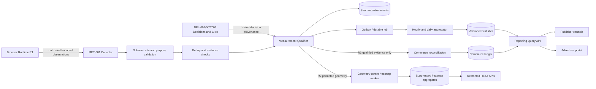
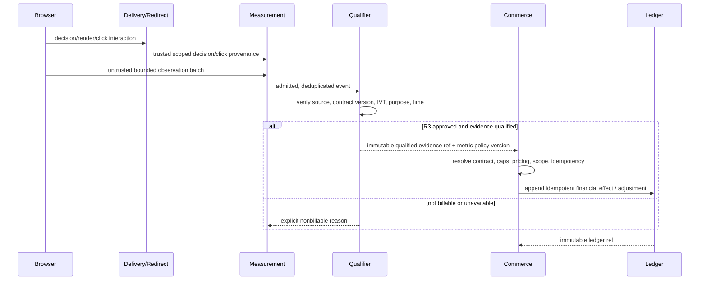

# AdPilot — Measurement, Attribution, Analytics Processing & Reporting Specification

**Document ID:** `ADP-DOC-019`  
**Filename:** `19_ADPILOT_MEASUREMENT_ATTRIBUTION_ANALYTICS_REPORTING.md`  
**Version:** 1.0.0 — proposed implementation specification  
**Status:** Proposed; Product, AdTech Measurement, Architecture, Data, Finance, Security/Privacy, UX, QA and Legal sign-off required  
**Date:** 2026-10-12  
**Product:** AdPilot — Self-Service Advertising Marketplace & Behavioral Analytics for WordPress  
**Audience:** GPT-6 High, PHP/WordPress, TypeScript/browser SDK, data/SQL, reporting, commerce, privacy/security, QA and accessibility engineers  
**Normative predecessors:** `ADP-DOC-001..018` (read in order; downstream proposals do not override earlier decisions)  
**Release horizon:** R1 basic trusted measurement and operational/advertiser aggregate reports; R2 viewability, heatmap overlays, export scaling; R3 CPC/CPM metering, invalid-traffic adjustments, conversion attribution, experimentation; R4 separately consented optional session replay and network extensions.  
**Next proposed document:** `ADP-DOC-020` — Heatmap Intelligence, Behavioral Analytics & Privacy-Aware Visualization Specification.

> **Implementation truth:** Everything in this file is a design and verification contract, not a claim that code, metrics, reports, tests, auditing, industry certification, MRC accreditation, or legal controls have already been delivered. The examples are reference shapes requiring real implementation and compatibility tests. For an unresolved policy, label the issue and fail closed on the dependent paid or sensitive feature rather than choosing an implicit default.

---

## 1. Authority, purpose, terminology and release discipline

### 1.1 Authoritative hierarchy

1. `ADP-DOC-001` defines 129 canonical `FR-*` IDs, `BR-001..018`, `NFR-001..016`, `INV-01..10`, `AC-001..015`, `DEC-001..012` and their original R1–R4 releases.
2. `ADP-DOC-002..005` define 18 capability families, baseline `AT-*` tests, 20 screens, 28 journeys, business state machines, site-plane WordPress capabilities and advertiser-organization membership policies.
3. `ADP-DOC-006..007` govern modular boundaries, `IC-014` Measurement, `IC-015` Reporting, `IC-016/017` heatmaps, `IC-012` Commerce, `UC-MET-*`, `UC-REP-*`, `UC-HEAT-*` and canonical `EV-001..030`.
4. `ADP-DOC-008..010` govern physical event/qualification/aggregate/financial storage, existing `MET-*`/`REP-*`/`HEAT-*` REST routes, event schemas, outbox, queues and retry semantics.
5. `ADP-DOC-011..017` govern privacy-conscious UX, dashboard display, advertiser projection, Layout Studio, Gutenberg, PHP/theme renderer and public integration semantics.
6. `ADP-DOC-018` governs delivery decisions, SDK observations, canonical `DE18-*` delivery gates and runtime collection boundaries; this document defines **server measurement meaning**, qualification/aggregation, attribution and reporting projection without weakening those gates.

### 1.2 Contract goals

Provide independently testable definitions for each report metric; admit and classify untrusted browser observations; preserve data lineage and auditability without retaining unbounded raw behavioral events; show completeness, quality, measurement coverage and time-zone semantics; prevent conflation of inventory reservations, observed ad events and financial transactions; support R2 viewability/heatmaps and R3 qualified billing/attribution as separately gated extensions. A plugin installed without WooCommerce or proprietary analytics vendors must still offer safe R1 reporting on available data.

### 1.3 Scope and non-goals

In scope: metric registry, schema versions, measurement decision provenance, synthetic and invalid traffic handling, batching, deduplication, ordering, event-time/watermark logic, hourly/daily projections, reconciliations, authorized dashboard queries, downloads, observability, performance, retention and release gates. Out of scope: writing a new generic data warehouse, unapproved third-party cookie tracking, probabilistic cross-device identity, personal profiling, direct financial ledger mutation inside Measurement, universal conversion credit without evidence, behavioral replay in R1/R2, and claiming external measurement certification.

### 1.4 Normative words and identifiers

`MUST`/`SHALL` are mandatory within the release in which a capability ships; `SHOULD` requires a recorded deviation when unmet; `MAY` is optional. `MR19-*` IDs are local additions only. Existing IDs preserve their original owner and semantics. `R1` fixed/time placements and basic telemetry; `R2` viewability and consent-aware heatmaps; `R3` metered billing, attribution and invalid-traffic financial adjustments; `R4` optional replay and network extensions. R2/R3 work must never be reported as available R1 features.

### 1.5 Accounting vocabulary

- **Opportunity:** a contextually eligible chance to select an ad for a published slot; not identical to a configured slot.
- **Requested:** client or server sought a decision for an occurrence; retries may happen.
- **Selected/decisioned:** decision algorithm produced an eligible candidate/decision reference.
- **Served:** safe creative was actually returned by a trusted delivery surface under the defined transport rule; define whether cached asset delivery is observable.
- **Rendered:** observer established that approved creative was committed to an actual runtime occurrence, distinct from placeholder markup.
- **Measurable:** supported, consent-permitted (where applicable) instrumentation and enough visibility context exist to evaluate a viewability definition.
- **Viewable:** a *measurable* occurrence met an approved, versioned ratio/duration/visibility policy; not gaze or recall.
- **Click observed:** bounded untrusted interaction event or trusted click redirect attempt; not a payable click.
- **Click qualified:** deduplicated, policy-validated click with decision/site/context linkage and invalid-traffic exclusions.
- **Billable:** independently reconciled, contract-specific R3 financial evidence, not a browser flag.
- **Conversion:** eligible downstream goal event from an authorized, verified integration, with a disclosed attribution model; not proof that an advertisement caused a purchase.
- **Revenue / collected cash / recognized revenue:** separately defined financial views sourced from Commerce ledger/order policy, not event counters.

### 1.6 Non-negotiable measurement invariants

| ID | Contract | Enforcer |
|---|---|---|
| `MR19-INV-01` | Each metric defines numerator, denominator, unit, population, qualifying events, UTC interval, time zone, rule version and freshness. | MetricRegistry + Reporting |
| `MR19-INV-02` | Configured/requested/selected/served/rendered/measurable/viewable/click/qualified/billable are distinct fact classes. | Measurement |
| `MR19-INV-03` | Browser-provided values are **claims**, never authoritative billing or privileged identity evidence. | Collector + Qualifier |
| `MR19-INV-04` | Server-determined editor, preview, staging and synthetic traffic cannot become revenue-bearing events. | Qualifier + Commerce |
| `MR19-INV-05` | Duplicate receipt, worker retries and backfills do not double-increment aggregates or ledger effects. | Idempotency + Aggregator |
| `MR19-INV-06` | All tenant, site and object scopes are checked before access, before export creation, and again at download. | Authorization + Reporting |
| `MR19-INV-07` | Behavioral samples obey current consent, exclusions, minimization and retention; failed consent gates collect nothing prohibited. | Compliance + Collector |
| `MR19-INV-08` | Raw telemetry is finite-lived and independently purged; durable financial audit is a different class with a separately approved retention policy. | Lifecycle + Commerce |
| `MR19-INV-09` | Event time, server receipt time, processing time and report bucket are separate UTC values; arrival order is not event order. | Collector + Aggregator |
| `MR19-INV-10` | A report with incomplete, stale, corrected or estimated values exposes that status; unknown cannot be rendered as zero. | Reporting + UX |
| `MR19-INV-11` | Layout version, logical slot and per-occurrence render identity cannot be lost in aggregation. | Layout + Measurement |
| `MR19-INV-12` | Rejected, indeterminate and unmeasurable observations retain traceable reason codes without retaining prohibited personal data. | Qualifier + Data Quality |
| `MR19-INV-13` | CPC/CPM and adjustment entries require contract rule version and idempotent reconciliation; never direct writes from report queries. | Commerce |
| `MR19-INV-14` | An attribution model is a declared choice, not a fact or proof of causation; credit windows and cross-device restrictions are explicit. | Attribution + UX |
| `MR19-INV-15` | Aggregated heatmaps never silently combine incompatible geometry, layout revisions or breakpoint classes. | Behavioral Analytics |
| `MR19-INV-16` | Report generation, exports and query bursts do not starve public WordPress rendering or paid inventory locking. | Platform + Reporting |
| `MR19-INV-17` | Corrections are revisioned and explainable; historical dashboards reproduce or clearly label their metric revision. | Aggregator + Audit |
| `MR19-INV-18` | External standards are references until the exact rule/version, implementation, evidence and approval are established; never assert accreditation. | AdTech + QA |

---

## 2. Component, owner and trust architecture



### 2.1 Data-control and authority table

| Responsibility | Owner and published contract | Permitted input | Forbidden behavior |
|---|---|---|---|
| Ad eligibility/decision | Delivery, `IC-013`, `UC-DEL-Q02` | Published site/slot/contract and targeting | Treat browser reports as permission or sale |
| Event admission | Measurement, `IC-014`, `UC-MET-C01` | `MET-001`, provenance, policy snapshot | Trust arbitrary source site/organization IDs |
| Qualification | Measurement, `UC-MET-C02` | Stored accepted event + trusted decision/stop version | Post directly into Commerce ledger |
| Aggregation | Measurement, `UC-MET-C03` | Qualified facts + checkpoint | Summarize unreviewed raw requests as payable |
| Read model | Reporting, `IC-015`, `UC-REP-Q01..03` | Aggregate read models and authorized Commerce projection | Expose visitor sessions to advertiser |
| Financial accounting | Commerce, `IC-012` | Approved R3 evidence, contract and payment rules | Accept client `billable` or float money |
| Heatmap geometry and bins | Behavioral, `IC-016/017`, `UC-HEAT-*` | R2 consent-gated samples + immutable geometry | Combine geometry versions or claim eye tracking |
| Export production | Reporting, `IC-018`, `UC-REP-C01` | Authorized report specification | Publish file under public uploads |
| Metrics client SDK | Browser/Delivery, `DE18-MET-*` | Actual observed lifecycle | Generate billing ledger entries |
| Policy / consent | Compliance, `IC-024` | Regional approved policy and current state | Assume all collection is allowed by default |

### 2.2 Trust-boundary order

For each accepted public event: validate route and method → enforce content type/body count/size → determine trusted WordPress site context → validate schema version and allowed event set → resolve opaque decision origin and legitimate render occurrence without exposing it → apply preview/test/server-known exclusion → evaluate purpose/consent and protected-page policy → validate bounds/timestamp skew/TTL and anti-abuse → atomically deduplicate → write evidence with restricted fields → return coarse batch acknowledgement → asynchronously qualify against policy/version → update authoritative aggregates and lineage. Each step has a structured rejection or quarantine code. No unauthenticated POST grants broader capabilities.

### 2.3 Privacy and multi-tenant scope

Per-site custom tables use trusted active `$wpdb->prefix` plus a scoped `site_id` as prescribed in Document 08; never reuse a repository object after `switch_to_blog()` to another site. Advertiser report queries MUST include current `(site, organization, authorized campaign)` scopes from active membership, not merely a request filter. Admin financial permissions differ from aggregate analytics permissions; restricted heatmaps have their own capability. Every response serializer projects only allowable fields, including cache keys and exports.

---

## 3. Metric registry, units and version management

### 3.1 Required metric definition object

```json
{
  "metric_key": "qualified_ctr",
  "metric_version": "1.0.0",
  "release": "R1",
  "aggregation": "ratio_of_sums",
  "numerator": "qualified_clicks",
  "denominator": "qualified_impressions_by_contract",
  "population": "production_eligible_campaign_occurrences",
  "unit": "percentage",
  "time_basis": "event_utc",
  "scope_dimensions": ["site", "campaign", "creative_version", "logical_slot", "layout_revision", "device_class"],
  "zero_denominator": "null_not_available",
  "data_status_required": true,
  "model_status": "observed_derived_ratio",
  "policy_reference": "approved_metric_registry_entry",
  "notes": "Denominator class is selected by an explicit report policy; do not silently substitute served or rendered."
}
```

The registry is immutable per `metric_key+metric_version`; changes affecting comparability create a new definition and backfill plan. A definition contains SQL source(s), event qualification policy, audience allowed to view, precision, currency if relevant, sampling treatment, watermark rule, invalid-traffic handling, expected coverage, automated fixture and human-readable glossary text. No component may define an ad-hoc private CTR formula or rename an estimated quantity as observed.

### 3.2 Mandatory metric catalog (`MR19-M-*`)

| ID | Metric key | Unit / R | Value and inclusion rule |
|---|---|---|---|
| `MR19-M-001` | `configured_logical_slots` | slots / R1 | Count active published logical definitions in selected layout; not serving opportunities. |
| `MR19-M-002` | `eligible_opportunities` | opportunities / R1 | Qualified delivery opportunities after server eligibility/density; dedup by scoped opportunity; not physical slots. |
| `MR19-M-003` | `requested_decisions` | requests / R1 | Distinct eligible decision requests; distinguish retry transport attempts. |
| `MR19-M-004` | `selected_decisions` | decisions / R1 | Unique selected eligible decisions; never equal render events by assumption. |
| `MR19-M-005` | `served_creatives` | serves / R1 | Verified delivery-stage occurrences under published definition; document CDN observability limitations. |
| `MR19-M-006` | `rendered_creatives` | renders / R1 | Validated browser-attested insertion for specific decision/render occurrence; collector limitations flagged. |
| `MR19-M-007` | `measurable_impressions` | occurrences / R2 | Supported eligible context under approved viewability definition; absent in R1, not zero. |
| `MR19-M-008` | `viewable_impressions` | occurrences / R2 | Qualified continuous exposure by versioned policy, with known limitations. |
| `MR19-M-009` | `unmeasurable_impressions` | occurrences / R2 | Classified unavailable measurement; reason breakdown required. |
| `MR19-M-010` | `observed_clicks` | interactions / R1 | Untrusted observed/sent or redirect attempts; separate from qualified. |
| `MR19-M-011` | `qualified_clicks` | interactions / R1 | Qualified unique click evidence linked to authoritative decision. |
| `MR19-M-012` | `invalid_clicks` | interactions / R1 diagnostic; R3 investigation | Rejected/suspect reasons; do not expose sensitive fraud signals to normal advertiser. |
| `MR19-M-013` | `qualified_ctr` | % / R1 | Qualified clicks / explicitly chosen qualified impression denominator. |
| `MR19-M-014` | `fill_rate` | % / R1 | Filled eligible opportunities / eligible opportunities, sampled/unknown caveats. |
| `MR19-M-015` | `inventory_utilization` | % / R1 | Contractually allocated sellable capacity / sellable capacity over same period. |
| `MR19-M-016` | `render_to_serve_rate` | % / R1 | Rendered creatives / verifiably served creatives; observability caveat. |
| `MR19-M-017` | `viewability_rate` | % / R2 | Viewable / measurable, never all configured. |
| `MR19-M-018` | `measurement_coverage` | % / R2 | Measurable / valid rendered population after approved eligibility rule. |
| `MR19-M-019` | `scroll_depth` | normalized fraction / R2 | Qualified scroll sample, document max or distribution convention; not attention. |
| `MR19-M-020` | `attention_time_proxy` | milliseconds / R2 | Observed visibility/interaction proxy with sampling and limitations. |
| `MR19-M-021` | `tap_click_heatmap_count` | count / R2 | Consent-allowed events by compatible normalized geometry bin. |
| `MR19-M-022` | `qualified_cpm_impressions` | impressions / R3 | Contract-governed qualifying impression class in reconciled billing evidence. |
| `MR19-M-023` | `qualified_cpc_clicks` | clicks / R3 | Contract-governed billable click evidence, deduped independently. |
| `MR19-M-024` | `attributed_conversions` | model credits / R3 | Authorized conversion evidence attributed under labeled model/window; noncausal. |
| `MR19-M-025` | `attributed_conversion_value` | money / R3 | Verified conversion value by currency, model and authorization; not ledger recognized revenue. |
| `MR19-M-026` | `invalid_traffic_adjustments` | events + money / R3 | Evidence-based correction/refund entries, independently approved. |
| `MR19-M-027` | `total_order_value` | money / R1 | Commerce order projection with defined statuses, never browser event summation. |
| `MR19-M-028` | `collected_cash` | money / R1 | Verified captured/settled ledger projection by currency; pending excluded. |
| `MR19-M-029` | `recognized_revenue` | money / R1 where governed | Ledger/accounting-policy projection; unavailable if revenue policy unresolved. |
| `MR19-M-030` | `event_acceptance_rate` | % / R1 ops | Valid admitted events / complete received events, transport count scoped. |
| `MR19-M-031` | `aggregation_lag_seconds` | seconds / R1 ops | Wall-clock minus newest processed covered event watermark. |
| `MR19-M-032` | `dedup_suppression_count` | count / R1 ops | Exact dedup collisions suppressed by declared scope; no visitor identity export. |
| `MR19-M-033` | `active_inventory_count` | placements / R1 | Active publishable inventory distinct from sold/occupied inventory. |
| `MR19-M-034` | `estimated_performance` | labeled estimate / R3 | Explicit modeled value, assumptions and uncertainty; never mixed with observed totals. |

### 3.3 Formula catalog and denominator edge cases

For a reporting group `g` and interval `[start_utc,end_utc)`:

- `qualified_ctr(g) = 100 × qualified_clicks(g) / selected_qualified_impression_basis(g)` only if that basis is approved and positive.
- `viewability_rate(g) = 100 × viewable_impressions(g) / measurable_impressions(g)` when denominator is positive.
- `measurement_coverage(g) = 100 × measurable_impressions(g) / eligible_rendered_impressions(g)` when approved and positive.
- `fill_rate(g) = 100 × filled_eligible_opportunities(g) / eligible_opportunities(g)` when denominator is positive.
- `inventory_utilization(g) = 100 × allocated_sellable_capacity(g) / sellable_capacity(g)` for time-weighted compatible products.
- `rejection_rate(g) = 100 × rejected_received_events(g) / all_received_events(g)`; operational only.

`ratio_of_sums` is mandatory for rollups: never average daily CTR percentages, especially across zero denominators. For `denominator=0`, absent/not supported, or incomplete collection, return `value:null` with a distinct code (`no_eligible_population`, `feature_not_released`, `data_unavailable`, or `partial`) and separately supplied raw numerator/denominator when authorized. Percentages display a configured number of places, but calculations preserve full integer/rational precision before formatting. Ratios over 100% require classification (multiple interactions per impression, mismatched population, duplicates, or data bug), not silent clamping. Cap/mapping decisions need metric-owner approval.

### 3.4 Dimensional grain governance

Base reporting dimensions: trusted site, organization authorization scope, campaign, **creative version**, logical slot, published layout revision, page/template context when admissible, device class, UTC bucket, metric policy version, qualification class and source version. Zone/container dimensions are derived from immutable binding snapshots effective at event time; never join old events to a new layout and pretend their zone is unchanged. Unknown values get a typed `unknown` category, not a fabricated default device/page. Aggregations use a stable normalized null grain key; SQL uniqueness must not be defeated by nullable `creative_version_id` (see Document 08's unresolved sentinel vs normalized key issue).

### 3.5 Data contract registry and evolution rules

Every emitted metric payload includes `metric_registry_version`, `aggregation_revision`, `data_as_of_utc`, `last_ingested_at_utc`, `watermark_utc`, `quality_status`, `partial_reason_codes`, `observability_class`, and applicable `currency`/`timezone_label`. Event schema and policy versions are independent. Deprecated metric definitions remain resolvable only according to approved historical disclosure/retention; never rewrite historical money after a dashboard definition change.

---

## 4. R1 event collection and server acceptance contract

### 4.1 Use the existing Document 09 routes

| Existing route | Usage and required boundary |
|---|---|
| `DEL-001` `POST /delivery/decisions` | Trusted decision opportunity and candidate reference; not viewability. |
| `DEL-002` `POST /delivery/click` | Browser-facing safe redirect/validation; click is not billable on return. |
| `DEL-003` `GET /delivery/creative/{decision_ref}` | Authorized safe creative response; asset caching policy governs possible observability gap. |
| `MET-001` `POST /measurement/events` | Bounded untrusted event batch; `202` only acknowledges acceptance for processing. |
| `MET-002` `GET /measurement/client-config` | Sanitized R1/R2 event type/limit/purpose policy appropriate to site and release. |
| `MET-003` `GET /admin/measurement/health` | Restricted redacted diagnostics; never raw visitor data. |
| `REP-001..008` | Aggregated admin, organization, export status/download; documented permissions only. |
| `HEAT-001..005` | R2 restricted geometry/aggregates, not advertiser-level replay. |
| `HEAT-006..007` | R4 replay only, independent explicit opt-in. |

**Do not invent additional public endpoints** to avoid missing approval. If a new conversion callback, billing dispute or customer download resource is required for R3, propose it in an API change request against Document 09 with privacy, ownership, signature and test contracts before implementation.

### 4.2 Browser batch wire shape (illustrative subset of `MET-001`)

```json
{
  "schema_version": 1,
  "batch_ref": "01K8EXAMPLEBATCHREF0001",
  "events": [
    {
      "event_id": "01K8EXAMPLEEVENTREF0001",
      "event_type": "rendered",
      "decision_ref": "opaque_signed_decision_ref",
      "render_instance_id": "opaque_render_ref_1",
      "occurred_at": "2026-10-12T08:30:00Z"
    },
    {
      "event_id": "01K8EXAMPLEEVENTREF0002",
      "event_type": "visibility_milestone",
      "decision_ref": "opaque_signed_decision_ref",
      "render_instance_id": "opaque_render_ref_1",
      "occurred_at": "2026-10-12T08:30:02Z",
      "measures": {"visible_ratio": "0.60", "continuous_visible_ms": 1200}
    }
  ]
}
```

Examples are deliberately not complete canonical DTO schemas. Document 09 and `ASY-MET-003` govern field validation, max bytes/counts and standard response envelope. A client-supplied `site_id`, `organization_id`, `campaign_id`, `billable=true`, `price`, IP or arbitrary page URI is not authorized evidence. Timestamp and ratio fields are bounded, typed and canonicalized; do not use PHP `float` for money.

### 4.3 Validation, rate limits and accepted/rejected separation

Require JSON media type, UTF-8, bounded nesting, allowed event names per release, maximum batch/event byte size, finite numeric representation, timestamp plausibility, valid decision and render reference, site isolation, known layout revision and binding, permission to collect purpose-specific fields, safe page-context proof, origin checks where feasible, and abuse/rate control. Response may include accepted/rejected **counts** and opaque batch ID, never operational fraud rules or personal identifiers. Rate limits and budgets are configurable policy values, not universal constants invented in this document. A transport-successful event may later be classified rejected, duplicate, unqualified, or nonbillable.

### 4.4 Distinguishing observer event sources

| Provenance | Admission | Reporting | R3 billing |
|---|---|---|---|
| `production_browser_observed` | Allowed if legitimate and purpose-eligible | May contribute after checks | Only after independent qualification/reconciliation |
| `trusted_server_decision` | Server fact | Decision/fill metrics | Not automatically a charge |
| `trusted_server_redirect` | Server-verified click attempt | Eligible qualified click after checks | Requires R3 contract validation |
| `authenticated_editor_preview` | Diagnostic only | Separate preview diagnostics | Never |
| `admin_layout_preview` | Diagnostic only | Separate preview diagnostics | Never |
| `staging_or_synthetic` | Test partition only | Never mixed with production | Never |
| `unknown_or_spoofed` | Reject/quarantine | Quality diagnostics only | Never |
| `bot_suspected` | Quarantine or qualified exclusion under policy | Segregated traffic quality | Never while unresolved |

### 4.5 Decision, render and event correlation

Canonical key is scoped by `(site, published_layout_revision, logical_slot_id, render_instance_id, decision_ref, creative_version_id, policy_version)`. `render_instance_id` is a distinct occurrence and cannot be used to create repeat billable impressions without a separately valid decision. The collector authenticates decision metadata from signed or server-backed source; client assertions are optional hints only. Browser clocks are not financial authority. Dedup keys incorporate approved event taxonomy and bounded time/policy scopes to prevent conflating `rendered` and `visibility_milestone` while avoiding unlimited repeats of the same logical observation.

---

## 5. Qualification state machine and invalid-event taxonomy

### 5.1 Independently tracked states

`received → syntax_validated → source_bound → purpose_checked → deduplicated → evidence_evaluated → qualified | rejected | quarantined | unmeasurable` with immutable reason and policy version. `accepted_for_processing` is not `qualified`; `qualified` is not `billable`; requalification and reversals create new explicit revision/evidence, not silent row mutation. `quarantined` must have an expiry/investigation path. A downstream missing source is `pending_verification`, not automatically accepted.

### 5.2 Reason code catalog (`MR19-Q-*`)

| ID | Code | Semantics and handling |
|---|---|---|
| `MR19-Q-001` | `invalid_schema` | Reject malformed or unknown schema/type; no public internals. |
| `MR19-Q-002` | `invalid_site_scope` | Reject wrong site/cross-tenant reference, audit suspicious pattern. |
| `MR19-Q-003` | `invalid_decision_provenance` | Reject fabricated/expired/tampered decision. |
| `MR19-Q-004` | `unknown_render_occurrence` | Reject/hold missing render instance proof; avoid accidental reattribution. |
| `MR19-Q-005` | `preview_or_editor` | Exclude from production/billing; keep safe diagnostics if needed. |
| `MR19-Q-006` | `staging_or_synthetic` | Exclude from production/billing; tag test partition. |
| `MR19-Q-007` | `duplicate_event` | Suppress repeated fact; return idempotent coarse acknowledgment. |
| `MR19-Q-008` | `timestamp_out_of_window` | Reject or quarantine skewed/unbounded event time. |
| `MR19-Q-009` | `policy_or_release_disabled` | Feature not enabled; do not infer implied consent. |
| `MR19-Q-010` | `consent_purpose_missing` | Reject forbidden purpose, no prohibited raw persistence. |
| `MR19-Q-011` | `sensitive_page_excluded` | Exclude page/input; no capture of private content. |
| `MR19-Q-012` | `automated_traffic_known` | Exclude known synthetic/automation from revenue basis. |
| `MR19-Q-013` | `traffic_suspicious_pending` | Investigate; no financial qualification pending review. |
| `MR19-Q-014` | `impossible_visibility_sample` | Reject out-of-range ratio, negative duration, nonsensical lifecycle. |
| `MR19-Q-015` | `tab_hidden_or_measurement_gap` | Mark nonmeasurable or reset exposure, don't claim viewable. |
| `MR19-Q-016` | `unsupported_browser_or_obstruction` | Mark measurement limitations; not viewable by default. |
| `MR19-Q-017` | `invalid_click_sequence` | Repeated/click-before-decision or anti-abuse fail; reject/quarantine. |
| `MR19-Q-018` | `contract_rule_not_applicable` | Valid measurement but not eligible billing basis. |
| `MR19-Q-019` | `late_beyond_watermark` | Quarantine/correction route; not silently discard or double count. |
| `MR19-Q-020` | `missing_immutable_layout` | Hold until verified historical layout or fail safe; never join current revision. |
| `MR19-Q-021` | `rate_limited` | Drop excess per approved budgets, retain only aggregate operational counters. |
| `MR19-Q-022` | `source_reconciliation_failed` | Quarantine R3 evidence; do not post charges. |
| `MR19-Q-023` | `deletion_or_retention_block` | Respect data lifecycle; do not recreate deleted raw identity from backfills. |
| `MR19-Q-024` | `metric_policy_incompatible` | Version mismatch; separate buckets or audited reprocessing. |

### 5.3 Automated and invalid traffic: conservative approach

Use layered, reviewable indicators: known test contexts, verified signatures and decisions, abnormal repeated click timing, request bursts, impossible geometry, invalid provenance, implausible clock behavior, bot-classification from approved maintained lists and controlled rate limits. Do not imply perfect bot detection, infer human intent solely from IP, fingerprint covertly, or disclose fraud heuristics publicly. Require false-positive analysis and human-review escalation for finance-impacting findings. Automated page-load monitors are not assumed fraudulent advertising participants without verified context, but must never be qualified for billable production metrics when identified as synthetic.

### 5.4 Requalification and appeal

Keep `original_classification`, current effective classification, `classification_version`, evidence digest, rationale, actor/service identity, approval (where required), and effective adjustment reference. A reversal after an advertiser report export triggers an aggregate revision and disclosure; a financial adjustment requires Commerce authorization, independent ledger posting and the contract's remedy policy. A privacy deletion request must not be used as a pretext to erase legitimate financial audit trails; keep only permissible minimal financial facts.

---

## 6. R2 viewability and observability policy

### 6.1 Definition governance

AdPilot SHALL adopt a formally approved, versioned viewability rule that defines creative category, minimum visible area, continuous duration, in-focus/tab eligibility, playback conditions where relevant, frame/iframe limitations, viewport clipping, occlusion capability and reset conditions. A commonly cited display reference is at least 50% of pixels for one continuous second; this is **an industry reference, not an automatically approved AdPilot default or claim of accreditation**. Larger creatives/video may have different policy-specific standards. The exact product metric version is unapproved until the measurement owner documents the chosen protocol and limitations. [IAB Tech Lab Open Measurement SDK](https://iabtechlab.com/standards/open-measurement-sdk/) is a possible compatibility reference, not a mandatory proprietary dependency or automatic certification.

### 6.2 Client observation logic

Use one shared `IntersectionObserver` where supported, bounded visibility milestones, monotonic elapsed time while running, `document.visibilityState`, lifecycle suspend/resume reset, device/browser capability and a server-sent measurement policy version. When a ratio drops below minimum, continuous qualifying duration resets. A runtime cannot prove non-occlusion or actual human attention merely from geometry; if required verification cannot be made, mark nonmeasurable/unknown with reason rather than viewable. Different assets can be visible simultaneously; every event links its unique occurrence.

```text
R2 eligibility and observation
  supported runtime + permitted purpose + valid production decision?
    no  -> nonmeasurable / excluded; do not collect prohibited payload
    yes -> assess geometry and visible fraction
              below threshold -> continuous clock reset
              at/above threshold, tab visible -> monotonic clock accumulation
              crosses approved continuous duration -> propose milestone once
              server revalidates and classifies -> qualified viewable or not
```

### 6.3 Measurable, nonmeasurable, viewable and unviewable

A nonmeasurable occurrence is not an unviewable occurrence. Reports must display `measurable`, `viewable`, and `unmeasurable` alongside eligibility/population, with explicit coverage denominator and reason breakdown. An eligible measurable ad that never meets threshold counts as `measurable_not_viewable`; an ad below fold without SDK activation may be unknown/unrequested, not falsely served or unviewable. Use sampling/transport completeness indicators and avoid privacy-invasive attempts to reconstruct visitors who withheld consent.

### 6.4 Browser limitations and certification policy

Intersection ratio can be inaccurate about visual occlusion/overlays, CSS transforms, embedded frame limitations and cross-origin display. Document feasible capability checks, cross-browser test matrix and detectable obstructions. Never call AdPilot measurements “MRC-accredited”, “independently verified”, or “human viewed” without actual independent certification. Third-party measurement SDKs need explicit review of supply chain, data flows, license, privacy and performance; ordinary plugin use cannot depend on them.

---

## 7. Time, deduplication, ordering, and aggregation semantics

### 7.1 Canonical clocks

Persist `event_occurred_at_utc` (client claim), `server_received_at_utc` (trusted receipt), `qualified_at_utc` (trusted classification), `aggregated_at_utc` (materialization), and an authorized `display_timezone`. Only trusted UTC server time drives expiry, financial qualification, rate limiting and watermark finality. Client event time may be accepted within approved bounded skew. Store report facts in UTC hourly/daily buckets; local displays re-bin from hourly facts where DST disambiguation demands, or explicitly show UTC-based accounting bucket attribution. Never assign two local 01:30 occurrences to one anonymous DST interval without offset/date information.

### 7.2 Exactly-once *effect*, not exactly-once transport

Browser, REST, Action Scheduler and event dispatch use at-least-once attempts. Deduplication uniqueness is scoped by `(site_id, event_hash)` and validated type/policy identity per Document 08. An outbox event may be retried; consumers use `inbox_consumptions` keyed by consumer/event/version. Only transactionally checked insert/update can produce a counted event. Expired dedup windows cannot be used for arbitrary financial replay: R3 financial evidence has a longer, separately approved unique reconciliation key and append-only proof.

### 7.3 Watermarks and late events

Per source partition and metric version maintain the highest fully covered event-time watermark, input cursor/checkpoint, last completed aggregation revision and `completeness_state`. A recent bucket can be `open`/`provisional`; after the configured allowed lateness it may become `final_under_policy`. Late valid arrivals use idempotent *revisioned correction* with provenance or quarantine if policy forbids rewrite. No universal lateness window is selected without real workload and finance-policy review. Report consumers receive both `data_as_of` and `bucket_status`, not only `updated_at`.

### 7.4 Reconciliation algorithm and safe atomic update

```text
process_partition(site, partition, policy_version):
  acquire bounded lease with fencing token
  load checkpoint under transaction or equivalent protected lock
  fetch bounded qualified event rows after checkpoint
  resolve immutable dimensions and metric definition for each row
  group by site/UTC hour/campaign/creative_version/slot/layout/device/metric version
  apply deterministic event IDs or exact reconciled delta, not repeated blind increments
  atomically upsert replacement/revisioned aggregate + checkpoint + outbox fact
  commit; release lease
  retry from durable checkpoint if crash
```

Document 08's `aggregation_checkpoints`, `stats_hourly`, `stats_daily`, `measurement_qualifications`, `event_deduplication` and outbox/inbox are authoritative schema shapes. Avoid `UPDATE count=count+batch_count` after a crash unless a unique batch-application log guarantees idempotency. Backfills must not race with live aggregations on the same grain without fencing. Prefer deterministic recomputation of affected bounded buckets from qualified facts while they exist, or durable corrections after raw retention ends.

### 7.5 Daily materialization and rollups

Daily UTC projections derive from reconciled hourly counters and their source revisions, not a second uncoordinated raw-event pass. A daily bucket states which hourly revisions and horizon it covers. Ratios compute after integer SUM; no averaging pre-rounded percentages. Reporting by selected account time zone may require re-bucketing complete hourly UTC buckets; when sub-hour resolution is unavailable, document approximation rather than pretend local-day exactness. Time-based contract revenue follows Commerce accounting periods, not presentation chart periods.

### 7.6 Backpressure and degraded service

If queue/DB is impaired: bounded event buffers, size/cost prioritization, reject optional behavioral samples first, preserve durable finance evidence and essential operational visibility, emit explicit `partial_collection` status, expose recovery metrics, and never block WordPress page navigation. Do not increase synchronous ad render latency to force analytics durability. On collector failure, clients retry within bounded TTL and the server deduplicates; a lost event remains an observed collection gap, not reconstructed as a guaranteed paid impression.

---

## 8. Physical schema and query plan contracts

### 8.1 Database table reuse: no shadow persistence model

| Existing table in Document 08 | Owner | Primary read/write path | Key correctness rule |
|---|---|---|---|
| `event_batches` | Measurement | Batch receipt | Counts reflect transport only; never billable. |
| `delivery_events` | Measurement | Validated short-retention event facts | Site, decision, render, creative/layout version, qualification and timestamps; no visitor payload firehose. |
| `event_deduplication` | Measurement | Collision-safe first-seen insert | Bounded TTL, site-scoped uniqueness and canonical event hash. |
| `measurement_qualifications` | Measurement | Qualified/billing evidence | Stable immutable evidence provenance and rule version; R3 reconciliation independent of raw purge. |
| `stats_hourly` | Reporting | Fast hourly aggregate queries | Composite grain uniqueness resolves nullable creative issue; versioned status. |
| `stats_daily` | Reporting | Daily reports | Derived from hourly with revision lineage, not arbitrary recount. |
| `aggregation_checkpoints` | Measurement | Job progress/recovery | Atomic with projection, fenced lease/retry. |
| `geometry_snapshots` | Behavioral R2 | Immutable sanitized layout geometry | Cannot contain DOM text, form or private page captures. |
| `heatmap_aggregates` | Behavioral R2 | Privacy-filtered normalized bins | Version/viewport/geometry and minimum cohort; no raw visitor data in API. |
| `consent_records` | Compliance R2 | Purpose policy evidence | Never a general-purpose tracking identity. |
| `report_exports` | Reporting | Queued protected downloads | Permission checked at request AND download time. |
| `financial_ledger_entries` | Commerce | Trusted finance projection | No updates by Measurement/Reporting query handlers. |
| `audit_log`, `outbox_messages`, `inbox_consumptions` | Platform | Reliability and traceability | Append-only audited transitions and idempotent consumers. |

### 8.2 Indexed access shapes

- Ingestion: `(site_id, batch_public_id)` unique; `delivery_events(site_id, observed_at, event_type)`, `(site_id, campaign_id, observed_at)` and `(site_id, slot_id, observed_at)` per Document 08.
- Aggregation: read after a stable `(site, time/cursor partition)` checkpoint; monitor `EXPLAIN` and range selectivity; don't scan an entire history for live dashboards.
- Campaign report: `(site_id, campaign_id, bucket_start_at)` constrained authorized campaign scope; `org_id` membership not inferred from a mutable campaign label.
- Placement report: `(site_id, slot_id, bucket_start_at)` and published `layout_revision_id` constraint.
- Heatmap: `(site_id, layout_revision_id, bucket_date)` and `(site_id, geometry_snapshot_id, metric_kind)`.
- Finances: ledger indices and row-level authorization determined by Commerce, independent of aggregated events.

### 8.3 Additional schema needs require change control

Document 08's baseline aggregate tables lack explicit storage for all proposed `eligible_opportunities`, `selected_decisions`, `qualified_impressions_by_contract`, conversion models, metric numerator/denominator metadata, aggregation revision lineage and durable R3 event-to-contract settlement. Implementers SHALL produce a schema delta proposal (`MR19-SCHEMA-*`) with compatibility migration, index/retention budget, aggregate grain, new write/read contracts and rollback strategy. **Do not quietly insert columns or imply that existing `stats_hourly` already stores every new metric.** A proposed typed `metric_definition_versions` read-only registry (code-backed R1 if no migration), `stats_metric_counters` for approved extended classes, `aggregate_revision_log`, `conversion_evidence`, `attribution_credits`, and `billing_evidence_reconciliations` may be used only after review by Document 08 owner. R3 conversion rows cannot be added to R1 without explicit release gating.

### 8.4 Data-volume and partitioning policies

On normal WordPress hosting, avoid massive indexes, unbounded `postmeta`, options/autoload, per-impression Action Scheduler jobs and globally locking fact tables. Work with bounded batches and periodic aggregation/expiration. Physical partitioning is optional, compatibility-verified, and cannot require server configuration beyond the supported product matrix. Select retention, index cardinality, partitions, max DB footprint, query timeout and export limits from measured traffic profiles and approved service tiers; record operations guidance and deny expensive queries safely.

---
## 9. R3 CPC/CPM reconciliation and commercial source of truth

### 9.1 Split observed evidence from charged transactions

Advertising analytics measure phenomena; financial entries enforce contractual obligations. A campaign can have many `rendered` events and zero R3 payable impressions, and a fixed-duration R1 contract can have a recognized revenue policy unrelated to rendered-event counts. R3 monetization is a distinct gated Commerce workflow; it must never be accidentally activated by adding a report toggle.



### 9.2 Metering contract (`MR19-BILL-*`)

| ID | Rule | Verification |
|---|---|---|
| `MR19-BILL-01` | `billable_event` cannot originate from browser, editor, CSV upload, dashboard or PHP theme API. | Forged client flag rejected and no ledger entry. |
| `MR19-BILL-02` | R3 activation requires approved rate card/quote/contract snapshot, allowed event class, event policy version and valid entitlement. | Wrong plan/release rejected. |
| `MR19-BILL-03` | CPC charges require independent qualified click evidence; redirect attempt alone is insufficient. | Repeated auto-clicks never double-charge. |
| `MR19-BILL-04` | CPM charges require contract-specific qualifying impression definition and integer/rational pricing allocation with approved rounding. | 1000-event boundary deterministic in currency units. |
| `MR19-BILL-05` | Each evidence-to-contract reconciliation mapping has stable idempotency; retry does not duplicate financial effects. | Crash/replay ledger invariant. |
| `MR19-BILL-06` | Budget and cap thresholds use authoritative concurrency-controlled Commerce state, not stale reporting charts. | Multi-worker cap race tests. |
| `MR19-BILL-07` | Invalidation after settlement yields append-only adjustment/refund remedy with dual control where policy demands. | Ledger remains append-only. |
| `MR19-BILL-08` | Report shows gross qualified events, disqualified events, pending settlement, reconciled charges and post-facto credits separately. | Statement and chart tie-out. |
| `MR19-BILL-09` | Billing window and time zone follow accepted contract, not a user's dashboard date picker. | DST and edge-window tests. |
| `MR19-BILL-10` | Unavailable proof or unresolved contract policy makes metered billing ineligible; production serving may remain in permitted fixed/time mode. | Feature gate and failure UX. |
| `MR19-BILL-11` | Money uses exact minor units/decimal rational rate, approved rounding per contract and single currency per arithmetic group; floating-point ledger calculations forbidden. | Currency and fractional-CPM fixtures. |
| `MR19-BILL-12` | Financial reports use independently reconciled ledger/accounting state; browser totals are never transformed into recognized revenue. | Report/ledger divergence flag. |

### 9.3 R3 qualification example (illustrative)

```json
{
  "evidence_ref": "opaque_qualified_evidence_ref",
  "site_ref": "server_resolved_site",
  "contract_ref": "server_resolved_contract",
  "campaign_ref": "server_resolved_campaign",
  "event_class": "qualified_cpc_click",
  "metric_policy_version": "cpc_policy_v1_approved",
  "contract_pricing_version": "contract_snapshot_v3",
  "event_time_utc": "2026-10-12T08:33:00Z",
  "source_digest": "sha256:opaque_digest",
  "classification": "eligible_for_commerce_reconciliation",
  "reconciliation_ref": null,
  "charge_minor_units": null,
  "billing_state": "pending_commerce_validation"
}
```

`billing_state` is descriptive; it is not a shortcut for a ledger posting. Currency and pricing amounts appear only after Commerce calculates them. If a source event is later challenged, ledger corrections reference the immutable original and adjustment and do not backdate a silent decrease to past counts.

### 9.4 Finance reconciliation and reporting tie-out

On a configured cadence reconcile: eligible qualified source evidence → contract allowance → billable unique evidence → effective charges/credits → ledger/account settlement → report projection. Produce per-campaign reconciliation status (`matched`, `pending`, `disputed`, `partially_matched`, `blocked`) with count deltas and reasons. Do not assert that impression count × CPM alone equals recognized revenue. The accounting policy, tax handling, currency, refunds, discounts and revenue recognition must be approved outside analytics.

---

## 10. R3 conversions and attribution modeling

### 10.1 Evidence prerequisites

An off-site conversion requires an advertiser-installed or separately authorized, documented integration, validated callback authenticity, bounded event schema, allowed purpose, unambiguous site+org+campaign scope, and permitted identifier/linkage. WordPress frontend scripts must not silently add an advertiser's pixel to customer checkout or collect purchase identifiers without the relevant privacy/legal authorization. Server-to-server ingestion requires signatures/authorization and replay bounds. Conversions must not be inferred from ordinary page-view proxies.

### 10.2 Conversion fact schema proposal

```json
{
  "conversion_ref": "opaque_external_or_internal_dedup_ref",
  "conversion_type": "approved_purchase",
  "occurred_at_utc": "2026-10-12T08:45:00Z",
  "received_at_utc": "server_assigned",
  "source_integration_ref": "approved_integration",
  "value_minor_units": "2599",
  "currency": "USD",
  "consent_proof_ref": "purpose_scope_ref_if_required",
  "attribution_model_version": "last_eligible_click_v1_proposed",
  "verification_status": "pending",
  "linked_touch_refs": [],
  "contains_personal_identifiers": false
}
```

Fields and the optional linkage mechanism are not approved for automatic use until a PIA/DPIA (when applicable) and interface review. Never export third-party customer PII as a normal advertiser analytics field. A conversion may be verified yet un-attributable; label it so instead of inventing an ad touch.

### 10.3 Attribution model menu (R3, policy-gated)

| Model | Rule and required label | Limitations |
|---|---|---|
| No attribution (`observed_conversions_only`) | Show independently verified totals, no ad credit. | Safest default when no approved linkage exists. |
| Last eligible click | Assign credit to latest qualifying click within approved lookback. | Not causal; biased by click capture and missing touchpoints. |
| First eligible click | Assign credit to earliest eligible click in approved window. | Not causal; identity/linkage incomplete. |
| Last eligible view | Assign credit to most recent eligible, defined impression when view-through is permitted. | More prone to coincidental correlation; requires R2 measure class. |
| Position/linear | Share credit over eligible touch sequence with explicit weights. | Requires stronger consent/linkage and revisioned weights. |
| Custom model | Require reviewed, versioned specification, reproducible fixture and clear reporting disclosure. | No hidden optimizer auto-crediting. |

Attribution precedence among click/view classes, duration of windows, cross-device support, tie-breakers, multiple conversions per order, refunds, returns, changed user consent and overlapping campaigns are **open product/legal decisions**. Use `conversion_ref` and attribution-credit idempotency to avoid repeated credit on webhook replay. When incompatible models are compared, do not sum overlapping credit totals as independent conversions. Separate observed conversion count, model-attributed credit and estimated incremental lift; experiments do not establish causality without valid design.

### 10.4 R3 evidence lifecycle

`conversion_received → integration_verified → policy_checked → deduplicated → touch_set_resolved → attributable | unattributable | excluded → model_credited → reportable`, with explicit `pending`, `corrected`, `withdrawn` and `refunded` paths. A paid order status reversal requires audited credit reversal rather than permanent “sales” count inflation. Backfills may reattribute only with approved model-version change and report revision.

---

## 11. Invalid-traffic investigation, disputes and adjustments (R3)

### 11.1 Investigation lifecycle

`anomaly_detected → triaged → evidence_preserved_minimally → investigated → classified → decision_approved → adjustment_issued_or_closed → report_revision_published`. Only authorized fraud/finance investigators may access restricted evidence; advertiser-facing output shows lawful, safe summaries, not visitor traces, fingerprints, rule thresholds or another advertiser's campaign data. Investigations have case ownership, severity, deadlines, classification version, reason and appeal/reference, with immutable audit of decisions.

### 11.2 Testable investigation rules

- Thresholds, bot-feed subscriptions and confidence bands must be reviewed per site/jurisdiction; no universal fraud score is implied.
- Detections are hypotheses. Preserve suspect vs confirmed classification and documented false-positive controls.
- A duplicate click is not equivalent to confirmed bot traffic; distinguish duplicate suppression, accidental click and automated abuse where supportable.
- Temporarily prevent R3 monetary reconciliation on contested evidence until resolved; avoid blanket blocking legitimate fixed contracts unless approved safety policy requires it.
- Reconstruct safe decision/rule versions and aggregate evidence without retaining prohibited visitor identifiers or raw DOM captures.
- Apply Commerce adjustment with independently approved reason, currency and ledger links; never delete settled postings.
- Report before/after counts, decision date, model/version and affected exports when a qualified billing event is reversed.
- If customer privacy or legal retention prevents full investigation, mark evidence unavailable and apply the signed commercial dispute policy rather than fabricating confidence.

### 11.3 Anomaly classes

Traffic spikes, viewability discontinuities, clicks without valid impression provenance, impossible repeated render identifiers, unusual site/version mismatch, geographic inconsistency when authorized signals exist, job replay surges, missing ingestion partitions, bot-list hits, SDK regressions and charge/qualified-counter divergence. Some signals reflect measurement bugs, not adversaries; triage must explicitly evaluate technical causes before assigning fraud labels.

---

## 12. Report APIs, permission projections and dashboard semantics

### 12.1 Existing route mapping (Document 09)

| Endpoint ID | Allowed audience | Metric classes | Mandatory query/UX rules |
|---|---|---|---|
| `REP-001` | Site-authorized admin | General KPIs, financial ledger projections if separately entitled | Revenue permission, status labels, freshness, accessible cards. |
| `REP-002` | Site-authorized admin | Campaign performance | Filters are constrained by current site and permission, zero/partial states. |
| `REP-003` | Site-authorized admin | Placement/zone/slot analysis | Immutable layout revision, site, period, device class. |
| `REP-004` | Current organization analyst | **Own** aggregated campaign performance | No raw/session fields, publisher internal pricing or other org rows. |
| `REP-005` | Authorized site exporter | Scoped async aggregate artifact | Permission + schema validation + cost limits. |
| `REP-006` | Current organization exporter | Own aggregate report artifact | Active org membership/current grant required. |
| `REP-007` | Authorized request owner/current delegate | Status of protected export | No private metadata across sites or organizations. |
| `REP-008` | Authorized request owner/current delegate | Download protected artifact | Recheck privilege/site/org, expiry, safe filename. |
| `HEAT-001..005` | Restricted publisher analytics role, R2 | Sanitized aggregate geometry/heatmaps | Purpose and cohort controls; numeric accessible equivalent. |
| `HEAT-006..007` | Dedicated replay permission, R4 | Separate opt-in replay | Never exposed via ordinary R1/R2 report. |

### 12.2 Query request semantics

Every report accepts documented and explicitly allowlisted filters; arbitrary SQL column names, unlimited groupings or raw `order_by` fragments are not allowed. `start_utc` inclusive and `end_utc` exclusive. Date presets convert using requested authorized report timezone with DST disambiguation. Reject too many/expensive dimensions and suggest async export rather than executing unbounded scans during WordPress page load. Validate `campaign_ids`, `creative_versions`, `zone_ids`, `slot_ids`, `page_context`, `device_classes`, metric versions and release availability through server-side object ownership and immutable historical binding data.

### 12.3 Shared aggregate response schema

```json
{
  "data": {
    "scope": {"type":"organization", "ref":"opaque_authorized_org"},
    "period": {"start_utc":"2026-10-01T00:00:00Z", "end_utc":"2026-10-02T00:00:00Z", "display_timezone":"Asia/Baku"},
    "grain": ["campaign", "utc_day"],
    "metrics": [
      {"key":"qualified_clicks", "version":"1.0.0", "value":73, "unit":"clicks", "status":"final_under_policy"},
      {"key":"qualified_ctr", "version":"1.0.0", "value":null, "unit":"percent", "numerator":73, "denominator":null, "status":"definition_requires_approved_denominator"}
    ],
    "quality": {"completeness":"partial", "reasons":["denominator_unavailable"], "sampled":false, "as_of_utc":"2026-10-12T08:00:00Z", "watermark_utc":"2026-10-12T07:00:00Z"}
  },
  "meta": {"request_id":"opaque_request", "metric_registry_version":"2026-10-approved-v1"}
}
```

The example is an illustrative typed DTO, not a replacement for Document 09's success envelope. Actual JSON must conform to existing API version and serializer. The UTC report interval, displayed timezone and freshness are separate. If a metric policy is still unresolved, show the `null` status instead of printing a deceptively precise percentage.

### 12.4 Domain-specific reporting cards

**Publisher dashboard:** active/pending campaigns; saleable vs occupied inventory; server-observable opportunity/serve/render counts; order/settlement/revenue as independently permitted; failed queue/collector/aggregate freshness; alerts as action links. **Advertiser dashboard:** own active campaigns, separately labeled approval/payment/delivery states, qualified click and valid impression basis, missing-data banners, contract status, downloadable own invoices. **Placement report:** stable zone/slot IDs and layout revision; page/template context, device, day, qualified counts; explain comparison incompatibility if layouts changed. **R2:** measurable, viewable, unmeasurable reasons, coverage, geometry-matched heatmap sample and consent limitations. **R3:** conversion model/window, reconciliation adjustments, finance tie-out, experiment uncertainty. **R4:** restricted replay separate application, not a tile on ordinary advertiser page.

### 12.5 UI state and data quality semantics

| State | Display contract | Forbidden representation |
|---|---|---|
| `loading` | Skeleton/reserved geometry, cancel option | Fake zero charts. |
| `empty_confirmed` | No eligible facts for confirmed period and scope, next-step guidance | Same treatment as failure. |
| `partial` | Visible banner, reason, coverage/time horizon and safe refresh | Silent sum as complete. |
| `stale` | Timestamp/age, last known data if allowed, incident action | Real-time label. |
| `unavailable` | Reason and retry route, no money guessed | `0.00` revenue without ledger. |
| `definition_pending` | Metric not approved; tooltip definition | Fabricated denominator. |
| `permission_denied` | Secure notice/no leaked existence, reauth path | Render privately cached report. |
| `suppressed` | Restricted/small sample warning, safe aggregate placeholder | Exact hidden counts or reidentifying sample. |
| `corrected` | Revision and explanation linking previous snapshot where permitted | Historical report silently changing. |
| `estimated` | Clear forecast styling, assumptions, uncertainty | Observed fact color/label. |

### 12.6 Chart-specific requirements

Use meaningful units; never truncate axes misleadingly without disclosure; avoid double axes that imply correlation; default to accessible tabular equivalents and CSV of aggregates. Use colorblind-robust accessible tokens from Document 12 with patterns/text; include legend + source + definition link + as-of time. Distinguish `0`, `null`, `missing`, `suppressed` and `not_applicable` visually and in assistive text. Screen readers must receive cell labels, period and metric definition. Mobile charts remain operable by keyboard and touch, with horizontal scroll and focus retention. UI-01, UI-10, UI-11, UI-14, UI-16 and UI-17 integrations follow Documents 03/11/13/14; don't fabricate a new canonical screen ID.

---

## 13. Exports, CSV/JSON hardening and immutable snapshots

### 13.1 Protected asynchronous workflow

`request -> authenticated policy check -> validate bounded filters/metrics -> create protected export job -> queue -> re-resolve site/org/grant and metric version -> execute paginated read under snapshot/revision semantics -> sanitize fields -> write outside public uploads -> integrity digest -> mark ready -> reauthorize on download -> stream with safe headers -> expire/purge`. A revoked membership during processing blocks delivery. An export link by itself never grants authority. A report requiring restricted raw behavior must be denied in the standard export workflow.

### 13.2 Supported formats

R1 protected aggregate CSV and JSON if already governed by Document 09; R2 adds heavier async/reporting scopes and heatmap aggregate export per PRD. CSV protects spreadsheet formula injection (`=`, `+`, `-`, `@`, leading control characters after trim) using an approved serializer, RFC-compatible quoting, deliberate UTF-8 handling and neutralized dangerous cells. JSON uses strict schemas and typed null/status properties. No raw ad creative HTML, email addresses, visitor sessions, payment secrets or API keys in regular reports.

### 13.3 Snapshot reproducibility

Include export file metadata: report query digest, authorized snapshot of scope not raw membership tokens, metric and filter definitions, UTC period/timezone, aggregation revision/last watermark, user-facing completeness limitations, created/expired times, row count and integrity checksum. For a post-export correction, make a new version and optional supersession notice, not an undetected overwrite of the old artifact. Named `currency`, count bases and attribution models must be in headers/metadata.

### 13.4 Permission matrix requirements

At authorization time: current WP site-plane `adpilot_view_aggregate_analytics` and/or `adpilot_export_reports`, active advertiser organization membership `org_analytics_read`/`org_export_reports`, separate financial permission, and `adpilot_view_restricted_analytics` for R2 restricted heatmaps. Re-evaluate after site switching and on download; deny for withdrawn role. A multisite super administrator has no implicit unbounded cross-site read entitlement via AdPilot APIs. Log scope and download actor without logging raw contents.

---

## 14. R2 geometry-aware analytics boundary

This section defines upstream measurement and reporting interfaces, **not** a full heatmap UI replacement for Document 20.

### 14.1 Sample schema and privacy gating

R2 inputs: approved event type (`click/tap`, `scroll-depth`, `slot-visibility`, `attention_proxy`); normalized `x,y` within [0,1] only for permitted page/slot region; semantic anchor ID; immutable `layout_revision_id`; responsive `device_class`; sanitized geometry snapshot digest; sample/policy version. No full DOM, typed input, password values, shopping-cart values, visitor names or arbitrary text selectors. Exclude sensitive checkout/account areas and designated blocks by current policy; dynamic page change requires geometry remap or quarantine, not current-template reuse. Consent denial or withdrawal suppresses prohibited collection; prior retention/deletion follows approved policy.

### 14.2 Heatmap aggregation grain

`(site, UTC day, layout revision, page context hash, geometry snapshot, semantic anchor, device class, metric kind, metric version, bin_x, bin_y)`. Filter to matching geometry and page viewport. Aggregate by cohort and suppress unapproved small groups; expose sample size/denominator, sampling rate, collection completeness and limitations. A viewport-only screenshot is not a full long-page heatmap. Preserve scroll offsets normalized to the immutable snapshot and show explicitly when infinite/AJAX content prevents a reliable comparison.

### 14.3 Attention proxy disclaimer

Visibility duration, scroll dwell and interaction timing approximate potential exposure under limitations. They do not observe eyes, cognition, reading, interest, or intent. UI titles and exports shall use `attention-time proxy` and an explanatory definition rather than “eye tracking”. Comparison charts show compatible sample/consent geometry; protect against confusing low-consent samples with naturally low interest.

---

## 15. Privacy, consent, retention and lawful collection

### 15.1 Classification and purpose-limited collection

Separate public published data, advertiser-confidential projections, publisher finances, restricted behavioral facts, operational diagnostics and legally retained finance evidence as in Document 01. R1 operational delivery/measurement data may have a distinct legal basis from R2 behavior; do not pretend R1 automatically authorizes R2 click/scroll heatmaps. The privacy owner must approve consent/lawful-basis differences per supported deployment, regional law and browser platform. Never implement a default invasive tracker while awaiting that decision.

### 15.2 Minimize visitor signals

No IP, precise GPS, long-lived cross-site identifier, raw URLs with query tokens, DOM field contents, payment credentials, keyboard telemetry, detailed session replay, advertising ID or fingerprinting in the default event schema. Essential network logs should be restricted and short-lived under the host's own governance; collector must not persist user-provided private fields. Server-side diagnostic correlation uses bounded opaque references without cross-site expansion. Investigators may access only a purpose-approved minimum within retention/legal controls.

### 15.3 Retention classes and erasure

| Class | Operational use | Retention decision | Required deletion/evidence behavior |
|---|---|---|---|
| Raw event rows | Retry/qualification/backfill | Finite, tenant-policy approved | Expiring partition/ranged purge; no backfill resurrection. |
| Dedup keys | Bounded retry defense | Independently bounded; finance caveat | Safe purge while financial uniqueness remains durable. |
| Hourly/daily aggregates | Operational reporting | Approved product policy | Revision log/versions and erasure impact documented. |
| R2 geometry/behavior | Consent-governed heatmaps | Short approved purpose limitation | Suppress/delete on policy, including cached exports. |
| R3 billing evidence | Contract dispute/audit | Independent legal/finance policy | Preserve minimal lawful immutable proof, not visitor sessions. |
| Ledger/invoice | Financial compliance | Jurisdiction/accounting approved | Never treat raw behavioral TTL as a ledger purge schedule. |
| R4 replay | Separately opted-in sample | Explicit short independent TTL | Off by default, sensitive exclusion and revocation. |
| Protected exports | Authorized download | Explicit expiry/job policy | Private file deletion, invalidate stale URLs. |

The document intentionally does not invent universal retention-day counts. Product, Legal, DPO/Privacy and operations owners must approve local defaults before enabling affected storage and make settings explain actual implications. Data subject access/export/delete workflows must not disclose another organization or breach financial preservation law.

### 15.4 Third-party transfer register

Any anti-bot list, conversion provider, measurement SDK, CDN, analytics sink or replay vendor requires data-flow map, purpose, subprocessor/region assessment, notice and consent handling where applicable, security/license review, breach recovery and administrator opt-in under upstream rules. Core R1 and R2 operate without mandatory proprietary SaaS. Enable external adapters only after interface `IC-*` review and explicit versioned policy.

---

## 16. Performance, availability and observability architecture

### 16.1 High-density scenarios and load classes

Test at minimum: a long page with 4 header + 100 sidebar + 196 content + 200 footer logical slots (=500 configured), repeated zones with distinct occurrence IDs, R1 1,000+ logical slot stress, multiple layouts, varying device breakpoints, cache/CDN hits, heavy creative size, partial network failure and low-power mobile. **Do not equate configured slots to 500 billable impressions or initiate 500 heavyweight analytics calls.** Use batched requests, shared observer(s), capped queues, per-slot decision budget and bounded concurrent ingestion; measure browser main-thread time and WordPress database contention.

### 16.2 Proposed SLO/SLI register (thresholds remain approval-dependent)

| SLI | Definition | Measurement source |
|---|---|---|
| Collector success rate | Admitted + documented rejected vs transport attempts; separate 5xx. | Redacted server counters. |
| Collector p95 latency | Request-processing latency for bounded event batch. | Server tracing. |
| Queue oldest age | Age of oldest due qualification/aggregation job. | Action Scheduler + checkpoint. |
| Ingestion-to-aggregate lag | Trusted server receive vs completed covered aggregation horizon. | Watermarks. |
| Event dedup effectiveness | Suppressed duplicate receipts / total validated duplicate-eligible events. | Dedup counters. |
| Qualification rejection mix | Counts by safe reason class/version. | Qualifier summaries. |
| Bucket completeness | Covered sources/partitions vs expected for query. | Checkpoint and ingestion manifests. |
| Ledger reconciliation drift | Difference between qualified billable evidence and settled evidence. | Commerce crosscheck. |
| Report p95 query latency | Authorized bounded filtered query on approved fixture sizes. | SQL instrumentation and request traces. |
| Export queue latency | Requested-to-ready intervals, expirations and failed tasks. | Export jobs. |
| DB write contention | Lock waits/conflicts for event/aggregate versus reservation operations. | DB diagnostic telemetry. |
| Consent suppression correctness | Forbidden behavioral events stored (must be zero). | Privacy negative tests. |

The owner sets numerical SLOs after benchmark evidence; no invented claim of production p95 or 100% collection is made. Record `site_ref`, job/metric version, structured reason and trace ID; avoid IP/PII in logs. Configure actionable severity and recovery runbooks.

### 16.3 Failure policies

| Failure | Required safe behavior | Recovery |
|---|---|---|
| Collector offline | Ads/site continue; mark collection partial. | Bounded SDK retry/dedupe; avoid invented lost data. |
| Queue stalled | Serve unaffected; dashboards stale banner. | Worker health check, safe lease recovery and ordered backfill. |
| DB raw event storage full | Rate-limit optional telemetry, no corrupt writes; fail closed for R3 billing. | Purge as policy, capacity alert, reconcile. |
| Aggregate checkpoint crash | No double-increments or ghost progress. | Atomic idempotent replay from durable cursor. |
| Wrong layout mapping | Quarantine metric group. | Use immutable layout version, recompute only valid source. |
| Ledger unavailable | No displayed cash/revenue guesses and no new R3 paid charge. | Commerce retry, disclose stale finance. |
| Consent service unavailable | No prohibited behavior collection. | Fail closed for sensitive R2/R4; safe R1 serving. |
| Export storage unavailable | Job failed/retriable without public artifact. | Protected retry with renewed auth. |
| Time zone invalid | Validate/fail request without shifting stored UTC facts. | Pick supported timezone explicitly. |
| Suspicious traffic surge | Bounded ingest and quarantine, preserve page. | Security review, rate controls and finance hold. |
| Model definition upgraded | No silent mixed-version chart. | Versioned new projection/backfill + UI comparison label. |

---

## 17. Implementation contracts: PHP ports, TypeScript DTOs and pseudocode

### 17.1 PHP interface design (illustrative; imports omitted)

```php
<?php
namespace AdPilot\Modules\Measurement\Application\Contracts;

interface MetricDefinitionRegistry {
    public function get(string $metricKey, string $version): MetricDefinition;
    /** @return list<MetricDefinition> */
    public function listForRelease(string $release): array;
}

interface EventAdmissionService {
    public function admitBatch(SiteContext $site, UntrustedEventBatch $batch, PublicRequestContext $request): AdmissionResult;
}

interface EventQualificationService {
    public function qualify(SiteContext $site, EventRef $event, MeasurementPolicyVersion $policy): QualificationOutcome;
}

interface AggregateProjectionWriter {
    public function applyIdempotentProjection(SiteContext $site, AggregatePartition $partition, AggregateRevision $revision): void;
}

namespace AdPilot\Modules\Reporting\Application\Contracts;

interface AuthorizedReportQueryService {
    public function query(ActorContext $actor, SiteContext $site, AuthorizedReportQuery $query): ReportProjection;
}

interface ExportArtifactService {
    public function requestExport(ActorContext $actor, AuthorizedReportQuery $query, IdempotencyKey $key): ExportJobRef;
    public function streamAuthorizedDownload(ActorContext $actor, SiteContext $site, ExportJobRef $job): ExportStream;
}
```

Domain interfaces must not import `$wpdb`, `WP_REST_Request`, WooCommerce order classes, HTTP response wrappers or Action Scheduler. Infrastructure adapters implement repository/worker transport; controllers perform authentication, REST schema parsing and response mapping. No public PHP method exports a raw behavioral row list by default.

### 17.2 TypeScript report typing (illustrative)

```ts
type DataStatus =
  | 'open' | 'final_under_policy' | 'partial' | 'stale'
  | 'unavailable' | 'suppressed' | 'definition_pending' | 'corrected';

type MetricValue = {
  key: string;
  version: string;
  unit: 'count' | 'percent' | 'milliseconds' | 'money_minor_units' | 'fraction';
  value: number | string | null;
  numerator?: number | null;
  denominator?: number | null;
  currency?: string;
  status: DataStatus;
  reasonCodes: readonly string[];
};

type ReportQuality = {
  completeness: 'complete' | 'partial' | 'unknown';
  asOfUtc: string;
  watermarkUtc: string | null;
  aggregationRevision: string;
  sampled: boolean;
  sampleRate: number | null;
  reasonCodes: readonly string[];
};
```

Money values are *not* JS floating numbers. Treat `money_minor_units` as decimal string or BigInt adapter depending on transport and serialize via an approved Money presentation helper; ensure safe display precision. This frontend DTO is illustrative and must be mapped to the Document 09 wire naming convention at the API boundary rather than accepting two undocumented formats.

### 17.3 Qualification pseudocode

```text
qualify(site, event_ref, policy_version):
  event = short_retention_event_repo.get_site_scoped(site, event_ref)
  if missing -> pending/rejected with approved reason
  if event.source is editor/staging/synthetic -> exclude from production
  verify trusted provenance and bound decision/creative/layout occurrence
  enforce current applicable purpose policy for data type
  check canonical schema, admissible timestamp and event ordering
  ensure atomically unique qualified fact by site+source+type+version
  classify invalid/suspect/measurable/viewable/click with rationale
  commit immutable classification revision + outbox event atomically
  publish coarse metrics-ready signal only after commit
  never write financial ledger
```

### 17.4 Reporting SQL query template (illustrative)

```sql
-- Adapt physical column names and authenticated values to the approved Document 08 schema.
SELECT
    bucket_start_at,
    campaign_id,
    SUM(served_count) AS served,
    SUM(rendered_count) AS rendered,
    SUM(qualified_clicks) AS qualified_clicks
FROM <resolved_site_prefix>adpilot_stats_hourly
WHERE site_id = :trusted_site_id
  AND campaign_id IN (:server_authorized_campaign_ids)
  AND bucket_start_at >= :start_utc
  AND bucket_start_at < :end_utc
  AND metric_version = :approved_metric_version
GROUP BY bucket_start_at, campaign_id
ORDER BY bucket_start_at ASC, campaign_id ASC;
```

`:server_authorized_campaign_ids` means safe prepared placeholders generated for the actual length, **not** literal string interpolation of a caller-supplied list. The SQL is conceptual. Real implementation must validate aggregation grain, filter campaign/creative permission, default scopes, version revisions and source completeness; financial values are queried separately from Commerce.

### 17.5 REST and export service wiring

`REST permission_callback -> site/organization context -> validated Request DTO -> policy-authorized service -> versioned read projection -> field allowlist/metric catalog -> standard API response`. A system worker has a verified internal principal and explicit job provenance, not an admin cookie. Read-side caching keys include site, org, role/permission revision, allowed object IDs, metric/aggregation version, filters, UTC interval and locale/timezone; purge/revalidate when membership changes. Sensitive 403 or other-org 404 responses must not leak data in frontend caches.

---

## 18. Test dataset, adversarial scenarios and acceptance methodology

### 18.1 Core acceptance data fixtures (`MR19-FX-*`)

| Fixture | Environment and expected result |
|---|---|
| `MR19-FX-01` | Site A/org X legitimate fixed/time ad, one approved creative and one rendered occurrence. |
| `MR19-FX-02` | Site A/org Y private campaign with same short display name, must never appear in org X report. |
| `MR19-FX-03` | Site B with overlapping numeric IDs and separate wp prefix, zero cross-site data. |
| `MR19-FX-04` | Browser repeats identical `rendered` event five times, exactly one qualified occurrence. |
| `MR19-FX-05` | Browser sends `billable=true` and arbitrary high charge, stored billing amount remains absent. |
| `MR19-FX-06` | Gutenberg editor plus Layout Studio preview; no payable/production metrics. |
| `MR19-FX-07` | Admin synthetic load-test of 1,000 slots; segregated test partition and zero R3 charges. |
| `MR19-FX-08` | Valid desktop decision, changed mobile layout revision and same logical slot; no wrong geometry join. |
| `MR19-FX-09` | Two render occurrences for same slot and unique instance IDs; attribution separated. |
| `MR19-FX-10` | Viewability sample interrupted by hidden tab, continuous threshold reset. |
| `MR19-FX-11` | Unsupported browser occlusion state; nonmeasurable, not falsely unviewable. |
| `MR19-FX-12` | Zero eligible opportunities, fill-rate null with reason, not 0%. |
| `MR19-FX-13` | Two UTC hours at local DST fall-back, independent rows/presentation. |
| `MR19-FX-14` | Long-page 500-slot fixture (4/100/196/200), no assumption each is served. |
| `MR19-FX-15` | Duplicate queue event and worker crash after DB aggregate transaction, no double count. |
| `MR19-FX-16` | Valid late event inside watermark correction horizon, revision audited. |
| `MR19-FX-17` | Event outside allowed lateness/quarantine, no silent overwrite. |
| `MR19-FX-18` | R2 denied consent on checkout-like protected page, zero forbidden behavior rows. |
| `MR19-FX-19` | R2 heatmap bins with two incompatible geometry revisions, compare warning. |
| `MR19-FX-20` | R2 small sample cohort, suppression and no exact hidden count leak. |
| `MR19-FX-21` | R3 CPC replayed evidence with valid provider ref, exactly one charge. |
| `MR19-FX-22` | R3 CPM 999/1000/1001 qualifying events, approved rational rounding and reconciled ledger. |
| `MR19-FX-23` | Fraud investigation reverses qualified event after prior report export; new revision and credit. |
| `MR19-FX-24` | R3 unknown attribution window, no fabricated conversion credit. |
| `MR19-FX-25` | Off-site conversion forged webhook, rejected pending integration verification. |
| `MR19-FX-26` | Advertiser permission revoked between request and export download, denied. |
| `MR19-FX-27` | Admin has aggregate analytics capability but lacks finances, money cells withheld. |
| `MR19-FX-28` | CSV input formula injection in campaign display name, neutralized output. |
| `MR19-FX-29` | Queue outage after decision, page works, report marked stale/partial. |
| `MR19-FX-30` | Raw event retention purge, financial ledger intact and no event resurrection. |
| `MR19-FX-31` | Report locale RTL/FA, units/currency intact and keyboard tabular equivalent. |
| `MR19-FX-32` | Two campaigns with different metric versions; UI does not sum as same numerator definition. |
| `MR19-FX-33` | CDN reports creative served without observable network ref; explicitly unknown gap. |
| `MR19-FX-34` | Backfill races live aggregation; lease/fence prevents double projection. |
| `MR19-FX-35` | Denied heatmap role and even valid snapshot ID, no aggregate disclosure. |
| `MR19-FX-36` | WooCommerce disabled; R1 nonfinancial analytics remains operational. |

### 18.2 Test implementation and evidence rules

Tests must be automated where deterministic, with manual/accessibility/privacy review gates where required. Use isolated WordPress multisite two-site fixture with independent `$wpdb->prefix`, two advertiser organizations and controlled campaign IDs, fake clocks around UTC and DST, seeded raw and aggregate tables, worker crash/failpoint injection, WooCommerce present/absent, R2 and R3 feature flags, and high-density browser fixture. Financial assertions compare exact decimal/minor units and ledger counts; response assertions compare exact reason code, not merely `HTTP 200`. Every test records owner, fixture, prerequisites, expected DB and UI state, events emitted/suppressed, source IDs, release, and result evidence. **No test is claimed executed merely because it is specified.**

---


## 19. Exhaustive acceptance, fault injection and privacy/security verification (`MR19-T-*`)

Every test has a deterministically seeded **Given → When → Then** oracle; combine with `MR19-FX-*`, `AT-*` and `E2E-*` and capture SQL/outbox/REST/UI evidence. No implementation/test run is implied. Test IDs are local; they never rename canonical requirement acceptance tests. Release-gated tests must be absent or guarded in earlier releases.

### 19.1 Metric definitions and denominators (R1)

| Test ID | Given / When | Then — deterministic oracle | Fixture / trace |
|---|---|---|---|
| `MR19-T-001` | The same ten served ads and six rendered ads produce distinct counters | Never present served=rendered without measured evidence | `MR19-FX-01`; `MR19-INV-*` |
| `MR19-T-002` | Zero denominator for CTR with three qualified clicks | Return null, numerator three and named denominator-unavailable reason | `MR19-FX-02`; `MR19-INV-*` |
| `MR19-T-003` | Two hourly groups with 10/1 and 100/20 clicks | Aggregate CTR from 21/110, never average 10% and 20% | `MR19-FX-03`; `MR19-INV-*` |
| `MR19-T-004` | One metric value exists but is marked provisional | Expose provisional status and watermark in API and UI | `MR19-FX-04`; `MR19-INV-*` |
| `MR19-T-005` | Requested opportunities include duplicate transport retries | Requested distinct count does not double count retries | `MR19-FX-05`; `MR19-INV-*` |
| `MR19-T-006` | Site publishes 500 slots with only three eligible opportunities | Configured count 500 and opportunity count three remain distinct | `MR19-FX-06`; `MR19-INV-*` |
| `MR19-T-007` | Changing metric definition version after a report export | Old report provenance retained and new version not silently merged | `MR19-FX-07`; `MR19-INV-*` |
| `MR19-T-008` | Creative version changes mid-day for same campaign | Report can partition by immutable creative version | `MR19-FX-08`; `MR19-INV-*` |
| `MR19-T-009` | Missing device classification in an admitted event | Use typed unknown bucket rather than guessing mobile or desktop | `MR19-FX-09`; `MR19-INV-*` |
| `MR19-T-010` | User selects DST-spanning local date filter | UTC interval is explicit and both repeated local hours remain distinct | `MR19-FX-10`; `MR19-INV-*` |

### 19.2 Admission validation and isolation (R1)

| Test ID | Given / When | Then — deterministic oracle | Fixture / trace |
|---|---|---|---|
| `MR19-T-011` | Malformed nested JSON exceeds configured budget | Reject with invalid-schema reason before expensive processing | `MR19-FX-11`; `MR19-INV-*` |
| `MR19-T-012` | Collector receives forged site scope in event body | Site resolved from trusted request and cross-site event rejected | `MR19-FX-12`; `MR19-INV-*` |
| `MR19-T-013` | Valid-looking event contains tampered decision MAC | Reject with provenance code and no qualified counter | `MR19-FX-13`; `MR19-INV-*` |
| `MR19-T-014` | Ad render instance does not match signed decision scope | Reject unknown occurrence and avoid arbitrary campaign assignment | `MR19-FX-14`; `MR19-INV-*` |
| `MR19-T-015` | Client claims a financial price and billable flag | Ignore untrusted fields and emit no ledger effect | `MR19-FX-15`; `MR19-INV-*` |
| `MR19-T-016` | Client submits unsupported R3 conversion event in R1 | Reject or feature-disable with clear release code | `MR19-FX-16`; `MR19-INV-*` |
| `MR19-T-017` | Origin header is missing but server context otherwise weak | Apply approved abuse/anti-forgery decision and never assume origin proves identity | `MR19-FX-17`; `MR19-INV-*` |
| `MR19-T-018` | Event timestamp is in far future | Reject/quarantine based on approved skew policy | `MR19-FX-18`; `MR19-INV-*` |
| `MR19-T-019` | Client sends excessive event batches per time budget | Enforce bounded rate controls without blocking WordPress content | `MR19-FX-19`; `MR19-INV-*` |
| `MR19-T-020` | Production event references archived layout version absent from DB | Quarantine mapping rather than joining to newest layout | `MR19-FX-20`; `MR19-INV-*` |

### 19.3 Preview/test and invalid traffic (R1)

| Test ID | Given / When | Then — deterministic oracle | Fixture / trace |
|---|---|---|---|
| `MR19-T-021` | Authenticated Gutenberg editor loads approved slot preview | No production qualified impression or billable event | `MR19-FX-21`; `MR19-INV-*` |
| `MR19-T-022` | Layout Studio opens long page visual preview | Preview telemetry segregated from production | `MR19-FX-22`; `MR19-INV-*` |
| `MR19-T-023` | Synthetic stress bot opens 1000 logical slots | Synthetic markers verified server side and excluded from financial basis | `MR19-FX-23`; `MR19-INV-*` |
| `MR19-T-024` | Public browser lies that it is not preview while endpoint knows editor context | Authoritative context excludes event regardless of caller flag | `MR19-FX-24`; `MR19-INV-*` |
| `MR19-T-025` | One click redirect is requested repeatedly by automated loop | Qualified click dedup/abuse policy prevents duplicate accepted facts | `MR19-FX-25`; `MR19-INV-*` |
| `MR19-T-026` | Known site-monitor robot fetches decision endpoint | No paid event is manufactured from a fetch alone | `MR19-FX-26`; `MR19-INV-*` |
| `MR19-T-027` | Valid event arrives under bot-suspected classification | Quarantine per policy, not silently billed | `MR19-FX-27`; `MR19-INV-*` |
| `MR19-T-028` | Two different events use same event ID and event type | Second rejected/deduplicated with forensic code | `MR19-FX-28`; `MR19-INV-*` |
| `MR19-T-029` | Same scoped event ID is used for rendered and click types | Event identity canonicalization respects type/policy contract and collision handling | `MR19-FX-29`; `MR19-INV-*` |
| `MR19-T-030` | Fraud heuristics flag an apparent surge caused by worker replay | Triage differentiates data error from suspected abuse | `MR19-FX-30`; `MR19-INV-*` |

### 19.4 Event idempotency and ordering (R1)

| Test ID | Given / When | Then — deterministic oracle | Fixture / trace |
|---|---|---|---|
| `MR19-T-031` | Delivery event POST retries five times after timeout | One accepted qualified fact and no multiply incremented aggregate | `MR19-FX-31`; `MR19-INV-*` |
| `MR19-T-032` | Client reports click before corresponding rendered observation | Follow approved source/provenance sequence, avoid imaginary render | `MR19-FX-32`; `MR19-INV-*` |
| `MR19-T-033` | Same batch arrives on two workers at once | Unique dedup key permits at most one effective admission | `MR19-FX-33`; `MR19-INV-*` |
| `MR19-T-034` | Worker crashes after aggregate transaction but before ack | Replay does not apply same delta twice | `MR19-FX-34`; `MR19-INV-*` |
| `MR19-T-035` | Worker crashes before committing checkpoint | Recovery recomputes/continues from durable consistent state | `MR19-FX-35`; `MR19-INV-*` |
| `MR19-T-036` | Two partitions process identical event ID | Canonical site event dedup or recognized partition unique scope blocks double count | `MR19-FX-36`; `MR19-INV-*` |
| `MR19-T-037` | Late qualified event arrives within approved correction horizon | New bucket revision and traceable recalculation | `MR19-FX-01`; `MR19-INV-*` |
| `MR19-T-038` | Late event arrives beyond approved finality policy | Quarantine/audited adjustment path; no hidden loss or overwrite | `MR19-FX-02`; `MR19-INV-*` |
| `MR19-T-039` | Metric schema version changes during job retry | Worker refuses unsafe mixed schema and follows migration/retry policy | `MR19-FX-03`; `MR19-INV-*` |
| `MR19-T-040` | Live aggregator overlaps deliberate historical backfill | Fencing or revision semantics avoid data race and double effect | `MR19-FX-04`; `MR19-INV-*` |

### 19.5 R2 viewability evidence (R2)

| Test ID | Given / When | Then — deterministic oracle | Fixture / trace |
|---|---|---|---|
| `MR19-T-041` | Intersection ratio crosses proposed threshold but tab becomes hidden early | Continuous exposure resets and no qualified milestone | `MR19-FX-05`; `MR19-INV-*` |
| `MR19-T-042` | Visibility ratio reaches target and stays continuously long enough | Exactly one eligible milestone proposed then server-qualified | `MR19-FX-06`; `MR19-INV-*` |
| `MR19-T-043` | Creative is selected but never inserted into DOM | No rendered/measurable/viewable claim | `MR19-FX-07`; `MR19-INV-*` |
| `MR19-T-044` | Ad is inserted but browser observation API unsupported | Nonmeasurable reason returned, not an unviewable fact | `MR19-FX-08`; `MR19-INV-*` |
| `MR19-T-045` | Creative is blocked by overlay that runtime cannot detect | Capability/occlusion limitation reported; no certification claim | `MR19-FX-09`; `MR19-INV-*` |
| `MR19-T-046` | Two repeated occurrences of same logical slot appear | Distinct render IDs and separate source evidence | `MR19-FX-10`; `MR19-INV-*` |
| `MR19-T-047` | A long-page footer remains below fold and unrequested | No viewable or billable event from configuration alone | `MR19-FX-11`; `MR19-INV-*` |
| `MR19-T-048` | Browser fast-scrolling briefly intersects slot | Continuous-duration criterion prevents premature viewable count | `MR19-FX-12`; `MR19-INV-*` |
| `MR19-T-049` | Visibility measurement policy version changes | Separate cohorts/buckets or governed backfill; no mixed viewability rate | `MR19-FX-13`; `MR19-INV-*` |
| `MR19-T-050` | Viewability has ten measurable and six viewable plus four unknown | Rate six of ten, separately report unknown share | `MR19-FX-14`; `MR19-INV-*` |

### 19.6 Privacy and behavioral analytics (R2)

| Test ID | Given / When | Then — deterministic oracle | Fixture / trace |
|---|---|---|---|
| `MR19-T-051` | Visitor denies relevant behavioral consent | No prohibited click/scroll geometry persisted | `MR19-FX-15`; `MR19-INV-*` |
| `MR19-T-052` | User visits protected checkout page with consent on general pages | Page exclusion still blocks sensitive capture | `MR19-FX-16`; `MR19-INV-*` |
| `MR19-T-053` | Heatmap sample supplies x coordinate above one | Reject out-of-range normalized value | `MR19-FX-17`; `MR19-INV-*` |
| `MR19-T-054` | AJAX insertion changes page geometry snapshot | New digest or quarantine, never stale remap | `MR19-FX-18`; `MR19-INV-*` |
| `MR19-T-055` | Desktop bins are requested together with mobile layout bins | Separate populations/device geometry groups | `MR19-FX-19`; `MR19-INV-*` |
| `MR19-T-056` | Page version A compared to incompatible page version B | Comparison warning and no automatic coordinate overlay | `MR19-FX-20`; `MR19-INV-*` |
| `MR19-T-057` | Small sample cohort below approved disclosure threshold | Suppress detailed bins and deny hidden count enumeration | `MR19-FX-21`; `MR19-INV-*` |
| `MR19-T-058` | Attention-time proxy is displayed in administrator UI | Explicit proxy label, no eye-tracking language | `MR19-FX-22`; `MR19-INV-*` |
| `MR19-T-059` | Admin lacks restricted heatmap capability but has general reporting right | HEAT route denies without leaking page sample counts | `MR19-FX-23`; `MR19-INV-*` |
| `MR19-T-060` | Publisher turns off R2 feature while R1 ads remain enabled | Behavioral collector stops, R1 serving and basic reporting continue | `MR19-FX-24`; `MR19-INV-*` |

### 19.7 R3 financial event reconciliation (R3)

| Test ID | Given / When | Then — deterministic oracle | Fixture / trace |
|---|---|---|---|
| `MR19-T-061` | Click is client observed but redirect provenance cannot be validated | No CPC billable evidence or ledger mutation | `MR19-FX-25`; `MR19-INV-*` |
| `MR19-T-062` | Qualified CPC evidence is delivered twice by outbox | Commerce idempotency permits one ledger effect | `MR19-FX-26`; `MR19-INV-*` |
| `MR19-T-063` | CPM event reaches approved one-thousand threshold boundary | Versioned contract rational rounding and exact minor-unit result | `MR19-FX-27`; `MR19-INV-*` |
| `MR19-T-064` | Two concurrent budget consumers hit final allowed event | Transactional cap invariant prevents overspend beyond approved policy | `MR19-FX-28`; `MR19-INV-*` |
| `MR19-T-065` | Payment ledger unavailable but measurement intake succeeds | Qualified evidence staged, charges blocked with status | `MR19-FX-29`; `MR19-INV-*` |
| `MR19-T-066` | R3 not enabled on site but someone posts qualified metric | No metered charge, R1 fixed-mode unaffected | `MR19-FX-30`; `MR19-INV-*` |
| `MR19-T-067` | Preview yields apparently viewable impression | No R3 billable action | `MR19-FX-31`; `MR19-INV-*` |
| `MR19-T-068` | Rate card price changes after accepted contract | Billing uses immutable accepted pricing snapshot | `MR19-FX-32`; `MR19-INV-*` |
| `MR19-T-069` | A flagged fraud adjustment follows a settled charge | Append-only credit/reversal with original entry linkage | `MR19-FX-33`; `MR19-INV-*` |
| `MR19-T-070` | Report totals differ from Commerce ledger on reconciliation | Discrepancy status and alert, never rewrite ledger from chart | `MR19-FX-34`; `MR19-INV-*` |

### 19.8 R3 conversions and attribution (R3)

| Test ID | Given / When | Then — deterministic oracle | Fixture / trace |
|---|---|---|---|
| `MR19-T-071` | No advertiser conversion integration is authorized | No off-site pixel/callback collection enabled | `MR19-FX-35`; `MR19-INV-*` |
| `MR19-T-072` | Conversion webhook signature invalid | Evidence rejected, no attributed conversion | `MR19-FX-36`; `MR19-INV-*` |
| `MR19-T-073` | Same provider conversion is replayed with same source reference | Conversion deduplicated and credit not repeated | `MR19-FX-01`; `MR19-INV-*` |
| `MR19-T-074` | Valid conversion has no eligible tracked touch | Reported observed-unattributable, no invented campaign credit | `MR19-FX-02`; `MR19-INV-*` |
| `MR19-T-075` | Last-click and first-click attribution disagree for same touch set | Reports identify model/version, not one universal factual answer | `MR19-FX-03`; `MR19-INV-*` |
| `MR19-T-076` | Conversion occurs after expired approved attribution window | No credit for outside-window touch | `MR19-FX-04`; `MR19-INV-*` |
| `MR19-T-077` | Consent prohibits cross-device linkage | Do not attempt cross-device attribution via fingerprinting | `MR19-FX-05`; `MR19-INV-*` |
| `MR19-T-078` | Conversion value currency differs from campaign ledger currency | Display separately or approved FX method, no float implicit conversion | `MR19-FX-06`; `MR19-INV-*` |
| `MR19-T-079` | Refunded ecommerce conversion is corrected | Immutable credit reversal and report revision | `MR19-FX-07`; `MR19-INV-*` |
| `MR19-T-080` | Attribution model version changes mid-period | Disclose change, segregate or approved backfill; not mixed silently | `MR19-FX-08`; `MR19-INV-*` |

### 19.9 Authorization and exports (R1/R2)

| Test ID | Given / When | Then — deterministic oracle | Fixture / trace |
|---|---|---|---|
| `MR19-T-081` | Advertiser X supplies campaign ID belonging to advertiser Y | REP-004 excludes/denies object independent of ID knowledge | `MR19-FX-09`; `MR19-INV-*` |
| `MR19-T-082` | Authenticated user is member of two advertisers and switches org | Queries rebind to selected current membership, no union leakage | `MR19-FX-10`; `MR19-INV-*` |
| `MR19-T-083` | WordPress admin without finance grant requests collected cash | Finance fields suppressed or denied, no hidden API disclosure | `MR19-FX-11`; `MR19-INV-*` |
| `MR19-T-084` | Report cache key accidentally omits organization membership revision | Static or runtime test fails caching isolation and invalidates key | `MR19-FX-12`; `MR19-INV-*` |
| `MR19-T-085` | User requests export then membership is revoked before download | REP-008 denies stream and logs safely | `MR19-FX-13`; `MR19-INV-*` |
| `MR19-T-086` | User attempts public upload URL for generated export | No direct publicly readable file exists | `MR19-FX-14`; `MR19-INV-*` |
| `MR19-T-087` | CSV campaign title begins spreadsheet formula marker | Serializer neutralizes formula injection | `MR19-FX-15`; `MR19-INV-*` |
| `MR19-T-088` | Client includes SQL expression in sort and group by | Allowlist validation rejects unsafe dimension | `MR19-FX-16`; `MR19-INV-*` |
| `MR19-T-089` | Site switches blog context but retains old report repository | Isolation test detects/rejects stale table prefix | `MR19-FX-17`; `MR19-INV-*` |
| `MR19-T-090` | R2 restricted heatmap fields requested through general advertiser JSON | Serializer never returns protected behavioral data | `MR19-FX-18`; `MR19-INV-*` |

### 19.10 Performance and reporting UX (R1)

| Test ID | Given / When | Then — deterministic oracle | Fixture / trace |
|---|---|---|---|
| `MR19-T-091` | 500 configured slots with only 20 activated | Collector batches appropriately and maintains bounded observers | `MR19-FX-19`; `MR19-INV-*` |
| `MR19-T-092` | Reporting SQL on many months exceeds synchronous cost budget | Queue authorized export or reject with actionable reason | `MR19-FX-20`; `MR19-INV-*` |
| `MR19-T-093` | Aggregate partition lags due to paused worker | Dashboards show stale as-of time and clear partial flag | `MR19-FX-21`; `MR19-INV-*` |
| `MR19-T-094` | Report query returns zero confirmed eligible events | Show empty-confirmed rather than network error | `MR19-FX-22`; `MR19-INV-*` |
| `MR19-T-095` | Responsive narrow mobile chart has many series | Accessible table/scroll and keyboard operation remain usable | `MR19-FX-23`; `MR19-INV-*` |
| `MR19-T-096` | RTL locale displays counts, ISO date and currency | Labels and number direction remain understandable and precise | `MR19-FX-24`; `MR19-INV-*` |
| `MR19-T-097` | User requests exact date around local DST transition | Query maps to unique UTC bounds and displays offset context | `MR19-FX-25`; `MR19-INV-*` |
| `MR19-T-098` | Large export is cancelled by authorized user | Job cancels safely, partial artifact deleted | `MR19-FX-26`; `MR19-INV-*` |
| `MR19-T-099` | Analytics database connection fails during public ad render | Containing page remains navigable and eligible serving failure safe | `MR19-FX-27`; `MR19-INV-*` |
| `MR19-T-100` | User applies filters that create a zero denominator group | Visuals do not chart infinity/NaN or invented zero | `MR19-FX-28`; `MR19-INV-*` |

### 19.11 Retention, corrections and incidents (R1)

| Test ID | Given / When | Then — deterministic oracle | Fixture / trace |
|---|---|---|---|
| `MR19-T-101` | Raw event expires per site policy | Cleanup removes only eligible events with audit and job checkpoint | `MR19-FX-29`; `MR19-INV-*` |
| `MR19-T-102` | Dedup retention ends before durable financial audit obligation | Financial idempotency remains provable using distinct retention strategy | `MR19-FX-30`; `MR19-INV-*` |
| `MR19-T-103` | Old event reprocessed after deletion request | Backfill does not resurrect prohibited visitor-level data | `MR19-FX-31`; `MR19-INV-*` |
| `MR19-T-104` | Metric correction happens after CSV was generated | New revision and optional supersession metadata available | `MR19-FX-32`; `MR19-INV-*` |
| `MR19-T-105` | Raw retention cleanup crashes halfway | Idempotent resume with bounded batches and no ledger loss | `MR19-FX-33`; `MR19-INV-*` |
| `MR19-T-106` | Wrong mapping detected after layout publish changed zone | Historical projection resolved from immutable layout version | `MR19-FX-34`; `MR19-INV-*` |
| `MR19-T-107` | Measurement collector offline for one hour | Report partial flag and no fabricated missing impressions | `MR19-FX-35`; `MR19-INV-*` |
| `MR19-T-108` | Suspicious external request floods event endpoint | Rate limits prevent resource exhaustion and site availability remains | `MR19-FX-36`; `MR19-INV-*` |
| `MR19-T-109` | Event payload includes password-form text field | Reject and never persist raw sensitive field | `MR19-FX-01`; `MR19-INV-*` |
| `MR19-T-110` | Admin investigates discrepancy without fraud role | Only redacted incident summary, no restricted evidence | `MR19-FX-02`; `MR19-INV-*` |

### 19.12 Cross-release and contract compatibility (R1/R2/R3/R4)

| Test ID | Given / When | Then — deterministic oracle | Fixture / trace |
|---|---|---|---|
| `MR19-T-111` | WordPress plugin installed without WooCommerce | R1 basic measurement and nonpayment reports still work | `MR19-FX-03`; `MR19-INV-*` |
| `MR19-T-112` | No R2 heatmap tables yet in R1 site | R1 pages and reports don't require R2 migrations | `MR19-FX-04`; `MR19-INV-*` |
| `MR19-T-113` | No R3 conversion routes published | R3 callbacks cannot be invoked before reviewed Document 09 delta | `MR19-FX-05`; `MR19-INV-*` |
| `MR19-T-114` | Report aggregate column is absent from Document 08 schema | Feature blocks on approved migration, no guessed SQL field | `MR19-FX-06`; `MR19-INV-*` |
| `MR19-T-115` | Unknown metric version arrives from newer SDK | Explicit compatibility error, quarantine or safe downgrade per registry | `MR19-FX-07`; `MR19-INV-*` |
| `MR19-T-116` | Site runs cached HTML with revoked creative | Server authoritative decision rejects revoked creative and no valid paid metric | `MR19-FX-08`; `MR19-INV-*` |
| `MR19-T-117` | Duplicate selected creative appears via Gutenberg and PHP helper | Separate render instance IDs with common logical slot and valid server decisions | `MR19-FX-09`; `MR19-INV-*` |
| `MR19-T-118` | Unauthorized worker tries to process queue for another site | Site-bound internal principal and repository scope reject operation | `MR19-FX-10`; `MR19-INV-*` |
| `MR19-T-119` | Optional external analytics provider goes offline | Native measurement continues, no mandatory proprietary dependency | `MR19-FX-11`; `MR19-INV-*` |
| `MR19-T-120` | Client sends R4 replay event while replay opt-in disabled | Reject with policy/release gate and preserve R1/R2 behavior | `MR19-FX-12`; `MR19-INV-*` |


## 20. Work-package execution plan for GPT-6 High (`MR19-WP-*`)

**Execution protocol:** Every package begins by reading the relevant predecessor contracts, identifying open decisions, writing narrow interfaces/tests, implementing in the existing module, running static checks plus its acceptance fixtures, and providing build/test evidence. Proceed to the next package only when its gates pass. If a policy or schema decision is blocking, stop that affected feature and implement only compatible prerequisites. Do not claim success based on code generation alone.

### 20.1 `MR19-WP-01` — Contract inventory and decisions (R1)

**Scope:** Docs 01–18 ID inventory, current DB/API gaps, authorized metric vocabulary. **Required handoff:** typed PHP/TS contracts or schema revision; executable positive/negative tests; migration/rollback if data shape changes; relevant UX and permissions verification. **Definition of done:** Reviewed contract matrix, blockers and approved sign-off path. **Minimum test anchors:** `MR19-T-001..010` (expand this range by the actual cases), baseline `AT-*`, Document 18 `DE18-*`, plus full regression on impacted modules. **Risk control:** no release gate, privacy policy, money calculation, site scope or invariant may be bypassed for convenience.

### 20.2 `MR19-WP-02` — Versioned metric registry (R1)

**Scope:** Typed definitions, units, denominator policy, owner and version history. **Required handoff:** typed PHP/TS contracts or schema revision; executable positive/negative tests; migration/rollback if data shape changes; relevant UX and permissions verification. **Definition of done:** Registry validation, no undefined metric keys in UI. **Minimum test anchors:** `MR19-T-001..010` (expand this range by the actual cases), baseline `AT-*`, Document 18 `DE18-*`, plus full regression on impacted modules. **Risk control:** no release gate, privacy policy, money calculation, site scope or invariant may be bypassed for convenience.

### 20.3 `MR19-WP-03` — Collection schema and adapters (R1)

**Scope:** MET-001/002 WordPress REST validators, bounded batches, site scope. **Required handoff:** typed PHP/TS contracts or schema revision; executable positive/negative tests; migration/rollback if data shape changes; relevant UX and permissions verification. **Definition of done:** No privileged/client money fields; coarse acknowledgement. **Minimum test anchors:** `MR19-T-011..020` (expand this range by the actual cases), baseline `AT-*`, Document 18 `DE18-*`, plus full regression on impacted modules. **Risk control:** no release gate, privacy policy, money calculation, site scope or invariant may be bypassed for convenience.

### 20.4 `MR19-WP-04` — Trusted decision and click correlation (R1)

**Scope:** DEL source proof, render IDs, layout/creative snapshots, clock checks. **Required handoff:** typed PHP/TS contracts or schema revision; executable positive/negative tests; migration/rollback if data shape changes; relevant UX and permissions verification. **Definition of done:** Forged/expired/unbound evidence rejected. **Minimum test anchors:** `MR19-T-011..020` (expand this range by the actual cases), baseline `AT-*`, Document 18 `DE18-*`, plus full regression on impacted modules. **Risk control:** no release gate, privacy policy, money calculation, site scope or invariant may be bypassed for convenience.

### 20.5 `MR19-WP-05` — Deterministic deduplication (R1)

**Scope:** Site-scoped event canonical hashing, replay TTL and uniqueness. **Required handoff:** typed PHP/TS contracts or schema revision; executable positive/negative tests; migration/rollback if data shape changes; relevant UX and permissions verification. **Definition of done:** Same event admitted once under concurrency. **Minimum test anchors:** `MR19-T-031..040` (expand this range by the actual cases), baseline `AT-*`, Document 18 `DE18-*`, plus full regression on impacted modules. **Risk control:** no release gate, privacy policy, money calculation, site scope or invariant may be bypassed for convenience.

### 20.6 `MR19-WP-06` — Traffic partition and exclusion (R1)

**Scope:** Preview/test/synthetic/bot handling and explainable reason codes. **Required handoff:** typed PHP/TS contracts or schema revision; executable positive/negative tests; migration/rollback if data shape changes; relevant UX and permissions verification. **Definition of done:** No revenue-bearing preview, spam or synthetic facts. **Minimum test anchors:** `MR19-T-021..030` (expand this range by the actual cases), baseline `AT-*`, Document 18 `DE18-*`, plus full regression on impacted modules. **Risk control:** no release gate, privacy policy, money calculation, site scope or invariant may be bypassed for convenience.

### 20.7 `MR19-WP-07` — Qualification workers and outbox (R1)

**Scope:** UC-MET-C02, policy version and immutable classification revisions. **Required handoff:** typed PHP/TS contracts or schema revision; executable positive/negative tests; migration/rollback if data shape changes; relevant UX and permissions verification. **Definition of done:** At-least-once attempts produce once-only effects. **Minimum test anchors:** `MR19-T-031..040` (expand this range by the actual cases), baseline `AT-*`, Document 18 `DE18-*`, plus full regression on impacted modules. **Risk control:** no release gate, privacy policy, money calculation, site scope or invariant may be bypassed for convenience.

### 20.8 `MR19-WP-08` — Aggregate SQL migration review (R1)

**Scope:** Document 08 exact schema, nullable-grain fix and counters delta. **Required handoff:** typed PHP/TS contracts or schema revision; executable positive/negative tests; migration/rollback if data shape changes; relevant UX and permissions verification. **Definition of done:** Migration review/rollback before unknown columns used. **Minimum test anchors:** `MR19-T-101..120` (expand this range by the actual cases), baseline `AT-*`, Document 18 `DE18-*`, plus full regression on impacted modules. **Risk control:** no release gate, privacy policy, money calculation, site scope or invariant may be bypassed for convenience.

### 20.9 `MR19-WP-09` — Hourly aggregation engine (R1)

**Scope:** Checkpoint fencing, bounded worker, deterministic bucket revisions. **Required handoff:** typed PHP/TS contracts or schema revision; executable positive/negative tests; migration/rollback if data shape changes; relevant UX and permissions verification. **Definition of done:** Crash/replay/late event tests and exact counts. **Minimum test anchors:** `MR19-T-031..040` (expand this range by the actual cases), baseline `AT-*`, Document 18 `DE18-*`, plus full regression on impacted modules. **Risk control:** no release gate, privacy policy, money calculation, site scope or invariant may be bypassed for convenience.

### 20.10 `MR19-WP-10` — Daily and timezone projections (R1)

**Scope:** UTC rollup, DST tests, ratio-of-sums and versioned corrections. **Required handoff:** typed PHP/TS contracts or schema revision; executable positive/negative tests; migration/rollback if data shape changes; relevant UX and permissions verification. **Definition of done:** No incorrect local day, no averaged percentages. **Minimum test anchors:** `MR19-T-001..010` (expand this range by the actual cases), baseline `AT-*`, Document 18 `DE18-*`, plus full regression on impacted modules. **Risk control:** no release gate, privacy policy, money calculation, site scope or invariant may be bypassed for convenience.

### 20.11 `MR19-WP-11` — Publisher report service (R1)

**Scope:** REP-001..003 and site capability projections, ledger separation. **Required handoff:** typed PHP/TS contracts or schema revision; executable positive/negative tests; migration/rollback if data shape changes; relevant UX and permissions verification. **Definition of done:** Scoped authorized KPI panels with freshness. **Minimum test anchors:** `MR19-T-081..100` (expand this range by the actual cases), baseline `AT-*`, Document 18 `DE18-*`, plus full regression on impacted modules. **Risk control:** no release gate, privacy policy, money calculation, site scope or invariant may be bypassed for convenience.

### 20.12 `MR19-WP-12` — Advertiser report service (R1)

**Scope:** REP-004 org checks, server allowed campaign lists and projection DTOs. **Required handoff:** typed PHP/TS contracts or schema revision; executable positive/negative tests; migration/rollback if data shape changes; relevant UX and permissions verification. **Definition of done:** Cross-org and revoked-access tests pass. **Minimum test anchors:** `MR19-T-081..090` (expand this range by the actual cases), baseline `AT-*`, Document 18 `DE18-*`, plus full regression on impacted modules. **Risk control:** no release gate, privacy policy, money calculation, site scope or invariant may be bypassed for convenience.

### 20.13 `MR19-WP-13` — Reports frontend and accessible charts (R1)

**Scope:** Docs 11–14/12 tokens, empty/partial states, keyboard/table. **Required handoff:** typed PHP/TS contracts or schema revision; executable positive/negative tests; migration/rollback if data shape changes; relevant UX and permissions verification. **Definition of done:** RTL/mobile/AT QA and status distinction. **Minimum test anchors:** `MR19-T-091..100` (expand this range by the actual cases), baseline `AT-*`, Document 18 `DE18-*`, plus full regression on impacted modules. **Risk control:** no release gate, privacy policy, money calculation, site scope or invariant may be bypassed for convenience.

### 20.14 `MR19-WP-14` — Protected export workers (R1)

**Scope:** REP-005..008, private artifact storage, formula hardening, recheck. **Required handoff:** typed PHP/TS contracts or schema revision; executable positive/negative tests; migration/rollback if data shape changes; relevant UX and permissions verification. **Definition of done:** No public URL or stale authorization leak. **Minimum test anchors:** `MR19-T-081..090` (expand this range by the actual cases), baseline `AT-*`, Document 18 `DE18-*`, plus full regression on impacted modules. **Risk control:** no release gate, privacy policy, money calculation, site scope or invariant may be bypassed for convenience.

### 20.15 `MR19-WP-15` — Operational health and alerts (R1)

**Scope:** MET-003, redacted SLI, log/trace and queue/DB health. **Required handoff:** typed PHP/TS contracts or schema revision; executable positive/negative tests; migration/rollback if data shape changes; relevant UX and permissions verification. **Definition of done:** Incident dashboard with approved thresholds. **Minimum test anchors:** `MR19-T-091..110` (expand this range by the actual cases), baseline `AT-*`, Document 18 `DE18-*`, plus full regression on impacted modules. **Risk control:** no release gate, privacy policy, money calculation, site scope or invariant may be bypassed for convenience.

### 20.16 `MR19-WP-16` — Data lifecycle and privacy (R1)

**Scope:** Retention jobs, purpose limited fields, erase and purge consistency. **Required handoff:** typed PHP/TS contracts or schema revision; executable positive/negative tests; migration/rollback if data shape changes; relevant UX and permissions verification. **Definition of done:** No unbounded raw data, ledger preserved. **Minimum test anchors:** `MR19-T-101..110` (expand this range by the actual cases), baseline `AT-*`, Document 18 `DE18-*`, plus full regression on impacted modules. **Risk control:** no release gate, privacy policy, money calculation, site scope or invariant may be bypassed for convenience.

### 20.17 `MR19-WP-17` — R2 browser viewability engine (R2)

**Scope:** Approved threshold policy, continuous clock and capability signals. **Required handoff:** typed PHP/TS contracts or schema revision; executable positive/negative tests; migration/rollback if data shape changes; relevant UX and permissions verification. **Definition of done:** Nonmeasurable vs unviewable distinguishes reality. **Minimum test anchors:** `MR19-T-041..050` (expand this range by the actual cases), baseline `AT-*`, Document 18 `DE18-*`, plus full regression on impacted modules. **Risk control:** no release gate, privacy policy, money calculation, site scope or invariant may be bypassed for convenience.

### 20.18 `MR19-WP-18` — R2 geometry/heatmap aggregation (R2)

**Scope:** Consent gate, immutable geometry, safe bins and cohort suppression. **Required handoff:** typed PHP/TS contracts or schema revision; executable positive/negative tests; migration/rollback if data shape changes; relevant UX and permissions verification. **Definition of done:** No prohibited capture/cross-layout overlap. **Minimum test anchors:** `MR19-T-051..060` (expand this range by the actual cases), baseline `AT-*`, Document 18 `DE18-*`, plus full regression on impacted modules. **Risk control:** no release gate, privacy policy, money calculation, site scope or invariant may be bypassed for convenience.

### 20.19 `MR19-WP-19` — R2 aggregate export scaling (R2)

**Scope:** Async heavy report plan and restricted heatmap data rules. **Required handoff:** typed PHP/TS contracts or schema revision; executable positive/negative tests; migration/rollback if data shape changes; relevant UX and permissions verification. **Definition of done:** No long synchronous SQL or restricted data leak. **Minimum test anchors:** `MR19-T-081..100` (expand this range by the actual cases), baseline `AT-*`, Document 18 `DE18-*`, plus full regression on impacted modules. **Risk control:** no release gate, privacy policy, money calculation, site scope or invariant may be bypassed for convenience.

### 20.20 `MR19-WP-20` — R3 billable evidence domain (R3)

**Scope:** Finance-reviewed contract/version/idempotency DTO and schema delta. **Required handoff:** typed PHP/TS contracts or schema revision; executable positive/negative tests; migration/rollback if data shape changes; relevant UX and permissions verification. **Definition of done:** No browser charges, deterministic qualified evidence. **Minimum test anchors:** `MR19-T-061..070` (expand this range by the actual cases), baseline `AT-*`, Document 18 `DE18-*`, plus full regression on impacted modules. **Risk control:** no release gate, privacy policy, money calculation, site scope or invariant may be bypassed for convenience.

### 20.21 `MR19-WP-21` — R3 Commerce reconciliation (R3)

**Scope:** CPC/CPM rounding, budgets, ledger linking and adjustment policy. **Required handoff:** typed PHP/TS contracts or schema revision; executable positive/negative tests; migration/rollback if data shape changes; relevant UX and permissions verification. **Definition of done:** Exactly-once financial effects and tie-out. **Minimum test anchors:** `MR19-T-061..070` (expand this range by the actual cases), baseline `AT-*`, Document 18 `DE18-*`, plus full regression on impacted modules. **Risk control:** no release gate, privacy policy, money calculation, site scope or invariant may be bypassed for convenience.

### 20.22 `MR19-WP-22` — R3 conversion integration and attribution (R3)

**Scope:** Approved callback routes, signatures, conversion dedup, model registry. **Required handoff:** typed PHP/TS contracts or schema revision; executable positive/negative tests; migration/rollback if data shape changes; relevant UX and permissions verification. **Definition of done:** Only authorized verified conversions and labeled credits. **Minimum test anchors:** `MR19-T-071..080` (expand this range by the actual cases), baseline `AT-*`, Document 18 `DE18-*`, plus full regression on impacted modules. **Risk control:** no release gate, privacy policy, money calculation, site scope or invariant may be bypassed for convenience.

### 20.23 `MR19-WP-23` — R3 investigation and report revision (R3)

**Scope:** Case workflow, evidence minimization, financial correction and audit. **Required handoff:** typed PHP/TS contracts or schema revision; executable positive/negative tests; migration/rollback if data shape changes; relevant UX and permissions verification. **Definition of done:** Appeals and changed exports traceable. **Minimum test anchors:** `MR19-T-061..080` (expand this range by the actual cases), baseline `AT-*`, Document 18 `DE18-*`, plus full regression on impacted modules. **Risk control:** no release gate, privacy policy, money calculation, site scope or invariant may be bypassed for convenience.

### 20.24 `MR19-WP-24` — Release-hardening and contract audit (R1–R4)

**Scope:** Multisite, Woo absent, R1 feature gates, perf/PII, 500 slots, CI. **Required handoff:** typed PHP/TS contracts or schema revision; executable positive/negative tests; migration/rollback if data shape changes; relevant UX and permissions verification. **Definition of done:** All mapped tests executed with evidence and open issues recorded. **Minimum test anchors:** `MR19-T-001..120` (expand this range by the actual cases), baseline `AT-*`, Document 18 `DE18-*`, plus full regression on impacted modules. **Risk control:** no release gate, privacy policy, money calculation, site scope or invariant may be bypassed for convenience.


## 21. Open decisions, change control and sign-off register

| Decision | Unresolved question | Owner(s) | Temporary safe state |
|---|---|---|---|
| `MR19-DEC-01` | CTR qualified impression denominator: served/rendered/other contract basis | Product + Measurement + Finance | Block publication of undefined CTR; provide counters only. |
| `MR19-DEC-02` | R2 viewability threshold versions by format/size, continuous duration and browser support | AdTech + Measurement + Legal | Do not label viewable without adopted policy. |
| `MR19-DEC-03` | Collector payload/event/batch limits and R1 rate budgets | Security + Performance | Use bounded implementation with site-configurable reviewed quotas. |
| `MR19-DEC-04` | Event skew, dedup window, allowed late arrival and watermark finality | Data + Operations + Finance | Keep data provisional; block unsafe money on late evidence. |
| `MR19-DEC-05` | Nullable aggregate grain uniqueness and durable correction schema | DB + Architecture | Require Document 08 migration amendment. |
| `MR19-DEC-06` | Retention classes, default periods and per-region lawful basis | Privacy + Legal + Operations | No sensitive feature until lawful policy approved. |
| `MR19-DEC-07` | R2 consent gating distinctions for click/scroll/viewability and geographic deployments | Privacy + Product | Do not collect disallowed behavior. |
| `MR19-DEC-08` | R2 heatmap minimum cohorts, bin sizes, privacy budgets and sampling | Privacy + UX + Data | Suppress unclear/small groups. |
| `MR19-DEC-09` | Validated click and IVT classifier thresholds and appeals | AdTech + Fraud + Security | Conservative classification, no auto charge. |
| `MR19-DEC-10` | R3 CPM/CPC billing definition and contract-qualified event class | Finance + Product + Legal | R3 billing disabled until approved. |
| `MR19-DEC-11` | Money rounding/minor-unit precision and thousand-event partial CPM math | Finance + Engineering | Only exact Commerce ledger computation. |
| `MR19-DEC-12` | R3 concurrency limits, budget exposure and invoice timing | Finance + Architecture | Fail closed for charge until race-safe. |
| `MR19-DEC-13` | Finance source-of-truth recognized revenue vs cash/order value | Accounting + Finance | Revenue unavailable when accounting policy unresolved. |
| `MR19-DEC-14` | R3 off-site conversion integration auth/signature/consent and REST delta | Security + Privacy + API Lead | No unapproved event endpoint/pixel. |
| `MR19-DEC-15` | Attribution model, lookback windows, cross-device and refunds | Product + Privacy + Analytics | Observed conversions without model credit. |
| `MR19-DEC-16` | Experiment inference, optimization confidence and estimate labeling | Data Science + Product | No false causal claims or unlabelled forecasts. |
| `MR19-DEC-17` | When historical metric revisions are recomputed and exported snapshots superseded | Data + Audit | Show revision/provenance; do not silently rewrite. |
| `MR19-DEC-18` | Data storage growth, partitioning, queue SLIs and report cost ceilings | DB + Operations | Bounded defaults reviewed against host matrix. |
| `MR19-DEC-19` | Industry viewability measurement compatibility and third-party SDK adoption | AdTech + Licensing + Privacy | No certification claim or dependency. |
| `MR19-DEC-20` | Which report/metric fields finance-restricted vs aggregate-accessible | Security + Finance + Product | Field-level denials preserve least privilege. |
| `MR19-DEC-21` | R1 export details vs R2 async heavy-export requirements in predecessor docs | Product + Reporting + API | Keep existing R1 routes; R2 enhancements gated. |
| `MR19-DEC-22` | R3 financial evidence storage and retention independent of raw events | Finance + Legal + DB | No metering before durable dedup. |
| `MR19-DEC-23` | Report timezone rebin precision when only hourly UTC buckets exist | Data + UX | Disclose approximation or store appropriate grain. |
| `MR19-DEC-24` | Webhooks and outbound subscriptions R1 vs R4 mismatch from earlier docs | Product + API + Database | No unapproved new schema or route release scope. |
| `MR19-DEC-25` | Geo/device targeting reports and reidentification constraints | Privacy + AdTech | Coarse segments only by approved policy. |
| `MR19-DEC-26` | R4 replay allowed retention/masking/audience; independent of core analytics | Privacy + Security + Product | Disabled by default; no ordinary advertiser access. |

**Approval process:** capture upstream ID(s), impact on code/schema/routes/UI, decision alternatives, privacy/financial risk, owner sign-off, migration/backfill plan, release gates and tests. When approved, update Documents 01–18 as needed through explicit change control; this document cannot silently mutate their interfaces.


## 22. Functional requirement traceability — canonical 129-ID crosswalk

Exact IDs and release labels below are taken from `ADP-DOC-001`. Since this document is about measurement and reporting, non-measurement features are linked to their upstream authoritative owner rather than being falsely claimed reimplemented here. A crosswalk row signals **interface/invariant coverage**, not that the feature was delivered or its original acceptance test passed.

| FR identifier | Source release | Source requirement (verbatim intent) | MR19 interface / owning area | Acceptance anchor |
|---|---|---|---|---|
| `FR-INV-001` | `R1` | Authorized administrators SHALL create, rename, archive, clone and search zones with stable unique IDs and descriptions. | Inventory/Layout immutable scope, active capacity and slot IDs; MR19-INV-11; §§3.4, 8, 12 | `AT-INV-001` / source D02 |
| `FR-INV-002` | `R1` | Zones SHALL contain multiple containers; containers SHALL support single, row, vertical stack and responsive grid configurations. | Inventory/Layout immutable scope, active capacity and slot IDs; MR19-INV-11; §§3.4, 8, 12 | `AT-INV-002` / source D02 |
| `FR-INV-003` | `R1` | Administrators SHALL configure slot count without a hard-coded 500-slot product maximum. Tested baseline: 500 logical slots on one page; stress test: 1,000+. Hosting-specific safe limits MAY be enforced with transparent diagnostics. | Inventory/Layout immutable scope, active capacity and slot IDs; MR19-INV-11; §§3.4, 8, 12 | `AT-INV-003` / source D02 |
| `FR-INV-004` | `R1` | A single container SHALL generate 100 sidebar or 200 footer slots from a compact configuration, not 100/200 manually persisted Gutenberg blocks. | Inventory/Layout immutable scope, active capacity and slot IDs; MR19-INV-11; §§3.4, 8, 12 | `AT-INV-004` / source D02 |
| `FR-INV-005` | `R1` | Responsive layouts SHALL support desktop/tablet/mobile column count, minimum width, aspect ratio, gaps and visibility rules without mutating contractual slot identity. | Inventory/Layout immutable scope, active capacity and slot IDs; MR19-INV-11; §§3.4, 8, 12 | `AT-INV-005` / source D02 |
| `FR-INV-006` | `R1` | The system SHALL resolve placement bindings for posts, pages, archives, search contexts, product pages where integrated, template parts and approved custom hooks. | Inventory/Layout immutable scope, active capacity and slot IDs; MR19-INV-11; §§3.4, 8, 12 | `AT-INV-006` / source D02 |
| `FR-INV-007` | `R1` | Administrators SHALL preview zones and slots with availability, reservation occupancy, breakpoint and empty-state information. | Inventory/Layout immutable scope, active capacity and slot IDs; MR19-INV-11; §§3.4, 8, 12 | `AT-INV-007` / source D02 |
| `FR-INV-008` | `R1` | Layout edits SHALL support draft, preview, validate, publish, immutable version history and controlled rollback. | Inventory/Layout immutable scope, active capacity and slot IDs; MR19-INV-11; §§3.4, 8, 12 | `AT-INV-008` / source D02 |
| `FR-INV-009` | `R1` | Changes affecting reserved/sold inventory SHALL warn, block or initiate explicit migration/reapproval before publication. | Inventory/Layout immutable scope, active capacity and slot IDs; MR19-INV-11; §§3.4, 8, 12 | `AT-INV-009` / source D02 |
| `FR-INV-010` | `R1` | Administrators SHALL bulk assign, unassign, edit, duplicate and filter generated slots using paginated/virtualized controls. | Inventory/Layout immutable scope, active capacity and slot IDs; MR19-INV-11; §§3.4, 8, 12 | `AT-INV-010` / source D02 |
| `FR-INV-011` | `R1` | Slots SHALL have explicit inactive, eligible, reserved, occupied and unavailable states where applicable. | Inventory/Layout immutable scope, active capacity and slot IDs; MR19-INV-11; §§3.4, 8, 12 | `AT-INV-011` / source D02 |
| `FR-INV-012` | `R2` | Container types SHOULD extend to carousel, masonry, sticky and conditional/repeater presentations with accessibility and density constraints. | Inventory/Layout immutable scope, active capacity and slot IDs; MR19-INV-11; §§3.4, 8, 12 | `AT-INV-012` / source D02 |
| `FR-INV-013` | `R1` | On empty eligible inventory, configurable house creative, collapsed placeholder or reserved blank layout space SHALL be possible without falsely counting impressions. | Inventory/Layout immutable scope, active capacity and slot IDs; MR19-INV-11; §§3.4, 8, 12 | `AT-INV-013` / source D02 |
| `FR-INV-014` | `R1` | The system SHALL detect duplicate unintended injection and distinguish it from permitted repeated rendering. | Inventory/Layout immutable scope, active capacity and slot IDs; MR19-INV-11; §§3.4, 8, 12 | `AT-INV-014` / source D02 |
| `FR-INT-001` | `R1` | Register dynamic blocks \`adpilot/ad-slot\`, \`adpilot/ad-zone\`, \`adpilot/ad-repeater\`, \`adpilot/ad-showcase\` using \`block.json\` and server-rendered output. | Rendering adapters, occurrence IDs, nonbillable editor preview; MR19-INV-02/04; §§2, 4, 16 | `AT-INT-001` / source D02 |
| `FR-INT-002` | `R1` | Each block SHALL expose relevant configuration, accessible editor controls, responsive preview and bounded representative rendering; editor previews SHALL not count as paid ad delivery. | Rendering adapters, occurrence IDs, nonbillable editor preview; MR19-INV-02/04; §§2, 4, 16 | `AT-INT-002` / source D02 |
| `FR-INT-003` | `R1` | \`adpilot/ad-zone\` SHALL store a compact stable zone reference and permitted overrides instead of one block per generated slot. | Rendering adapters, occurrence IDs, nonbillable editor preview; MR19-INV-02/04; §§2, 4, 16 | `AT-INT-003` / source D02 |
| `FR-INT-004` | `R1` | Repeater behavior SHALL support explicit interval policies for eligible content contexts; integrations into query loops, product grids and third-party layouts SHALL be adapter-controlled, not assumed universal. | Rendering adapters, occurrence IDs, nonbillable editor preview; MR19-INV-02/04; §§2, 4, 16 | `AT-INT-004` / source D02 |
| `FR-INT-005` | `R1` | Provide public PHP functions \`adpilot_render_slot()\`, \`adpilot_render_zone()\`, and \`adpilot_render_container()\` with stable, documented argument and return/error semantics. | Rendering adapters, occurrence IDs, nonbillable editor preview; MR19-INV-02/04; §§2, 4, 16 | `AT-INT-005` / source D02 |
| `FR-INT-006` | `R1` | Provide corresponding shortcodes, e.g. \`[adpilot_slot]\`, \`[adpilot_zone]\`, \`[adpilot_repeater]\`, and \`[adpilot_showcase]\`. | Rendering adapters, occurrence IDs, nonbillable editor preview; MR19-INV-02/04; §§2, 4, 16 | `AT-INT-006` / source D02 |
| `FR-INT-007` | `R1` | Provide extensible action/filter hooks and a capability-gated REST API; all integration paths SHALL invoke the same authorization/eligibility/rendering core. | Rendering adapters, occurrence IDs, nonbillable editor preview; MR19-INV-02/04; §§2, 4, 16 | `AT-INT-007` / source D02 |
| `FR-INT-008` | `R1` | Support classic themes, block themes, template parts and traditional widget areas through appropriately scoped adapters. | Rendering adapters, occurrence IDs, nonbillable editor preview; MR19-INV-02/04; §§2, 4, 16 | `AT-INT-008` / source D02 |
| `FR-INT-009` | `R1` | Avoid overriding theme global styles; use scoped styles and namespaced classes/CSS variables. | Rendering adapters, occurrence IDs, nonbillable editor preview; MR19-INV-02/04; §§2, 4, 16 | `AT-INT-009` / source D02 |
| `FR-INT-010` | `R1` | No shortcode, Gutenberg parameter or PHP template option SHALL bypass purchased inventory, creative approval, commercial restrictions, or security rules. | Rendering adapters, occurrence IDs, nonbillable editor preview; MR19-INV-02/04; §§2, 4, 16 | `AT-INT-010` / source D02 |
| `FR-INT-011` | `R2` | Provide layout/theme diagnostics for unresolved hooks, unsupported selectors, duplicates and rendering conflicts. | Rendering adapters, occurrence IDs, nonbillable editor preview; MR19-INV-02/04; §§2, 4, 16 | `AT-INT-011` / source D02 |
| `FR-INT-012` | `R1` | Documentation SHALL give minimal working examples for each supported theme integration path. | Rendering adapters, occurrence IDs, nonbillable editor preview; MR19-INV-02/04; §§2, 4, 16 | `AT-INT-012` / source D02 |
| `FR-MKT-001` | `R1` | Advertisers SHALL browse a public, filterable catalog of published placements and packages, with dimensions, format eligibility, price, schedule and clear terms. | Advertiser organization access and marketplace reporting scope; MR19-INV-06; §§2, 12 | `AT-MKT-001` / source D02 |
| `FR-MKT-002` | `R1` | Published placement pages SHALL include sanitized preview, responsive context and measured historical estimates when available, labeled as estimates rather than guarantees. | Advertiser organization access and marketplace reporting scope; MR19-INV-06; §§2, 12 | `AT-MKT-002` / source D02 |
| `FR-MKT-003` | `R1` | Authorized advertisers SHALL register, manage business profiles, view their campaigns, invoices and notifications, and resume saved drafts. | Advertiser organization access and marketplace reporting scope; MR19-INV-06; §§2, 12 | `AT-MKT-003` / source D02 |
| `FR-MKT-004` | `R1` | Advertiser organizations SHALL support owner/manager/analyst/billing membership with least-privilege permissions and secure invitations. | Advertiser organization access and marketplace reporting scope; MR19-INV-06; §§2, 12 | `AT-MKT-004` / source D02 |
| `FR-MKT-005` | `R1` | Campaign wizard SHALL guide placement selection, creative upload, targeting where allowed, scheduling, quote review, submission and checkout. | Advertiser organization access and marketplace reporting scope; MR19-INV-06; §§2, 12 | `AT-MKT-005` / source D02 |
| `FR-MKT-006` | `R1` | The wizard SHALL provide validation and clear recoverable errors, maintain drafts and preserve state during normal navigation. | Advertiser organization access and marketplace reporting scope; MR19-INV-06; §§2, 12 | `AT-MKT-006` / source D02 |
| `FR-MKT-007` | `R1` | Advertisers SHALL see distinguishable approval, payment and delivery states. | Advertiser organization access and marketplace reporting scope; MR19-INV-06; §§2, 12 | `AT-MKT-007` / source D02 |
| `FR-MKT-008` | `R1` | Public catalog SHALL expose no advertiser-private, financial-sensitive or visitor-personal records. | Advertiser organization access and marketplace reporting scope; MR19-INV-06; §§2, 12 | `AT-MKT-008` / source D02 |
| `FR-MKT-009` | `R1` | Administrators SHALL manage advertisers, verify organizations where configured, suspend accounts, and audit changes. | Advertiser organization access and marketplace reporting scope; MR19-INV-06; §§2, 12 | `AT-MKT-009` / source D02 |
| `FR-MKT-010` | `R2` | Campaign renewal, duplication, packaged purchasing and organization reporting enhancements SHOULD be available. | Advertiser organization access and marketplace reporting scope; MR19-INV-06; §§2, 12 | `AT-MKT-010` / source D02 |
| `FR-CAM-001` | `R1` | Campaigns SHALL have separately managed approval, financial and delivery state machines. | Approval and immutable creative version provenance; MR19-INV-02/11; §§4–5 | `AT-CAM-001` / source D02 |
| `FR-CAM-002` | `R1` | Campaigns SHALL support drafts, submission, review, changes requested, approval, rejection, schedule, activation, pause, completion and cancellation/suspension paths. | Approval and immutable creative version provenance; MR19-INV-02/11; §§4–5 | `AT-CAM-002` / source D02 |
| `FR-CAM-003` | `R1` | Creatives SHALL support safe raster images and text/native ad templates; file dimensions, format, size, destination URL and alt text SHALL be validated. | Approval and immutable creative version provenance; MR19-INV-02/11; §§4–5 | `AT-CAM-003` / source D02 |
| `FR-CAM-004` | `R1` | Advertisers SHALL upload multiple creative versions and request edits; policy-relevant changes require reapproval before serving. | Approval and immutable creative version provenance; MR19-INV-02/11; §§4–5 | `AT-CAM-004` / source D02 |
| `FR-CAM-005` | `R1` | Moderators SHALL approve/reject with reasons, maintain audit trails and support emergency stop. | Approval and immutable creative version provenance; MR19-INV-02/11; §§4–5 | `AT-CAM-005` / source D02 |
| `FR-CAM-006` | `R1` | Paid placement SHALL not imply automatic creative approval; rejection SHALL invoke documented revision, cancellation and refund policies. | Approval and immutable creative version provenance; MR19-INV-02/11; §§4–5 | `AT-CAM-006` / source D02 |
| `FR-CAM-007` | `R1` | Native/sponsored formats SHALL expose sponsorship disclosure and appropriate link attributes. | Approval and immutable creative version provenance; MR19-INV-02/11; §§4–5 | `AT-CAM-007` / source D02 |
| `FR-CAM-008` | `R1` | Arbitrary advertiser-controlled JavaScript, unsanitized SVG and unrestricted HTML SHALL be prohibited. Safe interactive/sandboxed formats may be separately designed for later release. | Approval and immutable creative version provenance; MR19-INV-02/11; §§4–5 | `AT-CAM-008` / source D02 |
| `FR-CAM-009` | `R2` | Video and interactive advertising MAY be supported subject to explicit format, security, performance and accessibility acceptance tests. | Approval and immutable creative version provenance; MR19-INV-02/11; §§4–5 | `AT-CAM-009` / source D02 |
| `FR-CAM-010` | `R1` | Campaign audit trail SHALL record high-value actions including owner, time, previous/new state, and safe explanation. | Approval and immutable creative version provenance; MR19-INV-02/11; §§4–5 | `AT-CAM-010` / source D02 |
| `FR-COM-001` | `R1` | Support fixed-price, time-based and exclusive sponsorship price plans with clear units and rate-card version. | Commercial entitlements, ledger and reservation source; MR19-INV-13; §§9, 12 | `AT-COM-001` / source D02 |
| `FR-COM-002` | `R1` | Availability SHALL be calculated from binding, capacity, exclusions, reservations and active allocations for the requested period. | Commercial entitlements, ledger and reservation source; MR19-INV-13; §§9, 12 | `AT-COM-002` / source D02 |
| `FR-COM-003` | `R1` | Reservation creation SHALL be concurrency-safe, have bounded expiry and be idempotent on retries. | Commercial entitlements, ledger and reservation source; MR19-INV-13; §§9, 12 | `AT-COM-003` / source D02 |
| `FR-COM-004` | `R1` | Quote SHALL include currency, units, dates/time zone, inventory, discounts, taxes where configured, expiration and applicable approval/refund conditions. | Commercial entitlements, ledger and reservation source; MR19-INV-13; §§9, 12 | `AT-COM-004` / source D02 |
| `FR-COM-005` | `R1` | WooCommerce adapter SHALL map AdPilot commercial orders to WooCommerce orders using supported WooCommerce CRUD/HPOS-compatible APIs. | Commercial entitlements, ledger and reservation source; MR19-INV-13; §§9, 12 | `AT-COM-005` / source D02 |
| `FR-COM-006` | `R1` | Payment status SHALL be obtained only from authoritative commerce/gateway callbacks, not browser redirect success alone. | Commercial entitlements, ledger and reservation source; MR19-INV-13; §§9, 12 | `AT-COM-006` / source D02 |
| `FR-COM-007` | `R1` | Duplicate, delayed and out-of-order callbacks SHALL not double-allocate inventory or duplicate invoices/charges. | Commercial entitlements, ledger and reservation source; MR19-INV-13; §§9, 12 | `AT-COM-007` / source D02 |
| `FR-COM-008` | `R1` | Refunds, cancellation, payment reversals, expired quotes and declined creatives SHALL have explicit policy-governed workflows. | Commercial entitlements, ledger and reservation source; MR19-INV-13; §§9, 12 | `AT-COM-008` / source D02 |
| `FR-COM-009` | `R1` | Financial records SHALL maintain auditable adjustments and reconciliation against commercial orders. | Commercial entitlements, ledger and reservation source; MR19-INV-13; §§9, 12 | `AT-COM-009` / source D02 |
| `FR-COM-010` | `R1` | Administrators SHALL view order, payment, reservation and fulfillment discrepancies. | Commercial entitlements, ledger and reservation source; MR19-INV-13; §§9, 12 | `AT-COM-010` / source D02 |
| `FR-COM-011` | `R3` | Qualified, reconciled CPM/CPC, spending caps, credits and share-of-voice contracts SHALL be introduced only after measurement/billing certification tests. | Commercial entitlements, ledger and reservation source; MR19-INV-13; §§9, 12 | `AT-COM-011` / source D02 |
| `FR-COM-012` | `R4` | Additional payment/billing providers MAY be implemented without entangling the core inventory and campaign domains. | Commercial entitlements, ledger and reservation source; MR19-INV-13; §§9, 12 | `AT-COM-012` / source D02 |
| `FR-COM-013` | `R1` | When WooCommerce is absent, product SHALL still support administrator-approved complimentary/manual campaigns and all non-checkout functions; online self-service payment UI SHALL clearly state its prerequisite. | Commercial entitlements, ledger and reservation source; MR19-INV-13; §§9, 12 | `AT-COM-013` / source D02 |
| `FR-COM-014` | `R1` | Time ranges SHALL be stored in UTC, rendered in selected site/account timezone, and tested across daylight-saving transitions. | Commercial entitlements, ledger and reservation source; MR19-INV-13; §§9, 12 | `AT-COM-014` / source D02 |
| `FR-DEL-001` | `R1` | Delivery decisions SHALL gate on approved creative, valid contract, active schedule, available allocation, policy eligibility and budget/hold rules. | Trusted delivery eligibility and SDK observations; MR19-INV-02/03; §§2, 4, 16 | `AT-DEL-001` / source D02 |
| `FR-DEL-002` | `R1` | Support fixed assignment, priority, weighted rotation and house-ad fallback with auditable selection rules. | Trusted delivery eligibility and SDK observations; MR19-INV-02/03; §§2, 4, 16 | `AT-DEL-002` / source D02 |
| `FR-DEL-003` | `R1` | Eligible targeting SHALL include page, post type, category/taxonomy, device/breakpoint and locale; advanced geo/audience policies require privacy/legal review. | Trusted delivery eligibility and SDK observations; MR19-INV-02/03; §§2, 4, 16 | `AT-DEL-003` / source D02 |
| `FR-DEL-004` | `R1` | Layout markup SHALL reserve predictable space or use controlled collapsing to minimize layout shifts. | Trusted delivery eligibility and SDK observations; MR19-INV-02/03; §§2, 4, 16 | `AT-DEL-004` / source D02 |
| `FR-DEL-005` | `R1` | Load creatives progressively as slots approach the viewport and batch backend decisions; do not fetch every heavy creative upfront on a 500-slot page. | Trusted delivery eligibility and SDK observations; MR19-INV-02/03; §§2, 4, 16 | `AT-DEL-005` / source D02 |
| `FR-DEL-006` | `R1` | Limit in-flight fetches, observers and event handlers; reuse shared browser primitives where appropriate. | Trusted delivery eligibility and SDK observations; MR19-INV-02/03; §§2, 4, 16 | `AT-DEL-006` / source D02 |
| `FR-DEL-007` | `R1` | Different occurrences of the same slot/zone on a page SHALL have unique render identifiers and correct event attribution. | Trusted delivery eligibility and SDK observations; MR19-INV-02/03; §§2, 4, 16 | `AT-DEL-007` / source D02 |
| `FR-DEL-008` | `R1` | Integration SHALL be resilient to full-page caching and common CDNs and shall not cache visitor-specific sensitive decisions in shared contexts. | Trusted delivery eligibility and SDK observations; MR19-INV-02/03; §§2, 4, 16 | `AT-DEL-008` / source D02 |
| `FR-DEL-009` | `R1` | Failure of delivery/analytics endpoints SHALL not break the containing WordPress page. | Trusted delivery eligibility and SDK observations; MR19-INV-02/03; §§2, 4, 16 | `AT-DEL-009` / source D02 |
| `FR-DEL-010` | `R1` | Admin previews, editor screens, tests and staging mode SHALL be flagged as nonbillable/nonproduction. | Trusted delivery eligibility and SDK observations; MR19-INV-02/03; §§2, 4, 16 | `AT-DEL-010` / source D02 |
| `FR-DEL-011` | `R1` | Ad density, slot count and large creative configurations SHALL produce configurable UX/performance warnings; supported logical capacity does not equal permission to show all creatives simultaneously. | Trusted delivery eligibility and SDK observations; MR19-INV-02/03; §§2, 4, 16 | `AT-DEL-011` / source D02 |
| `FR-DEL-012` | `R2/R3` | Advanced frequency caps, pacing, viewability-aware delivery and spend-limited allocation SHALL be implemented with explicit data-collection constraints. | Trusted delivery eligibility and SDK observations; MR19-INV-02/03; §§2, 4, 16 | `AT-DEL-012` / source D02 |
| `FR-DEL-013` | `R1` | A page SHALL remain navigable and accessible with JavaScript disabled, with documented limitations to dynamic filling and metrics. | Trusted delivery eligibility and SDK observations; MR19-INV-02/03; §§2, 4, 16 | `AT-DEL-013` / source D02 |
| `FR-MET-001` | `R1` | Separate ad requested, selected/served, browser rendered, click observed, click qualified and billable event types. | Measurement truth, qualification, counters and metering; MR19-INV-01..09; §§3–11 | `AT-MET-001` / source D02 |
| `FR-MET-002` | `R1` | Distinguish counts and denominators in UI/API; metrics SHALL not silently conflate served with viewable. | Measurement truth, qualification, counters and metering; MR19-INV-01..09; §§3–11 | `AT-MET-002` / source D02 |
| `FR-MET-003` | `R1` | Validate events server-side for schema, origin/context where practicable, bounded payload and rate limits. | Measurement truth, qualification, counters and metering; MR19-INV-01..09; §§3–11 | `AT-MET-003` / source D02 |
| `FR-MET-004` | `R1` | Provide event IDs and bounded deduplication/aggregation with at-least-once delivery assumptions. | Measurement truth, qualification, counters and metering; MR19-INV-01..09; §§3–11 | `AT-MET-004` / source D02 |
| `FR-MET-005` | `R1` | Exclude editor previews, testing traffic and known invalid automation under defined rules. | Measurement truth, qualification, counters and metering; MR19-INV-01..09; §§3–11 | `AT-MET-005` / source D02 |
| `FR-MET-006` | `R1` | Aggregate campaign, creative, page, zone and slot statistics by time bucket without requiring an unbounded raw-event history. | Measurement truth, qualification, counters and metering; MR19-INV-01..09; §§3–11 | `AT-MET-006` / source D02 |
| `FR-MET-007` | `R2` | Measure viewability with explicit observable-browser thresholds and time-in-view; document unsupported/browser-limited measurement. | Measurement truth, qualification, counters and metering; MR19-INV-01..09; §§3–11 | `AT-MET-007` / source D02 |
| `FR-MET-008` | `R2` | Report measurable vs nonmeasurable impressions and reasons where known. | Measurement truth, qualification, counters and metering; MR19-INV-01..09; §§3–11 | `AT-MET-008` / source D02 |
| `FR-MET-009` | `R3` | CPC/CPM billing SHALL be based on qualified, reconciled events and contract-specific rules, not client-reported counters alone. | Measurement truth, qualification, counters and metering; MR19-INV-01..09; §§3–11 | `AT-MET-009` / source D02 |
| `FR-MET-010` | `R3` | Maintain invalid-traffic investigation and adjustment workflow without claiming perfect fraud detection. | Measurement truth, qualification, counters and metering; MR19-INV-01..09; §§3–11 | `AT-MET-010` / source D02 |
| `FR-MET-011` | `R3` | Off-site conversions SHALL require advertiser-installed or otherwise authorized integrations, with attribution model/windows explicitly labeled. | Measurement truth, qualification, counters and metering; MR19-INV-01..09; §§3–11 | `AT-MET-011` / source D02 |
| `FR-HEAT-001` | `R2` | Provide click/tap, scroll-depth and element/slot-visibility heatmaps, with an optional attention-time **proxy** view; never label proxies as eye tracking. | R2 geometry-aware behavior and R4 replay gating; MR19-INV-07/15; §§6, 14–15 | `AT-HEAT-001` / source D02 |
| `FR-HEAT-002` | `R2` | Admin SHALL inspect full-page, zone, container and slot-level overlays on vertically scrollable pages. | R2 geometry-aware behavior and R4 replay gating; MR19-INV-07/15; §§6, 14–15 | `AT-HEAT-002` / source D02 |
| `FR-HEAT-003` | `R2` | Browser collector SHALL use normalized coordinates plus stable semantic element/slot references. | R2 geometry-aware behavior and R4 replay gating; MR19-INV-07/15; §§6, 14–15 | `AT-HEAT-003` / source D02 |
| `FR-HEAT-004` | `R2` | Aggregates SHALL be segmented by page layout version and responsive device class; incompatible geometries shall not be combined silently. | R2 geometry-aware behavior and R4 replay gating; MR19-INV-07/15; §§6, 14–15 | `AT-HEAT-004` / source D02 |
| `FR-HEAT-005` | `R2` | Editor SHALL show selected date range, event sample size, sampling status, denominator, measurement limitations and empty states. | R2 geometry-aware behavior and R4 replay gating; MR19-INV-07/15; §§6, 14–15 | `AT-HEAT-005` / source D02 |
| `FR-HEAT-006` | `R2` | Administrators SHALL filter by eligible campaign, creative, zone, page/template, device and reporting period. | R2 geometry-aware behavior and R4 replay gating; MR19-INV-07/15; §§6, 14–15 | `AT-HEAT-006` / source D02 |
| `FR-HEAT-007` | `R2` | Support side-by-side comparison of compatible layout periods and numeric accessible alternatives to color-only heatmaps. | R2 geometry-aware behavior and R4 replay gating; MR19-INV-07/15; §§6, 14–15 | `AT-HEAT-007` / source D02 |
| `FR-HEAT-008` | `R2` | Tracking SHALL be consent-aware where required, exclude protected/sensitive content, and minimize visitor identifiers. | R2 geometry-aware behavior and R4 replay gating; MR19-INV-07/15; §§6, 14–15 | `AT-HEAT-008` / source D02 |
| `FR-HEAT-009` | `R2` | Changing page geometry, infinite scroll or AJAX insertion SHALL not silently assign historical events to the wrong placement. | R2 geometry-aware behavior and R4 replay gating; MR19-INV-07/15; §§6, 14–15 | `AT-HEAT-009` / source D02 |
| `FR-HEAT-010` | `R4` | Optional sampled session replay SHALL be disabled by default, separately permissioned, sensitive-content-safe, retention-controlled, and never a prerequisite for regular ad serving. | R2 geometry-aware behavior and R4 replay gating; MR19-INV-07/15; §§6, 14–15 | `AT-HEAT-010` / source D02 |
| `FR-HEAT-011` | `R2` | Heatmap tracking and visualization SHALL operate without mandating Hotjar, Clarity or another proprietary hosted service. | R2 geometry-aware behavior and R4 replay gating; MR19-INV-07/15; §§6, 14–15 | `AT-HEAT-011` / source D02 |
| `FR-REP-001` | `R1` | Administrator dashboard SHALL surface revenue/order state, active/pending campaigns, placement occupancy, basic delivery status and operational alerts. | Authorized aggregate reporting and exports; MR19-INV-01/06/10; §§3, 12–13 | `AT-REP-001` / source D02 |
| `FR-REP-002` | `R1` | Advertiser dashboard SHALL expose only their own campaigns, approval/payment status, qualified statistics and invoices where available. | Authorized aggregate reporting and exports; MR19-INV-01/06/10; §§3, 12–13 | `AT-REP-002` / source D02 |
| `FR-REP-003` | `R1` | Reports SHALL support period, campaign, creative, zone/slot and device filters where data is available. | Authorized aggregate reporting and exports; MR19-INV-01/06/10; §§3, 12–13 | `AT-REP-003` / source D02 |
| `FR-REP-004` | `R1` | Report values SHALL identify units, currencies, denominators, time zone and data freshness. | Authorized aggregate reporting and exports; MR19-INV-01/06/10; §§3, 12–13 | `AT-REP-004` / source D02 |
| `FR-REP-005` | `R2` | Add viewability, scroll, placement exposure and heatmap summaries; export aggregate CSV/JSON as allowed. | Authorized aggregate reporting and exports; MR19-INV-01/06/10; §§3, 12–13 | `AT-REP-005` / source D02 |
| `FR-REP-006` | `R3` | Add conversion attribution, finance reconciliations, experiments, anomaly analysis and evidence-based placement recommendations. | Authorized aggregate reporting and exports; MR19-INV-01/06/10; §§3, 12–13 | `AT-REP-006` / source D02 |
| `FR-REP-007` | `R3` | Forecasts and estimates SHALL be visually labeled and accompanied by assumptions and uncertainty. | Authorized aggregate reporting and exports; MR19-INV-01/06/10; §§3, 12–13 | `AT-REP-007` / source D02 |
| `FR-REP-008` | `R2` | Long-running report exports SHALL use queued background processing and scoped download authorization. | Authorized aggregate reporting and exports; MR19-INV-01/06/10; §§3, 12–13 | `AT-REP-008` / source D02 |
| `FR-REP-009` | `R2` | Administrators SHALL review pending jobs, delivery/aggregation health and retention cleanup status. | Authorized aggregate reporting and exports; MR19-INV-01/06/10; §§3, 12–13 | `AT-REP-009` / source D02 |
| `FR-REP-010` | `R1` | Operational metrics, raw behavioral data and replay recordings SHALL not be exposed through ordinary advertiser reporting. | Authorized aggregate reporting and exports; MR19-INV-01/06/10; §§3, 12–13 | `AT-REP-010` / source D02 |
| `FR-UX-001` | `R1` | Provide distinct admin console, advertiser portal, public storefront, Gutenberg block controls and Layout Studio, under one coherent design system. | Truthful UX, accessible units, RTL, loading/empty/error; MR19-INV-10; §§12, 16 | `AT-UX-001` / source D02 |
| `FR-UX-002` | `R1` | Every primary workflow SHALL specify empty/loading/error/success/confirmation states and recovery paths. | Truthful UX, accessible units, RTL, loading/empty/error; MR19-INV-10; §§12, 16 | `AT-UX-002` / source D02 |
| `FR-UX-003` | `R1` | Layout Studio SHALL use visual canvas + zone tree + inspector, while also supporting keyboard-accessible and nonvisual editing. | Truthful UX, accessible units, RTL, loading/empty/error; MR19-INV-10; §§12, 16 | `AT-UX-003` / source D02 |
| `FR-UX-004` | `R1` | Screens containing hundreds of slots SHALL display summarized/paginated controls rather than hundreds of simultaneously mounted edit widgets. | Truthful UX, accessible units, RTL, loading/empty/error; MR19-INV-10; §§12, 16 | `AT-UX-004` / source D02 |
| `FR-UX-005` | `R1` | Advertiser wizard SHALL autosave drafts, show a transparent cost/approval summary, and avoid silent loss of changes. | Truthful UX, accessible units, RTL, loading/empty/error; MR19-INV-10; §§12, 16 | `AT-UX-005` / source D02 |
| `FR-UX-006` | `R1` | Primary interface SHALL meet WCAG 2.2 AA as a project target, with automated and manual verification. | Truthful UX, accessible units, RTL, loading/empty/error; MR19-INV-10; §§12, 16 | `AT-UX-006` / source D02 |
| `FR-UX-007` | `R1` | Use WordPress localization APIs; support RTL/LTR layouts, locale-aware dates, numbers and currency presentation. | Truthful UX, accessible units, RTL, loading/empty/error; MR19-INV-10; §§12, 16 | `AT-UX-007` / source D02 |
| `FR-UX-008` | `R1` | Responsive controls and page previews SHALL work across phone, tablet and desktop representative widths. | Truthful UX, accessible units, RTL, loading/empty/error; MR19-INV-10; §§12, 16 | `AT-UX-008` / source D02 |
| `FR-UX-009` | `R1` | Avoid unnecessary global theme CSS/JS and unrelated plugin side effects. | Truthful UX, accessible units, RTL, loading/empty/error; MR19-INV-10; §§12, 16 | `AT-UX-009` / source D02 |
| `FR-UX-010` | `R2/R4` | Offer richer saved report views, white-label/site branding and advanced multisite workflows subject to individual release scopes. | Truthful UX, accessible units, RTL, loading/empty/error; MR19-INV-10; §§12, 16 | `AT-UX-010` / source D02 |
| `FR-UX-011` | `R1` | AdPilot SHALL expose high-quality diagnostic feedback rather than generic fatal errors for configuration and integration failures. | Truthful UX, accessible units, RTL, loading/empty/error; MR19-INV-10; §§12, 16 | `AT-UX-011` / source D02 |
| `FR-OPS-001` | `R1` | Apply capability checks plus resource ownership to every sensitive REST/UI/CLI operation. | Multisite, privacy, retention, performance and security; MR19-INV-06/07/08/16; §§15–16 | `AT-OPS-001` / source D02 |
| `FR-OPS-002` | `R1` | Validate and sanitize inputs, escape output by context, use prepared SQL and defend against CSRF, XSS, SSRF, upload abuse, replay and broken object authorization. | Multisite, privacy, retention, performance and security; MR19-INV-06/07/08/16; §§15–16 | `AT-OPS-002` / source D02 |
| `FR-OPS-003` | `R1` | Audit financial changes, campaign approval, placement publication, account membership and emergency pause. | Multisite, privacy, retention, performance and security; MR19-INV-06/07/08/16; §§15–16 | `AT-OPS-003` / source D02 |
| `FR-OPS-004` | `R1` | Enable privacy policy guidance, configurable retention, eligible data export/deletion and consent integration points. | Multisite, privacy, retention, performance and security; MR19-INV-06/07/08/16; §§15–16 | `AT-OPS-004` / source D02 |
| `FR-OPS-005` | `R1` | Exclude sensitive DOM/form/payment values from any analytics collection; absence of user consent must prevent collection where required. | Multisite, privacy, retention, performance and security; MR19-INV-06/07/08/16; §§15–16 | `AT-OPS-005` / source D02 |
| `FR-OPS-006` | `R1` | Provide diagnostics, explicit job retries, failed-job reporting, queue monitoring and supportable system cron/WP-CLI execution. | Multisite, privacy, retention, performance and security; MR19-INV-06/07/08/16; §§15–16 | `AT-OPS-006` / source D02 |
| `FR-OPS-007` | `R1` | Implement schema-versioned installation/upgrades, data-preserving deactivation, intentional uninstall behavior and upgrade testing. | Multisite, privacy, retention, performance and security; MR19-INV-06/07/08/16; §§15–16 | `AT-OPS-007` / source D02 |
| `FR-OPS-008` | `R1` | Distributable libraries, assets and source code SHALL have documented GPL-compatible licensing; generate dependency register/SBOM and required notices. | Multisite, privacy, retention, performance and security; MR19-INV-06/07/08/16; §§15–16 | `AT-OPS-008` / source D02 |
| `FR-OPS-009` | `R1` | Use a versioned REST namespace and stable hooks/shortcodes/PHP APIs; changes SHALL follow documented deprecation policy. | Multisite, privacy, retention, performance and security; MR19-INV-06/07/08/16; §§15–16 | `AT-OPS-009` / source D02 |
| `FR-OPS-010` | `R1` | Expose structured, redacted logs, health checks, and safe administrator diagnostic exports. | Multisite, privacy, retention, performance and security; MR19-INV-06/07/08/16; §§15–16 | `AT-OPS-010` / source D02 |
| `FR-OPS-011` | `R4` | Support optional independently deployed workers/analytics integrations without a forced redesign of core WordPress services. | Multisite, privacy, retention, performance and security; MR19-INV-06/07/08/16; §§15–16 | `AT-OPS-011` / source D02 |
| `FR-OPS-012` | `R1` | Plugin bootstrap SHALL not require WooCommerce or proprietary remote services merely to load. | Multisite, privacy, retention, performance and security; MR19-INV-06/07/08/16; §§15–16 | `AT-OPS-012` / source D02 |
| `FR-OPS-013` | `R1` | Plugin activation SHALL create only documented, owned resources and SHALL avoid modifying unrelated existing pages/settings without authorization. | Multisite, privacy, retention, performance and security; MR19-INV-06/07/08/16; §§15–16 | `AT-OPS-013` / source D02 |

## 23. Baseline BR, INV, NFR and product acceptance integration crosswalk

### 23.1 Exact business rules (`BR-001..018`)

| Source | Canonical rule | Measurement/reporting enforcement |
|---|---|---|
| `BR-001` | Inventory sale is permitted only for an active, publishable placement with sufficient eligible capacity. | Delivery/inventory authority and immutable event context; `MR19-INV-*`; §§2–16 |
| `BR-002` | A temporary hold expires after its configured TTL; extension requires an explicit transaction. | Delivery/inventory authority and immutable event context; `MR19-INV-*`; §§2–16 |
| `BR-003` | A successful online payment does not bypass creative moderation. | Financial and metric truth/lineage; `MR19-INV-*`; §§2–16 |
| `BR-004` | If a paid campaign is rejected, revision/refund/cancellation options follow recorded policy; never silently keep funds without an enforceable fulfillment path. | Financial and metric truth/lineage; `MR19-INV-*`; §§2–16 |
| `BR-005` | An exclusive reservation cannot be double sold over overlapping contract time. | Delivery/inventory authority and immutable event context; `MR19-INV-*`; §§2–16 |
| `BR-006` | Changes to a slot's commercial meaning require impact analysis and resolution of affected contracts. | Delivery/inventory authority and immutable event context; `MR19-INV-*`; §§2–16 |
| `BR-007` | A rejected or unapproved creative cannot serve; approved prior versions may serve only if contract and policy permit. | Delivery/inventory authority and immutable event context; `MR19-INV-*`; §§2–16 |
| `BR-008` | Delivery eligibility is recomputed against current authoritative campaign state, not based solely on a stale cached creative. | Delivery/inventory authority and immutable event context; `MR19-INV-*`; §§2–16 |
| `BR-009` | Ad-preview, administrator-editing and synthetic load-test events are excluded from revenue-bearing analytics. | Financial and metric truth/lineage; `MR19-INV-*`; §§2–16 |
| `BR-010` | Advertising density policies and ad-network restrictions are configurable; default warnings should discourage excessive clutter and inadvertent clicks. | Delivery/inventory authority and immutable event context; `MR19-INV-*`; §§2–16 |
| `BR-011` | Advertiser reports show validated aggregate outcomes, not visitor-level session content. | Privacy and report access isolation; `MR19-INV-*`; §§2–16 |
| `BR-012` | Raw events have finite retention and are not a permanent financial source of truth; reconciled financial entries are independently retained under applicable policy. | Financial and metric truth/lineage; `MR19-INV-*`; §§2–16 |
| `BR-013` | Conversion and performance claims distinguish observed facts, attribution models, estimates and projections. | Financial and metric truth/lineage; `MR19-INV-*`; §§2–16 |
| `BR-014` | Currency arithmetic uses precise decimal/minor-unit representations, never floating point for ledger authority. | Financial and metric truth/lineage; `MR19-INV-*`; §§2–16 |
| `BR-015` | Timestamps are stored in UTC; contract terms display user-selected time zone and daylight-saving behavior explicitly. | Financial and metric truth/lineage; `MR19-INV-*`; §§2–16 |
| `BR-016` | Accessibility and mobile usability may constrain a particular layout even when there is ample logical inventory capacity. | Delivery/inventory authority and immutable event context; `MR19-INV-*`; §§2–16 |
| `BR-017` | Any third-party tracking, behavioral replay, or remote conversion adapter requires disclosure, consent gating where appropriate, and documented data flows. | Privacy and report access isolation; `MR19-INV-*`; §§2–16 |
| `BR-018` | Manual administrator overrides of paid placement allocation require reason, authorization and audit logging. | Delivery/inventory authority and immutable event context; `MR19-INV-*`; §§2–16 |

### 23.2 Baseline invariants (`INV-01..10`)

- `INV-01` — A campaign cannot serve until required approval, financial, scheduling, allocation and targeting gates hold. **Measurement/reporting enforcement:** preserve the original guard through trustworthy source evidence, scoped reporting, privacy and/or Commerce delegation; never narrow the source requirement.
- `INV-02` — Inventory reservation operations cannot oversell exclusive capacity under concurrent transactions. **Measurement/reporting enforcement:** preserve the original guard through trustworthy source evidence, scoped reporting, privacy and/or Commerce delegation; never narrow the source requirement.
- `INV-03` — A logical slot keeps a stable identifier across noncontract-breaking layout changes; breaking changes need impact review. **Measurement/reporting enforcement:** preserve the original guard through trustworthy source evidence, scoped reporting, privacy and/or Commerce delegation; never narrow the source requirement.
- `INV-04` — Multiple render occurrences of a zone have distinct DOM/render identities and correct measurement attribution. **Measurement/reporting enforcement:** preserve the original guard through trustworthy source evidence, scoped reporting, privacy and/or Commerce delegation; never narrow the source requirement.
- `INV-05` — A placement configured in layout is not automatically a rendered, viewable, or billable impression. **Measurement/reporting enforcement:** preserve the original guard through trustworthy source evidence, scoped reporting, privacy and/or Commerce delegation; never narrow the source requirement.
- `INV-06` — Editorial previews, bots filtered by policy, and staging environments do not generate production-billable events. **Measurement/reporting enforcement:** preserve the original guard through trustworthy source evidence, scoped reporting, privacy and/or Commerce delegation; never narrow the source requirement.
- `INV-07` — An advertiser cannot inspect or change any other advertiser's confidential resources. **Measurement/reporting enforcement:** preserve the original guard through trustworthy source evidence, scoped reporting, privacy and/or Commerce delegation; never narrow the source requirement.
- `INV-08` — A browser-generated event by itself is insufficient to create a final charge. **Measurement/reporting enforcement:** preserve the original guard through trustworthy source evidence, scoped reporting, privacy and/or Commerce delegation; never narrow the source requirement.
- `INV-09` — Optional tracking refusal does not disable safe baseline ad rendering, subject to applicable regional policies. **Measurement/reporting enforcement:** preserve the original guard through trustworthy source evidence, scoped reporting, privacy and/or Commerce delegation; never narrow the source requirement.
- `INV-10` — No untrusted advertiser JavaScript receives unrestricted first-party execution privileges. **Measurement/reporting enforcement:** preserve the original guard through trustworthy source evidence, scoped reporting, privacy and/or Commerce delegation; never narrow the source requirement.

### 23.3 Exact nonfunctional requirements (`NFR-001..016`)

| NFR | Canonical objective | Implementation verification area |
|---|---|---|
| `NFR-001` | Modular-monolith design with explicit domain/application/infrastructure/presentation boundaries; PHP WordPress host; no mandatory external application server in R1. | §§2–18; automated benchmarks/negative tests for release scope |
| `NFR-002` | WordPress Coding Standards, PHP static analysis, TypeScript strict mode, clear module APIs, source-level documentation and reviewed dependencies. | §§2–18; automated benchmarks/negative tests for release scope |
| `NFR-003` | A 500-logical-slot page must not eagerly fetch or paint 500 heavy creatives. Browser work and network concurrency must be bounded; no per-slot PHP query pattern. | §§2–18; automated benchmarks/negative tests for release scope |
| `NFR-004` | Establish and validate environment-specific p75/p95 budgets for request overhead, Core Web Vitals, query count, JS bundle size, browser memory, batching and queue lag; declare benchmark hardware, creative sizes and cache configuration. | §§2–18; automated benchmarks/negative tests for release scope |
| `NFR-005` | Idempotent payment webhooks and jobs; resilient scheduler; safe fallback if ad delivery or analytics endpoint fails. | §§2–18; automated benchmarks/negative tests for release scope |
| `NFR-006` | Database-enforced uniqueness/capacity controls, concurrency testing, reconciliation, immutable adjustment trail and precise currency arithmetic. | §§2–18; automated benchmarks/negative tests for release scope |
| `NFR-007` | Threat model, dependency scans, permission tests, hardened creative handling, secure REST, server-side validation and emergency shutdown. | §§2–18; automated benchmarks/negative tests for release scope |
| `NFR-008` | Data minimization, regional consent policy, no sensitive input collection, finite behavioral-event retention and protected access. | §§2–18; automated benchmarks/negative tests for release scope |
| `NFR-009` | WCAG 2.2 AA target for critical UIs, including nonvisual alternatives to heatmaps and drag/drop interactions. | §§2–18; automated benchmarks/negative tests for release scope |
| `NFR-010` | Validated WordPress/PHP/MySQL/MariaDB matrix; support classic and block themes, modern browsers, WooCommerce HPOS when commerce adapter enabled. | §§2–18; automated benchmarks/negative tests for release scope |
| `NFR-011` | Translation-ready strings, RTL/LTR support, reliable date/time-zone and currency displays. | §§2–18; automated benchmarks/negative tests for release scope |
| `NFR-012` | Logs, queue metrics, failed-event reporting, health diagnostics, financial discrepancy alerts and safe support exports. | §§2–18; automated benchmarks/negative tests for release scope |
| `NFR-013` | Versioned REST API, documented hooks, stable PHP and shortcode contracts, adapter interfaces and deprecation policy. | §§2–18; automated benchmarks/negative tests for release scope |
| `NFR-014` | GPL-compatible distribution, recorded license texts/notices, transitive dependency screening, no unclear copyrighted assets. | §§2–18; automated benchmarks/negative tests for release scope |
| `NFR-015` | Idempotent migrations, version compatibility checks, reliable backup guidance, data-preserving deactivation and explicit uninstall. | §§2–18; automated benchmarks/negative tests for release scope |
| `NFR-016` | Critical flows verified through task-based usability tests; major actions provide comprehensible states, feedback and undo/recovery when feasible. | §§2–18; automated benchmarks/negative tests for release scope |

### 23.4 Exact product acceptance criteria (`AC-001..015`)

| AC | Canonical product acceptance | MR19 evidence |
|---|---|---|
| `AC-001` | Publisher creates and publishes a 500-slot page consisting of 4 header, 100 sidebar, 196 in-content and 200 footer logical slots. Layout Studio remains usable; publishing and responsive preview succeed. | `MR19-T-*`; affected `AT-*`/`E2E-*`; cross-release gate |
| `AC-002` | One `adpilot/ad-zone` block can reference a 200-slot footer container without storing 200 Gutenberg blocks. | `MR19-T-*`; affected `AT-*`/`E2E-*`; cross-release gate |
| `AC-003` | Four supported integration paths (Gutenberg, PHP function, shortcode, and supported hook binding) render through one policy-aware engine with correct per-occurrence identifiers. | `MR19-T-*`; affected `AT-*`/`E2E-*`; cross-release gate |
| `AC-004` | Public page initially loads bounded creatives near viewport and does not miscount 500 configured slots as impressions. | `MR19-T-*`; affected `AT-*`/`E2E-*`; cross-release gate |
| `AC-005` | Advertiser can discover an available slot, obtain a quote, reserve, pay through configured WooCommerce, upload creative, request review and observe activation when approved. | `MR19-T-*`; affected `AT-*`/`E2E-*`; cross-release gate |
| `AC-006` | Two concurrent buyers cannot successfully reserve the same exclusive inventory over overlapping time windows. | `MR19-T-*`; affected `AT-*`/`E2E-*`; cross-release gate |
| `AC-007` | Duplicate payment callbacks and campaign activation retries do not double-allocate, double-invoice or double-activate. | `MR19-T-*`; affected `AT-*`/`E2E-*`; cross-release gate |
| `AC-008` | Creative changes requiring reapproval cannot bypass review and cannot serve in an unapproved state. | `MR19-T-*`; affected `AT-*`/`E2E-*`; cross-release gate |
| `AC-009` | Advertiser A cannot access advertiser B's campaigns, invoices, raw behavioral data or privileged reports through UI or direct API calls. | `MR19-T-*`; affected `AT-*`/`E2E-*`; cross-release gate |
| `AC-010` | Classic theme, block theme, common caching setup and supported WooCommerce HPOS mode pass the declared compatibility suite. | `MR19-T-*`; affected `AT-*`/`E2E-*`; cross-release gate |
| `AC-011` | Broken analytics endpoint does not crash the public site, block reading content or silently produce fictitious billable events. | `MR19-T-*`; affected `AT-*`/`E2E-*`; cross-release gate |
| `AC-012` | Privacy-sensitive pages/inputs are excluded from collection; denied consent prevents prohibited collection. | `MR19-T-*`; affected `AT-*`/`E2E-*`; cross-release gate |
| `AC-013` | All primary application workflows pass agreed manual accessibility and usability gates. | `MR19-T-*`; affected `AT-*`/`E2E-*`; cross-release gate |
| `AC-014` | Installer works without WooCommerce for nonpayment functions and provides an accurate diagnostic for unavailable online checkout. | `MR19-T-*`; affected `AT-*`/`E2E-*`; cross-release gate |
| `AC-015` | Release contains reproducible build, automated tests, license notices, migrations and administrator/developer documentation. | `MR19-T-*`; affected `AT-*`/`E2E-*`; cross-release gate |

## 24. Delivery evidence package, final release gates and prohibitions

### 24.1 Required handoff artifacts

1. Approved metric dictionary with executable numerator/denominator definitions, owner and versions; signed PRD/finance decisions for R3.
2. Compiled PHP/TS modules, types, unit tests, SQL migrations/rollback, site-scoped repository adapters, WordPress REST permission callbacks, cron/Action Scheduler jobs, privacy checks and redacted structured diagnostics.
3. Reproducible fixture generator: 2 sites, 2+ organizations, campaign/creative/layout revisions, 500/1000+ slots, duplicate/late/invalid events, worker failpoints, network outages and consent variants.
4. Saved test evidence: commands, environment/runtime versions, passing/failing suites, SLI benchmarks and query plans; no invented screenshots/performance claims.
5. Updated documentation/API/schema/ADR registry for any approved changes; release mapping of everything shipped and explicitly deferred.
6. Protected export privacy review, accessibility manual and automated reviews, incident playbook and actual backup/restore/migration evidence before production.

### 24.2 Hard release stop conditions

- A ratio or revenue figure lacks authoritative metric or ledger definition; `null`/unavailable is mandatory instead.
- Any cross-site/org report, cache or export data leak is possible.
- Preview/synthetic events can become production qualified/billable facts.
- R2 behavior is collected without approved consent/purpose/exclusion policy.
- R3 charges can duplicate on retry or race or are computed from browser-supplied billable/currency values.
- An R3/behavior schema delta is used without reviewed Document 08 migration contract or REST route is invented without Document 09 approval.
- Aggregate corrections overwrite prior financial evidence or silently change published reports.
- Collector failure blocks the containing WordPress page or forces external proprietary service use.
- Critical accessibility/RTL and data freshness semantics fail on official screen contracts.

### 24.3 GPT-6 High implementation protocol

**System objective:** Implement exactly the release-approved portions of `ADP-DOC-019` in the WordPress-native AdPilot modular monolith, reusing the approved interfaces from Documents 01–18. First produce a source-ID dependency/decision map; locate existing code before changing it; generate tests before or alongside implementation; work in order of `MR19-WP-01..24`; run the corresponding verification gates and source regression. Never pretend unexecuted migrations/tests pass; never weaken a denied permission or silently select a legal, consent, billing, viewability or attribution default. If an unresolved dependency blocks a feature, report it as blocked with precise owner/ID and continue only independent safe work. Finish with a concise change log, source-to-test evidence matrix, rejected shortcuts and outstanding decision list.**

### 24.4 Completion checklist

- [ ] 129/129 canonical `FR-*` IDs and their release labels preserved, with no duplicated or invented baseline IDs.
- [ ] 18/18 `BR-*`, 10/10 `INV-*`, 16/16 `NFR-*`, and 15/15 `AC-*` mapped to authoritative owners.
- [ ] Existing `DEL-*`, `MET-*`, `REP-*`, `HEAT-*` REST contracts reused rather than renamed.
- [ ] Ad event classes and every metric numerator/denominator are distinct and versioned.
- [ ] Event dedup, queue retry, backfill and aggregation correction prove idempotent effects.
- [ ] Qualified clicks and viewable measurements are never interpreted as universal paid evidence.
- [ ] R1 works without WooCommerce, heatmap/replay SDK, external measurement service or R3 conversion endpoint.
- [ ] R2 privacy/geometry/measurement capability changes require explicit positive consent tests.
- [ ] R3 Commerce alone controls contract charges and ledger entries; financial adjustments are append-only.
- [ ] Organization/site/finance/heatmap permissions cover reads, report caches and downloads.
- [ ] All charts/exports show units, population, time zone, accuracy/freshness and correction state.
- [ ] Every test and work package has executable evidence or is marked unexecuted/blocked honestly.

## 25. References and specification provenance

- `ADP-DOC-001..018`: canonical locally bundled AdPilot specification set; defer to each original source for normative ID definitions.
- IAB Tech Lab, [Open Measurement SDK](https://iabtechlab.com/standards/open-measurement-sdk/): industry measurement ecosystem, not evidence of AdPilot accreditation.
- IAB Tech Lab, [Measurement Standards](https://iabtechlab.com/standards/measurement/): standardization context, not automatic contract threshold adoption.
- [WordPress REST API Handbook](https://developer.wordpress.org/rest-api/): public/private endpoint context and schema contract.
- [WordPress Routes and Endpoints](https://developer.wordpress.org/rest-api/extending-the-rest-api/routes-and-endpoints/): route and permission callback guidance.
- `ADP-DOC-008` remains the authority for reviewed physical table definitions and migrations; `ADP-DOC-009` for HTTP routes; `ADP-DOC-010` for scheduled jobs; `ADP-DOC-018` for browser SDK and delivery semantics.

---

**Document-end checkpoint:** Specification authored. No claim is made that any event ingestion pipeline, fraud classifier, financial reconciliation, report, viewability standard implementation, privacy regime, or acceptance test has been executed or certified. The `MR19-DEC-*` register must be reviewed before a release activates dependent features.

