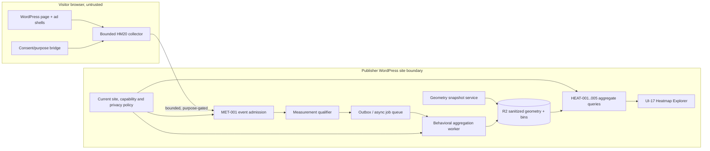
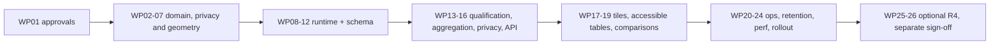

# AdPilot — Heatmap Intelligence, Behavioral Analytics & Privacy-Aware Visualization Specification

**Document ID:** `ADP-DOC-020`  
**Filename:** `20_ADPILOT_HEATMAP_INTELLIGENCE_BEHAVIORAL_ANALYTICS_PRIVACY_VISUALIZATION.md`  
**Version:** 1.0.0 — implementation contract proposal  
**Status:** Proposed — requires Product, Architecture, Security, Privacy/Legal, Analytics, UX/Accessibility, Database, Performance and QA sign-off  
**Date:** 2026-10-12  
**Product:** AdPilot — Self-Service Advertising Marketplace & Behavioral Analytics for WordPress  
**Owner:** Behavioral Analytics Lead + Principal Software Architect  
**Implementation target:** GPT-6 High, staged, independently verifiable engineering work packages  
**Normative predecessors:** `ADP-DOC-001` through `ADP-DOC-019`  
**Proposed successor:** `ADP-DOC-021` — Pricing, Reservations, Commerce & Financial Lifecycle Specification (sequence subject to document register)

> **Contract status.** This is a detailed design and implementation specification, **not** a claim of existing code, approved legal bases, validated privacy thresholds, production performance or test execution. Sample defaults, internal event names and suggested database extensions must be signed off before production. The word “heatmap” in this document means a statistical visualization of **observed, permitted, sampled** interaction signals, not eye tracking, psychological inference or an exact reconstruction of every visitor's actions.

---

## 1. Purpose, authority, precedence and terminology

### 1.1 Purpose

Specify AdPilot's native, self-hosted R2 behavioral intelligence subsystem: privacy-gated client instrumentation; geometrically valid click/tap, scroll reach, slot visibility and attention **proxy** aggregation; a version-correct full-page visual explorer; segment analysis; accessible numerical equivalents; incident operations; optional, separately governed R4 replay; and all mandatory tests, interfaces and release controls. The system shall function without proprietary heatmap SaaS. It must not impede R1 public advertisement serving, content usability, consent systems, checkout or SEO.

### 1.2 Precedence and exact source contracts

| Prior document | Binding responsibility, reused rather than redefined |
|---|---|
| `ADP-DOC-001` | All canonical `FR-*`, `BR-001..018`, `NFR-001..016`, `AC-001..015`, `INV-01..10`; exact R1–R4 scope. Particularly `FR-HEAT-001..011`. |
| `ADP-DOC-002` | Acceptance `AT-HEAT-001..011`, `AT-MET-*`, `AT-REP-*`, `E2E-11/15/17` and capability groups `CAP-12/13`. |
| `ADP-DOC-003` | `UJ-18..20`, `UJ-23`, `UJ-26`; `UI-17` Heatmap Explorer, `UI-18` exports, `UI-20` privacy settings and `UXA-*`. |
| `ADP-DOC-004` | Consent/retention, state transitions and `DP-*` policies; heatmap collection cannot bypass policy gates. |
| `ADP-DOC-005` | Restricted site-plane capability `adpilot_view_restricted_analytics`; separately `adpilot_view_replay` in R4; site and object authorization. |
| `ADP-DOC-006` | BehavioralAnalytics module boundary, `IC-016/017/024`, database/event architecture and independent publisher site contexts. |
| `ADP-DOC-007` | `DM-022` BehavioralAnalytics aggregate and `DM-*` slot/layout/measurement ownership; application/repository ports. |
| `ADP-DOC-008` | R2 `geometry_snapshots`, `heatmap_aggregates`, conditional `consent_records`; retention `DB-RET-05/06`; migration `DB-MIG-010`, `DB-Q-15`. |
| `ADP-DOC-009` | Existing `HEAT-001..005` admin GET routes, `MET-001/002`, `LAY-*`, `REP-*`; no invented public privileged route. `HEAT-006/007` replay R4 only. |
| `ADP-DOC-010` | Outbox/inbox, workers, retries, scheduling, deduplication, replay-proof jobs and consent erasure. |
| `ADP-DOC-011..014` | `UI-17` UX, design system, admin/report role boundaries, accessible charts and portal restrictions. |
| `ADP-DOC-015` | Stable logical slot identity, layout revision compiler, dynamic repeater identity, contract-protected geometry. |
| `ADP-DOC-016..017` | Gutenberg, theme/PHP/shortcode parity; previews never measured/billed; safe render descriptors. |
| `ADP-DOC-018` | Browser runtime observation/delivery contracts, decision/render instance correlation, resource caps. |
| `ADP-DOC-019` | Metric `MR19-M-019..021`, metric-definition version, measurement qualification, data quality, attribution/financial separation. |

In a conflict: **preserve upstream source meaning and report a change proposal.** This document adds `HM20-*` identifiers; it neither renames baseline IDs nor makes any R2/R4 feature an R1 requirement.

### 1.3 Release gates

| Release | Actual scope | Not included |
|---|---|---|
| **R1** | Accurate basic delivery/request/render/click events, baseline reporting, consent/privacy framework and lightweight SDK extension points. | Native aggregated heatmap dashboard, scroll/element heatmap product, session replay. |
| **R2** | Consent/purpose-gated click/tap, scroll reach, element/slot visibility and optional attention-time **proxy** heatmaps, geometry/version-aware overlays, aggregate-only restricted reporting and accessible table. | Keystroke capture, DOM replay, behavioral attribution to individual visitors, browser-independent true eye tracking. |
| **R3** | Existing metered billing, conversion attribution and advanced reporting remain separately governed. Heatmaps may provide **context**, never direct finance truth or a causal conversion claim. | Direct billing based on raw heatmap event counts. |
| **R4** | Optional, independently permissioned, sampled session replay *only after separate approvals*; enterprise/multisite extensions if separately approved. | Replay enabled by default or coupled to ad serving. |

Feature flags SHALL be server authoritative; unavailable release features are absent/disabled with truthful explanatory UI and reject access server side.

### 1.4 Core vocabulary

| Term | Precise definition |
|---|---|
| **Interaction event** | Untrusted client observation (tap/click, viewport reach, sampled element visibility), accepted only after bounded validation and purpose checks. |
| **Logical slot** | Stable site-local sellable inventory identity; never the DOM element ID. |
| **Render instance** | One occurrence of a logical slot on a particular page render or repeated context. |
| **Semantic anchor** | Allowlisted, stable, non-PII identifier for slot/zone/container/eligible template region. |
| **Layout revision** | Immutable published inventory/layout contract version (`layout_revision_id`). |
| **Geometry snapshot** | Immutable, sanitized arrangement for a layout revision, page context and compatible viewport class; has `geometry_digest`. |
| **Cohort** | Explicit grouping of eligible observations, with governance over minimum size and potential reidentification. |
| **Bin** | Bounded normalized interval/cell aggregating events for a stable compatible geometry target; not a raw visitor point. |
| **Scroll reach** | Max qualified viewport progress distribution, not reading comprehension. |
| **Exposure** | Browser-observed element intersection/visibility evidence, potentially not true human attention. |
| **Attention proxy** | Limited computed on-screen-duration or active-tab interaction observation; never eye tracking. |
| **Coverage** | Ratio of eligible or measurable observations to a clearly defined population, not total human visitors by default. |
| **Suppression** | Withholding or coarsening sensitive or low-sample result; **not** reporting a numeric zero. |
| **Replay** | R4 optional reconstruction of explicitly permitted masked interaction state, distinct from aggregated R2 heatmaps. |

### 1.5 Normative language and decision status

`MUST`/`SHALL` are mandatory once the respective release is enabled; `SHOULD` needs reviewed deviation; `MAY` is optional. `HM20-DEC-*` records choices awaiting accountable sign-off. This document uses **UTC** persistent times, approved local display conversions, half-open time windows `[start,end)`, and versioned metric/sampling/purpose definitions. No retention durations, k-anonymity threshold, epsilon budget, or “legal consent is required everywhere” statement is asserted as universally applicable.

## 2. Non-negotiable guarantees and explicit exclusions

The following are supplementary `HM20-INV-*` guarantees. They augment, never replace `INV-01..10` and `BR-001..018`.

| ID | Mandatory invariant | Enforcer | Observable proof |
|---|---|---|---|
| `HM20-INV-01` | No R2 or R4 collection until feature, purpose, consent/legal gate and page eligibility are satisfied. | Client + ingestion + worker | Denied consent produces zero prohibited persisted observations. |
| `HM20-INV-02` | Never collect form values, passwords, tokens, private DOM text, typed keys, private URL query payloads or raw IP as heatmap content. | Client minimizer + API validator | Malicious payload rejected/redacted. |
| `HM20-INV-03` | Every observation references trusted site, metric version, layout revision, page context class and compatible geometry snapshot or is quarantined. | Resolver + validator | Stale/unknown geometry cannot enter published aggregate. |
| `HM20-INV-04` | Logical slot ID and occurrence ID remain distinct across repeats, page renders, and dynamic insertion. | Layout + SDK | Repeater events correlate without double attribution. |
| `HM20-INV-05` | Heatmap bins never mix incompatible page/layout/viewport/geometry cohorts. | Worker + query | Cross-version query splits/warns. |
| `HM20-INV-06` | Suppressed/insufficient cohorts cannot be reconstructed by filters, pagination, exports, multiple query subtraction or cache. | Query privacy policy | Difference attacks fail in tests. |
| `HM20-INV-07` | Reports present counts, sampled population, denominator, coverage, uncertainty and freshness; unavailable is not zero. | Analytics query + UI | Chart labels expose limitations. |
| `HM20-INV-08` | Scroll, click, visibility and attention proxies use separate metric types and interpretation. | Metric registry | No unsupported “eye tracking” claims. |
| `HM20-INV-09` | Advertisers cannot access visitor-level records, publisher behavioral maps, underlying geometry/individual events or R4 replay by default. | Policy + serializer | Cross-role negative tests. |
| `HM20-INV-10` | Replay is R4, off by default, and disabled if masking, consent, access logging or deletion guarantees fail. | Feature policy | Replay fail-closed path. |
| `HM20-INV-11` | R1 ad serving, editorial rendering and checkout remain functional if R2 collector, heatmap API, workers or charts fail. | Runtime isolation | Chaos tests. |
| `HM20-INV-12` | Browser events are evidence, not payment instructions: no raw heatmap-to-ledger linkage. | Domain boundaries | No heatmap event can post a charge. |
| `HM20-INV-13` | No user-controlled HTML/selector/CSS or arbitrary URL is accepted as an analytics join key. | API/schema validators | Injection and anchor poisoning tests. |
| `HM20-INV-14` | Revocation/withdrawal stops new collection promptly, invalidates caches, and triggers policy-appropriate existing-data handling. | CMP bridge, workers, cache | Withdrawal lifecycle tests. |
| `HM20-INV-15` | Preview, wp-admin editing, synthetic test and denied-purpose traffic are excluded from reported behavioral metrics. | SDK + server qualification | Preview/test counts remain zero. |
| `HM20-INV-16` | Public heatmap collector cannot increase front-end work in proportion to thousands of inactive slots. | SDK scheduler | 500/1,200-slot resource audits. |
| `HM20-INV-17` | A published overlay must be aligned to an authorized, sanitized geometry snapshot; content mutation triggers new snapshot/rejection. | Geometry pipeline | Dynamic-page drift tests. |
| `HM20-INV-18` | All visualized information has an accessible, non-color-only tabular narrative equivalent, including filters and comparisons. | UI/QA | WCAG 2.2 AA target tests. |
| `HM20-INV-19` | GDPR/ePrivacy or other regional policy outcomes are configurable and reviewed, not guessed from visitor location. | Privacy/Legal + settings | Regulatory policy sign-off gate. |
| `HM20-INV-20` | High-risk export and replay access are checked at job creation and download/playback; all sensitive access audited. | Auth + jobs | Revoked permission cannot retrieve old export. |

**Explicit prohibited interpretations:** mouse position ≠ gaze; scroll depth ≠ attention; dwell proxy ≠ reading; clicks ≠ satisfaction; heatmap count ≠ unique visitor; event absence ≠ zero engagement; correlation ≠ causation; preview ≠ billable delivery; publisher-aggregate access ≠ replay authority.

## 3. Owners, trust boundaries and logical architecture

### 3.1 Component diagram



The R4 replay subsystem is a **separate optional module**, not a switch on the R2 aggregation worker. Diagram does not imply guaranteed real-time ingestion, direct visitor-to-dashboard telemetry, or third-party hosting.

### 3.2 Ownership and dependency table

| Data/action | Authority | Consumer constraint |
|---|---|---|
| Published layout, slot and revision | Inventory/Layout (`IC-004`) | Behavioral may reference immutable IDs, never alter sold inventory. |
| Authoritative ad decision and render correlation | Delivery (`IC-013`) | Behavioral verifies against accepted decision/occurrence evidence. |
| Event admission, dedup and qualification | Measurement (`IC-014/015`) | Behavioral consumes admitted purpose-eligible facts only. |
| Geometry snapshots and heatmap bins | BehavioralAnalytics (`IC-016/017`) | Reporting reads scoped projections, not raw events. |
| Consent source, retention, legal policy | Compliance/Privacy | Collector and workers must use effective versioned policy. |
| Viewer access, exports, replay access | Authorization (`ADP-DOC-005`) | No UI-only enforcement. |
| Reporting charts/exports | Reporting/Analytics | Source labels, provenance, coverage and privacy controls mandatory. |
| Monetary values and billing effects | Commerce ledger | Heatmap metrics may not create or reverse ledger entries. |
| Audit, outbox, migrations and diagnostics | Platform | Workers are idempotent; errors traceable without PII. |

### 3.3 Data classification boundaries

1. **Public-safe descriptor:** site-scoped non-secret layout/slot/renderer references and a tightly bounded policy config. Never include internal permissions, consent law mapping, financial data, member identities or replay secrets.
2. **Untrusted ephemeral observation:** event with normalized coordinates / coarse viewport, bound to permitted semantic anchor; treated as untrusted until server qualification; transport identifiers expire with policy.
3. **Short-lived internal evidence:** minimum fields for dedup/quarantine, typed invalid reasons and investigation; access limited to privacy and measurement operators.
4. **Persisted R2 facts:** sanitized immutable geometry and bucketed/suppressed aggregates; no free-form HTML or private text.
5. **Restricted projections:** capability-scoped aggregates and accessible summaries, cohort-suppression rules applied *before* caching/export.
6. **R4 replay data:** logically/cryptographically separated, stronger permission and lifecycle, never part of R2 export.

### 3.4 Context and tenancy

`site_id` comes from trusted server WordPress context, never from an unchecked browser parameter. Every repository lookup/aggregate/cache/export has site scope. A network administrator or site switch is **not** automatic authority to access analytics of another site. Organization ownership restrictions continue to apply. If a job's site context changes, re-resolve site-bound services and restore WordPress blog context in `finally`.

## 4. Event and signal taxonomy (`HM20-SIG-*`)

| ID | Release | Signal | Trigger | Measurement meaning | Never claim |
|---|---|---|---|---|---|
| `HM20-SIG-01` | R2 | `interaction.click` | Eligible trusted activation and policy gate | Click/tap location with approved semantic anchor; separate from qualified ad click | All user clicks or intent |
| `HM20-SIG-02` | R2 | `interaction.tap` | Accepted touch pointer primary activation | Touch distribution; dedup synthetic click from same interaction | Finger attention or satisfaction |
| `HM20-SIG-03` | R2 | `page.scroll_reach` | Coarsened checkpoint / page lifecycle | Maximum observed qualified scroll progression for this bounded visit sample | Full page read/comprehension |
| `HM20-SIG-04` | R2 | `slot.visible_interval` | Supported intersection observation interval | Slot exposure proxy with stated visibility/coverage limitations | Independently audited viewable paid impression |
| `HM20-SIG-05` | R2 | `element.visible_interval` | Allowlisted semantic element exposure | Bounded element exposure and duration proxy | Gaze or reading |
| `HM20-SIG-06` | R2 | `attention.proxy_interval` | Window visibility + limited allowed signals | Derived attention-time *proxy*, defined by model version | Eye tracking, attention of a human |
| `HM20-SIG-07` | R2 | `geometry.change` | Stable geometry fingerprint changes | New revision/snapshot or quarantine, not visitor intent | Semantic click by itself |
| `HM20-SIG-08` | R2 | `collector.health` | Redacted sampled diagnostics | Error rate, accepted/rejected counts, scheduler health | Visitor behavioral facts |
| `HM20-SIG-09` | R4 | `replay.masked_diff` | Explicit R4 sampled consent path | Permitted masked DOM-state reconstruction event | Entire browser session/key capture |

**Protocol compatibility:** Existing `MET-001` is the admission route. `HM20-SIG-*` is a proposed internal type registry, **not** a claim that Document 09 already defines new REST endpoints or external public event names. Its mapping to the approved Document 09 wire enum and schema version needs API/Measurement sign-off. Additional public endpoints are **change requests**, not silent additions.

### 4.1 Strict separation from ad clicks and viewable impressions

- `HM20-SIG-01/02` concern spatial click/tap density; `DEL-002` and `MR19-M-010..012` govern advertising click validity. A single gesture may correlate via opaque event reference but counts must not blindly add together.
- `HM20-SIG-04` yields only an exposure proxy; billing viewability follows approved `MR19-M-007..009` policy. `IntersectionObserver` intersection is not proof of unobscured vision, active user focus or conversion.
- `MR19-M-019` scroll depth, `MR19-M-020` attention proxy and `MR19-M-021` tap/click heatmap count must have explicit metric versions, units and numerator/denominator definitions.
- The same click never becomes three event counts merely because pointerdown, touchend and click listeners all fired. Use one primary canonical activation with duplicate suppression in the bounded time window; do not use stable identity fingerprinting to dedup.

### 4.2 Signal scope and exclusion list

Eligible surfaces: published public page/template contexts with a stable allowlisted AdPilot anchor and/or explicitly approved public-layout region, purpose met, and sanitized geometry. Exclude admin/editor preview, checkout/payment and account pages by default, authentication panels, private posts, password-protected pages, forms, medical/financial/sensitive user entries, searchable personal content, chat/message areas, consent UI itself, shadow roots without audited adapter, cross-origin iframe content and arbitrary third-party widgets. Exclusions are **positive allowlists**, not merely substring filtering. Public-page events must not capture text typed/selected/clipboard values, private query string, raw URL fragments, `innerHTML`, node attributes or arbitrary CSS selectors.

## 5. Consent, purpose, data minimization and security design

### 5.1 Explicit consent and purpose gates (`HM20-PRV-*`)

| Gate | Browser enforcement | Server/worker enforcement |
|---|---|---|
| `HM20-PRV-01` — site policy | Feature R2 flag and collector capability config | Current approved policy version + site scope |
| `HM20-PRV-02` — visitor preference/legal condition | CMP bridge returns allowed purpose; fail closed on unresolved state | Only purpose-eligible event types admitted; never trust `consent:true` alone |
| `HM20-PRV-03` — page context | Public eligible content + denylist + sensitive selectors excluded | Canonical page class and routing validation |
| `HM20-PRV-04` — target context | Event target resolves to approved semantic anchor; no input subtree | Anchor must exist in compatible sanitized snapshot |
| `HM20-PRV-05` — purpose/retention | Bounded memory buffer, lifecycle cleanup | Expiry/purge policies on raw/quarantine/aggregates |
| `HM20-PRV-06` — actor access | No browser analytics read credentials | Site capability + purpose + object scope rechecked |
| `HM20-PRV-07` — high risk | Replay separate R4 opt-in, secure storage, reviewer access | R4 dual authorization and immutable access audit |

Policy outcome should account for jurisdiction, legitimate-interest analysis where actually applicable, consent rules and configured CMP, **after** Privacy/Legal review. The implementation must not hardcode “consent is never needed” or “consent is legally mandated in every country.” If compliance mapping is unknown, collector does not activate. A denied preference must not be converted to permission by “essential analytics” marketing language.

### 5.2 Consent state machine and withdrawal

```text
unknown -> awaiting_policy_or_preference -> allowed_for_approved_purpose
    |                                          |
    +-> denied -------------------------------+-> withdrawn
    |                                          |
    +-> unavailable/error --------------------+-> policy_changed
```

Only `allowed_for_approved_purpose` starts signal listeners and buffers. On withdrawal: unregister listeners/observers, cancel scheduled work, clear pending unsubmitted events, stop R4 recording, invalidate purpose-scoped client identifiers, and emit only permissible compliance signals. Server rejects later batches regardless of stale client policy; queues check current policy/erasure tombstones before aggregation; exports/cache are invalidated. Delete/rebuild existing data per approved retention/erasure policy, preserving necessary nonidentifying compliance evidence only when justified.

### 5.3 Data field minimization matrix

| Field | Allowed under approved purpose? | Caveat |
|---|---|---|
| Site-scoped opaque event ID | Yes | Random per bounded event, not globally tracking visitor. |
| Published layout revision + geometry digest ref | Yes | Verify server-side; never implies privacy grant. |
| Semantic `slot/zone/container` opaque IDs | Yes | Site-scoped and valid version; only allowlisted anchors. |
| Coarse device class and viewport class | Yes | Avoid detailed fingerprint tuple and rare combinations. |
| Normalized, bounded coordinates in permitted regions | Yes, R2 | Quantize/coarsen before persistence; prefer aggregate-only transport if feasible. |
| Bounded observed interval / scroll bucket | Yes, R2 | Metric version, bias and sampling explicitly reported. |
| Exact URL / private query / fragment | No | Derive allowlisted canonical page context server-side. |
| Raw `event.target` / CSS selector / HTML / text | No | Map to approved predeclared anchor ID; do not serialize DOM. |
| Form values, keystrokes, clipboard, passwords, tokens | Never | Not even for replay; masking must happen before capture. |
| Raw visitor IP, cross-site identity, full user agent | No as heatmap data | Existing HTTP infrastructure may process security metadata separately with finite purpose limits. |
| Persistent cross-site visitor ID / session cookie | Not authorized by this spec | Needs separate legal, privacy and architecture decision. |
| Consent evidence | Only minimally justified fields | Prefer policy version/boolean effective gate; no persistent unique denial tracker. |

### 5.4 Threat model (`HM20-THR-*`)

| Threat | Failure mode | Required control |
|---|---|---|
| `HM20-THR-01` | Reconstruct low-cohort visits via bin + filter subtraction | Suppress/coarsen at query planner; minimum cohort and complementary suppression; limit query granularity. |
| `HM20-THR-02` | Target anchor poisoning / arbitrary script selector | Typed fixed enum/approved anchor registry; reject raw selectors/DOM. |
| `HM20-THR-03` | View private site metrics across multisite | Site-scoped repositories, capabilities and cache key derivation. |
| `HM20-THR-04` | Payload overflow or event flood | Strict batch/body/field maxima, rate limits, dedup, backpressure and quotas. |
| `HM20-THR-05` | HTML or CSV injection through labels | Context-aware escaping and safe spreadsheet export prefix policy. |
| `HM20-THR-06` | CSP bypass, replay script injection | Static trusted bundle, no eval/dynamic HTML injection or third-party unreviewed replay. |
| `HM20-THR-07` | Consent spoofing with stale header/client flag | Server authoritative purpose policy, short-lived contract/provenance, revocation check. |
| `HM20-THR-08` | Small cohort data in cached/exported artifact | Privacy-filtered projection before cache; download-time capability check. |
| `HM20-THR-09` | Reverse infer sensitive page data from exact element position | Sensitive page exclusion, bin coarsening, cumulative reach controls, aggregation threshold. |
| `HM20-THR-10` | R4 replay leaks typed or cross-origin embedded content | Mask before capture, deny unknown roots/frames, strong access and TTL, tests. |

## 6. Semantic anchor registry and identity resolution

### 6.1 Stable identity model (`HM20-GEO-*`)

A heatmap observation must resolve to a tuple of **site, page-context hash, published layout revision, geometry snapshot digest, viewport/device class, semantic anchor, render occurrence and metric version** where fields are applicable. This tuple is not a visitor identifier. Logical slot ID identifies commercial inventory, and render occurrence ID identifies one insertion. An AJAX-inserted copy must have a **new occurrence ID** even when sharing a logical slot. An anonymous public post not bound to commercial inventory may use only an approved coarse page-region anchor, not a user-supplied selector.

| Anchor class | Allowed key | Stable across | Re-snapshot condition |
|---|---|---|---|
| Logical slot | `logical_slot_id` | Published placement identity | Move/resize/hide or binding changes affecting geometry |
| Zone | `zone_id` | Zone definition | Arrangement/layout revision changes |
| Container | `container_id` | Layout container identity | CSS breakpoint/layout change |
| Occurrence | `render_instance_id` (ephemeral) | Single render insertion only | Any new insertion/recycled DOM node |
| Page/template region | approved `region_key` enum/hash | Same template schema version | Template, content injection or material geometry change |
| Document/page context | server-derived `page_context_hash` | Same canonical eligible page/template classification | Page template, canonical route or content geometry incompatible |

### 6.2 Anchor trust protocol

1. Layout compiler publishes versioned, sanitized anchor inventory; only registered semantic types.
2. PHP/Gutenberg/theme public renderer emits opaque `data-adp-*` IDs from authoritative published state; it must not expose arbitrary persisted private metadata.
3. Collector accepts only approved anchors explicitly marked safe for behavioral measurement and within the permitted region.
4. Server verifies submitted anchor against that site/layout/page/geometry revision; unverifiable references quarantine or reject.
5. Aggregate worker groups by trusted canonical anchor (not browser-provided CSS path). UI resolves safe display names separately from admin-owned inventory.
6. Mutable slot labels are rendered through escaped authorized read models and never become the stored join key.

### 6.3 Geometry snapshot contents and restrictions

Allowed sanitized snapshot data: schema version, revision, page class hash, viewport class, geometry digest, capture timestamp, allowed anchor references, normalized bounds, container ancestry, approximate aspect ratio, page extent class, order, renderer source, layout compiler version and clearly labeled coordinate basis. **Prohibit** text nodes, email addresses, screenshots containing sensitive content, form contents, DOM HTML, unbounded arbitrary attributes and full visitor URLs.

A geometry snapshot is immutable after accepted publication. New CSS, template or significant responsive geometry yields another snapshot/digest. A snapshot is not generated by trusting one malicious visitor's asserted coordinates: provenance requires controlled site/server compilation and/or verified authorized capture with bounded reproducibility checks. Admin preview captures are explicitly nonbillable and must not be counted as visitor interactions.

### 6.4 Geometry lifecycle state machine

```text
candidate -> validated -> published_eligible -> archived
    |          |                |
    +-> rejected             invalidated_for_new_samples
    |                              |
    +-> quarantined <-------------+
```

Only `published_eligible` geometry accepts new R2 events. Retain immutable historical snapshots as needed for authorized past analysis and audit; do not relabel historical events with newly published geometry. Expired/unavailable snapshots render an explanation, not a guessed overlay.

## 7. Coordinate systems, geometry matching, responsive changes and full-page correctness

### 7.1 Coordinate spaces (`HM20-COORD-*`)

Use **four distinct coordinate spaces**, each explicitly typed and versioned. All normalized values are finite and constrained to `[0,1]`. Reject `NaN`, `Infinity`, negative pixels where disallowed and out-of-range values before persistence.

| Space | Purpose | Basis | Validity |
|---|---|---|---|
| `HM20-COORD-01` viewport | Optional internal intersection calculation | visual viewport CSS pixels and current browser scroll | Ephemeral only; not enough to overlay historical page |
| `HM20-COORD-02` anchor-relative | Click/tap intensity within a stable slot/zone/element | Bounded `(x - rect.left)/rect.width`, `(y - rect.top)/rect.height` | Rect must be positive-size, eligible and geometry-compatible |
| `HM20-COORD-03` page-relative | Full-page overlay where trusted geometry is stable | `(scrollX + visualX)/documentWidth`, `(scrollY + visualY)/documentHeight` with approved viewport basis | Valid only for a stable page extent / matching fingerprint |
| `HM20-COORD-04` scroll-depth | Fraction of qualified content range reached | `(scrollTop + effectiveViewportHeight)/scrollExtent`, clamped to `[0,1]` | Document height, dynamic content and minimum scrollable range labeled |

In R2 prefer **anchor-relative bins** and semantic hierarchy over page-relative point capture; raw continuous full-page pointer trajectories are unnecessary. The collector must not persist raw `clientX/clientY`, unbounded `scrollY`, DOM paths or document coordinates solely for convenient debugging. Page-relative aggregates are valid only when the query can prove compatible extent/layout/viewport class and quantization settings.

### 7.2 Formula and numeric contract

For an eligible target bounding rect `r` and pointer `p` in *CSS pixels*, compute:

```text
anchor_x = clamp((p.clientX - r.left) / r.width, 0, 1)
anchor_y = clamp((p.clientY - r.top) / r.height, 0, 1)

# For optional page-relative mapping, only when layout geometry is stable:
page_x = clamp((scroll_left + p.clientX) / eligible_document_width, 0, 1)
page_y = clamp((scroll_top + p.clientY) / eligible_document_height, 0, 1)

# For scroll reach; avoid treating a zero-scroll page as "no engagement":
scroll_reach = clamp((scroll_top + effective_viewport_height) / eligible_scroll_extent, 0, 1)

bin_x = min(grid_columns - 1, floor(anchor_x * grid_columns))
bin_y = min(grid_rows - 1, floor(anchor_y * grid_rows))
```

This is **illustrative math**. Correct actual implementation must define visual-versus-layout viewport usage, nested scroll roots, RTL horizontal scroll, CSS transforms and zoom. For RTL horizontal scroll, browser `scrollLeft` conventions vary: normalize using a tested scroll-origin adapter rather than assuming one sign convention. Mobile browser chrome, pinch zoom, iframe nesting and VisualViewport offsets may change effective dimensions. If the adapter cannot reliably derive a compatible coordinate basis, **exclude the sample** and record a coarse reason code, not an invented location. For pointer events on transformed elements, use a tested transform/inverse mapping adapter or mark unsupported; `getBoundingClientRect()` ratios alone may not represent rotated or skewed visual content.

### 7.3 Anchor-relative placement projection

1. Load the immutable sanitized geometry snapshot for the authorized `(site, page context, layout revision, viewport class, digest)`.
2. Resolve trusted anchor rectangle from the snapshot and the overlay's selected presentation viewport.
3. Transform normalized bin center and cell boundaries into the anchor's displayed rectangle, accounting for snapshot scale and coordinate schema.
4. Clip to eligible container/page bounds; apply any approved sticky/fixed-element handling separately.
5. Render heat intensity from privacy-safe **aggregate** counts only. Never draw one dot for each visitor event.
6. Show a geometry mismatch banner and disable overlay when revision, digest, page extent, incompatible breakpoint or unknown anchor differs.
7. A geometry snapshot must never be treated as a screenshot of personal content. If screenshot-like previews are required for overlay context, source them from a separately approved sanitized publisher-controlled fixture, not from a visitor capture.

### 7.4 Full-page and scrolling model

The explorer must support vertically long pages, including 500 configured logical slots, without constructing a full-pixel-height canvas. Use tiled virtualized segments or viewport-window drawing with deterministic coordinates. Scroll the preview and overlay as one synchronized semantic scroll container. Keep the browser page scroll independent of the internal explorer's scroller where possible; ensure visible sticky headers are not projected as ordinary flow elements. Expose zoom 50%–200% as a **proposed UI control**, not assumed accessibility substitute; zoom/pan must not destroy keyboard focus or geometry alignment.

**Page extent governance:** record a stable approved `extent_class` or schema-valued geometry extent per snapshot; when the height changes materially after lazy insertion or content editing, recapture/revalidate. Do not stretch old bins to new full-page heights and present as accurate. Compare pages through corresponding **semantic anchors** with transparent coverage differences where raw full-page coordinates are not compatible.

### 7.5 Responsive viewports and devices

| Case | Rule | Browser response | Query/explorer response |
|---|---|---|---|
| Desktop vs phone | Different layout/reflow | New validated viewport class and snapshot | Separate cohorts; no pixel overlay merge. |
| Orientation change | May change breakpoint and extent | Re-evaluate geometry and anchor basis | Pause old coordinate context; create new compatible segment. |
| Font load/text zoom | Can reflow layout | Debounced geometry digest check | New snapshot/quarantine until verified. |
| Browser zoom/pinch | Affects visual vs layout viewport | Use tested viewport adapter; otherwise mark unsupported | Show measurable coverage drop, not pretend precision. |
| Responsive hidden slot | May not be rendered | No click/visibility sample for hidden anchor | Show absence/unavailable by context, not zero success. |
| CSS transform | May invalidate rect mapping | Apply validated adapter or reject | Excluded reason shown in quality metrics. |
| High-DPI screen | CSS px differs from physical px | Use CSS space, no device pixel fingerprint necessary | Bins independent of physical pixel ratio. |
| RTL layout | Horizontal placement mirrored/rearranged | Resolve explicit layout direction and tested basis | Correct visual mapping; never flip historical data blindly. |

### 7.6 Dynamic pages, infinite scroll and mutation handling

- Use bounded `MutationObserver`/`ResizeObserver` only for **approved anchor roots**. No unconstrained full-document DOM traversal. Batching, throttling and memory limits are mandatory.
- When an ad shell loads or the layout gets an AJAX injection, assign a fresh `render_instance_id`; page-context registry revalidates each visible anchor.
- For infinite scroll, model **segment identity** and semantic content/template insertion revision; do not map all future content to one original unbounded page snapshot. Segment events may be aggregated only with declared compatible segment schema.
- On substantial reflow, freeze old geometry context and start a new versioned observation segment. If server cannot verify the new context, buffer none and issue a diagnostic, not a new untrusted snapshot that can be consumed by anyone.
- Sticky/fixed nodes require viewport-relative visibility models; do not store them as if they live at one immutable y-position in document flow.
- Query Loop, reused Gutenberg templates, nested repeaters and dynamically paged elements require occurrence identity, cycle prevention and correct logical slot mapping (Documents 15–18).
- If CSS selector changes leave a semantic anchor missing, mark **unmapped** and fail closed, never heuristically attribute the click to a nearby paid slot.

### 7.7 Geometry compatibility verdict (`HM20-COMP-*`)

| Verdict | Criteria | Overlay/comparison behavior |
|---|---|---|
| `HM20-COMP-01` exact | Same geometry digest, metric/schema/binning version, viewport class, authorized page context | Full overlay and compatible aggregate comparison permitted. |
| `HM20-COMP-02` anchor comparable | Different revisions but explicit stable semantic anchor mappings, no ambiguous material reflow | **Aggregate numeric** or per-anchor comparison only, labeled; no misleading point-by-point overlay. |
| `HM20-COMP-03` trend comparable | Same metric/target with changed measurement basis, transformation approved + validated | Trend with discontinuity marker and method disclosure. |
| `HM20-COMP-04` incompatible | Unknown digest, page class, viewport, material geometry or missing anchor | No merged heatmap; separate panels and warning. |
| `HM20-COMP-05` suppressed | Privacy threshold unmet or attempted reconstruction | Withheld; comparison math unavailable. |
| `HM20-COMP-06` stale/unknown | Snapshot missing or insufficient measurement evidence | Empty/error state with refresh/rebuild action, not zero. |

## 8. Browser collector runtime specification

### 8.1 Load order and safety prerequisites (`HM20-SDK-*`)

The R2 collector is a small optional module in the Document 18 runtime, not a second global SDK. It loads only after the lightweight ad shell and consent/purpose bridges have resolved; R1 serving never waits for it. Require one installation-scoped observation controller per page; deduplicate multiple theme/block/shortcode integrations; avoid re-registering listeners per slot.

```text
R1 ad shell boot -> publicly eligible page check -> R2 enabled?
    no -> stop (no tracking listeners)
    yes -> CMP/legal purpose gate resolved and allowed?
        no/unknown/error -> stop, do not buffer events
        yes -> resolve published geometry descriptor
            unavailable/incompatible -> stop optional behavior, emit redacted health reason
            valid -> attach bounded delegated listeners + shared observers
                -> derive only safe normalized signals
                -> coarsen and sample before enqueue
                -> bounded in-memory batch
                -> MET-001, server requalification
```

No persistent visitor storage is justified by this document. If any cookie or local storage is proposed, it needs a new explicit policy review and truthful user-facing disclosure; never assume existing advertising cookies authorize behavioral heatmaps.

### 8.2 Collector modules

| Internal TypeScript unit | Responsibility | Failure behavior |
|---|---|---|
| `PurposeGate` | CMP bridge and approved purpose state, revocation callback | Closed, clears buffer. |
| `PageEligibility` | Public route/template exclusion, editor/preview detection | Closed. |
| `AnchorRegistry` | Deduplicated, allowlisted semantic anchor descriptors | Unknown anchor ignored. |
| `GeometryContext` | Published revision, digest, viewport class, safe extent basis | Drift -> suspend/revalidate. |
| `PointerSampler` | Primary activation only; spatial bins, synthetic click suppression | No sample when target protected. |
| `ScrollReachSampler` | Debounced, quantized max reach | No tight scroll listener or detailed trace. |
| `VisibilitySampler` | Shared IntersectionObserver and approved intervals | Unsupported -> unmeasurable; do not fabricate. |
| `AttentionProxyCalculator` | Conservative versioned limited proxy from active visibility | Unavailable -> null, not zero. |
| `SamplingPolicy` | Privacy-approved rate, bounded cap and documented inclusion probability | Fail closed if missing. |
| `BoundedEventQueue` | Memory bounded batches and retry rules | Drop optional events first; never delay content. |
| `CollectorDiagnostics` | Aggregate-only rates/errors; no visitor event payload logs | Silent production UI; redacted support diagnostics. |

### 8.3 Pseudocode — pointer qualification (illustrative)

```typescript
type UnitInterval = number & { readonly __unitInterval: unique symbol };
type SafeAnchor = { anchorRef: string; rect: DOMRectReadOnly; kind: 'slot' | 'zone' | 'container' | 'approved_region' };

function quantizeUnit(n: number, steps: number): number | null {
  if (!Number.isFinite(n) || n < 0 || n > 1 || !Number.isInteger(steps) || steps < 1) return null;
  return Math.min(steps - 1, Math.floor(n * steps));
}

function toAnchorBin(event: PointerEvent, anchor: SafeAnchor, cols: number, rows: number) {
  const r = anchor.rect;
  if (r.width <= 0 || r.height <= 0 || !event.isPrimary) return null;
  // Caller MUST already have checked consent, approved safe target, trusted anchor,
  // CSS transform/viewport compatibility, R2 flag, rate limit and preview exclusion.
  const x = (event.clientX - r.left) / r.width;
  const y = (event.clientY - r.top) / r.height;
  const bx = quantizeUnit(x, cols);
  const by = quantizeUnit(y, rows);
  return bx === null || by === null ? null : { anchorRef: anchor.anchorRef, binX: bx, binY: by };
}
```

This sketch intentionally omits bootstrap, policy, transport, idempotency, shadow DOM, touch-to-click dedup and DOM membership validation; **it is not a complete drop-in collector**. Coordinates are quantized before any transport in this design. Browser `isTrusted` or a browser-supplied flag is **not** sufficient server-side bot validation.

### 8.4 Shared visibility and scroll mechanics

- One or a small bounded set of `IntersectionObserver` instances per compatible root/threshold configuration; avoid one observer per 500 or 1,200 slots.
- `IntersectionObserver` is an asynchronous intersection signal; `trackVisibility`/`delay` remain browser-compatibility-sensitive and require feature detection. Do not assume universal support; fallback should label visibility certainty conservatively.
- On `document.visibilityState !== 'visible'`, suspended page, bfcache transitions, frozen background tab or noneligible root, stop exposure timers; avoid counting hidden-tab time.
- Use monotonic in-process clocks for duration within an active document and UTC event time for stored buckets; bounded handling of clock jumps and long background stalls.
- Scroll reach emits quantized **max progress checkpoints**, not raw scroll trajectory. Use passive scroll event or suitable observer with throttling, `requestAnimationFrame` scheduling and no synchronous forced layouts per event.
- Element-visibility/attention proxy duration is bounded and sampled, not equal to human attention; any threshold is an **approved metric-definition version**. No universal 50%/1s “MRC certification” claim is made merely by using an observer.

### 8.5 Event admission and compact transport

Illustrative **internal** R2 event after minimization, not a newly approved external `MET-001` request schema:

```json
{
  "schema_version": "hm20.observation.v1",
  "event_id": "opaque-random-event-id",
  "event_type": "interaction.click",
  "occurred_at": "2026-10-12T08:00:00Z",
  "layout_revision_ref": "opaque-published-revision",
  "page_context_ref": "opaque-public-page-context",
  "geometry_digest_ref": "opaque-verified-geometry",
  "viewport_class": "mobile",
  "device_class": "mobile",
  "anchor_kind": "slot",
  "anchor_ref": "opaque-authoritative-slot",
  "render_instance_ref": "opaque-short-lived-occurrence",
  "bin_grid_version": "grid-v1",
  "bin_x": 5,
  "bin_y": 9,
  "sampling_policy_version": "sample-v1",
  "purpose_version": "behavioral-r2-v1",
  "metric_version": "click-map-v1"
}
```

**No** raw URL, IP, exact DOM rectangle, selector, text value, cookie, persistent visitor fingerprint, ledger reference or account name. `bin_x/y` are meaningful only with a server-known grid/version. The accepted `MET-001` envelope, batch maxima, transport response and reason codes from `ADP-DOC-009/018/019` remain the source of truth. The above is a proposed typed payload extension that requires mapping and approval. A public `purpose_version` label is not proof that legally effective consent exists.

### 8.6 Sampling and budgets (`HM20-SAMP-*`)

| Control | Proposed rule | Acceptance condition |
|---|---|---|
| `HM20-SAMP-01` consent-first | Sampling decision only *after* effective purpose allowed | No preconsent buffer. |
| `HM20-SAMP-02` per-document cap | Fixed maximum events, bounded memory and batch bytes | Long pages do not accumulate unlimited events. |
| `HM20-SAMP-03` per-anchor cap | Limit hot/high-frequency repeated interactions | One malicious slot cannot dominate transport. |
| `HM20-SAMP-04` sampling probability | Approved inclusion rate per eligible population, recorded with model version | UI can explain estimate bias and sample count. |
| `HM20-SAMP-05` time resolution | Coarse, purpose-limited buckets; avoid unnecessary millisecond user trails | No rebuildable click path. |
| `HM20-SAMP-06` geometry resolution | Predeclared finite grids/anchor basis | Rare precision combinations prohibited. |
| `HM20-SAMP-07` backpressure | Network/worker issues cause optional events to drop | Ad serving / editor navigation unaffected. |
| `HM20-SAMP-08` rare cohort guard | Avoid segmentation that reveals single sessions | Server suppression even with filters and exports. |

**Threshold status:** Max events, precision, grid sizes, inclusion rates, and per-minute thresholds are **policy inputs**, not implied magic numbers; proposals require performance, accuracy and privacy testing plus sign-off. A fixture may use synthetic values (e.g. 16×16 bins and 10% rate) **only as labeled test inputs**, not as a shipped default.

## 9. Server validation, deduplication and qualification

### 9.1 Trust pipeline (`HM20-ING-*`)

```text
WordPress REST MET-001 admission
 -> method/content-type/CORS/origin and bounded body rules (existing API contract)
 -> site + server feature gate + effective policy check
 -> event schema/version allowlist and no prohibited fields
 -> published layout/page/geometry/anchor validation
 -> admitted event ID uniqueness, bounded time skew and rate-limit checks
 -> preview/test/bot classification per Measurement policy
 -> consent/erasure tombstone check and trusted canonical event classification
 -> durable bounded ingestion/outbox (approved DB contract)
 -> R2 behavior worker -> binning/aggregation -> privacy-safe read projection
```

Do not rely on Referer, Origin, IP, user-agent, JS `isTrusted`, client signature alone or security headers alone as visitor identity/proof. Use layered budget/provenance checks appropriate to anonymous public traffic; reject malformed or cross-site references. Respect the Document 19 distinction between **received**, **admitted**, **qualified**, **aggregated** and **publishable** events.

### 9.2 Qualification states and reason codes

| State | Interpretation | Storage/report outcome |
|---|---|---|
| `observed_local` | Browser-produced, not yet accepted | Memory only, no report fact. |
| `received_untrusted` | Transport reached server | May contribute to redacted ops counter only. |
| `admitted` | Structure and purpose gate accepted | Minimal short-lived queue evidence. |
| `qualified_behavioral` | Site, anchor, geometry, consent, dedup and policy validated | Can enter privacy-controlled aggregation. |
| `quarantined` | Geometry mismatch or unresolved provenance | Not reportable; bounded TTL and diagnostic. |
| `rejected` | Invalid, forbidden, oversize, unavailable or policy-denied | No behavior aggregate. |
| `aggregated` | Versioned bin/checkpoint updated | Still not releasable if cohort too small. |
| `publishable_aggregate` | Query suppression and authorization pass | Restricted UI only. |
| `suppressed` | Privacy rule withholds result | UI shows unavailable/suppressed, no count. |

Reason-code registry shall include: `CONSENT_UNRESOLVED`, `CONSENT_WITHDRAWN`, `PURPOSE_DENIED`, `FEATURE_UNAVAILABLE`, `PREVIEW_EXCLUDED`, `SENSITIVE_PAGE`, `PROTECTED_TARGET`, `UNKNOWN_ANCHOR`, `UNKNOWN_LAYOUT`, `GEOMETRY_MISMATCH`, `VIEWPORT_INCOMPATIBLE`, `BAD_COORDINATES`, `UNSUPPORTED_TRANSFORM`, `DUPLICATE_EVENT`, `TIME_WINDOW_INVALID`, `BATCH_LIMIT`, `RATE_LIMIT`, `POSSIBLE_AUTOMATION`, `STORAGE_DEGRADED`, `PRIVACY_SUPPRESSED`, `NO_SNAPSHOT`, `UNSUPPORTED_BROWSER`. Reason counts exposed to administrators must themselves not leak visitor data.

### 9.3 Dedup and replay-of-transport

- Dedup key scope must include site, event ID, source/purpose class and version; enforce with unique storage constraint or conditional update per Document 08/10.
- Ingress retries are allowed; aggregation effects exactly once **per accepted event**, even after partial worker crashes, lease expiration or out-of-order retries.
- Idempotency and audit **do not imply** exactly-once transport. Stale events outside the approved window may go to quarantine/correction queue or be rejected; do not silently backfill a fresh geometry.
- Client-side cross-listener dedup should avoid counting pointer + synthesized click twice. Server cannot solely trust that dedup already happened.
- Aggregation correction occurs through versioned compensating aggregate changes and audit, not unlogged destructive rewrites.

### 9.4 Invalid traffic and quality indicators

Use conservative rules to identify obvious automation/preview/test and unverifiable references; do not claim 100% bot detection. Publishers see aggregate rejection/coverage diagnostics, not fingerprintable IP strings or detailed fraud decisions. Missing consent and unmeasurable browser states must not be conflated with visitor disinterest.

## 10. Storage, indexes, schema extensions and data lifecycle

### 10.1 Canonical tables (no shadow database)

| `ADP-DOC-008` table | Ownership | Usage in this document | Strict caveat |
|---|---|---|---|
| `geometry_snapshots` | BehavioralAnalytics R2 | Immutable sanitized page/anchor bounds + digest + viewport class | Does not contain screenshots or arbitrary DOM. |
| `heatmap_aggregates` | BehavioralAnalytics R2 | Site + date + geometry + anchor + device + metric version + bin counts, suppression | Current schema does **not** independently prove visitor-level unique cohort size. |
| `consent_records` | Compliance R2 conditional | Only policy-justified minimally identifying evidence | Do not create cross-site visitor identity solely to store denials. |
| `event_batches`, `delivery_events`, `event_deduplication` | Measurement R1 | Existing bounded admission, qualified delivery facts and dedup evidence | `delivery_events.slot_id` and `decision_ref` are mandatory; R2 page-region events lacking ad decisions require a reviewed separate R2 event projection/migration, **not** fake slot IDs. |
| `aggregation_checkpoints` | Measurement | Monotonic progress per partition/run | Checkpoint commit atomic with aggregate effect. |
| `outbox_messages` | Platform R1 | Durable changes, invalidation and aggregate worker tasks | Reuse Document 10 outbox semantics and queue provenance. |
| `audit_log` / approved audit family | Platform | Snapshot/policy/export/replay access and corrections | Redacted purpose-limited facts only. |

**Required schema gap review:** `delivery_events` presently requires `decision_ref`, `render_ref` and `slot_id`, so it cannot safely store arbitrary full-page/region interactions without a reviewed R2 event schema/table addition; do not fabricate an ad decision or assign them to the nearest slot. `heatmap_aggregates.eligible_sample_count` alone may count events, not independent eligible people/sessions; do **not** use it as a unique-subject threshold proof. `geometry_snapshots.sanitized_snapshot_json` needs explicit schema/version bounds and privacy lint. The current aggregate unique grain lacks optional dimensions such as campaign/creative and interval-level reach distributions. The schema must evolve via **approved `DB-MIG-*` addendum** (separate projection/column only when justified), not by silently adding keys to deployed R2 tables. An “exact unique visitor” metric is not approved simply because the database can store pseudonyms.

### 10.2 Minimal aggregation grain (`HM20-GRAIN-*`)

| Grain | Dimensions | Allowed metrics | Privacy handling |
|---|---|---|---|
| `HM20-GRAIN-01` | site, UTC bucket, geometry snapshot, anchor, device, metric type/version, x/y bin | Click/tap aggregated count | Minimum cohort, suppression and filter-safe release. |
| `HM20-GRAIN-02` | site, UTC bucket, page-context class, snapshot, device, scroll-reach bucket | Scroll reach distribution | Cohort and minimum meaningful denominator before report. |
| `HM20-GRAIN-03` | site, UTC bucket, snapshot, approved slot/element anchor, device, visibility band | Exposure count/interval proxy | Not billable and not individual visit detail. |
| `HM20-GRAIN-04` | site, UTC bucket, snapshot, anchor, device, duration category, model version | Attention proxy summary | Only after separately approved definition and consent. |
| `HM20-GRAIN-05` | site, safe group, time range, snapshot, metric version | Sanitized accessible element table | Apply suppression and aggregation before query response. |

**No full cross-product of dimensions by default.** Campaign, creative, device, page, template, zone and date filters must be checked against population size, inference risk, and available physical keys. If any filter is unsupported by current grain, return a truthful validation error or require an approved new aggregate projection. Never JOIN raw events to advertiser PII to meet a reporting request.

### 10.3 Aggregation algorithm and atomicity

```text
For each idempotently claimed eligible R2 event:
  verify site, current policy/erasure disposition and immutable event qualification
  resolve valid geometry snapshot + fixed metric/binning version
  locate normalized bin and coarse UTC bucket from event time
  begin transaction (supported InnoDB environment)
    ensure event not applied to this aggregate pipeline/version
    update unique aggregate cell by atomic delta or insert-on-conflict
    update aggregation checkpoint and dedup consumer receipt
    append redacted audit/outbox fact only if policy requires
  commit
When requested by privileged viewer:
  retrieve matching scoped cells -> verify cohort/sampling guard
  suppress or coarsen sensitive result before serializer and cache
```

If hosting lacks required transactional durability, disable unsafe processing or switch to an explicitly reviewed recovery design; do not advertise numerical certainty the store cannot support. Rebuild aggregate versions in isolated staging tables, compare checksums/coverage, atomically switch approved projection, retain previous version for rollback subject to privacy lifecycle.

### 10.4 Query and index strategy

Baseline query `DB-Q-15`: `(site_id, geometry_snapshot_id, metric_kind)` plus date/device/anchor/version filters, using the source D08 composite indexes. Include selective immutable IDs first and provide separate indexes only after actual `EXPLAIN` and cardinality evaluation. Avoid server scans across all raw visitor events for interactive R2 dashboards. Avoid gigantic `IN` lists across 1,200 slots: use bounded page/zone/anchor queries, cached coarsened tiles and authorized pagination. No unbounded WordPress autoloaded options or `postmeta` event streams.

**Protection against inference via caching:** cache key includes `site_id`, policy/metric version, geometry/digest, qualified cohort slice, segmentation filter canonical hash, suppression version, effective scope/permission class, and retention generation. A public CDN must never cache privileged heatmaps; admin proxies carry strict private/no-store semantics where appropriate. Invalidation on consent/erasure, capability change, role removal, metric version correction or snapshot retirement.

### 10.5 Retention classes, deletion and restoration

| Class | Governed lifetime | Expiry method | Special case |
|---|---|---|---|
| Client buffer | Short memory-only, no browser persistent store | Clear on flush, withdrawal, navigation | Never retry denied traffic after permission change. |
| Admitted short-lived evidence | Policy-approved finite raw/quarantine TTL | Scheduled purge + checkpoints | Forensics does not justify unlimited tracking. |
| Geometry snapshots | D08 `DB-RET-05` approval-dependent | Archive/purge references after legal/audit checks | Retain only sanitized immutable versions required by authorized reports. |
| Heatmap bins | D08 `DB-RET-06` approval-dependent | TTL, aggregate recomputation, privacy purge | Erasure feasibility documented; no false promise of reversible contribution removal. |
| Exported aggregates | Protected job/artefact TTL with download-time auth | Encrypted/private deletion + cache invalidation | Exports may reintroduce suppression risk. |
| Access/audit records | Narrow regulatory/security justification | Redacted retention schedule | Never include session content. |
| Replay (R4) | **Separately approved shorter strict policy** | Cryptographic or secure deletion as applicable | Kill switch and reference cleanup required. |

Historical backups can preserve erased data temporarily: document recoverability exposure, backup retention and re-application of erasure tombstones after restore. Never claim instant deletion of immutable backups if not achievable. Site deletion/uninstall must respect explicit user choice and lawful retention without leaving orphaned behavioral data.

### 10.6 Migration and rollout order

1. Add conditional R2 settings and privacy/CMP integration under disabled default flag.
2. Apply `DB-MIG-010` geometry and aggregate tables through checksummed, idempotent migrations and verified rollback plan.
3. Seed versioned metric, binning, geometry schema and data-classification registry.
4. Deploy collectors inert by default, with forbidden-page denylist test.
5. Validate geometry on test layouts and initial sanitized snapshot provenance.
6. Enable bounded synthetic-only ingest using explicitly excluded QA fixtures; verify no leak into public aggregates.
7. Run privacy/legal and performance sign-off, choose conservative approved policy values.
8. Activate R2 on selected consenting publisher site with monitored feature flag; keep R1 independent.
9. Review lag, suppression, geometry mismatch and resource budgets; expand only with explicit acceptance evidence.
10. Keep R4 replay migrations and code disabled until their separate gate, never implicitly created by R2 feature enablement.

## 11. HTTP/API contracts, parameter validation and restricted serialization

### 11.1 Existing REST namespace and exact routes (`HM20-API-*`)

WordPress registers these under `adpilot/v1` and obtains base URI from `rest_url('adpilot/v1/')`; do not hardcode `/wp-json` as universal. Reuse source IDs; **do not implement duplicate endpoints**.

| Source route | Release | Method/path (relative to namespace) | Required site-plane permission | Query/response contract |
|---|---|---|---|---|
| `MET-001` | R1, R2 extension | `POST /measurement/events` | Bounded public admission, not private data read | Versioned optional R2 event types after policy, bounded batch, geometry validity. |
| `MET-002` | R1, R2 extension | `GET /measurement/client-config` | Public minimized config | Only safe flags, event type limits, sampler capability and purpose hints; no sensitive policy values. |
| `HEAT-001` | R2 | `GET /admin/heatmaps/pages` | `adpilot_view_restricted_analytics` | Eligible sanitized page summaries, date/sample/freshness. |
| `HEAT-002` | R2 | `GET /admin/heatmaps/geometry/{layout_version}` | Same | Authorized sanitized anchors, digest, viewport/schema, no raw DOM. |
| `HEAT-003` | R2 | `GET /admin/heatmaps/aggregates` | Same | Aggregated bins, suppression, sample metadata, permitted filters. |
| `HEAT-004` | R2 | `GET /admin/heatmaps/compare` | Same | Geometry compatibility and two independent scoped datasets. |
| `HEAT-005` | R2 | `GET /admin/heatmaps/element-summary` | Same | Keyboard/screen-reader-ready paginated data table, truthful denominators. |
| `HEAT-006` | R4 | `GET /admin/replay/sessions` | `adpilot_view_replay` plus purpose and policy gate | Minimal masked session index and restricted audit. |
| `HEAT-007` | R4 | `GET /admin/replay/sessions/{session_id}` | Same + per-object access | Protected playback metadata/data with short TTL; no raw personal content. |
| `REP-005..008` | R1/R2 as applicable | Existing export create/status/download flows | Owner/capability + fresh download authorization | Apply R2 heatmap suppression before protected export, never through open file URL. |

The heatmap permission is **not** the general `adpilot_view_reports` grant, and `adpilot_view_replay` is not implied by `adpilot_view_restricted_analytics`. WordPress nonce verification and authenticated WP admin login are not sufficient alone: validate site, role, target object, purpose and current effective capability. No advertiser route exposes restricted heatmap APIs merely because it displays campaign performance.

### 11.2 R2 `HEAT-003` proposed query profile (`HM20-QRY-*`)

| Parameter | Type | Validation / default behavior |
|---|---|---|
| `page_ref` | Opaque canonical page-context reference | Required; server resolves site and eligible public page. |
| `layout_version` | Existing immutable published revision reference | Required for overlay; no draft or nonexistent revision. |
| `geometry_digest_ref` | Safe geometry digest ref where route contract approved | Recommended strict compatibility, else derive from validated revision and viewport. |
| `device_class` | Approved enum `mobile/tablet/desktop` or declared compatible classes | Required; unknown returns validation error. |
| `viewport_class` | Versioned supported bucket | Required when metric geometry demands, not an arbitrary pixel fingerprint. |
| `from`, `to` | UTC ISO 8601 timestamps, `[from,to)` | Bounded span, `from < to`, timezone-aware filters. |
| `metric_kind` | Approved `click/tap`, `scroll_reach`, `slot_visibility`, `attention_proxy` | Enabled R2 metric types only. |
| `zone_ref`, `container_ref`, `slot_ref` | Optional trusted existing resource IDs | Validate relationship to requested layout/site. |
| `campaign_ref`, `creative_ref` | Optional, only when supported physical aggregate projection exists | Must be privacy-approved and testable; otherwise 422/409-style contract error. |
| `binning_version` | Registry value, optional | Explicit and compatible; do not silently rebin mismatched versions. |
| `page`, `per_page` | Bounded pagination | Stable cursors/ordering for tables and anchor lists. |

Parameters are a **proposed refinement** of the Document 09 existing route; exact allowed query fields and their schema additions require `ADP-DOC-009` controlled contract amendment. Do not claim that all proposed filters already exist in `HEAT-003`. All queries shall cap output cells, work/time cost, and field cardinality with actionable error responses.

### 11.3 Aggregate response proposal — safe and explainable

```json
{
  "data": {
    "page_ref": "page_context_opaque",
    "layout_version": "layout_revision_opaque",
    "geometry_ref": "geometry_snapshot_opaque",
    "geometry_digest_ref": "digest_opaque",
    "device_class": "desktop",
    "metric": {
      "key": "tap_click_heatmap_count",
      "definition_id": "MR19-M-021",
      "version": "v1",
      "unit": "qualified_permitted_events"
    },
    "range": {"from": "2026-10-01T00:00:00Z", "to": "2026-10-08T00:00:00Z"},
    "sampling": {
      "policy_version": "sample-v1",
      "method": "versioned_bounded_sampling",
      "eligible_sample_count": 850,
      "included_event_count": 2300,
      "coverage_status": "estimated_or_measured_per_policy"
    },
    "privacy": {"status": "released", "policy_version": "privacy-v1"},
    "quality": {
      "geometry_compatibility": "exact",
      "freshness": "partial_until_watermark",
      "watermark_at": "2026-10-08T00:05:00Z",
      "measurement_limitations": ["sampling_bias_possible", "browser_visibility_unverified"]
    },
    "grid": {"version": "grid-v1", "cols": 16, "rows": 16},
    "bins": [{"anchor_ref": "slot_opaque", "bin_x": 3, "bin_y": 7, "event_count": 18}]
  },
  "meta": {"request_id": "opaque-request-id", "schema_version": "hm20.response.v1"}
}
```

Numbers are **synthetic API examples, not production privacy limits or measurements**. `eligible_sample_count` must be labeled according to its actual physical population basis; never present it as unique individuals if the system has only event counts. If suppressed, omit bins and replace numeric counts that could reveal protected data with `null`/`suppressed`, and include a safe explanation. `zero` is legal **only** when the qualified denominator and measurement completeness prove genuine zero under the metric definition; otherwise display unknown/unavailable.

### 11.4 Compatibility and error contract

Existing Document 09 shared error envelope, HTTP status policy, idempotency and request IDs apply. Supplementary code catalog: `HEAT_FEATURE_DISABLED`, `HEAT_PURPOSE_DENIED`, `HEAT_CAPABILITY_DENIED`, `HEAT_GEOMETRY_UNKNOWN`, `HEAT_GEOMETRY_INCOMPATIBLE`, `HEAT_METRIC_UNAVAILABLE`, `HEAT_UNSUPPORTED_FILTER`, `HEAT_COHORT_SUPPRESSED`, `HEAT_SAMPLING_UNVERIFIABLE`, `HEAT_AGGREGATION_STALE`, `HEAT_QUERY_BUDGET_EXCEEDED`, `HEAT_REPLAY_DISABLED`, `HEAT_REPLAY_REVOKED`, `HEAT_EXPORT_NOT_AUTHORIZED`. Map exact names/status to API document change control; no novel success with misleading empty array in response to incompatible geometry.

### 11.5 Security, caching and rate constraints

- Admin routes require server-sourced authenticated actor; no public CORS wildcard access to restricted routes.
- Object IDs in path/query are hints, never authority. Resolve each requested page/layout/slot within current site.
- User can be revoked between list and data request, between export and download and between R4 session list and playback.
- Response fields are allowlisted per permission plane; no internal event arrays or media URLs from replay through R2 serializer.
- Use `ETag`/version stamps only where policy and cache partitioning are correct. Suppressed result caches may not outlive privacy-policy changes.
- Limit date range, number of bins, anchors, filters, query rate and chart generation; avoid long-running database scans and timing side channels.
- Heavy analysis/exports use protected asynchronous jobs, with URL expiration, download-time current permission and privacy checks.

## 12. Full-page Heatmap Explorer UX (`UI-17`) and visualization specifications

### 12.1 Information architecture (`HM20-UX-*`)

The explorer uses a **desktop-first, responsive, accessible** dashboard that reuses Document 12 design tokens and components. The primary hierarchy is:

```text
UI-17 Heatmap Explorer
  Global context: publisher site / page or template / layout revision / date range
  Metric selector: Click+Tap | Scroll Reach | Visibility | Attention Proxy (optional R2)
  Segmentation: device class / viewport / approved campaign, creative, zone, slot
  Quality summary: eligibility, sample basis, consent/purpose, sampling, lag, geometry
  Full-page preview: sanitized layout/approved page fixture with tiled overlay
  Hierarchical navigator: page -> zone -> container -> slot -> occurrence details
  Legend: absolute count or explicitly defined per-unit rate; suppression markers
  Detail sidebar: selected anchor statistics, geometry version, confidence flags
  Compare: parallel time periods/revisions with compatibility verdict
  Table view: exact same authorized aggregates without reliance on hue or pointer
  Export: protected aggregate-only request, privacy-approved and audited
```

### 12.2 Screen regions and interaction contracts

| Region | Visible behavior | Keyboard / assistive equivalent | Failure state |
|---|---|---|---|
| Breadcrumb/site context | Current publisher and page, never wrong-site carryover | Semantic navigation and focus restoration | Permission denial, no page data. |
| Metric switch | Meaning/denominator changes clearly when switching | Radiogroup/tabs with labels and descriptions | Disabled R2 signal explains missing definition. |
| Page/template search | Authorized page suggestions, debounced and paginated | Listbox accessible options and static submit fallback | Empty authorized catalog with explanation. |
| Date and device filters | UTC persisted, display-local times, `[start,end)` semantics | Explicit time inputs; screen-reader labels | Invalid range 422, no stale chart silent reuse. |
| Quality bar | Sample count, event count, coverage, lag, suppression, sampling | Plain-text summary and help links | Missing stats show `Unknown`, never fictitious 0. |
| Preview viewport | Smooth synchronized scrolling and bounded tile rendering | Jump-to-anchor list, table and zoom buttons | Geometry incompatibility suppresses overlay. |
| Intensity legend | Versioned scale/normalization and non-color patterns | Numeric ranges, table cell count labels | Suppressed bin omitted or safely coarsened. |
| Anchor navigator | Virtualized long list (500+), search, multi-select | Arrow keys, typeahead, checkbox list; no drag only | Unsupported anchor disabled with reason. |
| Details panel | Aggregate observed events and limitations by anchor | Structured headings, tables and screen-reader narrative | No data vs insufficient privacy vs no permission distinct. |
| Compare mode | Two independent, clearly labeled cohorts | Tabular side-by-side numbers/differences where valid | Incompatible geometry prohibits merged overlay. |
| Export action | Only released aggregates, job status and fresh auth | Accessible progress and download feedback | Explicit suppression/expiry/revocation errors. |

### 12.3 Heat layer types (`HM20-VIZ-*`)

| Layer | Visual metaphor | Scalar | Required caveat |
|---|---|---|---|
| `HM20-VIZ-01` click/tap density | Quantized color surface over valid anchors | qualified permitted tap/click event count or approved normalized rate | Not unique visitors and not satisfaction. |
| `HM20-VIZ-02` scroll reach | Y-axis reach bands / reach curve / distribution | qualifying sessions or samples *only if definable*, otherwise event-basis | Dynamic page height and denominator bias explicitly surfaced. |
| `HM20-VIZ-03` slot visibility | Anchor rectangles with exposure class/coverage | qualified observed exposures/duration | Not guaranteed physical viewability; missing unsupported segments marked. |
| `HM20-VIZ-04` attention proxy | Bounded duration category overlay and table | approved active/visible proxy milliseconds or band | Explicit “proxy, not eye tracking”. |
| `HM20-VIZ-05` layout delta | Safe two-panel comparison, with per-anchor change list | difference or rate only with compatible denominators | Layout reflow may break geometric comparability. |
| `HM20-VIZ-06` quality layer | Suppression/unknown/unmeasurable/lag states | labeled coverage metadata | Never normalize missing evidence to a transparent “no interest” cell. |

### 12.4 Visual normalization and colors

- Default to a colorblind-considerate continuous scale from Document 12 semantic data-viz tokens, with text and pattern alternate. Do **not** imply red is poor or green is good in a descriptive intensity layer.
- Legend must state absolute count or precise rate denominator, date window, device class, normalized bin size and selected metric version. Use identical scale for valid comparisons; do not auto-rescale both sides independently and imply equal intensity.
- Heatmap smoothing (kernel density) may interpolate for display **only within valid anchor regions**, after suppression; label it as smoothing rather than adding evidence. Never smooth across private/ineligible targets or geometry boundaries.
- Avoid drawing one animated dot per observation; the underlying data is aggregated. Never expose precise individual points in hover tooltips. Tooltip is aggregate, privacy-screened and keyboard accessible.
- Page screenshots, if any, must be an approved sanitized publisher preview. No unattended visitor page screenshot capture, and never screenshot authenticated user state.
- High zoom/contrast, forced colors and reduced motion must retain the same information through borders, patterns and text alternatives.

### 12.5 End-to-end task flows

**Flow A — Find weak placements:** restricted analytics user opens `UI-17`, picks page, selects a published layout revision, chooses device and range, reviews sample/quality, selects click layer, jumps to zone/slot, compares slot summary to a compatible prior period, and creates an *advice note*, not an automatic inventory change. If cohort suppressed, the UI explains no fine-grain inference is available.

**Flow B — Compare a layout update:** user chooses before/after, server returns `HM20-COMP-*` verdict; if exact, show aligned heatmap; if semantic-compatible only, show corresponding anchor tables and separate previews; if incompatible, show side-by-side independent views and explicit “cannot overlay” reason. Provide differences only for comparable metric versions and denominators.

**Flow C — Consent/measurement outage:** results have latency/coverage indicators and no error masquerades as zero engagement. User can inspect redacted health via permission-scoped diagnostics, not visitor raw data.

**Flow D — Export:** user selects permitted coarse dimensions, confirms purpose, server runs private job through `REP-*`, applies current suppression at materialization and download, audits access; post-revocation download fails.

### 12.6 Screen state machine

```text
feature_disabled
  | (R2 and authorized)
  v
initial -> loading -> ready
             |          +-> filtered -> loading
             |          +-> compare_loading -> comparable | incompatible | suppressed
             +-> empty_eligible_population
             +-> insufficient_privacy_sample
             +-> unmeasurable_or_incompatible_geometry
             +-> stale_or_partial
             +-> permission_revoked
             +-> network_error -> retry
```

All states provide a stable explanation and a safe next action; `loading` uses reserved dimensions, and neither loader nor error overlays obscure WordPress administration controls or change page navigation permissions.

### 12.7 Accessibility, responsive and localization requirements

- Target WCAG 2.2 AA for all critical flows, per `NFR-009`. All filters, zoom controls, tooltips and navigator operations keyboard-operable; visible focus and skip links; no color-only encoding.
- Provide `HEAT-005` table for *every* visual layer; users must obtain comparable conclusions without relying on canvas, pointer precision, color perception or chart reading.
- Support 200%/400% browser zoom where applicable, narrow viewports with stacked panel layout, large text, reduced motion, forced-colors mode, high contrast, RTL locales, and localizable chart/tooltips without breaking numeric units/UTC semantics.
- At mobile admin sizes, the page/metric selection and summary come first, preview is optional/tabbed, and the table remains primary accessible view.
- For compare mode, do not render two fully heavy canvases when memory is constrained: virtualize and degrade to aligned tables and separate preview tabs.
- Legend updates are announced succinctly via an accessible status region; avoid excessive live-region event spam on hover.

## 13. R2 analytical queries, aggregation semantics and quality disclosures

### 13.1 Numerators, denominators and interpretation (`HM20-MET-*`)

| Definition | Numerator | Denominator / statistical population | Interpretation requirement |
|---|---|---|---|
| `HM20-MET-01` click/tap map count (`MR19-M-021`) | Qualified, consent-permitted spatial activation events in bin | No implicit denominator for *count*; optional approved sampled exposure population if expressing a rate | Click heat is an event distribution, not unique visitor probability. |
| `HM20-MET-02` scroll reach (`MR19-M-019`) | Qualified reach samples with max depth ≥ threshold | Explicit set of eligible scroll-observed sampled page contexts if supported | Instrumentation and dynamic extent bias must be disclosed. |
| `HM20-MET-03` element exposure | Valid measurable interval count or duration bins | Valid measured anchor exposures / render occurrences under approved definition | Not equal to advertising viewability rate automatically. |
| `HM20-MET-04` attention proxy (`MR19-M-020`) | Bounded observed active-visible duration proxy | Approved observable duration windows, may be unknown | Not gaze, reading or cognitive attention. |
| `HM20-MET-05` heatmap coverage | Number of qualifying eligible sampled contexts/events | Explicit eligible measurement population, with supported sampling model | If denominator unknown, show unknown; do not invent total visits. |
| `HM20-MET-06` layout comparison difference | Same metric difference between cohorts | Compatible population and same definition/version, or justified transform | Sampling/model drift and seasonality disclaimers. |
| `HM20-MET-07` slot-relative concentration | Qualified bin count | All qualified permitted events in same compatible slot/cohort | Distribution of observed interactions only. |
| `HM20-MET-08` diagnostic exclusion | Count excluded by typed reason, safely aggregated | All received/admitted within same counted phase | Distinguish consent-denied from invalid or missing. |

### 13.2 Sampling bias and normalization

Raw counts across different dates, devices, cohorts or policy versions are not directly comparable if sampling probabilities or coverage vary. Whenever rates are estimated, disclose methodology and uncertainty, use approved weights only if event inclusion probabilities are actually known, and cap unstable estimates. Do not invent confidence intervals from an unverified unique-subject model. Dates use absolute window labels; all queries are attributed to UTC buckets and shown in configured locale time without bucket boundary ambiguity.

### 13.3 Privacy suppression and inference resistance

- Apply minimum eligible cohort and optional minimum contributed events **before** releasing bin/table/filter/compare output. The unique contributor notion must be technically and legally supported; if not, use coarser safe aggregates or withhold the fine-grain map.
- Apply **complementary suppression**: a suppressed small row must not be derivable from total-minus-visible categories or adjacent windows.
- Prevent repeated narrow range/filter differencing, sequence-of-queries inference and cross-format bypass (chart vs table vs export vs REST).
- Consider data-freshness windows to avoid exposing one new visit's effect in otherwise small slices.
- Do not simply add random display noise without a reviewed privacy accountant; differential-privacy methods, if introduced, require explicit utility/privacy design and explainable bias.
- Site reports may show a safe aggregate impression count while individual bins are suppressed. That distinction is a protected projection decision, not an inconsistent UI state.

### 13.4 Late data, recomputation, and quality

Aggregation records metric version, last completed watermark, late-event correction policy, snapshot applicability and provenance. If a rollup is incomplete, label it **partial**, never fully final; if corrected, record prior version and correction time. Reprocess only policy-permitted retained data, with idempotent backfills, bounded loops and a reversible projection switch. Finance metrics remain sourced from commerce, even when heatmap reporting is revised.

## 14. R4 optional replay — separate architecture and threat boundary

### 14.1 Non-negotiable R4 gates (`HM20-REP-*`)

R4 replay is **disabled by default** and independent of `HEAT-001..005` and regular R2 ad delivery/heatmaps. Gate approval requires written Privacy/Legal DPIA-style assessment as applicable, explicit purpose and lawful collection basis, published notice/CMP integration, secure short-retention storage, pre-capture masking, support for withdrawal/erasure, fine-grained permission `adpilot_view_replay`, audit of each access and tested emergency kill switch. Do not activate replay through an incidental heatmap settings toggle.

| ID | Gate | Required behavior |
|---|---|---|
| `HM20-REP-01` | Site feature flag + legal approval | Default off; no replay script downloaded/initialized when off. |
| `HM20-REP-02` | Explicit eligible visitor/session preference | No recording before approved preference and purpose; selection/sampling afterward. |
| `HM20-REP-03` | Page/content exclusion | Deny checkout, account, private, sensitive and protected pages by default. |
| `HM20-REP-04` | Mask at collection boundary | Never capture values/keystrokes/clipboard/raw DOM text; deny unknown fields. |
| `HM20-REP-05` | Resource scope | Only allowlisted static UI state/geometry changes; cross-origin frames excluded. |
| `HM20-REP-06` | Storage isolation | Dedicated encrypted private storage/key access with short approved TTL. |
| `HM20-REP-07` | Playback access | `HEAT-006/007` with current `adpilot_view_replay`, purpose and object checks. |
| `HM20-REP-08` | Audit | Log operator, purpose, session ref, time, outcome; do not log replay content. |
| `HM20-REP-09` | Withdrawal/purge | Stop, tombstone, purge and invalidate playback URLs/caches. |
| `HM20-REP-10` | Emergency operation | Kill switch halts capture and playback independent of basic ad serving. |
| `HM20-REP-11` | Separation from advertisers | No self-service advertiser session replay or visitor-level exposure. |
| `HM20-REP-12` | Security review | Threat model, penetration tests, retention and data restoration exercises passed. |

### 14.2 Capture architecture

The R4 browser bundle must be independently gated and size-budgeted. Prefer a limited **allowlisted component-state recorder** over general-purpose unrestricted DOM replay. If full DOM snapshot tooling is considered, that is a high-risk dependency and requires separate review, licensing audit, pre-capture masking proofs, content-security-policy tests, third-party transport audit and resource profiling. Sensitive content cannot be made safe merely by visually blurring during playback: it must never be captured or stored.

Do not record mouse trajectory at raw precision when coarse interaction intent suffices; never collect textarea contents, password/email fields, auth tokens, payment details, location specifics or IDs embedded in private DOM attributes. A default-allow DOM recorder is prohibited. If safe masking cannot be guaranteed for WordPress extensibility/third-party widgets, disable replay on the affected page.

### 14.3 Replay wire, identity and storage considerations

- Each recording uses a short-lived, site-local opaque replay ref with no identity lookup; no cross-site linkage or advertiser account mapping.
- Strongly bound provenance to site, approved page class, effective purpose/version, redaction rule version and TTL, with cryptographically protected private storage where justified.
- The replay index should expose at most coarse time, approved page/layout context, duration category, capture quality/masking status and expiration; no IP, name, exact URL query or user form details.
- Playback is read-only, sandboxed and script-inert; **never** execute recorded HTML or custom scripts in the admin origin.
- Even one unmasked frame is an incident: stop capture/playback, revoke artifact keys, initiate privacy response and revalidate masking fixtures before restart.
- Replay access is not automatic for super-admin or an advertiser. No endpoint may take arbitrary storage paths.

### 14.4 Explicit nonrequirements

No cross-device visitor session stitching, real identity matching, personal profiling, keystroke reproduction, screen recording of sensitive browser surfaces or automatic export of individual sessions. These would require a distinct user-approved product/regulatory program; they are not inferred from `FR-HEAT-010`.

## 15. Performance, capacity, reliability and browser compatibility

### 15.1 Target workloads and actual proof

| Fixture | Scenario | Required observable behavior |
|---|---|---|
| `HM20-LOAD-01` | 4 header + 100 sidebar + 196 content + 200 footer logical slots (500 total) | Public boot bounded and collector attaches shared observers only to eligible active anchors. |
| `HM20-LOAD-02` | 1,200 logical slot stress page | No one-listener-per-slot design, bounded memory, network and long-task overhead. |
| `HM20-LOAD-03` | Long/infinite-scroll article with repeated ad zones and AJAX inserts | New occurrence refs, snapshot compatibility checks; no wrong-location attribution. |
| `HM20-LOAD-04` | Thousands of aggregate cells per month and many authorized dashboard filters | Indexed/tiled queries, response cell limits, pagination and stable UI. |
| `HM20-LOAD-05` | 100 concurrent privileged reports and backfills on low-resource WordPress host | Query concurrency cap and graceful partial/deferred results; content and checkout unaffected. |
| `HM20-LOAD-06` | Collector endpoint unavailable for prolonged period | Optional behavioral events safely dropped; no unbounded browser buffer; no serving interruption. |
| `HM20-LOAD-07` | User toggles consent mid-session, navigates or resumes from bfcache | Collection stops promptly, no stale events exported or counted. |
| `HM20-LOAD-08` | Device rotation, 400% zoom, CSS reflow, RTL, forced-colors mode | Accurate compatible segments or explicit unsupported/quality explanation. |

**Budget governance:** Define explicit browser network bytes, script main-thread time, observer allocations, queued event limits, aggregate API p75/p95 latency, cache hit ratio, worker lag and memory ceilings during technical sign-off. This document intentionally does not fabricate measured performance or a universal millisecond target. A synthetic performance test is not equivalent to real-device profiling; proof needs representative WordPress classic and block themes, WooCommerce compatibility, low-power mobile devices and selected hosting environments.

### 15.2 Browser API compatibility matrix

| Browser capability | Baseline / fallback policy | Tested evidence |
|---|---|---|
| `IntersectionObserver` | Shared observers where supported; otherwise no unsupported exposure claim | Chromium/Firefox/WebKit desktop/mobile evidence. |
| `trackVisibility` and `delay` | Feature-detect, conservatively fall back; known availability limitations | Test both enabled and unsupported configurations. |
| `ResizeObserver` | Bounded geometry checks where supported; otherwise snapshot static mode | Rapid resize and layout shifts. |
| `MutationObserver` | Observe allowlisted anchor root, debounce mutations | Infinite scroll and lazy template insertion. |
| `PointerEvent` | Coalesced primary pointer input, synthetic click dedup | Touch, mouse, pen and assistive activation. |
| `visualViewport` | Optional viewport adapter where supported; otherwise verified fallback/skip | Pinch zoom, mobile chrome and orientation. |
| `Page Visibility` / lifecycle | Suspend intervals in hidden or frozen contexts | Background tab, BFCache and navigation. |
| `sendBeacon` / `fetch keepalive` | Only small consent-allowed bounded payloads; no guarantees of delivery | Late navigation drop and retry behavior. |
| `OffscreenCanvas` / workers | Optional display optimization, no required dependency | No-support fallback to accessible tables. |

The `IntersectionObserver.trackVisibility` property and `delay` are not a universally supported or cost-free basis for billing/viewability claims; compatibility guidance is documented in references below. Browser signals alone do not authenticate a visitor or certify exposure.

### 15.3 Backpressure and degraded service (`HM20-FAIL-*`)

| Failure | Visitor behavior | Dashboard/operator behavior | Recovery |
|---|---|---|---|
| `HM20-FAIL-01` R2 script missing | R1 ads still render; no behavioral events | Collector absent/coverage unavailable | Fix bundle without billing impacts. |
| `HM20-FAIL-02` CMP bridge unavailable | No optional signals | Redacted policy error, not “no clicks” | Repair policy integration. |
| `HM20-FAIL-03` MET-001 unavailable | Drop bounded R2 events; never block page | Mark period incomplete | Monitor and restore ingestion; no fake replay. |
| `HM20-FAIL-04` Geometry mismatch | Disable precise mapping | Show incompatible/no snapshot | Validate new sanitized revision. |
| `HM20-FAIL-05` Queue backpressure | Bounded optional-event loss | Quality/lag alert and watermark | Scale/repair workers; protect R1 tasks. |
| `HM20-FAIL-06` DB migration partial | R2 disabled for affected site | Health diagnostics; no privileged data leakage | Idempotent repair/rollback. |
| `HM20-FAIL-07` Cohort below threshold | No fine-grained heatmap released | “Insufficient privacy-safe sample” | Larger authorized time/cohort slice if allowed. |
| `HM20-FAIL-08` Permission revoked | UI shuts protected view and clears client cache | 403 and audit where applicable | Re-request approved rights. |
| `HM20-FAIL-09` Backup restored, erased data returns | No replay/aggregate data release until erasure re-applied | Restore consistency gate blocks exports | Replay tombstones, validate policies. |
| `HM20-FAIL-10` Replay mask violation | Stop R4 capture immediately | Kill playback and open incident | Security/Privacy-approved remediation before restart. |
| `HM20-FAIL-11` Projection cache stale | Show last complete watermark, not false fresh status | Controlled rebuild and cache invalidation | Resume/checkpoint reconciliation. |
| `HM20-FAIL-12` Rendering overlay memory pressure | Switch to low-res tiles/tabular mode | Performance diagnostic without raw events | Reduce tiles/cell budget, inspect browser profile. |

### 15.4 Isolation and non-interference

Public R2 observer CPU and network must not delay initial ad-shell rendering, worsen site content accessibility, execute on checkout/account pages, break WordPress navigation, or create blocking third-party dependencies. Failures degrade **heatmap quality**, not R1 advertising delivery, inventory reservation, payment or creative approvals. Worker resource allocation must prevent R2 aggregation from starving payment reconciliation and reservation expiry jobs. R4 replay, when enabled, receives even stricter budgets and can be disabled without taking R2 offline.

## 16. Observability, incident response and operational controls

### 16.1 Required redacted operational metrics (`HM20-OPS-*`)

| Metric | Intended audience | Diagnostic, without visitor leakage |
|---|---|---|
| `HM20-OPS-01` eligible_pages_count | Site health | Approved eligible contexts, not visitor count. |
| `HM20-OPS-02` collector_load_success_rate | Engineering | Bundle/CMP eligibility success, redacted. |
| `HM20-OPS-03` admitted_behavior_event_rate | Measurement | Qualified R2 event flow, per site/hour coarse. |
| `HM20-OPS-04` purpose_denied_rate | Privacy/Operations | Coarse rate where collection/legal policy allows counting denials. |
| `HM20-OPS-05` geometry_mismatch_rate | Layout + Analytics | Snapshot staleness or adapter conflict. |
| `HM20-OPS-06` unknown_anchor_rejection_count | Security + Analytics | Poison/mapping diagnostics, no submitted raw selectors logged. |
| `HM20-OPS-07` duplicate_event_suppression_count | Measurement | Retries/dedup, not traffic identity. |
| `HM20-OPS-08` aggregate_watermark_lag | Analytics/DevOps | Staleness SLI. |
| `HM20-OPS-09` suppressed_result_fraction | Privacy + Product | Coarse feature utility and cohort threshold evaluation. |
| `HM20-OPS-10` query_budget_exceeded_count | DevOps | Bounded query and suspicious access patterns. |
| `HM20-OPS-11` stored_event_retention_breaches | Compliance | Purge SLA incidents, no sample payload. |
| `HM20-OPS-12` replay_mask_integrity_status | Security R4 | Kill-switch-triggering mandatory safety indicator. |

### 16.2 Alerts, logs, traces, and access auditing

Alert on consent gate failures/over-collection, unknown private-page collection, retention backlog, worker permanent failure, significant geometry mismatch, sample privacy suppression bypass, forbidden REST data disclosure, export authorization failure, replay mask violation, uncontrolled processing cost and apparent cross-site access. Correlate through random request/job/event IDs that are short-lived and purpose-limited; **do not** embed form fields, cookies, full visitor URLs or private content in logs/traces. Audit every export and replay playback attempt, plus privacy-policy change and manual projection adjustment.

### 16.3 Incident runbooks

**INC-HM20-A — Unauthorized collection:** disable R2 collector flag, block `MET-001` R2 types, quarantine affected batches, invalidate caches, initiate privacy/security triage, establish affected site/page/time, follow legal incident process and test negative collection scenarios before re-enable.

**INC-HM20-B — Geometry drift:** prevent mismatched overlays, freeze affected snapshot, identify compiled revision/CSS change, revalidate geometry, process quarantined samples only if provenance can be proven, otherwise discard per retention policy; annotate historical period as incompatible.

**INC-HM20-C — Low sample/reconstruction risk:** restrict/filter UI, revoke exported artifacts, recompute coarse aggregates under amended approved cohort policy, audit exposure and ensure no cross-filter reconstruction.

**INC-HM20-D — Worker lag/correction:** protect R1 operations, pause R2 intake if needed, review outbox/checkpoints, replay idempotently using approved retained evidence, compare versioned projections, switch atomically and annotate reports.

**INC-HM20-E — R4 replay masking incident:** immediately disable capture and playback, revoke affected access, preserve minimal incident evidence outside visitor content, erase unsafe artifacts according to approved incident policy, investigate root cause and rerun adversarial masking suite.

## 17. Application interfaces, PHP/TypeScript contracts and reference queries

### 17.1 Domain/application ports (illustrative contracts)

```php
<?php
namespace AdPilot\Modules\BehavioralAnalytics\Application\Contracts;

interface GeometrySnapshotRepository
{
    public function findPublishedCompatible(
        SiteId $siteId,
        LayoutRevisionId $revisionId,
        PageContextHash $pageContext,
        ViewportClass $viewport,
        GeometryDigest $digest
    ): ?SanitizedGeometrySnapshot;
}

interface QualifiedBehaviorIngestor
{
    public function qualify(BehaviorObservation $observation, SiteContext $site, PurposePolicy $purpose): QualificationResult;
}

interface HeatmapAggregateRepository
{
    public function applyOnce(QualifiedBehaviorEvent $event, AggregateVersion $version): ApplyResult;
    public function query(AuthorizedHeatmapQuery $query): AggregateCells;
}

interface AggregateDisclosurePolicy
{
    /** Applies cohort limits, complementary suppression and allowed dimensions. */
    public function evaluate(AggregateCells $cells, AnalyticsViewer $viewer): PrivacySafeHeatmapProjection;
}

interface HeatmapComparisonService
{
    public function compare(AuthorizedHeatmapQuery $left, AuthorizedHeatmapQuery $right): CompatibleComparison;
}
```

Imports/types/transactions/exception mapping are intentionally omitted. Infrastructure adapters and WordPress controllers own `$wpdb`, REST sanitization and capability checks; domain services are dependency-injected and never depend on browser or admin components. An adapter cannot return `AggregateCells` directly to an external serializer without passing `AggregateDisclosurePolicy`.

### 17.2 TypeScript view model and effect boundaries

```typescript
type QualityState = 'complete' | 'partial' | 'stale' | 'unknown' | 'suppressed';
type GeometryVerdict = 'exact' | 'anchor_comparable' | 'trend_comparable' | 'incompatible' | 'suppressed' | 'stale';

type HeatmapModel = Readonly<{
  pageRef: string;
  layoutVersion: string;
  geometryRef: string;
  deviceClass: 'mobile' | 'tablet' | 'desktop';
  metricKey: string;
  metricVersion: string;
  numeratorLabel: string;
  denominatorLabel: string | null;
  sampleBasisDescription: string;
  qualityState: QualityState;
  watermarkAt: string | null;
  privacySuppressed: boolean;
  geometryVerdict: GeometryVerdict;
  bins: readonly Readonly<{ anchorRef: string; x: number; y: number; count: number }>[];
}>;
```

UI only renders a **server-validated privacy-safe model**, never reprojects raw event streams client-side. Use schema validation at REST boundary. State key includes all filters, metric version, geometry and permission generation, and must abort/reject obsolete asynchronous responses when users change page/device. The frontend shall not make authorization decisions from hidden button state; server errors trigger protected state cleanup.

### 17.3 SQL aggregate read example (illustrative, indexed)

```sql
-- Illustrative read shape, not an unrestricted production query.
-- Caller MUST have current site+capability policy and approved released cohort.
SELECT
    geometry_snapshot_id,
    target_anchor_hash,
    bin_x,
    bin_y,
    SUM(event_count) AS observed_events,
    SUM(eligible_sample_count) AS source_sample_units
FROM {wp_site_prefix}adpilot_heatmap_aggregates
WHERE site_id = :trusted_site_id
  AND geometry_snapshot_id = :approved_geometry_snapshot_id
  AND metric_kind = :allowed_metric_kind
  AND metric_version = :allowed_metric_version
  AND device_class = :allowed_device_class
  AND bucket_date >= :from_utc_date
  AND bucket_date < :to_utc_date
GROUP BY geometry_snapshot_id, target_anchor_hash, bin_x, bin_y
ORDER BY target_anchor_hash, bin_y, bin_x
LIMIT :bounded_max_rows;
```

Actual physical table prefixes, connection-safe placeholders, SQL modes and repository API must follow Document 08. **`source_sample_units` is not necessarily a count of unique visitors.** Aggregates returned by this query are **internal only** until privacy release/suppression and authorized serializer gates have run. Date-range truncation to UTC dates must be approved so partial-day filters are not misrepresented. For high-dimensional datasets, use indexed materialized projections and stable bounded paging, not arbitrary full-table `GROUP BY`.

### 17.4 Comparison algorithm (reference)

```text
authorize(current actor, site, page/ref, metric, dimensions)
validate(range, metric release, privacy purpose and sampling compatibility)
left = queryVersionedPrivacySafeProjection(leftDescriptor)
right = queryVersionedPrivacySafeProjection(rightDescriptor)
if either suppressed -> no difference; show suppression
verdict = assessGeometry(left.snapshot, right.snapshot, anchorMap, modelVersions)
if verdict == exact -> aligned tile comparison with shared scale
else if verdict in {anchor_comparable, trend_comparable} -> per-anchor table and separate previews
else -> show separate period summaries with incompatibility explanation
never manufacture a coordinate warp from one incompatible page height to another
```

### 17.5 Frontend bundle separation and internationalization

Expose editor/dashboard bundles only within authorized WordPress admin screens; public visitor runtime obtains no admin/chart bundle by default. CSS selectors/tokens are namespaced to avoid parent-theme interference. User-facing labels, metric descriptions, empty states, errors, warnings and chart accessibility descriptions are translatable (WordPress i18n). Locale affects number formatting and direction but not stored UTC bucket semantics or stable opaque IDs. JSON numeric fields are machine numbers, not localized strings.

## 18. Security, privacy, accessibility and quality assurance entry criteria

### 18.1 Static and architecture checks

- Dependency test: BehavioralAnalytics domain cannot import WordPress REST, React, WooCommerce ledger internals or raw `$wpdb` outside adapters.
- Forbidden-field test: REST serializer/client event schemas reject data named `innerHTML`, `textContent`, `email`, `password`, `access_token`, `clipboard`, `key`, arbitrary `selector`, and any dynamically added unknown untrusted key unless explicitly allowlisted.
- Private REST route registration and permission callback lint; controller must call site-scoped policy on **every** query/export/replay action.
- Lint no global singletons that persist stale site/replay capabilities across `switch_to_blog`.
- Source-level disallowance of `eval`, user-provided HTML injection and unreviewed remote script dependencies.
- Versioned golden datasets and geometry compat snapshots under code review; no production visitor material in test fixtures.

### 18.2 Functional quality gates

A feature is complete only with deterministic tests of the R2 collector, server admission, geometry matching, aggregation, privacy release, accessible UI, negative role tests, opt-out, lifecycle, backfill and failure states. For R4 replay, separate stronger consent/masking and playback access tests are prerequisite; disabling the feature must leave all R1/R2 tests passing. No benchmark score or penetration-test result is claimed in this authored specification.

### 18.3 Cross-release correctness

R1 plugin activates and serves without `geometry_snapshots`/`heatmap_aggregates`; R2 migrations remain optional/release gated; R3 CPC/CPM qualification never derives from raw R2 attention proxies; R4 replay code must not be required for R2 overlay to function. When a license/build targets only R1, no R2 page tracking bundle should load or emit events. Independent dashboard gating and server route gating are both mandatory.

## 19. Decision register, approval owners and change control

Every decision below is **proposed/unresolved** until recorded against the product decision register and reviewed by the accountable owner. `HM20-DEC-*` are supplementary, not replacements for `DEC-001..012`, D08 or `MR19-DEC-*`. All decisions retain scope, due release, alternatives, evidence, sign-off and migration impact. Block dependent work if safety or accuracy cannot be proven.

| ID | Decision topic | Required approvers | Resolution condition / safe interim |
|---|---|---|---|
| `HM20-DEC-01` | **Minimum safe cohort definition** — Define independent eligible contributor concept; event count alone insufficient | Privacy + Statistics | Without robust support withhold fine bins |
| `HM20-DEC-02` | **Suppression thresholds and complementary suppression** — Threshold(s), query rounding, filters and differencing controls | Privacy + Product | Default suppress unknown/small cohorts |
| `HM20-DEC-03` | **Approved collection legal basis per region/site** — CMP conditions and purpose mapping; decline universal law claims | Privacy/Legal | Collector closed until approved |
| `HM20-DEC-04` | **Prohibited page and target classes** — Allowlist/denylist and plugin-specific editor/account/checkout handling | Security/Privacy + Product | Exclude uncertain contexts |
| `HM20-DEC-05` | **Event sampling probability and schedule** — Inclusion rates, deterministic/nonpersistent sampling, bias reporting | Analytics + Privacy | No undocumented sample estimates |
| `HM20-DEC-06` | **Coordinate resolution/binning registry** — Per-anchor grids, quantization, bounds and retention | Analytics + UX + Privacy | Only coarse approved values |
| `HM20-DEC-07` | **Client transport schema extension** — Map HM20-SIG types into MET-001 versioned format | API + Measurement | No new unapproved routes |
| `HM20-DEC-08` | **Geometry provenance and capture mode** — Controlled snapshot construction and trusted digest issuance | Layout + Security | Client-submitted snapshots not authority |
| `HM20-DEC-09` | **Dynamic page extent/segment model** — How AJAX/infinite scroll contexts version and map | Layout + Analytics | Quarantine uncertain mapping |
| `HM20-DEC-10` | **Sticky, iframe, transform and zoom support** — Supported adapters and exclusion matrix per browser | Browser Engineering + QA | Unsupported signal reported unavailable |
| `HM20-DEC-11` | **Scroll denominator and unique exposure basis** — Define sample population without hidden visitor stitching | Analytics/Statistics | Do not claim unique sessions when unverifiable |
| `HM20-DEC-12` | **Attention proxy definition and policy** — Observability/active-tab rules, threshold/bias and labels | Analytics + Ethics/Privacy | Proxy only, off until approved |
| `HM20-DEC-13` | **Table-based heatmap aggregate dimensions** — R2 additional dimensions/projections for campaigns, scroll and duration | DB + Analytics | Unsupported filter rejected |
| `HM20-DEC-14` | **Aggregation dedup storage and checkpoint mapping** — Canonical physical table/unique key and crash recovery | DB + Platform | Idempotent outbox receipt |
| `HM20-DEC-15` | **Geometry snapshot schema and upper bounds** — Fields, allowed size, status and integrity checks | DB + Security | Sanitized immutable records |
| `HM20-DEC-16` | **Available query date range and granularity** — Limit time slicing and inferential differencing | Analytics + Security | Coarse safe slices |
| `HM20-DEC-17` | **UX palette, legend, interpolation and tile size** — Visual semantics and anti-misinterpretation disclosure | UX/Accessibility + Analytics | Numeric equivalent always |
| `HM20-DEC-18` | **Comparison transformation eligibility** — Approved semantic mappings across revision changes | Analytics + Layout + QA | No geometric merge without proof |
| `HM20-DEC-19` | **Retention policy by data class** — Approve finite TTL, erasure and backup recovery | Privacy + Operations | No indefinite data by default |
| `HM20-DEC-20` | **Sensitive export audience and format** — Export dimensions, release and revocation semantics | Security/Privacy + Product | Permission checked at download |
| `HM20-DEC-21` | **Aggregate cache partition and invalidation** — Permission/policy/erasure keys, CDN restrictions | Platform + Security | No public cache of private maps |
| `HM20-DEC-22` | **Private diagnostic metrics and incident triage** — Which redacted error counters can be logged | Security + Operations | Never record raw visitor contents |
| `HM20-DEC-23` | **Browser resource budgets and rollout thresholds** — Set p75/p95/script/observer memory constraints from testing | Performance + Frontend | Feature remains gated until passing |
| `HM20-DEC-24` | **Replay separate lawful purpose + notice (R4)** — Opt-in semantics, storage, access, incident response | Privacy/Legal + Product | Off by default |
| `HM20-DEC-25` | **R4 masking algorithm and safe supported DOM subset** — Prove exclusion before capture across WP widgets | Security + Accessibility | Fail closed |
| `HM20-DEC-26` | **R4 replay storage encryption/retention and role** — Keys, TTL, deletion guarantees and audit | Security/Privacy + DevOps | No general analytics access |
| `HM20-DEC-27` | **R4 replay playback format and scripts policy** — Sandbox and no active scripts/content injection | Security + Frontend | Playback script inert |
| `HM20-DEC-28` | **Product metric success criteria** — Pre-approved usefulness benchmarks and acceptance thresholds | Product + Analytics | Do not fabricate effectiveness |

**Existing cross-document conflicts to reconcile:** (a) D08 R2 aggregate uniqueness and sample units do not independently establish a cohort size of distinct eligible contributors; (b) D09 HEAT-003 generic filter contract does not guarantee all dimensional projections proposed in D01; (c) R2 event subtype/mapping through MET-001 needs versioned D09/19 alignment; (d) full-page dynamic geometry requires a verified segment/snapshot model beyond the static table fields; (e) R4 session replay may need new privacy/storage tables and should not mutate R2 tables without migration review. Log changes to D08/D09/D10/D15/D18/D19 explicitly.

## 20. GPT-6 High implementation work packages (`HM20-WP-*`)

### 20.1 Execution protocol

Execute a package in isolation with a stated source-document snapshot and acceptance IDs; do not implement 26 packages in one unverified patch. For every package: identify authoritative interfaces and affected files; state risks/unresolved decisions; implement bounded changes; add unit/integration/negative tests; run static analysis, formatting, type checks and relevant WordPress/browser tests; report actual commands and outcomes; update API/schema/ADR registers; review security/privacy/performance/accessibility; require owner sign-off for release gating. **Never claim tests passed without execution evidence.** Preserve existing R1 code and contracts. Stop when necessary policy/consent/schema approvals are unresolved.

| Package | Release | Scope | Deliverables | Mandatory gate |
|---|---|---|---|---|
| `HM20-WP-01` | R2 | **Contract audit and decision gates:** Enumerate D01–D19 contracts, gaps and approvals; freeze versioned source IDs | Trace ledger, sign-off register, blocked work report | No R2 collection code enabled before privacy approvals |
| `HM20-WP-02` | R2 | **Behavioral boundaries and ports:** Create DDD module DTOs, ports, policy/dependency boundaries | PHP interfaces, static dependency tests | Domain does not depend on WP/React implementation |
| `HM20-WP-03` | R2 | **Purpose gate and CMP bridge:** Implement versioned purpose/legal policy resolver, withdrawal hooks | Unit/integration tests for deny/unknown/withdraw | No events before allowed purpose |
| `HM20-WP-04` | R2 | **Sensitive-page and anchor exclusions:** Build positive page/template and safe target allowlists | Denied-page fixtures and schema lint | No input/private page collection |
| `HM20-WP-05` | R2 | **Geometry anchor registry:** Map layout/slot/zone/occurrence to trusted stable references | Schema, validator and mapping fixtures | No browser-defined CSS selector joins |
| `HM20-WP-06` | R2 | **Immutable geometry snapshots:** Implement snapshot provenance, status and digest validation | Repository adapter + migration + drift suite | Snapshots contain sanitized anchors only |
| `HM20-WP-07` | R2 | **Coordinate adapters:** Normalize viewport, anchor, scroll and RTL with tested transform/zoom behavior | Cross-browser viewport tests | Unsupported mappings excluded |
| `HM20-WP-08` | R2 | **Collector bootstrap and lifecycle:** Attach one gated, isolated bounded runtime and cleanup | Browser lifecycle tests | R1 not delayed |
| `HM20-WP-09` | R2 | **Click/tap dedup sampler:** Implement primary activation, safe quantization and caps | Touch/click synthetic tests | One gesture not double counted |
| `HM20-WP-10` | R2 | **Scroll reach and visibility samplers:** Implement bounded reach and supported exposure proxies | Background/IO fallback/long scroll tests | No false eye tracking |
| `HM20-WP-11` | R2 | **Sampling policy registry:** Version all inclusion/bins/cap decisions; approved privacy settings | Deterministic seeded sampling and coverage fixtures | No undocumented default |
| `HM20-WP-12` | R2 | **MET-001 R2 schema amendment:** Reconcile internal event fields to existing route; reject forbidden data | API contract/schema/abuse tests | No invented production endpoint |
| `HM20-WP-13` | R2 | **Measurement qualification bridge:** Bind to authoritative decision/render and site/purpose evidence | Dedup/rejection tests | No client-only proof |
| `HM20-WP-14` | R2 | **Aggregation worker and inbox:** Build idempotent bins and checkpoints with safe replay | Failure-injection/transaction suites | No double aggregation |
| `HM20-WP-15` | R2 | **Privacy disclosure/query planner:** Approve cohort thresholds, complementary suppression and anti-differencing | Small-cell/filter/export tests | Restricted aggregates only |
| `HM20-WP-16` | R2 | **HEAT-001..005 REST controllers:** Implement authorized geometry/aggregate/compare/table DTOs | Route tests including revoked permissions | No cross-site or advertiser leakage |
| `HM20-WP-17` | R2 | **Tiled visualization renderer:** Virtualized full-page overlays/legends with stable snapshot mapping | 500/1200-slot visual/perf suites | No giant canvas or wrong location |
| `HM20-WP-18` | R2 | **Accessible element/table views:** Build semantic table, keyboard/navigation and non-color alternatives | WCAG keyboard/screen reader/RTL suites | Information parity to visual overlays |
| `HM20-WP-19` | R2 | **Version-aware comparison:** Implement compatibility verdicts, shared scale, safe anchor deltas | Incompatible/suppressed regression suite | No misleading remap |
| `HM20-WP-20` | R2 | **Ops diagnostics and redaction:** Expose collector/geometry/aggregation lag without PII | Redaction and alert tests | No behavior payload in logs |
| `HM20-WP-21` | R2 | **Retention/withdrawal/erasure:** Implement finite TTL, tombstones, caches, backups recovery | Purge/restoration simulations | No stale disclosure |
| `HM20-WP-22` | R2 | **Protected exports:** Integrate authorized aggregate-only async export via REP routes | Creation/download/revocation/suppression tests | No CSV or leakage bypass |
| `HM20-WP-23` | R2 | **High-density performance validation:** Reproduce 500 and 1200 slots on low-power/mobile/hosted variants | Benchmark recordings and budgets | Evidence-based approval |
| `HM20-WP-24` | R2 | **R2 rollout/recovery and manuals:** Migrations, feature flags, operator runbooks, privacy disclosures | Disaster rollback and smoke tests | R1 unaffected |
| `HM20-WP-25` | R4 | **Optional R4 replay foundation:** Independent opt-in build/storage, strict masking and isolated access | Privacy/security review and no-default test | Cannot activate without sign-off |
| `HM20-WP-26` | R4 | **Optional R4 replay hardening:** Sandboxed playback, auditing, erasure and kill switch | Adversarial masking, withdrawal and playback tests | No protected content capture |

### 20.2 Dependency execution order



### 20.3 Required package completion evidence

- Source requirements (`FR-HEAT-*`, `BR-*`, `NFR-*`, `HM20-*`) and exact owner sign-offs; no invented approval.
- Changed domain ports, DB migrations, REST schema revisions, script enqueue dependencies and feature gates.
- Tests executed (commands, fixtures, environment versions, failures, measured browser/DB budgets).
- Privacy assessment of every new field, sampling/model/retention threshold and external transfer.
- Threat-control proof for denied consent, low cohorts, incorrect layout mapping and access revocation.
- UI evidence: keyboard walkthrough, WCAG 2.2 AA targeted checks, RTL, mobile, table-parity and no-color mode.
- Rollback and support diagnostic paths; no financial, delivery or R1 regressions.
- ADR and documentation updates for changed assumptions, plus explicit residual risks.

## 21. Versioned fixture suite (`HM20-FX-*`)

| Fixture ID | Scenario / synthetic dataset | Expected purpose |
|---|---|---|
| `HM20-FX-01` | **R1 empty install:** New WordPress site, zero R2 tables and no WooCommerce, anonymous visitor and wp-admin roles | R1 base remains working and R2 off |
| `HM20-FX-02` | **R2 eligible desktop:** Approved public article with published layout, consent allowed, desktop snapshot and 4 slots | Qualified event path |
| `HM20-FX-03` | **R2 refused purpose:** Same page with denied behavioral purpose and stale collector config | No optional persisted events |
| `HM20-FX-04` | **R2 unresolved CMP:** CMP absent/error/unresolved and privileged admin preview | No collector listeners |
| `HM20-FX-05` | **500-slot standard:** 4 header + 100 sidebar + 196 content + 200 footer logical slots | Bounded observers and rendering |
| `HM20-FX-06` | **1,200-slot stress:** Nested zones and generated repeaters across 1,200 logical slots | Bounded memory/network and safe degradation |
| `HM20-FX-07` | **Repeated occurrence:** Same logical slot in Query Loop 17 times with distinct render IDs | No misattribution |
| `HM20-FX-08` | **Sold layout rev A to B:** Published A with reservations, draft B changes positions and responsive rules | Version-correct history |
| `HM20-FX-09` | **CSS reflow:** Web font and CSS changes after initial geometry capture | New digest/quarantine |
| `HM20-FX-10` | **Infinite scroll:** AJAX page segment insertion and lazy advertisements | New segment/occurrence handling |
| `HM20-FX-11` | **Sticky/fixed slot:** Sticky header ad and nested scroll container | Viewport-basis label or excluded observation |
| `HM20-FX-12` | **RTL and zoom:** RTL theme, 200/400% zoom, horizontal scroll and phone rotation | Compatible mapping or unsupported state |
| `HM20-FX-13` | **Pointer collision:** Touch pointer with synthesized click, double handler and unique event ID | No duplicate observation |
| `HM20-FX-14` | **Bad coordinates:** NaN/Infinity/x>1/negative-bin/zero-size rect and skew transform | Reject with reason |
| `HM20-FX-15` | **Browser unknown:** No IntersectionObserver, no trackVisibility, background-tab lifecycle | No false viewability |
| `HM20-FX-16` | **Geometry unknown:** Wrong site and unknown geometry digest / unpublished layout | Fail closed |
| `HM20-FX-17` | **Server replayed event:** Repeated MET-001 batch, out-of-order retry, worker crash post-commit | At-most-one aggregate effect |
| `HM20-FX-18` | **Flooding attacker:** Malformed >limit bodies, 10k events/sec, arbitrary selector and script contents | Rate budget and redaction |
| `HM20-FX-19` | **Small cohort:** Privacy fixture with one rare compatible click in one protected zone | Suppressed and not inferable |
| `HM20-FX-20` | **Difference attack:** Adjacent time filters, total + subgroup, table/export/charts | Complementary suppression |
| `HM20-FX-21` | **Daily correction:** Late event after watermark and recompute of metric version | Audited correction |
| `HM20-FX-22` | **Cross-org publisher:** Two advertisers, one site, internal finance role, one analytics role | No unauthorized behavioral details |
| `HM20-FX-23` | **Cross-site multisite:** Two WordPress sites, same public ID values, shared object cache | Site isolation and cache namespace |
| `HM20-FX-24` | **R4 disabled default:** R1/R2 site with optional replay not approved and missing R4 storage | No replay script or access |
| `HM20-FX-25` | **R4 masked test:** Approved synthetic non-PII DOM plus password/address/payment and third-party widget | No protected fields recorded |
| `HM20-FX-26` | **R4 withdrawal:** Recording active then purpose revoked, signed URL previously issued | Stop, purge, revoke playback |
| `HM20-FX-27` | **Role revocation:** Analytics user revoked after page fetch, report job and export creation | No cache/export replay access |
| `HM20-FX-28` | **Time-window samples:** UTC midnight boundaries, DST and incomplete current hour | Correct data-freshness labels |
| `HM20-FX-29` | **Metric-basis mismatch:** Event-based denominator, unknown uniques and varied sampler rates | No false unique visitor estimates |
| `HM20-FX-30` | **Accessibility:** Keyboard-only, screen reader, high contrast, reduced motion, no color, RTL | Equivalent numeric/table view |
| `HM20-FX-31` | **Compare exact:** Two periods same digest, metric version and viewport class | Shared scale valid overlay |
| `HM20-FX-32` | **Compare semantic only:** Two layout revisions matching slot anchors but moved geometry | Tables only, not false overlay |
| `HM20-FX-33` | **Compare incompatible:** Page height/layout and anonymous content fundamentally changed | No merged density |
| `HM20-FX-34` | **Sensitive target:** Checkout, private/account pages, form controls and consent dialog | No spatial collection |
| `HM20-FX-35` | **Export restricted:** Heatmap export authorized then revoked; CSV-like malicious anchor label | Reauthorize, sanitize, expire |
| `HM20-FX-36` | **Backup restore:** Erasure tombstone exists then older DB backup restored | Tombstone replay before publish |

Fixture construction rules: synthetic data only; deterministic random seeds documented; use isolated test publisher sites, approved test advertisers and two distinct WordPress site contexts; include exact layout revision/digest/anchor definitions. No real visitor traces, user sessions, production DB exports, browser history, passwords, images of private content or private consent records in fixtures. Cross-browser visual tests should pin device/viewport/locale/theme and browser versions. All fixtures must be versioned alongside code and schema.

## 22. Complete acceptance, regression, privacy and adversarial test catalog (`HM20-T-*`)

### 22.1 Method and evidence policy

These are proposed **executable** tests; results are not asserted. Implement Given/When/Then as unit + API + worker + WordPress integration + browser E2E + accessibility + fault-injection suites. A test passes only if its specified oracle is observed and reproducible, including explicit evidence of excluded collection or data denial. Use a staged R1/R2/R3/R4 matrix to prevent future-feature leakage. Cross-link with `AT-HEAT-001..011`, `E2E-11/15/17`, `MR19-T-*`, `DB-AT-*`, `API-AT-*`, `DE18-T-*`.

### 22.2 Bootstrap, scope and release (R1)

| ID | Given / When | Then — independently verifiable oracle | Fixture |
|---|---|---|---|
| `HM20-T-001` | Install and activate R1 on a site with no heatmap migrations | R1 serves ads and all HEAT routes are R2-gated without bootstrap fatal errors | `HM20-FX-01` plus scenario-specific setup |
| `HM20-T-002` | Open HEAT-003 on an R1-only site with a valid admin account | Route returns feature-unavailable, not an empty fabricated heatmap | `HM20-FX-01` plus scenario-specific setup |
| `HM20-T-003` | Activate R2 flag before `DB-MIG-010` finishes | R2 collector and query fail closed with remediation diagnostics | `HM20-FX-01` plus scenario-specific setup |
| `HM20-T-004` | Switch between two multisite blog contexts while query repository is cached | Site-scoped repository and cache resolve current site and restore original context | `HM20-FX-23` plus scenario-specific setup |
| `HM20-T-005` | Use guessed heatmap ID from other publisher site | All geometry and aggregate lookups deny foreign-site data | `HM20-FX-23` plus scenario-specific setup |
| `HM20-T-006` | Try R4 HEAT-006 with only R2 enabled | Server denies and no replay bundle or storage is initialized | `HM20-FX-24` plus scenario-specific setup |
| `HM20-T-007` | Disable R2 during an active public page | Collector detaches and stops sending behavioral events without disrupting ad delivery | `HM20-FX-02` plus scenario-specific setup |
| `HM20-T-008` | Visit anonymous public eligible page without WooCommerce | R2 operation does not require WooCommerce or remote heatmap SaaS | `HM20-FX-01` plus scenario-specific setup |
| `HM20-T-009` | Render wp-admin Gutenberg preview while collector feature enabled | No preview or synthetic heatmap event qualifies | `HM20-FX-04` plus scenario-specific setup |
| `HM20-T-010` | Load R1 integration via shortcode plus Gutenberg block on same page | One shared SDK instance; no duplicate collector boot | `HM20-FX-07` plus scenario-specific setup |

### 22.3 Consent, exclusions and revocation (R2)

| ID | Given / When | Then — independently verifiable oracle | Fixture |
|---|---|---|---|
| `HM20-T-011` | Load R2 page when CMP state unknown | No listeners, buffer or prohibited persisted observations | `HM20-FX-04` plus scenario-specific setup |
| `HM20-T-012` | Load page with denied behavioral consent | No spatial signal is emitted or accepted | `HM20-FX-03` plus scenario-specific setup |
| `HM20-T-013` | Grant approved purpose on eligible public page | Only approved observation categories activate after permission resolves | `HM20-FX-02` plus scenario-specific setup |
| `HM20-T-014` | Withdraw approved purpose with buffered events | Listeners detach, queue clears and later MET-001 events reject | `HM20-FX-26` plus scenario-specific setup |
| `HM20-T-015` | Change site legal purpose rule while browser has stale config | Server purpose gate rejects stale submitted batch | `HM20-FX-04` plus scenario-specific setup |
| `HM20-T-016` | Interact with checkout and payment page | No spatial collection on excluded context | `HM20-FX-34` plus scenario-specific setup |
| `HM20-T-017` | Click on a password/form field nested in approved page | Target excluded and no value, text or DOM selector captured | `HM20-FX-34` plus scenario-specific setup |
| `HM20-T-018` | Click on consent banner | Consent controls do not generate heatmap coordinates | `HM20-FX-34` plus scenario-specific setup |
| `HM20-T-019` | Use private password-protected post through public-looking template | Authoritative server page context excludes collection | `HM20-FX-04` plus scenario-specific setup |
| `HM20-T-020` | Restore backup after erasure tombstone recorded | Erasure rules reapply before stale aggregate is re-exposed | `HM20-FX-36` plus scenario-specific setup |

### 22.4 Geometry, coordinates and semantic identity (R2)

| ID | Given / When | Then — independently verifiable oracle | Fixture |
|---|---|---|---|
| `HM20-T-021` | Submit normalized coordinate outside [0,1] | Event rejects rather than clamps untrusted invalid values silently | `HM20-FX-14` plus scenario-specific setup |
| `HM20-T-022` | Submit NaN, Infinity or nonnumeric bin field | Schema rejects and no row is aggregated | `HM20-FX-14` plus scenario-specific setup |
| `HM20-T-023` | Use zero width/height target rect | Collector drops sample with supported reason | `HM20-FX-14` plus scenario-specific setup |
| `HM20-T-024` | Reflow site CSS and modify snapshot digest | Old samples remain on old digest; new unknown geometry quarantines | `HM20-FX-09` plus scenario-specific setup |
| `HM20-T-025` | Rotate mobile viewport across breakpoint | Snapshot/viewport class revalidated; cohorts remain separate | `HM20-FX-12` plus scenario-specific setup |
| `HM20-T-026` | Render same logical slot 17 times with repeaters | Occurrence IDs remain distinct while inventory ID is stable | `HM20-FX-07` plus scenario-specific setup |
| `HM20-T-027` | Insert AJAX zone into infinite-scroll page | New segment/occurrence mapped and no old page height applied | `HM20-FX-10` plus scenario-specific setup |
| `HM20-T-028` | Scroll sticky slot under fixed header | Visibility/position uses supported model or marks unsupported | `HM20-FX-11` plus scenario-specific setup |
| `HM20-T-029` | Change to RTL with horizontal scrolling | Tested direction adapter maps correctly or signal omitted | `HM20-FX-12` plus scenario-specific setup |
| `HM20-T-030` | Request full-page overlay for snapshot with missing anchor | No closest-element approximation or unverified projection | `HM20-FX-16` plus scenario-specific setup |

### 22.5 Collector and browser lifecycle (R2)

| ID | Given / When | Then — independently verifiable oracle | Fixture |
|---|---|---|---|
| `HM20-T-031` | Dispatch touch primary activation followed by synthetic click | One spatial activation counted under dedup policy | `HM20-FX-13` plus scenario-specific setup |
| `HM20-T-032` | Dispatch pointerdown and click in separate integrations | Delegated handler produces one eligible event | `HM20-FX-13` plus scenario-specific setup |
| `HM20-T-033` | Scroll rapidly through 500-slot page | Throttle/quantize; bounded CPU and memory, no raw trajectory | `HM20-FX-05` plus scenario-specific setup |
| `HM20-T-034` | Visit page with 1,200 logical slots | No per-slot observer/listener explosion; cap stable | `HM20-FX-06` plus scenario-specific setup |
| `HM20-T-035` | Background page during visible interval | Duration timer pauses without time inflation | `HM20-FX-15` plus scenario-specific setup |
| `HM20-T-036` | Restore BFCache after consent changed | Purpose re-evaluated before events resume | `HM20-FX-26` plus scenario-specific setup |
| `HM20-T-037` | Remove and recreate ad DOM node | Old observer unsubscribed and new render occurrence registered | `HM20-FX-07` plus scenario-specific setup |
| `HM20-T-038` | Use browser without trackVisibility support | Measurability disclosed, no fabricated unobscured count | `HM20-FX-15` plus scenario-specific setup |
| `HM20-T-039` | Navigate with pending event batch under network failure | Optional events dropped at cap, site navigation proceeds | `HM20-FX-06` plus scenario-specific setup |
| `HM20-T-040` | Place cross-origin iframe in observed zone | No iframe contents, coordinates or private metadata traversed | `HM20-FX-11` plus scenario-specific setup |

### 22.6 API admission, input hardening and abuse (R2)

| ID | Given / When | Then — independently verifiable oracle | Fixture |
|---|---|---|---|
| `HM20-T-041` | Send R2 event before release flag active | MET-001 rejects R2 signal with safe reason | `HM20-FX-02` plus scenario-specific setup |
| `HM20-T-042` | Send unknown event schema version | Rejected with version-specific error; not silently accepted | `HM20-FX-02` plus scenario-specific setup |
| `HM20-T-043` | Include innerHTML, password or selector payload key | Validation rejects/strips according to fail-closed field policy | `HM20-FX-18` plus scenario-specific setup |
| `HM20-T-044` | Spoof trusted site_id in browser payload | Server derives active site, denies cross-site references | `HM20-FX-23` plus scenario-specific setup |
| `HM20-T-045` | Submit unpublished draft revision and valid-looking event | No qualifying heatmap observation | `HM20-FX-16` plus scenario-specific setup |
| `HM20-T-046` | Submit valid geometry digest for wrong viewport class | Rejected as incompatible | `HM20-FX-16` plus scenario-specific setup |
| `HM20-T-047` | Flood ingress above per-site batch/request budgets | Bounded rate limit and no worker starvation | `HM20-FX-18` plus scenario-specific setup |
| `HM20-T-048` | Submit duplicate event ID 100 times | Exactly one aggregate effect across retry | `HM20-FX-17` plus scenario-specific setup |
| `HM20-T-049` | Submit event whose timestamp is far outside policy window | Rejected/quarantined with explicit reason | `HM20-FX-18` plus scenario-specific setup |
| `HM20-T-050` | Spoof purpose_version without effective server-side consent | Event rejected despite claim | `HM20-FX-03` plus scenario-specific setup |

### 22.7 Aggregation, idempotency and late data (R2)

| ID | Given / When | Then — independently verifiable oracle | Fixture |
|---|---|---|---|
| `HM20-T-051` | Worker dies after aggregate write before acknowledgment | Retry does not add duplicate count | `HM20-FX-17` plus scenario-specific setup |
| `HM20-T-052` | Two workers process same event concurrently | Single aggregate effect via unique receipt/transaction | `HM20-FX-17` plus scenario-specific setup |
| `HM20-T-053` | Process partitioned events out of order across UTC midnight and DST boundaries | UTC bucket, half-open range and geometry/version stay deterministic | `HM20-FX-28` plus scenario-specific setup |
| `HM20-T-054` | Recompute exact snapshot under new metric definition version | Old and new projections stay explicitly separated | `HM20-FX-21` plus scenario-specific setup |
| `HM20-T-055` | Apply late valid event inside correction policy | Versioned aggregate correction and watermark update audited | `HM20-FX-21` plus scenario-specific setup |
| `HM20-T-056` | Replay event after retention window ended | Policy rejects and does not regenerate deleted behavioral fact | `HM20-FX-20` plus scenario-specific setup |
| `HM20-T-057` | Aggregate eligible click for one slot and other geometry | Rows remain isolated by layout/digest/anchor | `HM20-FX-08` plus scenario-specific setup |
| `HM20-T-058` | Calculate scroll reach on zero-scroll page | Defined denominator/coverage rule, no false conclusion | `HM20-FX-29` plus scenario-specific setup |
| `HM20-T-059` | Aggregate active visibility when tab hidden | Hidden-tab period excluded from duration | `HM20-FX-15` plus scenario-specific setup |
| `HM20-T-060` | Lose pending R2 queue backlog during backpressure | Quality flagged incomplete, R1 commercial jobs unaffected | `HM20-FX-06` plus scenario-specific setup |

### 22.8 Privacy suppression and inference protection (R2)

| ID | Given / When | Then — independently verifiable oracle | Fixture |
|---|---|---|---|
| `HM20-T-061` | Query sparse one-person bin | Cell suppressed, never exposed as 1 | `HM20-FX-19` plus scenario-specific setup |
| `HM20-T-062` | Request total and all but one suppressed category | Complementary suppression prevents subtraction | `HM20-FX-20` plus scenario-specific setup |
| `HM20-T-063` | Issue adjacent one-minute date-range requests | Coarse query grain/rate/policy prevents identifying small additions | `HM20-FX-20` plus scenario-specific setup |
| `HM20-T-064` | Switch table to heatmap for same sparse cohort | Same privacy policy applied to both surfaces | `HM20-FX-20` plus scenario-specific setup |
| `HM20-T-065` | Export sparse filtered results | Export suppresses at least as strongly as UI/API | `HM20-FX-20` plus scenario-specific setup |
| `HM20-T-066` | Combine campaign, zone, creative and small device filter | Query rejects unsupported or privacy-unsafe dimensions | `HM20-FX-22` plus scenario-specific setup |
| `HM20-T-067` | Use admin analytics permission without restricted heatmap capability | HEAT-001..005 deny data | `HM20-FX-22` plus scenario-specific setup |
| `HM20-T-068` | Revoke restricted analytics capability after one request | Subsequent query and cache response denied | `HM20-FX-27` plus scenario-specific setup |
| `HM20-T-069` | Reuse privileged cache key under different actor/site | No protected data leaks | `HM20-FX-23` plus scenario-specific setup |
| `HM20-T-070` | Query samples whose unique population cannot be proven | No unique-visitor statement or unsafe minimum cohort release | `HM20-FX-29` plus scenario-specific setup |

### 22.9 Explorer visual integrity and analytics interpretation (R2)

| ID | Given / When | Then — independently verifiable oracle | Fixture |
|---|---|---|---|
| `HM20-T-071` | Render 16×16 synthetic aggregate sample | Bins map to correct sanitized anchor positions | `HM20-FX-02` plus scenario-specific setup |
| `HM20-T-072` | Overlay old revision bins on new layout geometry | Mismatch warning and no false alignment | `HM20-FX-08` plus scenario-specific setup |
| `HM20-T-073` | Choose scroll layer and inspect legend | Reach population/denominator and extent caveat explicit | `HM20-FX-29` plus scenario-specific setup |
| `HM20-T-074` | Choose attention proxy | UI clearly says proxy and never eye tracking | `HM20-FX-19` plus scenario-specific setup |
| `HM20-T-075` | View no admitted traffic for a selected period | Empty eligible vs missing coverage correctly differentiated | `HM20-FX-19` plus scenario-specific setup |
| `HM20-T-076` | View sparse privacy-suppressed period | No numeric zero substituting protected counts | `HM20-FX-29` plus scenario-specific setup |
| `HM20-T-077` | Choose metric with missing cohort denominator | Rate unavailable, not fabricated percentage | `HM20-FX-29` plus scenario-specific setup |
| `HM20-T-078` | Filter to unsupported creative dimension | Error or explicit unavailable instead of silent ignore | `HM20-FX-19` plus scenario-specific setup |
| `HM20-T-079` | Change filters quickly under delayed API responses | Old async response cannot overwrite new selection | `HM20-FX-27` plus scenario-specific setup |
| `HM20-T-080` | Use small mobile screen with long page preview | Accessible table and panel switching remain operable | `HM20-FX-30` plus scenario-specific setup |

### 22.10 Comparison and layout versioning (R2)

| ID | Given / When | Then — independently verifiable oracle | Fixture |
|---|---|---|---|
| `HM20-T-081` | Compare two periods with exact digest/metric/viewport | Shared scale aligned overlay offered | `HM20-FX-31` plus scenario-specific setup |
| `HM20-T-082` | Compare two revisions with anchor equivalence but moved geometry | Per-anchor numeric comparison, not same-pixel overlay | `HM20-FX-32` plus scenario-specific setup |
| `HM20-T-083` | Compare unrelated page templates | Two separate previews and incompatible verdict | `HM20-FX-33` plus scenario-specific setup |
| `HM20-T-084` | Compare desktop and mobile reflows | No silent bin merge | `HM20-FX-12` plus scenario-specific setup |
| `HM20-T-085` | Compare different sampling probabilities | Bias/normalization warning or comparison blocked | `HM20-FX-29` plus scenario-specific setup |
| `HM20-T-086` | Compare mismatched metric definition versions | Transformation approval required; otherwise incompatible | `HM20-FX-29` plus scenario-specific setup |
| `HM20-T-087` | Compare when one cohort suppressed | No difference or subtraction inference published | `HM20-FX-20` plus scenario-specific setup |
| `HM20-T-088` | Change published layout without updating old snapshot | Historical queries still use old immutable geometry | `HM20-FX-08` plus scenario-specific setup |
| `HM20-T-089` | Add third-party dynamic content changing page height | Page mapping recaptured/quarantined; no stretching historical bins | `HM20-FX-09` plus scenario-specific setup |
| `HM20-T-090` | Compare incomplete current period with settled historical period | Freshness and incomplete-period warning displayed | `HM20-FX-28` plus scenario-specific setup |

### 22.11 Accessibility, localization and frontend quality (R2)

| ID | Given / When | Then — independently verifiable oracle | Fixture |
|---|---|---|---|
| `HM20-T-091` | Navigate all heatmap controls using keyboard | Full capability without pointer precision | `HM20-FX-30` plus scenario-specific setup |
| `HM20-T-092` | Use screen reader with heatmap off | HEAT-005 gives equivalent sortable summary with measurement caveats | `HM20-FX-30` plus scenario-specific setup |
| `HM20-T-093` | Enable forced-colors and remove hue | Intensity remains interpretable via numbers/patterns | `HM20-FX-30` plus scenario-specific setup |
| `HM20-T-094` | Enable reduced motion | No essential animated motion or inaccessible transition | `HM20-FX-30` plus scenario-specific setup |
| `HM20-T-095` | Scale browser to 400% and use large text | Filters and summary reflow without information loss | `HM20-FX-30` plus scenario-specific setup |
| `HM20-T-096` | Switch admin interface to RTL and localized digits | Labels/layout correct; UTC meaning and numeric API values preserved | `HM20-FX-12` plus scenario-specific setup |
| `HM20-T-097` | Use zoom button and shift viewport | Overlay and preview remain synchronized and focus preserved | `HM20-FX-30` plus scenario-specific setup |
| `HM20-T-098` | Use compare mode without dragging | Buttons/tables provide full accessible comparison | `HM20-FX-30` plus scenario-specific setup |
| `HM20-T-099` | Hover keyboard-focused high-density map bin | Accessible aggregate tooltip with suppression respected | `HM20-FX-30` plus scenario-specific setup |
| `HM20-T-100` | Induce geometry/query network failure | Error and retry discoverable, never fake zero | `HM20-FX-30` plus scenario-specific setup |

### 22.12 R4 replay optional safeguards (R4)

| ID | Given / When | Then — independently verifiable oracle | Fixture |
|---|---|---|---|
| `HM20-T-101` | Install R2 without enabling R4 | No replay collector script, recording or routes serve protected data | `HM20-FX-24` plus scenario-specific setup |
| `HM20-T-102` | Enable replay lacking legal/purpose approval | Activation denied; feature remains off | `HM20-FX-24` plus scenario-specific setup |
| `HM20-T-103` | Start R4 collector on page with password input | No masked/unmasked password bytes recorded | `HM20-FX-25` plus scenario-specific setup |
| `HM20-T-104` | Trigger sensitive DOM mutation/third-party iframe | Capture excludes unsafe subtree; fails closed if uncertain | `HM20-FX-25` plus scenario-specific setup |
| `HM20-T-105` | Withdraw consent during replay | Recorder stops, queue clears and access invalidated | `HM20-FX-26` plus scenario-specific setup |
| `HM20-T-106` | Attempt playback with general heatmap capability only | HEAT-007 denies without replay permission | `HM20-FX-24` plus scenario-specific setup |
| `HM20-T-107` | Revoke replay viewer after index but before playback | Playback denied and audited | `HM20-FX-27` plus scenario-specific setup |
| `HM20-T-108` | Open playback payload containing script markup | Sandbox does not execute recorded script | `HM20-FX-25` plus scenario-specific setup |
| `HM20-T-109` | Run replay retention purge then use stale signed URL | Artifact inaccessible and audit trail preserved | `HM20-FX-26` plus scenario-specific setup |
| `HM20-T-110` | Trip masking integrity kill switch while R1 ads serve | Replay stops without impacting delivery or R2 authorized heatmaps | `HM20-FX-24` plus scenario-specific setup |

### 22.13 Operations, lifecycle and cross-release safety (R2)

| ID | Given / When | Then — independently verifiable oracle | Fixture |
|---|---|---|---|
| `HM20-T-111` | Run R2 worker under database outage | Idempotent retry/diagnostic, no fabricated aggregates | `HM20-FX-17` plus scenario-specific setup |
| `HM20-T-112` | Run backfill while R1 payment reconciliation queue busy | R1 critical financial jobs remain prioritized | `HM20-FX-06` plus scenario-specific setup |
| `HM20-T-113` | Change sampling/binning policy mid-period | Metric-version boundary recorded and queries split or explain | `HM20-FX-29` plus scenario-specific setup |
| `HM20-T-114` | Change site consent configuration during cached dashboard access | Cache invalidates or blocks incompatible results | `HM20-FX-04` plus scenario-specific setup |
| `HM20-T-115` | Download old protected heatmap export after role revocation | Permission rechecked and download denied | `HM20-FX-27` plus scenario-specific setup |
| `HM20-T-116` | Create export containing malicious spreadsheet label | Escaped/protected CSV/JSON, no formula injection | `HM20-FX-35` plus scenario-specific setup |
| `HM20-T-117` | Upgrade partial R2 migration and retry activation | Idempotent migration and no corrupt published data | `HM20-FX-01` plus scenario-specific setup |
| `HM20-T-118` | Purge expired geometry while still referenced by protected aggregate | Reference-policy check and safe unavailable report handling | `HM20-FX-36` plus scenario-specific setup |
| `HM20-T-119` | Recompute aggregate after approved privacy erasure | Old projection invalidated and new release respects erasure | `HM20-FX-36` plus scenario-specific setup |
| `HM20-T-120` | Simulate analytics outage on ad-serving benchmark site | R1 delivery, booking and checkout remain functional | `HM20-FX-01` plus scenario-specific setup |

### 22.14 Test run matrix and exit conditions

| Test layer | Scope | Blocking failures |
|---|---|---|
| PHP domain/unit | Geometry, sampling, policy, aggregation and suppression services | Any privacy, idempotency or eligibility failure |
| REST integration | MET-001, HEAT-001..005, REP-* and R4 HEAT-006/007 when enabled | Any tenant/role/suppression bypass |
| DB/async faults | SQL indexes, transaction race/crash, retention and restore | Duplicate aggregate effects, unreconciled data or privacy restore leak |
| Browser/TypeScript | Chromium, Firefox, WebKit, mobile + allowed WordPress themes | Collected forbidden field, wrong geometry or severe performance failure |
| Accessibility | Keyboard, screen readers, zoom, forced colors, RTL | No equivalent aggregate table, inaccessible filters or misleading legend |
| R1 regression | Ad serving, checkout, block/theme rendering, no WooCommerce | Any R1 failure caused by optional collector |
| R4 separate gate | Default off, pre-capture masking, replay auth, kill switch and purge | Any unmasked protected content, privilege bypass or unauthorized activation |

**Product release acceptance:** Each test's observed output, release, code revision, schema revision, relevant browser/environment and reviewer signature must be recorded. Missing evidence means ‘not verified,’ not ‘passed.’ Tests for R4 do not gate R1/R2 unless R4 is enabled, but R1 independence is always mandatory.

## 23. Full functional requirements traceability — all canonical 129 IDs

The following is a crosswalk, **not** a replacement for the authoritative PRD or D02 acceptance suite. Exact requirement text and releases are inherited from Document 01. An `HM20` relationship of “upstream dependency” means the requirement is already owned by another feature module and must remain unbroken; it does **not** claim that this heatmap feature independently implements it.

| Canonical ID | Release | Exact PRD requirement (preserved) | HM20 relationship / relevant sections | Acceptance anchor |
|---|---|---|---|---|
| `FR-INV-001` | `R1` | Authorized administrators SHALL create, rename, archive, clone and search zones with stable unique IDs and descriptions. | Upstream dependency / non-regression: Layout geometry / anchors, §§6–7,10; R2 geometry consumer; R1 inventory owner retained | `AT-INV-001`; HM20-WP-05/06/07 |
| `FR-INV-002` | `R1` | Zones SHALL contain multiple containers; containers SHALL support single, row, vertical stack and responsive grid configurations. | Upstream dependency / non-regression: Layout geometry / anchors, §§6–7,10; R2 geometry consumer; R1 inventory owner retained | `AT-INV-002`; HM20-WP-05/06/07 |
| `FR-INV-003` | `R1` | Administrators SHALL configure slot count without a hard-coded 500-slot product maximum. Tested baseline: 500 logical slots on one page; stress test: 1,000+. Hosting-specific safe limits MAY be enforced with transparent diagnostics. | Upstream dependency / non-regression: Layout geometry / anchors, §§6–7,10; R2 geometry consumer; R1 inventory owner retained | `AT-INV-003`; HM20-WP-05/06/07 |
| `FR-INV-004` | `R1` | A single container SHALL generate 100 sidebar or 200 footer slots from a compact configuration, not 100/200 manually persisted Gutenberg blocks. | Upstream dependency / non-regression: Layout geometry / anchors, §§6–7,10; R2 geometry consumer; R1 inventory owner retained | `AT-INV-004`; HM20-WP-05/06/07 |
| `FR-INV-005` | `R1` | Responsive layouts SHALL support desktop/tablet/mobile column count, minimum width, aspect ratio, gaps and visibility rules without mutating contractual slot identity. | Upstream dependency / non-regression: Layout geometry / anchors, §§6–7,10; R2 geometry consumer; R1 inventory owner retained | `AT-INV-005`; HM20-WP-05/06/07 |
| `FR-INV-006` | `R1` | The system SHALL resolve placement bindings for posts, pages, archives, search contexts, product pages where integrated, template parts and approved custom hooks. | Upstream dependency / non-regression: Layout geometry / anchors, §§6–7,10; R2 geometry consumer; R1 inventory owner retained | `AT-INV-006`; HM20-WP-05/06/07 |
| `FR-INV-007` | `R1` | Administrators SHALL preview zones and slots with availability, reservation occupancy, breakpoint and empty-state information. | Upstream dependency / non-regression: Layout geometry / anchors, §§6–7,10; R2 geometry consumer; R1 inventory owner retained | `AT-INV-007`; HM20-WP-05/06/07 |
| `FR-INV-008` | `R1` | Layout edits SHALL support draft, preview, validate, publish, immutable version history and controlled rollback. | Upstream dependency / non-regression: Layout geometry / anchors, §§6–7,10; R2 geometry consumer; R1 inventory owner retained | `AT-INV-008`; HM20-WP-05/06/07 |
| `FR-INV-009` | `R1` | Changes affecting reserved/sold inventory SHALL warn, block or initiate explicit migration/reapproval before publication. | Upstream dependency / non-regression: Layout geometry / anchors, §§6–7,10; R2 geometry consumer; R1 inventory owner retained | `AT-INV-009`; HM20-WP-05/06/07 |
| `FR-INV-010` | `R1` | Administrators SHALL bulk assign, unassign, edit, duplicate and filter generated slots using paginated/virtualized controls. | Upstream dependency / non-regression: Layout geometry / anchors, §§6–7,10; R2 geometry consumer; R1 inventory owner retained | `AT-INV-010`; HM20-WP-05/06/07 |
| `FR-INV-011` | `R1` | Slots SHALL have explicit inactive, eligible, reserved, occupied and unavailable states where applicable. | Upstream dependency / non-regression: Layout geometry / anchors, §§6–7,10; R2 geometry consumer; R1 inventory owner retained | `AT-INV-011`; HM20-WP-05/06/07 |
| `FR-INV-012` | `R2` | Container types SHOULD extend to carousel, masonry, sticky and conditional/repeater presentations with accessibility and density constraints. | Upstream dependency / non-regression: Layout geometry / anchors, §§6–7,10; R2 geometry consumer; R1 inventory owner retained | `AT-INV-012`; HM20-WP-05/06/07 |
| `FR-INV-013` | `R1` | On empty eligible inventory, configurable house creative, collapsed placeholder or reserved blank layout space SHALL be possible without falsely counting impressions. | Upstream dependency / non-regression: Layout geometry / anchors, §§6–7,10; R2 geometry consumer; R1 inventory owner retained | `AT-INV-013`; HM20-WP-05/06/07 |
| `FR-INV-014` | `R1` | The system SHALL detect duplicate unintended injection and distinguish it from permitted repeated rendering. | Upstream dependency / non-regression: Layout geometry / anchors, §§6–7,10; R2 geometry consumer; R1 inventory owner retained | `AT-INV-014`; HM20-WP-05/06/07 |
| `FR-INT-001` | `R1` | Register dynamic blocks `adpilot/ad-slot`, `adpilot/ad-zone`, `adpilot/ad-repeater`, `adpilot/ad-showcase` using `block.json` and server-rendered output. | Upstream dependency / non-regression: Gutenberg/theme shared integration, §§3,6,8; No preview counting; source Docs 16–17 | `AT-INT-001`; HM20-WP-05/08 |
| `FR-INT-002` | `R1` | Each block SHALL expose relevant configuration, accessible editor controls, responsive preview and bounded representative rendering; editor previews SHALL not count as paid ad delivery. | Upstream dependency / non-regression: Gutenberg/theme shared integration, §§3,6,8; No preview counting; source Docs 16–17 | `AT-INT-002`; HM20-WP-05/08 |
| `FR-INT-003` | `R1` | `adpilot/ad-zone` SHALL store a compact stable zone reference and permitted overrides instead of one block per generated slot. | Upstream dependency / non-regression: Gutenberg/theme shared integration, §§3,6,8; No preview counting; source Docs 16–17 | `AT-INT-003`; HM20-WP-05/08 |
| `FR-INT-004` | `R1` | Repeater behavior SHALL support explicit interval policies for eligible content contexts; integrations into query loops, product grids and third-party layouts SHALL be adapter-controlled, not assumed universal. | Upstream dependency / non-regression: Gutenberg/theme shared integration, §§3,6,8; No preview counting; source Docs 16–17 | `AT-INT-004`; HM20-WP-05/08 |
| `FR-INT-005` | `R1` | Provide public PHP functions `adpilot_render_slot()`, `adpilot_render_zone()`, and `adpilot_render_container()` with stable, documented argument and return/error semantics. | Upstream dependency / non-regression: Gutenberg/theme shared integration, §§3,6,8; No preview counting; source Docs 16–17 | `AT-INT-005`; HM20-WP-05/08 |
| `FR-INT-006` | `R1` | Provide corresponding shortcodes, e.g. `[adpilot_slot]`, `[adpilot_zone]`, `[adpilot_repeater]`, and `[adpilot_showcase]`. | Upstream dependency / non-regression: Gutenberg/theme shared integration, §§3,6,8; No preview counting; source Docs 16–17 | `AT-INT-006`; HM20-WP-05/08 |
| `FR-INT-007` | `R1` | Provide extensible action/filter hooks and a capability-gated REST API; all integration paths SHALL invoke the same authorization/eligibility/rendering core. | Upstream dependency / non-regression: Gutenberg/theme shared integration, §§3,6,8; No preview counting; source Docs 16–17 | `AT-INT-007`; HM20-WP-05/08 |
| `FR-INT-008` | `R1` | Support classic themes, block themes, template parts and traditional widget areas through appropriately scoped adapters. | Upstream dependency / non-regression: Gutenberg/theme shared integration, §§3,6,8; No preview counting; source Docs 16–17 | `AT-INT-008`; HM20-WP-05/08 |
| `FR-INT-009` | `R1` | Avoid overriding theme global styles; use scoped styles and namespaced classes/CSS variables. | Upstream dependency / non-regression: Gutenberg/theme shared integration, §§3,6,8; No preview counting; source Docs 16–17 | `AT-INT-009`; HM20-WP-05/08 |
| `FR-INT-010` | `R1` | No shortcode, Gutenberg parameter or PHP template option SHALL bypass purchased inventory, creative approval, commercial restrictions, or security rules. | Upstream dependency / non-regression: Gutenberg/theme shared integration, §§3,6,8; No preview counting; source Docs 16–17 | `AT-INT-010`; HM20-WP-05/08 |
| `FR-INT-011` | `R2` | Provide layout/theme diagnostics for unresolved hooks, unsupported selectors, duplicates and rendering conflicts. | Upstream dependency / non-regression: Gutenberg/theme shared integration, §§3,6,8; No preview counting; source Docs 16–17 | `AT-INT-011`; HM20-WP-05/08 |
| `FR-INT-012` | `R1` | Documentation SHALL give minimal working examples for each supported theme integration path. | Upstream dependency / non-regression: Gutenberg/theme shared integration, §§3,6,8; No preview counting; source Docs 16–17 | `AT-INT-012`; HM20-WP-05/08 |
| `FR-MKT-001` | `R1` | Advertisers SHALL browse a public, filterable catalog of published placements and packages, with dimensions, format eligibility, price, schedule and clear terms. | Upstream dependency / non-regression: Marketplace visibility and protected projection, §§3,5,11; No advertiser access to site heatmaps | `AT-MKT-001`; HM20-WP-15/16 |
| `FR-MKT-002` | `R1` | Published placement pages SHALL include sanitized preview, responsive context and measured historical estimates when available, labeled as estimates rather than guarantees. | Upstream dependency / non-regression: Marketplace visibility and protected projection, §§3,5,11; No advertiser access to site heatmaps | `AT-MKT-002`; HM20-WP-15/16 |
| `FR-MKT-003` | `R1` | Authorized advertisers SHALL register, manage business profiles, view their campaigns, invoices and notifications, and resume saved drafts. | Upstream dependency / non-regression: Marketplace visibility and protected projection, §§3,5,11; No advertiser access to site heatmaps | `AT-MKT-003`; HM20-WP-15/16 |
| `FR-MKT-004` | `R1` | Advertiser organizations SHALL support owner/manager/analyst/billing membership with least-privilege permissions and secure invitations. | Upstream dependency / non-regression: Marketplace visibility and protected projection, §§3,5,11; No advertiser access to site heatmaps | `AT-MKT-004`; HM20-WP-15/16 |
| `FR-MKT-005` | `R1` | Campaign wizard SHALL guide placement selection, creative upload, targeting where allowed, scheduling, quote review, submission and checkout. | Upstream dependency / non-regression: Marketplace visibility and protected projection, §§3,5,11; No advertiser access to site heatmaps | `AT-MKT-005`; HM20-WP-15/16 |
| `FR-MKT-006` | `R1` | The wizard SHALL provide validation and clear recoverable errors, maintain drafts and preserve state during normal navigation. | Upstream dependency / non-regression: Marketplace visibility and protected projection, §§3,5,11; No advertiser access to site heatmaps | `AT-MKT-006`; HM20-WP-15/16 |
| `FR-MKT-007` | `R1` | Advertisers SHALL see distinguishable approval, payment and delivery states. | Upstream dependency / non-regression: Marketplace visibility and protected projection, §§3,5,11; No advertiser access to site heatmaps | `AT-MKT-007`; HM20-WP-15/16 |
| `FR-MKT-008` | `R1` | Public catalog SHALL expose no advertiser-private, financial-sensitive or visitor-personal records. | Upstream dependency / non-regression: Marketplace visibility and protected projection, §§3,5,11; No advertiser access to site heatmaps | `AT-MKT-008`; HM20-WP-15/16 |
| `FR-MKT-009` | `R1` | Administrators SHALL manage advertisers, verify organizations where configured, suspend accounts, and audit changes. | Upstream dependency / non-regression: Marketplace visibility and protected projection, §§3,5,11; No advertiser access to site heatmaps | `AT-MKT-009`; HM20-WP-15/16 |
| `FR-MKT-010` | `R2` | Campaign renewal, duplication, packaged purchasing and organization reporting enhancements SHOULD be available. | Upstream dependency / non-regression: Marketplace visibility and protected projection, §§3,5,11; No advertiser access to site heatmaps | `AT-MKT-010`; HM20-WP-15/16 |
| `FR-CAM-001` | `R1` | Campaigns SHALL have separately managed approval, financial and delivery state machines. | Upstream dependency / non-regression: Creative/campaign join and moderation, §§3,4,11; Never override campaign approval | `AT-CAM-001`; HM20-WP-13/16 |
| `FR-CAM-002` | `R1` | Campaigns SHALL support drafts, submission, review, changes requested, approval, rejection, schedule, activation, pause, completion and cancellation/suspension paths. | Upstream dependency / non-regression: Creative/campaign join and moderation, §§3,4,11; Never override campaign approval | `AT-CAM-002`; HM20-WP-13/16 |
| `FR-CAM-003` | `R1` | Creatives SHALL support safe raster images and text/native ad templates; file dimensions, format, size, destination URL and alt text SHALL be validated. | Upstream dependency / non-regression: Creative/campaign join and moderation, §§3,4,11; Never override campaign approval | `AT-CAM-003`; HM20-WP-13/16 |
| `FR-CAM-004` | `R1` | Advertisers SHALL upload multiple creative versions and request edits; policy-relevant changes require reapproval before serving. | Upstream dependency / non-regression: Creative/campaign join and moderation, §§3,4,11; Never override campaign approval | `AT-CAM-004`; HM20-WP-13/16 |
| `FR-CAM-005` | `R1` | Moderators SHALL approve/reject with reasons, maintain audit trails and support emergency stop. | Upstream dependency / non-regression: Creative/campaign join and moderation, §§3,4,11; Never override campaign approval | `AT-CAM-005`; HM20-WP-13/16 |
| `FR-CAM-006` | `R1` | Paid placement SHALL not imply automatic creative approval; rejection SHALL invoke documented revision, cancellation and refund policies. | Upstream dependency / non-regression: Creative/campaign join and moderation, §§3,4,11; Never override campaign approval | `AT-CAM-006`; HM20-WP-13/16 |
| `FR-CAM-007` | `R1` | Native/sponsored formats SHALL expose sponsorship disclosure and appropriate link attributes. | Upstream dependency / non-regression: Creative/campaign join and moderation, §§3,4,11; Never override campaign approval | `AT-CAM-007`; HM20-WP-13/16 |
| `FR-CAM-008` | `R1` | Arbitrary advertiser-controlled JavaScript, unsanitized SVG and unrestricted HTML SHALL be prohibited. Safe interactive/sandboxed formats may be separately designed for later release. | Upstream dependency / non-regression: Creative/campaign join and moderation, §§3,4,11; Never override campaign approval | `AT-CAM-008`; HM20-WP-13/16 |
| `FR-CAM-009` | `R2` | Video and interactive advertising MAY be supported subject to explicit format, security, performance and accessibility acceptance tests. | Upstream dependency / non-regression: Creative/campaign join and moderation, §§3,4,11; Never override campaign approval | `AT-CAM-009`; HM20-WP-13/16 |
| `FR-CAM-010` | `R1` | Campaign audit trail SHALL record high-value actions including owner, time, previous/new state, and safe explanation. | Upstream dependency / non-regression: Creative/campaign join and moderation, §§3,4,11; Never override campaign approval | `AT-CAM-010`; HM20-WP-13/16 |
| `FR-COM-001` | `R1` | Support fixed-price, time-based and exclusive sponsorship price plans with clear units and rate-card version. | Upstream dependency / non-regression: Commerce consistency and separate accounting, §§2,3,13; No heatmap-to-ledger charging | `AT-COM-001`; HM20-WP-13/14 |
| `FR-COM-002` | `R1` | Availability SHALL be calculated from binding, capacity, exclusions, reservations and active allocations for the requested period. | Upstream dependency / non-regression: Commerce consistency and separate accounting, §§2,3,13; No heatmap-to-ledger charging | `AT-COM-002`; HM20-WP-13/14 |
| `FR-COM-003` | `R1` | Reservation creation SHALL be concurrency-safe, have bounded expiry and be idempotent on retries. | Upstream dependency / non-regression: Commerce consistency and separate accounting, §§2,3,13; No heatmap-to-ledger charging | `AT-COM-003`; HM20-WP-13/14 |
| `FR-COM-004` | `R1` | Quote SHALL include currency, units, dates/time zone, inventory, discounts, taxes where configured, expiration and applicable approval/refund conditions. | Upstream dependency / non-regression: Commerce consistency and separate accounting, §§2,3,13; No heatmap-to-ledger charging | `AT-COM-004`; HM20-WP-13/14 |
| `FR-COM-005` | `R1` | WooCommerce adapter SHALL map AdPilot commercial orders to WooCommerce orders using supported WooCommerce CRUD/HPOS-compatible APIs. | Upstream dependency / non-regression: Commerce consistency and separate accounting, §§2,3,13; No heatmap-to-ledger charging | `AT-COM-005`; HM20-WP-13/14 |
| `FR-COM-006` | `R1` | Payment status SHALL be obtained only from authoritative commerce/gateway callbacks, not browser redirect success alone. | Upstream dependency / non-regression: Commerce consistency and separate accounting, §§2,3,13; No heatmap-to-ledger charging | `AT-COM-006`; HM20-WP-13/14 |
| `FR-COM-007` | `R1` | Duplicate, delayed and out-of-order callbacks SHALL not double-allocate inventory or duplicate invoices/charges. | Upstream dependency / non-regression: Commerce consistency and separate accounting, §§2,3,13; No heatmap-to-ledger charging | `AT-COM-007`; HM20-WP-13/14 |
| `FR-COM-008` | `R1` | Refunds, cancellation, payment reversals, expired quotes and declined creatives SHALL have explicit policy-governed workflows. | Upstream dependency / non-regression: Commerce consistency and separate accounting, §§2,3,13; No heatmap-to-ledger charging | `AT-COM-008`; HM20-WP-13/14 |
| `FR-COM-009` | `R1` | Financial records SHALL maintain auditable adjustments and reconciliation against commercial orders. | Upstream dependency / non-regression: Commerce consistency and separate accounting, §§2,3,13; No heatmap-to-ledger charging | `AT-COM-009`; HM20-WP-13/14 |
| `FR-COM-010` | `R1` | Administrators SHALL view order, payment, reservation and fulfillment discrepancies. | Upstream dependency / non-regression: Commerce consistency and separate accounting, §§2,3,13; No heatmap-to-ledger charging | `AT-COM-010`; HM20-WP-13/14 |
| `FR-COM-011` | `R3` | Qualified, reconciled CPM/CPC, spending caps, credits and share-of-voice contracts SHALL be introduced only after measurement/billing certification tests. | Upstream dependency / non-regression: Commerce consistency and separate accounting, §§2,3,13; No heatmap-to-ledger charging | `AT-COM-011`; HM20-WP-13/14 |
| `FR-COM-012` | `R4` | Additional payment/billing providers MAY be implemented without entangling the core inventory and campaign domains. | Upstream dependency / non-regression: Commerce consistency and separate accounting, §§2,3,13; No heatmap-to-ledger charging | `AT-COM-012`; HM20-WP-13/14 |
| `FR-COM-013` | `R1` | When WooCommerce is absent, product SHALL still support administrator-approved complimentary/manual campaigns and all non-checkout functions; online self-service payment UI SHALL clearly state its prerequisite. | Upstream dependency / non-regression: Commerce consistency and separate accounting, §§2,3,13; No heatmap-to-ledger charging | `AT-COM-013`; HM20-WP-13/14 |
| `FR-COM-014` | `R1` | Time ranges SHALL be stored in UTC, rendered in selected site/account timezone, and tested across daylight-saving transitions. | Upstream dependency / non-regression: Commerce consistency and separate accounting, §§2,3,13; No heatmap-to-ledger charging | `AT-COM-014`; HM20-WP-13/14 |
| `FR-DEL-001` | `R1` | Delivery decisions SHALL gate on approved creative, valid contract, active schedule, available allocation, policy eligibility and budget/hold rules. | Upstream dependency / non-regression: Delivery/runtime correlation, §§3–4,6–9; Stable occurrence + published eligibility | `AT-DEL-001`; HM20-WP-08/13 |
| `FR-DEL-002` | `R1` | Support fixed assignment, priority, weighted rotation and house-ad fallback with auditable selection rules. | Upstream dependency / non-regression: Delivery/runtime correlation, §§3–4,6–9; Stable occurrence + published eligibility | `AT-DEL-002`; HM20-WP-08/13 |
| `FR-DEL-003` | `R1` | Eligible targeting SHALL include page, post type, category/taxonomy, device/breakpoint and locale; advanced geo/audience policies require privacy/legal review. | Upstream dependency / non-regression: Delivery/runtime correlation, §§3–4,6–9; Stable occurrence + published eligibility | `AT-DEL-003`; HM20-WP-08/13 |
| `FR-DEL-004` | `R1` | Layout markup SHALL reserve predictable space or use controlled collapsing to minimize layout shifts. | Upstream dependency / non-regression: Delivery/runtime correlation, §§3–4,6–9; Stable occurrence + published eligibility | `AT-DEL-004`; HM20-WP-08/13 |
| `FR-DEL-005` | `R1` | Load creatives progressively as slots approach the viewport and batch backend decisions; do not fetch every heavy creative upfront on a 500-slot page. | Upstream dependency / non-regression: Delivery/runtime correlation, §§3–4,6–9; Stable occurrence + published eligibility | `AT-DEL-005`; HM20-WP-08/13 |
| `FR-DEL-006` | `R1` | Limit in-flight fetches, observers and event handlers; reuse shared browser primitives where appropriate. | Upstream dependency / non-regression: Delivery/runtime correlation, §§3–4,6–9; Stable occurrence + published eligibility | `AT-DEL-006`; HM20-WP-08/13 |
| `FR-DEL-007` | `R1` | Different occurrences of the same slot/zone on a page SHALL have unique render identifiers and correct event attribution. | Upstream dependency / non-regression: Delivery/runtime correlation, §§3–4,6–9; Stable occurrence + published eligibility | `AT-DEL-007`; HM20-WP-08/13 |
| `FR-DEL-008` | `R1` | Integration SHALL be resilient to full-page caching and common CDNs and shall not cache visitor-specific sensitive decisions in shared contexts. | Upstream dependency / non-regression: Delivery/runtime correlation, §§3–4,6–9; Stable occurrence + published eligibility | `AT-DEL-008`; HM20-WP-08/13 |
| `FR-DEL-009` | `R1` | Failure of delivery/analytics endpoints SHALL not break the containing WordPress page. | Upstream dependency / non-regression: Delivery/runtime correlation, §§3–4,6–9; Stable occurrence + published eligibility | `AT-DEL-009`; HM20-WP-08/13 |
| `FR-DEL-010` | `R1` | Admin previews, editor screens, tests and staging mode SHALL be flagged as nonbillable/nonproduction. | Upstream dependency / non-regression: Delivery/runtime correlation, §§3–4,6–9; Stable occurrence + published eligibility | `AT-DEL-010`; HM20-WP-08/13 |
| `FR-DEL-011` | `R1` | Ad density, slot count and large creative configurations SHALL produce configurable UX/performance warnings; supported logical capacity does not equal permission to show all creatives simultaneously. | Upstream dependency / non-regression: Delivery/runtime correlation, §§3–4,6–9; Stable occurrence + published eligibility | `AT-DEL-011`; HM20-WP-08/13 |
| `FR-DEL-012` | `R2/R3` | Advanced frequency caps, pacing, viewability-aware delivery and spend-limited allocation SHALL be implemented with explicit data-collection constraints. | Upstream dependency / non-regression: Delivery/runtime correlation, §§3–4,6–9; Stable occurrence + published eligibility | `AT-DEL-012`; HM20-WP-08/13 |
| `FR-DEL-013` | `R1` | A page SHALL remain navigable and accessible with JavaScript disabled, with documented limitations to dynamic filling and metrics. | Upstream dependency / non-regression: Delivery/runtime correlation, §§3–4,6–9; Stable occurrence + published eligibility | `AT-DEL-013`; HM20-WP-08/13 |
| `FR-MET-001` | `R1` | Separate ad requested, selected/served, browser rendered, click observed, click qualified and billable event types. | Upstream dependency / non-regression: Measurement qualification / metric integrity, §§4,8–10,13; Preserve event and billing semantics | `AT-MET-001`; HM20-WP-11/13/14 |
| `FR-MET-002` | `R1` | Distinguish counts and denominators in UI/API; metrics SHALL not silently conflate served with viewable. | Upstream dependency / non-regression: Measurement qualification / metric integrity, §§4,8–10,13; Preserve event and billing semantics | `AT-MET-002`; HM20-WP-11/13/14 |
| `FR-MET-003` | `R1` | Validate events server-side for schema, origin/context where practicable, bounded payload and rate limits. | Upstream dependency / non-regression: Measurement qualification / metric integrity, §§4,8–10,13; Preserve event and billing semantics | `AT-MET-003`; HM20-WP-11/13/14 |
| `FR-MET-004` | `R1` | Provide event IDs and bounded deduplication/aggregation with at-least-once delivery assumptions. | Upstream dependency / non-regression: Measurement qualification / metric integrity, §§4,8–10,13; Preserve event and billing semantics | `AT-MET-004`; HM20-WP-11/13/14 |
| `FR-MET-005` | `R1` | Exclude editor previews, testing traffic and known invalid automation under defined rules. | Upstream dependency / non-regression: Measurement qualification / metric integrity, §§4,8–10,13; Preserve event and billing semantics | `AT-MET-005`; HM20-WP-11/13/14 |
| `FR-MET-006` | `R1` | Aggregate campaign, creative, page, zone and slot statistics by time bucket without requiring an unbounded raw-event history. | Upstream dependency / non-regression: Measurement qualification / metric integrity, §§4,8–10,13; Preserve event and billing semantics | `AT-MET-006`; HM20-WP-11/13/14 |
| `FR-MET-007` | `R2` | Measure viewability with explicit observable-browser thresholds and time-in-view; document unsupported/browser-limited measurement. | Upstream dependency / non-regression: Measurement qualification / metric integrity, §§4,8–10,13; Preserve event and billing semantics | `AT-MET-007`; HM20-WP-11/13/14 |
| `FR-MET-008` | `R2` | Report measurable vs nonmeasurable impressions and reasons where known. | Upstream dependency / non-regression: Measurement qualification / metric integrity, §§4,8–10,13; Preserve event and billing semantics | `AT-MET-008`; HM20-WP-11/13/14 |
| `FR-MET-009` | `R3` | CPC/CPM billing SHALL be based on qualified, reconciled events and contract-specific rules, not client-reported counters alone. | Upstream dependency / non-regression: Measurement qualification / metric integrity, §§4,8–10,13; Preserve event and billing semantics | `AT-MET-009`; HM20-WP-11/13/14 |
| `FR-MET-010` | `R3` | Maintain invalid-traffic investigation and adjustment workflow without claiming perfect fraud detection. | Upstream dependency / non-regression: Measurement qualification / metric integrity, §§4,8–10,13; Preserve event and billing semantics | `AT-MET-010`; HM20-WP-11/13/14 |
| `FR-MET-011` | `R3` | Off-site conversions SHALL require advertiser-installed or otherwise authorized integrations, with attribution model/windows explicitly labeled. | Upstream dependency / non-regression: Measurement qualification / metric integrity, §§4,8–10,13; Preserve event and billing semantics | `AT-MET-011`; HM20-WP-11/13/14 |
| `FR-HEAT-001` | `R2` | Provide click/tap, scroll-depth and element/slot-visibility heatmaps, with an optional attention-time **proxy** view; never label proxies as eye tracking. | **Direct implementation**: Direct BehavioralAnalytics feature, §§4–14,22; All R2/ R4 gates as assigned | `AT-HEAT-001`; HM20-WP-01..26 |
| `FR-HEAT-002` | `R2` | Admin SHALL inspect full-page, zone, container and slot-level overlays on vertically scrollable pages. | **Direct implementation**: Direct BehavioralAnalytics feature, §§4–14,22; All R2/ R4 gates as assigned | `AT-HEAT-002`; HM20-WP-01..26 |
| `FR-HEAT-003` | `R2` | Browser collector SHALL use normalized coordinates plus stable semantic element/slot references. | **Direct implementation**: Direct BehavioralAnalytics feature, §§4–14,22; All R2/ R4 gates as assigned | `AT-HEAT-003`; HM20-WP-01..26 |
| `FR-HEAT-004` | `R2` | Aggregates SHALL be segmented by page layout version and responsive device class; incompatible geometries shall not be combined silently. | **Direct implementation**: Direct BehavioralAnalytics feature, §§4–14,22; All R2/ R4 gates as assigned | `AT-HEAT-004`; HM20-WP-01..26 |
| `FR-HEAT-005` | `R2` | Editor SHALL show selected date range, event sample size, sampling status, denominator, measurement limitations and empty states. | **Direct implementation**: Direct BehavioralAnalytics feature, §§4–14,22; All R2/ R4 gates as assigned | `AT-HEAT-005`; HM20-WP-01..26 |
| `FR-HEAT-006` | `R2` | Administrators SHALL filter by eligible campaign, creative, zone, page/template, device and reporting period. | **Direct implementation**: Direct BehavioralAnalytics feature, §§4–14,22; All R2/ R4 gates as assigned | `AT-HEAT-006`; HM20-WP-01..26 |
| `FR-HEAT-007` | `R2` | Support side-by-side comparison of compatible layout periods and numeric accessible alternatives to color-only heatmaps. | **Direct implementation**: Direct BehavioralAnalytics feature, §§4–14,22; All R2/ R4 gates as assigned | `AT-HEAT-007`; HM20-WP-01..26 |
| `FR-HEAT-008` | `R2` | Tracking SHALL be consent-aware where required, exclude protected/sensitive content, and minimize visitor identifiers. | **Direct implementation**: Direct BehavioralAnalytics feature, §§4–14,22; All R2/ R4 gates as assigned | `AT-HEAT-008`; HM20-WP-01..26 |
| `FR-HEAT-009` | `R2` | Changing page geometry, infinite scroll or AJAX insertion SHALL not silently assign historical events to the wrong placement. | **Direct implementation**: Direct BehavioralAnalytics feature, §§4–14,22; All R2/ R4 gates as assigned | `AT-HEAT-009`; HM20-WP-01..26 |
| `FR-HEAT-010` | `R4` | Optional sampled session replay SHALL be disabled by default, separately permissioned, sensitive-content-safe, retention-controlled, and never a prerequisite for regular ad serving. | **R4-only**, explicit separate approval and permissions: Direct BehavioralAnalytics feature, §§4–14,22; All R2/ R4 gates as assigned | `AT-HEAT-010`; HM20-WP-01..26 |
| `FR-HEAT-011` | `R2` | Heatmap tracking and visualization SHALL operate without mandating Hotjar, Clarity or another proprietary hosted service. | **Direct implementation**: Direct BehavioralAnalytics feature, §§4–14,22; All R2/ R4 gates as assigned | `AT-HEAT-011`; HM20-WP-01..26 |
| `FR-REP-001` | `R1` | Administrator dashboard SHALL surface revenue/order state, active/pending campaigns, placement occupancy, basic delivery status and operational alerts. | Upstream dependency / non-regression: Reports/exports and authorization, §§11–13,16; Restricted aggregate projection only | `AT-REP-001`; HM20-WP-16/18/22 |
| `FR-REP-002` | `R1` | Advertiser dashboard SHALL expose only their own campaigns, approval/payment status, qualified statistics and invoices where available. | Upstream dependency / non-regression: Reports/exports and authorization, §§11–13,16; Restricted aggregate projection only | `AT-REP-002`; HM20-WP-16/18/22 |
| `FR-REP-003` | `R1` | Reports SHALL support period, campaign, creative, zone/slot and device filters where data is available. | Upstream dependency / non-regression: Reports/exports and authorization, §§11–13,16; Restricted aggregate projection only | `AT-REP-003`; HM20-WP-16/18/22 |
| `FR-REP-004` | `R1` | Report values SHALL identify units, currencies, denominators, time zone and data freshness. | Upstream dependency / non-regression: Reports/exports and authorization, §§11–13,16; Restricted aggregate projection only | `AT-REP-004`; HM20-WP-16/18/22 |
| `FR-REP-005` | `R2` | Add viewability, scroll, placement exposure and heatmap summaries; export aggregate CSV/JSON as allowed. | Upstream dependency / non-regression: Reports/exports and authorization, §§11–13,16; Restricted aggregate projection only | `AT-REP-005`; HM20-WP-16/18/22 |
| `FR-REP-006` | `R3` | Add conversion attribution, finance reconciliations, experiments, anomaly analysis and evidence-based placement recommendations. | Upstream dependency / non-regression: Reports/exports and authorization, §§11–13,16; Restricted aggregate projection only | `AT-REP-006`; HM20-WP-16/18/22 |
| `FR-REP-007` | `R3` | Forecasts and estimates SHALL be visually labeled and accompanied by assumptions and uncertainty. | Upstream dependency / non-regression: Reports/exports and authorization, §§11–13,16; Restricted aggregate projection only | `AT-REP-007`; HM20-WP-16/18/22 |
| `FR-REP-008` | `R2` | Long-running report exports SHALL use queued background processing and scoped download authorization. | Upstream dependency / non-regression: Reports/exports and authorization, §§11–13,16; Restricted aggregate projection only | `AT-REP-008`; HM20-WP-16/18/22 |
| `FR-REP-009` | `R2` | Administrators SHALL review pending jobs, delivery/aggregation health and retention cleanup status. | Upstream dependency / non-regression: Reports/exports and authorization, §§11–13,16; Restricted aggregate projection only | `AT-REP-009`; HM20-WP-16/18/22 |
| `FR-REP-010` | `R1` | Operational metrics, raw behavioral data and replay recordings SHALL not be exposed through ordinary advertiser reporting. | Upstream dependency / non-regression: Reports/exports and authorization, §§11–13,16; Restricted aggregate projection only | `AT-REP-010`; HM20-WP-16/18/22 |
| `FR-UX-001` | `R1` | Provide distinct admin console, advertiser portal, public storefront, Gutenberg block controls and Layout Studio, under one coherent design system. | Upstream dependency / non-regression: Visual/accessible interaction, §§12,15,17; WCAG, RTL, density, quality states | `AT-UX-001`; HM20-WP-17/18/19 |
| `FR-UX-002` | `R1` | Every primary workflow SHALL specify empty/loading/error/success/confirmation states and recovery paths. | Upstream dependency / non-regression: Visual/accessible interaction, §§12,15,17; WCAG, RTL, density, quality states | `AT-UX-002`; HM20-WP-17/18/19 |
| `FR-UX-003` | `R1` | Layout Studio SHALL use visual canvas + zone tree + inspector, while also supporting keyboard-accessible and nonvisual editing. | Upstream dependency / non-regression: Visual/accessible interaction, §§12,15,17; WCAG, RTL, density, quality states | `AT-UX-003`; HM20-WP-17/18/19 |
| `FR-UX-004` | `R1` | Screens containing hundreds of slots SHALL display summarized/paginated controls rather than hundreds of simultaneously mounted edit widgets. | Upstream dependency / non-regression: Visual/accessible interaction, §§12,15,17; WCAG, RTL, density, quality states | `AT-UX-004`; HM20-WP-17/18/19 |
| `FR-UX-005` | `R1` | Advertiser wizard SHALL autosave drafts, show a transparent cost/approval summary, and avoid silent loss of changes. | Upstream dependency / non-regression: Visual/accessible interaction, §§12,15,17; WCAG, RTL, density, quality states | `AT-UX-005`; HM20-WP-17/18/19 |
| `FR-UX-006` | `R1` | Primary interface SHALL meet WCAG 2.2 AA as a project target, with automated and manual verification. | Upstream dependency / non-regression: Visual/accessible interaction, §§12,15,17; WCAG, RTL, density, quality states | `AT-UX-006`; HM20-WP-17/18/19 |
| `FR-UX-007` | `R1` | Use WordPress localization APIs; support RTL/LTR layouts, locale-aware dates, numbers and currency presentation. | Upstream dependency / non-regression: Visual/accessible interaction, §§12,15,17; WCAG, RTL, density, quality states | `AT-UX-007`; HM20-WP-17/18/19 |
| `FR-UX-008` | `R1` | Responsive controls and page previews SHALL work across phone, tablet and desktop representative widths. | Upstream dependency / non-regression: Visual/accessible interaction, §§12,15,17; WCAG, RTL, density, quality states | `AT-UX-008`; HM20-WP-17/18/19 |
| `FR-UX-009` | `R1` | Avoid unnecessary global theme CSS/JS and unrelated plugin side effects. | Upstream dependency / non-regression: Visual/accessible interaction, §§12,15,17; WCAG, RTL, density, quality states | `AT-UX-009`; HM20-WP-17/18/19 |
| `FR-UX-010` | `R2/R4` | Offer richer saved report views, white-label/site branding and advanced multisite workflows subject to individual release scopes. | Upstream dependency / non-regression: Visual/accessible interaction, §§12,15,17; WCAG, RTL, density, quality states | `AT-UX-010`; HM20-WP-17/18/19 |
| `FR-UX-011` | `R1` | AdPilot SHALL expose high-quality diagnostic feedback rather than generic fatal errors for configuration and integration failures. | Upstream dependency / non-regression: Visual/accessible interaction, §§12,15,17; WCAG, RTL, density, quality states | `AT-UX-011`; HM20-WP-17/18/19 |
| `FR-OPS-001` | `R1` | Apply capability checks plus resource ownership to every sensitive REST/UI/CLI operation. | Upstream dependency / non-regression: Privacy, security, operations, §§5,10,15–18; Tenant isolation, retention, rollback | `AT-OPS-001`; HM20-WP-01/20/21/24 |
| `FR-OPS-002` | `R1` | Validate and sanitize inputs, escape output by context, use prepared SQL and defend against CSRF, XSS, SSRF, upload abuse, replay and broken object authorization. | Upstream dependency / non-regression: Privacy, security, operations, §§5,10,15–18; Tenant isolation, retention, rollback | `AT-OPS-002`; HM20-WP-01/20/21/24 |
| `FR-OPS-003` | `R1` | Audit financial changes, campaign approval, placement publication, account membership and emergency pause. | Upstream dependency / non-regression: Privacy, security, operations, §§5,10,15–18; Tenant isolation, retention, rollback | `AT-OPS-003`; HM20-WP-01/20/21/24 |
| `FR-OPS-004` | `R1` | Enable privacy policy guidance, configurable retention, eligible data export/deletion and consent integration points. | Upstream dependency / non-regression: Privacy, security, operations, §§5,10,15–18; Tenant isolation, retention, rollback | `AT-OPS-004`; HM20-WP-01/20/21/24 |
| `FR-OPS-005` | `R1` | Exclude sensitive DOM/form/payment values from any analytics collection; absence of user consent must prevent collection where required. | Upstream dependency / non-regression: Privacy, security, operations, §§5,10,15–18; Tenant isolation, retention, rollback | `AT-OPS-005`; HM20-WP-01/20/21/24 |
| `FR-OPS-006` | `R1` | Provide diagnostics, explicit job retries, failed-job reporting, queue monitoring and supportable system cron/WP-CLI execution. | Upstream dependency / non-regression: Privacy, security, operations, §§5,10,15–18; Tenant isolation, retention, rollback | `AT-OPS-006`; HM20-WP-01/20/21/24 |
| `FR-OPS-007` | `R1` | Implement schema-versioned installation/upgrades, data-preserving deactivation, intentional uninstall behavior and upgrade testing. | Upstream dependency / non-regression: Privacy, security, operations, §§5,10,15–18; Tenant isolation, retention, rollback | `AT-OPS-007`; HM20-WP-01/20/21/24 |
| `FR-OPS-008` | `R1` | Distributable libraries, assets and source code SHALL have documented GPL-compatible licensing; generate dependency register/SBOM and required notices. | Upstream dependency / non-regression: Privacy, security, operations, §§5,10,15–18; Tenant isolation, retention, rollback | `AT-OPS-008`; HM20-WP-01/20/21/24 |
| `FR-OPS-009` | `R1` | Use a versioned REST namespace and stable hooks/shortcodes/PHP APIs; changes SHALL follow documented deprecation policy. | Upstream dependency / non-regression: Privacy, security, operations, §§5,10,15–18; Tenant isolation, retention, rollback | `AT-OPS-009`; HM20-WP-01/20/21/24 |
| `FR-OPS-010` | `R1` | Expose structured, redacted logs, health checks, and safe administrator diagnostic exports. | Upstream dependency / non-regression: Privacy, security, operations, §§5,10,15–18; Tenant isolation, retention, rollback | `AT-OPS-010`; HM20-WP-01/20/21/24 |
| `FR-OPS-011` | `R4` | Support optional independently deployed workers/analytics integrations without a forced redesign of core WordPress services. | Upstream dependency / non-regression: Privacy, security, operations, §§5,10,15–18; Tenant isolation, retention, rollback | `AT-OPS-011`; HM20-WP-01/20/21/24 |
| `FR-OPS-012` | `R1` | Plugin bootstrap SHALL not require WooCommerce or proprietary remote services merely to load. | Upstream dependency / non-regression: Privacy, security, operations, §§5,10,15–18; Tenant isolation, retention, rollback | `AT-OPS-012`; HM20-WP-01/20/21/24 |
| `FR-OPS-013` | `R1` | Plugin activation SHALL create only documented, owned resources and SHALL avoid modifying unrelated existing pages/settings without authorization. | Upstream dependency / non-regression: Privacy, security, operations, §§5,10,15–18; Tenant isolation, retention, rollback | `AT-OPS-013`; HM20-WP-01/20/21/24 |

### 23.1 Business rules, quality constraints and release acceptance preservation

| Business rule | Heatmap non-regression / enforcement | Reference tests |
|---|---|---|
| `BR-001` | Eligible publishable inventory/capacity; behavioral collection not fulfillment | `HM20-T-001/110` |
| `BR-002` | Hold TTL unaffected | `HM20-T-001/110` |
| `BR-003` | Payment never bypasses moderation | `HM20-T-001/110` |
| `BR-004` | Rejected paid creative requires governed remedy | `HM20-T-001/110` |
| `BR-005` | No double sale of exclusive capacity | `HM20-T-001/110` |
| `BR-006` | Sold layout modification impact assessment | `HM20-T-031/032` |
| `BR-007` | Approved creative version only serves | `HM20-T-001/110` |
| `BR-008` | Current eligibility not stale cache | `HM20-T-001/110` |
| `BR-009` | Editor/test events excluded from billable analytics | `HM20-T-009/079` |
| `BR-010` | Publisher density rules preserved | `HM20-T-001/110` |
| `BR-011` | Advertiser aggregate reports only | `HM20-T-068/070` |
| `BR-012` | Raw event retention finite; ledger independent | `HM20-T-119` |
| `BR-013` | Metric provenance and model labels | `HM20-T-075/085` |
| `BR-014` | Exact monetary arithmetic; no behavioral billing | `HM20-T-001/110` |
| `BR-015` | UTC time and DST handling | `HM20-T-053` |
| `BR-016` | Accessible, responsive UI and visual alternatives | `HM20-T-091..100` |
| `BR-017` | Third-party data transfers governed | `HM20-T-040/104` |
| `BR-018` | Allocation overrides audited and authorized; HM20 must not exercise allocation authority | `HM20-T-006/120` (non-regression; owner D04/D18) |

| Source constraints | Binding heatmap consequence | Test/owner |
|---|---|---|
| `NFR-001` | Architecture isolation; upstream normative text remains in PRD; do not weaken during R2 additions. | `HM20-WP-01`, R2 regression suite |
| `NFR-002` | Maintainability, bounded modules; upstream normative text remains in PRD; do not weaken during R2 additions. | `HM20-WP-01`, R2 regression suite |
| `NFR-003` | R1 render correctness; upstream normative text remains in PRD; do not weaken during R2 additions. | `HM20-WP-01`, R2 regression suite |
| `NFR-004` | Front-end and DB performance; upstream normative text remains in PRD; do not weaken during R2 additions. | `HM20-WP-01`, R2 regression suite |
| `NFR-005` | Reliability and graceful failure; upstream normative text remains in PRD; do not weaken during R2 additions. | `HM20-WP-01`, R2 regression suite |
| `NFR-006` | Financial correctness; upstream normative text remains in PRD; do not weaken during R2 additions. | `HM20-WP-01`, R2 regression suite |
| `NFR-007` | Security; upstream normative text remains in PRD; do not weaken during R2 additions. | `HM20-WP-01`, R2 regression suite |
| `NFR-008` | Privacy; upstream normative text remains in PRD; do not weaken during R2 additions. | `HM20-WP-01`, R2 regression suite |
| `NFR-009` | WCAG accessibility; upstream normative text remains in PRD; do not weaken during R2 additions. | `HM20-WP-01`, R2 regression suite |
| `NFR-010` | WordPress/site compatibility; upstream normative text remains in PRD; do not weaken during R2 additions. | `HM20-WP-01`, R2 regression suite |
| `NFR-011` | Internationalization; upstream normative text remains in PRD; do not weaken during R2 additions. | `HM20-WP-01`, R2 regression suite |
| `NFR-012` | Operational observability; upstream normative text remains in PRD; do not weaken during R2 additions. | `HM20-WP-01`, R2 regression suite |
| `NFR-013` | Data correctness; upstream normative text remains in PRD; do not weaken during R2 additions. | `HM20-WP-01`, R2 regression suite |
| `NFR-014` | Extensibility / portability; upstream normative text remains in PRD; do not weaken during R2 additions. | `HM20-WP-01`, R2 regression suite |
| `NFR-015` | Future-proof releases; upstream normative text remains in PRD; do not weaken during R2 additions. | `HM20-WP-01`, R2 regression suite |
| `NFR-016` | UX/task completion; upstream normative text remains in PRD; do not weaken during R2 additions. | `HM20-WP-01`, R2 regression suite |

- `AC-001` — Preserve original R1 product-level criterion from `ADP-DOC-001`; R2 optional collector does not change its truth condition; execute original `E2E-*` suite in regression. (Release owner: Product + QA.)
- `AC-002` — Preserve original R1 product-level criterion from `ADP-DOC-001`; R2 optional collector does not change its truth condition; execute original `E2E-*` suite in regression. (Release owner: Product + QA.)
- `AC-003` — Preserve original R1 product-level criterion from `ADP-DOC-001`; R2 optional collector does not change its truth condition; execute original `E2E-*` suite in regression. (Release owner: Product + QA.)
- `AC-004` — Preserve original R1 product-level criterion from `ADP-DOC-001`; R2 optional collector does not change its truth condition; execute original `E2E-*` suite in regression. (Release owner: Product + QA.)
- `AC-005` — Preserve original R1 product-level criterion from `ADP-DOC-001`; R2 optional collector does not change its truth condition; execute original `E2E-*` suite in regression. (Release owner: Product + QA.)
- `AC-006` — Preserve original R1 product-level criterion from `ADP-DOC-001`; R2 optional collector does not change its truth condition; execute original `E2E-*` suite in regression. (Release owner: Product + QA.)
- `AC-007` — Preserve original R1 product-level criterion from `ADP-DOC-001`; R2 optional collector does not change its truth condition; execute original `E2E-*` suite in regression. (Release owner: Product + QA.)
- `AC-008` — Preserve original R1 product-level criterion from `ADP-DOC-001`; R2 optional collector does not change its truth condition; execute original `E2E-*` suite in regression. (Release owner: Product + QA.)
- `AC-009` — Preserve original R1 product-level criterion from `ADP-DOC-001`; R2 optional collector does not change its truth condition; execute original `E2E-*` suite in regression. (Release owner: Product + QA.)
- `AC-010` — Preserve original R1 product-level criterion from `ADP-DOC-001`; R2 optional collector does not change its truth condition; execute original `E2E-*` suite in regression. (Release owner: Product + QA.)
- `AC-011` — Preserve original R1 product-level criterion from `ADP-DOC-001`; R2 optional collector does not change its truth condition; execute original `E2E-*` suite in regression. (Release owner: Product + QA.)
- `AC-012` — Preserve original R1 product-level criterion from `ADP-DOC-001`; R2 optional collector does not change its truth condition; execute original `E2E-*` suite in regression. (Release owner: Product + QA.)
- `AC-013` — Preserve original R1 product-level criterion from `ADP-DOC-001`; R2 optional collector does not change its truth condition; execute original `E2E-*` suite in regression. (Release owner: Product + QA.)
- `AC-014` — Preserve original R1 product-level criterion from `ADP-DOC-001`; R2 optional collector does not change its truth condition; execute original `E2E-*` suite in regression. (Release owner: Product + QA.)
- `AC-015` — Preserve original R1 product-level criterion from `ADP-DOC-001`; R2 optional collector does not change its truth condition; execute original `E2E-*` suite in regression. (Release owner: Product + QA.)

### 23.2 Canonical journey and screen mapping

| Existing ID | HM20 realization |
|---|---|
| `UJ-09` | 500-slot page geometry fixture, no overlay drift |
| `UJ-10` | Sold-layout impact and historical snapshot compatibility |
| `UJ-11` | Gutenberg editor nonbillable previews |
| `UJ-12` | PHP/shortcode/theme render identity parity |
| `UJ-13` | Consent-aware public visitor page observation |
| `UJ-15` | Validated metrics, qualified aggregates and denominators |
| `UJ-17` | Analytics outage operational recovery |
| `UJ-18` | Site privacy configuration and denial |
| `UJ-19` | Authorized full-page heatmap exploration (`UI-17`) |
| `UJ-20` | Layout-period comparison without false coordinate remap |
| `UJ-22` | High-density generated slot navigation |
| `UJ-23` | Protected aggregate export and revocation |
| `UJ-26` | R4 opt-in masked session replay, never by default |
| `UJ-27` | Migrations, diagnostics, privacy feature flags |
| `UI-17` | R2 full-page Heatmap Explorer, table/visual parity, compare, quality and privacy-state UX. |
| `UI-18` | Protected aggregate-only export jobs and authorization on download. |
| `UI-20` | Publisher site settings, privacy controls, diagnostics and legal policy gates. |

### 23.3 Feature and API test traceability

| Canonical requirement/test | HM20 verification path |
|---|---|
| `FR-HEAT-001` / `AT-HEAT-001` | `HM20-T-071..080 / HM20-T-021..040` |
| `FR-HEAT-002` / `AT-HEAT-002` | `HM20-T-071/072/075 / HM20-T-101` |
| `FR-HEAT-003` / `AT-HEAT-003` | `HM20-T-021..030 / HM20-T-041..050` |
| `FR-HEAT-004` / `AT-HEAT-004` | `HM20-T-081..090` |
| `FR-HEAT-005` / `AT-HEAT-005` | `HM20-T-071..080` |
| `FR-HEAT-006` / `AT-HEAT-006` | `HM20-T-075/078 / HM20-T-067` |
| `FR-HEAT-007` / `AT-HEAT-007` | `HM20-T-081..100` |
| `FR-HEAT-008` / `AT-HEAT-008` | `HM20-T-011..020 / HM20-T-061..070` |
| `FR-HEAT-009` / `AT-HEAT-009` | `HM20-T-026/027/089` |
| `FR-HEAT-010` / `AT-HEAT-010` | `HM20-T-101..110` |
| `FR-HEAT-011` / `AT-HEAT-011` | `HM20-T-008/105/110` |
| `E2E-11` | Purpose-denied tracking and protected inputs — `HM20-T-011..020`. |
| `E2E-15` | Full-page geometry + version correct maps — `HM20-T-021..030`, `HM20-T-071..090`. |
| `E2E-17` | Optional replay, tenant isolation — `HM20-T-061..070`, `HM20-T-101..110`. |
| `HEAT-001..005` | Server-scoped read contracts — `HM20-T-061..080`. |
| `HEAT-006/007` R4 only | Replay access and kill switch — `HM20-T-101..110`. |
| `MET-001/002` | Event admission/collector gates — `HM20-T-041..050`. |
| `IC-016/017/024`, `DM-022` | Geometry, privacy aggregates and replay contracts — `HM20-T-021..030`, `HM20-T-061..070`, `HM20-T-101..110`. |

## 24. Approval checklist and final implementation handoff

- [ ] **Gate 01:** No unresolved consent/legal/retention/unique-cohort decision was implicitly finalized or silently implemented.
- [ ] **Gate 02:** All `FR-HEAT-001..011`, including R2 and R4 separation, retain their original meanings and exact release tags.
- [ ] **Gate 03:** No proprietary service is mandatory to run native R2 heatmaps.
- [ ] **Gate 04:** Every stored behavioral field has purpose, minimization, population, retention and deletion justification.
- [ ] **Gate 05:** R2 signals enter only through approved `MET-001` schema revision and trusted measurement qualification.
- [ ] **Gate 06:** Every geometry mapping uses trusted published revisions, semantic anchors, separate render occurrences and exact matching where needed.
- [ ] **Gate 07:** Cross-device, cross-layout, AJAX and infinite-scroll samples cannot silently share wrong coordinate space.
- [ ] **Gate 08:** Privacy suppression is imposed before all chart, table, export, caching, comparison and API response shapes.
- [ ] **Gate 09:** Existing D08 schema supports each promised query dimension, or a tracked blocked migration change request exists.
- [ ] **Gate 10:** No browser metric is reclassified as billable without Document 19/Commerce policy and verified financial evidence.
- [ ] **Gate 11:** Every click/scroll/visibility/attention metric has correct units, denominator, coverage, model version and limitations.
- [ ] **Gate 12:** Every browser collector buffer and observer remains bounded and nonblocking on 500/1,200-slot fixtures.
- [ ] **Gate 13:** Explicit R2 failure modes leave R1 serving, booking, payments, Gutenberg and theme rendering unaffected.
- [ ] **Gate 14:** UI-17 includes keyboard, high-contrast, RTL, reduced-motion and a full numeric/table alternative.
- [ ] **Gate 15:** R4 replay is off by default, separately permitted, masked before capture, TTL-controlled, audited and kill-switch tested.
- [ ] **Gate 16:** Tests include anonymous/public attack, multisite, IDOR, query inference, cache leakage, role revocation, backup restore and CSV injection.
- [ ] **Gate 17:** Implementation reports cite exact tested commands, results, environment and regression status; no speculative "100%" claim.
- [ ] **Gate 18:** Architectural decisions are signed or their affected work blocked; all changed upstream contracts receive versioned amendments.

## 25. External technical references and provenance

These URLs are engineering references, not substitutes for deployment-specific browser tests, legal review or source documents:

- [MDN — Intersection Observer API](https://developer.mozilla.org/en-US/docs/Web/API/Intersection_Observer_API) — async intersection observation, visibility limitations and threshold semantics.
- [MDN — IntersectionObserver trackVisibility](https://developer.mozilla.org/en-US/docs/Web/API/IntersectionObserver/trackVisibility) — feature/compatibility limitations and conservative visibility.
- [MDN — IntersectionObserver delay](https://developer.mozilla.org/en-US/docs/Web/API/IntersectionObserver/delay) — `trackVisibility` performance considerations.
- [W3C WCAG 2.2](https://www.w3.org/TR/WCAG22/) — accessibility target including dragging alternatives and accessible visualizations.
- [W3C Privacy Principles](https://www.w3.org/TR/privacy-principles/) — minimization, transparency and purpose-oriented design.
- [WordPress REST API Handbook](https://developer.wordpress.org/rest-api/) — namespaces, controller permissions, sanitization and validation.
- [WordPress Block Editor Handbook](https://developer.wordpress.org/block-editor/) — dynamic blocks, editor preview and site editor integration.
- `ADP-DOC-001..019` — internal normative product, domain, DB, API, event, UX, editor and measurement specifications.

---

**Document-end status:** Implementation-ready proposed heatmap subsystem contract, subject to recorded decisions and test execution. All 129 `FR-*` IDs appear with original release labels and text; no feature is represented as already deployed. Next document candidate `ADP-DOC-021`, title subject to canonical documentation roadmap.
