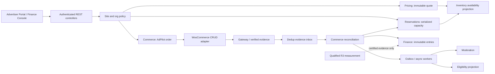
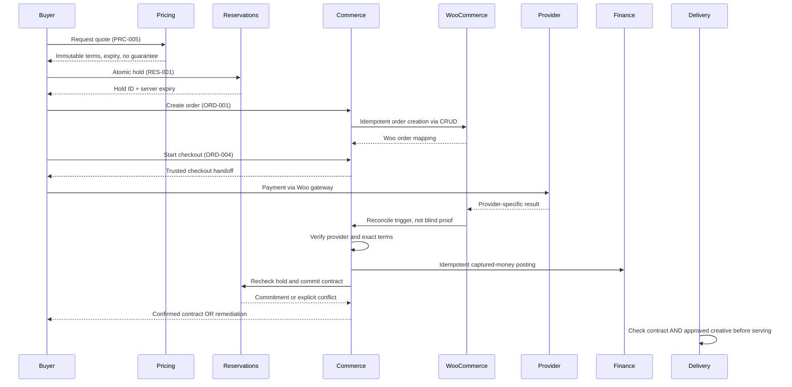

# AdPilot — Pricing, Reservations, Commerce & Financial Lifecycle Specification

**Document ID:** `ADP-DOC-021`  
**Filename:** `21_ADPILOT_PRICING_RESERVATIONS_COMMERCE_FINANCIAL_LIFECYCLE.md`  
**Version:** 1.0.0 — implementation contract proposal  
**Status:** Proposed; Product Owner, Finance/Accounting, Legal/Tax, WordPress/WooCommerce, AdTech, Security, Database, UX and QA sign-off required  
**Date:** 2026-10-12  
**Product:** AdPilot — Self-Service Advertising Marketplace & Behavioral Analytics for WordPress  
**Accountable owners:** Commerce/Finance Domain Lead + Principal Software Architect  
**Implementation target:** GPT-6 High, bounded and independently auditable work packages  
**Normative predecessors:** `ADP-DOC-001` through `ADP-DOC-020`  
**Next proposed document:** `ADP-DOC-022` — Creative Management, Moderation, Policy Enforcement & Approval Workflows (subject to document register)

> **Implementation status.** This document is a proposed executable specification, **not evidence that financial processes, integrations, bank settlement, performance or tests already exist**. Examples, accounting representations, values, timing policies and adapters are illustrative until approved for a specific merchant, gateway, supported currency and legal jurisdiction. Never invent VAT/GST rates, legal refund guarantees, fiscal invoice requirements or processor transaction states. A finance/legal sign-off is a release blocker wherever external requirements are unresolved.

---

## 1. Authority, precedence, releases and scope

### 1.1 Controlling requirements and preservation rules

| Source | Mandatory reusable contract | Implementation rule |
|---|---|---|
| `ADP-DOC-001` | 129 canonical `FR-*`, especially `FR-COM-001..014`; `BR-001..018`, `INV-01..10`, `NFR-001..016`, `AC-001..015`, R1–R4 | No renumbering, narrowing or silent change. |
| `ADP-DOC-002` | `AT-COM-001..014`, `AT-BR-001..018`, `E2E-01..17`, `CAP-06..08` and other related capabilities | Existing acceptance remains mandatory. |
| `ADP-DOC-003` | `UJ-04/05/08/16/21/24/28`, `WF-04..07`, `WF-16`, accessible UI and recovery | Preserve truthful messages and buyer task continuity. |
| `ADP-DOC-004` | `DP-INV`, `DP-PRC`, `DP-RES`, `DP-COM`, `DP-FIN`, `DP-TIM`, `DP-MOD`, `DP-OVR`; `SM-QUOTE/HOLD/RESERVATION/ORDER/PAYMENT/DISPUTE` | State transitions are domain policy, not UI-generated status writes. |
| `ADP-DOC-005` | Publisher capabilities, current advertiser organization membership, object scope, dual control, audit and multisite policy | Backend checks on every command and read. |
| `ADP-DOC-006` | Modular monolith, `IC-005..008`, `IC-011/012`, `IC-014/015`, transaction/outbox boundary | No direct cross-module SQL. |
| `ADP-DOC-007` | `DM-012..019` rate card, quote, hold, reservation, order, attempt, ledger and remedy aggregates; typed ports | No new shadow domain model. |
| `ADP-DOC-008` | `rate_card_versions`, `quotes`, `inventory_holds`, `hold_slot_lines`, `contract_reservations`, `reservation_slot_lines`, `advertising_orders`, `order_lines`, `payment_attempts`, `provider_events`, `financial_ledger_entries`, `commercial_remedies`, `idempotency_records`, `outbox_messages` | Schema changes only via reviewed migrations. |
| `ADP-DOC-009` | `PRC-001..006`, `RES-001..006`, `ORD-001..012`; standardized HTTP errors, idempotency and permissions | Extend only by approved API amendment, never pretend proposed new routes exist. |
| `ADP-DOC-010` | Durable async jobs, provider evidence inbox, event outbox, lease/fencing, reconciliation and retry policy | At-least-once execution with once-only financial effect. |
| `ADP-DOC-011..014` | Advertiser checkout wizard, finance console, responsive/accessible messages, exact currencies and state labels | No fake success or countdown-based authority. |
| `ADP-DOC-015..017` | Stable slot identity, layout-contract impacts and consistent public rendering | Layout changes never silently invalidate sold contractual rights. |
| `ADP-DOC-018` | Current delivery gate checks, independent moderation, emergency stops | Paid != deliverable. |
| `ADP-DOC-019` | Metric registry, qualified event evidence, certified R3 charging, immutable correction and finance tie-out | Browser counters never post charges. |
| `ADP-DOC-020` | Optional behavioral telemetry separated from billable proof | Heatmap events never create ledger entries. |

**Priority:** PRD and formally approved policy decisions control meaning; Documents 04–10 control domain/API/persistence contracts; this document specifies commerce orchestration and test evidence. On conflict, create `FC21-DEC-*`, mark affected behavior blocked, identify an accountable approver and source amendment. `MUST/SHALL` is mandatory for the release containing the feature; `SHOULD` needs an approved documented exception.

### 1.2 Release matrix and explicit exclusions

| Release | Offered behavior | Must not be inferred |
|---|---|---|
| **R1** | Fixed-price, time-window and exclusive sponsorship rate plans; quotes; atomic temporary holds; order mapping; WooCommerce online checkout when installed; provider verification; complimentary/manual approvals when Woo absent; remedies, adjustments, reconciliation dashboard | Per-impression billing; automatic settlement assumed for every gateway; native standalone payment processor; tax compliance without legal configuration. |
| **R2** | R1 commerce preserved, R2 viewability/heatmap reports informative only | Heatmap events as billing evidence. |
| **R3** | Only after finance/measurement certification: qualified CPM/CPC, budget limits, credits, metered settlement, disputes, share-of-voice and defined reconciliation | Browser event = invoice; estimated viewability = guarantee; unverified invalid-traffic classifications = final charge. |
| **R4** | Extensible additional billing/payment providers, federated/multisite workflows subject to security sign-off | Shared network funds or cross-site order access without explicit grants. |

The entire plugin loads without WooCommerce. No-Woo mode keeps manual/complimentary advertiser-independent functionality. A site with a disabled WooCommerce adapter is **not** authorized to invent an online checkout flow. Site management, finance observation and legally required remedies remain accessible to authorized users.

### 1.3 Glossary and independent truths

- **Rate card:** a published, immutable commercial offer policy; not a reservation.
- **Quote:** a time-limited immutable price/term snapshot; not guaranteed availability.
- **Hold:** a server-committed temporary capacity claim, expiring at server time.
- **Contract reservation:** durable inventory commitment backed by enforceable approved settlement terms.
- **Order:** an AdPilot commercial obligation whose financial state is separately reconciled with WooCommerce/provider evidence.
- **Payment attempt:** a gateway-specific transaction with proven or unknown financial state.
- **Ledger posting:** an immutable financial fact, not the state of a WooCommerce page.
- **Remedy:** an explicit accountable resolution for nonfulfillment, rejected creative, expired inventory, refund, reversal, or contract amendment.
- **Allocation:** separate entitlement used by Delivery; a paid order alone does not allow public serving.
- **Provider evidence:** verified gateway/WooCommerce result, not an unauthenticated client-supplied flag.
- **Financial reconciliation:** comparison of the AdPilot order, provider transactions, ledger postings, reservations and fulfillment, with quarantined discrepancies.

**Four independent planes:** `booking/contract`, `payment/ledger`, `creative moderation`, and `delivery eligibility` have separate state and separate gatekeepers. They may be correlated, never collapsed into a single `active` boolean.

## 2. Non-negotiable financial and booking invariants

Supplementary `FC21-INV-*` requirements do not replace `INV-01..10`.

| ID | Requirement | Server enforcer | Proof |
|---|---|---|---|
| `FC21-INV-01` | Quotes disclose immutable product units, slot identities, UTC instants, selected IANA time zone, currency, discount/tax basis, expiry, rate and remedy policy versions. | Pricing | Quote snapshot/hash test. |
| `FC21-INV-02` | Client-supplied totals, discounts, tax, authorization and inventory availability are never authoritative. | Pricing/Commerce | Tampered payload ignored or rejected. |
| `FC21-INV-03` | Overlapping exclusive windows can never be concurrently allocated above capacity. | Reservations/DB | Two-writer barrier tests. |
| `FC21-INV-04` | Quote and hold expiry are determined by persisted server time; refresh and replay do not extend a hold. | Reservations | Expiry clock tests. |
| `FC21-INV-05` | A late, successful payment cannot revive or steal an expired/reallocated hold. | Commerce/Reservations | Late-capture adversarial test. |
| `FC21-INV-06` | WooCommerce success page and browser redirects do not confirm settlement or trigger delivery. | Commerce | Spoofed-redirect tests. |
| `FC21-INV-07` | Every verified provider event has one deduplicated processing effect and auditable evidence; out-of-order events cannot regress settled facts. | Payment adapter/inbox | Duplicate/reorder tests. |
| `FC21-INV-08` | Monetary authority uses currency-validated exact minor-unit arithmetic or approved high-precision decimal; no binary floats. | Pricing/Finance | Property tests. |
| `FC21-INV-09` | A posted ledger fact is append-only; corrections use a linked compensating posting and audit. | Finance/DB | UPDATE/DELETE forbidden tests. |
| `FC21-INV-10` | Every paid creative rejected without a permitted fulfillment path produces an actionable, time-bounded remedy case. | Moderation/Commerce | Rejection matrix. |
| `FC21-INV-11` | Financial authorization, adjustments, refunds and approvals meet separate role, site, org, threshold and dual-control policies. | Security/Finance | Cross-role tests. |
| `FC21-INV-12` | Time contracts use half-open `[start,end)` UTC windows; DST ambiguity cannot silently change purchased coverage. | Pricing/Reservations | DST fixtures. |
| `FC21-INV-13` | A rate/layout revision cannot retrospectively mutate an accepted price or published contract. | Pricing/Layout | Revision conflict test. |
| `FC21-INV-14` | Delivery requires current contractual entitlement, approved exact creative version and schedule; paid != approved. | Delivery | Cross-state tests. |
| `FC21-INV-15` | Refund requests, WC refund objects, provider refunds and ledger refund postings are distinguished; `cancelled` WC status is not proof of returned money. | Finance/Adapter | Refund reconciliation test. |
| `FC21-INV-16` | R3 metered charges require independently qualified/deduplicated evidence and certified contract-specific billing version. | Finance/Measurement | Certification gate. |
| `FC21-INV-17` | An unavailable DB transaction guarantee blocks unsafe sale/commit; no best-effort pretend checkout. | Health/Reservations | Degraded-host tests. |
| `FC21-INV-18` | Every site/organization reference is bound to trusted context through query predicates, not only URL validation. | Policy/Repositories | Multisite/org tests. |
| `FC21-INV-19` | Reconciliation deficits, overpayments, disputed transactions and unknown provider states are visible, not auto-hidden or fabricated as zero. | Finance/Reporting | Fault injection. |
| `FC21-INV-20` | Finance exports and invoices are scoped, purpose-limited, revoked on permission loss, and do not expose payment secrets. | Reporting/Security | Auth/export tests. |
| `FC21-INV-21` | Source-specific idempotency is preserved for order creation, payment, captures, refunds, hold commit and ledger entries independently. | DB/Services | Repeated command tests. |
| `FC21-INV-22` | Fulfillment recognition and legal/tax treatment are policy-driven, not inferred simply because a contract window ended. | Finance/Legal | Recognition sign-off test. |
| `FC21-INV-23` | A credit, refund or manual allocation override never changes another tenant's balance or contracted slot. | Finance/Auth | Cross-scope malicious tests. |
| `FC21-INV-24` | R1 fixed price cannot be changed by R2 heatmap counts or later R3 delivery-event corrections. | Finance | Reporting/ledger isolation. |

## 3. Domain ownership, dependency map and ports



### 3.1 Domain ownership and read/write rights

| Owner | Owns / mutates | External readers | MUST NOT do |
|---|---|---|---|
| **Pricing** | `RateCardVersion`, `Quote`; tax/discount calculation policy and snapshots | Reservations, Commerce, Storefront | Hold capacity; declare payment settled. |
| **Inventory/Layout** | Slot identity, published binding, eligibility and sold-layout impacts | Pricing, Reservations, Delivery | Backdate or delete sold rights. |
| **Reservations** | `InventoryHold`, `ContractReservation`, booked capacity, contract amendments | Commerce, Delivery, Admin | Treat payment redirect as a contract. |
| **Commerce** | `AdvertisingOrder`, `PaymentAttempt`, `CommercialRemedy`, provider evidence interpretation | Portal, Reporting, Reservations | Approve creatives or directly update foreign aggregate tables. |
| **Finance** | `FinancialLedgerEntry`, posting/reversal, financial reconciliation and reporting policy | Authorized projections, R3 billed metrics | Treat client/browser data as settlement. |
| **Woo adapter** | Woo `WC_Order` and refund CRUD orchestration as integration boundary | Commerce | Direct SQL to Woo HPOS/posts or claim gateway capture without verification. |
| **Measurement** | Qualified event evidence and aggregates | R3 billing service via certified export | Post a payment or final bill from raw events. |
| **Moderation/Delivery** | Creative version approval and live eligibility gates | Commercial status projections | Change accepted price or ledger. |

Inter-module service contracts remain `IC-005 Availability`, `IC-006 Quote`, `IC-007 Hold`, `IC-008 ContractAllocation`, `IC-011 PaymentEvidence`, `IC-012 FinancialLedger`, `IC-014 EventEnvelope` and `IC-015 QualifiedAggregates`. New `FC21-*` names are supplementary implementation contracts, not substitutes.

### 3.2 Security and transaction context

Every command MUST receive a server-constructed immutable context with `site_id`, verified actor/principal, organization membership revision, scoped resource IDs, correlation ID, command idempotency scope, authoritative UTC clock and signed-off feature-policy version. WordPress nonces mitigate CSRF on cookie-authenticated requests but do not grant permissions. Domain services must explicitly invoke current authorization, including when called from CLI and queues. Background workers act as audited internal principals and verify trusted site provenance; no arbitrary user impersonation.

`TransactionManager` is injected into coordinated application use cases. Repositories are site-scoped. Database transaction boundaries cannot generally include an external gateway or WooCommerce datastore commit in a single atomic operation: use durable intent, compensation, idempotency and reconciliation, **not** a fictitious distributed transaction.

## 4. Product modeling, rate cards and price governance (R1; extensions R3)

### 4.1 Supported R1 commercial products

| Product | Exact commercial unit | Inventory protection | Completion rule |
|---|---|---|---|
| Fixed placement | Named slot(s)/versioned inventory, one contracted delivery window or explicitly listed term | Holds contractual quantity and conflict class | Defined placement entitlement, not automatically guaranteed impression count. |
| Time-window sponsorship | Calendar period `[start,end)` in explicit timezone, quantity/capacity policy | Holds per-slot time capacity | Time window and separately specified obligations. |
| Exclusive sponsorship | Sole reserved eligible slot/zone commercial class during term, governed exclusivity scope | Serialize every affected capacity key and test overlaps | Contract fulfillment within approved rights. |
| Complimentary/house/manual | Explicit operator-approved entitlement, zero or externally governed consideration | Must not preempt sold inventory | Separate approval + moderation + allocation. |

The fixed/time distinction must be explicit in product copy; avoid accidental multi-unit billing for hourly/daily rounding. No implicit guarantee of an impression count, audience size or revenue is permitted without a separate signed-off guarantee/remedy policy.

### 4.2 Rate card version object

`RateCardVersion` includes site/rate key, version, target scope (slot or eligible zone), sale model, currency, exact unit price, billing interval unit, minimum/maximum term, quantity, exclusivity class, effective UTC period, tax and discount policy references, buyer eligibility, approval/remedy policy snapshot references, created/approved/published actors and provenance. A published version becomes immutable; edit creates a new draft version. Changed live rate affects only new quotes; a previously accepted but *expired* quote does not continue to qualify. Rate currency is not inferred from locale.

Proposed policy signature (illustrative, not complete production code):

```php
<?php
namespace AdPilot\Modules\Pricing\Application;

interface QuoteService
{
    public function issue(AuthenticatedCommercialContext $ctx, QuoteIntent $intent): QuoteResult;
    public function read(AuthenticatedCommercialContext $ctx, QuoteId $id): QuoteView;
}

interface MonetaryCalculator
{
    public function calculate(PriceDefinition $rate, CommercialUnits $units,
        DiscountPolicy $discount, TaxPolicy $tax): ExactPriceBreakdown;
}
```

### 4.3 Pricing function and exact arithmetic

**Normative calculation:** `subtotal = exact_unit_rate × approved billable units`, then a versioned policy determines discount basis and order, taxable base, each tax component, rounding stage and final total. Compute with a fixed-point integer or approved arbitrary-precision decimal library. For non-decimal representation or prices with more precision than the invoice minor unit, retain high-precision intermediate values and round only at approved stages. Currency ISO code **does not alone fix all payment-gateway rounding or tax obligations**; tax/chargeback/legal owners sign off supported currencies and jurisdiction-specific rules.

A worked **illustrative arithmetic fixture only**: 3 days at 1,500 minor units/day = 4,500 minor units; discount 300 = 4,200; configured test tax 10% of post-discount subtotal = 420; total 4,620. The 10% rate is a *synthetic QA setting*, not applicable law. Multiple line/tax allocations require remainder distribution that preserves exact total. Prohibit `float`/JavaScript Number as authoritative money values; API should transport exact integers as canonical decimal strings when range safety matters. Prohibit silent exchange-rate conversion; a new settlement currency is a new approved quote and gateway policy.

### 4.4 Discount, promotion and tax policy contracts

- Discount types (if enabled): fixed amount, percentage, limited-use approved promotion or negotiated contract version. Publish allowed combinations, eligibility and priority in versioned policy; never trust a browser promo discount amount.
- Rate floor, promotional stacking, negative-total prevention, seller/organization eligibility and expiry must be validated centrally.
- Tax inclusivity/exclusivity, tax-exempt evidence, customer billing address, nexus/source, invoice fields, tax effective dates and invoice corrections require tax/legal configuration and merchant review. If unavailable, **block taxable checkout that cannot be lawfully priced**, not guess a region or rate.
- Tax ID/customer organization billing fields are restricted PII, server-side validated and redacted in logs. Never infer authority from user-entered business name.
- A zero-value complimentary deal is an approved manual/administrative entitlement, not a credit card gateway capture with amount zero unless WooCommerce behavior has been explicitly certified.

### 4.5 Immutable quote issuance algorithm

1. Authenticate/authorize with current site/organization membership; verify buyer identity and product availability permissions.
2. Load *published* rate-card version, current stable slot identities, active binding/layout revision and explicit capacity key scope.
3. Normalize buyer wall-time to exact UTC instants, requiring DST ambiguity resolution; ensure `start < end` and window fits product rules.
4. Check advisory availability and limitations. Record that availability may change before hold commit.
5. Calculate exact line, discount, tax and total via approved deterministic policies; include currency unit scale and cost basis.
6. Freeze source versions, allocation/exclusivity class, site/org/campaign, refund/moderation policy text/version, delivery guarantee scope (if any), selected timezone, original wall-time, UTC instants, quantity, layout revision, cancellation terms and expiry.
7. Serialize canonical terms deterministically (key order, normalized types and precision), compute `terms_digest` and persist immutable `offer_snapshot_json` plus expected revision.
8. Return `quote_id`, expiry and source authority; no hold created and no payment status changed.
9. On reprice after rate/layout changes, create a new quote with changed terms; never unilaterally invalidate an already accepted but still contract-valid quote solely because a new rate exists, although an actual hold may fail current inventory eligibility. UI shows line-by-line differences, never overwrites the accepted record.

**Postcondition:** selected rate and terms can be independently reconstructed without reconsulting mutable CMS settings. Invoice and audit evidence reference the *accepted* quote digest.

## 5. Availability and serialized reservation engine

### 5.1 Two distinct queries

- **Read-only availability estimate:** convenient filtered calendar/list result; may be stale. Can report ``available``, ``limited``, ``not eligible`` with data age, but not a guarantee.
- **Atomic hold attempt:** authoritative transaction on each sellable capacity key, current UTC clock, quote/source validation, active locks, eligible holds/reservations and contract classes. Result is an exact **hold token** or conflict. Frontend cannot mark a slot ``held`` prior to acknowledged commit.

### 5.2 Capacity and interval mathematics

Use half-open UTC intervals `a.start < b.end AND b.start < a.end`. Adjacent `[10:00,11:00)` and `[11:00,12:00)` do not overlap; zero or negative intervals are invalid. For each canonical slot/capacity key and each event boundary inside the requested window, `committed_units + live_unexpired_hold_units + requested_units <= applicable_capacity`. Simply summing every overlapping interval is *overly conservative* if their times do not overlap; compute peak concurrent units via a sweep-line across normalized segment boundaries or a proven equivalent indexed interval algorithm. `exclusivity` requires zero incompatible overlapping quantity and may cover all child slot keys governed by the accepted rate's exclusivity definition.

Inventory capacity is keyed to stable **logical slots**, not render-instance IDs or HTML position. Multiple placement occurrences are not new stock. Do not equate 500 configured slots with 500 instantly available commercial products. Capacity changes during active contracts require policy-governed impact assessment.

### 5.3 Hold creation transaction protocol

```text
BEGIN TRANSACTION (InnoDB-compatible; explicit supported isolation)
  resolve site + organization + quote, verify immutable terms and expiry
  load published layout / relevant contract versions and current UTC timestamp
  expand quote lines into canonical sorted capacity keys
  SELECT canonical lock rows FOR UPDATE in deterministic key order
  re-read active, unexpired holds and committed reservations overlapping all windows
  validate exclusivity, peak capacity, restrictions and no sold-layout divergence
  insert hold + hold_slot_lines and scoped unique idempotency record
  append audit and outbox inside same transaction
COMMIT
RETURN hold_id, authoritative expires_at, booked lines and remaining TTL
```

If lock rows can be absent, create or select an existing durable slot/capacity lock target transactionally before reading availability; a query that locks **zero rows** is not a concurrency guarantee. Avoid deadlocks by consistent key order; retry deadlocks a bounded number of times with fresh transaction and the *same idempotency key*. On unsupported transactional hosts, return `503 unsafe_booking_unavailable` and disable checkout; do not fall back to a non-atomic `get_option` lock or transient.

### 5.4 Hold lifecycle and refund liability

`SM-HOLD` is normative: new hold → active, explicit `release`, expiry by authoritative server-time, `committing`, `committed` or repair. A page countdown is advisory. An expired hold is excluded even before a cleanup worker physically marks its row expired. Extension requires **new authorized mutation**, full capacity recheck and a new expiry; no `expires_at = now()+ttl` update on browser refresh. After expiry, the merchant's confirmed payment may create a duty to refund/offer alternative, but it may **not** create entitlement in sold inventory.

### 5.5 Hold-to-reservation conversion

Inside a new inventory transaction: lock same ordered keys, lock current hold row, verify ownership, quote and contract digest, current time, payment/manual authorization policy, no incompatible booking or layout drift, then atomically transition hold and insert contract reservation/slot lines, audit and outbox. If provider charge already exists but the hold is invalid, **commit no reservation**, mark order `remediation_required` and generate a case. A checkout may outlast hold TTL: policy must explicitly define recovery/renewal or purchase timeout; never make payment completion alone extend capacity. Conversion is idempotent by `(site, order, hold, accepted_contract_digest)` and reservation uniqueness, subject to approved DB constraint.

### 5.6 Layout updates and amendment safety

Layout Studio publication checks all affected sold slots and live holds. Renaming or reflowing visual containers may be safe while changing sellable position, size, eligibility, exclusivity or availability requires impact analysis (`BR-006`). An amendment has signed-off buyer/merchant terms, original/new version references, exact money delta, effective window, capacity revalidation under locks, optional refund/charge and audit; do not mutate historical `contract_digest` or retroactively recalculate previous invoice lines. Restoring a layout is a **new revision** subject to the same checks.

## 6. Order lifecycle, WooCommerce adapter and checkout (R1)

### 6.1 R1 checkout architecture

AdPilot is an independent application domain with a **conditional** WooCommerce checkout adapter. A signed-off commercial order snapshot exists in AdPilot, and the gateway-facing order exists in WooCommerce when online checkout is enabled. The mapping must be bijective within the approved one-order-per-contract model; source document 08 allows an alternative multiple-attempt mapping only if formal ADR freezes it.

**Approved integration mechanisms:** `wc_get_order()`, `wc_get_orders()`, `WC_Order` methods, WooCommerce order/refund APIs and registered WooCommerce callbacks supported by the deployed version. Use `WC_Order::update_meta_data()` and `save()` for mappings; never write directly to WordPress `postmeta` or WooCommerce HPOS tables. Use `WC_Order_Query` for Woo order lookup. Test both HPOS and legacy compatibility modes where claimed. WooCommerce order metadata is an *integration mapping*, not a new financial source of truth.

Authoritative external guidance checked at authoring: [WooCommerce HPOS developer docs](https://developer.woocommerce.com/docs/features/orders/high-performance-order-storage/), [WooCommerce HPOS recipe book](https://developer.woocommerce.com/docs/features/orders/high-performance-order-storage/recipe-book/), [WooCommerce order querying APIs](https://developer.woocommerce.com/docs/features/orders/wc-get-orders/). Runtime support and gateway compatibility must be independently verified at build time.

### 6.2 Order-to-Woo mapping

Persist in AdPilot: trusted site ID, scoped order ID, org/campaign, accepted quote ID/terms digest, exact currency and total, proposed order lines, WooCommerce order ID if present, provider channel, checkout attempt, data revision, state, reconciled paid amount and status timestamps. Store in Woo order metadata (using Woo CRUD) namespaced `_adpilot_*` keys: local AdPilot order identity, site identity, quote digest, contract/campaign reference, mapping version and **nonsecret** reconciliation reference. Protect values from accidental customer-facing exposure. IDs alone never confer access.

To avoid distributing a false cross-database atomicity guarantee, the adapter uses this intent pattern:

1. In AdPilot transaction, allocate a unique local order ID from a currently valid hold, persist order intent, immutable lines and outbox `WooOrderCreationRequested`, with unique idempotency scope.
2. After commit, a trusted adapter worker creates/locates the WooCommerce order by durable correlation ID. It stores the mapping through supported CRUD, with retry-safe safeguards against duplicate Woo order creation.
3. The adapter records authoritative Woo order ID and safe status in AdPilot, updates intent stage, then returns a checkout handoff URL only after the mapping is persisted and validated.
4. On crash after Woo creation but before AdPilot mapping, recovery queries restricted metadata using supported WooCommerce APIs and correlates exact context; duplicates are quarantined or cancelled through the appropriate Woo operations after manual review, **never** charged twice.
5. Confirm hold validity *again* before returning usable checkout. If expired/unsafe, block handoff and offer a fresh quote/hold or authorized remedy. The browser sees pending/preparing, not fake checkout success.

**Important engineering decision:** WooCommerce order creation and AdPilot DB transaction cannot be made atomic by an ordinary `$wpdb` transaction when HPOS/hooks/gateway side effects execute. Treat external calls as separately committed steps with durable state and idempotent recovery.

### 6.3 Checkout entry and trust boundaries

Existing route `ORD-004` is the controlled checkout start. The server rechecks current membership, order ownership, accepted terms, active hold, Woo readiness, currency compatibility, tax configuration and open attempt. It must resist CSRF, checkout-handoff URI manipulation, duplicate requests and referrer/host spoofing. A checkout URL must be generated by the adapter and validated against an allowlist of expected WooCommerce endpoints/hosts; never use an advertiser-supplied return URL as a privileged redirect.

Payment page, order-received page, email link and user-visible WooCommerce `processing`/`completed` statuses are **observations**; none directly changes AdPilot state absent verified adapter reconciliation. Display a pending verification state and poll/read `ORD-003` with bounded intervals; never spin on the client indefinitely or tell a user a charge failed solely because a callback is delayed.

### 6.4 Gateway evidence state machine

Use `SM-PAYMENT`: `created → submitted → authorized → captured → settled` where supported, plus `failed`, `cancelled`, `refunded`, `reversed`, `unknown`. **Do not fabricate a `settled` state** when the gateway only guarantees `paid` or `captured`. A gateway authorization hold alone does not equal captured funds. Classify evidence by provider mapping, direction, amount, currency, gateway transaction ID and provenance. If a provider lacks event signatures or authoritative readable transaction state, document compensating verification and fail closed for unsupported financial actions.

| Incoming signal | Is it authoritative? | Effect |
|---|---|---|
| Browser redirects to `order-received` | No | Show `verifying`, request safe server status. |
| Unsigned client-supplied `paid=true` | No | Reject and security log; no order mutation. |
| Woo order hook | Internal trigger, not necessarily final gateway proof | Queue reconcile; independently load order/status and verify configured provider semantics. |
| Signed gateway callback + mapped reference | Potentially; signature alone not amount/ownership proof | Dedup, verify against provider contract, reconcile exact amount/currency/attempt and status. |
| Verified capture after order hold expiry | Yes for money, no for inventory | Ledger receipt if appropriate; order `remediation_required`, no stolen reservation. |
| Gateway refund created | Not automatically returned money | Track pending, complete only with verified provider refund outcome and matching Woo record. |
| Provider chargeback | Verified adverse financial event | Freeze risky delivery per approved policy, dispute/remedy and compensate ledger without erasing previous capture. |

### 6.5 Payment event admission algorithm

```text
receive provider/Woo signal (untrusted until verified)
  validate provider endpoint authentication/signature and replay bound where available
  derive trusted site/order mapping from server-owned persistent correlation
  normalize provider event ID and hash nonsecret identifiers into provider_events
  INSERT dedup unique(site,provider,event_hash); duplicate => return recorded result
  queue trusted payment-reconciliation job with redacted correlation
  load current Woo order via CRUD; fetch provider authoritative status if required
  validate gateway account, order, currency, amount, capture/refund ID, timing, lineage
  lock AdPilot order + attempts; compare event version and financial evidence precedence
  persist new payment state, immutable ledger/outbox effects transactionally if supported
  separately attempt hold->reservation commit using Reservations contract
  if booking fails: remediation_required, no allocation, start approved remedy path
  acknowledge and retry safely on transient failure; never invent final success
```

Do not persist raw gateway credentials, full webhook bodies containing secrets, PAN, CVV or unrestricted billing profile details. Verification events must have a safe audit reference and one *effect* even when processed multiple times. Provenance and status comparison need provider-specific test fixtures.

### 6.6 Non-WooCommerce and manual/complimentary contract path

If WooCommerce is not installed, deactivated, incompatible or configuration-invalid: Admin inventory, rate cards, safe delivery, moderation and reports still load. Show online checkout prerequisite to advertisers. Authorized publisher workflows MAY create a zero-price complimentary contract or an externally reconciled/manual arrangement **only if** a signed-off manual policy defines approval, evidence and entitlement. A manual `payment_confirmed` flag with no financial evidence is prohibited. Proposed manual states: `complimentary_approved`, `external_payment_pending`, `external_payment_verified`; do not add persisted status enum values without schema/API ADR.

Complimentary proposals require reason, responsible operator, compatible unoccupied inventory, current organization/site rights, threshold-based independent approval when applicable, immutable contract terms and no ledger capture of fictitious cash. External bank transfer confirmation needs verifiable transaction reference, matching account/site/amount/currency, current financial approval, audit and reconciliation. Unreviewed manual items are not public inventory entitlements.

## 7. Independent state machines and cross-plane orchestration

### 7.1 Normative state set

| Aggregate | Baseline state machine | Critical invariant |
|---|---|---|
| Quote | `SM-QUOTE` | Expired or superseded quote cannot be silently reaccepted. |
| Inventory hold | `SM-HOLD` | Hold TTL, owner and capacity invariant. |
| Contract reservation | `SM-RESERVATION` | Sold inventory remains auditable across changes. |
| Order | `SM-ORDER` | `payment_confirmed` and `remediation_required` are distinct from campaign state. |
| Payment attempt | `SM-PAYMENT` | Payment evidence has processor-specific precedence. |
| Dispute/remedy | `SM-DISPUTE` R3 formal, R1 basic recovery | Case and ledger amendments never destroy history. |
| Campaign/creative | `SM-CAMPAIGN`, `SM-CREATIVE` | Paid creative can remain in review/rejected. |

### 7.2 Commercial saga: successful purchase



Money capture and reservation commit may finish in different transactions; the persisted saga state describes each step. Any interrupted stage is inspected and resumed idempotently. Never call payment gateway inside inventory row-lock transaction. A captured payment without inventory may be a business liability, not an authorization to oversell.

### 7.3 Recovery matrix

| Fault | Safe persisted state | Buyer-facing UX | Recovery owner |
|---|---|---|---|
| Quote expired before hold | Quote expired; no hold | Explain new quote and changed terms | Pricing |
| Capacity lost between quote and hold | No hold | Availability changed; preserve draft | Reservations |
| Hold expires during checkout | Order pending/unknown; hold expired | Payment verification and remedy explanation | Commerce |
| Woo order creation times out | Local order intent and pending mapping | Preparing checkout, retry safely | Adapter |
| Woo order created but mapping write fails | Uncertain mapping with job retry | No duplicate checkout until recovery | Adapter/Finance |
| Gateway event duplicated | Original effect retained | Single payment visible | Inbox/Commerce |
| Gateway failure after capture evidence | Quarantine contradictory evidence | Pending verification, not false decline | Provider adapter |
| Capture succeeds, capacity no longer available | `remediation_required` | Refund/alternative options and deadline | Finance/Reservations |
| Creative rejected after paid commitment | Paid booking + moderation rejection/remedy | Revision/cancel/refund policy path | Moderation/Finance |
| Partial refund pending provider | Refund initiated, not completed | “Refund pending” with evidence status | Finance |
| Chargeback after fulfillment | Disputed with compensating posting | Restricted appeal/notice | Finance/Legal |
| WP-Cron/worker delayed | Authoritative expiry and stale async flags | No extended capacity promises | Reservations/Operations |
| Woo deactivated mid-checkout | Pending reconciliation; disable new checkout | Status uncertain; support escalation | Commerce/Ops |
| Database lacks transactional support | New sales disabled | Temporary checkout unavailable | Ops/DB |

### 7.4 Financial state must not overwrite booking state

For example, `payment_confirmed + creative_rejected + reservation_committed` is a coherent intermediate state. `payment_confirmed + reservation_missing` is a financial discrepancy needing remediation. A `refunded` order may retain historical reservation and delivery facts; future allocation is stopped according to approved terms. `reservation_fulfilled` does not assert that a gateway transfer reached a bank account. Model cases with independent records rather than one global mutable status switch.

## 8. Financial ledger, adjustments and accounting policy

### 8.1 What the R1 schema currently guarantees

Document 08 defines `financial_ledger_entries` as a **signed append-only ledger**, with `(site_id, source_idempotency_hash)` uniqueness, `reversal_of_entry_id`, `amount_minor`, `currency`, `entry_type` and `posted_at`. It explicitly leaves a balanced double-entry posting model as a finance ADR. Therefore this document **must not claim an approved general ledger or GAAP/IFRS-compliant double-entry system already exists**. The R1 signed operational ledger is an immutable transaction register; if double-entry accounting is required, approve schema migration and balanced posting invariants before enabling the affected functionality.

### 8.2 Signed financial posting categories

| Proposed entry kind | Economic interpretation | Required evidence | Dedup domain |
|---|---|---|---|
| `capture` | Verified received/captured funds, defined gateway meaning | Provider transaction reference and reconciliation | One entry per verified capture ID and amount scope |
| `refund` | Verified returned funds | Confirmed provider refund or independently evidenced manual transfer | One per confirmed refund reference |
| `reversal` | Chargeback/reversal | Verified provider/account reconciliation | One per reversal event |
| `adjustment` | Approved correction | Dual-control and reason; links source entry | One per approved adjustment command |
| `credit_issued` (R3 if enabled) | Approved purchaser credit | Credit policy, balance and immutable source | One per issuance event |
| `metered_charge` (R3) | Certified period/event charges | Contract + qualified event batch and unique billing period | One per approved billing settlement key |

The approved taxonomy must specify sign convention, recognition classification, gross/net tax handling, provider fees, FX adjustments and account reconciliation; sample `entry_type` labels are not an assertion of canonical database enums. An AdPilot operational receipt need not equal financial-accounting *revenue recognition*.

### 8.3 Exact-money arithmetic and totals

Proposed `Money` value object stores ISO currency, exact signed integer minor units with validated range; decimal rate calculations use a canonical arbitrary-precision representation and approved rounding. Every arithmetic operation rejects different currencies unless an explicit FX-conversion contract is authorized. Enforce invoice invariant under approved tax rules: sum line net + tax + approved fees - discounts = exact payable total; recorded captures - verified refunds - reversals = net provider receipts in *matching currency*, subject to gateway-specific settlement lag. Distinguish ``gateway gross`` from ``bank net`` when processor fees apply. A ledger balance must not be fabricated by subtracting unrelated event impressions.

### 8.4 Append-only posting algorithm

```text
on verified financial effect:
  derive finance idempotency key from site/provider/transaction/entry_kind/amount/version
  BEGIN DB transaction
    lock site/order and expected posting source
    validate exact currency, entitlement, verified event evidence, allowed status transition
    check source_idempotency_hash unique, return existing if duplicate
    INSERT immutable financial_ledger_entries with safe evidence and link
    update order reconciled paid_minor projection (not separate settlement truth)
    INSERT audit and outbox with same transaction
  COMMIT
  enqueue reconciliation/report projection asynchronously
```

Posting `source_idempotency_hash` must be computed with a collision-resistant keyed/deterministic canonical strategy and include the logical economic event. Do not use event delivery attempt ID alone; retries should map to one financial effect. On storage failure after provider capture, queue re-verification; never call gateway capture again merely to repair the local ledger.

### 8.5 Corrections, reversals, refunds and dispute accounting

Refund request, approved remedy, WC refund record, provider refund initiation, completed provider refund and ledger posting are six different milestones. Store each with a correlation ID and exact decimal/amount. An initiated refund is **not** marked completed until the external authority confirms it (or manual out-of-band evidence has been independently approved). If partial refund is approved for one product/line, allocate tax/discount corrections deterministically and preserve the original invoice snapshot plus legal correction record. Never mutate an already posted capture row into a negative amount. Chargebacks are new adverse facts; if a subsequent dispute is won, post another evidenced correction.

**Provider note:** WooCommerce documentation distinguishes automatic gateway refunds from manual refunds, and warns that changing status to `Cancelled` or `Refunded` does not itself transfer money. [WooCommerce refunds documentation](https://woocommerce.com/document/woocommerce-refunds/). Configure only gateways that support the exact intended automatic-refund behavior; otherwise show and audit a required manual transfer task.

### 8.6 Reconciliation axes and invariants

Reconciliation must compare at least five separate books:

1. **Commercial obligation:** accepted quote, exact order lines and tax/discount basis.
2. **Provider money:** verified successful captures, refunds, reversals, settlement if exposed.
3. **AdPilot ledger:** append-only financial effects and adjustments.
4. **Inventory:** hold status, reservation commitment, exclusivity, cancellation and amendment lineage.
5. **Fulfillment/moderation:** creative approval and actual contract rights; metered event evidence separately only in R3.

An order can reconcile money but fail fulfillment, or fulfill but remain disputed. Emit categorized discrepancies (`missing_capture`, `ledger_without_provider`, `provider_without_ledger`, `currency_mismatch`, `amount_mismatch`, `stale_mapping`, `orphan_woo_order`, `captured_unbooked`, `reservation_unpaid`, `refund_pending`, `unresolved_chargeback`, `wrong_organization`, `tax_snapshot_mismatch`). Never automatically “fix” financial data by editing posted rows.

### 8.7 Reconciliation state and operator sign-off

`pending → in_progress → matched | discrepancy | needs_evidence | escalated | corrected` are proposed **projection/job states**, not a rewrite of `SM-ORDER` or `SM-PAYMENT`. Store checkpoint, safe evidence digest, approved remediation action, signed reviewer and next retry. Finance console lists discrepancies with age, magnitude in original currency, impact, open case, source freshness and authorized actions. Do not expose raw visitor metrics or unrelated advertiser invoices to a finance user lacking the relevant permission.

## 9. Remediation, refunds, cancellation and buyer rights

### 9.1 Remedy triggers and policy snapshot

Triggers: creative rejection/changes requested, safety suspension, post-payment inventory conflict, unfulfillable slot after layout change, buyer cancellation, unfulfilled schedule, payment reversal, duplicate charge, refund request, processor outage and statutory/legal withdrawal where applicable. A case references the order, immutable accepted contract, amount, reason, governing policy version, deadline, responsible actor, buyer communication, approver and evidence. **Neither merchant refund discretion nor legal obligation should be guessed**; the approved per-site policy controls the default options, subject to applicable law and contract terms.

### 9.2 Safe remedy decision table

| Case | Preconditions | Permitted action class | Forbidden shortcut |
|---|---|---|---|
| Unapproved creative, paid | Contract valid but no eligible creative | Revision by deadline, approved substitute, cancellation/refund under policy | Auto-approve creative. |
| Paid after hold expiry | Capture verified, inventory unavailable | Fresh opt-in booking, alternate offer with explicit acceptance, refund | Force old capacity commit. |
| Slot retired after sale | Contract impact recorded | Equivalent placement only with authorized amendment, credit/refund under policy | Silent relocation and price change. |
| Duplicate charge | Provider confirms multiple distinct captures | Reconcile both, approve refund/credit of excess, investigate idempotency bug | Pretend duplicate provider event means two charges. |
| Chargeback | Verified adverse event | Restrict risky delivery, preserve evidence, dispute resolution | Delete purchase/ledger history. |
| Partial fulfillment | Evidence supports contractual shortfall | Proportional extension/credit/refund by approved terms | Use raw unqualified impressions as sole proof. |
| Manual complimentary allocation | Properly approved zero consideration | Cancel or amend per manual terms | Claim gateway refunded zero money. |
| Tax invoice error | Verified policy/legal correction required | Corrected document and linked posting | Overwrite historical invoice PDF silently. |

### 9.3 Separation of duties

Proposal and approval of high-risk refunds, allocation overrides, material adjustments or policy exemptions MUST be separated when Document 05 thresholds/policies require it. A finance proposer cannot self-approve their own controlled transaction. A support role may view a redacted case and request escalation but cannot change bank/gateway refund destination or force a payment state. Administrator access does not bypass site/organization checks, provenance or independent approvals. Every material override carries a reason, immutable audit, affected source IDs and a next-step notice.

### 9.4 Customer-facing experience and service-level policy

Display a dated plain-language timeline of `order placed`, `payment awaiting verification`, `payment confirmed`, `creative under review`, `placement confirmed`, `requires action`, `refund initiated`, `refund completed`, without implying one state means the others. Include help link, remedy deadline and status freshness when known. No arbitrary “refund in 7 days” promise unless merchant policy/procedure and gateway constraints support it. A retrying button must reuse idempotency key while the original command is outstanding and create a new distinct intent only after an explicit changed transaction.

## 10. R3 metered CPM/CPC, caps, credits and dispute settlement

### 10.1 Release gate

R3 metering remains **off** until all are approved: metric catalog (`ADP-DOC-019`), valid R2 viewability where used, invalid-traffic qualification, counter/dedup rules, contract price arithmetic, late-event watermark/cutoff, amended ledger schema if needed, R3 disputes and refunds, bank/gateway provider semantics, privacy/legal approvals, and demonstrated reconciliation under load. An R1 deployment does not surface CPM/CPC checkout options as live products.

### 10.2 Metered contract snapshot

Immutable purchased terms: model (`CPM`/`CPC`), exact unit rate and minor/decimal precision, qualified eligible event definition/version, campaign, slot/zone and schedule, event inclusion/exclusion rule, source decision proof, count window and watermark, caps/pacing, budget, currency, prepay/postpay policy, refund/dispute windows, reporting attribution policy and measurement downtime response. Do not silently modify contract economics after campaign launch.

### 10.3 CPM/CPC math and one-charge-per-fact

For a test contract, `CPM amount = floor/round-approved(qualified_impressions × exact_CPM_rate / 1000)`; `CPC amount = qualified_clicks × exact_CPC_rate`, with explicitly approved interim precision and invoice-rounding boundaries. Illustrative fixture: 10,000 certified impressions at 250 minor-units CPM = 2,500 minor units. A single invalidation of one counted impression must yield a deterministic correction, not append a second full gross charge. Deduplicate event qualification by (site, contract, event, qualification version). Finance reconciles *versioned certified batches* and posts settled periods once; never ingest browser event counts directly as ledger commands.

### 10.4 Caps, pacing and risk handling

Proposed cap counter model maintains `contract_budget_minor`, `reserved_unsettled_minor`, `posted_minor`, and a conservative `remaining_available_minor` view; must not risk overrun under concurrent decisions/late batches. For CPC where event finality lags, use risk buffers and shutoff thresholds approved by Finance, not an unsupported zero-overspend guarantee. Freeze billable eligibility on emergency stop/revocation at authoritative decision time, honoring provider/measurement latency semantics and signed-off cutoff. Share-of-voice is a separately defined contract with eligible denominator, placement coverage and explicit shortfall remedy; do not equate share of *configured* slots with delivered impression share.

### 10.5 Credit and dispute lifecycle

Issuance, application, expiry, forfeiture and refunds of credits need approved finance/tax treatment, unique source identity and audit; they are not negative paid captures by default. R3 disputes carry event batch hashes, metric-definition versions, exclusion reasons, purchaser visibility scope, independent reviewer and adjustment memo. Once a settlement period is closed, corrections use new linked ledger entries, versioned reports and notice; never rewrite original qualified evidence to make a past invoice look as if it never existed. R3 attribution models are explanatory and cannot by themselves be treated as proven conversions.

## 11. API integration matrix and request/response contracts

### 11.1 Reuse exactly the Document 09 existing endpoint IDs

| Endpoint | Existing method/path | Release | Domain behavior / protected operation |
|---|---|---|---|
| `PRC-001` | `GET /admin/rate-cards` | R1 | Authorized rate card listing. |
| `PRC-002` | `POST /admin/rate-cards` | R1 | Draft rate creation; version/price policy. |
| `PRC-003` | `PATCH /admin/rate-cards/{rate_id}` | R1 | Compare-and-swap draft edit. |
| `PRC-004` | `POST /admin/rate-cards/{rate_id}/actions/publish` | R1 | Immutable publication with current finance permission. |
| `PRC-005` | `POST /organizations/{org_id}/quotes` | R1 | Authoritative exact quote, no capacity commitment. |
| `PRC-006` | `GET /organizations/{org_id}/quotes/{quote_id}` | R1 | Private immutable quote snapshot. |
| `RES-001` | `POST /organizations/{org_id}/holds` | R1 | Atomic hold, idempotent, TTL. |
| `RES-002` | `GET /organizations/{org_id}/holds/{hold_id}` | R1 | Server-derived live hold state and time. |
| `RES-003` | `POST /organizations/{org_id}/holds/{hold_id}/actions/release` | R1 | Authorized idempotent release. |
| `RES-004..005` | `GET /admin/reservations[/{reservation_id}]` | R1 | Publisher authorized contracts. |
| `RES-006` | `POST /admin/reservations/{reservation_id}/actions/propose-remedy` | R1 | Governed contract remedy proposal. |
| `ORD-001` | `POST /organizations/{org_id}/orders` | R1 | Create one order intent from current hold. |
| `ORD-002..003` | `GET /organizations/{org_id}/orders[/{order_id}]` | R1 | Advertiser own finance projection/status. |
| `ORD-004` | `POST /organizations/{org_id}/orders/{order_id}/actions/start-checkout` | R1 | Controlled Woo checkout handoff. |
| `ORD-005..006` | `GET /organizations/{org_id}/invoices[/{invoice_id}]` | R1 | Private safe invoice metadata and artifact. |
| `ORD-007` | `GET /admin/orders` | R1 | Publisher orders, role-scoped. |
| `ORD-008` | `GET /admin/ledger` | R1 | Finance ledger projection, no direct mutation. |
| `ORD-009` | `POST /admin/orders/{order_id}/actions/propose-remedy` | R1 | Protected financial remedy proposal. |
| `ORD-010` | `POST /admin/remedies/{remedy_id}/actions/approve` | R1 | Independent approval policy. |
| `ORD-011` | `POST /admin/remedies/{remedy_id}/actions/execute` | R1 | Verified compensation/refund initiation and result. |
| `ORD-012` | `GET /admin/payment-reconciliation` | R1 | Authoritative discrepancies and age. |

Endpoints inherit `ADP-DOC-009` REST namespace, versioning, standardized errors, ETags/revisions, paging and authentication; **do not derive an unverified URL prefix from these relative paths**. Any new release-specific quote/hold-extension, tax, metering or dispute route requires API change control rather than being presented here as already in Document 09.

### 11.2 Proposed quote request and safe response fragments

```json
{
  "campaign_id": "cam_001",
  "inventory": [{"slot_id":"slot_101","units":1}],
  "requested_window": {
    "local_start":"2026-11-02T10:00:00",
    "local_end":"2026-11-04T10:00:00",
    "time_zone":"Europe/Berlin"
  },
  "rate_card_version_id":"rate_v7",
  "promotion_code":"TEST10"
}
```

Only inventory/time/rate intent is accepted from the client; ownership, eligible organization, actual rates, promotion eligibility, tax classification, capacity and totals are reconstructed server-side. Valid canonical IDs and field naming must be reconciled with the final API OpenAPI contract; the above is a **proposed example**, not an existing deployment.

```json
{
  "quote_id":"q_01",
  "status":"issued",
  "currency":"EUR",
  "currency_scale":2,
  "subtotal_minor":"4500",
  "discount_minor":"300",
  "tax_minor":"420",
  "total_minor":"4620",
  "rate_card_version_id":"rate_v7",
  "expires_at":"2026-11-01T12:00:00Z",
  "terms_digest":"sha256:illustrative-only",
  "availability_is_guaranteed":false,
  "requires_creative_approval":true,
  "refund_policy_version":"policy_3"
}
```

Example amount is synthetic, not an actual tax calculation. Real `terms_digest` must be a valid algorithm digest, not the placeholder string shown. The API MUST distinguish safely generated public identifiers from DB IDs and prevent cross-org retrieval.

### 11.3 Proposed hold request and conflict response

```json
{
  "quote_id":"q_01",
  "quote_terms_digest":"sha256:illustrative-only",
  "idempotency_key":"buyer-generated-stable-unique-key"
}
```

Hold response includes opaque `hold_id`, `status`, `server_time_utc`, `expires_at_utc`, exact reserved slot IDs, booking-term digest, and authoritative remaining TTL. A failed competing exclusive hold returns `409 inventory_conflict`, safe alternative CTA and **no competitor's business identity**. Expired quote returns `409 quote_stale` or a standardized code approved in Document 09; expired hold uses `410 hold_expired`; unavailable transactional hosting uses a retryable 503 with truthful safety diagnosis. A 200 response on idempotent replay returns the original resource/result, not another hold.

### 11.4 Optimistic concurrency and critical error catalog

| Error code / class | HTTP intent | Client behavior |
|---|---|---|
| `quote_stale` | 409 | Recalculate and show changed terms. |
| `hold_expired` | 410 | Show expiry, preserve campaign, create new explicit purchase path. |
| `inventory_conflict` | 409 | Refresh availability; never auto-substitute sold placement. |
| `version_conflict` | 409/412 per API | Offer reload/compare instead of overwriting. |
| `commerce_unavailable` | 503 | Keep drafts, show Woo prerequisite or outage. |
| `unsafe_booking_unavailable` | 503 | Disable new paid commitments until DB repaired. |
| `payment_verification_pending` | 202/status projection | Poll boundedly; no false paid/failure conclusion. |
| `remediation_required` | 409/status projection | Explain refund or alternate policy path. |
| `financial_approval_required` | 403/409 by state | Show required separate approver where safe. |
| `currency_mismatch` / `amount_mismatch` | Domain conflict | Quarantine financial evidence, escalate operator; no ledger posting. |
| `idempotency_payload_mismatch` | 409 | Same key with different intent blocked. |
| `permission_revoked` | 403 | Clear private view and stop retries; no stale export. |

All errors use Document 09's finalized shape and correlation IDs. Log safely; never include PAN, gateway secret, full client tax ID or competing buyer identity.

## 12. Physical persistence, constraints and migration dependencies

### 12.1 Reuse `ADP-DOC-008` database ownership

| Existing R1 table | Finance/reservation invariant and access path | Further approval requirement |
|---|---|---|
| `rate_card_versions` | `UNIQUE(site_id,rate_key,version_number)`; published rows immutable. | Freeze currency scale, price model enums, effective-window exclusion. |
| `quotes` | Site/org scoped, snapshot and digest, indexed `(site_id,organization_id,status,expires_at)`. | Persist policy snapshot and display timezone if not already in `offer_snapshot_json`. |
| `inventory_holds` | `UNIQUE(site_id,organization_id,idempotency_hash)`; active/expired by *clock*, not worker flag. | Freeze hold-commit uniqueness and TTL bounds. |
| `hold_slot_lines` | Slot/time interval line and lookup index. | Use stable logical slot lock target, not just overlap scan. |
| `contract_reservations` | Indelible sold contract, hold/order link and `contract_digest`. | Enforce one approved commitment per intended order/hold via constraint. |
| `reservation_slot_lines` | Indexed by slot/time; UNIQUE row key is NOT temporal exclusion. | True serialized overlap proof required. |
| `advertising_orders` | Unique quote/order mapping per approved model, Woo order link, reconciled `paid_minor`. | Approve one-quote-many-attempt vs one-quote-one-order semantics. |
| `order_lines` | Immutable quantities/tax/price source lines. | Ensure line tax and discounts can be reproduced. |
| `payment_attempts` | Unique provider attempt/event refs; verified evidence hash and state. | Provider transaction IDs and captured/refund granularity validated. |
| `provider_events` | Unique `(site_id,provider,event_reference_hash)`; safe event status. | Missing provider event IDs need canonical dedup fallback ADR. |
| `financial_ledger_entries` | Immutable posting; unique source idempotency; `reversal_of_entry_id`. | Signed versus balanced double-entry posting approval. |
| `commercial_remedies` | Status/deadline, case/source link. | Dual-approval, workflow assignments and communication records if legally required. |
| `idempotency_records` | Stable intent keys, payload hash and expiry policy. | Retain through full chargeback/refund/replay risk period. |
| `outbox_messages`, `inbox_consumptions` | Durable fanout and consumer idempotency. | Lease/fencing extensions tracked in Document 10. |
| `audit_log` | Immutable actor/reason/state-change evidence. | GDPR/retention, access redaction and full legal audit policy. |
| `data_lifecycle_jobs`, `schema_migrations` | Indexed cleanup and migration provenance. | Never purge active financial obligations or mandated records. |

**No shadow database:** WordPress user/media identities remain native. AdPilot commerce facts are AdPilot custom indexed tables. Woo order data lives under WooCommerce CRUD-managed storage. All site-scoped names are derived from the active site `$wpdb->prefix`, with explicit `site_id` conditions where applicable. Database foreign keys may be conditional on WordPress compatibility, but logical ownership and reference validation are never optional.

### 12.2 Mandatory unique/locking scope and anti-phantom proof

1. `(site, org, idempotency key)` is unique for holds, and `(site, source event key)` for ledger effects; do not reuse a purchase-key for a refund-key.
2. The capacity-lock target is the canonical `slots` row or a dedicated approved lock table; **every** writer modifying applicable capacity, active holds, reservations or exclusivity must acquire it in the same deterministic order.
3. Use `SELECT ... FOR UPDATE` or an equivalent certified transaction in the supported InnoDB environment. Test absence/creation of lock target, isolation modes, deadlocks, crash rollback and lock-wait timeouts.
4. Re-read authoritative present-time eligible holds (exclude `expires_at <= db_now`) and contracts while holding locks. Do not rely on cache, REST availability calendar or prior quote.
5. SQL `UNIQUE(site, reservation, slot, start, end)` does not prevent overlapping intervals; the locked interval algorithm supplies that guarantee.
6. The checkout mapping uniqueness constraint must be applied to both Woo ID and AdPilot economic order identity; duplicate Woo orders are handled through quarantine and recovery, not by silently selecting the latest.
7. For provider callbacks, protect event ID hash collision scope by including provider account/site and tenant-safe unique refs; validate actual normalized evidence as well as hashes.

### 12.3 Suggested transaction pseudo-SQL and cautions

```sql
-- Pseudocode only: exact prefixes, ID columns and lock ordering are defined by DB 08 migrations.
START TRANSACTION;
SELECT id FROM wp_adp_slots
 WHERE site_id = :site_id AND id IN (:canonical_slot_ids_ordered)
 ORDER BY id FOR UPDATE;
-- Application checks current DB clock, quote, hold/contract overlap and per-segment peak units.
-- The application must not trust cache for this read or skip the locks if no rows matched.
INSERT INTO wp_adp_inventory_holds (...)
 VALUES (...);
INSERT INTO wp_adp_hold_slot_lines (...)
 VALUES (...);
INSERT INTO wp_adp_outbox_messages (...)
 VALUES (...);
COMMIT;
```

**Do not execute this pseudocode as production SQL.** `:...` placeholders, `IN (...)` binding, physical table names and ellipses are illustrative only. The real adapter must use `$wpdb->prepare` or equivalent supported parameterization, avoid interpolated identifiers from users, explicitly check errors and transaction capabilities, and use DB 08 frozen DDL. Never call WooCommerce order creation inside the lock scope.

### 12.4 Migration and compatibility sequencing

- **Phase A:** Back up, detect DB server version/engine/isolation, check InnoDB transaction/lock support, verify DB 08 schema version and deployed WC/HPOS mode. Detect missing required unique constraints and disable paid sale until fixed.
- **Phase B:** Add new proposed columns/tables via additive idempotent migration, not silent production DDL; record version, checksum and rollback/backfill policy. No Woo or personal-data rewrite without approved plan.
- **Phase C:** Backfill quote/contract references where safely derivable; quarantine ambiguous legacy mappings or incomplete amounts rather than fabricate digest/tax history.
- **Phase D:** Enable dual-read or guarded new-write only after compatibility tests, ledger tie-out and performance benchmarks; preserve old meaningful audit histories.
- **Phase E:** Test migration interrupted at each step, rollback of a partially completed transaction, and worker reads during schema version skew; document restore drill.

Proposed extensions to be approved include reliable source-specific finance transaction references, balanced posting groups if required, explicit manual-payment evidence tables, separate dispute records in R3, posting cutoff/watermark tables, and credit balances. None are declared as already present in Document 08.

## 13. Async operations, idempotency, alerts and operational runbooks

### 13.1 Required asynchronous job behavior

| Job purpose | Trigger | Primary guard | Failure response |
|---|---|---|---|
| Expire temporary holds | Scheduled sweep / lazy availability check | Current DB clock, CAS status | Retry cleanup; expiry enforced even if worker down. |
| Create/recover Woo order | AdPilot order intent outbox | Exact site/order identity and Woo CRUD lookup | Retry with correlation; quarantine duplicates. |
| Reconcile payment | Verified provider event or Woo status hook | Provider authenticity, mapped amount/currency | `payment_unknown`, backoff and operator alert. |
| Commit paid reservation | Reconciled payment and active hold | Current capacity lock, contract digest, fresh state | Remediation, never force booking. |
| Process refund | Approved finance remedy | Verified authorization, provider policy, unique intent | Keep refund pending; do not repeat charge/refund blindly. |
| Run financial reconciliation | Periodic + incident trigger | Read provider, Woo and ledger authorities | Discrepancy issue/case and alert. |
| Notify buyer | New durable state change | Outbox event and template-safe projections | Retry without mutating state or exposing secrets. |
| Roll up billing reports | Posted ledger and versioned snapshots | Finance authority only | Mark projection stale; no fake zero. |
| R3 metered settlement | Certified period close | Qualified events + financial policy | Pause billing if certification/version fails. |
| Retention and archival | Schedule / legal hold review | No open financial obligation or statutory hold | Quarantine purge, audit failed job. |

Job identifiers and details are owned by Document 10; this table is an operation-purpose mapping, not a conflicting new job registry. All jobs must have dedup keys, maximum attempts, jittered retry, fencing where necessary, dead-letter escalation and redacted observability. Queued messages never carry card data, signed Woo nonces or raw provider secrets.

### 13.2 Retry and failure classification

**Retryable:** transient DB deadlock/lock timeout, provider 5xx, queue outage, temporary WC unavailable, network timeout (with provider status lookup first). **Nonretryable without human/changed input:** invalid currency, expired hold, contract mismatch, unauthorized operation, disallowed refund, unsupported gateway, tax policy missing, negative invoice total, tampered order mapping. **Unknown effect:** provider request timed out after possible capture/refund; query provider status by stable economic intent before retrying mutation. A retry must not send a second capture merely because receipt of the first response failed.

### 13.3 Observability specification

Metrics and logs are partitioned by trusted site and nonsecret resource class. Monitor: booking attempts/confirmed/conflicts, lock wait p50/p95/p99, deadlocks, TTL expiration lag, paid-but-unbooked count, unlinked Woo orders, callback duplicate rate, verified provider lag, unknown payments, pending refunds, exact-currency ledger differences, orphan ledger postings, open-remedy SLA age, chargeback rate and unresolved worker dead letters. Each metric defines denominator, time window, sampling and data freshness. Avoid high-cardinality PII tags. Traces have correlation ID and audited access to sensitive references; do not embed complete billing profiles.

### 13.4 Incident runbooks

| Incident | Immediate containment | Diagnosis | Recovery and proof |
|---|---|---|---|
| Double-booking reported | Pause sale of affected capacity keys only; stop conflicting delivery | Extract lock/transaction history and contract digests | Enforce first valid commitment, case/refund for others, concurrency regression test. |
| Payment captured but absent in ledger | Block duplicate capture; mark reconciliation pending | Compare provider authoritative transaction and WC order | Idempotent posting, exact tie-out, confirm no second payment. |
| Unlinked Woo orders growing | Disable new checkout only if mapping safety uncertain | Find correlation IDs and failed intent stages | Repair/reconcile by CRUD and approved operator action. |
| Webhook signature check fails | Reject signal, no money state mutation | Verify provider credentials/clock/schema without logging secrets | Credential rotation, adapter test and audited reprocessing. |
| Refund initiated twice | Pause refund execution for affected order | Inspect provider refunds, idempotency keys, approvers | Refund reconciliation and corrective posting only; escalation. |
| Ledger inconsistency | Suspend impacted financial operations | Find out-of-order event/projection defect | Immutable compensating entry + signed review; never DELETE old entries. |
| Checkout during DB transaction outage | Disable paid hold/checkout | Storage engine/isolation/unique-key health | Restore, prove two-writer test, then reopen sale. |
| Tax policy ambiguity | Disable affected taxable product checkout | Review currency/jurisdiction and contract snapshot | Tax/legal sign-off, reissue quotes, remediate buyers. |
| Unexpected mass campaign stop | Ensure no unsafe delivery resumes | Check reversal/chargeback provider evidence and policy | Restore only after verified state and approved audit. |

### 13.5 Service levels and performance budgets

Any numeric targets must be tested and approved for the supported hosting tier; no invented production SLO is implied. Proposed *benchmark suites*, rather than normative absolute response-time claims: 100 parallel buyers for one exclusive slot, 1,000 concurrent holds across independent keys, 10k verified callback replays, 1M historic ledger entries queried with pagination, 10k expired holds and 100 disputed orders, WC HPOS on/off, worker outage > full hold TTL, DST boundaries, and failover after gateway confirmation. Report lock-contention distributions, zero oversell and once-only ledger effect as correctness gates before optimizing response speed.

## 14. UI/UX, accessibility, localization and error-state design

### 14.1 Advertiser purchase sequence

The marketplace selection flow (`UI-06..UI-10` from upstream) uses progressive disclosure and explicit facts: availability estimate with timestamp; selection and offered unit/date; breakdown with currency/taxes/discounts; quote expiration; one-click hold with server expiry; branded Woo checkout; payment verification screen; campaign/creative moderation status; protected invoice and remedies. The primary purchase action cannot be enabled for mismatched org, invalid tax config or unsupported WC state. `Purchase` must not obscure the difference between acquiring a hold and making payment. After stale rate/duration changes, show a comparison dialogue. On keyboard and screen readers, countdown conveys authoritative expiry in text without relying solely on color or motion.

### 14.2 Publisher finance and reservation consoles

Existing admin reports expose role-filtered revenue/order state, outstanding liabilities, unsold/held/committed inventory, health alerts, refund and reconciliation queues. Keep finance/operations tabs navigable even if `manage_options` is not granted; the WP parent menu capability must be derived from legitimate child-plane rights, per Document 13. For refund approval, show original amount, previous refunds, maximum refundable, remaining eligible amount, gateway support, reason, independent approver, target payment and whether a provider transfer has truly occurred. All decisions require clear confirmation and a safe cancellation path.

### 14.3 Status copy matrix

| Display state | User-facing explanation | Forbidden UI copy |
|---|---|---|
| Quote issued | “Price and terms are available until [time]. Inventory is not reserved.” | “Your placement is secured.” |
| Hold active | “Placement held until [server-derived time]; payment and review still required.” | “Your campaign is live.” |
| Pending gateway | “We are verifying payment; do not attempt another payment unless instructed.” | “Payment failed” after mere timeout. |
| Paid, awaiting moderation | “Payment confirmed. Creative approval is still required before display.” | “Your ad is running.” |
| Payment confirmed, hold expired | “Your payment was received but placement is unavailable. Choose an approved remedy.” | “Booking successful.” |
| Refund requested | “Refund has been requested and awaits approval/processing.” | “Funds returned.” |
| Refund completed | “Provider/approved manual evidence confirms refund completion.” | “Refund guaranteed instantly.” |
| R3 billing pending | “Metered charges are being qualified and reconciled.” | “Final invoice” on raw telemetry. |
| Reconciliation discrepancy | “An order requires verification; funds/inventory may be pending.” | Hide warning or show numeric zero. |

### 14.4 Accessibility and internationalization

Target WCAG 2.2 AA for all critical paths. Form fields have programmatic labels, descriptive invalid-feedback, keyboard-only operation, safe focus restoration after errors, announced status changes, non-color indicators and contrast-compliant invoices. Currency display includes localized unit symbol/format but stable exact accounting units. RTL reverses layout where appropriate without swapping monetary sign meaning; bidirectional mixed dates/IDs require isolation. Timezone is explicit with DST offset, and an ambiguous appointment selection requests disambiguation rather than silently changing sold coverage. On mobile, sticky checkout actions must not cover legal terms, totals, validation messages or refund links.

### 14.5 Browser-side transactional safety

Duplicate-click prevention is an affordance only; server idempotency is mandatory. Preserve draft and accepted terms across navigational retries without storing gateway secrets. Do not persist buyer PII in `localStorage` except where an approved minimization/security policy explicitly permits it. The browser cannot change a completed financial state, create an invoice by client-side template or choose an alternative slot automatically after a failed hold. The client must clear sensitive projections on role revocation and enforce cache `no-store` for private payment responses.

## 15. Threat model and protected data flows

| Threat | Abuse route | Defense | Negative proof |
|---|---|---|---|
| Race-based overselling | Parallel hold/commit | Ordered row locks + current interval evaluation | Two buyers only one exclusive commitment. |
| Price tampering | Modify total, tax, discount in REST | Server price policies and snapshot/digest | Rejected/mismatched total with no checkout. |
| Cross-tenant IDOR | Guess quote/order/ledger IDs | Current org/site membership, scoped repositories | 403/404 non-disclosing denial. |
| Privileged shortcode/block | Theme supplies fabricated order/slot | Render path grants no finance mutation | Zero financial effects. |
| Replay charge | Duplicate callbacks or retry | Provider event and economic-effect idempotency | One ledger posting. |
| Fake WC paid status | Frontend redirect, rogue unsigned webhook | Provider-verified adapter state | No booking/ledger. |
| Payment/refund confusion | Mark Woo refunded without gateway transfer | Explicit refund workflow + provider evidence | Pending not complete. |
| CVV/PAN leakage | Gateway payload logging | PCI-safe gateway checkout, redacted logs | Static and runtime scans. |
| SQL injection | Custom slot/time filters | Prepared SQL, allowlisted keys and exact types | Malicious input safely rejected. |
| Stale permission | Refund after revocation | Current authorization at job creation/execution/download | Revoked actor denied. |
| Coupon brute force | Promotion testing | Auth/rate limits, scoped policy, safe errors | No eligibility oracle/DoS. |
| Tax inversion | Manipulate billing country/classification | Server validation, evidence policy | Missing tax config blocks checkout. |
| Multisite confusion | Reused Woo order ID after blog switch | Site-scoped mappings, restore context, audit | No cross-site retrieval/posting. |
| False financial metrics | Counter changes billing | Separate measurement qualification/ledger | R1 earnings unchanged. |
| Duplicate compensations | Refund job replays | Refund economic event key + provider lookup | One provider refund effect. |
| Data exfiltration | Invoice/export cross-scope | Recheck auth when downloading, signed protected files | Old URL unusable after revocation. |

**Data retention:** Finance, legally mandated invoices and audit require separately approved retention and lawful access, unlike short-lived raw analytics. No blanket deletion after a fixed interval while an open dispute or legal hold exists. Erasure requests evaluate legal retention and minimize residual PII, producing an accountable exception if records are retained; never promise deletion of legally required transaction evidence. Gateway secrets in WP options must use approved deployment secret management and access control, not publicly accessible autoloaded settings.

## 16. TypeScript/PHP contract samples and implementation notes

### 16.1 Server-authoritative quote and hold ports

```php
<?php
namespace AdPilot\Modules\Reservations\Application;

interface ReservationCheckoutPort
{
    public function placeHold(AuthorizedBuyerContext $ctx, QuoteId $quote,
        IdempotencyKey $key): HoldOutcome;

    public function commitPaidHold(VerifiedCommercialContext $ctx, OrderId $order,
        HoldId $hold, ContractDigest $terms): ReservationOutcome;
}

namespace AdPilot\Modules\Commerce\Application;

interface PaymentReconciliationPort
{
    public function reconcile(TrustedSiteContext $ctx, ProviderEventReference $ref): ReconciliationResult;
}

interface RefundExecutionPort
{
    public function initiate(ApprovedRemedyContext $ctx, RemedyId $id,
        IdempotencyKey $key): RefundInitiationResult;
}
```

These are *proposed shape sketches*, not runnable standalone PHP; real files must import types, validate policy, declare exact namespaces/classes aligned with Document 07 and implement transactions/adapters. Do not duplicate business rules inside controllers.

### 16.2 Browser price format

```ts
/** Exact decimal strings travel over the wire; never Number-cast monetary authority. */
type ExactMoney = Readonly<{ currency: string; amountMinor: string; scale: number }>;
type PurchaseDisplayState =
  | { kind: 'quote'; quoteId: string; expiresAt: string; total: ExactMoney }
  | { kind: 'held'; holdId: string; expiresAt: string; total: ExactMoney }
  | { kind: 'payment_verifying'; orderId: string }
  | { kind: 'awaiting_moderation'; orderId: string }
  | { kind: 'remedy_required'; orderId: string; reasonCode: string }
  | { kind: 'confirmed'; orderId: string; reservationId: string };

// Presentation-only. The server is solely responsible for computing price,
// inventory commitment, verification, and actual approval/delivery eligibility.
```

### 16.3 Domain event correlation and outbox

Commercial events must keep stable entity revision and correlation, not ambiguous Woo payment lifecycle names. Suggested event topics (supplementary labels until schema-approved): `QuoteIssued`, `InventoryHeld`, `HoldExpired`, `OrderIntentCreated`, `WooOrderLinked`, `PaymentEvidenceAccepted`, `PaymentReconciled`, `ReservationCommitted`, `PaymentWithoutInventoryDetected`, `LedgerEntryPosted`, `RemedyOpened`, `RefundRequested`, `RefundVerified`, `FinancialDiscrepancyDetected`. Where Document 07 already defines an equivalent canonical event, **reuse its exact identifier and payload contract** instead of registering a second event with the same semantic meaning. Event payloads carry references and protected summaries, never full card/gateway payloads or visitor data.

### 16.4 Contract tests for adapters

Implement a mocked gateway provider with controlled statuses: auth, capture, settlement optional, refund pending/completed, reversal, network unknown, duplicate ID, wrong currency, wrong amount, contradictory timestamp. Woo integration tests run on a test Woo instance with HPOS enabled and legacy compatibility setup, multiple payment gateways *only if present in approved support matrix*. Test `wc_get_order`, mapping round-trips, order query, refund object updates, webhooks, plugins deactivation/reactivation and context switching. A fake gateway's `captured` event must never be accepted solely because a test fixture says so; assert provenance verification in the mock adapter contract.

## 17. Decision register and mandatory sign-offs

All `FC21-DEC-*` below are **open proposals**, not approved architecture decisions. `P0` means block the relevant production capability; `P1` means block additional feature only. Owners must approve amended upstream source docs where required.

| ID | Priority | Proposed choice / unresolved matter | Approval owner | Blocking evidence |
|---|---|---|---|---|
| `FC21-DEC-001` | P0 | Supported Woo versions, HPOS modes, checkout gateway matrix | Woo Lead + Ops | Compatibility matrix and integration test results. |
| `FC21-DEC-002` | P0 | Exact supported currencies, precision, overflow and rounding | Finance Lead | Currency/rounding tests, sample invoice sign-off. |
| `FC21-DEC-003` | P0 | Jurisdictional tax inputs, inclusive/exclusive model, exemptions | Tax/Legal | Merchant-approved jurisdiction configuration. |
| `FC21-DEC-004` | P0 | Quote TTL and hold TTL policies (including checkout timeout) | Product + Finance | Expiry/late-capture scenario approval. |
| `FC21-DEC-005` | P0 | Canonical capacity-key lock strategy, isolation and peak interval algorithm | DB + AdTech | Verified two-writer concurrency benchmarks. |
| `FC21-DEC-006` | P0 | One quote→one order vs multiple order attempts | Architecture + Finance | DB unique constraints and recovery design. |
| `FC21-DEC-007` | P0 | External gateway capture proof and Woo order-status mapping | Woo Lead + Finance | Provider-specific event precedence tests. |
| `FC21-DEC-008` | P0 | Supported manual/complimentary approval and external payment policy | Product + Finance | Separation-of-duties rules, audit and source evidence. |
| `FC21-DEC-009` | P0 | Refund, cancellation, paid creative rejection and commercial shortfall remedies | Legal + Product | Contract text, response deadlines and acceptance tests. |
| `FC21-DEC-010` | P0 | Operational signed ledger sufficient vs balanced double-entry requirements | Finance + Architecture | Accounting model decision, migration plan if needed. |
| `FC21-DEC-011` | P0 | Refund gateway capabilities and real-money result verification | Finance + Woo | Integration results + manual transfer flow. |
| `FC21-DEC-012` | P0 | Multi-site processor account and customer/billing ownership boundaries | Security + Finance | Cross-site isolation proofs. |
| `FC21-DEC-013` | P0 | Paid layout override and independent approver thresholds | Product + Security | Override authorization matrix and audit. |
| `FC21-DEC-014` | P0 | Financial retention, legal hold, invoice correction and personal data policy | Legal + Privacy | Regional/legal policy approval. |
| `FC21-DEC-015` | P1 | Noncard online methods, partial capture and split tender | Woo + Product | Explicit adapter support contract. |
| `FC21-DEC-016` | P1 | Commission, revenue share, gateway fee and publisher payout modeling | Finance | Separate accounts/ledger architecture. |
| `FC21-DEC-017` | P1 | Guaranteed-delivery products and shortfall formula | Product + AdTech | Immutable guarantee terms, evidence/remedy model. |
| `FC21-DEC-018` | P1 | R3 qualified billing versions, certification and settlement cutoffs | Finance + Measurement | Certification and correction tests. |
| `FC21-DEC-019` | P1 | R3 budget reserve, cap/pacing and overspend tolerance | Finance + AdTech | Concurrency/late-event proofs. |
| `FC21-DEC-020` | P1 | R3 credits/disputes and tax treatment | Finance + Legal | Credit state schema and legal texts. |
| `FC21-DEC-021` | P1 | R4 external provider plugin contract and multistore account mapping | Architecture + Security | Vendor isolation/compatibility review. |
| `FC21-DEC-022` | P0 | Cross-version schema changes from Docs 08/10/19 and source API gaps | Architecture + DB + API | Signed migrations and no fake existing endpoint. |
| `FC21-DEC-023` | P0 | Merchant financial/invoice terms presentation and accessible checkout | UX + Legal | Buyer usability/accessibility sign-off. |
| `FC21-DEC-024` | P0 | Observability, retry/unknown-charge policy and restoration after incident | Ops + Finance | Chaos test and reconciliation drill. |

**Decision procedure:** Record date, owner, source references, considered alternatives, selected option, impacts to data/API/UX/finance/security, rollback plan, tests and affected release flags. Update canonical docs through change control rather than rewriting IDs in this file.


## 18. Reproducible test fixtures and deterministic staging configuration

Test fixtures are synthetic, non-PII and run on an isolated staging WordPress+WooCommerce site. Fixture values are intentionally **not business defaults or legal recommendations**. Each fixture must be resettable by a single local setup command, with test-time clock control, WordPress multisite support, Woo HPOS toggle, in-memory fake gateway and deterministic event delivery sequence. Record the relevant releases, database engine and WordPress/Woo versions for every test run.

| Fixture ID | Synthetic setup | Designed failure / proof |
|---|---|---|
| `FC21-FX-001` | **One exclusive position:** Single active slot, 1 unit, 2 buyer organizations, overlapping 2-hour term | Race allows only one winning hold. |
| `FC21-FX-002` | **Nonexclusive stack:** One slot capacity 3; 3 concurrent bookings plus one excess | Peak interval capacity is enforced. |
| `FC21-FX-003` | **Adjacent intervals:** A [10:00,11:00), B [11:00,12:00) | No overlap; both eligible. |
| `FC21-FX-004` | **Partial overlap sweep:** A [10:00,11:00), B [11:00,12:00), C [10:30,11:30) | Peak capacity at overlap, not crude total. |
| `FC21-FX-005` | **Quote-revision race:** Rate v7 published; rate v8 published after quote | Accepted snapshot stable; stale quote policy enforced. |
| `FC21-FX-006` | **Layout-revision race:** Slot meaning changes after quote before booking | Impact detection blocks unsafe hold. |
| `FC21-FX-007` | **Expired hold and late capture:** Hold expires at T0; buyer B books; buyer A provider confirms at T+1 | A cannot take B slot; refund/alternative case. |
| `FC21-FX-008` | **Deadlock stress:** Multi-line holds request slots in different client order | Server sorted lock acquisition. |
| `FC21-FX-009` | **WC HPOS enabled:** Supported Woo instance with custom order table authoritative | CRUD order metadata mapping. |
| `FC21-FX-010` | **WC HPOS legacy:** Configured compatibility Woo datastore where supported | Same domain semantics with no direct meta SQL. |
| `FC21-FX-011` | **Woo missing:** WP plugin active, Woo deactivated | Admin/manual remains; online checkout disabled. |
| `FC21-FX-012` | **Woo duplicate mapping:** Crash after Woo create but before AdPilot mapping | Recovery locates and dedups order. |
| `FC21-FX-013` | **Gateway duplicate captured:** Same capture event delivered 10 times | Once-only economic ledger posting. |
| `FC21-FX-014` | **Gateway captured then failed:** Out-of-order failure event after captured | No false regression. |
| `FC21-FX-015` | **Gateway wrong currency:** EUR order, USD callback | Evidence quarantined, never counted. |
| `FC21-FX-016` | **Gateway partial capture:** Provider supports partial capture, total differs | No false full payment status. |
| `FC21-FX-017` | **Provider timeout after capture:** Client timeout; provider has transaction | Query provider; do not recapture. |
| `FC21-FX-018` | **Refund pending and completed:** One requested refund, delayed gateway outcome | No premature refund completion. |
| `FC21-FX-019` | **Manual Woo refund only:** WC manual refund created; funds not transferred | External transfer remains open. |
| `FC21-FX-020` | **Refund double attempt:** Two job workers same approved refund | One provider refund economic effect. |
| `FC21-FX-021` | **DST ambiguous:** Europe/Berlin autumn repeated wall-time | Explicit offset selection. |
| `FC21-FX-022` | **DST nonexistent:** Europe/Berlin spring nonexistent wall-time | Reject silent normalization. |
| `FC21-FX-023` | **Zero-decimal currency:** Synthetic currency scale=0 | No fractions or overflow. |
| `FC21-FX-024` | **Very large values:** Near BIGINT boundary and invoice summation | Overflow detected, no truncation. |
| `FC21-FX-025` | **Tax/discount reorder:** Fixed discount plus tax on configured net subtotal | Approved policy exact deterministic totals. |
| `FC21-FX-026` | **Finance privilege change:** Refund requester loses membership before worker | Permission rechecked and denied. |
| `FC21-FX-027` | **Multisite same ID:** Two WP sites share local IDs and gateway account different | Never cross-site map or ledger. |
| `FC21-FX-028` | **R3 qualified events:** Metering window with late, invalid and duplicate events | Certified events only, correction posted. |
| `FC21-FX-029` | **Sustained worker outage:** Async scheduler disabled past hold TTL | Live time check preserves capacity. |
| `FC21-FX-030` | **Restore from backup:** Snapshot taken between Woo charge and ledger commit | Reconcile evidence without new charge. |
| `FC21-FX-031` | **Fraudulent browser success:** Fake payment return query and nonce | No booking/ledger mutation. |
| `FC21-FX-032` | **Moderation rejection:** Paid active contract with rejected creative | No serving; explicit remedy. |
| `FC21-FX-033` | **Contract termination:** Partial refund after delivered interval | Past facts immutable, future delivery policy applied. |
| `FC21-FX-034` | **Sold-layout change:** Layout retires 1 contracted slot | Guarded amendment/remedy, no silent replacement. |
| `FC21-FX-035` | **Legal hold:** Old settled order under dispute hold | Retention job respects hold. |
| `FC21-FX-036` | **No rights to invoice:** User from unrelated org requests invoice | Non-disclosing authorization failure. |

## 19. Mandatory acceptance, property and adversarial test catalog

These `FC21-T-*` cases supplement, not replace, `AT-COM-*`, `AT-BR-*`, `E2E-*`, `SCN-*` and existing integration tests. Each row defines **setup/action → independently assertable oracle**. For every case, QA records site/organization fixtures, plugin versions, order/event IDs, DB transaction logs (redacted), error codes, HTTP status, ledger/hold record counts and pass/fail evidence. Absence of unexpected rows is part of the assertion. A failure of any P0 financial/concurrency test blocks the affected release.

| Test ID | Suite / release | Trigger and test input | Required oracle |
|---|---|---|---|
| `FC21-T-001` | **PRC** · R1 | Create a valid draft rate in authorized site; publish; attempt modifying same published version. | Published price and terms immutable; new version required. |
| `FC21-T-002` | **PRC** · R1 | Offer unbound/archived slot in rate-card draft; attempt publication. | Publication rejected until eligible inventory reference exists. |
| `FC21-T-003` | **PRC** · R1 | Issue quote for fixed placement then publish higher rate; read first quote. | Existing quote total/version unchanged; future quote sees new rate. |
| `FC21-T-004` | **PRC** · R1 | Submit tampered subtotal and discount in quote intent. | Server computes canonical total and rejects unauthorized discount. |
| `FC21-T-005` | **PRC** · R1 | Apply synthetic fixed discount plus configured sample tax on net subtotal. | Exact fixture line math ties to total and digest. |
| `FC21-T-006` | **PRC** · R1 | Use mixed currency amounts in one contract without authorized conversion. | Pricing fails with currency mismatch. |
| `FC21-T-007` | **PRC** · R1 | Use near-overflow price and extreme quantity. | Calculation safely detects overflow before checkout. |
| `FC21-T-008` | **PRC** · R1 | Request ambiguous local DST hour without offset. | User must disambiguate, no silently issued quote. |
| `FC21-T-009` | **PRC** · R1 | Request nonexistent DST wall-time. | Reject/ask new time; no UTC auto-shift. |
| `FC21-T-010` | **PRC** · R1 | Change terms digest after quote issuance then request hold. | Hold rejects mismatch and leaves inventory untouched. |
| `FC21-T-011` | **CAP** · R1 | Launch 100 parallel buyer holds on single exclusive key. | Exactly one compatible active hold; no overbooking. |
| `FC21-T-012` | **CAP** · R1 | Launch four parallel nonexclusive holds on capacity-three key. | At most three peak units booked. |
| `FC21-T-013` | **CAP** · R1 | Create adjacent half-open reservations. | Boundary equality is not counted as overlap. |
| `FC21-T-014` | **CAP** · R1 | Create partially overlapping windows with different starts. | Sweep-line detects correct peak, no conservative false conflict. |
| `FC21-T-015` | **CAP** · R1 | Request a hold across multiple capacity keys in shuffled order. | Server locks sorted keys; completes or safe bounded retry. |
| `FC21-T-016` | **CAP** · R1 | Kill transaction after first key lock before inserting hold. | No partial persistent hold or locked-out inventory. |
| `FC21-T-017` | **CAP** · R1 | Cause deadlock on competing multi-key holds. | Retry same idempotent intent; no second reservation. |
| `FC21-T-018` | **CAP** · R1 | Attempt hold while required slot lock row is missing. | Insert/acquire certified target or fail closed, not phantom lock. |
| `FC21-T-019` | **CAP** · R1 | Attempt booking on engine without transactional lock guarantee. | Service returns safe disabled/unavailable state. |
| `FC21-T-020` | **CAP** · R1 | Render same logical slot twice; request one commercial reservation. | Occurrence count does not multiply sellable capacity. |
| `FC21-T-021` | **HLD** · R1 | Advance server clock one tick beyond expires_at without running cleanup. | Expired hold no longer blocks others. |
| `FC21-T-022` | **HLD** · R1 | Refresh browser countdown for hold expired server-side. | TTL not extended; server 410 semantics. |
| `FC21-T-023` | **HLD** · R1 | Replay identical hold request key/payload ten times. | Same hold and expiry returned. |
| `FC21-T-024` | **HLD** · R1 | Reuse same idempotency key with different quote. | 409 mismatch, no alternate capacity allocated. |
| `FC21-T-025` | **HLD** · R1 | Release own hold twice. | Once-only release effect, idempotent response. |
| `FC21-T-026` | **HLD** · R1 | Org B attempts release of org A hold. | Scoped authorization denial; A hold intact. |
| `FC21-T-027` | **HLD** · R1 | Post valid paid capture while A hold active; commit reservation. | One durable contract; hold marked committed. |
| `FC21-T-028` | **HLD** · R1 | Post late capture after hold expires and B booked. | No A reservation; remediation case created. |
| `FC21-T-029` | **HLD** · R1 | Commit same paid order from two workers. | One reservation and contract effect. |
| `FC21-T-030` | **HLD** · R1 | Extend hold using unapproved client timer write. | Denied; no expiry mutation. |
| `FC21-T-031` | **WOO** · R1 | Create AdPilot order from current valid hold; retry exact command. | Single order intent and terms digest. |
| `FC21-T-032` | **WOO** · R1 | Run mapped order creation with Woo HPOS enabled. | WC_Order CRUD used; stable mapping round-trips. |
| `FC21-T-033` | **WOO** · R1 | Run with supported legacy Woo storage mode. | No direct wp_posts/wp_postmeta writes. |
| `FC21-T-034` | **WOO** · R1 | Crash immediately after Woo created but before local link saved. | Idempotent recovery finds order and avoids double creation. |
| `FC21-T-035` | **WOO** · R1 | Create two WC orders with same AdPilot correlation unexpectedly. | Quarantine duplicates and require controlled resolution. |
| `FC21-T-036` | **WOO** · R1 | Deactivate WooCommerce before plugin bootstrap. | Plugin still loads and exposes non-checkout features. |
| `FC21-T-037` | **WOO** · R1 | Deactivate WooCommerce after intent created. | No fresh online checkout; pending case visible. |
| `FC21-T-038` | **WOO** · R1 | Spoof arbitrary off-site checkout_url in request. | Server rejects URL; only trusted adapter return. |
| `FC21-T-039` | **WOO** · R1 | Pass unverified browser `order-received` flag. | No captured-money state or contract created. |
| `FC21-T-040` | **WOO** · R1 | Request checkout with expired hold. | Handoff refused; preserve campaign draft and safe refresh. |
| `FC21-T-041` | **PAY** · R1 | Replay verified capture event 100 times. | Single payment effect and single ledger posting. |
| `FC21-T-042` | **PAY** · R1 | Send unsigned callback `paid=true`. | No payment state change; rejected security evidence. |
| `FC21-T-043` | **PAY** · R1 | Send signed event for another site/order. | Reject cross-site mapping; do not post funds. |
| `FC21-T-044` | **PAY** · R1 | Send matching provider event with wrong currency. | Quarantine mismatch and alert. |
| `FC21-T-045` | **PAY** · R1 | Send event with amount higher than accepted total. | Do not mark exact purchase settled; create discrepancy. |
| `FC21-T-046` | **PAY** · R1 | Deliver failure event after prior verified captured state. | Do not regress to unpaid by arrival order. |
| `FC21-T-047` | **PAY** · R1 | Deliver authorized-only provider event then stop. | Do not claim final capture/settlement. |
| `FC21-T-048` | **PAY** · R1 | Timeout after provider capture before local response. | Lookup source event, never capture twice. |
| `FC21-T-049` | **PAY** · R1 | Provider has no settlement signal but supports captured. | Show only evidenced captured state, not invented settled. |
| `FC21-T-050` | **PAY** · R1 | Spoof WC status through REST request payload. | No trusted financial mutation. |
| `FC21-T-051` | **LED** · R1 | Post one capture by verified economic source; retry with fresh message ID. | Ledger unique economic effect enforced. |
| `FC21-T-052` | **LED** · R1 | Attempt UPDATE amount on previously posted entry through API/adapter. | Mutation denied, requires correcting entry. |
| `FC21-T-053` | **LED** · R1 | Post approved reversal linked to original entry. | Historical row remains and net projection ties out. |
| `FC21-T-054` | **LED** · R1 | Post refund in currency different from captured order. | Reject until legitimate FX evidence/policy approved. |
| `FC21-T-055` | **LED** · R1 | Try JS/PHP floating-point as source of financial minor units. | Serialization/calculator rejects in authoritative path. |
| `FC21-T-056` | **LED** · R1 | Test extreme values near integer range. | Overflow is detected and transaction rolls back. |
| `FC21-T-057` | **LED** · R1 | Compare sums of 1,000 synthetic line/tax allocations. | Rounded line totals equal approved invoice exact total. |
| `FC21-T-058` | **LED** · R1 | Force ledger DB insert failure after gateway captured. | Recover using verified provider, never repeat gateway charge. |
| `FC21-T-059` | **LED** · R1 | Apply same source event to ledger twice in parallel. | Only one row due to unique idempotency and lock. |
| `FC21-T-060` | **LED** · R1 | Run R2 heatmap ingestion before/after R1 order settlement. | No change to authoritative R1 price or money. |
| `FC21-T-061` | **REF** · R1 | Pay for creative later rejected with no permitted fallback. | Open enforceable remedy and notify buyer. |
| `FC21-T-062` | **REF** · R1 | Initiate automatic refund with unsupported gateway. | Do not claim completed transfer; manual path shown. |
| `FC21-T-063` | **REF** · R1 | Create Woo manual refund record without bank transfer. | Remedy remains awaiting external money evidence. |
| `FC21-T-064` | **REF** · R1 | Duplicate approved refund job attempts concurrently. | One provider refund operation and ledger effect. |
| `FC21-T-065` | **REF** · R1 | Provider refund remains pending for hours. | UI stays pending; deadline/escalation visible. |
| `FC21-T-066` | **REF** · R1 | Verified refund completes for partial line including tax. | Amount allocation exact and linked corrections recorded. |
| `FC21-T-067` | **REF** · R1 | Request refund exceeding remaining paid balance. | Blocked with remaining eligible amount and safe error. |
| `FC21-T-068` | **REF** · R1 | Chargeback arrives on fulfilled order. | Adverse entry and dispute preserved, not history deletion. |
| `FC21-T-069` | **REF** · R1 | Cross-organization buyer attempts remedy approval. | Authorization denied and audited. |
| `FC21-T-070` | **REF** · R1 | Open remedy after paid contract sold slot removed. | Explicit amendment/refund path, not silent relocation. |
| `FC21-T-071` | **AUT** · R1 | Finance proposer attempts own controlled override approval. | Enforced separation of duties where configured. |
| `FC21-T-072` | **AUT** · R1 | Revoke finance capability before queued refund execution. | Current policy prevents unauthorized execution. |
| `FC21-T-073` | **AUT** · R1 | Advertiser member of org A requests org B quote by ID. | No IDOR and no existence leak. |
| `FC21-T-074` | **AUT** · R1 | Switch to second multisite blog sharing local order IDs. | No cross-site order/money reference leakage. |
| `FC21-T-075` | **AUT** · R1 | Download old invoice link after role revocation. | Reauthorized download fails. |
| `FC21-T-076` | **AUT** · R1 | Submit modified site_id in REST JSON body. | Server derives site from trusted routing context. |
| `FC21-T-077` | **AUT** · R1 | Request logs for refund containing provider signature. | Sensitive token never included. |
| `FC21-T-078` | **AUT** · R1 | Try to view finance ledger with campaign moderator-only role. | Finance-only projection denied. |
| `FC21-T-079` | **AUT** · R1 | Use WordPress nonce without required capability. | Mutation denied. |
| `FC21-T-080` | **AUT** · R1 | Operate as audited CLI user with no site finance authority. | CLI respects policy or approved internal provenance. |
| `FC21-T-081` | **JOB** · R1 | Stop worker for longer than hold TTL. | Authoritative booking still excludes expired holds. |
| `FC21-T-082` | **JOB** · R1 | Interrupt Woo creation during mapping persistence. | Retry reconciles single logical Woo order. |
| `FC21-T-083` | **JOB** · R1 | Interrupt ledger posting mid-DB transaction. | Atomic rollback and replay converge to one effect. |
| `FC21-T-084` | **JOB** · R1 | Replay provider webhook after job marked done. | Inbox dedup prevents second effect. |
| `FC21-T-085` | **JOB** · R1 | Deliver payment webhook before order-mapping job completes. | Queue/quarantine until authoritative mapping resolved. |
| `FC21-T-086` | **JOB** · R1 | Cause three transient provider 5xx responses. | Bounded backoff then resume, no duplicate capture. |
| `FC21-T-087` | **JOB** · R1 | Send permanent wrong-currency provider evidence. | No retry storm; operator discrepancy raised. |
| `FC21-T-088` | **JOB** · R1 | Generate 10k aged pending holds with cleanup disabled. | Lazy expiry correct; eventual cleanup idempotent. |
| `FC21-T-089` | **JOB** · R1 | Restore DB snapshot behind provider balance. | Reconcile external capture, no second charge. |
| `FC21-T-090` | **JOB** · R1 | Create orphan Woo order without AdPilot intent. | Quarantine and investigate, not attach to unrelated tenant. |
| `FC21-T-091` | **UX** · R1 | Issue quote without creating hold. | UI announces advisory quote, not guaranteed placement. |
| `FC21-T-092` | **UX** · R1 | Show active hold clock then advance server expiry. | Accessible expired notice and safe next action. |
| `FC21-T-093` | **UX** · R1 | Simulate gateway redirect success without callback. | UI shows verifying, not paid. |
| `FC21-T-094` | **UX** · R1 | Payment captured with invalid hold. | Buyer shown action-required remediation and support. |
| `FC21-T-095` | **UX** · R1 | Creative rejected after payment confirmation. | Payment and creative statuses visible independently. |
| `FC21-T-096` | **UX** · R1 | Display USD/JPY synthetic currencies in RTL account. | Exact sign/scale and bidirectional text correct. |
| `FC21-T-097` | **UX** · R1 | Navigate full purchase wizard using keyboard only. | WCAG 2.2 AA controls and error announcements. |
| `FC21-T-098` | **UX** · R1 | Run mobile checkout with 200% zoom. | Total, refund text and primary controls remain usable. |
| `FC21-T-099` | **UX** · R1 | Open finance discrepancy table with stale aggregates. | Show last-updated and unknown, not zero. |
| `FC21-T-100` | **UX** · R1 | Perform refund approval as restricted role. | Control absent/disabled and backend denies action. |
| `FC21-T-101` | **MET** · R3 | Attempt enable CPC billing without approved metric version. | Feature gate refuses billing activation. |
| `FC21-T-102` | **MET** · R3 | Report raw click with no qualification. | No final CPC charge. |
| `FC21-T-103` | **MET** · R3 | Deduplicate same certified impression across worker retries. | Single qualified event effect and at-most-one posting. |
| `FC21-T-104` | **MET** · R3 | Close CPM period with exact 10k valid impressions. | Approved rate/rounding yields exact test invoice. |
| `FC21-T-105` | **MET** · R3 | Reclassify a charged event invalid after settlement. | New linked adjustment, original remains. |
| `FC21-T-106` | **MET** · R3 | Apply concurrent spend cap updates from two workers. | No unauthorized committed overspend; risk policy visible. |
| `FC21-T-107` | **MET** · R3 | Delay certified event beyond stated watermark. | Late-event correction follows approved cutoff policy. |
| `FC21-T-108` | **MET** · R3 | Try bill R2 heatmap attention proxy as CPC. | Denied; no contractual billing source. |
| `FC21-T-109` | **MET** · R3 | Open R3 dispute for settled metering batch. | Evidence/version preserved, independent reviewer. |
| `FC21-T-110` | **MET** · R3 | Disable R3 via feature flag while orders exist. | No new metered billing; pending existing obligations reconciled. |
| `FC21-T-111` | **COMP** · R1/R4 | Publish rate with unknown applicable tax configuration. | Checkout blocked pending approved tax input. |
| `FC21-T-112` | **COMP** · R1/R4 | Purge transaction under active legal hold. | Retention job refuses unsafe deletion. |
| `FC21-T-113` | **COMP** · R1/R4 | Change account default timezone mid-contract. | UTC contractual instants remain unchanged. |
| `FC21-T-114` | **COMP** · R1/R4 | Insert R4 alternate provider adapter without supported isolation. | Feature disabled pending security/finance review. |
| `FC21-T-115` | **COMP** · R1/R4 | Run payment reconciliation while Woo temporarily unavailable. | Orders enter pending verification, not invented failure. |
| `FC21-T-116` | **COMP** · R1/R4 | Renew plugin during pending refund. | Refund state and idempotency preserved. |
| `FC21-T-117` | **COMP** · R1/R4 | Run 100 parallel buyers for exclusive slot. | Zero oversell, monotonic contract ownership. |
| `FC21-T-118` | **COMP** · R1/R4 | Query 1M ledger records through role-scoped pagination. | No unbounded memory or unrelated-tenant access. |
| `FC21-T-119` | **COMP** · R1/R4 | Enable new migration against incompatible DB engine. | Fail preflight, preserve existing contracts. |
| `FC21-T-120` | **COMP** · R1/R4 | Attempt production release with unresolved P0 finance decisions. | Release gate blocks affected checkout. |

### 19.1 Test execution layers

- **Domain unit/property tests:** Money precision, price breakdown, timezone conversion, state transitions, quote hashing, interval sweep, idempotency scopes, cap counters; randomized boundaries including overflow, negative amounts, empty overlaps and DST.
- **Integration tests:** InnoDB locks with two independent PHP processes, database isolation, WC CRUD HPOS/legacy, provider fake gateway evidence, signed callback verifier, migrations and dual-control audit.
- **Contract tests:** Existing `PRC/RES/ORD` REST endpoints, permissions, money/UTC data shapes, 409/410/503 errors, private invoice downloads and status projection.
- **E2E tests:** Advertiser finds slot → quote → hold → Woo checkout → verified capture → separate moderation → eligible delivery; rejection/refund; expired/late payment; manual path without Woo.
- **Chaos tests:** Provider timeout after effect, WC deactivation, worker outage, DB crash between transactions, duplicate notifications, restore from stale DB snapshot and cross-site context contamination.
- **Visual/accessibility tests:** R1–R4 feature gating, responsive 320 CSS px viewport and 200%/400% zoom where feasible, keyboard/screen reader, color/RTL, precision and live time conflict messages.

### 19.2 Required performance and capacity evidence

Record supported test host characteristics, InnoDB server settings, active WooCommerce/WordPress versions, HPOS state, row counts and throughput methodology. Measure lock wait percentiles, query plans using representative indices, API p75/p95/p99, duplicate-effect count, queue lag, stale projection delay and memory. A target value without approval or baseline is a benchmark proposal, not an achieved SLO. Correctness requires **zero exclusive oversell**, **zero unauthorized ledger effects**, **zero cross-org data leak** under every certified stress scenario.


## 20. GPT-6 High bounded implementation work packages

Execution instruction for an implementation model: **read all preceding canonical documents before coding**. Implement one package at a time, preserve existing module ownership and releases, write evidence before declaring completion, and stop/report any unapproved financial/legal/security ambiguity. No skipped mocks or fabricated test reports. Check actual repository APIs and runtime versions; do not guess.

| Package | Owner(s) | Dependencies | Deliverable and verification | Stop condition |
|---|---|---|---|---|
| `FC21-WP-01` — Policy freeze and decision register | Product, Finance and Legal | BR-001..018, DP-PRC/RES/COM/FIN, source decision IDs | Approved P0 resolution record; release flags; no guessed taxes/refunds. | No production sales while P0 unresolved. |
| `FC21-WP-02` — Environment and WC/DB preflight | DevOps, Woo and DB | DB08 platform envelope, Woo versions, HPOS compat | Health gate, reproducible setup and diagnostics. | Unsafe engine or unsupported gateway disables checkout. |
| `FC21-WP-03` — Exact Money and time value objects | PHP domain, Finance | DM Money/Time objects, BR-014/015 | Strict types, arbitrary precision, DST/overflow property tests. | No float ledger or silent DST shift. |
| `FC21-WP-04` — Rate card publication domain | Pricing and QA | PRC-001..004, immutable rate versions | Publish/CAS permissions, audit, deterministic snapshot. | Published edits and invalid slot rates blocked. |
| `FC21-WP-05` — Quote calculator and policy snapshot | Pricing, Legal/Tax | PRC-005/006, IC-006, FR-COM-004 | Exact quote, tax policy gate, canonical digest, API contract. | Tampering and missing tax config rejected. |
| `FC21-WP-06` — Indexed availability read model | Inventory/DB | IC-005, site-scoped slots and revisions | Availability with freshness and capacity class. | No advisory status promoted to guarantee. |
| `FC21-WP-07` — Capacity locks and interval engine | Reservations/DB | DP-RES, DB-TX, FC21-T-011..020 | Certified sorted locks and peak-capacity tests. | Two-writer exclusive oversell impossible. |
| `FC21-WP-08` — Hold APIs and TTL lifecycle | Reservations/API | RES-001..003, SM-HOLD, idempotency | Live holds, release/expiry, 409/410, worker. | Browser refresh cannot extend hold. |
| `FC21-WP-09` — Paid reservation conversion | Reservations/Commerce | SM-RESERVATION, IC-007/008 | Atomic commit, order-link, layout guard, outbox. | Expired late pay does not steal booked space. |
| `FC21-WP-10` — Woo adapter and HPOS mapping | Woo integration | ORD-001/004, WC_Order CRUD | Order intent, safe mapping and interrupted creation recovery. | No Woo direct SQL or duplicate economic order. |
| `FC21-WP-11` — Gateway evidence admission and inbox | Commerce/Security | SM-PAYMENT, provider_events, signature verifier | Verified source, dedup and redacted evidence. | Unsigned/out-of-order signals do not settle money. |
| `FC21-WP-12` — Payment-order saga and repair | Commerce/Operations | ORD-002/003, IC-011, Document 10 | Durable saga stages, recovery paths and alerts. | Crash does not duplicate capture or sale. |
| `FC21-WP-13` — Operational immutable ledger | Finance/DB | IC-012, ledger schema, BR-012/014 | Once-only append, reversible corrections, exact projections. | No UPDATE posted rows, no float. |
| `FC21-WP-14` — Remedies, cancellations and refunds | Finance/Legal/Woo | ORD-009..011, DP-COM/FIN/MOD | Approval workflow, provider outcome, immutable evidence. | WC manual refund not falsely called paid. |
| `FC21-WP-15` — Dual-control and multitenant authorization | Security/Finance | ADP-DOC-005 capability/role matrix | Object-scoped policy, audit, revocation tests. | No self-approval or cross-site leakage. |
| `FC21-WP-16` — Financial reconciliation jobs | Finance/Operations | ORD-012, Doc10 outbox/inbox | Five-book reconciliation, discrepancy queue and health. | Unknown event cannot be guessed settled. |
| `FC21-WP-17` — Advertiser purchase UI and accessibility | React/UX | UI-06..10, ADP-DOC-014 | Accessible quote/hold/payment/remedy state machine. | No premature success or hidden terms. |
| `FC21-WP-18` — Publisher finance console | React/UX/Security | ADP-DOC-013, ORD-007..012 | Protected discrepancy views, approval and remediation. | Finance subroles have correct WP menus. |
| `FC21-WP-19` — Invoice and export governance | Finance/Reporting/Privacy | ORD-005/006, restricted reporting | Protected documents, corrections, reauth and retention. | Revoked user cannot fetch prior signed artifact. |
| `FC21-WP-20` — R1 end-to-end and concurrency certification | QA/DB/Woo | AT-COM-001..014, E2E-05..07, FC21 suite | Evidence bundle, stress logs, idempotency proof. | Any P0 test failure blocks release. |
| `FC21-WP-21` — R3 certified metered contract domain | Finance/Measurement | MR19 billing facts, FR-COM-011 | Contract model, cutoff/rounding/correction version. | No browser event as ledger trigger. |
| `FC21-WP-22` — R3 caps, credits and disputes | Finance/AdTech/Legal | R3 SM-DISPUTE, budget cap policy | Auditable counters and independent disputes. | No uncertified charge or hidden overrun. |
| `FC21-WP-23` — R4 provider adapter isolation | Architecture/Security/Woo | FR-COM-012, multisite authority | Documented SPI, provider/account scope and contract tests. | No cross-site payment authority union. |
| `FC21-WP-24` — Release, migration, incident and handoff | Tech Lead/Ops/QA | All documents and FC21 decisions | Signed matrix, schema plan, runbooks, rollback, reproducible CI. | No false implementation/certification claims. |

### 20.1 Engineering change constraints

1. **Inspect:** map existing modules, routes, schema migrations and tests to the exact names above; report inconsistencies before changing APIs or tables.
2. **Implement vertical slice:** domain policy → infrastructure adapter → application command → authorized REST projection → UI state → tests, with accepted `IC-*` boundaries.
3. **Enforce safety:** transaction locks, economic idempotency, current authorization, immutable audit and outbox, a fail-closed feature gate for incomplete finance.
4. **Execute proof:** repeat randomized money math and two-writer concurrency until deterministic; exercise gateway after-effect timeout and refund replay; run HPOS and non-Woo matrix.
5. **Document evidence:** record test name/command, input, expected and observed outcome, runtime versions, redacted logs and unresolved decisions; do not claim passing tests without execution.
6. **Review:** Finance, Tax/Legal, Security and Product must sign the dependent P0 decisions; code review has independent approval on ledger/booking changes.
7. **Release safely:** migrations and feature flags deployed before activation; pilot with approved sandbox gateway; verify refunds and reconciliation; provide rollback that never rewrites completed cash events.

### 20.2 Definition of done, per package

- Files and exports compile/lint, WordPress coding/security/i18n standards are met; PHP static analysis and TypeScript strict checks pass.
- All new persistence is migrated idempotently; validated DB engine/isolation; existing site data unchanged unless explicitly approved.
- Schema/OpenAPI, domain event and module port changes have owner sign-off; `ADP-DOC-001` IDs/release assignments stay unchanged.
- Positive, negative and concurrency tests prove intent; no direct WooCommerce SQL, no float money, no unverified payment.
- UI follows Documents 11–14 with RTL and accessibility verification and truthful unavailability/pending copy.
- Observability, health diagnostics, safe backups and correction runbooks exist for any exposed financial operation.
- No unapproved R3/4 functionality is advertised as ready, and no R1 dependency on later analytics/replay is introduced.


## 21. Canonical requirement-to-implementation traceability

The table below reproduces the **129 exact requirement IDs, original release tags and normative text** from `ADP-DOC-001`. Commercial-specific requirements are implemented directly in this document; other requirements retain their upstream owning module and apply here only through bounded interfaces. Inclusion in this traceability matrix **does not move later-release obligations into R1 or assert implementation**.

| PRD functional ID | Source release | Canonical PRD requirement (exact) | Integration owner | Relevant implementation / test |
|---|---|---|---|---|
| `FR-INV-001` | `R1` | Authorized administrators SHALL create, rename, archive, clone and search zones with stable unique IDs and descriptions. | Inventory / Layout commercial scope | §§2, 5, 12–14; IC-005/007/008; FC21-T-011..030 |
| `FR-INV-002` | `R1` | Zones SHALL contain multiple containers; containers SHALL support single, row, vertical stack and responsive grid configurations. | Inventory / Layout commercial scope | §§2, 5, 12–14; IC-005/007/008; FC21-T-011..030 |
| `FR-INV-003` | `R1` | Administrators SHALL configure slot count without a hard-coded 500-slot product maximum. Tested baseline: 500 logical slots on one page; stress test: 1,000+. Hosting-specific safe limits MAY be enforced with transparent diagnostics. | Inventory / Layout commercial scope | §§2, 5, 12–14; IC-005/007/008; FC21-T-011..030 |
| `FR-INV-004` | `R1` | A single container SHALL generate 100 sidebar or 200 footer slots from a compact configuration, not 100/200 manually persisted Gutenberg blocks. | Inventory / Layout commercial scope | §§2, 5, 12–14; IC-005/007/008; FC21-T-011..030 |
| `FR-INV-005` | `R1` | Responsive layouts SHALL support desktop/tablet/mobile column count, minimum width, aspect ratio, gaps and visibility rules without mutating contractual slot identity. | Inventory / Layout commercial scope | §§2, 5, 12–14; IC-005/007/008; FC21-T-011..030 |
| `FR-INV-006` | `R1` | The system SHALL resolve placement bindings for posts, pages, archives, search contexts, product pages where integrated, template parts and approved custom hooks. | Inventory / Layout commercial scope | §§2, 5, 12–14; IC-005/007/008; FC21-T-011..030 |
| `FR-INV-007` | `R1` | Administrators SHALL preview zones and slots with availability, reservation occupancy, breakpoint and empty-state information. | Inventory / Layout commercial scope | §§2, 5, 12–14; IC-005/007/008; FC21-T-011..030 |
| `FR-INV-008` | `R1` | Layout edits SHALL support draft, preview, validate, publish, immutable version history and controlled rollback. | Inventory / Layout commercial scope | §§2, 5, 12–14; IC-005/007/008; FC21-T-011..030 |
| `FR-INV-009` | `R1` | Changes affecting reserved/sold inventory SHALL warn, block or initiate explicit migration/reapproval before publication. | Inventory / Layout commercial scope | §§2, 5, 12–14; IC-005/007/008; FC21-T-011..030 |
| `FR-INV-010` | `R1` | Administrators SHALL bulk assign, unassign, edit, duplicate and filter generated slots using paginated/virtualized controls. | Inventory / Layout commercial scope | §§2, 5, 12–14; IC-005/007/008; FC21-T-011..030 |
| `FR-INV-011` | `R1` | Slots SHALL have explicit inactive, eligible, reserved, occupied and unavailable states where applicable. | Inventory / Layout commercial scope | §§2, 5, 12–14; IC-005/007/008; FC21-T-011..030 |
| `FR-INV-012` | `R2` | Container types SHOULD extend to carousel, masonry, sticky and conditional/repeater presentations with accessibility and density constraints. | Inventory / Layout commercial scope | §§2, 5, 12–14; IC-005/007/008; FC21-T-011..030 |
| `FR-INV-013` | `R1` | On empty eligible inventory, configurable house creative, collapsed placeholder or reserved blank layout space SHALL be possible without falsely counting impressions. | Inventory / Layout commercial scope | §§2, 5, 12–14; IC-005/007/008; FC21-T-011..030 |
| `FR-INV-014` | `R1` | The system SHALL detect duplicate unintended injection and distinguish it from permitted repeated rendering. | Inventory / Layout commercial scope | §§2, 5, 12–14; IC-005/007/008; FC21-T-011..030 |
| `FR-INT-001` | `R1` | Register dynamic blocks `adpilot/ad-slot`, `adpilot/ad-zone`, `adpilot/ad-repeater`, `adpilot/ad-showcase` using `block.json` and server-rendered output. | Theme / public adapters | §§2–3, 15; ADP-DOC-016..018 |
| `FR-INT-002` | `R1` | Each block SHALL expose relevant configuration, accessible editor controls, responsive preview and bounded representative rendering; editor previews SHALL not count as paid ad delivery. | Theme / public adapters | §§2–3, 15; ADP-DOC-016..018 |
| `FR-INT-003` | `R1` | `adpilot/ad-zone` SHALL store a compact stable zone reference and permitted overrides instead of one block per generated slot. | Theme / public adapters | §§2–3, 15; ADP-DOC-016..018 |
| `FR-INT-004` | `R1` | Repeater behavior SHALL support explicit interval policies for eligible content contexts; integrations into query loops, product grids and third-party layouts SHALL be adapter-controlled, not assumed universal. | Theme / public adapters | §§2–3, 15; ADP-DOC-016..018 |
| `FR-INT-005` | `R1` | Provide public PHP functions `adpilot_render_slot()`, `adpilot_render_zone()`, and `adpilot_render_container()` with stable, documented argument and return/error semantics. | Theme / public adapters | §§2–3, 15; ADP-DOC-016..018 |
| `FR-INT-006` | `R1` | Provide corresponding shortcodes, e.g. `[adpilot_slot]`, `[adpilot_zone]`, `[adpilot_repeater]`, and `[adpilot_showcase]`. | Theme / public adapters | §§2–3, 15; ADP-DOC-016..018 |
| `FR-INT-007` | `R1` | Provide extensible action/filter hooks and a capability-gated REST API; all integration paths SHALL invoke the same authorization/eligibility/rendering core. | Theme / public adapters | §§2–3, 15; ADP-DOC-016..018 |
| `FR-INT-008` | `R1` | Support classic themes, block themes, template parts and traditional widget areas through appropriately scoped adapters. | Theme / public adapters | §§2–3, 15; ADP-DOC-016..018 |
| `FR-INT-009` | `R1` | Avoid overriding theme global styles; use scoped styles and namespaced classes/CSS variables. | Theme / public adapters | §§2–3, 15; ADP-DOC-016..018 |
| `FR-INT-010` | `R1` | No shortcode, Gutenberg parameter or PHP template option SHALL bypass purchased inventory, creative approval, commercial restrictions, or security rules. | Theme / public adapters | §§2–3, 15; ADP-DOC-016..018 |
| `FR-INT-011` | `R2` | Provide layout/theme diagnostics for unresolved hooks, unsupported selectors, duplicates and rendering conflicts. | Theme / public adapters | §§2–3, 15; ADP-DOC-016..018 |
| `FR-INT-012` | `R1` | Documentation SHALL give minimal working examples for each supported theme integration path. | Theme / public adapters | §§2–3, 15; ADP-DOC-016..018 |
| `FR-MKT-001` | `R1` | Advertisers SHALL browse a public, filterable catalog of published placements and packages, with dimensions, format eligibility, price, schedule and clear terms. | Original owning module / architecture | §§1–3 and governing upstream module; ADP-DOC-001..020 acceptance tests |
| `FR-MKT-002` | `R1` | Published placement pages SHALL include sanitized preview, responsive context and measured historical estimates when available, labeled as estimates rather than guarantees. | Original owning module / architecture | §§1–3 and governing upstream module; ADP-DOC-001..020 acceptance tests |
| `FR-MKT-003` | `R1` | Authorized advertisers SHALL register, manage business profiles, view their campaigns, invoices and notifications, and resume saved drafts. | Original owning module / architecture | §§1–3 and governing upstream module; ADP-DOC-001..020 acceptance tests |
| `FR-MKT-004` | `R1` | Advertiser organizations SHALL support owner/manager/analyst/billing membership with least-privilege permissions and secure invitations. | Original owning module / architecture | §§1–3 and governing upstream module; ADP-DOC-001..020 acceptance tests |
| `FR-MKT-005` | `R1` | Campaign wizard SHALL guide placement selection, creative upload, targeting where allowed, scheduling, quote review, submission and checkout. | Original owning module / architecture | §§1–3 and governing upstream module; ADP-DOC-001..020 acceptance tests |
| `FR-MKT-006` | `R1` | The wizard SHALL provide validation and clear recoverable errors, maintain drafts and preserve state during normal navigation. | Original owning module / architecture | §§1–3 and governing upstream module; ADP-DOC-001..020 acceptance tests |
| `FR-MKT-007` | `R1` | Advertisers SHALL see distinguishable approval, payment and delivery states. | Original owning module / architecture | §§1–3 and governing upstream module; ADP-DOC-001..020 acceptance tests |
| `FR-MKT-008` | `R1` | Public catalog SHALL expose no advertiser-private, financial-sensitive or visitor-personal records. | Original owning module / architecture | §§1–3 and governing upstream module; ADP-DOC-001..020 acceptance tests |
| `FR-MKT-009` | `R1` | Administrators SHALL manage advertisers, verify organizations where configured, suspend accounts, and audit changes. | Original owning module / architecture | §§1–3 and governing upstream module; ADP-DOC-001..020 acceptance tests |
| `FR-MKT-010` | `R2` | Campaign renewal, duplication, packaged purchasing and organization reporting enhancements SHOULD be available. | Original owning module / architecture | §§1–3 and governing upstream module; ADP-DOC-001..020 acceptance tests |
| `FR-CAM-001` | `R1` | Campaigns SHALL have separately managed approval, financial and delivery state machines. | Campaigns / Moderation / remedies | §§7, 9, 14; SM-CAMPAIGN/CREATIVE; FC21-T-061..070 |
| `FR-CAM-002` | `R1` | Campaigns SHALL support drafts, submission, review, changes requested, approval, rejection, schedule, activation, pause, completion and cancellation/suspension paths. | Campaigns / Moderation / remedies | §§7, 9, 14; SM-CAMPAIGN/CREATIVE; FC21-T-061..070 |
| `FR-CAM-003` | `R1` | Creatives SHALL support safe raster images and text/native ad templates; file dimensions, format, size, destination URL and alt text SHALL be validated. | Campaigns / Moderation / remedies | §§7, 9, 14; SM-CAMPAIGN/CREATIVE; FC21-T-061..070 |
| `FR-CAM-004` | `R1` | Advertisers SHALL upload multiple creative versions and request edits; policy-relevant changes require reapproval before serving. | Campaigns / Moderation / remedies | §§7, 9, 14; SM-CAMPAIGN/CREATIVE; FC21-T-061..070 |
| `FR-CAM-005` | `R1` | Moderators SHALL approve/reject with reasons, maintain audit trails and support emergency stop. | Campaigns / Moderation / remedies | §§7, 9, 14; SM-CAMPAIGN/CREATIVE; FC21-T-061..070 |
| `FR-CAM-006` | `R1` | Paid placement SHALL not imply automatic creative approval; rejection SHALL invoke documented revision, cancellation and refund policies. | Campaigns / Moderation / remedies | §§7, 9, 14; SM-CAMPAIGN/CREATIVE; FC21-T-061..070 |
| `FR-CAM-007` | `R1` | Native/sponsored formats SHALL expose sponsorship disclosure and appropriate link attributes. | Campaigns / Moderation / remedies | §§7, 9, 14; SM-CAMPAIGN/CREATIVE; FC21-T-061..070 |
| `FR-CAM-008` | `R1` | Arbitrary advertiser-controlled JavaScript, unsanitized SVG and unrestricted HTML SHALL be prohibited. Safe interactive/sandboxed formats may be separately designed for later release. | Campaigns / Moderation / remedies | §§7, 9, 14; SM-CAMPAIGN/CREATIVE; FC21-T-061..070 |
| `FR-CAM-009` | `R2` | Video and interactive advertising MAY be supported subject to explicit format, security, performance and accessibility acceptance tests. | Campaigns / Moderation / remedies | §§7, 9, 14; SM-CAMPAIGN/CREATIVE; FC21-T-061..070 |
| `FR-CAM-010` | `R1` | Campaign audit trail SHALL record high-value actions including owner, time, previous/new state, and safe explanation. | Campaigns / Moderation / remedies | §§7, 9, 14; SM-CAMPAIGN/CREATIVE; FC21-T-061..070 |
| `FR-COM-001` | `R1` | Support fixed-price, time-based and exclusive sponsorship price plans with clear units and rate-card version. | Pricing / Reservations / Commerce / Finance | §§4–11, 17–20; PRC/RES/ORD routes; FC21-T-001..100 |
| `FR-COM-002` | `R1` | Availability SHALL be calculated from binding, capacity, exclusions, reservations and active allocations for the requested period. | Pricing / Reservations / Commerce / Finance | §§4–11, 17–20; PRC/RES/ORD routes; FC21-T-001..100 |
| `FR-COM-003` | `R1` | Reservation creation SHALL be concurrency-safe, have bounded expiry and be idempotent on retries. | Pricing / Reservations / Commerce / Finance | §§4–11, 17–20; PRC/RES/ORD routes; FC21-T-001..100 |
| `FR-COM-004` | `R1` | Quote SHALL include currency, units, dates/time zone, inventory, discounts, taxes where configured, expiration and applicable approval/refund conditions. | Pricing / Reservations / Commerce / Finance | §§4–11, 17–20; PRC/RES/ORD routes; FC21-T-001..100 |
| `FR-COM-005` | `R1` | WooCommerce adapter SHALL map AdPilot commercial orders to WooCommerce orders using supported WooCommerce CRUD/HPOS-compatible APIs. | Pricing / Reservations / Commerce / Finance | §§4–11, 17–20; PRC/RES/ORD routes; FC21-T-001..100 |
| `FR-COM-006` | `R1` | Payment status SHALL be obtained only from authoritative commerce/gateway callbacks, not browser redirect success alone. | Pricing / Reservations / Commerce / Finance | §§4–11, 17–20; PRC/RES/ORD routes; FC21-T-001..100 |
| `FR-COM-007` | `R1` | Duplicate, delayed and out-of-order callbacks SHALL not double-allocate inventory or duplicate invoices/charges. | Pricing / Reservations / Commerce / Finance | §§4–11, 17–20; PRC/RES/ORD routes; FC21-T-001..100 |
| `FR-COM-008` | `R1` | Refunds, cancellation, payment reversals, expired quotes and declined creatives SHALL have explicit policy-governed workflows. | Pricing / Reservations / Commerce / Finance | §§4–11, 17–20; PRC/RES/ORD routes; FC21-T-001..100 |
| `FR-COM-009` | `R1` | Financial records SHALL maintain auditable adjustments and reconciliation against commercial orders. | Pricing / Reservations / Commerce / Finance | §§4–11, 17–20; PRC/RES/ORD routes; FC21-T-001..100 |
| `FR-COM-010` | `R1` | Administrators SHALL view order, payment, reservation and fulfillment discrepancies. | Pricing / Reservations / Commerce / Finance | §§4–11, 17–20; PRC/RES/ORD routes; FC21-T-001..100 |
| `FR-COM-011` | `R3` | Qualified, reconciled CPM/CPC, spending caps, credits and share-of-voice contracts SHALL be introduced only after measurement/billing certification tests. | Pricing / Reservations / Commerce / Finance | §§4–11, 17–20; PRC/RES/ORD routes; FC21-T-001..100 |
| `FR-COM-012` | `R4` | Additional payment/billing providers MAY be implemented without entangling the core inventory and campaign domains. | Pricing / Reservations / Commerce / Finance | §§4–11, 17–20; PRC/RES/ORD routes; FC21-T-001..100 |
| `FR-COM-013` | `R1` | When WooCommerce is absent, product SHALL still support administrator-approved complimentary/manual campaigns and all non-checkout functions; online self-service payment UI SHALL clearly state its prerequisite. | Pricing / Reservations / Commerce / Finance | §§4–11, 17–20; PRC/RES/ORD routes; FC21-T-001..100 |
| `FR-COM-014` | `R1` | Time ranges SHALL be stored in UTC, rendered in selected site/account timezone, and tested across daylight-saving transitions. | Pricing / Reservations / Commerce / Finance | §§4–11, 17–20; PRC/RES/ORD routes; FC21-T-001..100 |
| `FR-DEL-001` | `R1` | Delivery decisions SHALL gate on approved creative, valid contract, active schedule, available allocation, policy eligibility and budget/hold rules. | Delivery / contract eligibility | §§3, 7, 10; IC-008, FC21-INV-14/24 |
| `FR-DEL-002` | `R1` | Support fixed assignment, priority, weighted rotation and house-ad fallback with auditable selection rules. | Delivery / contract eligibility | §§3, 7, 10; IC-008, FC21-INV-14/24 |
| `FR-DEL-003` | `R1` | Eligible targeting SHALL include page, post type, category/taxonomy, device/breakpoint and locale; advanced geo/audience policies require privacy/legal review. | Delivery / contract eligibility | §§3, 7, 10; IC-008, FC21-INV-14/24 |
| `FR-DEL-004` | `R1` | Layout markup SHALL reserve predictable space or use controlled collapsing to minimize layout shifts. | Delivery / contract eligibility | §§3, 7, 10; IC-008, FC21-INV-14/24 |
| `FR-DEL-005` | `R1` | Load creatives progressively as slots approach the viewport and batch backend decisions; do not fetch every heavy creative upfront on a 500-slot page. | Delivery / contract eligibility | §§3, 7, 10; IC-008, FC21-INV-14/24 |
| `FR-DEL-006` | `R1` | Limit in-flight fetches, observers and event handlers; reuse shared browser primitives where appropriate. | Delivery / contract eligibility | §§3, 7, 10; IC-008, FC21-INV-14/24 |
| `FR-DEL-007` | `R1` | Different occurrences of the same slot/zone on a page SHALL have unique render identifiers and correct event attribution. | Delivery / contract eligibility | §§3, 7, 10; IC-008, FC21-INV-14/24 |
| `FR-DEL-008` | `R1` | Integration SHALL be resilient to full-page caching and common CDNs and shall not cache visitor-specific sensitive decisions in shared contexts. | Delivery / contract eligibility | §§3, 7, 10; IC-008, FC21-INV-14/24 |
| `FR-DEL-009` | `R1` | Failure of delivery/analytics endpoints SHALL not break the containing WordPress page. | Delivery / contract eligibility | §§3, 7, 10; IC-008, FC21-INV-14/24 |
| `FR-DEL-010` | `R1` | Admin previews, editor screens, tests and staging mode SHALL be flagged as nonbillable/nonproduction. | Delivery / contract eligibility | §§3, 7, 10; IC-008, FC21-INV-14/24 |
| `FR-DEL-011` | `R1` | Ad density, slot count and large creative configurations SHALL produce configurable UX/performance warnings; supported logical capacity does not equal permission to show all creatives simultaneously. | Delivery / contract eligibility | §§3, 7, 10; IC-008, FC21-INV-14/24 |
| `FR-DEL-012` | `R2/R3` | Advanced frequency caps, pacing, viewability-aware delivery and spend-limited allocation SHALL be implemented with explicit data-collection constraints. | Delivery / contract eligibility | §§3, 7, 10; IC-008, FC21-INV-14/24 |
| `FR-DEL-013` | `R1` | A page SHALL remain navigable and accessible with JavaScript disabled, with documented limitations to dynamic filling and metrics. | Delivery / contract eligibility | §§3, 7, 10; IC-008, FC21-INV-14/24 |
| `FR-MET-001` | `R1` | Separate ad requested, selected/served, browser rendered, click observed, click qualified and billable event types. | Measurement / R3 billing evidence | §§8, 10, 13; IC-014/015; FC21-T-101..110 |
| `FR-MET-002` | `R1` | Distinguish counts and denominators in UI/API; metrics SHALL not silently conflate served with viewable. | Measurement / R3 billing evidence | §§8, 10, 13; IC-014/015; FC21-T-101..110 |
| `FR-MET-003` | `R1` | Validate events server-side for schema, origin/context where practicable, bounded payload and rate limits. | Measurement / R3 billing evidence | §§8, 10, 13; IC-014/015; FC21-T-101..110 |
| `FR-MET-004` | `R1` | Provide event IDs and bounded deduplication/aggregation with at-least-once delivery assumptions. | Measurement / R3 billing evidence | §§8, 10, 13; IC-014/015; FC21-T-101..110 |
| `FR-MET-005` | `R1` | Exclude editor previews, testing traffic and known invalid automation under defined rules. | Measurement / R3 billing evidence | §§8, 10, 13; IC-014/015; FC21-T-101..110 |
| `FR-MET-006` | `R1` | Aggregate campaign, creative, page, zone and slot statistics by time bucket without requiring an unbounded raw-event history. | Measurement / R3 billing evidence | §§8, 10, 13; IC-014/015; FC21-T-101..110 |
| `FR-MET-007` | `R2` | Measure viewability with explicit observable-browser thresholds and time-in-view; document unsupported/browser-limited measurement. | Measurement / R3 billing evidence | §§8, 10, 13; IC-014/015; FC21-T-101..110 |
| `FR-MET-008` | `R2` | Report measurable vs nonmeasurable impressions and reasons where known. | Measurement / R3 billing evidence | §§8, 10, 13; IC-014/015; FC21-T-101..110 |
| `FR-MET-009` | `R3` | CPC/CPM billing SHALL be based on qualified, reconciled events and contract-specific rules, not client-reported counters alone. | Measurement / R3 billing evidence | §§8, 10, 13; IC-014/015; FC21-T-101..110 |
| `FR-MET-010` | `R3` | Maintain invalid-traffic investigation and adjustment workflow without claiming perfect fraud detection. | Measurement / R3 billing evidence | §§8, 10, 13; IC-014/015; FC21-T-101..110 |
| `FR-MET-011` | `R3` | Off-site conversions SHALL require advertiser-installed or otherwise authorized integrations, with attribution model/windows explicitly labeled. | Measurement / R3 billing evidence | §§8, 10, 13; IC-014/015; FC21-T-101..110 |
| `FR-HEAT-001` | `R2` | Provide click/tap, scroll-depth and element/slot-visibility heatmaps, with an optional attention-time **proxy** view; never label proxies as eye tracking. | BehavioralAnalytics — no finance mutation | §§1, 2, 10; FC21-INV-24; ADP-DOC-020 |
| `FR-HEAT-002` | `R2` | Admin SHALL inspect full-page, zone, container and slot-level overlays on vertically scrollable pages. | BehavioralAnalytics — no finance mutation | §§1, 2, 10; FC21-INV-24; ADP-DOC-020 |
| `FR-HEAT-003` | `R2` | Browser collector SHALL use normalized coordinates plus stable semantic element/slot references. | BehavioralAnalytics — no finance mutation | §§1, 2, 10; FC21-INV-24; ADP-DOC-020 |
| `FR-HEAT-004` | `R2` | Aggregates SHALL be segmented by page layout version and responsive device class; incompatible geometries shall not be combined silently. | BehavioralAnalytics — no finance mutation | §§1, 2, 10; FC21-INV-24; ADP-DOC-020 |
| `FR-HEAT-005` | `R2` | Editor SHALL show selected date range, event sample size, sampling status, denominator, measurement limitations and empty states. | BehavioralAnalytics — no finance mutation | §§1, 2, 10; FC21-INV-24; ADP-DOC-020 |
| `FR-HEAT-006` | `R2` | Administrators SHALL filter by eligible campaign, creative, zone, page/template, device and reporting period. | BehavioralAnalytics — no finance mutation | §§1, 2, 10; FC21-INV-24; ADP-DOC-020 |
| `FR-HEAT-007` | `R2` | Support side-by-side comparison of compatible layout periods and numeric accessible alternatives to color-only heatmaps. | BehavioralAnalytics — no finance mutation | §§1, 2, 10; FC21-INV-24; ADP-DOC-020 |
| `FR-HEAT-008` | `R2` | Tracking SHALL be consent-aware where required, exclude protected/sensitive content, and minimize visitor identifiers. | BehavioralAnalytics — no finance mutation | §§1, 2, 10; FC21-INV-24; ADP-DOC-020 |
| `FR-HEAT-009` | `R2` | Changing page geometry, infinite scroll or AJAX insertion SHALL not silently assign historical events to the wrong placement. | BehavioralAnalytics — no finance mutation | §§1, 2, 10; FC21-INV-24; ADP-DOC-020 |
| `FR-HEAT-010` | `R4` | Optional sampled session replay SHALL be disabled by default, separately permissioned, sensitive-content-safe, retention-controlled, and never a prerequisite for regular ad serving. | BehavioralAnalytics — no finance mutation | §§1, 2, 10; FC21-INV-24; ADP-DOC-020 |
| `FR-HEAT-011` | `R2` | Heatmap tracking and visualization SHALL operate without mandating Hotjar, Clarity or another proprietary hosted service. | BehavioralAnalytics — no finance mutation | §§1, 2, 10; FC21-INV-24; ADP-DOC-020 |
| `FR-REP-001` | `R1` | Administrator dashboard SHALL surface revenue/order state, active/pending campaigns, placement occupancy, basic delivery status and operational alerts. | Reporting / Finance projections | §§8, 11, 14; ORD-007/008/012; FC21-T-051..060 |
| `FR-REP-002` | `R1` | Advertiser dashboard SHALL expose only their own campaigns, approval/payment status, qualified statistics and invoices where available. | Reporting / Finance projections | §§8, 11, 14; ORD-007/008/012; FC21-T-051..060 |
| `FR-REP-003` | `R1` | Reports SHALL support period, campaign, creative, zone/slot and device filters where data is available. | Reporting / Finance projections | §§8, 11, 14; ORD-007/008/012; FC21-T-051..060 |
| `FR-REP-004` | `R1` | Report values SHALL identify units, currencies, denominators, time zone and data freshness. | Reporting / Finance projections | §§8, 11, 14; ORD-007/008/012; FC21-T-051..060 |
| `FR-REP-005` | `R2` | Add viewability, scroll, placement exposure and heatmap summaries; export aggregate CSV/JSON as allowed. | Reporting / Finance projections | §§8, 11, 14; ORD-007/008/012; FC21-T-051..060 |
| `FR-REP-006` | `R3` | Add conversion attribution, finance reconciliations, experiments, anomaly analysis and evidence-based placement recommendations. | Reporting / Finance projections | §§8, 11, 14; ORD-007/008/012; FC21-T-051..060 |
| `FR-REP-007` | `R3` | Forecasts and estimates SHALL be visually labeled and accompanied by assumptions and uncertainty. | Reporting / Finance projections | §§8, 11, 14; ORD-007/008/012; FC21-T-051..060 |
| `FR-REP-008` | `R2` | Long-running report exports SHALL use queued background processing and scoped download authorization. | Reporting / Finance projections | §§8, 11, 14; ORD-007/008/012; FC21-T-051..060 |
| `FR-REP-009` | `R2` | Administrators SHALL review pending jobs, delivery/aggregation health and retention cleanup status. | Reporting / Finance projections | §§8, 11, 14; ORD-007/008/012; FC21-T-051..060 |
| `FR-REP-010` | `R1` | Operational metrics, raw behavioral data and replay recordings SHALL not be exposed through ordinary advertiser reporting. | Reporting / Finance projections | §§8, 11, 14; ORD-007/008/012; FC21-T-051..060 |
| `FR-UX-001` | `R1` | Provide distinct admin console, advertiser portal, public storefront, Gutenberg block controls and Layout Studio, under one coherent design system. | UX / storefront and finance screens | §14; FC21-T-091..100; ADP-DOC-011..014 |
| `FR-UX-002` | `R1` | Every primary workflow SHALL specify empty/loading/error/success/confirmation states and recovery paths. | UX / storefront and finance screens | §14; FC21-T-091..100; ADP-DOC-011..014 |
| `FR-UX-003` | `R1` | Layout Studio SHALL use visual canvas + zone tree + inspector, while also supporting keyboard-accessible and nonvisual editing. | UX / storefront and finance screens | §14; FC21-T-091..100; ADP-DOC-011..014 |
| `FR-UX-004` | `R1` | Screens containing hundreds of slots SHALL display summarized/paginated controls rather than hundreds of simultaneously mounted edit widgets. | UX / storefront and finance screens | §14; FC21-T-091..100; ADP-DOC-011..014 |
| `FR-UX-005` | `R1` | Advertiser wizard SHALL autosave drafts, show a transparent cost/approval summary, and avoid silent loss of changes. | UX / storefront and finance screens | §14; FC21-T-091..100; ADP-DOC-011..014 |
| `FR-UX-006` | `R1` | Primary interface SHALL meet WCAG 2.2 AA as a project target, with automated and manual verification. | UX / storefront and finance screens | §14; FC21-T-091..100; ADP-DOC-011..014 |
| `FR-UX-007` | `R1` | Use WordPress localization APIs; support RTL/LTR layouts, locale-aware dates, numbers and currency presentation. | UX / storefront and finance screens | §14; FC21-T-091..100; ADP-DOC-011..014 |
| `FR-UX-008` | `R1` | Responsive controls and page previews SHALL work across phone, tablet and desktop representative widths. | UX / storefront and finance screens | §14; FC21-T-091..100; ADP-DOC-011..014 |
| `FR-UX-009` | `R1` | Avoid unnecessary global theme CSS/JS and unrelated plugin side effects. | UX / storefront and finance screens | §14; FC21-T-091..100; ADP-DOC-011..014 |
| `FR-UX-010` | `R2/R4` | Offer richer saved report views, white-label/site branding and advanced multisite workflows subject to individual release scopes. | UX / storefront and finance screens | §14; FC21-T-091..100; ADP-DOC-011..014 |
| `FR-UX-011` | `R1` | AdPilot SHALL expose high-quality diagnostic feedback rather than generic fatal errors for configuration and integration failures. | UX / storefront and finance screens | §14; FC21-T-091..100; ADP-DOC-011..014 |
| `FR-OPS-001` | `R1` | Apply capability checks plus resource ownership to every sensitive REST/UI/CLI operation. | Platform / scheduling / operations | §§12, 13, 15; FC21-T-081..090; ADP-DOC-010 |
| `FR-OPS-002` | `R1` | Validate and sanitize inputs, escape output by context, use prepared SQL and defend against CSRF, XSS, SSRF, upload abuse, replay and broken object authorization. | Platform / scheduling / operations | §§12, 13, 15; FC21-T-081..090; ADP-DOC-010 |
| `FR-OPS-003` | `R1` | Audit financial changes, campaign approval, placement publication, account membership and emergency pause. | Platform / scheduling / operations | §§12, 13, 15; FC21-T-081..090; ADP-DOC-010 |
| `FR-OPS-004` | `R1` | Enable privacy policy guidance, configurable retention, eligible data export/deletion and consent integration points. | Platform / scheduling / operations | §§12, 13, 15; FC21-T-081..090; ADP-DOC-010 |
| `FR-OPS-005` | `R1` | Exclude sensitive DOM/form/payment values from any analytics collection; absence of user consent must prevent collection where required. | Platform / scheduling / operations | §§12, 13, 15; FC21-T-081..090; ADP-DOC-010 |
| `FR-OPS-006` | `R1` | Provide diagnostics, explicit job retries, failed-job reporting, queue monitoring and supportable system cron/WP-CLI execution. | Platform / scheduling / operations | §§12, 13, 15; FC21-T-081..090; ADP-DOC-010 |
| `FR-OPS-007` | `R1` | Implement schema-versioned installation/upgrades, data-preserving deactivation, intentional uninstall behavior and upgrade testing. | Platform / scheduling / operations | §§12, 13, 15; FC21-T-081..090; ADP-DOC-010 |
| `FR-OPS-008` | `R1` | Distributable libraries, assets and source code SHALL have documented GPL-compatible licensing; generate dependency register/SBOM and required notices. | Platform / scheduling / operations | §§12, 13, 15; FC21-T-081..090; ADP-DOC-010 |
| `FR-OPS-009` | `R1` | Use a versioned REST namespace and stable hooks/shortcodes/PHP APIs; changes SHALL follow documented deprecation policy. | Platform / scheduling / operations | §§12, 13, 15; FC21-T-081..090; ADP-DOC-010 |
| `FR-OPS-010` | `R1` | Expose structured, redacted logs, health checks, and safe administrator diagnostic exports. | Platform / scheduling / operations | §§12, 13, 15; FC21-T-081..090; ADP-DOC-010 |
| `FR-OPS-011` | `R4` | Support optional independently deployed workers/analytics integrations without a forced redesign of core WordPress services. | Platform / scheduling / operations | §§12, 13, 15; FC21-T-081..090; ADP-DOC-010 |
| `FR-OPS-012` | `R1` | Plugin bootstrap SHALL not require WooCommerce or proprietary remote services merely to load. | Platform / scheduling / operations | §§12, 13, 15; FC21-T-081..090; ADP-DOC-010 |
| `FR-OPS-013` | `R1` | Plugin activation SHALL create only documented, owned resources and SHALL avoid modifying unrelated existing pages/settings without authorization. | Platform / scheduling / operations | §§12, 13, 15; FC21-T-081..090; ADP-DOC-010 |

## 22. Normative business-rule, invariant and quality crosswalk

### 22.1 Canonical `BR-*` commercial enforcement

| Rule | Exact source text | Enforcement and regression target |
|---|---|---|
| `BR-001` | Inventory sale is permitted only for an active, publishable placement with sufficient eligible capacity. | §2 (`FC21-INV-*`); FC21-T-011..030 |
| `BR-002` | A temporary hold expires after its configured TTL; extension requires an explicit transaction. | §2 (`FC21-INV-*`); FC21-T-011..030 |
| `BR-003` | A successful online payment does not bypass creative moderation. | §2 (`FC21-INV-*`); FC21-T-061..080 |
| `BR-004` | If a paid campaign is rejected, revision/refund/cancellation options follow recorded policy; never silently keep funds without an enforceable fulfillment path. | §2 (`FC21-INV-*`); FC21-T-061..080 |
| `BR-005` | An exclusive reservation cannot be double sold over overlapping contract time. | §2 (`FC21-INV-*`); FC21-T-011..030 |
| `BR-006` | Changes to a slot's commercial meaning require impact analysis and resolution of affected contracts. | §2 (`FC21-INV-*`); FC21-T-011..030 |
| `BR-007` | A rejected or unapproved creative cannot serve; approved prior versions may serve only if contract and policy permit. | §2 (`FC21-INV-*`); FC21-T-061..080 |
| `BR-008` | Delivery eligibility is recomputed against current authoritative campaign state, not based solely on a stale cached creative. | §2 (`FC21-INV-*`); FC21-T-061..080 |
| `BR-009` | Ad-preview, administrator-editing and synthetic load-test events are excluded from revenue-bearing analytics. | §2 (`FC21-INV-*`); FC21-T-051..060, FC21-T-101..110 |
| `BR-010` | Advertising density policies and ad-network restrictions are configurable; default warnings should discourage excessive clutter and inadvertent clicks. | §2 (`FC21-INV-*`); FC21-T-001..010, FC21-T-091..100 |
| `BR-011` | Advertiser reports show validated aggregate outcomes, not visitor-level session content. | §2 (`FC21-INV-*`); FC21-T-051..060, FC21-T-101..110 |
| `BR-012` | Raw events have finite retention and are not a permanent financial source of truth; reconciled financial entries are independently retained under applicable policy. | §2 (`FC21-INV-*`); FC21-T-051..060, FC21-T-101..110 |
| `BR-013` | Conversion and performance claims distinguish observed facts, attribution models, estimates and projections. | §2 (`FC21-INV-*`); FC21-T-051..060, FC21-T-101..110 |
| `BR-014` | Currency arithmetic uses precise decimal/minor-unit representations, never floating point for ledger authority. | §2 (`FC21-INV-*`); FC21-T-051..060, FC21-T-101..110 |
| `BR-015` | Timestamps are stored in UTC; contract terms display user-selected time zone and daylight-saving behavior explicitly. | §2 (`FC21-INV-*`); FC21-T-001..010, FC21-T-091..100 |
| `BR-016` | Accessibility and mobile usability may constrain a particular layout even when there is ample logical inventory capacity. | §2 (`FC21-INV-*`); FC21-T-001..010, FC21-T-091..100 |
| `BR-017` | Any third-party tracking, behavioral replay, or remote conversion adapter requires disclosure, consent gating where appropriate, and documented data flows. | §2 (`FC21-INV-*`); FC21-T-051..060, FC21-T-101..110 |
| `BR-018` | Manual administrator overrides of paid placement allocation require reason, authorization and audit logging. | §2 (`FC21-INV-*`); FC21-T-061..080 |

### 22.2 Canonical `INV-*` source guarantees

| Rule | Exact source text | Commerce consequence |
|---|---|---|
| `INV-01` | A campaign cannot serve until required approval, financial, scheduling, allocation and targeting gates hold. | `FC21-INV-*`; §§2–15, release-gated as applicable |
| `INV-02` | Inventory reservation operations cannot oversell exclusive capacity under concurrent transactions. | `FC21-INV-*`; §§2–15, release-gated as applicable |
| `INV-03` | A logical slot keeps a stable identifier across noncontract-breaking layout changes; breaking changes need impact review. | `FC21-INV-*`; §§2–15, release-gated as applicable |
| `INV-04` | Multiple render occurrences of a zone have distinct DOM/render identities and correct measurement attribution. | `FC21-INV-*`; §§2–15, release-gated as applicable |
| `INV-05` | A placement configured in layout is not automatically a rendered, viewable, or billable impression. | `FC21-INV-*`; §§2–15, release-gated as applicable |
| `INV-06` | Editorial previews, bots filtered by policy, and staging environments do not generate production-billable events. | `FC21-INV-*`; §§2–15, release-gated as applicable |
| `INV-07` | An advertiser cannot inspect or change any other advertiser's confidential resources. | `FC21-INV-*`; §§2–15, release-gated as applicable |
| `INV-08` | A browser-generated event by itself is insufficient to create a final charge. | `FC21-INV-*`; §§2–15, release-gated as applicable |
| `INV-09` | Optional tracking refusal does not disable safe baseline ad rendering, subject to applicable regional policies. | `FC21-INV-*`; §§2–15, release-gated as applicable |
| `INV-10` | No untrusted advertiser JavaScript receives unrestricted first-party execution privileges. | `FC21-INV-*`; §§2–15, release-gated as applicable |

### 22.3 Exact NFR and product acceptance source wording

Preserve the **exact canonical wording** below, not a shortened financial reinterpretation. Tests in this document supplement the PRD acceptance suite; where an NFR is owned by another module, this document verifies only its commerce intersection.

| ID | Source topic | Exact canonical requirement | Commerce verification |
|---|---|---|---|
| `NFR-001` | Architecture | Modular-monolith design with explicit domain/application/infrastructure/presentation boundaries; PHP WordPress host; no mandatory external application server in R1. | Upstream owning module plus commerce UI/API integration tests |
| `NFR-002` | Maintainability | WordPress Coding Standards, PHP static analysis, TypeScript strict mode, clear module APIs, source-level documentation and reviewed dependencies. | Upstream owning module plus commerce UI/API integration tests |
| `NFR-003` | Rendering | A 500-logical-slot page must not eagerly fetch or paint 500 heavy creatives. Browser work and network concurrency must be bounded; no per-slot PHP query pattern. | Upstream owning module plus commerce UI/API integration tests |
| `NFR-004` | Performance | Establish and validate environment-specific p75/p95 budgets for request overhead, Core Web Vitals, query count, JS bundle size, browser memory, batching and queue lag; declare benchmark hardware, creative sizes and cache configuration. | Upstream owning module plus commerce UI/API integration tests |
| `NFR-005` | Reliability | Idempotent payment webhooks and jobs; resilient scheduler; safe fallback if ad delivery or analytics endpoint fails. | Booking and finance correctness: `FC21-T-011..090` |
| `NFR-006` | Financial correctness | Database-enforced uniqueness/capacity controls, concurrency testing, reconciliation, immutable adjustment trail and precise currency arithmetic. | Booking and finance correctness: `FC21-T-011..090` |
| `NFR-007` | Security | Threat model, dependency scans, permission tests, hardened creative handling, secure REST, server-side validation and emergency shutdown. | Booking and finance correctness: `FC21-T-011..090` |
| `NFR-008` | Privacy | Data minimization, regional consent policy, no sensitive input collection, finite behavioral-event retention and protected access. | Booking and finance correctness: `FC21-T-011..090` |
| `NFR-009` | Accessibility | WCAG 2.2 AA target for critical UIs, including nonvisual alternatives to heatmaps and drag/drop interactions. | Upstream owning module plus commerce UI/API integration tests |
| `NFR-010` | Compatibility | Validated WordPress/PHP/MySQL/MariaDB matrix; support classic and block themes, modern browsers, WooCommerce HPOS when commerce adapter enabled. | Booking and finance correctness: `FC21-T-011..090` |
| `NFR-011` | Internationalization | Translation-ready strings, RTL/LTR support, reliable date/time-zone and currency displays. | Upstream owning module plus commerce UI/API integration tests |
| `NFR-012` | Observability | Logs, queue metrics, failed-event reporting, health diagnostics, financial discrepancy alerts and safe support exports. | Booking and finance correctness: `FC21-T-011..090` |
| `NFR-013` | Extensibility | Versioned REST API, documented hooks, stable PHP and shortcode contracts, adapter interfaces and deprecation policy. | Upstream owning module plus commerce UI/API integration tests |
| `NFR-014` | Licensing | GPL-compatible distribution, recorded license texts/notices, transitive dependency screening, no unclear copyrighted assets. | Upstream owning module plus commerce UI/API integration tests |
| `NFR-015` | Upgrade safety | Idempotent migrations, version compatibility checks, reliable backup guidance, data-preserving deactivation and explicit uninstall. | Booking and finance correctness: `FC21-T-011..090` |
| `NFR-016` | Usability | Critical flows verified through task-based usability tests; major actions provide comprehensible states, feedback and undo/recovery when feasible. | Upstream owning module plus commerce UI/API integration tests |

| ID | Exact canonical R1 product acceptance text | Commerce intersection |
|---|---|---|
| `AC-001` | Publisher creates and publishes a 500-slot page consisting of 4 header, 100 sidebar, 196 in-content and 200 footer logical slots. Layout Studio remains usable; publishing and responsive preview succeed. | Original E2E and owning module tests; retain release-wide criterion |
| `AC-002` | One `adpilot/ad-zone` block can reference a 200-slot footer container without storing 200 Gutenberg blocks. | Original E2E and owning module tests; retain release-wide criterion |
| `AC-003` | Four supported integration paths (Gutenberg, PHP function, shortcode, and supported hook binding) render through one policy-aware engine with correct per-occurrence identifiers. | Original E2E and owning module tests; retain release-wide criterion |
| `AC-004` | Public page initially loads bounded creatives near viewport and does not miscount 500 configured slots as impressions. | Original E2E and owning module tests; retain release-wide criterion |
| `AC-005` | Advertiser can discover an available slot, obtain a quote, reserve, pay through configured WooCommerce, upload creative, request review and observe activation when approved. | Core R1 finance suite `FC21-T-001..100` |
| `AC-006` | Two concurrent buyers cannot successfully reserve the same exclusive inventory over overlapping time windows. | Core R1 finance suite `FC21-T-001..100` |
| `AC-007` | Duplicate payment callbacks and campaign activation retries do not double-allocate, double-invoice or double-activate. | Core R1 finance suite `FC21-T-001..100` |
| `AC-008` | Creative changes requiring reapproval cannot bypass review and cannot serve in an unapproved state. | Original E2E and owning module tests; retain release-wide criterion |
| `AC-009` | Advertiser A cannot access advertiser B's campaigns, invoices, raw behavioral data or privileged reports through UI or direct API calls. | Original E2E and owning module tests; retain release-wide criterion |
| `AC-010` | Classic theme, block theme, common caching setup and supported WooCommerce HPOS mode pass the declared compatibility suite. | Original E2E and owning module tests; retain release-wide criterion |
| `AC-011` | Broken analytics endpoint does not crash the public site, block reading content or silently produce fictitious billable events. | Original E2E and owning module tests; retain release-wide criterion |
| `AC-012` | Privacy-sensitive pages/inputs are excluded from collection; denied consent prevents prohibited collection. | Original E2E and owning module tests; retain release-wide criterion |
| `AC-013` | All primary application workflows pass agreed manual accessibility and usability gates. | Original E2E and owning module tests; retain release-wide criterion |
| `AC-014` | Installer works without WooCommerce for nonpayment functions and provides an accurate diagnostic for unavailable online checkout. | Core R1 finance suite `FC21-T-001..100` |
| `AC-015` | Release contains reproducible build, automated tests, license notices, migrations and administrator/developer documentation. | Original E2E and owning module tests; retain release-wide criterion |

### 22.4 Canonical journeys, APIs, domain and tests

| Source grouping | Exact preserved identifiers | Implementation proof |
|---|---|---|
| Buyer journeys | `UJ-04`, `UJ-05`, `UJ-08`, `UJ-21`, `UJ-28` | Quote, hold, checkout, conflicts, recovery, manual path; `FC21-T-001..050`, `091..100`. |
| Finance and metered journeys | `UJ-16`, `UJ-24`; `WF-16` | Reconciliation, refunds, R3 charge correction; `FC21-T-051..070`, `101..110`. |
| Commercial workflows | `WF-04..07` | Quote/hold/checkout/reconcile; `FC21-T-001..050`. |
| Core REST contracts | `PRC-001..006`, `RES-001..006`, `ORD-001..012` | Section 11; API/permission/contract testing. |
| Domain aggregates | `DM-012..019` | Rate, quote, hold, reservation, order, attempt, ledger, remedy; repository ports. |
| Integration contracts | `IC-005..008`, `IC-011/012`, `IC-014/015` | No cross-module SQL, source-of-truth separation. |
| State machines | `SM-QUOTE`, `SM-HOLD`, `SM-RESERVATION`, `SM-ORDER`, `SM-PAYMENT`, `SM-DISPUTE` | Section 7; explicit reject/repair paths, no merged status. |
| Business policy | `DP-PRC`, `DP-RES`, `DP-COM`, `DP-FIN`, `DP-TIM`, `DP-MOD`, `DP-OVR` | §§4–10 and cross-cutting tests. |
| Baseline automated tests | `AT-COM-001..014`, `AT-BR-001..018`, `E2E-05/06/07/13`, `SCN-RES-*`, `SCN-COM-*`, `SCN-FIN-*` | Supplemented, not replaced, by 120 `FC21-T-*` cases. |

---

## Appendix A. Implementation checklist and sign-off record

- [ ] P0 `FC21-DEC-*` decisions approved with linked architecture and legal/tax changes.
- [ ] Real supported WooCommerce/HPOS/gateway versions verified; no direct Woo SQL.
- [ ] All R1 commercial products, exact money and timezone calculations pass property tests.
- [ ] Quote, hold and sold reservation semantics preserve contractual stable slot identity.
- [ ] Two independent DB writers cannot oversell exclusive or shared capacity.
- [ ] A late payment cannot revive an expired or sold hold; explicit remedy exists.
- [ ] Payment notifications, gateway state and WC order mapping are verified, idempotent and crash-safe.
- [ ] Refund initiated/pending/completed are financially distinct; manual refund does not imply money transferred.
- [ ] Ledger is append-only, signed operational register or approved balanced posting implementation; tests verify adjustment lineage.
- [ ] All privileged finance actions and exports enforce current site/org/object authority and dual control when required.
- [ ] Financial report summaries tie to authoritative ledger/provider evidence; unknown is not silently zero.
- [ ] WooCommerce deactivation leaves rest of AdPilot functioning and does not discard unresolved obligations.
- [ ] R2 behavioral telemetry never impacts R1 financial totals; R3 metered billing is feature/certification gated.
- [ ] DST, currencies, tax config, refunds and legal retention approved for actual target jurisdictions.
- [ ] Worker-outage, after-effect timeout, restore, deadlock and multisite incident drills completed with evidence.
- [ ] UI status and exact total explanations pass accessibility and RTL/localization review.
- [ ] 120 supplementary `FC21-T-*` tests, 24 packages and all baseline AT/BR/E2E gates recorded; no false test claims.

**Document completion means this specification is authored and audited, not that the software passes the checklist.**

## Appendix B. Source and reference notes

- AdPilot `ADP-DOC-001..020`: controlling internal product/domain/API/UX/measurement contracts.
- Official WooCommerce: [HPOS overview](https://developer.woocommerce.com/docs/features/orders/high-performance-order-storage/), [HPOS recipe book](https://developer.woocommerce.com/docs/features/orders/high-performance-order-storage/recipe-book/), [order querying](https://developer.woocommerce.com/docs/features/orders/wc-get-orders/), [refund documentation](https://woocommerce.com/document/woocommerce-refunds/). Verify exact API behavior and gateway support against locked deployment versions.
- WordPress database APIs and the deployed storage engine transaction behavior must be verified in integration tests; do not infer financial atomicity from `$wpdb` merely being available.
- Tax, revenue recognition, data retention, invoicing and payment processing are jurisdiction/provider-specific. This document deliberately does not provide definitive legal or accounting advice.

**Next proposed document:** `ADP-DOC-022` — Creative Management, Moderation, Policy Enforcement & Approval Workflows Specification; preserve all `ADP-DOC-001..021` identifiers and independent payment/booking/moderation/delivery state.

