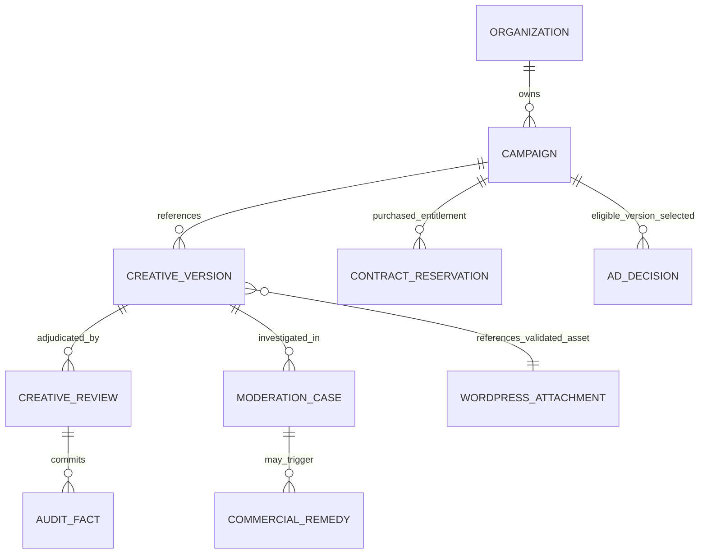
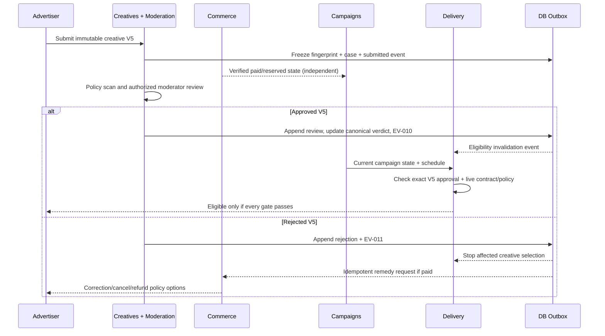

# AdPilot — Creative Management, Moderation, Policy Enforcement & Approval Workflows Specification

**Document ID:** `ADP-DOC-022`  
**Filename:** `22_ADPILOT_CREATIVE_MANAGEMENT_MODERATION_POLICY_APPROVAL_WORKFLOWS.md`  
**Version:** 1.0.0 — proposed implementation contract  
**Status:** Proposed; product, advertising operations, application security, legal/policy, WordPress/media, finance, UX/accessibility and QA sign-off required  
**Date:** 2026-10-12  
**Product:** AdPilot — Self-Service Advertising Marketplace & Behavioral Analytics for WordPress  
**Accountable owners:** Creative/Moderation Domain Lead; Security Lead; Principal Software Architect  
**Intended implementer:** GPT-6 High and human engineering/review teams  
**Normative predecessors:** `ADP-DOC-001` through `ADP-DOC-021`  
**Proposed next document:** `ADP-DOC-023` — Security, Privacy, Compliance & Threat Modeling Specification

> **Status discipline.** This is an implementation-ready **specification**, not executable, deployed or security-certified software. Source files, adapters and snippets are proposed until implemented and tested. Regulatory classifications, forbidden-industry lists, geographic restrictions, size limits, malware scanners and review service-level agreements (SLAs) are **policy decisions**, not facts assumed about every WordPress publisher. Unsafe/unresolved behaviors fail closed for creative publication and ad delivery.

---

## 1. Mandate, authority, scope and release gates

### 1.1 Normative precedence

| Governing document | Mandatory creative-related contract |
|---|---|
| `ADP-DOC-001` | `FR-CAM-001..010`, `FR-DEL-001/009/010`, `BR-003/004/007/008/009/017`, `INV-01/06/07/09/10`; all 129 `FR-*` retain original wording and R1–R4 assignment. |
| `ADP-DOC-002` | `AT-CAM-001..010`, feature catalog, `CAP-*` scope and `E2E-01..17`; preserve independent verification. |
| `ADP-DOC-003` | `UJ-05/07/14/16/21/28`, `WF-*`, `UI-09/11/12`, recovery flows, keyboard and assistive-technology journeys. |
| `ADP-DOC-004` | `DP-MOD`, `DP-CRT`, `DP-REM`, `DP-DEL`, `DP-AUTH`, `SM-CREATIVE`, `SM-CAMPAIGN`, `SM-DELIVERY`; immutable review guards. |
| `ADP-DOC-005` | `org_creative_read`, `org_creative_write`, `adpilot_moderate_creatives`, `adpilot_emergency_stop`; site, org, object and state-based authorization. |
| `ADP-DOC-006` | Modular-monolith module ownership, outbox, caches, security boundaries and `IC-009`, `IC-010`, `IC-019`, `IC-020`. |
| `ADP-DOC-007` | `DM-009 Campaign`, `DM-010 Creative`, `DM-011 CreativeReview` and typed aggregate / service / repository ports. |
| `ADP-DOC-008` | `campaigns`, `creative_versions`, `creative_reviews`, `moderation_cases`, `audit_log`, `outbox_messages`, media attachment references; schema changes require migrations. |
| `ADP-DOC-009` | `CRE-001..010`, `CAM-001..014`; `POST /admin/creative-reviews/{review_id}/actions/{approve|reject|request-changes}`; REST error envelope and idempotency. |
| `ADP-DOC-010` | `EV-009 CampaignSubmitted`, `EV-010 CreativeVersionApproved`, `EV-011 CreativeVersionRejected`, durable outbox / inbox, `ASY-J-009` remedies. |
| `ADP-DOC-011..014` | UX workflows, `UI-12` creative moderation, advertiser campaign wizard, queues, status/failure recovery, component tokens and responsive RTL. |
| `ADP-DOC-015..017` | Immutable published layout and consistent theme/shortcode/Gutenberg rendering; no creative approval by embedding. |
| `ADP-DOC-018` | Per-decision authoritative creative version and campaign eligibility, stop revision, fallback and cache coherence. |
| `ADP-DOC-019..020` | Preview/nonproduction exclusion, data minimization, protected reporting, no conflation of tracking with creative approval. |
| `ADP-DOC-021` | Financial state remains independent; paid rejection creates policy-governed remedy, not silent forfeiture or automatic refund. |

**Precedence rule:** Product requirements and approved business policy govern meaning. This document refines implementation; it does not supersede upstream decision registers. File an `CM22-DEC-*` change record with impacts on schema/API/UX/security when necessary. Example code is illustrative, not proof of a working implementation.

### 1.2 Release contract

| Release | In scope | Deliberately excluded unless separately approved |
|---|---|---|
| **R1** | Raster image and text/native templates, multiple immutable versions, upload validation, disclosure, review queues, decision history, emergency stop, eligible approved-version delivery, remedies and audit. | User-supplied executable code, unsanitized SVG, arbitrary HTML, unsafe iframe, auto-approval solely because payment succeeded. |
| **R2** | Potential video/interactive creatives *only if the optional format pipeline, sandbox and QA gates pass*, as stated in `FR-CAM-009`; any policy-aware UX extensions. | Assumption that R2 must support all codecs or arbitrary third-party embeds. |
| **R3** | Metered charging and verified click/impression controls belong to Documents 18/19/21; creative changes remain version-bound and policy-governed. | Creative review becoming a financial charging authority. |
| **R4** | Additional approved integrations / network operations may consume immutable creative projections with explicit site authority. | Global network-level bypass, unrestricted cross-site media sharing or replay of private review artifacts. |

### 1.3 Non-negotiable safety invariants (`CM22-INV-*` are supplements)

1. `CM22-INV-01`: Only an explicitly approved **fingerprint of a specific immutable creative version** can appear in a production decision.
2. `CM22-INV-02`: Payment or inventory ownership never confers review approval (`BR-003`).
3. `CM22-INV-03`: Any material media, target URL, disclosure, format, executable capability or targeting-policy change creates a new reviewable version; no in-place mutation of an approved digest.
4. `CM22-INV-04`: Current emergency stop / campaign suspension wins over cached creative HTML or stale decision tokens (`BR-008`).
5. `CM22-INV-05`: No untrusted advertiser script, unsanitized SVG, dangerous URI scheme or unrestricted HTML executes in the WordPress origin (`INV-10`).
6. `CM22-INV-06`: Every read/write is scoped to current site, organization, actor, object and revision; a nonce or WordPress role label alone is insufficient.
7. `CM22-INV-07`: Review history, rejection reason, actor and fingerprint are append-only and attributable; corrections create new facts.
8. `CM22-INV-08`: A rejected paid campaign exposes authorized revision/cancellation/remedy choices, but no automatic charge or arbitrary refund is inferred.
9. `CM22-INV-09`: Nonproduction previews never become paid production impressions (`BR-009` and `INV-06`).
10. `CM22-INV-10`: A previously approved version may remain selected **only** when current agreement, eligibility, policy and explicit version selection authorize it.
11. `CM22-INV-11`: Malware scanner outage, invalid source image or failed validation cannot be reinterpreted as approval.
12. `CM22-INV-12`: No successful renderer, theme filter, Gutenberg block or SDK option can disable a mandatory moderation gate.
13. `CM22-INV-13`: A plugin activation must not require commercial scanner SaaS, WooCommerce or proprietary remote services for basic startup; unavailable optional capabilities degrade independently.
14. `CM22-INV-14`: Media inspection and export are purpose-bound; review evidence cannot become a public unprotected URL.
15. `CM22-INV-15`: Creative dimensions, density and accessibility restrictions apply even when a publisher has 500+ logical placement definitions.
16. `CM22-INV-16`: Deletion, retention and legal holds cannot rewrite historical ledger, approved review or contracted creative evidence.

---

## 2. Vocabulary, entities and authoritative ownership

| Term | Definition and invariant | Owner |
|---|---|---|
| Creative | Logical identity grouping versions for one advertisement; scoped to site+organization+campaign. | Creatives (`DM-010`) |
| Creative version | Immutable payload after submission: exact media bytes identity, image variant policy, destination, text, disclosure, format and review-sensitive settings. | Creatives |
| Source asset | Original uploaded content in quarantined / private-safe staging before accept; never a public asset merely because transfer succeeded. | Media adapter (Creatives) |
| Validated asset | Inspected, permitted, normalized file with pinned digest, dimensions and WordPress attachment identity. | Creatives media adapter |
| Fingerprint | Canonically calculated SHA-256 (or approved equivalent) over the *complete review-sensitive manifest*; not file digest alone. | Creatives |
| Submission | Explicit request to review one exact version and current policy context; subsequent mutation yields conflict/new version. | Moderation |
| Moderation case | Operational case with assignment, queue state, notes, evidence and SLA; **not** authoritative approval proof. | Moderation (`moderation_cases`) |
| CreativeReview | Append-only version-bound adjudication fact, reviewer, policy, outcome, and reasons (`DM-011`). | Creatives/Moderation decision port |
| Canonical approval projection | Transactionally current verdict for `(site, creative_version, fingerprint, review sequence/policy)`; do not pick arbitrary latest timestamp. | Creatives repository |
| Campaign approval | Separate campaign-level policy state; necessary but not sufficient for delivery. | Campaigns (`DM-009`) |
| Delivery stop revision | Current campaign/site/version invalidation fence consumed by delivery cache and decision service. | Campaigns/Delivery |
| Remedy case | Independently governed financial/fulfillment resolution for rejected paid orders. | Commerce (`DM-019`) |
| Policy bundle | Versioned, publisher-approved allow/deny rules, evidence requirements and reviewer matrix. | Moderation/Policy |

**Identity model:** Internal integer record IDs are site-local database implementation details. Public API IDs are opaque bounded identifiers. A media attachment ID cannot be accepted from another site or organization without proof of ownership, explicit authorized import, digest validation and an immutable site-local binding.

### 2.1 Conceptual relationship map



The diagram is conceptual: `AD_DECISION` and WordPress attachments are not automatically new custom tables; the precise persistence remains in Documents 07–10, 18 and 21. Never model a creative approval as a boolean on an entire campaign.

### 2.2 Fingerprint and canonicalization contract

A fingerprint is computed server-side from a **schema-versioned canonical manifest**. Fields: `site_id`, `organization_id`, `campaign_id`, `creative_key`, `version_number`, `format`, immutable media digest(s), normalized content text, destination URL and redirect policy, disclosure text/class, resolved accessibility alt text, safety-relevant dimensions/crop policy, supported placements and policy-sensitive behavior flags. Include additional fields if a publisher's review policy considers them substantive. Canonical JSON uses deterministic key sorting, Unicode normalization, explicit null handling, consistent URL normalization, stable integers and UTF-8 encoding. Hash original decoded bytes separately and bind those to the manifest; hashing a mutable CDN URL is insufficient. Avoid treating two visually similar but different images as the same review evidence. Fingerprint computation must be reproducible across PHP/runtime versions through golden vectors. An algorithm-version upgrade requires controlled re-verification rather than silently carrying forward approvals.

### 2.3 Creative aggregate lifecycle

- `draft`: editable owner-scoped concept, not eligible for delivery.
- `submitted`: version frozen; create moderation case with immutable evidence.
- `under_review`: assigned or claimed moderator is examining that exact version.
- `changes_requested`: review decision contains actionable non-sensitive reason; any substantive edit creates a new draft version.
- `approved`: approval fact references matching fingerprint and current policy applicability; not a guarantee of commercial or campaign eligibility.
- `rejected`: denied for that exact version and recorded reason; financial remedy check if order exists.
- `suspended`: previously approved creative disabled by safety/policy; no serving until explicit governed reapproval or qualified reactivation policy.
- `superseded`: historical immutable version; may serve only with explicit contracted prior-version policy and current approval, never via implicit fallback.

States/edges remain `SM-CREATIVE` in Document 04 (§5.7); this document does not invent alternate direct state transitions. Nontrivial reactivation from suspension is an **open policy/API decision** and defaults to no direct self-service resume.

---

## 3. Format taxonomy, media restrictions and acceptance profiles

### 3.1 R1 profiles

| Profile | Source formats | Required validation | Serving behavior |
|---|---|---|---|
| Static image (`image_static`) | JPEG, PNG; WebP/AVIF only if support/decoder matrix certified | Actual decoded file type, dimension/pixel bounds, content limits, attachment ownership, safe variants, optional metadata stripping | Escaped `` and verified link; responsive intrinsic sizing and lazy loading |
| Static GIF (`image_animated`) | GIF **only if enabled by policy** | Frame/size/animation limits, safe decoding, reduced-motion treatment, image-capability fallback | Disallow by default until review/UX budget approval |
| Plain text (`text`) | UTF-8 text in declarative schema | Length/Unicode control characters, output escaping, alt/title equivalent, destination | Server-generated markup only, sponsorship disclosure |
| Native card (`native_card`) | Approved, finite declarative fields + optionally static image | Allowlisted fields, required sponsor label, text length, thumbnail/alt, link attributes | Theme-independent, scoped and accessible markup; no author HTML |
| House/public service (`house`) | Same allowlisted R1 formats | Same security checks; publisher authorization and inventory conflict policy | Not exempt from moderation, display eligibility or event classification |

No universal maximum byte count/pixel dimension is chosen here: publisher policy MUST specify concrete bounds and upper hard limits after compatibility/performance testing. Operational examples (for test fixtures only) may use 8 MiB JPEG and 4096×4096 limits but they are **not approved product defaults**. Aspect ratios and placement-safe cropping are stored in an explicit rendition policy; the reviewer sees the final responsive variants.

### 3.2 R2 optional gated profiles

`video` and `interactive_sandboxed` are nonoperative until a signed R2 decision covers format/codec allowlist, accessible captions/transcripts, user gesture/autoplay restrictions, media processing quotas, isolated origin or sandbox, CSP, network/request permissions, malicious redirect controls, time/memory budgets, no tracking without permission, vendor/subprocessor review, versioned QA tests and fallback. **Do not** implement arbitrary user-supplied SVG, HTML, third-party tags or JavaScript by expanding a WordPress `unfiltered_html` capability. If safe implementation is not feasible, disable the format and return a comprehensible unsupported-format error.

### 3.3 Destination URL policy

- Accept only approved `https` (and optionally `http` where explicitly allowed) destinations; reject `javascript:`, `data:`, `file:`, `blob:`, `ftp:`, credential-bearing URLs and control-character obfuscation.
- Canonicalize and validate Unicode/IDN hostnames, userinfo, port, query, fragment and encoded forms. Do not assume `esc_url()` validates advertiser commercial safety on its own.
- Reject known dangerous hosts or publisher-prohibited industries/categories under versioned policies; preserve legal explanation without exposing internal detection rules.
- Destination changes that alter host, path, tracking params or campaign policy require version review under policy; never grant broad arbitrary redirect authority from previously approved root domain.
- R1 may perform static URL checks without any network fetch. A network-based verification subsystem is optional and must block private/reserved/link-local/metadata addresses, revalidate each redirect hop and DNS result, enforce timeouts and response budgets, and resist DNS rebinding; failure should be `pending_manual_review`, not `safe`.
- Click redirect services must recheck live approved destination binding and avoid becoming an open redirect. Use privacy-appropriate `rel` and `referrerpolicy` defaults subject to approved link policy.

### 3.4 Content, accessibility and disclosure

All advertisements must be visually and semantically disclosed as advertising, including native cards that resemble editorial content. Disclosure does not depend on CSS alone; include appropriate accessible text. Ensure meaningful alt for informative images, empty alt only if equivalent nearby text fully conveys the creative, and avoid duplicative screen-reader output. Validate contrast, flashing/motion, focus handling, tap targets, and target behavior. Advertiser text is data: never parse it as active HTML, Markdown script, embed directives or attribute expressions. Native card templates are product-controlled, not advertiser-defined executable templates. Respect publisher policies against impersonation, misleading offers, unsafe claims, prohibited goods and misleading click targets; the exact policy catalogue remains jurisdiction- and publisher-dependent.

---

## 4. Trust boundaries and secured media pipeline

### 4.1 Dataflow sequence

```mermaid
sequenceDiagram
  participant A as Advertiser UI
  participant API as Authenticated REST Adapter
  participant AV as Private Upload/Inspection
  participant CR as Creatives Application Service
  participant W as WordPress Media Adapter
  participant MO as Moderation Service
  participant DB as Database + Outbox
  A->>API: Initiate upload / submit selected file
  API->>API: Verify actor, site, org, quota, CSRF protections
  API->>AV: Stream bounded upload to quarantine
  AV->>AV: Detect format, decode, inspect, compute bytes hash
  alt Invalid / suspicious / unscannable
    AV-->>API: Reject or quarantine awaiting authorized manual review
    API-->>A: Actionable error; no accepted asset ID
  else Accepted
    AV->>W: Create controlled WordPress attachment/renditions
    W-->>CR: Immutable asset manifest + attachment reference
    CR->>DB: Save safe draft/version reference + audit
    CR-->>A: Validated asset projection
    A->>API: Submit exact creative version and fingerprint
    API->>MO: Start review with current policy and version
    MO->>DB: Create case + immutable submission evidence + outbox
    MO-->>A: Pending review (never public delivery)
  end
```

### 4.2 Upload stages and failure behavior

| Stage | Mandatory checks | Failure state / proof |
|---|---|---|
| A. Route ingress | Authenticated actor; WP nonce for cookie-authenticated REST; active org membership; site/object scope; body size, quota and rate limits; idempotency | 401/403/413/429/validation error with no media exposure |
| B. Quarantine | Random path unavailable for direct public retrieval, restrictive perms, total byte cap, temporary TTL, no execution, no trust in supplied filename | Failed transfer destroyed on schedule, internal incident if repeated |
| C. File typing | Compare allowed extension + MIME/content signature + image decoder; reject polyglot/unsupported/ambiguous input as governed | `unsafe_media`, not a public attachment |
| D. Decoder safety | Pixel, frame, dimensions, decompression ratio, CPU time, output bounds and memory; corrupt files rejected; image-editor availability checked | `decoding_failed` or `processing_unavailable`, no false acceptance |
| E. Malware/security inspection | Approved scanner and quarantine policy if required; scanner errors never mean negative findings; evidence/result version recorded | `scan_unavailable` / manual review; fail closed |
| F. Normalization | Strip unneeded EXIF/GPS, correct orientation, generate controlled renditions, disallow active vector/script formats | Variant integrity check; do not lose approved source evidentiary digest |
| G. WordPress storage | Use supported core attachment/media APIs with explicit ownership metadata; verify media URLs, metadata, scoped access and non-executable MIME | Roll back orphan attachments / queue cleanup |
| H. Version assembly | Validate destination, text, alt, disclosure, placements; compute canonical manifest hash | Mismatch or missing field rejects submission |
| I. Review submission | Freeze immutable version, record actor/site/org/policy, create case+outbox consistently | Duplicate key returns idempotent result; stale version yields conflict |

WordPress `wp_check_filetype_and_ext()` and `wp_get_image_editor()` are **defense layers**, not comprehensive malware scanners or sufficient proof against all adversarial images. Reference documentation: <https://developer.wordpress.org/reference/functions/wp_check_filetype_and_ext/> and <https://developer.wordpress.org/reference/functions/wp_get_image_editor/>. Never treat core's private `_wp_handle_upload()` as a supported plugin-facing public API.

### 4.3 Attachment isolation and cross-tenant safeguards

WordPress Media Library attachments may be served from publicly accessible URLs. **Quarantine and confidential review evidence must not be placed in public media paths.** Accepted ad images may become public only after approved policies and with safe rendition URL exposure; if the product requires unreleased creative images to remain private, use protected storage or authorized proxy delivery rather than claiming normal WP uploads are private. Define a threat-modelled media storage adapter. Verify attachment site ID, uploader, organization binding, decoded content fingerprint, and allowed access each time an ID is attached. Prevent IDOR and metadata enumeration via public attachment queries, REST, thumbnail endpoints, editor pickers, and gallery plugins. WordPress media is shared site infrastructure; avoid modifying unrelated assets or global upload allowlists.

### 4.4 Upload idempotency and resource limits

Hash file contents for duplicate-byte awareness but **never** deduplicate or share approval across advertisers/sites based only on an identical digest. Use request idempotency keys scoped to actor/site/org/operation/payload hash; return a conflict if the same key reappears with different bytes. Enforce publisher-defined per-file, per-organization storage, pixel, daily transfer, concurrent processing and request-rate quotas. On cancellation or HTTP disconnect, abandon staging and schedule TTL cleanup; a timed-out antivirus scanner is an indeterminate state requiring review, not success.

---

## 5. Moderation policy engine and policy bundle governance

### 5.1 Layered policy verdict

Order of checks (restrictive overrides always dominate): input/schema safety → attachment/source safety → site/org authority → creative and campaign version integrity → prohibited claims/categories and destination policy → disclosure/accessibility constraints → format/placement capabilities → legal/location/industry restrictions → manual moderation disposition → delivery-time current stop and eligibility. Advisory heuristics and optional classifiers may **flag**, explain or route; they do not silently auto-approve in R1. No policy hook is allowed to weaken a core security denial.

```text
POLICY_EVALUATOR(version, immutable_fingerprint, context)
  -> unsafe_input | unsupported_format | security_quarantine
  -> blocked_by_publisher_policy | blocked_by_law_or_consent
  -> requires_manual_review | changes_requested
  -> eligible_for_human_approval
Human review decision is a separate authorized command.
Published approval is still not full delivery entitlement.
```

### 5.2 Policy rule families

| Family | Example inputs | Configured action | Evidence and owner |
|---|---|---|---|
| `content_claims` | Ad copy, destination, disclaimer | queue/reject/escalate | Policy revision and moderator |
| `restricted_categories` | Publisher and regional restrictions | reject/escalate | Publisher/legal sign-off |
| `misleading_ui` | Fake close buttons, mimicry, deceptive click targets | reject/change request | UX/moderator |
| `malware_and_executable` | MIME, decoded payload, external script/embed | quarantine/reject | Security |
| `destination_safety` | URL structure, redirects, prohibited domains | manual review/reject | Security/policy |
| `accessibility` | Missing alt, flashes, contrast, disclosure | changes requested/reject | Accessibility lead |
| `visual_density` | Placement class and responsive preview | block placement/escalate | Layout/AdTech |
| `rights_and_identity` | Trademarks, impersonation, creator consent declarations | manual review/record evidence | Legal/policy |
| `language_and_locale` | Script, translation, geographic claims | route to qualified reviewer | Moderation operations |
| `privacy_and_tracking` | Embedded pixels, unsafe tracking URLs, third-party domains | block or gated exception | Privacy/security |
| `special_formats_r2` | Video/interactive capabilities | disabled until approved | R2 gate |

For each configured rule store a stable rule ID, version, owner, severity, action, scope, effective time, reviewer guidance, public-safe explanation, appeal route, evidence-retention classification and test vectors. Never expose full private detection signatures in advertiser responses. Policy updates may trigger selective re-review of active creatives; severe updates must trigger immediate serving stop rather than wait for queue drain.

### 5.3 Policy changes and approval invalidation

Policy versions are separate from asset versions. If a restrictive publisher policy changes, decide whether previously approved creatives still satisfy the **current** policy; maintain a policy impact index and recertification sweep. A formerly approved ad that is now prohibited is stopped immediately. More permissive policy cannot automatically approve an old rejected creative without a governed review transition. R1 may choose manual approval of every submitted creative; automated approval is a separate formally approved decision requiring abuse and false-negative evaluation.

### 5.4 Reviewer qualifications and segregation

A reviewer must have current `adpilot_moderate_creatives` site capability, be assigned/authorized for the given site and object, and pass independence rules for sensitive exceptions. Org owners/managers may submit and revise but cannot self-approve. Finance staff may see limited reason/status for remedies but cannot decide content safety through a billing UI. Incident operators may suspend with `adpilot_emergency_stop` without being able to convert suspension into approval. Optional two-person exception review is a configurable higher-assurance workflow and requires a formal policy decision; do not silently assume all publishers use it.

---

## 6. Creative review state machine and transition guards

The **only** authoritative transition machine is `SM-CREATIVE` from Document 04. All mutations are atomic compare-and-set on current version, policy revision and case decision sequence. Invalid state transitions return a structured conflict with safe current state; never apply last-write-wins.

| Command | Allowed origin | Mandatory guard | Transactional effects | Forbidden shortcut |
|---|---|---|---|---|
| `CreateCreativeDraft` | new/draft | Current org write membership, campaign ownership, quotas | Persist draft identity and audit | Create approved creative |
| `AttachValidatedAsset` | draft | Exact site+org media ownership, inspected bytes | Link immutable asset metadata | Accept arbitrary attachment ID |
| `CreateVersion` | existing logical creative | New draft snapshot, increment version, version check | New draft record | Rewrite prior approved payload |
| `SubmitCreativeForReview` | draft / newly revised draft | Complete manifest, frozen digest, policy compatibility, linked campaign | Mark submitted, create review case and outbox | Send nonvalidated bytes to delivery |
| `ClaimReviewCase` | submitted/queued | Moderator scope, lease and current case | Assign reviewer and under_review with audit | Claim case from foreign site |
| `ApproveCreativeVersion` | under_review | Verified actor, exact review case + version + fingerprint, policy pass, nonstale revision | Append review decision, update canonical verdict/version, emit `EV-010`, audit | Approve a newer version via old case |
| `RequestCreativeChanges` | under_review | Safe actionable reason, exact version | Record decision/case, notify owner | Alter existing frozen version |
| `RejectCreativeVersion` | under_review | Reason/policy code, exact review sequence, assess remedy | Append rejection `EV-011`, audit, initiate authorized remedy workflow | Void customer's payment automatically |
| `SuspendCreativeVersion` | approved | Security/moderation safety authority, incident reason | Durable stop fact, bump fence, audit, enqueue invalidation | Wait for browser cache TTL alone |
| `SupersedeCreativeVersion` | approved | Alternative version independently approved and selected, contract compatible | Explicit selection/supersession | Copy old approval to new version |
| `ReviseAfterDecision` | rejected/changes_requested | Org write, create fresh immutable successor | New draft version, link previous case | Set rejected record back to approved |
| `ArchiveCreative` | policy-eligible terminal | Retention/legal holds, no unresolved commercial claims | Logical archive only | Delete approval and financial evidence |

**Suspension note:** `SM-CREATIVE` only explicitly declares `approved → suspended`; restoration requires an upstream-reviewed transition design. Until approved, create a new reviewable version or use a specifically approved reinstatement workflow, never fabricate `suspended → approved`.

### 6.1 Concurrency and idempotency

Two moderators may open the same case concurrently. A lease/claim is a UX convenience, not exclusive authority by itself; the decision command uses a DB conditional revision update and a unique `(site_id, creative_version_id, decision_sequence)` constraint, append-only decision log and idempotency. Exactly one new canonical decision succeeds; conflicting duplicate payload returns the original idempotent result or `409 creative_review_stale`. Lock acquisition order: site+campaign → creative/version → moderation case → approval projection → audit/outbox, in a documented deterministic order. Avoid long-lived DB transactions while uploading/scanning media, rendering previews or performing network destination checks.

### 6.2 Partial progress and financial independence

Campaign, creative, reservation, order, finance and delivery use separate aggregates/state machines. A creative's approval never authorizes charging a payment method or creates capacity. If a paid campaign is rejected, enqueue/create a `CommercialRemedy` through an idempotent Commerce application contract and show `remedy_required` until a lawful chosen outcome is settled. A timeout in remedy processing is not a reason to undo the creative review. Do not let a finance refund change an unsafe creative to approved.

---

## 7. Campaign/creative/delivery/commerce orchestration



### 7.1 Delivery predicate

A production creative may be emitted only if, at decision time: site enabled; published active logical slot; valid contract and allocation; campaign organization active; campaign approval/financial/delivery states independently eligible; scheduling/time-window valid; exact creative version fingerprint has positive current approval; not suspended/revoked; creative policy current; destination permitted; targeting and density allowed; and audience/consent rules satisfied where applicable. A cache hit cannot bypass this predicate. Use a current stop-revision fence and bounded edge cache TTL plus fast invalidation; if the fence cannot be read, safety-critical placements fail closed to house/empty output. House creatives must pass safety and exclusivity rules too.

### 7.2 Approved prior version during revision

Introduce explicit per-campaign selection map `(creative_key → approved_version_id)` and policy flag permitting existing approved version while successor is under review. The selection must be current and contract compatible, not an implicit fallback to the last approved digest. Dangerous prior versions, suspended versions and current policy violations always stop. If selection change lacks a finalized route/schema in Documents 08–09, record a change request instead of pretending the field exists.

### 7.3 Emergency stop SLA and precedence

A stop command requires authorized principal, site/campaign/creative IDs, revision guard, reason, incident link and current object scope. Commit authoritative status + monotonic stop revision + audit/outbox in one transaction; dispatch invalidation, but do not wait for asynchronous delivery for enforcement. New decisions check authoritative stop fence; previously distributed signed decision tokens are revocable via short validity and/or revocation checks. **No guarantee that a human can retract pixels already displayed in an offline browser**; define and test time-to-no-new-decisions and best-effort active runtime removal as separate operational objectives. Avoid claiming instant CDN purging without measured evidence.

### 7.4 Preview isolation and no billing

Ad preview is accessible only to authorized site/org scope; mask secret review evidence, use safe rendering of the exact version, label `PREVIEW — NOT LIVE`, and use nonproduction decision provenance. A preview MUST not expose unapproved scripts, produce billable events, count as real views/clicks, or allow shared-cache indexing. Simulated target links can be disabled or routed to explicit safe preview actions. A campaign dashboard cannot convert a preview's appearance into an assertion of publication.

---
## 8. Application service, domain port and PHP integration contracts

### 8.1 Reference module package boundaries

```text
src/Modules/Creatives/
  Domain/Creative.php
  Domain/CreativeVersion.php
  Domain/CreativeFingerprint.php
  Domain/CreativeFormatPolicy.php
  Domain/Contracts/CreativeRepository.php
  Domain/Contracts/MediaInspectionPort.php
  Application/Commands/CreateCreativeDraftHandler.php
  Application/Commands/CreateCreativeVersionHandler.php
  Application/Commands/SubmitCreativeForReviewHandler.php
  Application/Queries/GetCreativeProjectionHandler.php
  Infrastructure/WpMedia/WordPressAttachmentAdapter.php
  Infrastructure/Storage/QuarantineStorageAdapter.php
  Infrastructure/Persistence/WpdbCreativeRepository.php
src/Modules/Moderation/
  Domain/ModerationCase.php
  Domain/ModerationVerdict.php
  Domain/PolicyBundle.php
  Application/Commands/ClaimReviewCaseHandler.php
  Application/Commands/ApproveCreativeVersionHandler.php
  Application/Commands/RejectCreativeVersionHandler.php
  Application/Commands/RequestCreativeChangesHandler.php
  Application/Commands/SuspendCreativeVersionHandler.php
  Application/Queries/SearchModerationQueueHandler.php
  Infrastructure/Persistence/WpdbModerationRepository.php
src/Modules/Campaigns/Application/... (existing contracts)
src/Modules/Commerce/Application/... (existing contracts)
src/Modules/Delivery/Application/... (existing contracts)
assets/apps/advertiser/features/creatives/
assets/apps/admin/features/moderation/
tests/Domain/Creatives/
tests/Integration/Moderation/
tests/E2E/CreativeLifecycle/
```

These are **proposed** example paths, to be adapted to the approved existing modular-monolith naming rules. Do not add parallel top-level modules if Document 06 already specifies an owner. Domain types may depend on common typed IDs, never WordPress globals or REST DTOs. Infrastructure adapters may depend on `$wpdb` and WordPress APIs; domain code must not.

### 8.2 Command envelope

| Field | Type and rule |
|---|---|
| `siteId` | Trusted integer resolved by active WordPress site context; not accepted from body |
| `actor` | Authenticated WP principal or internal job provenance, scoped to operation |
| `organizationId` | Verified current membership or trusted site-side target after object resolution |
| `campaignId` | Site+organization-scoped opaque identifier resolved before use |
| `creativeId/creativeKey` | Resource identity; never sufficient without tenant check |
| `creativeVersionId` | Exact immutable revision, not "latest" on mutation |
| `expectedRevision` | Nonnegative monotonic optimistic concurrency token |
| `fingerprint` | Server-generated canonical 32-byte digest, encoded consistently in API |
| `policyVersion` | Verified current effective policy revision |
| `idempotencyKey` | Per-operation scoped replay protection for retryable mutations |
| `correlationId` | Nonsecret request tracing identifier; emitted in logs/errors |
| `reasonCode`, `reasonText` | Safe but meaningful moderator explanation for change/reject/suspend |
| `reviewSequence` | Canonical append-only decision sequence and CAS fencing |

### 8.3 Illustrative PHP contracts

```php
<?php
namespace AdPilot\Modules\Creatives\Application\Contracts;

interface CreativeWriteService
{
    public function createDraft(CreateCreativeDraftCommand $command): CreativeDraftResult;
    public function createVersion(CreateCreativeVersionCommand $command): CreativeVersionResult;
    public function submitForReview(SubmitCreativeForReviewCommand $command): SubmissionResult;
}

interface CreativeReadService
{
    public function getForOrganization(CreativeQuery $query): CreativeProjection;
    public function listForOrganization(CreativeListQuery $query): PagedCreatives;
}

namespace AdPilot\Modules\Moderation\Application\Contracts;

interface ModerationService
{
    public function claim(ClaimReviewCaseCommand $command): ModerationCaseProjection;
    public function approve(ApproveCreativeVersionCommand $command): DecisionResult;
    public function reject(RejectCreativeVersionCommand $command): DecisionResult;
    public function requestChanges(RequestChangesCommand $command): DecisionResult;
    public function suspend(SuspendCreativeVersionCommand $command): DecisionResult;
}

interface CreativeEligibilityPort
{
    public function assertCurrentlyApproved(ApprovedCreativeQuery $query): ApprovedCreativeProjection;
}

interface MediaInspectionPort
{
    public function inspect(QuarantinedUpload $upload, CreativeMediaPolicy $policy): InspectionResult;
}
```

Return errors through a typed domain result/error classification; REST adapter maps to controlled HTTP codes. `CreativeEligibilityPort` returns a minimal safe read projection (`IC-009`), never raw attachment admin metadata or moderation notes. Dependencies must be injected through the existing composition root. Do not implement business logic in a REST callback, React reducer, WooCommerce hook, Gutenberg control or shortcode callback.

### 8.4 Domain event semantics

`EV-010 CreativeVersionApproved` and `EV-011 CreativeVersionRejected` are the **existing** canonical asynchronous names from Document 10. An approved fact contains site, creative/version, fingerprint, approved policy version, campaign reference, decision sequence, audit/correlation reference and timestamp. A rejected fact contains the same core references plus a **safe** machine reason code; sensitive human notes remain protected. Both are committed via outbox in the same transaction as the canonical review decision. If supplemental `CreativeVersionSubmitted`, `CreativeVersionSuspended`, `CreativeMediaRejected`, or `PolicyImpactDetected` event names are needed, mark them `CM22-EV-PROPOSED-*` with new schema and consumer approval; never misrepresent these as among the 30 already canonical `EV-*` events. Consumers are at-least-once and idempotent; UI notification failure cannot undo committed moderation.

---

## 9. REST API, route security and approved extensions

### 9.1 Existing routes: do not rename

All paths are relative to the registered WordPress REST namespace `/adpilot/v1`. `A` means advertiser organization scope, `S` site publisher scope. Route IDs are sourced from Document 09.

| Route ID | Method and path | Allowed caller | Required behavior |
|---|---|---|---|
| `CRE-001` | `GET /organizations/{org_id}/creatives` | A, `org_creative_read` | Own-organization paginated list; approved-state projection; filter safely |
| `CRE-002` | `POST /organizations/{org_id}/creatives` | A, `org_creative_write` | Create metadata referencing site/org-validated asset |
| `CRE-003` | `POST /organizations/{org_id}/creatives/{creative_id}/versions` | A, `org_creative_write` | Create new immutable version; never overwrite previous |
| `CRE-004` | `GET /organizations/{org_id}/creatives/{creative_id}` | A, `org_creative_read` | Own version history with redacted policy reasons |
| `CRE-005` | `POST /organizations/{org_id}/creatives/{creative_id}/actions/submit-review` | A, `org_creative_write` | Submit exact version fingerprint; idempotent |
| `CRE-006` | `GET /admin/creative-reviews` | S, `adpilot_moderate_creatives` | Authorized queue and pending cases, no cross-site records |
| `CRE-007` | `POST /admin/creative-reviews/{review_id}/actions/approve` | S, `adpilot_moderate_creatives` | Approve exact immutable digest and policy snapshot |
| `CRE-008` | `POST /admin/creative-reviews/{review_id}/actions/reject` | S, `adpilot_moderate_creatives` | Reason required; exact version and policy checked |
| `CRE-009` | `POST /admin/creative-reviews/{review_id}/actions/request-changes` | S, `adpilot_moderate_creatives` | Required actionable reason; version follow-up |
| `CRE-010` | `GET /organizations/{org_id}/creatives/{creative_id}/preview` | A, `org_creative_read` | Safe preview, no billable events and no store-wide cache |
| `CAM-005` | `POST /organizations/{org_id}/campaigns/{campaign_id}/actions/submit` | A, `org_campaign_write` | Campaign submission remains separate from creative review |
| `CAM-011` | `POST /admin/campaigns/{campaign_id}/actions/pause` | S, `adpilot_manage_campaigns` | Stop serving a campaign via authoritative state |
| `CAM-012` | `POST /admin/campaigns/{campaign_id}/actions/emergency-stop` | S, `adpilot_emergency_stop` | Audit + stop fence, immediate future-decision denial |
| `CAM-013` | `POST /admin/campaigns/{campaign_id}/actions/resume` | S, `adpilot_manage_campaigns` | Full fresh eligibility review, no implied creative reapproval |

**Important:** The canonical API route and capability names from Document 09 are authoritative; do not introduce alternate aliases.

### 9.2 API extension gaps: approval required

Documents 08/09 do not finalize a standalone secure upload staging API, moderator claim endpoints, creative-level stop command, owner-accessible review evidence, policy bundle lifecycle or bulk case triage. Proposed additions MUST be recorded as `CM22-API-PROP-*` and approved as a new API version/addendum before implementation. Until then, integrate file transfer through **an authenticated, scoped supported WordPress media flow** or a reviewed custom upload adapter; do not imply `CRE-002` itself safely handles arbitrary multipart uploads without an explicit contract. `CAM-012` remains the defined emergency campaign stop. If a creative-only stop is required, either approved `SuspendCreativeVersion` through a new route or fail safely by invoking authorized campaign emergency stop at the wider scope; never silently expose an undocumented public endpoint.

### 9.3 Request/response examples

**Review submission (illustrative payload, existing `CRE-005` behavior; final key names subject to Document 09 schema approval):**

```json
{
  "creative_version_id": "cv_74",
  "expected_revision": 4,
  "fingerprint": "f5ca5a36c1f9d621f0cb943ddc3e5ff81a8368352a5b03b4bc959b1d9d4f2eb9",
  "idempotency_key": "a9bb95a6-27d1-4d27-a5f5-c105f56f07b1"
}
```

**Approval (illustrative, no implicit campaign approval):**

```json
{
  "creative_version_id": "cv_74",
  "fingerprint": "f5ca5a36c1f9d621f0cb943ddc3e5ff81a8368352a5b03b4bc959b1d9d4f2eb9",
  "expected_review_sequence": 2,
  "policy_version": "creative-policy-3",
  "reason_code": "MANUAL_REVIEW_PASSED",
  "idempotency_key": "0cc1f83b-1e7a-4b0e-942b-e3cb47aa7d75"
}
```

Success response uses the standardized Document 09 envelope and includes exact approved version, canonical decision sequence, current state, public-safe next steps, and server timestamp. **Do not** return restricted moderation rules, malware signatures, quarantine path, scanner credentials or other tenants' fields.

### 9.4 Error and conflict taxonomy

| Code (proposed domain code) | Typical HTTP | User-visible UX recovery |
|---|---:|---|
| `creative_not_found` | 404 | Not found within current org/site; no cross-tenant existence leak |
| `creative_forbidden` | 403 | Explain missing grant and provide request-access route, not a bypass |
| `creative_media_unsupported` | 422 | Accepted formats and dimension/size guidance, if safe |
| `creative_upload_quarantined` | 422/423 | Upload not accepted for publication; safe next steps |
| `creative_scan_unavailable` | 503 | Retry later or moderator escalation; no false approval |
| `creative_invalid_destination` | 422 | Correct URL without revealing sensitive blocklist internals |
| `creative_version_conflict` | 409 | Compare/reload; preserve nonconflicting draft fields |
| `creative_review_stale` | 409 | Show updated queue entry and reviewer decision; never overwrite |
| `creative_policy_changed` | 409/422 | Explain need for re-review and current policy revision |
| `creative_not_reviewable` | 409 | Current state disallows transition; show allowed action |
| `creative_reason_required` | 422 | Focus required reason input and retain typed text |
| `creative_rate_limited` | 429 | Display `Retry-After` if supplied; preserve draft |
| `creative_internal_error` | 500 | Correlation ID and safe retry state; no secret dump |

Use standardized Document 09 `error.code`, `message`, `details`, `correlation_id`; error code naming here is proposed pending API registry approval. Protect write routes with explicit `permission_callback`, CSRF/nonce measures for browser-cookie auth, schema validation, version/CAS and idempotency. A valid WordPress nonce establishes neither creative ownership nor moderator privilege. Rate limits apply at actor, organization, site and endpoint levels.

### 9.5 Browser-upload protocol boundaries

Use a streaming or bounded multipart upload with private staging. `Content-Type` and filename supplied by browser are untrusted. If chunked upload/resume is proposed for large assets, require individual chunk authentication, bounded chunks, upload session ownership, whole-file digest and cleanup; do not merge on a publicly guessable session ID. Never log base64 payloads, temporary file paths or raw URLs containing credentials. Client-side preview object URLs are ephemeral and not proof of accepted upload.

---

## 10. Persistence, migrations, projections and integrity constraints

### 10.1 Existing tables from Document 08

| Table | Owner | Mandatory interpretation |
|---|---|---|
| `campaigns` | Campaigns | `approval_state`, `delivery_state`, `contract_state` independent; `stop_revision` participates in invalidation. |
| `creative_versions` | Creatives | `organization_id`, `campaign_id`, `creative_key`, `version_number`, `media_attachment_id`, `format`, `destination_url`, `destination_digest`, `content_json`, `fingerprint`, `created_by`. |
| `creative_reviews` | Creatives | `creative_version_id`, `decision`, `reviewer_user_id`, `fingerprint`, `policy_version`, `reason_code/text`, `decided_at`; append-only with ordered decisions. |
| `moderation_cases` | Moderation | `organization_id`, `campaign_id`, `creative_version_id`, `status`, `category`, `opened_by`, `assigned_to`, `resolution_json`; operational queue only. |
| `audit_log` | Platform | Protected append-only authorized decision and incident facts. |
| `outbox_messages` | Platform | Durable domain publication in the same transaction as state change. |
| WordPress attachments | WordPress | Site-local validated media reference; not private by default. |

### 10.2 Required schema-review issues (`CM22-DB-PROP-*`)

1. `CM22-DB-PROP-01`: Confirm primary keys, `site_id`, timestamps and `lock_version` for composite/special `creative_versions` and `creative_reviews` rows. Document 08 deliberately leaves special-row detail unresolved.
2. `CM22-DB-PROP-02`: Freeze immutable `creative_versions` after submission through application guards and ideally database-enforced immutable-version discipline; determine draft storage model without allowing edits to a submitted row.
3. `CM22-DB-PROP-03`: Implement unambiguous, CAS-controlled canonical review decision sequence—e.g. additional `review_sequence`, `is_current` projection table or strongly enforced current-decision pointer—not a naive `ORDER BY decided_at DESC LIMIT 1`.
4. `CM22-DB-PROP-04`: Store protected media manifest/scan evidence and quarantine TTL, if the policy requires quarantine; do not put binary upload blobs or extensive scanner output in autoloaded options.
5. `CM22-DB-PROP-05`: Define linkage between commercial remedies and exact creative/campaign review events, with durable inbox idempotency.
6. `CM22-DB-PROP-06`: Ensure `campaign_id` and `organization_id` are consistent, site-scoped, and indexed for every creative version; implement composite referential checks even if physical foreign keys are not deployed.
7. `CM22-DB-PROP-07`: Decide how active `(creative_key → version_id)` selection is persisted and audited; never pick the most recently uploaded version by default.
8. `CM22-DB-PROP-08`: Material policy rule versions, reviewer assignments, exceptions and review attestations may require new owned tables; no silent addition without migration review.
9. `CM22-DB-PROP-09`: Stable fingerprint algorithm/version and digest storage; preserve byte identity when renditions are regenerated.
10. `CM22-DB-PROP-10`: Audit/access retention and legal hold behavior for PII/redacted evidence vs immutable financial facts.

Migrations are ordered, checksummed, idempotent and reversible where feasible. A downgrade never silently changes approved version semantics. Expand → dual compatible reads/writes if needed → backfill under bounded batches → verify → contract old columns only with explicit approval. No arbitrary writes to `wp_posts` statuses or WooCommerce HPOS tables to implement moderation.

### 10.3 Indexes and queries

- Version lookup: `(site_id, campaign_id, creative_key, version_number)` unique, immutable.
- Advertiser list: `(site_id, organization_id, campaign_id)` plus controlled cursor over stable ID/creation time.
- Review queue: `(site_id, status, created_at)` with `assigned_to`, priority and policy index as justified by EXPLAIN under realistic load.
- Review trace: `(site_id, creative_version_id, review_sequence)` unique once sequence adopted, plus reviewer/timestamp audit index.
- Public decision read: indexed lookup by site/campaign/current version projection; no queue scan on a 500-slot page.
- Audit queries: `(site_id, resource_type, resource_id, time)` and restricted actor filters with retention/pagination.

Database indexes are **proposals** to validate against actual `$wpdb` prefix, MySQL/MariaDB features, cardinality and workload; never rely on PHP-only filtering for tenant isolation. Uploaded asset content, text and review notes are not added to full-text public search without explicit privacy/legal review.

### 10.4 Transactional approval write example (pseudocode)

```sql
-- Illustrative transaction only. Exact column names/projection require
-- CM22-DB-PROP-01/03 approval; DO NOT copy as deployable DDL.
BEGIN;
SELECT version_id, fingerprint, status, revision
  FROM <scoped_creative_version_projection>
 WHERE site_id = :site AND version_id = :version FOR UPDATE;
SELECT id, decision_sequence, status
  FROM <scoped_moderation_case_projection>
 WHERE site_id = :site AND id = :case FOR UPDATE;
-- Validate current actor, policy revision, manifest fingerprint and state.
UPDATE <scoped_moderation_case_projection>
   SET status = 'resolved', revision = revision + 1
 WHERE site_id = :site AND id = :case AND revision = :expected_revision;
-- Require exactly one row updated. Append immutable review and current
-- decision pointer, audit, and EV-010 outbox entry in SAME transaction.
COMMIT;
```

Physical transaction guarantees must be validated for actual engine/table setup; if hosting cannot provide required integrity for review/financial state, disable unsafe mutating operations with a diagnostic, not an advisory imitation.

---

## 11. Background jobs, event propagation and operational ordering

### 11.1 Job types

| Proposed job operation | Trigger | Idempotency | Failure handling |
|---|---|---|---|
| `inspect_upload` | Safe quarantined upload received | site+session+byte digest+policy | Retry transient scanner failures; quarantine remains not accepted |
| `generate_renditions` | Accepted source media | source digest+variant policy version | Reprocess under bounds; never mutate reviewed source identity |
| `expire_quarantine` | Scheduled TTL / abandoned upload | site+staging ID | Secure cleanup after legal/incident hold checks |
| `notify_review_requested` | Submission outbox | event+recipient+template | Retry, access recheck at send time |
| `refresh_review_queue` | Submission/assignment/decision | event ID | Rebuild projection; no authoritative decision writes |
| `invalidate_creative_eligibility` | Approval/rejection/suspension/policy change | site+campaign+stop revision | Retry; active decision path still checks current state |
| `scan_policy_impact` | Approved policy revision | policy revision+site+batch cursor | Bounded batches; immediately fence known critical prohibitions |
| `reconcile_media_orphans` | Periodic / failed transfer | site+attachment/stage ID | Restrict deletion to AdPilot-owned candidates |
| `process_paid_rejection_remedy` | `EV-011` + verified paid contract | existing `ASY-J-009` idempotency semantics | Commerce owns outcome; escalate unresolved, never fabricate refund |
| `deliver_moderation_notification` | Case transition | event+recipient current rights | Redacted content, delivery failures cannot roll back decision |
| `check_review_backlog` | Scheduled operational scan | site+window | Alert to operators, no auto-approval |
| `invalidate_stale_preview` | Asset/version/suspension change | asset/version/revision | Prevent old previews being presented as current |

These descriptive operation names are **not** a claim that new `ASY-J-*` IDs are registered; update Document 10 job registry through governed extension first. Queue execution is at least once and idempotent, never assumes global order. Consumer retries must not reissue approval, remoderate without reason, refund twice or resurrect stopped ads. Signed/internally attested provenance and explicit site context are required for jobs; no stale user capability snapshot can authorize a privileged delayed action.

### 11.2 Failure taxonomy and compensation

| Failure | User-facing interpretation | Safe backend action |
|---|---|---|
| Upload browser disconnect | Transfer incomplete | Abort staging, idempotent cleanup |
| Unsupported image decoder | Asset cannot be validated | Block acceptance; show supported formats |
| Scanner unavailable | Review pending/processing unavailable | Quarantine, controlled retry/escalation |
| Media attachment created but DB commit fails | Submission unsuccessful | Orphan cleanup with ownership proof |
| Reviewer HTTP response lost after commit | Decision may have succeeded | Query idempotency result; do not reapprove |
| Two reviewers decide at once | State changed | One CAS wins, other sees conflict/current verdict |
| Policy changed while reviewing | Review needs refresh | Invalidate stale policy snapshot, stop unsafe approval |
| Delivery edge cache unavailable | Ads temporarily unavailable | Render safe placeholder/house fallback, never stale unsafe creative |
| Outbox dispatcher down | Notifications delayed | Authoritative DB decision remains; worker repair/replay |
| Paid rejection remedy worker down | Purchase unresolved | Finance incident alert and safe pending-remedy state |
| Attachment deleted outside AdPilot | Creative no longer safe to serve | Deny eligibility; create incident/owner remediation |
| Thumbnail variant corrupt | Placement cannot use variant | Fallback to verified permitted variant or empty safe slot |
| Multi-site switch leaks repository scope | Isolation failure | Fail closed, incident, two-site regression tests |

---

## 12. Moderator console (UI-12) and advertiser UX contracts

### 12.1 Design-system consistency

Reuse Document 12 tokens and native WordPress component patterns; avoid one-off button colors, fake semantic badges, inaccessible canvases and custom HTML inputs without labels. `UI-12` is the main moderation workspace; related `UI-09` campaign wizard, `UI-11` campaign details and `UI-14` financial/remedy views must display independently truthful states. Responsive layouts use split-pane desktop, stacked mobile detail, keyboard-operated menus and preserved form state. Light/dark, RTL/LTR, text scaling, high contrast and screen-reader announcements are acceptance dimensions, not optional decoration.

### 12.2 Moderator queue specification

**Navigation:** `AdPilot → Campaigns → Creative moderation` (actual menu access capability-aware, even if moderator cannot reach the admin plugin's broad parent menu by finance/admin capability). **Dashboard sections:** pending unassigned, claimed/in review, urgent policy flags, changes requested, paid-rejection remedy alerts with redacted financial status, expired/orphan cases, completed history. Filters: site (authorized only), campaign, organization (authorized only), format, policy category, age, reviewer, due date and current decision. Cursor pagination and stable sorting; do not materialize thousands of image thumbnails. Queue row includes bounded preview, submit time in user-selected time zone, version/digest prefix, format, policy flags, current claim, SLA status, approval and payment badges as **different** statuses. A 500-slot layout must not imply 500 moderation cases per page.

### 12.3 Side-by-side review evidence

Detail shows current exact version and previous approved version (when authorized), media renditions, effective destination URL, final sponsored label, alt text, text/native content, landing page host, campaign/slot compatibility, responsive previews, decoded content metadata and review-policy checklist. Display final rendered output in **nonbillable sandboxed preview** and a plain-text/content-only inspection mode. For image comparison, label changed bytes, crop/variant changes and destination changes; never rely on color alone. Provide evidence pane with public-safe rule rationale and optional restricted security findings visible only to qualified moderation/security principals. Avoid embedding a live remote destination in the moderator console; link opens only under verified safe handling policy.

### 12.4 Review action interaction contract

1. Select case; fetch current version, review sequence and policy version with loading/empty/error states.
2. Confirm assignment/lease where supported; stale case shows conflict reload.
3. Examine source/effective render and complete required policy checklist. Fields mandatory per approved policy, not arbitrary universal default.
4. Choose `Approve`, `Request changes`, or `Reject`. Rejection/changes request asks for predefined reason code and human-readable explanation; prohibit unsafe disclosure of internal scanner signatures.
5. Confirmation dialog shows **campaign ID, creative version, destination, fingerprint prefix, current status** and exact action effect, including "Approval does not charge or activate this campaign".
6. Submit with unique idempotency key and expected review sequence; disable repeat UI interaction, but do not use UI disabling as the server-side idempotency mechanism.
7. On success show canonical new status, actor/time, audit reference and notice with next allowed action; on 409 show another actor's decision and never silently overwrite.
8. Trigger notifications asynchronously; display delivery status separately from committed review outcome.

### 12.5 Advertiser creation/revision interaction

The advertiser wizard permits file select and drag/drop plus keyboard-equivalent file picker, progress by upload/inspection/validation/review stages, accessible format help, inline safe errors, alt/text/disclosure/target fields, final responsive preview, draft autosave, version comparison and submit action. A newly accepted upload remains `draft` or `processing`, not `approved`. If a version is rejected, show reason, actionable edits, version history and available contract remedy paths without promising refunds not approved by policy. Show user-selected local time zone and deadlines; do not rely on a client countdown for authoritative SLA or hold status.

### 12.6 Status and messaging matrix

| Backend state | Advertiser label | Moderator label | Safe actions |
|---|---|---|---|
| `draft` | Draft — not submitted | Not in queue | Owner edit/submit |
| `submitted` | Submitted — awaiting review | Awaiting assignment | Reviewer claim |
| `under_review` | In review | Review evidence and decide | Reviewer decision only |
| `changes_requested` | Changes requested — revise version | Returned for updates | Owner creates new draft |
| `approved` | Approved creative — delivery depends on campaign/contract | Approved exact version | Audit, authorized stop/supersede |
| `rejected` | Rejected — see reason and remedies | Closed rejection | Owner revises, finance remedies independently |
| `suspended` | Paused for safety/policy — not serving | Suspended with incident | Escalation/new governed review |
| `superseded` | Previous version | Historical reference | Read-only; exceptional prior serving by explicit policy |
| asset `quarantine` | File still being checked / unavailable | Inspection required | Retry/escalate, no approval |

### 12.7 Accessibility acceptance requirements

Target WCAG 2.2 AA on primary interfaces. Every action must work by keyboard and assistive technology; maintain focus on inline errors and after dialog closure; announce asynchronous upload progress and moderation results without speech storms; place human-readable reasons next to inputs and preserve text on conflict. Avoid relying on red/green alone, color-only policy highlights, drag/drop-only attachments or hover-only evidence. Image comparisons require textual diff lists; motion-heavy creative previews offer still-frame / reduced-motion options. Automated checks (axe or equivalent) supplement manual screen-reader and keyboard testing.

---

## 13. Notifications, audit and incident response

### 13.1 Notification classes

Notify advertiser about submitted, changes requested, approved, rejected and suspended versions subject to delivery preferences and lawful notices. Notify assigned reviewers for queue requests and operators for critical unsafe content, scanner outages, backlog thresholds or paid rejection pending remedy. Each notification links to an authorized scoped page; opening a link rechecks current membership. Email must not contain malware scan details, raw sensitive reviewer evidence, unredacted private destination tokens or payment secrets. Deduplicate by event+recipient+template and record durable send status without inserting duplicate state changes.

### 13.2 Audit event minimums

`event_id`, trusted `site_id`, org/campaign/creative/version IDs, previous/new state, immutable fingerprint, actor ID/principal type, permission/policy revision, decision sequence, source operation, reason code, redacted human explanation, UTC timestamp, correlation/request ID, idempotency reference, optional incident/approver and result category. Append-only: do not alter historical facts when a reviewer makes a mistake. Audit read/export is separately privileged; retention and erasure must respect documented legal policy, not an invented fixed number of years.

### 13.3 Emergency operational runbook

**Detect → identify site+campaign+version → authorize and record reason → commit stop revision → invalidate serving selection/cache → verify no new eligible decisions → inspect old tokens/edge cache → notify stakeholders → preserve necessary evidence → begin policy/financial remedy if relevant → post-incident review.** Define measurable freshness/stop objectives through benchmark and deployment sign-off; do not advertise a zero-millisecond global stop guarantee. If automated security telemetry generates false positives, support an audited appeal and fresh review while preserving safe default suspension.

### 13.4 Abuse handling

Protect against adversarial upload floods, duplicate creative/version storms, phishing destinations, cloaked content, tracking pixels, parser bombs, very large images, malformed Unicode and social-engineering of reviewers. Implement per-account quotas, configurable deny lists with due-process documentation, reason redaction, operations rate limits, case sampling, and dedicated security escalation. Reviewer access to external landing pages must use safe inspection workflows, not unattended navigation from a privileged session.

---

## 14. Quality attributes, performance and compatible fallback behavior

| Domain | Enforceable implementation condition | Proof |
|---|---|---|
| Security | Untrusted advertiser payload never executes under first-party origin | CSP/HTML escaping/URI tests, browser attack suite |
| Integrity | Immutable source media digest and exact version approval | Replay + tamper tests, golden fingerprint vectors |
| Tenant isolation | Two-site and two-org tests across upload/read/review/cache/jobs | Negative REST and direct-object tests |
| Reliability | Failed scanner, WP Media error or outbox outage never yields false approval | Failure injection and repair runbook |
| Performance | 500-slot public rendering uses compact approved read projection; no 500 per-creative DB queries | p75/p95 benchmark with query profiling, cold/warm caches |
| Upload limits | Bounded file bytes/pixels/frames/CPU/quarantine TTL and organization quota | Exhaustion/bomb tests, limits in approved policy |
| Accessible UX | WCAG 2.2 AA target and readable disclosure | Automated/manual AT, keyboard, RTL tests |
| Observability | Scrubbed logs, case throughput/backlog, denial codes, stop propagation, media errors | Telemetry dashboard and incident simulation |
| Privacy | No unprotected original assets or review-only evidence; EXIF minimization | Unauthorized fetch/export tests |
| Compatibility | Supported PHP/WordPress/MariaDB/HPOS matrix and optional Woo absence | CI matrix; disable dependent commerce only |
| Operations | Safe backups and partial migration/upgrade recovery | Restore smoke test; staged rollout |
| Release gating | R2 interactive/video features absent/inert on R1 installations | Feature-availability server/client tests |

Do not fix performance with insecure cache keys that omit site, version, policy, stop revision or audience safety constraints. CDN may cache public approved static media only under an approved revocation/expiry plan; protected review evidence is never stored in public caches.

---

## 15. Reference implementations (illustrative; not complete code)

### 15.1 Immutable submission handler outline

```php
<?php
final class SubmitCreativeForReviewHandler
{
    public function __construct(
        private CreativeRepository $creatives,
        private ModerationCaseRepository $cases,
        private PolicyEvaluator $policies,
        private PermissionGate $permissions,
        private UnitOfWork $uow,
        private AuditPort $audit,
        private OutboxPort $outbox,
    ) {}

    public function handle(SubmitCreativeForReviewCommand $cmd): SubmissionResult
    {
        $this->permissions->assertCanWriteCreative(
            $cmd->actor, $cmd->siteId, $cmd->organizationId, $cmd->creativeId
        );
        // Illustrative: service methods and error DTOs require concrete implementation.
        return $this->uow->run(function () use ($cmd): SubmissionResult {
            $creative = $this->creatives->loadForUpdate(
                $cmd->siteId, $cmd->organizationId, $cmd->creativeId
            );
            $creative->assertExpectedRevision($cmd->expectedRevision);
            $version = $creative->getExactDraftVersion($cmd->versionId);
            $verdict = $this->policies->evaluateSubmission($version, $cmd->siteId);
            $verdict->assertCanSubmit();
            $version->freezeWithCanonicalFingerprint();
            $case = $this->cases->openForExactVersion($version, $verdict->policyVersion());
            $this->creatives->saveWithVersionCheck($creative, $cmd->expectedRevision);
            $this->audit->appendSubmitted($cmd, $case, $version);
            $this->outbox->appendSubmittedIntent($cmd, $case, $version);
            return SubmissionResult::fromCase($case, $version);
        });
    }
}
```

**Required hardening beyond illustration:** actual interfaces/imports, SQL transactions+CAS, uniqueness, idempotency, error types, exact site binding, no DB operations during external network scans, and outbox/broker recovery. Do not copy this snippet directly as production-ready PHP.

### 15.2 Safe R1 markup outline

```php
<?php
// Pseudocode inside the shared eligible delivery renderer AFTER authoritative checks.
function render_approved_static_creative(ApprovedCreativeProjection $item): string {
    $href = adpilot_validate_public_destination($item->destinationUrl());
    if ($href === null) { return ''; }
    $src = adpilot_validate_owned_public_rendition($item->renditionUrl());
    if ($src === null) { return ''; }
    $alt = esc_attr($item->alternativeText());
    $label = esc_html__('Advertisement', 'adpilot');
    return '<div class="adp-creative" data-adp-approved-version="'
        . esc_attr($item->versionToken()) . '">'
        . '<span class="adp-creative__disclosure">' . $label . '</span>'
        . '<a href="' . esc_url($href) . '" rel="sponsored nofollow noopener">'
        . ''
        . '</a></div>';
}
```

The output is a **simplified example**, not the public renderer API to register. Production must preserve Document 17 helper signatures and Document 18 decision provenance/render-instance identity, sizing/aspect-ratio and click-integrity semantics. Return nothing rather than unsafe output on malformed projection. Never insert advertiser HTML via `innerHTML`, `dangerouslySetInnerHTML` or a permissive shortcode.

### 15.3 React review mutation outline

```ts
interface CreativeDecisionCommand {
  creativeVersionId: string;
  fingerprint: string;
  reviewSequence: number;
  policyVersion: string;
  reasonCode: string;
  reasonText?: string;
  idempotencyKey: string;
}

async function submitReviewDecision(
  client: AuthorizedAdPilotClient,
  reviewId: string,
  action: 'approve' | 'reject' | 'request-changes',
  data: CreativeDecisionCommand
): Promise<ModerationCaseView> {
  // client uses Document 09's real typed API; no handbuilt CSRF bypass.
  return client.moderation.actOnReview(reviewId, action, data);
}
```

Never infer successful approval from a local optimistic `setState`; update UI only from authoritative response and reconcile `409` conflicts. Restrict uploaded file content and malware-related diagnostics from browser logs and Redux/query persistence.

---
## 16. Security threat model and adversarial failure scenarios

### 16.1 Trust-boundary inventory

| Boundary | Attacker goal | Mitigation family | Required evidence |
|---|---|---|---|
| Advertiser browser → REST | Forged file/role/status fields, CSRF, IDOR | Explicit permission callback, nonce where needed, ownership and schema checks | Negative tenant/CSRF tests |
| Remote bytes → decoder | Polyglot, RCE, decompression bomb, malformed animation | Isolated bounded decode, MIME/content cross-check, safe library patching | Fuzz corpus, budget tests |
| Uploaded file → public WordPress asset | Execute JS/SVG/HTML or exfiltrate tokens | Allowlisted output, controlled naming/path, no executable MIME, protected quarantine | Browser CSP / upload probe |
| Media attachment ID → creative | Link other org's or site's attachment | Resolve scoped ownership and digest, no global ID-by-request | Two-org, two-site tests |
| Version draft → approved | Modify destination/asset after approval | Immutable manifest fingerprint and CAS projection | Mutation/tamper tests |
| Reviewer → moderation decision | Self-approval, spoofed case, stale policy, privilege escalation | Current grant/site/state checks, independent review, decision sequence | Role/revocation tests |
| Moderator queue → external destination | Phishing reviewer, tracker leakage, SSRF via server checks | Safe link handling, optional sandbox, explicit remote check restrictions | SSRF and remote-preview tests |
| Approved creative → public delivery | Inject HTML/script via native text or link | Escaping, allowlist, no arbitrary HTML, current policy gate | XSS regression/browser suite |
| Suspension → cache/edge | Serve stale revoked ad | Stop revision fences, short-lived decisions, invalidation, empty fallback | Cache race and outage tests |
| Event → finance | Trigger refund/charge by fake review callback | Outbox provenance, verified order, Commerce-only ledger | Duplicate/forged event tests |
| Logs/notifications → secondary exposure | Leak private attachment, investigation notes, audit actor PII | Redaction, access controls, retention, protected exports | DLP/redaction tests |
| Optional interactive R2 → visitor | Cookie access, cross-origin data leakage | Feature off, sandbox, restrictive CSP, no first-party scripts | Security audit before enabling |

### 16.2 Untrusted HTML and CSS rules

Reject arbitrary advertiser `style`, event handlers, script-bearing attributes, `<iframe>`, `<object>`, `<embed>`, form submission, CSS external URLs and user-supplied custom JavaScript in R1. If any native-card field requires basic formatting, render **typed text runs** with a hardcoded template; do not provide a general HTML sanitizer as permission to accept full HTML. WordPress `wp_kses()` is useful for allowlisted HTML but cannot replace immutable version review or guarantee third-party interactive media security; default should be escaped plain text. Ref: <https://developer.wordpress.org/reference/functions/wp_kses/>.

### 16.3 Security incident categories

`confirmed_active_malware`, `suspicious_payload_unconfirmed`, `credential_exposure`, `unsafe_redirect`, `advertiser_account_compromise`, `unauthorized_approval`, `cross_tenant_leak`, `delivery_cache_replay`, `unsupported_decoder`, `dangerous_policy_change`, `reviewer_social_engineering`. Every category has response owner, severity, evidence access role, mandatory stop/escalation conditions and review deadline decided by security operations; avoid embedding unapproved absolute incident times in code.

---

## 17. Testing strategy and execution protocol

### 17.1 Test pyramid

- **Pure domain/property-based tests:** canonical fingerprints, state-machine transition sets, policy verdict precedence, exact-version approval, disclosure rules, Unicode normalization and URL canonicalization.
- **Infrastructure integration:** WordPress media APIs, file quarantine, decoder failure, MySQL transactions, outbox, caching, attachment ownership, hooks and migration idempotency.
- **Security testing:** XSS, MIME confusion, SVG/polyglots, compression bombs, SSRF, open redirect, authorization/CSRF/IDOR, privileged review metadata leakage and concurrent reviewer conflicts.
- **Cross-domain integration:** campaigns, paid orders, creative approval, selected versions, remedies, delivery and event provenance.
- **E2E UI:** advertiser submit/change cycle, moderator review, conflict recovery, emergency stop, RTL, keyboard and assistive technology.
- **Operational testing:** queue delays, decoder outages, malformed attachments, high-density pages, cache propagation, backup/restore and migrations.

### 17.2 Evidence conventions

For each case record: environment/runtime version, site/org/actor fixtures, policy bundle version, requested command, expected DB rows and outbox counts, expected HTTP code, visible UI state, security denial, audit fact, actual result, screenshots when relevant, worker and SQL logs redacted, and pass/fail. A CI green build alone is not acceptance unless it includes appropriately isolated two-site, multi-organization, media parser, transactional DB and browser suites. No mocked `current_user_can()` permits bypass of production authorization integration tests.

### 17.3 Severity and release blockers

P0: any rejected/unreviewed creative serves, arbitrary code executes, cross-tenant records leak, unsafe creative can be approved by buyer, or paid funds disappear without governed remedy. P1: stale stop cache continues making new decisions beyond approved bound, moderation race creates multiple canonical verdicts, uploads bypass quarantine, review evidence leaked via CDN, or retry repeats finance effects. P2: inaccessible critical moderation action, wrong localized error, missing version comparison, unbounded queue pagination or broken image fallback. P0/P1 unresolved means block affected release; P2 requires triage and approved risk disposition, with accessibility obligations retained.

---
## 18. Canonical creative acceptance and adversarial test catalog

Each test is a **specification** (`CM22-T-*`), not an assertion of execution. Use real WordPress/DB/browser adapters where applicable. All tests preserve the upstream `AT-CAM-*`, `AT-BR-*` and `E2E-*` obligations.

### Upload ingress and quota

| Test ID | Preconditions | Stimulus | Acceptance oracle |
|---|---|---|---|
| `CM22-T-001` | authorized advertiser with empty storage | upload a conforming raster in their own organization | creates site-scoped quarantine stage; no public acceptance until inspection |
| `CM22-T-002` | advertiser belongs to org A only | upload using org B path | 403 or indistinguishable scoped not-found; no staging data in org B |
| `CM22-T-003` | two-site network with overlapping numeric attachment IDs | submit site B attachment from site A | deny, site context restored, no cross-site metadata leak |
| `CM22-T-004` | valid user with missing CSRF nonce under cookie auth | POST multipart upload | CSRF check denies before staging even when user logged in |
| `CM22-T-005` | stale authorized membership revoked after UI load | upload using cached browser state | deny at server; client requests fresh access |
| `CM22-T-006` | valid draft upload in progress | disconnect midway | bounded partial file cleanup and no accepted media reference |
| `CM22-T-007` | quota near limit | concurrently upload two files above cumulative limit | atomic quota accounting prevents overuse; no duplicate acceptance |
| `CM22-T-008` | same idempotency key and same byte digest | repeat completed upload | returns original outcome with no duplicate stored accepted assets |
| `CM22-T-009` | same idempotency key and different bytes | repeat upload | 409 conflict; original stored asset unchanged |
| `CM22-T-010` | non-allowed MIME and extension | attempt upload with admin-like filename | deny regardless of display name and WordPress user unfiltered role |

### Media decoding and safe storage

| Test ID | Preconditions | Stimulus | Acceptance oracle |
|---|---|---|---|
| `CM22-T-011` | file named image.jpg but containing SVG XML | inspect staged bytes | reject mismatch; no SVG execution or attachment publication |
| `CM22-T-012` | file with valid PNG signature but truncated decode | run decoder | reject corrupt image and delete/quarantine stage safely |
| `CM22-T-013` | huge decompression-ratio image | decode under resource limits | bounded CPU/memory; no worker crash affecting unrelated jobs |
| `CM22-T-014` | multi-frame animated asset above policy limit | submit for R1 static profile | reject or explicit allowed animation policy; no silent playback |
| `CM22-T-015` | image containing EXIF GPS/location | accept and normalize | public rendition has prohibited metadata stripped, original evidence protected |
| `CM22-T-016` | pixel profile unsupported by installed image editor | request rendition | fail as processing-unavailable; no success state |
| `CM22-T-017` | stale scanner service | time out inspection | quarantined/indeterminate not approved; later retry idempotent |
| `CM22-T-018` | private quarantine path | guess direct HTTP URL | not publicly retrievable; no execution |
| `CM22-T-019` | uploaded image accepted then deleted in WP Media | request live delivery | fail closed to empty/house; raise repair signal |
| `CM22-T-020` | post-accept malicious manipulation of attachment bytes | verify digest during rendition or decision | detect mismatch; revoke approved projection and alert |

### Creative manifests and versions

| Test ID | Preconditions | Stimulus | Acceptance oracle |
|---|---|---|---|
| `CM22-T-021` | draft creative with complete source | freeze and submit V1 | digest includes exact destination, copy, disclosure, media and format |
| `CM22-T-022` | same logical creative after approved V1 | edit destination URL | create V2 draft with distinct digest and pending review |
| `CM22-T-023` | same approved creative V1 | change image bytes while keeping filename | V1 immutable; V2 distinct fingerprint |
| `CM22-T-024` | same ad text with changed Unicode normalization | canonicalize from equivalent forms | stable documented result in deterministic golden vectors |
| `CM22-T-025` | same text but changed alternative text | compute manifest fingerprint | review-sensitive difference produces new version where policy requires |
| `CM22-T-026` | approved V1 and uploaded V2 | resolve active version for selection | explicit selected approved V1 remains only under authorized prior-version policy |
| `CM22-T-027` | new creative copied across organizations | clone draft | new scoped IDs and mandatory review; approval not transferred |
| `CM22-T-028` | existing version V4 | submit V3 stale expected revision | 409 conflict preserving V4 and any draft edits |
| `CM22-T-029` | rate-limited creative creation | retry same operation | no duplicate creative version records |
| `CM22-T-030` | unknown schema version in manifest | submit review | reject unsupported until migration or approved adapter exists |

### Policy enforcement and safe content

| Test ID | Preconditions | Stimulus | Acceptance oracle |
|---|---|---|---|
| `CM22-T-031` | native text ad with embedded script markup | render preview and public ad | script never executes; text escaped or validation rejects |
| `CM22-T-032` | creative destination javascript URL with whitespace encoding | normalize and validate | reject unsafe scheme after decoding |
| `CM22-T-033` | creative destination containing credentials | validate | reject URL and avoid logging secrets |
| `CM22-T-034` | destination with private IP redirect chain | perform optional remote verification | reject/indeterminate without SSRF or fetch to private address |
| `CM22-T-035` | unsanitized SVG in image upload | attempt approval | reject; no first-party SVG execution |
| `CM22-T-036` | native card without sponsored disclosure | submit | policy failure; reviewer cannot approve without governed correction |
| `CM22-T-037` | image lacking required alternative text | submit | actionable changes-requested path and accessible focus recovery |
| `CM22-T-038` | creative violates publisher category rule | evaluate current bundle | reject or escalate according to signed policy |
| `CM22-T-039` | policy bundle upgraded with new prohibition | serve previously approved unsafe category | current denial overrides prior approval |
| `CM22-T-040` | policy bundle relaxed after previous rejection | attempt automatic reactivation | old rejection not silently turned into approval |

### Moderation state transitions

| Test ID | Preconditions | Stimulus | Acceptance oracle |
|---|---|---|---|
| `CM22-T-041` | valid V1 submitted | claim by permitted reviewer | moves to under_review with case claim/version history |
| `CM22-T-042` | submitted V1 | approve directly without entering under_review | reject invalid transition per SM-CREATIVE |
| `CM22-T-043` | V1 under review and valid checks | approve exact V1 fingerprint | one canonical review decision + audit + EV-010 outbox |
| `CM22-T-044` | V1 under review | reject with no reason | validation fails and case remains reviewable |
| `CM22-T-045` | V1 under review | request changes with reason | records immutable decision; next edit must create new draft version |
| `CM22-T-046` | rejected V1 | modify same V1 DB row | immutable guard denies; create V2 instead |
| `CM22-T-047` | already approved V1 | attempt duplicate approval with different idempotency key | state guard denies or governed no-op; no second canonical approval |
| `CM22-T-048` | creative V1 approved | suspend via authorized security action | delivery fence immediately blocks new decisions |
| `CM22-T-049` | suspended V1 | advertiser requests re-enable using draft write route | denied until approved reinstatement/new version review |
| `CM22-T-050` | approved V1 and approved V2 | explicitly supersede V1 | audit selection and ensure no implicit fallback bypass |

### Moderator permissions and race safety

| Test ID | Preconditions | Stimulus | Acceptance oracle |
|---|---|---|---|
| `CM22-T-051` | advertiser organization owner | invoke CRE-007 approval route | 403; owner cannot self-approve |
| `CM22-T-052` | finance manager without moderation grant | invoke CRE-008 rejection route | 403 with no state mutation |
| `CM22-T-053` | moderator site A | review site B case using numeric ID | site isolation denies without metadata leak |
| `CM22-T-054` | moderator with revoked capability | submit approval from stale open dialog | current authorization denies, no audit of successful decision |
| `CM22-T-055` | two moderators opened same case | both decide approve vs reject concurrently | one CAS succeeds, other receives 409 and canonical single verdict |
| `CM22-T-056` | case current revision 3 | submit with expected revision 2 | 409 and safely current state, not overwrite |
| `CM22-T-057` | policy revision changed after reviewer opened case | approve old policy version | denied pending refresh/reassessment |
| `CM22-T-058` | reviewer controls body organization ID | change to another org | server ignores or rejects spoofed tenant body |
| `CM22-T-059` | super admin on multisite without delegated AdPilot grant | request cross-site confidential evidence | no implicit data access; require approved site context authority |
| `CM22-T-060` | optional dual-control exception configured | attempt approval by same proposer | block and require independent qualified approver |

### Delivery eligibility and suspension

| Test ID | Preconditions | Stimulus | Acceptance oracle |
|---|---|---|---|
| `CM22-T-061` | paid campaign but creative V1 pending | request public ad decision | no V1 eligible; house/empty policy chosen |
| `CM22-T-062` | approved creative but unpaid contract | request ad decision | deny; no billable event |
| `CM22-T-063` | approved V1 with matching contract/schedule | request eligible slot | select explicit V1 only if all independent gates pass |
| `CM22-T-064` | V1 approved then dangerous URL changed to V2 | request decision for V2 | deny until V2 separately approved |
| `CM22-T-065` | creative paused while edge cache contains V1 | request new decision | authoritative fence defeats cache and denies |
| `CM22-T-066` | approved V1 on unbound layout slot | request delivery | deny inventory and contractual mismatch |
| `CM22-T-067` | same zone embedded several times | render repeated V1 | unique render instances and correct attribution, no status bypass |
| `CM22-T-068` | preview-only context | render ad and simulate click | no production billable impression/click |
| `CM22-T-069` | delivery endpoint unavailable | load 500-slot page | reading content intact with bounded safe placeholders |
| `CM22-T-070` | policy-revoked creative served in already open browser | emit stop notification / active cleanup | no new decisions, best-effort rendered cleanup with honest timing |

### Payment and remedy separation

| Test ID | Preconditions | Stimulus | Acceptance oracle |
|---|---|---|---|
| `CM22-T-071` | paid order and pending creative | load campaign dashboard | payment confirmed, approval pending, delivery inactive as distinct states |
| `CM22-T-072` | paid approved contract then creative rejected | commit review result | outbox triggers exactly one remedy intent with authorized choices |
| `CM22-T-073` | unpaid rejected draft | reject review | no invented refund or ledger posting |
| `CM22-T-074` | paid rejection remedy job retried | replay same event 10 times | no duplicate refund or case; once-only financial effect |
| `CM22-T-075` | refund provider returns transient error | run remedy | state remains pending_reconciliation not completed |
| `CM22-T-076` | creative approved after previous payment reverse | request delivery | financial gate denies; review cannot recreate payment |
| `CM22-T-077` | moderator clicks approve | observe financial ledger | no ledger debit/credit created by moderation |
| `CM22-T-078` | merchant changes quote while creative under review | approve | no accidental order/quote mutation |
| `CM22-T-079` | late paid callback after hold expired | invoke campaign approval/delivery | no revived entitlement; governed Commerce resolution |
| `CM22-T-080` | contract amendment references original creative V1 | substitute V2 | requires eligibility/contract/policy checks and audit |

### REST, cache and notification safety

| Test ID | Preconditions | Stimulus | Acceptance oracle |
|---|---|---|---|
| `CM22-T-081` | creative moderation route with malformed JSON | POST invalid body | schema error; no partial decision or audit success |
| `CM22-T-082` | unauthenticated user | GET private creative preview | deny and do not cache sensitive response |
| `CM22-T-083` | advertiser with org B query filter | list creative versions | site/org repository scope still enforced |
| `CM22-T-084` | error response for blocked policy | inspect body | safe reason without internal scanner signatures or other tenant details |
| `CM22-T-085` | approved decision and duplicate client retry | POST same idempotency key | exact original result and one decision outbox event |
| `CM22-T-086` | accepted moderation, async notification dead-lettered | inspect case state | approved state authoritative despite notification failure |
| `CM22-T-087` | stale preview CDN key | request private preview cross-user | no public shared caching; deny unauthorized |
| `CM22-T-088` | WordPress block or shortcode with creative ID | embed unapproved creative | cannot bypass shared render policy |
| `CM22-T-089` | REST endpoint returns validation error in RTL locale | inspect localization | translated human message and stable machine code |
| `CM22-T-090` | unauthorized download of audit evidence URL | use stale signed link | permission recheck or safe expiry denies |

### UX, accessibility and reporting

| Test ID | Preconditions | Stimulus | Acceptance oracle |
|---|---|---|---|
| `CM22-T-091` | keyboard-only moderator | complete claim/review/reject | all controls reachable; focus moves coherently |
| `CM22-T-092` | screen reader user | review image change comparison | text diff conveys changed media/destination/alt |
| `CM22-T-093` | RTL advertiser on phone viewport | upload and revise creative | form usable without clipped actions or reversed numeric IDs |
| `CM22-T-094` | async media scan exceeds normal duration | view progress | processing/pending truthfully not false successful approval |
| `CM22-T-095` | another moderator resolves open case | click approve in stale tab | non-destructive conflict UI with current decision |
| `CM22-T-096` | missing alt text | attempt submit | focus/announcement locates error and preserves other fields |
| `CM22-T-097` | rejected paid campaign | view portal outcome | shows actual policy-approved remedies rather than unconditional refund promise |
| `CM22-T-098` | review queue contains 10,000 cases | filter/paginate | bounded list virtualization/no eager image fetch |
| `CM22-T-099` | dangerous animated asset | view reduced-motion preview | still/safe alternative, no forced flashing |
| `CM22-T-100` | approved campaign with disabled WooCommerce | open moderation UI | creative functions work; commerce limitation separately explained |

### Operations, migration and retention

| Test ID | Preconditions | Stimulus | Acceptance oracle |
|---|---|---|---|
| `CM22-T-101` | plugin activates without WooCommerce | open creative submission | works independently of checkout configuration |
| `CM22-T-102` | mixed old/new schema during upgrade | run read and migration | fail-safe mode, no approval ambiguity or silent data loss |
| `CM22-T-103` | backfill canonical review pointer | run twice | idempotent outcome; histories remain immutable |
| `CM22-T-104` | partial DB transaction during review | inject failure before commit | no approved state without review/audit/outbox atomicity |
| `CM22-T-105` | worker crashes after outbox send before ack | retry consumer | deduplicated invalidation/notification, no repeated finance |
| `CM22-T-106` | backup/restore of submitted creatives | restore staging/media and DB snapshot | detect missing attachment evidence, disable unsafe delivery |
| `CM22-T-107` | expired quarantined uploads | retention sweep | only owned unlocked staging deleted |
| `CM22-T-108` | legal hold on disputed creative | run scheduled purge | preserve governed evidence and log protected hold |
| `CM22-T-109` | two-site switch_to_blog with repository cache | switch sites in request | site-bound services resolve correct prefix and restore context |
| `CM22-T-110` | review policy rollback | rerun eligibility audit | approved current policy provenance coherent; no silent unsafe reinstatement |

### R2/R3/R4 release gates and future-proofing

| Test ID | Preconditions | Stimulus | Acceptance oracle |
|---|---|---|---|
| `CM22-T-111` | R1 site | attempt video creative submission | unsupported/feature unavailable; no dangerous parser execution |
| `CM22-T-112` | R1 site | attempt raw advertiser JavaScript embed | rejected even with administrator flag |
| `CM22-T-113` | R2 video feature not signed off | load video editor control | server disabled and UI does not offer active feature |
| `CM22-T-114` | R2 sandbox approved | attempt same-origin cookie access from interactive creative | sandbox/CSP prevents origin capability |
| `CM22-T-115` | R2 video ad | keyboard/prefers-reduced-motion and captions audit | accessible safe fallback and controlled autoplay |
| `CM22-T-116` | R3 CPC program | creative approved | no billable event solely from approval or click observed by browser |
| `CM22-T-117` | R3 CPC program | qualified event reconciliation | ledger authority remains Commerce with documented certification |
| `CM22-T-118` | R4 multisite federation unavailable | request media from different site | deny even for super admin lacking authorized data operation |
| `CM22-T-119` | R4 external reviewer integration disabled | send pending review | no data egress or unapproved webhook |
| `CM22-T-120` | rollback from later release | render historical approved creative | supported format or safe empty fallback, never interpret unknown format as unrestricted HTML |

## 19. Reproducible test fixtures

| Fixture ID | Setup / media / principals | Main use |
|---|---|---|
| `CM22-F01` | Site A, org Alpha, owner Alice, unpaid campaign C1, empty draft | R1 authorized happy-path creation |
| `CM22-F02` | Site A, org Beta with colliding numeric media IDs | IDOR and tenant-scope denial |
| `CM22-F03` | Site B in multisite with independent prefix and org Alpha name | cross-site provenance |
| `CM22-F04` | Reviewer Bob, site A creative grant, no finance grant | valid moderation / financial separation |
| `CM22-F05` | Finance staff Carol without moderation grant | role denial and remedy-only views |
| `CM22-F06` | Suspended/revoked reviewer Dan with stale token | real-time authorization recheck |
| `CM22-F07` | JPEG 1280×720, safe ICC and EXIF | static image normalization |
| `CM22-F08` | PNG with valid bytes and true alpha | safe raster image |
| `CM22-F09` | Filename jpg containing SVG/polyglot payload | extension/content confusion |
| `CM22-F10` | Corrupted/truncated PNG plus enormous declared dimensions | decoder denial/resource limits |
| `CM22-F11` | Animated GIF with excessive frames | format budget policy |
| `CM22-F12` | Large pixel-count decompression bomb (synthetic) | isolated decoder budget |
| `CM22-F13` | Untrusted native copy containing <script> and encoded handlers | escaping and xss |
| `CM22-F14` | javascript:/data: URL with encoded control characters | destination protocol rejection |
| `CM22-F15` | HTTPS URL with private-IP redirect and DNS change | network verifier SSRF defense |
| `CM22-F16` | V1 approved creative, V2 changed destination, V3 changed image | immutable review and selection |
| `CM22-F17` | Same bytes and different disclosure fields | manifest fingerprint semantics |
| `CM22-F18` | V1 rejected paid campaign, linked order O1 | commerce remedy intent |
| `CM22-F19` | Pending creative on confirmed paid order O2 | paid does not approve |
| `CM22-F20` | Exclusive slot reservation with competing orgs | commercial entitlement independence |
| `CM22-F21` | Two reviewers simultaneously deciding same case | CAS and canonical verdict |
| `CM22-F22` | Policy P3 transitioning to restrictive P4 | policy invalidation and re-review |
| `CM22-F23` | Active campaign stopped with cached public decision | stop-fence revocation |
| `CM22-F24` | Synthetic admin preview and staging render | nonbillable event classification |
| `CM22-F25` | 500-slot page with 100 sidebar / 200 footer positions | high-density bounded fetch |
| `CM22-F26` | RTL Arabic/Persian reviewer and mobile 320px viewport | localization/keyboard layout |
| `CM22-F27` | WordPress without WooCommerce installed | independent plugin operation |
| `CM22-F28` | Scanner timeout/outage with pending quarantine | fail closed / repair |
| `CM22-F29` | Outbox worker duplicate delivery and delayed notification | idempotency |
| `CM22-F30` | WordPress attachment deletion after creative approval | live missing-media gate |
| `CM22-F31` | Policy-required text/native ad and missing sponsored label | disclosure enforcement |
| `CM22-F32` | Uploader with full-media library but no AdPilot org grant | least privilege |
| `CM22-F33` | Moderator with two current and one stale review tab | conflict recovery |
| `CM22-F34` | Historical review evidence with legal hold | retention and erasure policy |
| `CM22-F35` | R2 future video/interactive payload and disabled feature | release gate and sandbox |
| `CM22-F36` | R3 qualified CPC signal and paid refund/reversal | separate financial authority |

Fixture media files must be generated from harmless samples. Use inert strings and fuzz test harnesses for unsafe payloads; do not ship executable malware in release fixtures. Deterministic test clocks, stubbed scanners, two independently prefixed multisite environments and seeded DB transactions must be available in CI. In the absence of a suitable scanner, use safe fake adapter responses to test outages—not a production bypass.

## 20. Bounded GPT-6 High implementation work packages

**Execution discipline:** implement in dependency order, limit each implementation attempt to one bounded module/test slice, inspect current repository before edits, add migrations/tests, run affected suites, and report exact diffs and evidence. An agent may not assert completion just because this document lists a package. `CM22-WP-*` labels are proposed document-local IDs.

| WP ID | Package | Release | Dependencies | Required deliverable | Objective evidence |
|---|---|---|---|---|---|
| `CM22-WP-01` | Foundation + ownership | R1 | None | Module interfaces, current-actor site/org scopes, dependency-injection registrations | Static boundary and permission tests |
| `CM22-WP-02` | Policy bundle schema | R1 | WP01 | Versioned policy rule catalogue, signed policy revisions and safe verdict codes | Golden policy vectors + mandatory denial precedence |
| `CM22-WP-03` | Quarantine storage | R1 | WP01 | Private staging, bounded transfer and cleanup | Public URL and path-traversal tests |
| `CM22-WP-04` | Media type/decoder guards | R1 | WP03 | MIME + decoded pixel/frame + runtime limits | Malicious/polyglot/zip-bomb fixture suite |
| `CM22-WP-05` | WordPress media adapter | R1 | WP04 | Site-local validated attachment/rendition ownership | WP media and multisite integration |
| `CM22-WP-06` | Quotas and upload idempotency | R1 | WP03/05 | Per-org upload quotas, replay key, body bound | Concurrent uploads and replay tests |
| `CM22-WP-07` | Fingerprint + immutable versions | R1 | WP02/05 | Canonical schema, hash golden vectors, version CAS | Tamper and revision compatibility tests |
| `CM22-WP-08` | Creative repository/migrations | R1 | WP07 | Safe `creative_versions` / review rows, canonical decision pointer | Database migrations and transaction rollback |
| `CM22-WP-09` | Submission workflow | R1 | WP07/08 | Draft-to-frozen, moderation case creation and outbox | E2E submission and queue event replay |
| `CM22-WP-10` | Moderator permission gate | R1 | WP01/09 | Current capability, site/org case, reviewer independence | Two-site, two-org, revoked reviewer denials |
| `CM22-WP-11` | Policy evaluation engine | R1 | WP02/04 | Content/destination/format/disclosure enforcement | Deny precedence and version-change tests |
| `CM22-WP-12` | Moderation state handlers | R1 | WP08/10/11 | Claim, approve, reject, request changes, immutable audit/outbox | Two-reviewer race and stale revision tests |
| `CM22-WP-13` | Campaign eligibility port | R1 | WP08/12 | Exact `IC-009/010` read projection and selected version | Approved V1 vs pending V2 selection |
| `CM22-WP-14` | Emergency stop propagation | R1 | WP12/13 | Stop fence, cache invalidation, safe public denial | Cold/warm edge and browser tests |
| `CM22-WP-15` | Commerce remedy bridge | R1 | WP12 | Paid rejection idempotent `DM-019` initiation | No charge/refund duplication, outage recovery |
| `CM22-WP-16` | Advertiser creative UI | R1 | WP06/09 | File upload, progress, version editor, preview, revisions | Keyboard/RTL/mobile/UX cases |
| `CM22-WP-17` | Moderator console UI | R1 | WP10/12 | Queue, evidence review, actions, conflict handling | A11y/manual and controlled moderator tasks |
| `CM22-WP-18` | Notification/audit integrations | R1 | WP12 | Outbox consumers, redacted templates, audit browse | Duplicate notification / leak checks |
| `CM22-WP-19` | Rest contract conformance | R1 | WP09/12/16/17 | CRE-001..010 typed clients and permission callbacks | OpenAPI/schema/HTTP/replay suite |
| `CM22-WP-20` | High-density rendering compatibility | R1 | WP13/14 | Reuse Documents 15–18 renderer, responsive assets | 500-slot/1,200-slot bounded benchmark |
| `CM22-WP-21` | Runbooks and diagnostics | R1 | WP03/14/18 | Scanner outage, stop, policy incident and media repair runbooks | Fault injection + operational restore |
| `CM22-WP-22` | R1 security and release audit | R1 | WP01..21 | Threat model, P0/P1 triage, QA evidence, license check | Full regression, finance independence proof |
| `CM22-WP-23` | R2 safe media experiment | R2 | WP22 + R2 sign-off | Video/interactive capability evaluation and sandbox adapter behind flag | Separate pen test, captions, CSP, zero bypass |
| `CM22-WP-24` | Later-release compatibility | R3/R4 | WP22 + feature policy | Certified charging interactions and network adapters remain decoupled | R3 ledger and R4 site-isolation tests |

### 20.1 Mandatory agent handoff contract

For each work package, deliver: (1) source file and schema changes; (2) exact API/typed DTO contracts; (3) authorization and policy evaluation location; (4) transactions, concurrency and idempotency mechanism; (5) automated tests executed with command/output; (6) accessibility and security checks; (7) performance query budget impact; (8) migration and rollback note; (9) unresolved decisions/risks; (10) final status as `not_started`, `implemented_unverified`, `tested`, `blocked`, or `approved`. Do not mark `approved` without named human decision and completed release evidence.

### 20.2 Mandatory code review checklist

- Does any mutable approved creative body or destination persist without new version/fingerprint?
- Does any route authorize solely on a WordPress nonce, user ID, admin flag, theme hook or untrusted tenant ID?
- Could uploaded bytes be accessible or executable before inspection?
- Is a scanner/decoder outage represented as unsafe/unavailable instead of clean?
- Can two moderators approve/reject simultaneously with both decisions canonical?
- Does every decision bind to exact site, version, digest, policy and review sequence?
- Can a newly uploaded successor serve because the earlier version was approved?
- Is a previously stopped ad served through CDN/cache/shortcode or browser decision token?
- Are payment state, creative approval, delivery state and ledger entries independent?
- Do notification/retry operations have deterministic idempotency keys and current rights checks?
- Does the UI show distinct pending, approved, paid, delivering and remedy statuses?
- Are R2/R3/R4 capabilities feature-gated on backend as well as frontend?
- Have two-org/two-site IDOR and least-privilege tests run against real adapters?
- Are native formats disclosed and all text/content safe under HTML/CSS contexts?
- Are security policies and legal constraints formally signed before release?

## 21. Open decision register and upstream change requests

Every `CM22-DEC-*` is **unresolved until formally signed off**. Do not silently choose defaults as if they were publisher/legal policy. The final column specifies the safe interim behavior.

| Decision ID | Decision needing confirmation | Required approver(s) | Safe interim behavior |
|---|---|---|---|
| `CM22-DEC-001` | R1 allowed image MIME/codec set and maximum file bytes/pixels/frames | Security + WordPress Lead | Conservative static JPEG/PNG only; unknown formats disabled |
| `CM22-DEC-002` | GIF animation allowance and reduced-motion alternative | UX + Accessibility + Security | Off until tested and signed off |
| `CM22-DEC-003` | Scanner engine, version update policy and paid/optional availability | Security + DevOps | No unscanned asset accepted if scanner required |
| `CM22-DEC-004` | Quarantine storage location, TTL and privacy guarantees | Security + Privacy + DevOps | Protected staging; never public WordPress uploads |
| `CM22-DEC-005` | Attachment publication/privacy for preapproved creative media | Privacy + Product + WordPress Lead | No public private-evidence exposure |
| `CM22-DEC-006` | Media normalization and EXIF/ICC/crop variant policy | Media Lead + Accessibility | Strip sensitive metadata, retain protected hashes |
| `CM22-DEC-007` | Per-organization storage/byte/concurrency limits | Product + DevOps + Security | Bounded conservative quotas; no universal number invented |
| `CM22-DEC-008` | Canonical manifest fields, digest algorithm version and golden vectors | Architect + Security | SHA-256 canonical schema, no inherited approval |
| `CM22-DEC-009` | Moderation SLA priority/times and escalation policy | AdOps + Product | No automatic approval on overdue review |
| `CM22-DEC-010` | High-risk content and regional prohibited categories | Legal + Policy + Publisher | Unknown category referred to human moderation |
| `CM22-DEC-011` | Manual vs assisted review; automation false-negative safeguards | AdOps + Security | R1 manual approval |
| `CM22-DEC-012` | Reviewer independence and optional dual control | Security + AdOps | No uploader self-approval; exceptional grants blocked |
| `CM22-DEC-013` | Approved prior-version selection while successor is under review | Product + Commerce + Delivery | No implicit fallback; explicit authorized selection only |
| `CM22-DEC-014` | Direct creative suspension/restoration contract and missing API | API Lead + Security + AdOps | Campaign stop via CAM-012; restoration blocked |
| `CM22-DEC-015` | Canonical review sequence projection schema migration | Database + Architect + QA | No timestamp-only authoritative approval |
| `CM22-DEC-016` | Selected creative version persistence and consistency model | Database + Delivery | No floating “latest version” selector |
| `CM22-DEC-017` | Secure media upload staging REST/WordPress adapter API | API Lead + WP Lead + Security | No uncontracted multipart route |
| `CM22-DEC-018` | Review policy-change recertification and revocation timing | AdOps + Security + Delivery | Restrictive changes stop unsafe serving |
| `CM22-DEC-019` | Optional remote destination verification, SSRF controls | Security + Privacy | Static checks only pending approved verifier |
| `CM22-DEC-020` | Creative review evidence retention, redaction and legal hold | Legal + Privacy + Security | Protect and minimize; no fixed invented period |
| `CM22-DEC-021` | Paid creative rejection legal remedy options per jurisdiction | Finance + Legal + Product | Create pending remedy; no automatic refund promise |
| `CM22-DEC-022` | Emergency-stop operational freshness SLO and CDN/browser bounds | SRE + Delivery + Security | Fail closed new decisions; measured best-effort cleanup |
| `CM22-DEC-023` | R2 video/interactive format security and accessibility | Security + UX + Product | Feature disabled until approved |
| `CM22-DEC-024` | R4 cross-site creative media sharing and provenance | Multisite + Legal + Security | Site-local isolation; no implicit federation |

### 21.1 Cross-document incompatibility / gap ledger

| Gap | Affected documents | Owner and required change | Before approval |
|---|---|---|---|
| Immutable review history lacks unambiguously frozen canonical decision pointer/sequence | `ADP-DOC-007/008`, `SM-CREATIVE`, `CRE-007..009` | DB + Domain + API amend migration, transaction and DTO | Do not select approvals by latest timestamp; block ambiguous mutation |
| Public creative-version selection reference not finalized | `ADP-DOC-007/008/018` | Delivery + Creatives + DB approve explicit active-version binding | Never auto-select most recent upload |
| Private upload/quarantine REST contract not settled | `ADP-DOC-008/009` | API + Media + Security approve scoped upload route or safe core adapter | No arbitrary custom multipart endpoint |
| Creative-level suspension/reinstatement missing from canonical REST registry | `ADP-DOC-004/009/018` | Security + AdOps + API approve contract and scope | Use authorized CAM-012 emergency stop where safe, deny self-reenable |
| Review event names outside `EV-009..011` not in canonical event register | `ADP-DOC-007/010` | Async + Domain approve optional new schema version | Do not claim events exist; retain synchronous audit and approved outbox events |
| Paid rejection refund/correction terms unresolved | `ADP-DOC-001/004/021` | Product + Finance + Legal approve jurisdictional remedy | Flag pending remedy; keep finance ledger intact |
| R2 video/interactive acceptance matrix incomplete | `ADP-DOC-001/018/022` | Security + Privacy + UX + AdTech approve scope | Server disable unsafe formats |
| Asset storage exposure under normal WordPress Media Library | `ADP-DOC-006/008/009` | WordPress + Security + Privacy decide private staging and publish boundary | No private evidence in public uploads |

For each change request, record: source contract, conflict/gap, risk severity, owner, proposed schema/route diff, test impact, release gate, approval artifact and migration path. Inform Documents 01–21 owners when an upstream modification is accepted.

## 22. Full functional requirements traceability (129 exact canonical definitions)

`FR-*` text and release classifications below are extracted from the authoritative PRD, **not rewritten**. This crosswalk is navigation and implementation impact, not a change of ownership or implied implementation of all 129 requirements inside the Creatives module. Tests `AT-<same suffix>` remain controlled by Document 02.

| Canonical FR ID | Release | Exact PRD requirement | Document 22 relation / preserving owner | Source acceptance |
|---|---|---|---|---|
| `FR-INV-001` | `R1` | Authorized administrators SHALL create, rename, archive, clone and search zones with stable unique IDs and descriptions. | Inventory contract | `AT-INV-001` |
| `FR-INV-002` | `R1` | Zones SHALL contain multiple containers; containers SHALL support single, row, vertical stack and responsive grid configurations. | Inventory contract | `AT-INV-002` |
| `FR-INV-003` | `R1` | Administrators SHALL configure slot count without a hard-coded 500-slot product maximum. Tested baseline: 500 logical slots on one page; stress test: 1,000+. Hosting-specific safe limits MAY be enforced with transparent diagnostics. | Inventory contract | `AT-INV-003` |
| `FR-INV-004` | `R1` | A single container SHALL generate 100 sidebar or 200 footer slots from a compact configuration, not 100/200 manually persisted Gutenberg blocks. | Inventory contract | `AT-INV-004` |
| `FR-INV-005` | `R1` | Responsive layouts SHALL support desktop/tablet/mobile column count, minimum width, aspect ratio, gaps and visibility rules without mutating contractual slot identity. | Inventory contract | `AT-INV-005` |
| `FR-INV-006` | `R1` | The system SHALL resolve placement bindings for posts, pages, archives, search contexts, product pages where integrated, template parts and approved custom hooks. | Inventory contract | `AT-INV-006` |
| `FR-INV-007` | `R1` | Administrators SHALL preview zones and slots with availability, reservation occupancy, breakpoint and empty-state information. | Inventory contract | `AT-INV-007` |
| `FR-INV-008` | `R1` | Layout edits SHALL support draft, preview, validate, publish, immutable version history and controlled rollback. | Inventory contract | `AT-INV-008` |
| `FR-INV-009` | `R1` | Changes affecting reserved/sold inventory SHALL warn, block or initiate explicit migration/reapproval before publication. | Inventory contract | `AT-INV-009` |
| `FR-INV-010` | `R1` | Administrators SHALL bulk assign, unassign, edit, duplicate and filter generated slots using paginated/virtualized controls. | Inventory contract | `AT-INV-010` |
| `FR-INV-011` | `R1` | Slots SHALL have explicit inactive, eligible, reserved, occupied and unavailable states where applicable. | Inventory contract | `AT-INV-011` |
| `FR-INV-012` | `R2` | Container types SHOULD extend to carousel, masonry, sticky and conditional/repeater presentations with accessibility and density constraints. | Inventory contract | `AT-INV-012` |
| `FR-INV-013` | `R1` | On empty eligible inventory, configurable house creative, collapsed placeholder or reserved blank layout space SHALL be possible without falsely counting impressions. | Inventory contract | `AT-INV-013` |
| `FR-INV-014` | `R1` | The system SHALL detect duplicate unintended injection and distinguish it from permitted repeated rendering. | Inventory contract | `AT-INV-014` |
| `FR-INT-001` | `R1` | Register dynamic blocks `adpilot/ad-slot`, `adpilot/ad-zone`, `adpilot/ad-repeater`, `adpilot/ad-showcase` using `block.json` and server-rendered output. | Gutenberg/theme parity | `AT-INT-001` |
| `FR-INT-002` | `R1` | Each block SHALL expose relevant configuration, accessible editor controls, responsive preview and bounded representative rendering; editor previews SHALL not count as paid ad delivery. | Gutenberg/theme parity | `AT-INT-002` |
| `FR-INT-003` | `R1` | `adpilot/ad-zone` SHALL store a compact stable zone reference and permitted overrides instead of one block per generated slot. | Gutenberg/theme parity | `AT-INT-003` |
| `FR-INT-004` | `R1` | Repeater behavior SHALL support explicit interval policies for eligible content contexts; integrations into query loops, product grids and third-party layouts SHALL be adapter-controlled, not assumed universal. | Gutenberg/theme parity | `AT-INT-004` |
| `FR-INT-005` | `R1` | Provide public PHP functions `adpilot_render_slot()`, `adpilot_render_zone()`, and `adpilot_render_container()` with stable, documented argument and return/error semantics. | Gutenberg/theme parity | `AT-INT-005` |
| `FR-INT-006` | `R1` | Provide corresponding shortcodes, e.g. `[adpilot_slot]`, `[adpilot_zone]`, `[adpilot_repeater]`, and `[adpilot_showcase]`. | Gutenberg/theme parity | `AT-INT-006` |
| `FR-INT-007` | `R1` | Provide extensible action/filter hooks and a capability-gated REST API; all integration paths SHALL invoke the same authorization/eligibility/rendering core. | Gutenberg/theme parity | `AT-INT-007` |
| `FR-INT-008` | `R1` | Support classic themes, block themes, template parts and traditional widget areas through appropriately scoped adapters. | Gutenberg/theme parity | `AT-INT-008` |
| `FR-INT-009` | `R1` | Avoid overriding theme global styles; use scoped styles and namespaced classes/CSS variables. | Gutenberg/theme parity | `AT-INT-009` |
| `FR-INT-010` | `R1` | No shortcode, Gutenberg parameter or PHP template option SHALL bypass purchased inventory, creative approval, commercial restrictions, or security rules. | Gutenberg/theme parity | `AT-INT-010` |
| `FR-INT-011` | `R2` | Provide layout/theme diagnostics for unresolved hooks, unsupported selectors, duplicates and rendering conflicts. | Gutenberg/theme parity | `AT-INT-011` |
| `FR-INT-012` | `R1` | Documentation SHALL give minimal working examples for each supported theme integration path. | Gutenberg/theme parity | `AT-INT-012` |
| `FR-MKT-001` | `R1` | Advertisers SHALL browse a public, filterable catalog of published placements and packages, with dimensions, format eligibility, price, schedule and clear terms. | Advertiser experience integration | `AT-MKT-001` |
| `FR-MKT-002` | `R1` | Published placement pages SHALL include sanitized preview, responsive context and measured historical estimates when available, labeled as estimates rather than guarantees. | Advertiser experience integration | `AT-MKT-002` |
| `FR-MKT-003` | `R1` | Authorized advertisers SHALL register, manage business profiles, view their campaigns, invoices and notifications, and resume saved drafts. | Advertiser experience integration | `AT-MKT-003` |
| `FR-MKT-004` | `R1` | Advertiser organizations SHALL support owner/manager/analyst/billing membership with least-privilege permissions and secure invitations. | Advertiser experience integration | `AT-MKT-004` |
| `FR-MKT-005` | `R1` | Campaign wizard SHALL guide placement selection, creative upload, targeting where allowed, scheduling, quote review, submission and checkout. | Advertiser experience integration | `AT-MKT-005` |
| `FR-MKT-006` | `R1` | The wizard SHALL provide validation and clear recoverable errors, maintain drafts and preserve state during normal navigation. | Advertiser experience integration | `AT-MKT-006` |
| `FR-MKT-007` | `R1` | Advertisers SHALL see distinguishable approval, payment and delivery states. | Advertiser experience integration | `AT-MKT-007` |
| `FR-MKT-008` | `R1` | Public catalog SHALL expose no advertiser-private, financial-sensitive or visitor-personal records. | Advertiser experience integration | `AT-MKT-008` |
| `FR-MKT-009` | `R1` | Administrators SHALL manage advertisers, verify organizations where configured, suspend accounts, and audit changes. | Advertiser experience integration | `AT-MKT-009` |
| `FR-MKT-010` | `R2` | Campaign renewal, duplication, packaged purchasing and organization reporting enhancements SHOULD be available. | Advertiser experience integration | `AT-MKT-010` |
| `FR-CAM-001` | `R1` | Campaigns SHALL have separately managed approval, financial and delivery state machines. | Campaign/Commerce/Delivery state integration | `AT-CAM-001` |
| `FR-CAM-002` | `R1` | Campaigns SHALL support drafts, submission, review, changes requested, approval, rejection, schedule, activation, pause, completion and cancellation/suspension paths. | Campaign/Commerce/Delivery state integration | `AT-CAM-002` |
| `FR-CAM-003` | `R1` | Creatives SHALL support safe raster images and text/native ad templates; file dimensions, format, size, destination URL and alt text SHALL be validated. | Direct creative/moderation implementation | `AT-CAM-003` |
| `FR-CAM-004` | `R1` | Advertisers SHALL upload multiple creative versions and request edits; policy-relevant changes require reapproval before serving. | Direct creative/moderation implementation | `AT-CAM-004` |
| `FR-CAM-005` | `R1` | Moderators SHALL approve/reject with reasons, maintain audit trails and support emergency stop. | Direct creative/moderation implementation | `AT-CAM-005` |
| `FR-CAM-006` | `R1` | Paid placement SHALL not imply automatic creative approval; rejection SHALL invoke documented revision, cancellation and refund policies. | Campaign/Commerce/Delivery state integration | `AT-CAM-006` |
| `FR-CAM-007` | `R1` | Native/sponsored formats SHALL expose sponsorship disclosure and appropriate link attributes. | Direct creative/moderation implementation | `AT-CAM-007` |
| `FR-CAM-008` | `R1` | Arbitrary advertiser-controlled JavaScript, unsanitized SVG and unrestricted HTML SHALL be prohibited. Safe interactive/sandboxed formats may be separately designed for later release. | Direct creative/moderation implementation | `AT-CAM-008` |
| `FR-CAM-009` | `R2` | Video and interactive advertising MAY be supported subject to explicit format, security, performance and accessibility acceptance tests. | Direct creative/moderation implementation | `AT-CAM-009` |
| `FR-CAM-010` | `R1` | Campaign audit trail SHALL record high-value actions including owner, time, previous/new state, and safe explanation. | Direct creative/moderation implementation | `AT-CAM-010` |
| `FR-COM-001` | `R1` | Support fixed-price, time-based and exclusive sponsorship price plans with clear units and rate-card version. | Commerce/remedy interface | `AT-COM-001` |
| `FR-COM-002` | `R1` | Availability SHALL be calculated from binding, capacity, exclusions, reservations and active allocations for the requested period. | Commerce/remedy interface | `AT-COM-002` |
| `FR-COM-003` | `R1` | Reservation creation SHALL be concurrency-safe, have bounded expiry and be idempotent on retries. | Commerce/remedy interface | `AT-COM-003` |
| `FR-COM-004` | `R1` | Quote SHALL include currency, units, dates/time zone, inventory, discounts, taxes where configured, expiration and applicable approval/refund conditions. | Commerce/remedy interface | `AT-COM-004` |
| `FR-COM-005` | `R1` | WooCommerce adapter SHALL map AdPilot commercial orders to WooCommerce orders using supported WooCommerce CRUD/HPOS-compatible APIs. | Commerce/remedy interface | `AT-COM-005` |
| `FR-COM-006` | `R1` | Payment status SHALL be obtained only from authoritative commerce/gateway callbacks, not browser redirect success alone. | Commerce/remedy interface | `AT-COM-006` |
| `FR-COM-007` | `R1` | Duplicate, delayed and out-of-order callbacks SHALL not double-allocate inventory or duplicate invoices/charges. | Commerce/remedy interface | `AT-COM-007` |
| `FR-COM-008` | `R1` | Refunds, cancellation, payment reversals, expired quotes and declined creatives SHALL have explicit policy-governed workflows. | Commerce/remedy interface | `AT-COM-008` |
| `FR-COM-009` | `R1` | Financial records SHALL maintain auditable adjustments and reconciliation against commercial orders. | Commerce/remedy interface | `AT-COM-009` |
| `FR-COM-010` | `R1` | Administrators SHALL view order, payment, reservation and fulfillment discrepancies. | Commerce/remedy interface | `AT-COM-010` |
| `FR-COM-011` | `R3` | Qualified, reconciled CPM/CPC, spending caps, credits and share-of-voice contracts SHALL be introduced only after measurement/billing certification tests. | Commerce/remedy interface | `AT-COM-011` |
| `FR-COM-012` | `R4` | Additional payment/billing providers MAY be implemented without entangling the core inventory and campaign domains. | Commerce/remedy interface | `AT-COM-012` |
| `FR-COM-013` | `R1` | When WooCommerce is absent, product SHALL still support administrator-approved complimentary/manual campaigns and all non-checkout functions; online self-service payment UI SHALL clearly state its prerequisite. | Commerce/remedy interface | `AT-COM-013` |
| `FR-COM-014` | `R1` | Time ranges SHALL be stored in UTC, rendered in selected site/account timezone, and tested across daylight-saving transitions. | Commerce/remedy interface | `AT-COM-014` |
| `FR-DEL-001` | `R1` | Delivery decisions SHALL gate on approved creative, valid contract, active schedule, available allocation, policy eligibility and budget/hold rules. | Exact-version eligibility and nonbillable preview integration | `AT-DEL-001` |
| `FR-DEL-002` | `R1` | Support fixed assignment, priority, weighted rotation and house-ad fallback with auditable selection rules. | Delivery eligibility interface | `AT-DEL-002` |
| `FR-DEL-003` | `R1` | Eligible targeting SHALL include page, post type, category/taxonomy, device/breakpoint and locale; advanced geo/audience policies require privacy/legal review. | Delivery eligibility interface | `AT-DEL-003` |
| `FR-DEL-004` | `R1` | Layout markup SHALL reserve predictable space or use controlled collapsing to minimize layout shifts. | Delivery eligibility interface | `AT-DEL-004` |
| `FR-DEL-005` | `R1` | Load creatives progressively as slots approach the viewport and batch backend decisions; do not fetch every heavy creative upfront on a 500-slot page. | Delivery eligibility interface | `AT-DEL-005` |
| `FR-DEL-006` | `R1` | Limit in-flight fetches, observers and event handlers; reuse shared browser primitives where appropriate. | Delivery eligibility interface | `AT-DEL-006` |
| `FR-DEL-007` | `R1` | Different occurrences of the same slot/zone on a page SHALL have unique render identifiers and correct event attribution. | Delivery eligibility interface | `AT-DEL-007` |
| `FR-DEL-008` | `R1` | Integration SHALL be resilient to full-page caching and common CDNs and shall not cache visitor-specific sensitive decisions in shared contexts. | Delivery eligibility interface | `AT-DEL-008` |
| `FR-DEL-009` | `R1` | Failure of delivery/analytics endpoints SHALL not break the containing WordPress page. | Delivery eligibility interface | `AT-DEL-009` |
| `FR-DEL-010` | `R1` | Admin previews, editor screens, tests and staging mode SHALL be flagged as nonbillable/nonproduction. | Exact-version eligibility and nonbillable preview integration | `AT-DEL-010` |
| `FR-DEL-011` | `R1` | Ad density, slot count and large creative configurations SHALL produce configurable UX/performance warnings; supported logical capacity does not equal permission to show all creatives simultaneously. | Delivery eligibility interface | `AT-DEL-011` |
| `FR-DEL-012` | `R2/R3` | Advanced frequency caps, pacing, viewability-aware delivery and spend-limited allocation SHALL be implemented with explicit data-collection constraints. | Delivery eligibility interface | `AT-DEL-012` |
| `FR-DEL-013` | `R1` | A page SHALL remain navigable and accessible with JavaScript disabled, with documented limitations to dynamic filling and metrics. | Delivery eligibility interface | `AT-DEL-013` |
| `FR-MET-001` | `R1` | Separate ad requested, selected/served, browser rendered, click observed, click qualified and billable event types. | Measurement provenance | `AT-MET-001` |
| `FR-MET-002` | `R1` | Distinguish counts and denominators in UI/API; metrics SHALL not silently conflate served with viewable. | Measurement provenance | `AT-MET-002` |
| `FR-MET-003` | `R1` | Validate events server-side for schema, origin/context where practicable, bounded payload and rate limits. | Measurement provenance | `AT-MET-003` |
| `FR-MET-004` | `R1` | Provide event IDs and bounded deduplication/aggregation with at-least-once delivery assumptions. | Measurement provenance | `AT-MET-004` |
| `FR-MET-005` | `R1` | Exclude editor previews, testing traffic and known invalid automation under defined rules. | Measurement provenance | `AT-MET-005` |
| `FR-MET-006` | `R1` | Aggregate campaign, creative, page, zone and slot statistics by time bucket without requiring an unbounded raw-event history. | Measurement provenance | `AT-MET-006` |
| `FR-MET-007` | `R2` | Measure viewability with explicit observable-browser thresholds and time-in-view; document unsupported/browser-limited measurement. | Measurement provenance | `AT-MET-007` |
| `FR-MET-008` | `R2` | Report measurable vs nonmeasurable impressions and reasons where known. | Measurement provenance | `AT-MET-008` |
| `FR-MET-009` | `R3` | CPC/CPM billing SHALL be based on qualified, reconciled events and contract-specific rules, not client-reported counters alone. | Measurement provenance | `AT-MET-009` |
| `FR-MET-010` | `R3` | Maintain invalid-traffic investigation and adjustment workflow without claiming perfect fraud detection. | Measurement provenance | `AT-MET-010` |
| `FR-MET-011` | `R3` | Off-site conversions SHALL require advertiser-installed or otherwise authorized integrations, with attribution model/windows explicitly labeled. | Measurement provenance | `AT-MET-011` |
| `FR-HEAT-001` | `R2` | Provide click/tap, scroll-depth and element/slot-visibility heatmaps, with an optional attention-time **proxy** view; never label proxies as eye tracking. | R2/R4 analytics privacy authority | `AT-HEAT-001` |
| `FR-HEAT-002` | `R2` | Admin SHALL inspect full-page, zone, container and slot-level overlays on vertically scrollable pages. | R2/R4 analytics privacy authority | `AT-HEAT-002` |
| `FR-HEAT-003` | `R2` | Browser collector SHALL use normalized coordinates plus stable semantic element/slot references. | R2/R4 analytics privacy authority | `AT-HEAT-003` |
| `FR-HEAT-004` | `R2` | Aggregates SHALL be segmented by page layout version and responsive device class; incompatible geometries shall not be combined silently. | R2/R4 analytics privacy authority | `AT-HEAT-004` |
| `FR-HEAT-005` | `R2` | Editor SHALL show selected date range, event sample size, sampling status, denominator, measurement limitations and empty states. | R2/R4 analytics privacy authority | `AT-HEAT-005` |
| `FR-HEAT-006` | `R2` | Administrators SHALL filter by eligible campaign, creative, zone, page/template, device and reporting period. | R2/R4 analytics privacy authority | `AT-HEAT-006` |
| `FR-HEAT-007` | `R2` | Support side-by-side comparison of compatible layout periods and numeric accessible alternatives to color-only heatmaps. | R2/R4 analytics privacy authority | `AT-HEAT-007` |
| `FR-HEAT-008` | `R2` | Tracking SHALL be consent-aware where required, exclude protected/sensitive content, and minimize visitor identifiers. | R2/R4 analytics privacy authority | `AT-HEAT-008` |
| `FR-HEAT-009` | `R2` | Changing page geometry, infinite scroll or AJAX insertion SHALL not silently assign historical events to the wrong placement. | R2/R4 analytics privacy authority | `AT-HEAT-009` |
| `FR-HEAT-010` | `R4` | Optional sampled session replay SHALL be disabled by default, separately permissioned, sensitive-content-safe, retention-controlled, and never a prerequisite for regular ad serving. | R2/R4 analytics privacy authority | `AT-HEAT-010` |
| `FR-HEAT-011` | `R2` | Heatmap tracking and visualization SHALL operate without mandating Hotjar, Clarity or another proprietary hosted service. | R2/R4 analytics privacy authority | `AT-HEAT-011` |
| `FR-REP-001` | `R1` | Administrator dashboard SHALL surface revenue/order state, active/pending campaigns, placement occupancy, basic delivery status and operational alerts. | Reporting/analytics authority | `AT-REP-001` |
| `FR-REP-002` | `R1` | Advertiser dashboard SHALL expose only their own campaigns, approval/payment status, qualified statistics and invoices where available. | Reporting/analytics authority | `AT-REP-002` |
| `FR-REP-003` | `R1` | Reports SHALL support period, campaign, creative, zone/slot and device filters where data is available. | Reporting/analytics authority | `AT-REP-003` |
| `FR-REP-004` | `R1` | Report values SHALL identify units, currencies, denominators, time zone and data freshness. | Reporting/analytics authority | `AT-REP-004` |
| `FR-REP-005` | `R2` | Add viewability, scroll, placement exposure and heatmap summaries; export aggregate CSV/JSON as allowed. | Reporting/analytics authority | `AT-REP-005` |
| `FR-REP-006` | `R3` | Add conversion attribution, finance reconciliations, experiments, anomaly analysis and evidence-based placement recommendations. | Reporting/analytics authority | `AT-REP-006` |
| `FR-REP-007` | `R3` | Forecasts and estimates SHALL be visually labeled and accompanied by assumptions and uncertainty. | Reporting/analytics authority | `AT-REP-007` |
| `FR-REP-008` | `R2` | Long-running report exports SHALL use queued background processing and scoped download authorization. | Reporting/analytics authority | `AT-REP-008` |
| `FR-REP-009` | `R2` | Administrators SHALL review pending jobs, delivery/aggregation health and retention cleanup status. | Reporting/analytics authority | `AT-REP-009` |
| `FR-REP-010` | `R1` | Operational metrics, raw behavioral data and replay recordings SHALL not be exposed through ordinary advertiser reporting. | Reporting/analytics authority | `AT-REP-010` |
| `FR-UX-001` | `R1` | Provide distinct admin console, advertiser portal, public storefront, Gutenberg block controls and Layout Studio, under one coherent design system. | Design-system accessibility | `AT-UX-001` |
| `FR-UX-002` | `R1` | Every primary workflow SHALL specify empty/loading/error/success/confirmation states and recovery paths. | Design-system accessibility | `AT-UX-002` |
| `FR-UX-003` | `R1` | Layout Studio SHALL use visual canvas + zone tree + inspector, while also supporting keyboard-accessible and nonvisual editing. | Design-system accessibility | `AT-UX-003` |
| `FR-UX-004` | `R1` | Screens containing hundreds of slots SHALL display summarized/paginated controls rather than hundreds of simultaneously mounted edit widgets. | Design-system accessibility | `AT-UX-004` |
| `FR-UX-005` | `R1` | Advertiser wizard SHALL autosave drafts, show a transparent cost/approval summary, and avoid silent loss of changes. | Design-system accessibility | `AT-UX-005` |
| `FR-UX-006` | `R1` | Primary interface SHALL meet WCAG 2.2 AA as a project target, with automated and manual verification. | Design-system accessibility | `AT-UX-006` |
| `FR-UX-007` | `R1` | Use WordPress localization APIs; support RTL/LTR layouts, locale-aware dates, numbers and currency presentation. | Design-system accessibility | `AT-UX-007` |
| `FR-UX-008` | `R1` | Responsive controls and page previews SHALL work across phone, tablet and desktop representative widths. | Design-system accessibility | `AT-UX-008` |
| `FR-UX-009` | `R1` | Avoid unnecessary global theme CSS/JS and unrelated plugin side effects. | Design-system accessibility | `AT-UX-009` |
| `FR-UX-010` | `R2/R4` | Offer richer saved report views, white-label/site branding and advanced multisite workflows subject to individual release scopes. | Design-system accessibility | `AT-UX-010` |
| `FR-UX-011` | `R1` | AdPilot SHALL expose high-quality diagnostic feedback rather than generic fatal errors for configuration and integration failures. | Design-system accessibility | `AT-UX-011` |
| `FR-OPS-001` | `R1` | Apply capability checks plus resource ownership to every sensitive REST/UI/CLI operation. | Platform/operations authority | `AT-OPS-001` |
| `FR-OPS-002` | `R1` | Validate and sanitize inputs, escape output by context, use prepared SQL and defend against CSRF, XSS, SSRF, upload abuse, replay and broken object authorization. | Platform/operations authority | `AT-OPS-002` |
| `FR-OPS-003` | `R1` | Audit financial changes, campaign approval, placement publication, account membership and emergency pause. | Platform/operations authority | `AT-OPS-003` |
| `FR-OPS-004` | `R1` | Enable privacy policy guidance, configurable retention, eligible data export/deletion and consent integration points. | Platform/operations authority | `AT-OPS-004` |
| `FR-OPS-005` | `R1` | Exclude sensitive DOM/form/payment values from any analytics collection; absence of user consent must prevent collection where required. | Platform/operations authority | `AT-OPS-005` |
| `FR-OPS-006` | `R1` | Provide diagnostics, explicit job retries, failed-job reporting, queue monitoring and supportable system cron/WP-CLI execution. | Platform/operations authority | `AT-OPS-006` |
| `FR-OPS-007` | `R1` | Implement schema-versioned installation/upgrades, data-preserving deactivation, intentional uninstall behavior and upgrade testing. | Platform/operations authority | `AT-OPS-007` |
| `FR-OPS-008` | `R1` | Distributable libraries, assets and source code SHALL have documented GPL-compatible licensing; generate dependency register/SBOM and required notices. | Platform/operations authority | `AT-OPS-008` |
| `FR-OPS-009` | `R1` | Use a versioned REST namespace and stable hooks/shortcodes/PHP APIs; changes SHALL follow documented deprecation policy. | Platform/operations authority | `AT-OPS-009` |
| `FR-OPS-010` | `R1` | Expose structured, redacted logs, health checks, and safe administrator diagnostic exports. | Platform/operations authority | `AT-OPS-010` |
| `FR-OPS-011` | `R4` | Support optional independently deployed workers/analytics integrations without a forced redesign of core WordPress services. | Platform/operations authority | `AT-OPS-011` |
| `FR-OPS-012` | `R1` | Plugin bootstrap SHALL not require WooCommerce or proprietary remote services merely to load. | Platform/operations authority | `AT-OPS-012` |
| `FR-OPS-013` | `R1` | Plugin activation SHALL create only documented, owned resources and SHALL avoid modifying unrelated existing pages/settings without authorization. | Platform/operations authority | `AT-OPS-013` |

## 23. Canonical rule, invariant, quality and acceptance crosswalk

### 23.1 Exact business rules (`BR-001..018`)

| Rule | Exact PRD wording | Document 22 enforcement / boundary |
|---|---|---|
| `BR-001` | Inventory sale is permitted only for an active, publishable placement with sufficient eligible capacity. | Preserve upstream owning service rule; no creative bypass |
| `BR-002` | A temporary hold expires after its configured TTL; extension requires an explicit transaction. | Preserve upstream owning service rule; no creative bypass |
| `BR-003` | A successful online payment does not bypass creative moderation. | No approval from payment |
| `BR-004` | If a paid campaign is rejected, revision/refund/cancellation options follow recorded policy; never silently keep funds without an enforceable fulfillment path. | Paid rejection → Commerce remedy |
| `BR-005` | An exclusive reservation cannot be double sold over overlapping contract time. | Preserve upstream owning service rule; no creative bypass |
| `BR-006` | Changes to a slot's commercial meaning require impact analysis and resolution of affected contracts. | Preserve upstream owning service rule; no creative bypass |
| `BR-007` | A rejected or unapproved creative cannot serve; approved prior versions may serve only if contract and policy permit. | Exact-version approval; prior-version policy |
| `BR-008` | Delivery eligibility is recomputed against current authoritative campaign state, not based solely on a stale cached creative. | Live stop gate, cache coherence |
| `BR-009` | Ad-preview, administrator-editing and synthetic load-test events are excluded from revenue-bearing analytics. | Nonproduction preview exclusion |
| `BR-010` | Advertising density policies and ad-network restrictions are configurable; default warnings should discourage excessive clutter and inadvertent clicks. | Density/publisher policy |
| `BR-011` | Advertiser reports show validated aggregate outcomes, not visitor-level session content. | No visitor-level reviewer data export |
| `BR-012` | Raw events have finite retention and are not a permanent financial source of truth; reconciled financial entries are independently retained under applicable policy. | Protected review evidence and separate finance retention |
| `BR-013` | Conversion and performance claims distinguish observed facts, attribution models, estimates and projections. | Preserve upstream owning service rule; no creative bypass |
| `BR-014` | Currency arithmetic uses precise decimal/minor-unit representations, never floating point for ledger authority. | Commerce-only precise money |
| `BR-015` | Timestamps are stored in UTC; contract terms display user-selected time zone and daylight-saving behavior explicitly. | Preserve upstream owning service rule; no creative bypass |
| `BR-016` | Accessibility and mobile usability may constrain a particular layout even when there is ample logical inventory capacity. | Responsive accessible creative |
| `BR-017` | Any third-party tracking, behavioral replay, or remote conversion adapter requires disclosure, consent gating where appropriate, and documented data flows. | Third-party media/tracking governance |
| `BR-018` | Manual administrator overrides of paid placement allocation require reason, authorization and audit logging. | Audited allocation override, not moderation grant |
### 23.2 Canonical invariants (`INV-01..10`)

| Invariant | Integration implication |
|---|---|
| `INV-01` | Exact creative approval only one of campaign/contract/schedule/target gates |
| `INV-02` | No creative approval creates or changes reserved exclusive capacity |
| `INV-03` | Current approved versions are bound to stable logical placement rights |
| `INV-04` | Media/version tracking must preserve unique render occurrence |
| `INV-05` | Review/preview/rendering does not imply served/viewable/billable |
| `INV-06` | Test/staging/editor previews never billable |
| `INV-07` | Site+org+object authorization for assets, review cases and reports |
| `INV-08` | Browser click/impression cannot post ledger entries |
| `INV-09` | Refusing optional tracking does not imply forced unsafe ad or loss of safe baseline display |
| `INV-10` | No unrestricted first-party advertiser execution |
### 23.3 Nonfunctional requirements (`NFR-001..016`) — exact PRD definitions

| NFR | Exact PRD wording | Test family |
|---|---|---|
| `NFR-001` | Architecture: Modular-monolith design with explicit domain/application/infrastructure/presentation boundaries; PHP WordPress host; no mandatory external application server in R1. | `CM22-T-001..120` as applicable + upstream NFR tests |
| `NFR-002` | Maintainability: WordPress Coding Standards, PHP static analysis, TypeScript strict mode, clear module APIs, source-level documentation and reviewed dependencies. | `CM22-T-001..120` as applicable + upstream NFR tests |
| `NFR-003` | Rendering: A 500-logical-slot page must not eagerly fetch or paint 500 heavy creatives. Browser work and network concurrency must be bounded; no per-slot PHP query pattern. | `CM22-T-001..120` as applicable + upstream NFR tests |
| `NFR-004` | Performance: Establish and validate environment-specific p75/p95 budgets for request overhead, Core Web Vitals, query count, JS bundle size, browser memory, batching and queue lag; declare benchmark hardware, creative sizes and cache configuration. | `CM22-T-001..120` as applicable + upstream NFR tests |
| `NFR-005` | Reliability: Idempotent payment webhooks and jobs; resilient scheduler; safe fallback if ad delivery or analytics endpoint fails. | `CM22-T-001..120` as applicable + upstream NFR tests |
| `NFR-006` | Financial correctness: Database-enforced uniqueness/capacity controls, concurrency testing, reconciliation, immutable adjustment trail and precise currency arithmetic. | `CM22-T-001..120` as applicable + upstream NFR tests |
| `NFR-007` | Security: Threat model, dependency scans, permission tests, hardened creative handling, secure REST, server-side validation and emergency shutdown. | `CM22-T-001..120` as applicable + upstream NFR tests |
| `NFR-008` | Privacy: Data minimization, regional consent policy, no sensitive input collection, finite behavioral-event retention and protected access. | `CM22-T-001..120` as applicable + upstream NFR tests |
| `NFR-009` | Accessibility: WCAG 2.2 AA target for critical UIs, including nonvisual alternatives to heatmaps and drag/drop interactions. | `CM22-T-001..120` as applicable + upstream NFR tests |
| `NFR-010` | Compatibility: Validated WordPress/PHP/MySQL/MariaDB matrix; support classic and block themes, modern browsers, WooCommerce HPOS when commerce adapter enabled. | `CM22-T-001..120` as applicable + upstream NFR tests |
| `NFR-011` | Internationalization: Translation-ready strings, RTL/LTR support, reliable date/time-zone and currency displays. | `CM22-T-001..120` as applicable + upstream NFR tests |
| `NFR-012` | Observability: Logs, queue metrics, failed-event reporting, health diagnostics, financial discrepancy alerts and safe support exports. | `CM22-T-001..120` as applicable + upstream NFR tests |
| `NFR-013` | Extensibility: Versioned REST API, documented hooks, stable PHP and shortcode contracts, adapter interfaces and deprecation policy. | `CM22-T-001..120` as applicable + upstream NFR tests |
| `NFR-014` | Licensing: GPL-compatible distribution, recorded license texts/notices, transitive dependency screening, no unclear copyrighted assets. | `CM22-T-001..120` as applicable + upstream NFR tests |
| `NFR-015` | Upgrade safety: Idempotent migrations, version compatibility checks, reliable backup guidance, data-preserving deactivation and explicit uninstall. | `CM22-T-001..120` as applicable + upstream NFR tests |
| `NFR-016` | Usability: Critical flows verified through task-based usability tests; major actions provide comprehensible states, feedback and undo/recovery when feasible. | `CM22-T-001..120` as applicable + upstream NFR tests |
### 23.4 Product acceptance criteria (`AC-001..015`) — exact PRD definitions

| AC | Exact PRD wording | Creative acceptance role |
|---|---|---|
| `AC-001` | Publisher creates and publishes a 500-slot page consisting of 4 header, 100 sidebar, 196 in-content and 200 footer logical slots. Layout Studio remains usable; publishing and responsive preview succeed. | Preserve original cross-module acceptance gate |
| `AC-002` | One `adpilot/ad-zone` block can reference a 200-slot footer container without storing 200 Gutenberg blocks. | Preserve original cross-module acceptance gate |
| `AC-003` | Four supported integration paths (Gutenberg, PHP function, shortcode, and supported hook binding) render through one policy-aware engine with correct per-occurrence identifiers. | Preserve original cross-module acceptance gate |
| `AC-004` | Public page initially loads bounded creatives near viewport and does not miscount 500 configured slots as impressions. | Preserve original cross-module acceptance gate |
| `AC-005` | Advertiser can discover an available slot, obtain a quote, reserve, pay through configured WooCommerce, upload creative, request review and observe activation when approved. | Preserve original cross-module acceptance gate |
| `AC-006` | Two concurrent buyers cannot successfully reserve the same exclusive inventory over overlapping time windows. | Preserve original cross-module acceptance gate |
| `AC-007` | Duplicate payment callbacks and campaign activation retries do not double-allocate, double-invoice or double-activate. | Preserve original cross-module acceptance gate |
| `AC-008` | Creative changes requiring reapproval cannot bypass review and cannot serve in an unapproved state. | Direct creative approval/no-bypass proof |
| `AC-009` | Advertiser A cannot access advertiser B's campaigns, invoices, raw behavioral data or privileged reports through UI or direct API calls. | Direct creative approval/no-bypass proof |
| `AC-010` | Classic theme, block theme, common caching setup and supported WooCommerce HPOS mode pass the declared compatibility suite. | Preserve original cross-module acceptance gate |
| `AC-011` | Broken analytics endpoint does not crash the public site, block reading content or silently produce fictitious billable events. | Preserve original cross-module acceptance gate |
| `AC-012` | Privacy-sensitive pages/inputs are excluded from collection; denied consent prevents prohibited collection. | Preserve original cross-module acceptance gate |
| `AC-013` | All primary application workflows pass agreed manual accessibility and usability gates. | Preserve original cross-module acceptance gate |
| `AC-014` | Installer works without WooCommerce for nonpayment functions and provides an accurate diagnostic for unavailable online checkout. | Preserve original cross-module acceptance gate |
| `AC-015` | Release contains reproducible build, automated tests, license notices, migrations and administrator/developer documentation. | Preserve original cross-module acceptance gate |

### 23.5 Related canonical navigation

| Source requirement | Domain implementation | Proposed tests |
|---|---|---|
| `FR-CAM-003` | R1 raster/native/text format validation, alt, URL, MIME/pixel validation | `CM22-T-011..040`, `CM22-T-101..110` |
| `FR-CAM-004` | Immutable revision/fingerprint, explicit version selection | `CM22-T-021..030`, `CM22-T-041..050` |
| `FR-CAM-005` | Human review, reason, audit, emergency stop | `CM22-T-041..060`, `CM22-T-061..070` |
| `FR-CAM-006` | Paid rejection and Commerce remedy | `CM22-T-071..080` |
| `FR-CAM-007..008` | Sponsorship disclosure and no untrusted code | `CM22-T-031..040`, `CM22-T-111..120` |
| `FR-CAM-009` | Optional R2 video/interactive gate | `CM22-T-111..115` |
| `FR-CAM-010` | Review/audit history and safe explanations | `CM22-T-041..060`, `CM22-T-091..100` |
| `BR-003/004/007/008` | Paid != approved; remedies, current version, stop fence | `CM22-T-061..080` |
| `INV-06/10` | Nonbillable previews, script safety | `CM22-T-031..040`, `CM22-T-061..070` |
| `CRE-001..010`, `CAM-005/011/012/013` | Existing API routes, typed client and auth | `CM22-T-051..060`, `CM22-T-081..090` |
| `EV-009/010/011`, `ASY-J-009` | Campaign/creative events and remedial async choreography | `CM22-T-071..080`, `CM22-T-101..110` |
| `DM-009/010/011`, `IC-009/010/019` | Current authoritative entity, policy and delivery contracts | `CM22-T-021..070` |
| `UI-09/11/12/14` | Advertiser wizard, version status, moderator review, financial remedies | `CM22-T-091..100` |

---

## 24. Definition of done and release readiness

R1 Creative Management is **not complete** unless all of the following are evidenced:

1. Validated real WordPress attachment/media handling with secure private upload inspection boundary, known parser/resource limitations and protected original evidence.
2. Signed R1 creative format/size and URL/content/disclosure policy, correctly versioned and enforced on the server.
3. Immutable creative version/fingerprint reproducibility and a concurrency-safe canonical approval decision.
4. Authenticated, organization-scoped upload/list/version/submit actions and site-scoped moderator decision routes matching `CRE-001..010`.
5. Original `SM-CREATIVE` and `SM-CAMPAIGN` transitions preserved and independent of financial/delivery status.
6. Emergency stop and current version invalidation tested against cold/warm caches and CDN/full-page cache behavior.
7. Paid rejection opens correct governed Commerce remedy; duplicate event delivery causes no duplicate financial effect.
8. No arbitrary HTML/JS/unsanitized SVG or dangerous URL is accepted, rendered or executed on first-party origin.
9. Moderator and advertiser task flows implemented using the established design system, keyboard navigation, responsive/RTL and screen-reader alternatives.
10. Two-site/two-organization authorization suites pass including revoked reviewer, stolen attachment IDs and stale REST tabs.
11. Outbox and audit semantics tested for rollback, duplicate dispatch, worker outage, repair and protected retention.
12. Production-like 500-slot rendering does not cause per-slot moderation DB N+1, unbounded image requests or render crashes.
13. Approved migrations, backup/restore and upgrade compatibility tests pass on supported WordPress, PHP and DB runtimes.
14. Existing `AT-CAM-001..010`, `AT-BR-003/004/007/008/009`, relevant `E2E-*`, NFRs, and `CM22-T-001..120` have test reports with exact environment/command/outcome.
15. All `CM22-DEC-*` required for release are approved or explicitly block the corresponding feature; upstream amendments are reconciled.
16. No P0/P1 risk is left unmitigated; named Product, Architecture, Security, AdOps, Finance, UX/Accessibility and QA reviewers approve the release evidence.

### GPT-6 High final execution directive

Implement the smallest independently testable package first; never rewrite an upstream policy to make a test pass. For every state-changing workflow, identify the authoritative owner, input principal, version/fingerprint, transaction, audit, outbox, idempotency key and negative tests *before* adding UI wiring. Review source and test diffs twice (domain and adversarial/security passes). Supply test output and blocked decisions; do not assert deployment or security certification absent evidence. If a real API/table/transition is missing, add an explicit reviewed contract change rather than invent a field or endpoint in dependent code.

**Document-end checkpoint:** `ADP-DOC-022` describes proposed implementation and test contracts. It does not assert an existing media scanner, completed production moderation, verified legal defaults, successful testing or finalized unresolved decisions.

