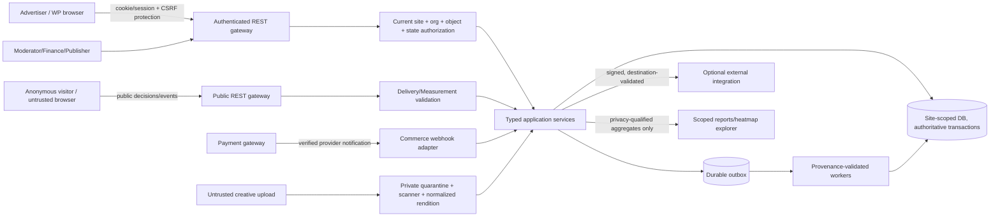
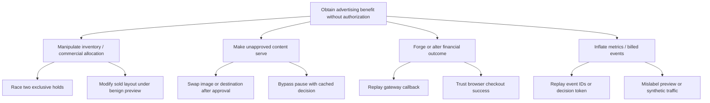

# AdPilot — Security, Privacy, Compliance & Threat Modeling Specification

**Document ID:** `ADP-DOC-023`  
**Filename:** `23_ADPILOT_SECURITY_PRIVACY_COMPLIANCE_THREAT_MODELING.md`  
**Version:** 1.0.0 — proposed security and privacy implementation contract  
**Status:** Proposed; Security Lead, Privacy/Legal Lead, Product Owner, WordPress Lead, AdTech Lead, Finance Lead, QA Lead and Principal Architect approval required  
**Date:** 2026-10-12  
**Product:** AdPilot — Self-Service Advertising Marketplace & Behavioral Analytics for WordPress  
**Owners:** Application Security Lead and Privacy Engineering Lead  
**Implementation target:** GPT-6 High; bounded, evidence-backed work packages  
**Normative predecessors:** `ADP-DOC-001` through `ADP-DOC-022`  
**Suggested next document:** `ADP-DOC-024` — Quality Assurance, Test Strategy, Automation & Release Certification Specification

> **Assurance statement:** This document specifies controls and verification obligations. It is **not** a claim that AdPilot is deployed, penetration-tested, legally compliant in any jurisdiction, PCI DSS certified, or proven secure. All jurisdictional legal bases, purpose mappings, retention schedules, incident notification obligations, privacy thresholds, vendor agreements, and encryption/deployment settings require explicit approval by accountable professionals. Proposed endpoint/database extensions are change requests until reviewed against Documents 08–10 and 20–22. A security control that cannot be enforced must not be represented as enabled.

---

## 1. Authority, objectives, vocabulary and release gates

### 1.1 Document precedence and security obligations

| Source | Authoritative matter preserved here |
|---|---|
| `ADP-DOC-001` | All 129 original `FR-*`, `BR-001..018`, `NFR-001..016`, `INV-01..10`, `AC-001..015`, `DEC-001..012`, and R1–R4 scopes. |
| `ADP-DOC-002..003` | `AT-*` tests, 18 capability groups, 20 canonical `UI-*` screens, `UJ-01..28`, `WF-01..18`, `E2E-01..17`, accessible recovery requirements. |
| `ADP-DOC-004..005` | `DP-*` guards, independent state machines, `PERM-001..016`, 22 baseline site-plane capabilities, org-plane memberships, separation of duties and multisite authorization. |
| `ADP-DOC-006..007` | Modular-monolith boundaries, `IC-001..024`, domain ports and independent authority for inventory, commercial, creative, delivery, measurement and compliance decisions. |
| `ADP-DOC-008..010` | Per-site custom tables, transaction-safe booking, ledger, outbox/inbox, REST route IDs, idempotency, jobs, signed integration messages and event qualification. |
| `ADP-DOC-011..017` | Design system and all editor/admin/advertiser/theme paths, R1 PHP APIs, four server-rendered blocks, safe previews, high-density Layout Studio. |
| `ADP-DOC-018..019` | Current delivery eligibility, nonbillable preview, validated measurement evidence, R3 metering and immutable commercial authority. |
| `ADP-DOC-020` | R2 native aggregate heatmaps, geometry-version integrity, privacy thresholds and off-by-default R4 session replay. |
| `ADP-DOC-021..022` | Transactional reservation/payment/remedy boundaries; quarantine, exact creative version approval and emergency-stop precedence. |

**Conflict protocol:** No new `SEC23-*` requirement modifies upstream facts or gives an adapter new capabilities. Log source IDs, incompatible behaviors, options, owner, decision and exact impacted migration/API/UX tests. The more restrictive safe behavior applies pending approval. `MUST/SHALL` are mandatory for an enabled release; `SHOULD` requires written exception with expiration; `MAY` is optional and cannot override mandatory safeguards.

### 1.2 Assurance goals and release boundaries

| Release | Security/privacy commitment | Not yet in scope |
|---|---|---|
| R1 | Site/org isolation, authorization, secure creative validation, payment evidence provenance, no double-sale, click/event abuse protection, consent integration, finite retention, audit logs, safe baseline reporting, emergency stop, hardened public PHP/REST integrations. | Native R2 heatmap exploration, R3 metered advertising, R4 session replay/federation. |
| R2 | R2 behavior signals, purpose-gated heatmap ingestion, layout-correct aggregation, inference-resistant reporting and cohort privacy controls; optional video/interactive creative formats only after separate sandbox approval. | Raw visitor replay and R3 charging. |
| R3 | Qualified billable-event certification, model/attribution provenance, fraud evidence, finance separation of duties, metered corrections/disputes and immutable reconciled ledger postings. | Browser-reported charge authority. |
| R4 | Optional replay off by default with pre-capture masking and purpose approval, network/site federation with separate authorization, optional independently hosted workers and payment providers through governed adapters. | Automatic transfer of site-private data or unrestricted recording. |

### 1.3 Security reference standards and applicability

- **OWASP ASVS 5.0.0 (May 2025):** application security verification baseline. Define an appropriate risk-based verification profile (at minimum suitable L2-aligned goals for privileged and financial workflows), map individual adopted requirements against the licensed stable version, and document exceptions; **do not** claim a formal ASVS certification exists. Official: https://owasp.org/www-project-application-security-verification-standard/ and https://github.com/OWASP/ASVS/tree/v5.0.0.
- **OWASP API Security Top 10 (2023), Cheat Sheet Series:** threat prompts for BOLA, broken function authorization, property-level authorization, SSRF, unsafe API consumption, uploads, CSRF, XSS and webhook integrity. https://owasp.org/API-Security/ and https://cheatsheetseries.owasp.org/.
- **NIST SP 800-61 Rev.3 (April 2025):** incident response integrated with organizational risk management, not only a four-step incident checklist. https://csrc.nist.gov/pubs/sp/800/61/r3/final.
- **GDPR Regulation (EU) 2016/679:** where applicable; obligations depend on role, processing and jurisdiction. Relevant analysis includes Articles 5, 6, 12–23, 25, 28, 30, 32–35, 44 onward; do not interpret this document as legal advice. https://eur-lex.europa.eu/eli/reg/2016/679.
- **EDPB Guidelines 05/2020 on consent:** assess genuine choice, withdrawal and purpose controls for applicable processing. https://www.edpb.europa.eu/documents/guideline/guidelines-052020-on-consent-under-regulation-2016679_en.
- **WordPress REST API:** real route `permission_callback`, authenticated caller and object policy; a nonce is CSRF protection, **not authorization**. https://developer.wordpress.org/rest-api/extending-the-rest-api/adding-custom-endpoints/.
- **W3C WCAG 2.2 AA:** target for critical UIs and accessible alternatives to Canvas/heatmap views. https://www.w3.org/TR/WCAG22/.

Freeze exact third-party reference versions in the security assurance register. Apply PCI DSS or another sector standard **only** when the final payment handling architecture, merchant scope and acquiring agreements require it; AdPilot's design should avoid touching cardholder data through approved hosted/WooCommerce gateway paths.

---

## 2. System context, attacker model and trust boundaries

### 2.1 Assets and security objectives

| Asset | Classification | Integrity/confidentiality objective | Primary authority |
|---|---|---|---|
| Organization memberships, roles, invitations | Restricted authorization | Cannot fabricate grants, transfer ownership or enumerate unrelated tenants | Identity; `IC-001/002` |
| Published placement and active slot binding | Commercial integrity | Contractual identity cannot silently mutate or become cross-site | Inventory/Layout; `IC-003/004` |
| Holds, reservations, immutable quotes | Commercial integrity | No overselling, false amount, resurrected holds or external lock bypass | Reservations/Pricing; `IC-005..008` |
| Gateway evidence and financial ledger | Critical financial | Verified provenance, exact money and append-only correction history | Commerce; `IC-011/012` |
| Creative media, approved fingerprint, moderation evidence | High-risk untrusted content | No executable arbitrary upload, approval tampering, XSS or changed URL after review | Creatives; `IC-009/019` |
| Current campaign delivery state and stop fence | Availability/integrity | Paused/blocked campaigns never served from stale cache | Campaigns/Delivery; `IC-010/013` |
| Public decision/event tokens | Integrity-sensitive pseudonymous | Cannot mint privileged rights, forge billable proofs or cross-scope reuse | Delivery/Measurement; `IC-013/014` |
| Raw browser observations and consent evidence | Restricted behavioral | Collection minimized, consent/purpose enforced, no sensitive DOM values | Compliance/Measurement |
| Heatmap bins, geometry and R4 replay | Restricted behavioral | No personal session disclosure, cohort reconstruction or replay masking failure | BehavioralAnalytics; `IC-016/017` |
| Exports, support bundles, audit entries | Confidential/financial audit | Tenant-safe delivery, redacted logs, tamper-evident trail | Reporting/Platform; `IC-018/023` |
| API keys, webhook secrets, signing keys, deployment credentials | Secrets | No client display, source-control exposure or ungoverned key sharing | Secret storage adapter |
| WordPress users, media and posts | Host application | Least privilege; AdPilot must not compromise other themes/plugins | WordPress core interfaces |

### 2.2 Threat actors and assumptions

Assume an anonymous visitor can forge any browser event, inspect markup/JavaScript, block cookies, manipulate query strings, automate requests, alter headers, inspect shared-cached HTML and replay public tokens. An advertiser may deliberately tamper with organization IDs, quotations, creative files, destination URLs and checkout state. A compromised low-privilege WP account or organization billing/analyst member may test horizontal/vertical escalation. A malicious third-party theme/plugin could influence hooks and frontend DOM; a fully malicious installed PHP plugin executes at the same server privilege as AdPilot, so the shared-process boundary **cannot** provide hard isolation. A gateway endpoint or outbound webhook target may be attacker-controlled. An administrator can make mistakes or may be malicious; high-risk operations therefore require audit, independent approval where policy demands, and protected history.

Do **not** claim the server can distinguish a genuine human from all automation, or that cryptographic browser tokens make untrusted browser measurements inherently truthful. Controls reduce abuse and qualify evidence; they do not guarantee authenticity of human attention.

### 2.3 Trust-boundary diagram



**Boundary B1** public browser→decision/event; **B2** authenticated browser→WP/REST; **B3** controller→domain authorization; **B4** domain→tenant-scoped DB; **B5** creative bytes→quarantine/publishing; **B6** payment provider→commerce; **B7** transaction→outbox→job; **B8** AdPilot→external webhook/vendor; **B9** raw behavior→suppressed aggregate/export; **B10** plugin→other same-process WP code; **B11** site→multisite network context; **B12** administrator→protected financial/privacy operations. Every control/test carries the boundary it protects.

### 2.4 Attack graph: economically material abuse



All leaf paths require independent negative tests; rate limits and UI disabling alone do not close the graph.

---

## 3. Security invariant register and enforcement ownership

| Supplementary ID | Non-negotiable invariant | Enforcement point and evidence |
|---|---|---|
| `SEC23-INV-01` | All sensitive operations require fresh site + principal + org + resource + state authorization. | Policy port and repository scope; cross-tenant test |
| `SEC23-INV-02` | WordPress nonce never substitutes for permission. | Every protected REST `permission_callback`; escalation tests |
| `SEC23-INV-03` | Untrusted or stale browser tokens cannot change booking, approval or financial authority. | Domain services and gateway validation |
| `SEC23-INV-04` | Current stop/revocation invalidates serving and protected reads even against cached UI. | Fresh current state and cache fences |
| `SEC23-INV-05` | Uploaded executable content never runs in WordPress origin. | Quarantine, normalizer and safe publication |
| `SEC23-INV-06` | Ledger is append-only; no browser metrics create direct money movements. | Commerce port and financial reconciliation |
| `SEC23-INV-07` | Exclusive capacity is protected in real DB transactions; retry may not double-sell. | Reservation locks and uniqueness |
| `SEC23-INV-08` | Sensitive form/input, private DOM, payment and account content are never collected as behavioral events. | Collector allowlist and ingestion rejection |
| `SEC23-INV-09` | Missing/withdrawn permission for a purpose forbids corresponding processing. | Client, ingestion, jobs, caches and exports |
| `SEC23-INV-10` | Restricted cohorts cannot be reconstructed via filter differencing or exports. | Query privacy guard and release policy |
| `SEC23-INV-11` | Session replay is R4, off by default, separately masked and authorized. | Feature gate + pre-capture exclusion |
| `SEC23-INV-12` | A public renderer returns only contextual, least-privilege ad HTML, never tenant finances or secrets. | Shared PHP renderer and serializers |
| `SEC23-INV-13` | Secrets remain server-side and can be revoked/rotated without rewriting historical facts. | Secret reference abstraction |
| `SEC23-INV-14` | Every high-risk mutation creates attributable, redacted, tamper-evident audit facts. | Transactional audit/outbox and audit query ACL |
| `SEC23-INV-15` | Error paths reveal safe codes, not credentials, SQL, private paths, internal IDs or visitor data. | Uniform error serializer, logs and exports |
| `SEC23-INV-16` | Worker/CLI/admin actions receive explicit scoped principal, job type and policy; no ambient arbitrary impersonation. | Job dispatcher and CLI adapter |
| `SEC23-INV-17` | Network super-admin does not automatically gain cross-site advertiser or replay entitlements. | Explicit federation policy and site restoration |
| `SEC23-INV-18` | Unresolved vendor/privacy/legal decisions disable affected collection/integration rather than assume authorization. | `IC-024` feature-availability verdict |
| `SEC23-INV-19` | Public WordPress browsing remains functional during optional analytics/security integration outages. | Fail-safe public rendering and circuit breakers |
| `SEC23-INV-20` | Security findings have owner, severity, remediation, test evidence and release gate. | Assurance register and release checklist |

---

## 4. Identity, authentication, authorization and tenancy

### 4.1 Authentication modes and session protection

- WP user login/session remains the default privileged session mechanism. Follow site HTTPS, secure/HttpOnly session cookie management as supported by WordPress/hosting; do not invent an AdPilot password database.
- Browser REST calls from the authenticated WordPress context use supported cookie authentication and a WP REST nonce as **CSRF guard**; enforce authorization independently. Configure nonce refresh, expiration, logout/revocation recovery and clear errors.
- External automation uses a separately approved credential mechanism with scoped privileges and revocation; do not leak application passwords, tokens or signing secrets into browser bundles or diagnostics.
- Require MFA for high-risk administrators **through a reviewed WordPress-compatible identity solution or IdP integration** if organization policy mandates it. A custom home-grown MFA flow is not assumed in R1.
- Apply sensitive-operation step-up or independent second-person approval when risk/policy requires it; do not interpret a user's ability to edit their own organization as the ability to approve their own allocation/refund overrides.
- Invitation tokens are CSPRNG-generated, hashed at rest, audience and site/org scoped, short-lived under approved policy, one-time consumed atomically, and invalidated on member revocation or owner transfer.
- Reject session fixation, privilege persistence after role change, and cross-origin credential leakage. Every protected operation checks live membership and actor state rather than relying on a long-lived JWT role claim.

### 4.2 Authorization predicate

```text
ALLOW(operation, principal, requestedResource, purpose) iff:
  trustedSite(principal) == trustedSite(resource)
  AND principalIsAuthenticatedOrExplicitInternalPrincipal(operation)
  AND currentSiteCapabilityOrCurrentOrgMembership(operation, principal)
  AND sameOrganizationWhereApplicable(principal, resource)
  AND resourceExistsAndBelongsToSiteAndOwner(resource)
  AND objectStateAllows(operation)
  AND featureReleaseEnabled(operation)
  AND privacyPurposeAllows(operation, purpose)
  AND separationOfDutiesAndElevatedApprovalSatisfied(operation)
  AND noCurrentSuspensionRevocationOrPolicyBlock(operation).
Otherwise DENY with nonenumerating safe error and an appropriate audit event.
```

**Policy order:** derive trusted site from active WP blog/site context; resolve resource by `site_id` within authorized repository; resolve current organization membership; perform domain-specific policy; serialize allowed fields. Never start with unscoped `getById()` and then filter some fields. `site_id`, `organization_id`, `role`, `approval_status`, billing price and `is_billable` in request JSON are **untrusted hints**, not authoritative claims.

### 4.3 Privilege planes and sensitive duties

| Plane | Legitimate authority | Mandatory restriction |
|---|---|---|
| Site publisher administration | Document 05 scoped `adpilot_*` capabilities | No automatic advertiser ownership or network-wide power |
| Advertiser organization | Current `org_*` membership at `(site,org,user)` | No WordPress post editing, finance administration or other org reads |
| Moderation | `adpilot_moderate_creatives` and review policy | No self-approved campaign, no ledger authority |
| Finance | `adpilot_view_finance` and policy-specific adjustments/refunds | Independent reason/approval; no silent inventory override |
| Privacy and restricted analytics | `adpilot_manage_privacy`, `adpilot_view_restricted_analytics` where applicable | No raw replay access unless separately R4-authorized |
| Support/diagnostics | `adpilot_view_diagnostics`, approved export scopes | Redacted projections, no hidden impersonation |
| Background worker | Signed/internal job identity, allowlisted job type, site/resource ref | No request-supplied user ID impersonation or stale member grant |
| Network governance (R4) | `adpilot_network_governance` and approved federation model | Does not supersede tenant or replay permissions |

Preserve the **exact** Document 05 capability catalog; names in this table are references, not a new permission registry. At least two organizations and two WordPress sites are required in automated positive/negative policy tests.

### 4.4 Cross-site and cache isolation

- In WordPress multisite, obtain the true blog-specific `$wpdb->prefix` on every site-bound service construction. If `switch_to_blog()` is used, restore context in `finally` and reconstruct site-bound repositories; do not memoize a previous site's SQL prefix or permission projection.
- Cache keys include site + organization where private + actor/permission version where authorization-sensitive + policy/release version. Protected data must not enter public CDN caches or public object caches with insufficient key scope.
- A network super-admin permission is a different operation from site resource permission; test both. Shared database installation does **not** mean global cross-tenant query rights.
- Revocation needs cache invalidation or authoritative live check on next request, download and worker execution; an active browser tab showing old controls must receive denial and safe refresh, not a grace authorization window.

### 4.5 REST and Graphical UI examples

```php
<?php
// Illustrative adapter structure, NOT drop-in production code.
register_rest_route('adpilot/v1', '/organizations/(?P<org_id>[A-Za-z0-9_-]+)/campaigns', [
    'methods' => 'POST',
    'permission_callback' => static function (WP_REST_Request $request) use ($policy): bool|WP_Error {
        // Policy itself resolves current blog, actor, live org membership and resource ownership.
        return $policy->authorize('campaign.create', get_current_user_id(), $request['org_id']);
    },
    'callback' => static function (WP_REST_Request $request) use ($app): WP_REST_Response|WP_Error {
        // Application service repeats sensitive current-state and object-level gates.
        return $app->createCampaignFromValidatedRequest($request);
    },
]);
```

Do not return `false` with sensitive details. WordPress callbacks and sanitizers must validate arguments per-route, derive actor/site server-side, and use prepared SQL. Never use nonce verification as the sole predicate. Do not allow frontend visibility flags or React route guards to be treated as security.

---

## 5. API, public SDK and browser-edge security

### 5.1 Authenticated REST route baseline

All Document 09 `S` (site) and `A` (advertiser) routes MUST register `permission_callback`; verify supported auth, method, endpoint release, field schema, allowed media type, body length, `Idempotency-Key` on retryable mutations, optimistic version/`If-Match` where needed, and current object policy. Parse UTF-8/JSON safely, reject duplicate conflicting fields and unknown privilege-bearing properties; cap nested arrays, filter cardinality, record IDs, date ranges and exports. Rate limit by site/operation/principal and avoid revealing existence of foreign records through error/body/timing. All admin error responses follow the approved safe Document 09 envelope.

### 5.2 Public ad-decision API (`DEL-001..003`)

- Only a **bounded, anonymous-safe** page-context descriptor, published layout/slot references and fresh opaque render occurrence IDs may enter the decision request; do not allow caller-supplied paid entitlement or chosen creative.
- Validate that every requested slot belongs to a currently published eligible layout in the current site; cap batch size, body bytes and aggregate work before database lookups.
- Selection checks live campaign stop version, exact creative fingerprint approval, booked entitlement, schedule, targeting, policy, release, and capacity/frequency/budget gates; cache cannot replace this fresh guard.
- Prevent one page from requesting 500 heavy ads eagerly: shared observer/batch strategy, concurrency and output bytes budgets; fallback safely to empty/house creative with nonbillable semantics.
- Decision tokens, if used, are short-lived, purpose-bound, site/slot/render scoped and integrity-protected. They are **evidence correlation**, not proof of human viewing or authorization to bill.
- Public responses never contain real WP user IDs, raw organizational contacts, financial ledger records, cookie secrets, private revenue allocations, or event-signing secrets.

### 5.3 Public event ingestion (`MET-001..003`)

- Treat rendered/viewable/click observations as adversarial. Verify schema, token association, expiry, event ID dedup key, time skew, site, origin/referrer where useful, preview/test flag and qualification rules. `Origin` and `Referer` are defense-in-depth signals, not reliable identity proofs.
- Enforce per-site and per-network abuse budgets; distinguish rejected/duplicate/quarantined events without producing exaggerated financial metrics. `429` and backoff guidance protect service but cannot alone prove invalid traffic.
- Do not store free-form selectors, URLs with query strings, DOM text, keystrokes or mouse traces through R1 event endpoints. Use bounded purpose-appropriate telemetry only.
- R1 event ingestion does not establish R3 metered charge eligibility. Qualified/settled charge evidence is separately reconciled in Commerce.

### 5.4 Browser exploit defenses

- Escape HTML attribute, text, URL, JS and CSS contexts through context-correct APIs; prefer DOM text APIs and vetted templates. Ban unsanitized `innerHTML` with browser/advertiser-controlled strings.
- Do not insert creative JS into first-party DOM; no arbitrary `eval`, new `Function`, unsafe custom scripts or unrestricted iframe `srcdoc`. If interactive formats are later approved, provide an isolated origin/sandbox with minimized capabilities, strict postMessage origin checks and resource quotas.
- Adopt a CSP appropriate to WordPress site/theme compatibility, tested in report-only mode before enforcement. Prefer WordPress enqueue/asset systems, no inline secrets, and document constrained compatibility exceptions. Do not claim CSP alone neutralizes a same-origin malicious plugin.
- Output publisher sponsorship labels and suitable link relations. Destination URLs allow only approved schemes and canonicalization; reject `javascript:`, `data:`, unsafe redirects and ambiguous internationalized/encoded host representations.
- Prevent clickjacking on **sensitive admin/publisher surfaces** with host-compatible frame policies. Do not break required editor/preview contexts or public embedding without a tested plan.
- Use TLS with valid certificates and HSTS where deployment owner can enforce it; avoid mixed active content and insecure API origins. Advertiser pages must not expose gateway or private tokens through `Referer` leakage.
- Third-party scripts, analytics libraries and network callbacks are integrations requiring legal and security review; absent optional dependencies cannot break R1 WordPress bootstrap.

---

## 6. Creative/media and moderation security

### 6.1 File upload and quarantine contract

1. Identify authenticated actor, active site and current organization, upload purpose, campaign/creative ID and budget/quota. Check `org_creative_write` plus object policy before creating a media record.
2. Perform bounded streaming/upload-size checks and inspect **actual bytes** against allowlisted raster formats; filename, MIME header and extension are insufficient. Reject polyglots, active content, malformed files, decompression bombs, huge pixel dimensions, path tricks, symlinks, archive extraction and hostile metadata.
3. Save source in private quarantine **outside executable public paths** where feasible; explicitly block script execution and arbitrary direct access. WordPress uploads directories are not intrinsically private.
4. Scan using an approved adapter when enabled. A scanner timeout or undecidable result is `pending_review/quarantined`, never `safe`. Normalize/re-encode via hardened libraries; strip unneeded metadata; generate known-safe renditions with bounded CPU/memory.
5. Compute a content digest and the **review-sensitive canonical manifest digest** including media identity, destination, disclosure, format and policy context. A changed field creates a new immutable version.
6. The moderator reviews one exact immutable fingerprint. The binding `CreativeReview` fact must point to that fingerprint; delivery rechecks current version selection, policy, campaign and stop state.
7. Promotion to public media serving is atomic and references only approved renditions. Physical file ACL, public cache and CDN invalidation are tested after revocation or emergency stop. Do not rely on removing a CDN file as the sole immediate stop guard.

### 6.2 Moderation abuse controls

Review cannot be delegated by untrusted advertiser metadata. Reject dangerous URLs and redirects after submission; record destination evidence and revalidation timestamps. Approved earlier versions may serve only when current policy/contract explicitly permits. Separate moderation vs finance permission; paying an order neither creates an approval nor weakens publisher content policy (`BR-003`, `BR-007`). Policy override requires independently authorized reason, effective scope, expiration, and immutable audit; no undocumented “skip review” filter for Gutenberg, shortcode or theme developers.

### 6.3 External links and fetch SSRF

If the product later supports creative URL inspection or remote preview fetching, **disable remote fetching by default** until its server-side client enforces: HTTPS/TLS validation; domain/hostname allowlist or reviewed destination approval; DNS resolution and IP range blocking for loopback, link-local, private, metadata, multicast and IPv6 edge cases; validation after each redirect; redirect limit; socket-level IP pinning or equivalent rebinding protection; strict response size/time/cross-protocol limits; and no credential forwarding. The public browser opening a user-visible advertiser link is different from privileged server-side fetch. Do not approximate SSRF defense with a `strpos(host, 'localhost')` filter.

---

## 7. Commercial transactions, payments, and financial integrity

### 7.1 Booking and money trust boundaries

- Quotes carry immutable trusted rate-card version, exact currency/minor unit representation, tax/discount policy digest, inventory scope, UTC interval, expiry and idempotency context. An adversary cannot authorize a purchase by editing JSON totals.
- Exclusive capacity is locked in a real database transaction using deterministic key ordering, re-read availability and nonoverlap/uniqueness controls. The browser calendar remains advisory. Unsupported transactional storage disables unsafe purchasing with an actionable diagnostic.
- Holds expire under authoritative UTC time. No late or duplicated payment callback may reanimate expired holds; create a resolution/remedy case, do not allocate another party's sold inventory.
- WooCommerce HPOS operations use WooCommerce CRUD and verified payment/order provenance, not raw `wp_posts` assumptions or browser redirect status. Gateway callback signatures/verification are provider-specific.
- Ledger is append-only, amounts precise, adjustments independently attributable, and refunds governed by approved finance workflows. Private revenue/ledger is never read through advertiser/aggregate analytics endpoints.
- R3 CPM/CPC uses certified qualified event evidence, reconciliation and disputes; a visitor can never hit an endpoint that directly posts `FinancialLedgerEntry` by claiming `billable: true`.

### 7.2 Financial separation of duties and audit

| Operation | Control | Evidence |
|---|---|---|
| Change rate card affecting live offers | Authorization, effective-date/version, sold-contract impact and audit | Before/after digest and reviewer |
| Override allocation for paid slot | `BR-018`, authorized reason, independent approval where configured | Transactional adjustment event |
| Refund/credit | Approved policy, current order state, idempotency, amount/currency ceiling | Provider evidence and immutable ledger adjustment |
| Gateway configuration/secret rotation | Privileged integration admin, step-up where applicable, no secret echo | Audit actor + key version |
| Reconcile duplicate/out-of-order events | Inbox dedup and monotonic state machine | Unique provider event ref and correction record |
| Cancel paid rejected creative | Preserve financial/approval separation; remedy path | Linked adjudication and remedy case |

### 7.3 Failure semantics

A queue outage delays notifications/reconciliation but cannot make inventory both sold and available. A gateway outage shows `pending verification` and safe retry, not `paid`. Outbox replay is allowed but financial effects are idempotent on semantic business keys. Use transactional outbox with original financial facts, not a retrying job that replays a PHP side effect without uniqueness. On suspected compromise, operators can pause affected checkout/delivery/metering independently while preserving financial forensic evidence.

---

## 8. Data governance, privacy engineering and lawful processing

### 8.1 Roles, jurisdiction and purpose approval

AdPilot is self-hosted software. The publisher/site operator typically decides how the platform is used, but exact controller/processor roles (including agencies, advertisers and third-party analytics/hosting vendors) depend on contractual facts; **do not hardcode legal role classification**. Prior to enabling collection, Privacy/Legal Lead records relevant regions, personal-data categories, purpose, recipients, lawful basis where required, consent/CMP behavior, retention, transfer mechanism, DSAR owner, legitimate-interest balancing (if asserted), security controls and a DPIA determination when required. A feature flag is not a lawful basis.

| Processing purpose | R1/R2/R3/R4 | Candidate permitted input | Prohibited or conditional |
|---|---|---|---|
| Operate WordPress membership and contracts | R1 | Account identifiers, organization role, necessary business contact | Unrelated visitor tracking; mass export |
| Serve an approved contextual ad | R1 | Published slot, eligible page/taxonomy context, coarse device/locale | Sensitive inferred categories, undisclosed profiling |
| Record basic ad operation | R1 | Bounded decision/render/click validation signal under lawful policy | Raw DOM/form input or persistent cross-site identity |
| Analyze interaction heatmap | R2 | Purpose-eligible quantized coordinates/geometry, bounded cohorts | Form/account/checkout pages; unfiltered raw sessions |
| Meter validated advertising | R3 | Reconciled qualified event evidence and dispute audit | Unverified browser charge requests |
| Optional session replay | R4 | Opted-in sampled, pre-masked permitted diffs | Raw keyboard, payment, sensitive or authenticated session content |
| Fraud/security operations | Conditional | Minimally necessary security telemetry under approved policy | Indefinite tracking under an unbounded security pretext |

### 8.2 Consent/purpose state machine and collector rules

```text
unresolved -> evaluated_allow | evaluated_deny
allowed -> withdrawn | expired | reevaluated_deny
withdrawn/denied/expired -> only new valid evaluation may permit new processing
```

- The CMP integration must produce **purpose-specific, versioned evaluated verdicts** from trusted site policy and visitor choice. Do not accept a request body `"consent": true` as proof; client-side consent is always corroborated by eligible server-side policy/evidence appropriate to the implementation.
- For uncertain region/purpose mappings, use privacy-protective defaults: no disputed behavioral collection until a documented lawful policy exists. Contextual ad delivery may continue only without the prohibited telemetry or targeting.
- On withdrawal, immediately stop client listeners/sampling/replay; clear queued unsent events, invalidate purpose-scoped identifiers, and prevent subsequent ingestion or queued enrichment inconsistent with the new policy. Execute deletion/de-identification/recomputation workflows as applicable.
- Restrict protected pages: checkout, payment, WordPress admin, login, user account, private posts, password pages, forms, consent UIs, financial/medical inputs, free-form messaging and unvetted dynamic widgets; R2 overlays require positive page/element allowlists.
- Respect an approved regional assessment for ePrivacy/storage-access rules, CMP, Global Privacy Control or browser preference signals where applicable. Do not promise a universal GPC legal interpretation.
- Replay must be explicitly separately enabled and **masked before capture**, not cleaned after transmission; arbitrary selector/text capture prohibited. Masking failure disables recording immediately.

### 8.3 Information categories and storage classification

| Class | Examples | Default policy |
|---|---|---|
| Public | Published catalog and sponsor disclosure | Cacheable only when safely public |
| Internal operational | Redacted queue health, aggregate counts | RBAC, finite retention, no secrets |
| Advertiser confidential | Creative draft, campaign, quote, invoice, organization contact | Tenant row scope, restricted exports |
| Publisher confidential | Profit, internal rules, moderation notes, fraud scores | Site role/operation scope; avoid browser exposure |
| Financial audit | Settlement evidence, immutable ledger, tax record | Strongest integrity, documented lawful retention |
| Restricted behavioral | Visitor event, cohort linkage, geometry snapshots, heatmap/replay | Purpose gate, strict read access, suppression/expiry |
| Secrets | API keys, webhook signing keys, encryption material | Vault/restricted configuration; never render/track |
| Incident evidence | Minimal logs, event lineage, investigator actions | Scoped legal hold, access log, disposal policy |

### 8.4 Retention, minimization and erasure

Maintain a versioned *record-class retention matrix* with owner, purpose, lawful reason, trigger (creation/last activity/contract termination), expiry, anonymization policy, backups and restoration handling. **No universal `30/90/365 days` is asserted as legally correct.** Raw measurement events, quarantined uploads, geolocation/pseudonymous state, deduplication keys, heatmap bins, session replay, audit, exports and financial records require separate schedules and legal grounds.

Data subject requests (access, rectification, erasure, restriction, portability, objection) are received through the site's approved workflow, identity verified proportionately, and routed to responsible data owners. Use WordPress privacy exporter/eraser integration **where applicable**, plus AdPilot repositories and external processors. Track request ID, legal response deadlines from jurisdictional policy, category inventory, statutory exemptions, processor coordination and completion evidence. Do not erase legally retained financial facts without review; minimize unrelated visitor data. Cache copies, exports, outbox, worker retries and restored backups must honor erasure tombstones or equivalent replay-safe control so deleted data is not resurrected after restore.

### 8.5 R2 heatmap statistical disclosure control

A heatmap count of events is **not** proof of sufficient independent eligible contributors. Before permitting release, approve and implement a contributor-distinctness scheme without permanent cross-site tracking; support suppression under declared threshold, minimum cohort/time buckets, filter limits and privacy budgets where applicable. Protect against differencing between neighboring filters, pagination, CSV exports and dashboard snapshots; hide low-sample data instead of treating a low-sample cell as zero. Don’t map geometry from changed templates without an explicit compatibility verdict. The Document 20 schema gaps (contributor cardinality and optional non-ad full-page event references) remain blocking change requests until approved.

### 8.6 Data transfer and third-party disclosures

Every noncore network request is registered with domain, purpose, operator, data categories, region, contractual basis, security assessment, retention and revocation mechanism. No unapproved ads/analytics CDN, proprietary pixel, replay SaaS, geo enrichment or remote scanner may silently receive visitor behavior. Remote conversion, if R3 enabled, uses purpose and lawful basis review plus signed/adversarially tested contracts. A publicly displayed publisher disclosure is **not** a substitute for backend governance of transfers.

---
## 9. Data storage, cryptography, secrets, backups and database integrity

### 9.1 Cryptographic and key-management requirements

| Operation | Required property | Prohibited shortcut |
|---|---|---|
| Key creation | Cryptographically secure random generator, documented entropy and source, purpose-specific key ID | PHP `rand()`/timestamp-derived secrets |
| Signing outbound webhooks | Versioned per-subscription key and exact canonical signed bytes, safe timestamp window and replay protection | A single global static key embedded in client JS |
| Verifying inbound gateway messages | Provider-specific authenticated verification of raw payload and mapped order/amount/state | Browser success redirect, guessed custom HMAC header |
| Sensitive configuration storage | Environment/host-supported secure secret adapter, least-read privileges, redacted UI; encryption at rest where feasible and keys managed separately | Base64 called “encryption”; logging decrypted keys |
| Passwords | WordPress-supported hashing/identity system, no AdPilot duplicate password table | Homegrown password encryption |
| Public decision correlation | Site/purpose-bound integrity token, limited TTL, key rotation semantics and verified scopes | Treating signature as proof of legitimate human activity |
| Encryption in transit | HTTPS for privileged ingress, payment callbacks and outbound integrations; secure downgrade handling | Sending bearer secrets over HTTP |
| Backup protection | Encryption and access control appropriate to stored personal/financial data; documented tested restore | Public backup archive under `/uploads/` |

Be explicit: WordPress salts and nonces serve different purposes; do **not** repurpose the WordPress authentication salt directly as a forever webhook signing secret. Encryption of a database column cannot provide meaningful confidentiality if the encryption key and raw database are world-readable under the same compromise; define the actual deployment threat model and rotation procedure. Do not promise encryption at rest without tested adapter and key custody.

### 9.2 Rotation and revocation protocol

1. Authenticate the authorized operator and require operation-specific capability plus elevated approval for production secret rotation.
2. Generate successor key/version in the approved secret store; record metadata only (ID, algorithm, creation, activation, expiry and owner).
3. Allow narrow overlap for bounded in-flight requests only where sender/receiver protocol requires it. Every verification selects key ID via authenticated/validated metadata, never arbitrary caller-supplied algorithm selection.
4. Mark predecessor inactive at expiry; invalidate affected outbound subscriptions/job leases and revoke credentials immediately on suspected compromise.
5. Verify successful delivery, failed replay after cutoff, no export/log leakage, and audit actor/reason.
6. For incident rotation, prefer immediate revocation and dependent-service temporary suspension over an unsafe extended overlap.

### 9.3 Custom-table integrity and migration posture

- Use Document 08 site-specific custom tables and versioned migrations. Database adapters use prepared statements with interpolated identifiers only from trusted validated table resolver; no user-supplied table/column/order-by names.
- Schema changes are additive/backward-compatible where possible, checksummed, idempotent, versioned, and tested with older jobs, downgrade refusal, interrupted upgrade and rollback instructions. A partial migration must not enable paid checkout against inconsistent uniqueness controls.
- Prefer database constraints for immutable business facts, unique references, idempotency scope, exclusive locks and normalized owner IDs; repository checks supplement but do not replace verified transactional guarantees.
- Prevent mass assignment: list writable fields per command. Do not deserialize PHP objects or unbounded JSON from stored untrusted payload; enforce JSON schema and permitted class-free primitives.
- File- and table-level erasure must avoid foreign-owned records while preserving approved financial evidence, policy-version history and legal holds as appropriate.
- Backups are encrypted, access restricted, retention scoped, sampled for restore tests, and never generated as publicly accessible WordPress uploads.

### 9.4 Audit and ledger integrity evidence

Use append-only application-layer audit facts with actor type/ID, trusted site/org scope, resource ID and version, operation, policy/rule version, prior/new safe state digest, correlation ID, UTC timestamp, approved reason, any second-person authorization, and outcome. Protect audit reads with Document 05 permissions and redact field-level secrets/visitor data. Tamper evidence may use linked digests/signatures if an approved independent key/evidence store exists; do not label a mutable database table “immutable” solely because its application API has no update method. Define admin/database compromise limitation explicitly. Ledger correction is an append-only compensating entry, never silent overwriting of settled history.

---

## 10. Webhooks, outbound integration SSRF and background job provenance

### 10.1 Inbound gateway callback security

- Verify the provider's **documented actual authentication method** against raw request bytes/headers, including timestamp and source where supported. Some gateways require an authenticated status fetch rather than self-signed callbacks. Never accept a generic `signature` field as a universal verifier.
- Map the verified event to an AdPilot site, commercial order and WooCommerce order using trusted persistent mapping. Confirm currency/amount, provider account, transaction reference and permitted state transition.
- Persist deduplication/inbox evidence under a provider+site+event semantic key; replay or out-of-order messages must return an idempotent result without repeating money/inventory side effects.
- Check request limits, failure controls and alert thresholds. Avoid sensitive provider response bodies in logs. Distinguish transient gateway unavailability (`retry/reconcile`) from invalid signature (`reject/quarantine`).
- If callbacks are unexpectedly sent to an unpublished route, do not return internal object details or enable R3/R4 features implicitly.

### 10.2 Outbound webhook hardening

Document 09 `OPS-009..013` proposes R1 outbound subscription operations, while Document 08 defers subscription persistence to R4. **This is an unresolved cross-document scope conflict** carried forward from Documents 10–22. Do not enable outbound subscriptions or fabricate tables until Product Owner/Architecture/Integration Lead approve the target release, schema/API migration and security review. For any approved release:

1. Restrict endpoint host and scheme per policy; deny direct IP and private/metadata/link-local/multicast/loopback/reserved DNS targets including IPv6 edge cases; validate DNS at registration and connection with rebinding defense.
2. Disable redirects unless each hop is independently validated and bounded; set strict connect/read timeout, output size, concurrency and egress policy.
3. Strip sensitive event fields before serialization; send only allowlisted event topic/version, actor-safe resource IDs, site/public references and nonsecret event metadata.
4. Sign exact message bytes with per-subscription rotated secret and timestamp/unique delivery reference. Consumer verification guidance must be published.
5. Persist delivery and attempt records; backoff with jitter, dead-letter, disable on repeated unsafe errors; no unbounded retries and no retry of revoked subscription.
6. A webhook receiver cannot cause recursive webhooks or money effects by echoing events; replay/inbox protects each consumer independently.

### 10.3 Job worker / WP-CLI abuse resistance

Jobs use Document 10 `IC-020 BackgroundJob` scope: approved job type and payload schema/version, trusted site ID, authoritative resource reference, internal principal/purpose, idempotency key, allowed attempt count, deadline and dependency version. A job should not execute arbitrary PHP class names, URLs, SQL or user-supplied WordPress actions. Before execution verify current feature enabled, legal purpose, object state, account status and erasure tombstones; acquire fenced lease, process idempotently, commit effects and complete outbox/inbox. On `switch_to_blog()`, always restore in `finally`. CLI operations require explicit target-site argument, authorization context, dry-run for destructive actions, protected stdout and auditable actor attribution.

### 10.4 Dependency failure isolation

Worker outage must not produce a fake paid success; measurement outage must not block public content; privacy store outage must disable disputed tracking; unknown moderation scanner must quarantine; DNS validation failure must prevent outbound webhook activation; key store outage must prevent signed high-risk operations without returning secrets; reporting outage must not compromise bookings. Document each fallback in release acceptance and disaster recovery runbooks.

---

## 11. WordPress platform hardening and inter-plugin compatibility

### 11.1 Plugin activation, hooks and admin surfaces

AdPilot is an installable WordPress plugin; it cannot demand full control over host HTTP headers, other plugins, server firewall or DB user privileges. Therefore every environment-dependent security property has an observable preflight and safe fallback. Activation registers only owned roles/caps/tables/blocks/settings and documented pages; no indiscriminate modification of existing themes or privacy policies. Plugin bootstrap does not require WooCommerce, remote scanning SaaS, paid monitoring or external app servers. Deactivation preserves data by default and stops scheduled processing safely; uninstall requires deliberate separate action and legal record review.

- WordPress hooks/filters are extension points, **not** authorization bypass points; validate filtered return types/values, re-check critical business predicates after extensions, document immutable protected fields.
- Enqueue JS/CSS on the specific admin/editor/frontend surface; avoid global injection of credentials, CSS selectors and tracking to unrelated site pages.
- Four blocks (`adpilot/ad-slot`, `adpilot/ad-zone`, `adpilot/ad-repeater`, `adpilot/ad-showcase`) are server-rendered through the shared eligibility path; their JSON attributes do not confer entitlements or bypass moderation.
- `adpilot_render_slot`, `adpilot_render_zone`, `adpilot_render_container` and four Document 17 shortcodes only return safe public outputs; no protected database read on behalf of arbitrary templates.
- Support classic themes, block themes, Site Editor, Query Loop context, safe nested repeats and child themes without cross-content event attribution.
- Do not use `manage_options` as a substitute for the bespoke module capability and org policy model. Verify all privileged admin pages, AJAX actions, REST, CLI, job schedulers and exports.

### 11.2 WordPress security-specific pitfalls

| Pattern | Why it fails | Required treatment |
|---|---|---|
| `check_ajax_referer()` alone | Valid nonce does not authorize a resource | Add capability + org + object guard |
| `is_admin()` as trust test | Describes admin-side request context, not actor authority | Current-user and object authorization |
| `get_post_meta` for all event streams | No high-volume constraints or query isolation | Own indexed tables and bounded aggregation |
| `sanitize_text_field` for arbitrary HTML context | Sanitization does not replace context-escaping | Data-type schema + output-context escape |
| `esc_url_raw()` as universal SSRF block | URL syntax sanitation does not enforce network target safety | Network-level allowlist/address validation |
| Public `wp-content/uploads` for private reports | Predictable/publicly accessible storage | Protected stream/download-time access check |
| `switch_to_blog` without `finally` | Leaks context into later operations | Guaranteed restore + repository rebind |
| `dbDelta()` as complete migration rollback | Cannot guarantee arbitrary FK/online migration behavior | Versioned explicit migrations, verification |
| Admin preview as production | Makes tests inflate financial evidence | Nonbillable preview provenance throughout pipeline |
| Global static options with secrets | Leaks through UI/log/backups and weakens per-site rotation | Secret reference abstraction |

### 11.3 Infrastructure assumptions and installation checklist

Check supported WordPress/PHP/database versions, TLS, file permissions, object-cache isolation, DB transaction engine, scheduled worker health, outbound egress control, backup destination and PHP imaging libraries. Report severity and actionable admin advice without disclosing keys. Where infrastructure cannot protect paid booking or confidential exports, disable affected feature rather than simulating compliance. Document the boundary between plugin-implemented guards and host-managed protections (WAF, OS updates, database backups, CDN, anti-DDoS and intrusion monitoring).

---

## 12. Frontend, UX, accessibility and abuse-aware design

Secure UX is part of the control environment, but UI is never the final authorization source. Each of the 20 canonical `UI-*` screens and publisher/advertiser frontend states must show a correct explanation when an action is forbidden, pending, expired, unsupported or privacy-blocked. Preserve draft data on genuine network failures without retrying dangerous commands automatically. Display financial status separately from creative approval and delivery; never use visually similar “Paid”, “Approved” and “Live” labels as one state.

### 12.1 High-risk user journeys

| Journey | Security UX | Server-side enforcement |
|---|---|---|
| Advertiser invitation | Recipient sees intended organization/site, expiration and one-time acceptance | Current invitation and role grant check; atomic consume |
| Quote/hold countdown | UTC-derived expiration and live refresh; accessible announcement | Real transactional expiry; browser timer advisory |
| WooCommerce redirect return | “Verifying payment” with retry/refresh, no automatic invoice success | Gateway/order evidence reconciliation |
| Creative review | Exact version fingerprint, warnings, reason, independent reviewer | State machine, revocable reviewer rights and audit |
| Emergency pause | Prominent confirmation, safe scope preview and post-action status | Current stop fence and cache invalidation |
| Refund | Amount/currency breakdown, separate authorization, irreversible warning | Ledger adjustment/provenance and idempotency |
| Privacy preferences | Purpose granularity and withdrawal mechanism where applicable | Server consent/policy evaluation and worker re-check |
| Heatmap export | Suppression/filter warnings and restricted role indicator | Row/field and cohort policy at export *and download* |
| R4 replay | Explicit restricted access, reason, masked preview, access history | R4 gate, purpose validation, bounded playback |

WCAG 2.2 AA compliance is a target with automated and manual evidence. Keyboard alternatives to drag/drop, screen-reader equivalents to charts/heatmaps, accessible confirmation, focus management, status announcements, RTL, reduced motion and responsive zoom are mandatory for critical tasks. A visual heatmap overlay must not be the only way to inspect observations; privacy suppression applies equally to tabular alternatives.

### 12.2 Deceptive interaction and ad-policy protection

Sponsored content needs clear labeling; do not camouflage ad UI as system notifications, induce accidental clicks via overlay or use auto-generated layout density as a reason to hide site navigation. Provide safe advertiser content reports and publisher policy reason codes; moderation explanations must not expose fraud detection thresholds or unrelated advertiser data. Anti-bot controls should be proportionate and not indefinitely block legitimate screen-reader, keyboard or privacy-preserving users.

---

## 13. Logging, anomaly detection, abuse resistance and observability

### 13.1 Security event taxonomy

| Event category | Examples | Log classification |
|---|---|---|
| `authn` | Login failure, session expiration, MFA step-up failure where integrated | Restricted; minimize account identifiers |
| `authz` | Cross-org denial, forbidden `OPS-*` mutation, stale membership | Restricted and rate-limited; never log full tokens |
| `integrity` | Illegal state transition, duplicate hold race, stale creative fingerprint | Security/commerce operational |
| `payment` | Signature failure, provider mismatch, duplicate event, ledger discrepancy | Confidential; redacted financial reference |
| `creative` | Malware suspicion, decoder rejection, policy exception, emergency stop | Restricted with quarantined evidence ID |
| `api` | Oversized payload, abnormal rate, invalid public token, origin anomaly | Aggregated/hashed metadata as permitted |
| `privacy` | CMP mismatch, collector blocked, DSAR action, purpose policy change | Sensitive; limited records |
| `analytics` | Invalid traffic spike, reporting suppression, event replay collision | Sanitized operational metrics |
| `integration` | DNS/SSRF refusal, signature check failure, compromised subscription | Restricted diagnostic |
| `platform` | Upgrade failure, exposed export attempt, suspicious backup access | High severity |

### 13.2 Log schemas and data minimization

Prefer structured logs with UTC timestamp, severity, event code, site, bounded hashed actor/resource reference, correlation ID, software/policy version, safe status, latency and severity. No raw cookies, Authorization headers, WordPress nonce, webhook secret, payment card details, request-body dumps, private visitor URL fragments, selected form content, replay frames or raw media bytes. Format all user-supplied strings as structured parameters to avoid log injection. Restrict access to `adpilot_view_diagnostics` and separately guarded audit privileges; audit viewers do not automatically gain private export/replay privileges.

### 13.3 Operational alerts and thresholds

Alert on: repeated unauthorized object scans; anomalous invitation/role changes; moderation decisions by unexpected principals; unexpected emergency pause; high failed upload decoder/scanner rate; late-payment/remedy backlog; financial mismatch; unusual click-to-impression ratios with data quality qualifiers; event pipeline backlog; collector consent mismatch; low-cohort query probing; failed export authorization; excess replay access; key rotation failures; webhook DNS private-IP attempts; outbox dead-letter growth; and cross-site cache-key collision. Define thresholds from tested baselines with alert owner, dedup window, suppression, incident routing and avoiding sensitive alert payloads; this specification does not invent production thresholds.

### 13.4 Incident evidence protections

Anomalies are not proof of fraud or a reportable personal-data breach. Keep evidence references and chain of custody under role-based controls, clear UTC timestamps and limited retention. Suspected compromise must preserve appropriate evidence without indefinitely extending unrelated visitor tracking. Security dashboards display data freshness and cannot hide that monitoring may be delayed due to queue outage.

---

## 14. Secure supply chain, build artifacts and update governance

### 14.1 Dependency and licensing assurance

- Generate SBOM covering PHP Composer, npm, WordPress packages, bundled assets and transitive dependencies; include package name/version/hash/source/license and direct/indirect flag. Distributable package must satisfy GPL-compatibility requirements from `FR-OPS-008` and `NFR-014`.
- Lock dependencies, review transitive changes, scan vulnerabilities, malware, secrets and license conflicts. Do not automatically update an unverified dependency from CI or a production WordPress admin session.
- Produce reproducible tagged package artifacts with checksums and signed release manifest when a controlled signing mechanism is available; publishing instructions cannot fabricate a cryptographic signature.
- Check any CDN/widget usage and downloadable fonts/images for rights, integrity and privacy. Avoid required proprietary remote services for R1 startup.
- Maintain a package deprecation/patch policy, owner and embargo-aware response. Evaluate severity in *AdPilot's usage*, not only the CVSS score; record exceptions with deadline and compensating controls.

### 14.2 CI gate pipeline


Use local/staging fixtures; never run payment tests against live merchant accounts or real personal sessions by default. Every CI job and plugin asset is pinned where reasonable. Separate privileged signing/production deploy credentials from untrusted pull-request workloads. Dynamic scans should not indiscriminately attack third-party production sites.

### 14.3 Coding and review policy

No debug bypass on production, TODO “accept all” validators, suppressed analyzer findings without review, untrusted `unserialize`, string-built SQL from user input, hardcoded credentials, direct financial mutable state changes or secret-bearing frontend environment variables. Enforce type-safe money and identifiers, centralized policy ports, pure domain unit tests, explicit SQL transaction boundaries, review for synchronous side effects, contract-level API schema tests and variant RTL/locale rendering. Human security and privacy reviews remain required; GPT-6 High may produce implementation and tests but cannot self-attest legal authorization or external certification.

---

## 15. Threat modeling method, scoring and verification semantics

### 15.1 Required model artifacts

Perform threat modeling at initial architecture, before each new release, on any critical payment/creative/consent feature or integration change, and after a material incident. Produce an asset inventory, data flow diagram, entrypoint ledger, attacker capabilities, **STRIDE** threat worksheet (Spoofing, Tampering, Repudiation, Information Disclosure, Denial of Service, Elevation of Privilege), associated business/privacy abuse cases, mitigations, owners and tests. Record unmitigated residual risk and human accept/reject decision. Models must cover public endpoints, WordPress same-process limitations, jobs/webhooks, site switching, vendor transfers and downstream aggregates.

### 15.2 Risk prioritization

Use likelihood, impact (confidentiality/integrity/availability, financial liability, privacy rights and reputational harm), exploitation conditions, reachability and detection coverage; the final scoring rubric and severity thresholds require Security/Privacy owner approval. **Never** infer low severity merely because an exploit needs a valid low-privilege account. Initial high-priority examples: double-selling inventory, payment spoof/replay, arbitrary creative script execution, cross-tenant report leakage, undetected replay of private sessions, bypassed consent, and unrestricted outbound SSRF.

### 15.3 Verification evidence requirements

Each threat must resolve to at least one positive and one negative test with reproducible fixture, specific entry point, expected HTTP/domain result, expected audit event, absence of prohibited side effects and any timing/consistency expectations. A green unit test of a pure policy function is not enough for a cross-tenant attack; also run it through the WordPress REST adapter, database scope and cache. A successful browser UX warning is not proof that the server blocked the command.

---
## 16. Incident response, containment, recovery and breach assessment

### 16.1 Governance aligned with NIST SP 800-61 Rev.3

Incident readiness is continuous: asset inventories, monitoring, role assignment, tabletop exercises, backups, communications, supplier contracts and postincident improvement. Establish a security incident manager, WordPress/application owner, privacy/legal decision maker, finance/gateway owner, technical forensics lead, communications owner and on-call backup. Record business-critical dependencies and a tested decision path when the publisher has no dedicated security operations team. Define severity and response targets **per organization**, not as unsupported universal SLAs.

### 16.2 Incident workflow

| Phase | Action and required evidence | Stop/go authority |
|---|---|---|
| Detection and triage | Receive anomaly, log reporter/time/site/reproducibility, classify affected data/tenant/payment/availability; preserve minimal safe evidence | Incident manager + domain owner |
| Containment | Revoke credentials/membership, disable compromised integration, suspend affected campaigns/collector/replay/checkout, invalidate CDN decisions, isolate exports; preserve unaffected WordPress public content where safe | Security Lead; Finance/Privacy consulted |
| Investigation | Reconstruct trustworthy timeline using audit/outbox/gateway/DB backup and key versions; map affected resources, visitors, advertisers and data flows | Forensics Lead with lawful authorization |
| Legal/privacy analysis | Determine controller/processor obligations, applicable notification deadlines and evidence, using jurisdictional legal advice; avoid prematurely declaring a notifiable breach | Privacy/Legal Lead |
| Eradication | Patch issue, rotate affected keys, invalidate sessions/tokens, remove malicious files or subscriptions, migrate affected data, prove no undetected backdoor | Security + Engineering Leads |
| Recovery | Restore verified backups, check migrated schema, ledger/booking reconciliation, approved creative fingerprints, consent/tombstone replay, background jobs, delivery stop fences and public content | Product/Technical/Finance/Privacy sign-off by domain |
| Postincident | Root cause, scope, user/vendor communications, compensating controls, regression tests, owner/due date, model update | Incident owner and accountable management |

### 16.3 Specialized runbooks

**`SEC23-IR-01 — Compromised WordPress account`:** force session invalidation and approved credential reset; inspect capability/membership changes, role grants, moderation, refund and export histories; re-evaluate actor-linked jobs and signed artifacts; test revoked access immediately. Do not treat a fresh nonce as evidence of innocence.

**`SEC23-IR-02 — Cross-tenant data disclosure`:** block affected endpoint/cache, preserve minimum scope evidence, enumerate affected site/org and export downloads, purge dangerous cache artifacts, correct repository scope, test with two sites and two orgs, perform legal breach assessment and scoped communications. Avoid publishing attacker query data in an incident dashboard.

**`SEC23-IR-03 — Malicious creative or destination`:** emergency-stop campaign/creative, bump stop fence, quarantine asset and invalidate public delivery; inspect normalized rendition and downstream click URLs; identify rendered decisions and content exposure without unnecessary visitor tracking; reauthorize only after new review.

**`SEC23-IR-04 — Payment callback compromise or double-sale`:** suspend affected checkout/reconciliation, preserve provider event IDs and signed raw-hash provenance, lock reconciled inventory, compare WooCommerce records and ledger, open remedy cases; do not manually rewrite ledger lines or sell contested capacity.

**`SEC23-IR-05 — Behavioral consent breach`:** halt collector/replay or affected purpose, clear client queues where possible, block ingest and workers, freeze scoped exports, determine actual retention and recipient transfers, assess required DSAR/breach remediation and resume only after policy test evidence.

**`SEC23-IR-06 — Webhook SSRF/secret leak`:** disable subscription/egress, revoke key, check DNS and destination logs without exposing secrets, investigate outbound data scope, invalidate retry queue and inspect provider endpoints; approve reactivation after verified allowlist and signature tests.

**`SEC23-IR-07 — DB/backup compromise`:** isolate credentials, protect immutable audit/ledger evidence, distinguish host-level breach from plugin vulnerability, restore in trusted environment with post-restore key rotation/erasure tombstones, reconcile site prefixes, financial facts and live campaign status.

**`SEC23-IR-08 — Replay masking escape (R4)`:** stop collection and viewing globally for the affected purpose, quarantine existing recordings, revoke signed playback artifacts, review legal notification conditions, test masking at capture and prohibit replay reactivation until independent privacy approval.

### 16.4 Incident simulations and restoration gates

Run tabletop and technical exercises at least before R1 launch and before enabling R2 heatmaps/R3 billing/R4 replay; set periodic cadence by owner. Evidence includes test time, scenario, on-call reachability, key revocation latency, stop propagation, backup recovery-point/time measured values, restored financial reconciliation, and consent tombstone invariants. Do not claim RTO/RPO without measured deployment results. For public site containment, “turn off all WordPress” should be last resort if independent feature kills can preserve content safely.

---

## 17. Privacy and regulatory evidence pack

| Artifact (`SEC23-COMP-*`) | Responsible owner | Required content / release condition |
|---|---|---|
| `SEC23-COMP-01` Processing activity register | Privacy/Legal | Site/operator purposes, data classes, recipients, systems, retention and role classification |
| `SEC23-COMP-02` Lawful-basis and consent matrix | Privacy/Legal + UX | Relevant locations, purpose verdicts, withdrawal/consent records where applicable, tests |
| `SEC23-COMP-03` Data protection impact assessment decision | Privacy/Legal | DPIA trigger analysis; completed DPIA when required; risk treatment |
| `SEC23-COMP-04` Vendor/processor inventory | Procurement/Privacy | DPA/SCC or other safeguards when applicable, subprocessors, regions, exits |
| `SEC23-COMP-05` Cross-border transfer register | Privacy/Legal | Transfer mechanism and recipient risk review when required |
| `SEC23-COMP-06` Retention and lawful holds matrix | Privacy + Finance | Record-specific schedule, exception grounds, deletion workflows, audit |
| `SEC23-COMP-07` Data subject request playbook | Privacy + Support | Identity check, intake, export/erasure, exemptions, vendor requests, timing |
| `SEC23-COMP-08` Incident/breach notification matrix | Legal + Security | Trigger, recipient, applicable deadline and authority, drafts/approval |
| `SEC23-COMP-09` Security controls register | Security Lead | Implemented/proposed control, test ID, outcome, owner, risk acceptance |
| `SEC23-COMP-10` Subprocessor and remote-call inventory | Integration + Privacy | Domains, payload types, consent/contract gate, log/evidence |
| `SEC23-COMP-11` R2 statistical privacy release dossier | Privacy + Analytics | Contributor minimum, differencing tests, suppression and bin granularity |
| `SEC23-COMP-12` R4 replay enablement approval | Privacy + Security | Masking strategy, reidentification risk, manual audit and emergency stop |

**Jurisdiction note:** GDPR, national ePrivacy/consumer laws, children's data rules, cookie laws, tax/document retention and breach requirements depend on site context; do not conflate compliance with a checkbox or use standards as jurisdiction-independent mandates. WordPress plugin code cannot make the publisher's privacy notice, contracts, use of other plugins or hosting setup compliant on its own.

---

## 18. Public integration security profiles and extension contracts

| Surface | Trusted input | Untrusted input | Safe output | Security regression oracle |
|---|---|---|---|---|
| Gutenberg `adpilot/ad-slot` | Current published slot and renderer | Block attributes, editor state | Sanitized preview or shared public renderer result | Cannot name other-site or unapproved creative |
| Gutenberg `adpilot/ad-zone` | Immutable published zone/plan | Serialized count/zone ref | Bounded lazy placeholder set | 200-slot embed does not disclose 200 private items |
| Gutenberg `adpilot/ad-repeater` | Approved content adapter/anchors | Query Loop context/repeater config | Recursion-bounded occurrence outputs | Unique render IDs, no nested infinite expansion |
| Gutenberg `adpilot/ad-showcase` | Approved curated collection | Display modes/order values | Disclosure-bearing approved items | R1 carousel cannot activate R2/R3-only behavior |
| PHP public helpers and shortcodes | Named approved site context | Attributes/theme hook filter | Context-escaped HTML or safe empty | No auth privilege gained from theme use |
| Layout Studio | Authorized site/layout/role | React drag/drop, bulk generator config | Versioned draft preview and publication request | Paid slot mutations require impact check |
| Public ad runtime | Server decision token and published context | Scroll/viewability/click observations | Safe creative display and bounded events | Browser cannot mark its own event billable |
| Advertiser portal | Current org membership and object | URLs, price/quote/creative fields | Authorized org projections | Cross-tenant objects not enumerable |
| Admin finance/moderation | Current site capability and state | Manual refund/approval intent | Audited independent domain action | Self-escalation and self-approval denied |
| Heatmap Explorer | Authorized suppressed aggregate | Filters and comparison inputs | Privacy-safe bins + accessible table | Difference attack suppressed everywhere |
| R4 replay | Approved separate policy, consent, masking | Site-supplied selector/recording request | Restricted, pre-masked playback | No sensitive data capture even before network |

**Extension contract:** External hooks and filters MAY narrow eligibility, introduce UI views using approved APIs or register safe adapters. They MUST NOT modify trusted site/actor identity, remove moderation/financial guards, disable consent or rename protected event classes. Enforce post-extension validation, type constraints and negative tests for malicious filter return values. Same-process malicious plugins remain a shared-trust risk; document that limitation and advise site operators to vet all installed code.

---

## 19. Security acceptance execution model and release gates

### 19.1 Test levels and mandatory evidence

| Layer | Test mechanism | Proof obligation |
|---|---|---|
| Unit | PHPUnit for policy/value objects; TypeScript test runner for pure collection gates | Deterministic allow/deny, type/format invariants |
| Repository/DB integration | MySQL/MariaDB fixtures and site-scoped queries | No cross-tenant rows, enforced unique ledger/hold records |
| WordPress integration | WordPress test suite and REST request simulation | Nonce/capability split, hook validation and user switching |
| API contract | Schema-driven positive/negative methods, serialization and auth | Every Document 09 route, forbidden field handling, idempotency |
| Browser/E2E | Playwright with logged-in and anonymous personas | Accessible recovery, security-aware navigation, no secret client bundles |
| Financial fault injection | Two-worker races, callbacks, time skew and provider outages | No double-sell, duplicate money or false paid confirmation |
| Creative adversarial | Malformed files, media decoder limits and redirect targets | Quarantine and zero executable content |
| Analytics/privacy E2E | CMP allow/deny/withdrawal, filter differencing, export/replay | No forbidden capture/processing or suppressed cohort leakage |
| Infra/security | SAST, dependency/license scan, DAST within authorized staging, secret scan | No critical unreviewed findings; documented risk decisions |
| Recovery/operations | Worker kill/restart, backup restore, key rotation, incident tabletop | Source-of-truth restored and fail-closed behaviors |

### 19.2 Negative-test execution protocol

For each `SEC23-T-*` test: specify release; actor and existing site/org context; preconditions/fixture; exact malicious input or concurrency schedule; expected HTTP/application verdict; domain state delta (usually none); audit/alert behavior; potential privacy/export/cache consequences; and environment/version. Tests pass only when **all** expected outcomes are verified. Never claim execution from the presence of a test definition. Property testing/fuzzing supplements named cases, not vice versa.

### 19.3 Release gate policy

- **R1:** No unresolved exploitable cross-tenant authorization, unapproved serving, gateway spoofing, double-sale, secret leak, or input/CSRF vulnerability; successful initial dependency/license scan, API coverage, scheduler/backup drills, documented privacy policies and on-call plan.
- **R2:** In addition, consent/purpose controls tested across ingestion/jobs/exports and geometry-version privacy inference mitigations with independently approved contributor threshold and schema.
- **R3:** In addition, certified qualification/reconciliation, dispute path, idempotent billing/credit/refund and financial audit negative tests.
- **R4:** In addition, formal replay DPIA/purpose approval and pre-capture masking tests, replay permissions and expiry, network federation tenant tests and optional worker trust model.
- **All releases:** SBOM, release manifest and rollback/recovery proof; stop-ship if missing evidence for a critical asset, even if UI screenshots look complete.

### 19.4 Formal security exception record

An exception MUST include `exception_id`, source requirement/test ID, affected releases/sites/tenants, exploit preconditions and known impact, business justification, mitigating controls, accountable Security/Privacy/Finance approval when applicable, expiry and re-verification plan. A GPT-6 completion message or a unit test assertion cannot approve a risk exception.

---
## 20. Structured STRIDE and privacy threat register

The following are **specific threat hypotheses**, not confirmed vulnerabilities. All mitigations require implementation, monitoring and negative-test evidence. Severity and risk acceptance remain owned by the accountable security/privacy/finance reviewers; this document intentionally does not fabricate quantitative risk scores.

| ID | Class | Attack and boundary | Mandatory mitigation | Owning team |
|---|---|---|---|---|
| `SEC23-TH-001` | S | **Site credential replay across sessions** (`B2`): Stolen WordPress session used after user logout | Revalidate current session/account status; revoke and expire on logout; secure cookie policy | Identity + Security |
| `SEC23-TH-002` | S | **Impersonated org invitation acceptance** (`B2/B3`): Attacker swaps invite organization or redeems same token twice | Hash one-time invitation, binding to current site/org and recipient, atomic consume | Identity |
| `SEC23-TH-003` | S | **Forged webhook payment origin** (`B6`): Fake gateway POST asserts order paid | Provider-specific verification and mapped order/amount/site | Commerce |
| `SEC23-TH-004` | S | **Forged worker principal** (`B7`): Job payload contains arbitrary privileged WP user ID | Approved internal principal, type whitelist and current policy on execution | Platform |
| `SEC23-TH-005` | S | **Forged public ad decision claim** (`B1`): Browser invents signed-looking entitlement or render ID | Trusted selection, bounded integrity correlation token and authoritative eligibility | Delivery |
| `SEC23-TH-006` | S | **False browser consent evidence** (`B1/B9`): Client body sets consent=true after visitor denies | Effective purpose policy + trusted consent evaluation; reject ingestion | Compliance |
| `SEC23-TH-007` | T | **Mass assignment of campaign approval** (`B2/B3`): Advertiser PATCH contains approval_status=approved | Schema allowlist and protected domain command | Campaigns |
| `SEC23-TH-008` | T | **Mutated creative after approval** (`B5`): Modify destination/media with same version ID | Immutable manifest fingerprint and exact review version binding | Creatives |
| `SEC23-TH-009` | T | **Sold slot reassigned by layout publication** (`B3/B4`): Publisher bulk change without contract impact flow | Immutable active revision and affected-contract approval | Layout |
| `SEC23-TH-010` | T | **Exclusive hold race** (`B4`): Two buyers simultaneously book same period | Deterministic transactional locks and capacity constraint | Reservations |
| `SEC23-TH-011` | T | **Backdated quote/hold expiration** (`B3/B4`): Client sends modified timestamps/price | Server-derived UTC/exact-money offer and expiry | Pricing |
| `SEC23-TH-012` | T | **Finance ledger overwrite** (`B4`): Operator edits prior settlement row | Append-only ledger with unique semantic posting key and correction facts | Commerce |
| `SEC23-TH-013` | T | **Invalid event type escalation** (`B1`): Browser labels observation as certified billable | Qualification-only evidence; Commerce independently posts | Measurement |
| `SEC23-TH-014` | T | **Tampered layout geometry** (`B9`): Fabricated anchor coordinates move hotspot onto unrelated slot | Immutable snapshot/version checks and accepted geometry pipeline | BehavioralAnalytics |
| `SEC23-TH-015` | R | **Refund without accountable actor** (`B12`): Admin refund lacks reason/approver | Audit actor/purpose, second-person approval when policy requires | Commerce |
| `SEC23-TH-016` | R | **Untraceable membership grants** (`B3`): Owner transferred via direct SQL job path | Versioned auth change record, job prohibition and audit | Identity |
| `SEC23-TH-017` | R | **Creative moderation repudiation** (`B5`): Review reason or decision edited later | Immutable version-bound review facts and decision sequence | Moderation |
| `SEC23-TH-018` | R | **Webhook retry repudiation** (`B7/B8`): Consumer claims never received event | Delivery attempt IDs, signed payload hash, redacted audit | Integrations |
| `SEC23-TH-019` | R | **Replay playback without reason** (`B9/B12`): Operator views sensitive replay and denies action | Separate replay permission, reason, immutable access log | Compliance |
| `SEC23-TH-020` | I | **Cross-org campaign read** (`B3/B4`): Org A guesses org B campaign public ID | Scoped repository + field serializer + nonenumerating denial | Identity |
| `SEC23-TH-021` | I | **Cross-site cached finance projection** (`B4/B11`): Cache key lacks blog ID or org context | Site/tenant/policy version in key; private cache headers | Platform |
| `SEC23-TH-022` | I | **Secret in localized JS bundle** (`B2`): WP admin script gets webhook key with wp_localize_script | Only nonce/safe config; server secret store; secret scanning | Frontend |
| `SEC23-TH-023` | I | **Report export direct URL** (`B9`): Private CSV accessible from uploads by guessing URL | Protected storage and current authorization at download | Reporting |
| `SEC23-TH-024` | I | **Sensitive DOM collection** (`B1/B9`): Tracker serializes checkout input/innerHTML | Positive allowed signals, excluded pages, server schema reject | Measurement |
| `SEC23-TH-025` | I | **Small cohort inference** (`B9`): Adjacent filters subtract suppressed visitor count | Contributor-based suppression and differencing defense | BehavioralAnalytics |
| `SEC23-TH-026` | I | **R4 replay text leak** (`B9`): Password text captured before scrubbing | Pre-capture exclusion/masking and blocked recording on failure | BehavioralAnalytics |
| `SEC23-TH-027` | I | **Overexposed diagnostics** (`B12`): Support download includes raw header/customer IDs | Redacted typed diagnostic projection and classified export | Platform |
| `SEC23-TH-028` | D | **500-slot request explosion** (`B1`): Browser requests 500 heavy creatives immediately | Bounded slots/batches/network, rate budget, progressive loading | Delivery |
| `SEC23-TH-029` | D | **Malformed creative decoder bomb** (`B5`): Image decodes to massive pixel/memory use | Pixel/file limits, isolated processing, timeout/quarantine | Creatives |
| `SEC23-TH-030` | D | **Webhook DNS rebinding** (`B8`): Host resolves public then private metadata IP | Address revalidation/pinning and egress network block | Integrations |
| `SEC23-TH-031` | D | **Outbox retry storm** (`B7`): Dead-letter loop requeues indefinitely | Leases, attempt bounds, jitter, dead letters and alarms | Platform |
| `SEC23-TH-032` | D | **Expensive heatmap filter cardinality** (`B9`): Attacker requests very high segment count | Allowed dimensions, query cost and time bounds | BehavioralAnalytics |
| `SEC23-TH-033` | D | **Auth brute-force / invitation flood** (`B2`): Automated logins and invite creation | Hosting/IdP rate caps, audit and abuse monitoring | Identity |
| `SEC23-TH-034` | E | **Nonce-only admin route** (`B2/B3`): Logged-in subscriber uses REST nonce to change settings | Permission callback plus current capability/object scope | Platform |
| `SEC23-TH-035` | E | **Cross-site network superadmin bypass** (`B11`): Network user reads advertiser report without site rights | Explicit R4 federation and tenant policy | Identity |
| `SEC23-TH-036` | E | **Self-approval of paid creative** (`B12`): Advertiser with moderator role approves own campaign | Independent review policy/SoD and audit | Moderation |
| `SEC23-TH-037` | E | **User-controlled PHP hook bypass** (`B10`): Theme filter returns allowed despite suspended campaign | After-hook eligibility validation and fail-closed policy | Delivery |
| `SEC23-TH-038` | E | **SSRF internal metadata access** (`B8`): Webhook URL points at cloud metadata or internal port | Approved hostname/IP egress rules and redirect validation | Integrations |
| `SEC23-TH-039` | E | **Privilege via worker job serializer** (`B7`): User sets job class/callback in queued payload | Allowlisted job type and typed fields; scoped internal principal | Platform |
| `SEC23-TH-040` | E | **Unauthorized R4 replay grant** (`B9/B12`): Analytics viewer passes hidden replay flag | Separate R4 capability, feature, purpose and access log | Compliance |
| `SEC23-TH-041` | P | **Purpose laundering** (`B9`): Essential flag enables nonessential tracking | Purpose-specific legal verdict and CMP integration | Compliance |
| `SEC23-TH-042` | P | **Withdrawal ignored in worker backlog** (`B7/B9`): Queued event processed after visitor opts out | Policy and tombstone checks at consumer time | Measurement |
| `SEC23-TH-043` | P | **Retention replay after database restore** (`B4/B9`): Restored backup recreates erased telemetry | Post-restore erasure tombstone scan before reactivation | Platform |
| `SEC23-TH-044` | P | **Filter-combination privacy leak** (`B9`): Repeated slices expose small groups | Privacy budgets/suppression same for API/UI/CSV/cache | BehavioralAnalytics |
| `SEC23-TH-045` | P | **Unapproved cross-border transfer** (`B8/B9`): Optional SaaS receives raw behavior without review | Vendor inventory, purpose/legal assessment and disable by default | Compliance |
| `SEC23-TH-046` | P | **Replay on protected pages** (`B1/B9`): Recorder runs in payment/account form | Positive page allowlist and pre-capture hard exclusion | BehavioralAnalytics |
| `SEC23-TH-047` | P | **Privacy request misrouting** (`B3/B9`): DSAR org A returns org B export | Proportionate identity/site mapping and scoped retrieval | Compliance |

**Register scope:** 47 scenarios; `S/T/R/I/D/E` are STRIDE categories, `P` adds privacy-specific misuse cases. All threat IDs are supplemental and must not be mistaken for existing canonical `FR-*`/`BR-*` identifiers. A real threat review updates likelihood, impact, control status, exact regression test(s), owner, evidence and residual-risk decision for each row.

---

## 21. Security test matrix — executable acceptance and adversarial scenarios

Test execution metadata required for every case: `test_id`, release, actor/site/org fixture, technique, endpoint/job/UI, input, expected status and durable state, audit evidence, hardware/build version, outcome, reviewer and defect link. The descriptions below are sufficient test **oracles**, not proof of executed tests.

### 21.1 Identity / org permissions

| Test ID | Release | Adversarial setup / action | Pass oracle |
|---|---|---|---|
| `SEC23-T-001` | R1 | Anonymous caller POSTs site settings with no session | 403; no settings mutation; safe error; authz audit |
| `SEC23-T-002` | R1 | Authenticated subscriber presents valid WP REST nonce to finance API | 403; capability denial independent of nonce |
| `SEC23-T-003` | R1 | Org A member GETs Org B campaign guessed opaque ID | 404/403 nonenumerating; zero foreign fields; no cache leak |
| `SEC23-T-004` | R1 | Org A member edits Org B creative through PATCH | Denied; no changed creative fingerprint/revision |
| `SEC23-T-005` | R1 | User removes own membership while a second browser tab remains open | Next privileged action denied; frontend prompts refresh |
| `SEC23-T-006` | R1 | Invite token redeemed twice concurrently | Exactly one membership grant; second denied/idempotent safe state |
| `SEC23-T-007` | R1 | Expired invite for Site A replayed against Site B | Denied; no cross-site membership |
| `SEC23-T-008` | R1 | Billing-only member tries creative approval | Denied; independent moderation permission enforced |
| `SEC23-T-009` | R1 | Moderator attempts to approve directly affiliated campaign under enforced SoD | Denied; independently reviewable audit |
| `SEC23-T-010` | R1 | Authenticated user probes objects through GraphQL-like field/filter attempts on REST | Unknown fields rejected; no hidden owner/ledger properties |

### 21.2 REST, CSRF and serializers

| Test ID | Release | Adversarial setup / action | Pass oracle |
|---|---|---|---|
| `SEC23-T-011` | R1 | POST sensitive route with missing/invalid nonce under cookie-auth mode | CSRF rejection; no mutation |
| `SEC23-T-012` | R1 | POST same route with good nonce but wrong org capability | Authorization rejection; no mutation |
| `SEC23-T-013` | R1 | Inject privileged role/paid fields into allowed campaign create JSON | Field rejection or ignore with zero effect; no mass assignment |
| `SEC23-T-014` | R1 | Send oversized nested JSON payload into `/admin/settings` | Bounded 413/400 before expensive parse; safe log |
| `SEC23-T-015` | R1 | Submit SQL meta syntax inside sorting and filtering inputs | Allowlisted field IDs; prepared SQL; no injection or 500 |
| `SEC23-T-016` | R1 | Set invalid owner, release, status and version in URL/body | Deny and no state change; appropriate 400/404/409 |
| `SEC23-T-017` | R1 | Try unsupported HTTP method and cross-origin credentials | 405/CORS block; no leaked protected response |
| `SEC23-T-018` | R1 | Two concurrent optimistic updates on settings/privacy policy | One CAS succeeds, stale one 409; audit one change |
| `SEC23-T-019` | R1 | Request foreign report ID via an export download after permissions removed | Denied at download time; no cached direct file URL |
| `SEC23-T-020` | R1 | Fuzz malformed UTF-8 and duplicate JSON keys in privileged route | Parser/schema reject; no crash or partial write |

### 21.3 Browser and public delivery

| Test ID | Release | Adversarial setup / action | Pass oracle |
|---|---|---|---|
| `SEC23-T-021` | R1 | Forge creative approval in browser decision payload | Ignored; no creative outside current approved/paid status |
| `SEC23-T-022` | R1 | Replay public decision token for foreign site and different slot | Denied/empty; no attribution to foreign slot |
| `SEC23-T-023` | R1 | Render same slot twice in Query Loop | Distinct render occurrence IDs; correct site/slot attribution |
| `SEC23-T-024` | R1 | Submit 500 slots in one request beyond approved decision batch cap | Bounded rejection/splitting; no 500 eager media fetches |
| `SEC23-T-025` | R1 | Stop active campaign while CDN has cached initial HTML | Fresh eligibility fence blocks new ad; no stale selected creative |
| `SEC23-T-026` | R1 | Use malicious shortcode attribute as an HTML event handler | Context escaping; no script execution |
| `SEC23-T-027` | R1 | Use javascript/data/ambiguous encoded destination scheme | Destination blocked; no unsafe redirect |
| `SEC23-T-028` | R1 | Simulate no-JS public rendering | Page readable and accessible; no fictitious rendered/click billable event |
| `SEC23-T-029` | R1 | Automate invalid clicks with cloned event IDs | Dedup/quarantine; no inflated qualified metrics |
| `SEC23-T-030` | R1 | Activate editor preview and trigger viewable/click events | All marked nonproduction; no revenue-bearing counters |

### 21.4 Creatives and moderation

| Test ID | Release | Adversarial setup / action | Pass oracle |
|---|---|---|---|
| `SEC23-T-031` | R1 | Upload executable PHP renamed as JPEG | Actual byte validation blocks and quarantines |
| `SEC23-T-032` | R1 | Upload SVG with embedded JavaScript in R1 raster-only flow | Rejected; no executable markup served |
| `SEC23-T-033` | R1 | Upload huge-dimension compressed image bomb | Decode/pixel/cpu cap; no memory exhaustion |
| `SEC23-T-034` | R1 | Upload filename with `../` traversal or encoded special path | Normalized private filename; no path traversal |
| `SEC23-T-035` | R1 | Upload polyglot image + HTML active payload | Format/magic normalization, quarantine on uncertain result |
| `SEC23-T-036` | R1 | Force scanner timeout or malformed scanner response | Fails closed; no auto-approval |
| `SEC23-T-037` | R1 | Approve creative v1 then change destination without changing version | Fingerprint mismatch; v1 only if selected/eligible, modified candidate blocked |
| `SEC23-T-038` | R1 | Retry approved-version selection using stale optimistic revision | Conflict; no silent serving switch |
| `SEC23-T-039` | R1 | Publish rejected version through theme PHP render hook | Shared delivery gate rejects it |
| `SEC23-T-040` | R1 | Emergency-stop version while cached decisions and CDN assets exist | Stop fence blocks decision; audit and visible incident status |

### 21.5 Reservations / commercial

| Test ID | Release | Adversarial setup / action | Pass oracle |
|---|---|---|---|
| `SEC23-T-041` | R1 | Two adversarial buyers purchase exclusive overlapping interval concurrently | Exactly one exclusive allocation; loser safe availability conflict |
| `SEC23-T-042` | R1 | Browser edits quote amount to 0 or different currency | Trusted quote comparison rejects; ledger unchanged |
| `SEC23-T-043` | R1 | Use client timestamp to extend expired hold | Rejected; extension only governed transactional command |
| `SEC23-T-044` | R1 | Pay after hold expired and sold to another organization | No resurrection; remedy state; no inventory reassignment |
| `SEC23-T-045` | R1 | Return to checkout success URL without gateway settlement | Remain pending verification; no paid entitlement |
| `SEC23-T-046` | R1 | Replay identical valid provider callback three times | One financial and contract effect; dedup audit |
| `SEC23-T-047` | R1 | Send out-of-order payment reversal before capture confirmation | State reconciliation correct; no phantom settlement |
| `SEC23-T-048` | R1 | Apply partial refund twice with same semantic key | Exactly one ledger compensation; money exact |
| `SEC23-T-049` | R1 | Attempt refund using a billing member without site finance approval | Denied; no gateway operation |
| `SEC23-T-050` | R3 | Forge browser billable flag and qualified CPM counter | Commerce refuses; certified evidence required |

### 21.6 Webhooks / SSRF / keys

| Test ID | Release | Adversarial setup / action | Pass oracle |
|---|---|---|---|
| `SEC23-T-051` | R1 | Send wrong provider signature to WooCommerce/Commerce callback | Rejected; no order transition |
| `SEC23-T-052` | R1 | Send valid signature mapped to wrong site/order/amount | Rejected with evidence; no allocation |
| `SEC23-T-053` | R1 | Replay old but valid signing timestamp outside approved window | Rejected or provider-verified duplicate-safe outcome |
| `SEC23-T-054` | R1 | Put signing secret in `/admin/settings` GET response | Never serialized; redacted reference only |
| `SEC23-T-055` | R1 | Rotate key during in-flight callbacks | Previous accepted only within approved overlap, no double effect |
| `SEC23-T-056` | R1/R4 | Register webhook target with loopback/private IP or cloud metadata DNS | Rejected at validation/connection; no internal fetch |
| `SEC23-T-057` | R1/R4 | Rebind validated webhook DNS between registration and connection | Blocked by resolved-IP validation/pinning |
| `SEC23-T-058` | R1/R4 | Redirect external webhook to internal IP | Every hop revalidated, redirect blocked |
| `SEC23-T-059` | R1/R4 | Misbehaving receiver produces endless retry/redirect loop | Bounded retries and dead-letter, no unbounded resource burn |
| `SEC23-T-060` | R1 | Log provider header, bearer token or key during failure | Sensitive fields redacted in logs, UI and support bundle |

### 21.7 Workers and transaction failures

| Test ID | Release | Adversarial setup / action | Pass oracle |
|---|---|---|---|
| `SEC23-T-061` | R1 | Inject arbitrary job class name into retry request | Allowlisted job type only; no execution |
| `SEC23-T-062` | R1 | Inject foreign-site actor ID into job payload | Trusted internal principal; target-site permission denial |
| `SEC23-T-063` | R1 | Kill worker between domain commit and outbox dispatch | Event remains durable; retry produces exactly-once business effect |
| `SEC23-T-064` | R1 | Run same outbox message in two workers simultaneously | Fenced claim/inbox uniqueness; no duplicate ledger/notification |
| `SEC23-T-065` | R1 | Expire session membership before queued export job executes | Current rights re-evaluated; export denied or redacted |
| `SEC23-T-066` | R1 | Switch WordPress site then throw exception from job | `restore_current_blog()` guaranteed, later job site unaffected |
| `SEC23-T-067` | R1 | Attempt irreversible destructive WP-CLI without explicit site and dry-run | Reject or require approved dry-run/authorization path |
| `SEC23-T-068` | R1 | Upgrade halfway then rerun migration | Checksum/version discipline, resumable/idempotent; paid mode protected |
| `SEC23-T-069` | R1 | Queue backlog exceeds alert budget | Health degraded and alerted, no false paid completion |
| `SEC23-T-070` | R1 | Backup restore replays stale spent idempotency key | Ledger/hold dedup and erasure tombstones remain correct |

### 21.8 Privacy and consent R1

| Test ID | Release | Adversarial setup / action | Pass oracle |
|---|---|---|---|
| `SEC23-T-071` | R1 | CMP returns unknown purpose/region verdict | No disputed behavioral collection |
| `SEC23-T-072` | R1 | Visitor denies applicable analytics purpose | Zero prohibited tracked events persisted |
| `SEC23-T-073` | R1 | Browser lies `consent:true` after denied CMP choice | Server policy rejects |
| `SEC23-T-074` | R1 | Withdraw consent while events queued in SDK | Listeners stop and pending events discarded as required |
| `SEC23-T-075` | R1 | Withdraw consent after jobs queued | Worker rechecks policy/tombstones, no forbidden processing |
| `SEC23-T-076` | R1 | Attempt to track password/email/payment form text | Collector never reads it; ingestion schema rejects |
| `SEC23-T-077` | R1 | Attempt tracking on admin/account/checkout and private page | Positive allowlist denies |
| `SEC23-T-078` | R1 | Data subject export for one verified account | Returns only authorized subject-related eligible categories |
| `SEC23-T-079` | R1 | Erase eligible subject data while keeping lawful ledger facts | Selective erasure documented; financial immutable records retained only as approved |
| `SEC23-T-080` | R1 | Restore old backup after honored erasure | No telemetry resurrection; tombstone/reconcile before service |

### 21.9 Heatmap R2 privacy and geometry

| Test ID | Release | Adversarial setup / action | Pass oracle |
|---|---|---|---|
| `SEC23-T-081` | R2 | Heatmap request for protected login/form page | Collection and read denied |
| `SEC23-T-082` | R2 | Send arbitrary DOM text/element attributes in heatmap event | Schema rejects; nothing persisted |
| `SEC23-T-083` | R2 | Click on sticky element after scroll offset shift | Geometry correctly normalized or marked invalid |
| `SEC23-T-084` | R2 | Try compare unrelated layout revisions without compatibility map | Safe mismatch result; no silent visual overlay |
| `SEC23-T-085` | R2 | Filter heatmap to cohort under approved contributor threshold | Suppressed; not exposed as zero |
| `SEC23-T-086` | R2 | Reconstruct small cohort by subtracting neighboring filters | Query privacy budget/differencing denial |
| `SEC23-T-087` | R2 | Replay small-cohort API query as CSV export | Same suppression controls across export and UI |
| `SEC23-T-088` | R2 | Replace viewport breakpoint with unknown dimensions | Reject unsupported geometry, no false mapping |
| `SEC23-T-089` | R2 | Expired raw event retention but existing aggregates still available | Policy-based safe aggregate handling and no raw resurrection |
| `SEC23-T-090` | R2 | Advertiser tries read publisher restricted heatmap API | Denied even if basic campaign analytics allowed |

### 21.10 R4 replay / federation

| Test ID | Release | Adversarial setup / action | Pass oracle |
|---|---|---|---|
| `SEC23-T-091` | R4 | Enable replay with default feature flag from R1 config | Disabled until independent signed approval and purpose gate |
| `SEC23-T-092` | R4 | Capture sensitive input text then attempt postupload redaction | Pre-capture blocked; no raw text sent |
| `SEC23-T-093` | R4 | Disable pre-capture masking adapter mid-recording | Recorder stops and fails closed |
| `SEC23-T-094` | R4 | Analytics viewer without replay permission opens session URL | Denied; no session metadata/body |
| `SEC23-T-095` | R4 | Cross-site network admin reads another site replay by ID | Explicit scoped grant required; otherwise denied |
| `SEC23-T-096` | R4 | Export replay frame/session to public uploads | Forbidden; protected storage only |
| `SEC23-T-097` | R4 | Revoke replay consent during playback/queue | Future collection/view policy rechecked, stop/delete per policy |
| `SEC23-T-098` | R4 | Request replay for a private/payment/login page | Collection disabled regardless of advertiser claims |
| `SEC23-T-099` | R4 | Play masked session with tampered asset query token | Token scoped, expired/invalid denied and audited |
| `SEC23-T-100` | R4 | Network federation worker forgets blog context reset | Two-site isolation tests fail; restoration enforced |

### 21.11 WordPress/platform compatibility

| Test ID | Release | Adversarial setup / action | Pass oracle |
|---|---|---|---|
| `SEC23-T-101` | R1 | Enable unrelated theme filter returning unsafe creative markup | Final rendering validation blocks unsafe output |
| `SEC23-T-102` | R1 | Use classic theme and shortcode with conflicting attributes | Correct schema/escaping and safe empty fallback |
| `SEC23-T-103` | R1 | Use Site Editor preview plus paid decision token | Preview nonbillable; no privileged data leak |
| `SEC23-T-104` | R1 | Use 500 logical placements in one zone | Bounded initial DOM/network; accessible content remains usable |
| `SEC23-T-105` | R1 | Use plugin with WooCommerce absent | Noncheckout functions boot; checkout prerequisite visible |
| `SEC23-T-106` | R1 | Disable required transactional DB engine | Unsafe paid purchase disabled with diagnostic |
| `SEC23-T-107` | R1 | Open support diagnostic without audit/finance role | Protected/redacted projection only |
| `SEC23-T-108` | R1 | Uninstall without deliberate destructive confirmation | Preserve data by default on deactivation; uninstall policy check |
| `SEC23-T-109` | R1 | Include malicious URL in shortcode and unsafe href attribute | URL scheme sanitation and context escape |
| `SEC23-T-110` | R1 | Share cache across two sites/advertiser organizations | Keys and protected responses isolated; no wrong org content |

### 21.12 Supply chain / incidents

| Test ID | Release | Adversarial setup / action | Pass oracle |
|---|---|---|---|
| `SEC23-T-111` | R1 | Build package with vulnerable high-risk dependency and no exception | Release gate blocks; SBOM evidence |
| `SEC23-T-112` | R1 | Commit plaintext gateway key to source fixture | Secret scan blocks; rotate any exposed credential |
| `SEC23-T-113` | R1 | Ship non-GPL-compatible bundled library | License gate blocks or approved replacement |
| `SEC23-T-114` | R1 | Run unauthorized DAST against production during test | Scope control prevents test job; staging only |
| `SEC23-T-115` | R1 | Rotate leaked webhook key then replay predecessor after cutoff | Replay denied; key version/audit maintained |
| `SEC23-T-116` | R1 | Respond to account takeover and test revoked privileges | Sessions/keys revoked, new admin ops denied, evidence preserved |
| `SEC23-T-117` | R1 | Respond to payment incident and compare WooCommerce vs ledger | Discrepancies detected; no silent overwrites |
| `SEC23-T-118` | R1 | Restore backup without checking schema and commercial state | Recovery gate blocks serving/purchase until reconciliation |
| `SEC23-T-119` | R2 | Privacy incident disables heatmap but leaves safe contextual serving | No forbidden behavioral telemetry; public content stable |
| `SEC23-T-120` | R4 | Replay masking incident triggers emergency off | Recording stops; artifacts access revoked; legal assessment recorded |

**Total:** 120 individually specified security acceptance scenarios. All `SEC23-T-*` are **new**, supplementary IDs and SHALL link to existing `AT-*`, `PERM-*`, `E2E-*`, `AR-T-*` and applicable product `AC-*` cases. Broken or skipped tests in material release scope block release until reviewed, not treated as passes.

---

## 22. Reproducible security and privacy test fixtures

| ID | Fixture | Required reproducible setup / purpose |
|---|---|---|
| `SEC23-FIX-01` | WP single site clean | Clean WordPress with no WooCommerce, default roles, no configured consent bridge |
| `SEC23-FIX-02` | WP site A/B | Multisite two blogs with different prefixes and shared user IDs |
| `SEC23-FIX-03` | Org A/B/C | Two active advertisers, one suspended and overlapping user memberships |
| `SEC23-FIX-04` | Publisher role spectrum | Admin, moderator, finance, privacy, analyst, diagnostics-only and no-capability subscriber |
| `SEC23-FIX-05` | Org membership spectrum | Owner, manager, analyst, billing, revoked, pending invite and expired invite |
| `SEC23-FIX-06` | One approved campaign | Payment confirmed, approved fingerprint v1, active entitlement and valid time |
| `SEC23-FIX-07` | Unapproved creative variants | Draft, changed media digest, rejected v2, approved v1 and stop revision |
| `SEC23-FIX-08` | Two competing buyers | Overlapping exclusive UTC interval and three competing DB transactions |
| `SEC23-FIX-09` | Quote/payment variants | Expired hold, mismatched currency, duplicate valid callback, forged callback and reversal |
| `SEC23-FIX-10` | DB engine matrix | Supported InnoDB transaction environment and explicit unsafe engine diagnostic |
| `SEC23-FIX-11` | Runtime public variants | 500 logical placements (4/100/196/200), 1,200 stress, no-JS and slow network |
| `SEC23-FIX-12` | Classic/block themes | Child theme, Site Editor, template parts and Query Loop repeated occurrence |
| `SEC23-FIX-13` | Malicious media corpus | EXIF payload, huge image, polyglot, malformed decoder, unsanitized SVG, fake JPEG |
| `SEC23-FIX-14` | Moderation concurrency | Reviewer A approves v1 while reviewer B sees stale review sequence |
| `SEC23-FIX-15` | Outbound webhook network | Public allowed endpoint, loopback, private IPv4/v6, DNS rebinding, redirect, dead host |
| `SEC23-FIX-16` | Secrets and signing | Rotating dual-key window, revoked key, expired signed message, invalid HMAC |
| `SEC23-FIX-17` | Consent allow/deny | Purpose-specific eligible and disallowed visitor states in representative regions |
| `SEC23-FIX-18` | Consent withdrawal | SDK queue + worker backlog + erasure tombstone across backup restore |
| `SEC23-FIX-19` | Protected pages | Login/account/checkout/financial/private post/form and embedded third-party widgets |
| `SEC23-FIX-20` | Heatmap geometry | Sticky element, infinite scroll, zoom, RTL, responsive breakpoint and layout revision drift |
| `SEC23-FIX-21` | Heatmap privacy cohorts | Near-threshold cohorts, overlapping segments and differencing queries |
| `SEC23-FIX-22` | Replay R4 | Masked allowed session, blocked sensitive input, missing permission, disabled flag |
| `SEC23-FIX-23` | Provider identity | WooCommerce HPOS enabled/disabled plus known provider adapter authenticity fixture |
| `SEC23-FIX-24` | Outbox concurrency | Two workers, crash after commit, duplicate inbox and dead-letter job |
| `SEC23-FIX-25` | Private exports | Temporary file, expired token, permission revocation and guessed direct URL |
| `SEC23-FIX-26` | Diagnostics/logging | Fake stack trace with header/token/PII, log injection and support zip |
| `SEC23-FIX-27` | i18n accessibility | EN/FA RTL, keyboard navigation, WCAG 2.2 AA, reduced motion, mobile/tablet |
| `SEC23-FIX-28` | Dependency policy | Vulnerable fixture library, incompatible license, controlled SBOM and package hash |
| `SEC23-FIX-29` | Incident simulation | Compromised session, malicious creative, privacy breach, refund discrepancy tabletop |
| `SEC23-FIX-30` | Recovery exercise | Encrypted backup, corrupted copy, restore with erasure tombstones and financial recalc |
| `SEC23-FIX-31` | Traffic adversary | Event replay, rate limit, origin spoof, event ID collision and invalid token |
| `SEC23-FIX-32` | Clock boundaries | UTC half-open intervals, DST gap/repeat, delayed gateway callback, expired signature |
| `SEC23-FIX-33` | Cache policy variants | No cache, persistent object cache, full-page CDN, stale edge and policy revision |
| `SEC23-FIX-34` | Vendor outage | Gateway timeout, scanner unavailable, CMP unavailable, key store unavailable |
| `SEC23-FIX-35` | R3 metered settlement | Certified and invalid observations, budget cap, duplicate adjustment and dispute evidence |
| `SEC23-FIX-36` | R4 network federation | Explicit network grants, two sites, different privacy policies and replay separation |

**Fixture rule:** Use synthetic accounts and content, deterministic seed data, isolated payment simulator, fixed clock and controlled network mocks. Do not copy real visitors, credit cards, customer support logs or production replay into tests. CI artifacts themselves are classified and protected.

---

## 23. GPT-6 High bounded implementation work packages

| Work package | Primary deliverable | Required exit evidence | Minimum acceptance anchor |
|---|---|---|---|
| `SEC23-WP-01` — Security bootstrap and assurance registry | Map requirements, release gates, asset owners, supported versions and security debt | Versioned controls register and signed review checklist | `SEC23-T-001..020` |
| `SEC23-WP-02` — Threat modeling automation | Maintain trust diagram, STRIDE worksheets and abuse case links in repo | Threat record schema with 42+ hypotheses and sign-off workflow | `SEC23-T-001..120` |
| `SEC23-WP-03` — WordPress authorization adapter | Enforce current site+user capability, org membership and object policy | All privileged REST/UI/CLI routes deny unauthorized access | `SEC23-T-001..010` |
| `SEC23-WP-04` — Session, invite and permission revocation | Hash invitation tokens, one-time redemption, current role checks | Concurrent invite and revocation tests, no stale grant | `SEC23-T-005..007` |
| `SEC23-WP-05` — REST schema and safe errors | Strict typed input, unknown-field rejection, guarded methods/errors | Contract and injection negative tests | `SEC23-T-011..020` |
| `SEC23-WP-06` — Public decision/token hardening | Scope decisions by published site/slot/render with bounded batches | No forged ads, safe CDN/stale-cache outcome | `SEC23-T-021..030` |
| `SEC23-WP-07` — Browser SDK secure rendering | DOM sanitization, URL policy, no inline secret, CSP compatible | XSS and no-JS/preview tests | `SEC23-T-021..030` |
| `SEC23-WP-08` — Creative quarantine & scanning | Private quarantine, streaming validation, decoder isolation | Malicious media suite and scanner fail-closed | `SEC23-T-031..040` |
| `SEC23-WP-09` — Creative fingerprint/moderation integrity | Immutable review sequence and version-bound publication | Changed destination cannot serve; emergency-stop proof | `SEC23-T-037..040` |
| `SEC23-WP-10` — Transactional booking controls | Serializable-enough inventory locks with provider-compatible DB tests | No overlapping exclusive sale under chaos | `SEC23-T-041..044` |
| `SEC23-WP-11` — Gateway/ledger controls | Authenticity adapter, precise money, idempotent posted effects | Duplicate callback/refund test and audit | `SEC23-T-045..060` |
| `SEC23-WP-12` — Outbound webhook egress/signed transport | Approved destination, DNS/IP hardening, signing keys | SSRF/rebinding/redirect negative tests, release gate | `SEC23-T-055..060` |
| `SEC23-WP-13` — Key/secret storage and rotation | Typed key reference, redaction, purpose separation and revocation | Old key cutoff and exposure regression | `SEC23-T-054..060` |
| `SEC23-WP-14` — Secure background job runner | Whitelisted typed jobs, scoped internal principals, leases/inbox | Worker restart and site restoration tests | `SEC23-T-061..070` |
| `SEC23-WP-15` — CMP/purpose policy bridge | Purpose evaluation, denial and withdrawal, protected-page exclusions | No forbidden R1 collection persisted | `SEC23-T-071..080` |
| `SEC23-WP-16` — Data rights, retention and backup erasure | DSAR routing, retention classes, tombstones and restore reconciliation | Targeted deletion and non-resurrection tests | `SEC23-T-078..080` |
| `SEC23-WP-17` — R2 heatmap disclosure guard | Contributor-distinctness, suppression, differencing and export checks | Inaccessible small cohorts across all channels | `SEC23-T-081..090` |
| `SEC23-WP-18` — R2 geometry-safe analytics | Layout snapshot compatibility and bounded privacy-safe bins | Sticky/infinite scroll and revision mismatch tests | `SEC23-T-081..090` |
| `SEC23-WP-19` — R3 metered finance certification | Reject browser billing authority, verified reconciliation/disputes | Metered evidence and credit/refund tests | `SEC23-T-050`, `SEC23-T-120` |
| `SEC23-WP-20` — R4 pre-capture replay privacy | Mask before capture, restricted playback and emergency stop | No sensitive frames stored; consent stop tests | `SEC23-T-091..100` |
| `SEC23-WP-21` — R4 federation authorization | Explicit site/network governance and worker rebind | No implicit super-admin data/replay grant | `SEC23-T-094..100` |
| `SEC23-WP-22` — WP theme/block/shortcode hardening | One shared renderer, final policy gate and no global CSS/JS leakage | Cross-entrypoint parity and preview nonbillability | `SEC23-T-101..110` |
| `SEC23-WP-23` — Security telemetry and incident runbooks | Redacted logs, alert taxonomy, eight response playbooks | Tabletop proof and no secret logging | `SEC23-T-111..120` |
| `SEC23-WP-24` — CI/SBOM/release artifact checks | SAST, SCA, secret/license scan, release manifest | No high severity unreviewed issues, reproducible build | `SEC23-T-111..114` |
| `SEC23-WP-25` — Recovery/backup and upgrade hardening | Schema-aware migrations, protected backups, disaster exercise | Restore finances, consent and revocation invariants | `SEC23-T-068`, `SEC23-T-080`, `SEC23-T-118` |
| `SEC23-WP-26` — End-to-end adversarial certification | Replay all core tests with baseline + stress fixtures and reviewers | Executed coverage, defects, explicit risk acceptance and signed go/no-go | `SEC23-T-001..120` |

**Implementation dependency order:** `WP-01..07` establish policy, HTTP and public runtime guards; creative and commercial work (`WP-08..13`) proceeds only against approved storage/API interfaces; worker and privacy modules (`WP-14..18`) reuse purpose and tenant policy ports; R3/R4 (`WP-19..21`) are release-gated; CI/operations/certification (`WP-22..26`) run throughout. Implement one package at a time. For each package first inspect actual repository/tests, then make minimal cohesive changes, execute unit/integration/security tests, report observed results and update the decision/risk register. A missing permission test or unsafe finance behavior is a stop condition, not a TODO to hide.

---

## 24. Unresolved security, legal and architecture decisions

Every decision needs a dated, signed record with alternatives, data-flow/schema/API impacts, fallback, test updates, release gate and owner. The safe interim action is binding until a new approved decision supersedes it.

| Decision ID | Pending approval | Accountable reviewer | Interim safe behavior |
|---|---|---|---|
| `SEC23-DEC-01` — Identity/MFA | Required MFA or step-up integration for sensitive roles and compatibility with WordPress hosts | Identity/Security | No claim of enforced MFA; configure safe role policies and document risk |
| `SEC23-DEC-02` — Auth session | Credential/session revocation semantics across object caches and application passwords | Identity | Fresh policy checks and targeted revocation tests |
| `SEC23-DEC-03` — Invitation | Approved token TTL, renewal and recipient binding | Identity/Privacy | Short-lived one-time hash tokens; no uncertain invitation auto-accept |
| `SEC23-DEC-04` — Object IDs | Public ID format and nonenumerating error policy edge cases | Security/API | Scope every read, keep equivalent private denial response |
| `SEC23-DEC-05` — Encryption keys | Realistic secret vault/backend and admin key custody | Security/DevOps | No exposed plaintext secrets in public APIs; disable affected integrations |
| `SEC23-DEC-06` — Cipher suites | Supported transport and at-rest encryption standards per deployment | Security/DevOps | No unverified encryption claims |
| `SEC23-DEC-07` — CSP rollout | Hosting/theme compatibility and per-surface CSP enforcement | Frontend/Security | Report-only compatible baseline, sanitized templates mandatory |
| `SEC23-DEC-08` — Creative scanner | Optional scanning provider/licensing, failure policy, data transfer | Creative/Security/Legal | Quarantine uncertain files; no executable formats |
| `SEC23-DEC-09` — Creative storage | Canonical protected quarantine/rendition mapping and signature scheme | Creative/DB | Block live serving of unapproved/missing digest |
| `SEC23-DEC-10` — Media formats | R2 interactive/video safety origin and device test matrix | Security/AdTech | R1 raster/text only; R2 formats disabled until approved |
| `SEC23-DEC-11` — Webhook release | OPS-009..013 R1 API routes vs R4 subscription storage in DB Doc 08 | Architecture/Integrations | Outbound subscription management disabled pending approved migration/scope |
| `SEC23-DEC-12` — Webhook egress | Approved network allowlist, DNS/IP rebinding and redirect strategy | Security/DevOps | No untrusted server-side remote fetch |
| `SEC23-DEC-13` — Payment provider | Gateway verification protocol, HPOS versions, charge/refund limits | Finance/Integrations | Use approved WooCommerce order evidence only |
| `SEC23-DEC-14` — Financial control | Dual approval thresholds, refund authority and emergency freeze | Finance/Security | No unauthorized override; audit all mutations |
| `SEC23-DEC-15` — Storage engine | Verified transaction/lock matrix across supported MySQL/MariaDB | DB/Finance | Disable unsafe paid purchase when locks unverified |
| `SEC23-DEC-16` — Consent mapping | Purpose/jurisdiction/legal basis and CMP capability matrix | Privacy/Legal | Deny disputed collection; permit only lawful contextual serving |
| `SEC23-DEC-17` — Tracking identity | Minimal anti-abuse and session dedup approach, cookie lifetimes | Privacy/Measurement | No cross-site persistent tracking by default |
| `SEC23-DEC-18` — Raw retention | Raw events, quarantine, audit, ledger, backups and vendor expiry schedule | Privacy/Finance | Bound data class by documented approval; no indefinite raw telemetry |
| `SEC23-DEC-19` — Data rights | DSAR scope, identity checks, WordPress exporters, statutory exceptions | Privacy/Legal | Privacy controls visible; manual governed path until verified automation |
| `SEC23-DEC-20` — Heatmap minimum | R2 contributor-distinctness scheme and threshold, leakage budget | Privacy/Analytics | Suppress low-confidence cohorts; no R2 activation until approved |
| `SEC23-DEC-21` — Heatmap schema | Non-ad interaction event references and geometry version mapping | DB/Analytics | Only valid known references accepted; R2 dependency flagged |
| `SEC23-DEC-22` — Replay DPIA | R4 purpose, separate consent, pre-capture masking and operator policy | Privacy/Legal/Security | R4 off by default; no recording |
| `SEC23-DEC-23` — Vendor transfers | Cross-border, processors, scanner/analytics/network disclosures | Privacy/Legal/Integrations | Unapproved remote transfers disabled |
| `SEC23-DEC-24` — Incident notice | Breach triggers/deadlines and controller/processor notification chain | Privacy/Legal | Route every suspected incident to authorized legal reviewer |
| `SEC23-DEC-25` — Log protection | Retention, access, tamper evidence and private IDs pseudonymization | Security/DevOps | Redact secret/visitor fields and restrict export |
| `SEC23-DEC-26` — ASVS profile | Exact 5.0.0 adopted verification profile, exceptions and assurance goals | Security/QA | Run mapped tests; no certification claims |
| `SEC23-DEC-27` — SBOM signing | Release trust root, signature/verifiability and update channel | DevOps/Security | Hashes/reproducible manifest; unsigned status honest |
| `SEC23-DEC-28` — R4 network | Site-to-network governance roles, resource transfer and central analytics restrictions | Architecture/Privacy | Cross-site denied without approved explicit federation |

---

## 25. Canonical requirements and cross-document traceability

### 25.1 All 129 product functional requirements — exact canonical text and release

The original PRD is authoritative. This table reproduces its exact operative sentences and releases and assigns a security/privacy coverage family, without replacing upstream implementation/UX acceptance tests. Where the feature is not principally a security feature, the row shows the mandatory **security boundary** that must accompany implementation.

| Canonical FR | Release | Exact PRD requirement text | Security control family / test anchors |
|---|---|---|---|
| `FR-INV-001` | R1 | Authorized administrators SHALL create, rename, archive, clone and search zones with stable unique IDs and descriptions. | Layout commercial integrity / authorization; `SEC23-T-101..110` |
| `FR-INV-002` | R1 | Zones SHALL contain multiple containers; containers SHALL support single, row, vertical stack and responsive grid configurations. | Layout commercial integrity / authorization; `SEC23-T-101..110` |
| `FR-INV-003` | R1 | Administrators SHALL configure slot count without a hard-coded 500-slot product maximum. Tested baseline: 500 logical slots on one page; stress test: 1,000+. Hosting-specific safe limits MAY be enforced with transparent diagnostics. | Layout commercial integrity / authorization; `SEC23-T-101..110` |
| `FR-INV-004` | R1 | A single container SHALL generate 100 sidebar or 200 footer slots from a compact configuration, not 100/200 manually persisted Gutenberg blocks. | Layout commercial integrity / authorization; `SEC23-T-101..110` |
| `FR-INV-005` | R1 | Responsive layouts SHALL support desktop/tablet/mobile column count, minimum width, aspect ratio, gaps and visibility rules without mutating contractual slot identity. | Layout commercial integrity / authorization; `SEC23-T-101..110` |
| `FR-INV-006` | R1 | The system SHALL resolve placement bindings for posts, pages, archives, search contexts, product pages where integrated, template parts and approved custom hooks. | Layout commercial integrity / authorization; `SEC23-T-101..110` |
| `FR-INV-007` | R1 | Administrators SHALL preview zones and slots with availability, reservation occupancy, breakpoint and empty-state information. | Layout commercial integrity / authorization; `SEC23-T-101..110` |
| `FR-INV-008` | R1 | Layout edits SHALL support draft, preview, validate, publish, immutable version history and controlled rollback. | Layout commercial integrity / authorization; `SEC23-T-101..110` |
| `FR-INV-009` | R1 | Changes affecting reserved/sold inventory SHALL warn, block or initiate explicit migration/reapproval before publication. | Layout commercial integrity / authorization; `SEC23-T-101..110` |
| `FR-INV-010` | R1 | Administrators SHALL bulk assign, unassign, edit, duplicate and filter generated slots using paginated/virtualized controls. | Layout commercial integrity / authorization; `SEC23-T-101..110` |
| `FR-INV-011` | R1 | Slots SHALL have explicit inactive, eligible, reserved, occupied and unavailable states where applicable. | Layout commercial integrity / authorization; `SEC23-T-101..110` |
| `FR-INV-012` | R2 | Container types SHOULD extend to carousel, masonry, sticky and conditional/repeater presentations with accessibility and density constraints. | Layout commercial integrity / authorization; `SEC23-T-101..110` |
| `FR-INV-013` | R1 | On empty eligible inventory, configurable house creative, collapsed placeholder or reserved blank layout space SHALL be possible without falsely counting impressions. | Layout commercial integrity / authorization; `SEC23-T-101..110` |
| `FR-INV-014` | R1 | The system SHALL detect duplicate unintended injection and distinguish it from permitted repeated rendering. | Layout commercial integrity / authorization; `SEC23-T-101..110` |
| `FR-INT-001` | R1 | Register dynamic blocks `adpilot/ad-slot`, `adpilot/ad-zone`, `adpilot/ad-repeater`, `adpilot/ad-showcase` using `block.json` and server-rendered output. | Shared rendering and public trust boundary; `SEC23-T-021..030` |
| `FR-INT-002` | R1 | Each block SHALL expose relevant configuration, accessible editor controls, responsive preview and bounded representative rendering; editor previews SHALL not count as paid ad delivery. | Shared rendering and public trust boundary; `SEC23-T-021..030` |
| `FR-INT-003` | R1 | `adpilot/ad-zone` SHALL store a compact stable zone reference and permitted overrides instead of one block per generated slot. | Shared rendering and public trust boundary; `SEC23-T-021..030` |
| `FR-INT-004` | R1 | Repeater behavior SHALL support explicit interval policies for eligible content contexts; integrations into query loops, product grids and third-party layouts SHALL be adapter-controlled, not assumed universal. | Shared rendering and public trust boundary; `SEC23-T-021..030` |
| `FR-INT-005` | R1 | Provide public PHP functions `adpilot_render_slot()`, `adpilot_render_zone()`, and `adpilot_render_container()` with stable, documented argument and return/error semantics. | Shared rendering and public trust boundary; `SEC23-T-021..030` |
| `FR-INT-006` | R1 | Provide corresponding shortcodes, e.g. `[adpilot_slot]`, `[adpilot_zone]`, `[adpilot_repeater]`, and `[adpilot_showcase]`. | Shared rendering and public trust boundary; `SEC23-T-021..030` |
| `FR-INT-007` | R1 | Provide extensible action/filter hooks and a capability-gated REST API; all integration paths SHALL invoke the same authorization/eligibility/rendering core. | Shared rendering and public trust boundary; `SEC23-T-021..030` |
| `FR-INT-008` | R1 | Support classic themes, block themes, template parts and traditional widget areas through appropriately scoped adapters. | Shared rendering and public trust boundary; `SEC23-T-021..030` |
| `FR-INT-009` | R1 | Avoid overriding theme global styles; use scoped styles and namespaced classes/CSS variables. | Shared rendering and public trust boundary; `SEC23-T-021..030` |
| `FR-INT-010` | R1 | No shortcode, Gutenberg parameter or PHP template option SHALL bypass purchased inventory, creative approval, commercial restrictions, or security rules. | Shared rendering and public trust boundary; `SEC23-T-021..030` |
| `FR-INT-011` | R2 | Provide layout/theme diagnostics for unresolved hooks, unsupported selectors, duplicates and rendering conflicts. | Shared rendering and public trust boundary; `SEC23-T-021..030` |
| `FR-INT-012` | R1 | Documentation SHALL give minimal working examples for each supported theme integration path. | Shared rendering and public trust boundary; `SEC23-T-021..030` |
| `FR-MKT-001` | R1 | Advertisers SHALL browse a public, filterable catalog of published placements and packages, with dimensions, format eligibility, price, schedule and clear terms. | Advertiser tenant confidentiality / invitations; `SEC23-T-001..020` |
| `FR-MKT-002` | R1 | Published placement pages SHALL include sanitized preview, responsive context and measured historical estimates when available, labeled as estimates rather than guarantees. | Advertiser tenant confidentiality / invitations; `SEC23-T-001..020` |
| `FR-MKT-003` | R1 | Authorized advertisers SHALL register, manage business profiles, view their campaigns, invoices and notifications, and resume saved drafts. | Advertiser tenant confidentiality / invitations; `SEC23-T-001..020` |
| `FR-MKT-004` | R1 | Advertiser organizations SHALL support owner/manager/analyst/billing membership with least-privilege permissions and secure invitations. | Advertiser tenant confidentiality / invitations; `SEC23-T-001..020` |
| `FR-MKT-005` | R1 | Campaign wizard SHALL guide placement selection, creative upload, targeting where allowed, scheduling, quote review, submission and checkout. | Advertiser tenant confidentiality / invitations; `SEC23-T-001..020` |
| `FR-MKT-006` | R1 | The wizard SHALL provide validation and clear recoverable errors, maintain drafts and preserve state during normal navigation. | Advertiser tenant confidentiality / invitations; `SEC23-T-001..020` |
| `FR-MKT-007` | R1 | Advertisers SHALL see distinguishable approval, payment and delivery states. | Advertiser tenant confidentiality / invitations; `SEC23-T-001..020` |
| `FR-MKT-008` | R1 | Public catalog SHALL expose no advertiser-private, financial-sensitive or visitor-personal records. | Advertiser tenant confidentiality / invitations; `SEC23-T-001..020` |
| `FR-MKT-009` | R1 | Administrators SHALL manage advertisers, verify organizations where configured, suspend accounts, and audit changes. | Advertiser tenant confidentiality / invitations; `SEC23-T-001..020` |
| `FR-MKT-010` | R2 | Campaign renewal, duplication, packaged purchasing and organization reporting enhancements SHOULD be available. | Advertiser tenant confidentiality / invitations; `SEC23-T-001..020` |
| `FR-CAM-001` | R1 | Campaigns SHALL have separately managed approval, financial and delivery state machines. | Creative approval / malicious media controls; `SEC23-T-031..040` |
| `FR-CAM-002` | R1 | Campaigns SHALL support drafts, submission, review, changes requested, approval, rejection, schedule, activation, pause, completion and cancellation/suspension paths. | Creative approval / malicious media controls; `SEC23-T-031..040` |
| `FR-CAM-003` | R1 | Creatives SHALL support safe raster images and text/native ad templates; file dimensions, format, size, destination URL and alt text SHALL be validated. | Creative approval / malicious media controls; `SEC23-T-031..040` |
| `FR-CAM-004` | R1 | Advertisers SHALL upload multiple creative versions and request edits; policy-relevant changes require reapproval before serving. | Creative approval / malicious media controls; `SEC23-T-031..040` |
| `FR-CAM-005` | R1 | Moderators SHALL approve/reject with reasons, maintain audit trails and support emergency stop. | Creative approval / malicious media controls; `SEC23-T-031..040` |
| `FR-CAM-006` | R1 | Paid placement SHALL not imply automatic creative approval; rejection SHALL invoke documented revision, cancellation and refund policies. | Creative approval / malicious media controls; `SEC23-T-031..040` |
| `FR-CAM-007` | R1 | Native/sponsored formats SHALL expose sponsorship disclosure and appropriate link attributes. | Creative approval / malicious media controls; `SEC23-T-031..040` |
| `FR-CAM-008` | R1 | Arbitrary advertiser-controlled JavaScript, unsanitized SVG and unrestricted HTML SHALL be prohibited. Safe interactive/sandboxed formats may be separately designed for later release. | Creative approval / malicious media controls; `SEC23-T-031..040` |
| `FR-CAM-009` | R2 | Video and interactive advertising MAY be supported subject to explicit format, security, performance and accessibility acceptance tests. | Creative approval / malicious media controls; `SEC23-T-031..040` |
| `FR-CAM-010` | R1 | Campaign audit trail SHALL record high-value actions including owner, time, previous/new state, and safe explanation. | Creative approval / malicious media controls; `SEC23-T-031..040` |
| `FR-COM-001` | R1 | Support fixed-price, time-based and exclusive sponsorship price plans with clear units and rate-card version. | Transactional financial and booking integrity; `SEC23-T-041..060` |
| `FR-COM-002` | R1 | Availability SHALL be calculated from binding, capacity, exclusions, reservations and active allocations for the requested period. | Transactional financial and booking integrity; `SEC23-T-041..060` |
| `FR-COM-003` | R1 | Reservation creation SHALL be concurrency-safe, have bounded expiry and be idempotent on retries. | Transactional financial and booking integrity; `SEC23-T-041..060` |
| `FR-COM-004` | R1 | Quote SHALL include currency, units, dates/time zone, inventory, discounts, taxes where configured, expiration and applicable approval/refund conditions. | Transactional financial and booking integrity; `SEC23-T-041..060` |
| `FR-COM-005` | R1 | WooCommerce adapter SHALL map AdPilot commercial orders to WooCommerce orders using supported WooCommerce CRUD/HPOS-compatible APIs. | Transactional financial and booking integrity; `SEC23-T-041..060` |
| `FR-COM-006` | R1 | Payment status SHALL be obtained only from authoritative commerce/gateway callbacks, not browser redirect success alone. | Transactional financial and booking integrity; `SEC23-T-041..060` |
| `FR-COM-007` | R1 | Duplicate, delayed and out-of-order callbacks SHALL not double-allocate inventory or duplicate invoices/charges. | Transactional financial and booking integrity; `SEC23-T-041..060` |
| `FR-COM-008` | R1 | Refunds, cancellation, payment reversals, expired quotes and declined creatives SHALL have explicit policy-governed workflows. | Transactional financial and booking integrity; `SEC23-T-041..060` |
| `FR-COM-009` | R1 | Financial records SHALL maintain auditable adjustments and reconciliation against commercial orders. | Transactional financial and booking integrity; `SEC23-T-041..060` |
| `FR-COM-010` | R1 | Administrators SHALL view order, payment, reservation and fulfillment discrepancies. | Transactional financial and booking integrity; `SEC23-T-041..060` |
| `FR-COM-011` | R3 | Qualified, reconciled CPM/CPC, spending caps, credits and share-of-voice contracts SHALL be introduced only after measurement/billing certification tests. | Transactional financial and booking integrity; `SEC23-T-041..060` |
| `FR-COM-012` | R4 | Additional payment/billing providers MAY be implemented without entangling the core inventory and campaign domains. | Transactional financial and booking integrity; `SEC23-T-041..060` |
| `FR-COM-013` | R1 | When WooCommerce is absent, product SHALL still support administrator-approved complimentary/manual campaigns and all non-checkout functions; online self-service payment UI SHALL clearly state its prerequisite. | Transactional financial and booking integrity; `SEC23-T-041..060` |
| `FR-COM-014` | R1 | Time ranges SHALL be stored in UTC, rendered in selected site/account timezone, and tested across daylight-saving transitions. | Transactional financial and booking integrity; `SEC23-T-041..060` |
| `FR-DEL-001` | R1 | Delivery decisions SHALL gate on approved creative, valid contract, active schedule, available allocation, policy eligibility and budget/hold rules. | Public decision and client event tamper protection; `SEC23-T-021..030` |
| `FR-DEL-002` | R1 | Support fixed assignment, priority, weighted rotation and house-ad fallback with auditable selection rules. | Public decision and client event tamper protection; `SEC23-T-021..030` |
| `FR-DEL-003` | R1 | Eligible targeting SHALL include page, post type, category/taxonomy, device/breakpoint and locale; advanced geo/audience policies require privacy/legal review. | Public decision and client event tamper protection; `SEC23-T-021..030` |
| `FR-DEL-004` | R1 | Layout markup SHALL reserve predictable space or use controlled collapsing to minimize layout shifts. | Public decision and client event tamper protection; `SEC23-T-021..030` |
| `FR-DEL-005` | R1 | Load creatives progressively as slots approach the viewport and batch backend decisions; do not fetch every heavy creative upfront on a 500-slot page. | Public decision and client event tamper protection; `SEC23-T-021..030` |
| `FR-DEL-006` | R1 | Limit in-flight fetches, observers and event handlers; reuse shared browser primitives where appropriate. | Public decision and client event tamper protection; `SEC23-T-021..030` |
| `FR-DEL-007` | R1 | Different occurrences of the same slot/zone on a page SHALL have unique render identifiers and correct event attribution. | Public decision and client event tamper protection; `SEC23-T-021..030` |
| `FR-DEL-008` | R1 | Integration SHALL be resilient to full-page caching and common CDNs and shall not cache visitor-specific sensitive decisions in shared contexts. | Public decision and client event tamper protection; `SEC23-T-021..030` |
| `FR-DEL-009` | R1 | Failure of delivery/analytics endpoints SHALL not break the containing WordPress page. | Public decision and client event tamper protection; `SEC23-T-021..030` |
| `FR-DEL-010` | R1 | Admin previews, editor screens, tests and staging mode SHALL be flagged as nonbillable/nonproduction. | Public decision and client event tamper protection; `SEC23-T-021..030` |
| `FR-DEL-011` | R1 | Ad density, slot count and large creative configurations SHALL produce configurable UX/performance warnings; supported logical capacity does not equal permission to show all creatives simultaneously. | Public decision and client event tamper protection; `SEC23-T-021..030` |
| `FR-DEL-012` | R2/R3 | Advanced frequency caps, pacing, viewability-aware delivery and spend-limited allocation SHALL be implemented with explicit data-collection constraints. | Public decision and client event tamper protection; `SEC23-T-021..030` |
| `FR-DEL-013` | R1 | A page SHALL remain navigable and accessible with JavaScript disabled, with documented limitations to dynamic filling and metrics. | Public decision and client event tamper protection; `SEC23-T-021..030` |
| `FR-MET-001` | R1 | Separate ad requested, selected/served, browser rendered, click observed, click qualified and billable event types. | Untrusted measurement qualification / minimization; `SEC23-T-021..030;071..080` |
| `FR-MET-002` | R1 | Distinguish counts and denominators in UI/API; metrics SHALL not silently conflate served with viewable. | Untrusted measurement qualification / minimization; `SEC23-T-021..030;071..080` |
| `FR-MET-003` | R1 | Validate events server-side for schema, origin/context where practicable, bounded payload and rate limits. | Untrusted measurement qualification / minimization; `SEC23-T-021..030;071..080` |
| `FR-MET-004` | R1 | Provide event IDs and bounded deduplication/aggregation with at-least-once delivery assumptions. | Untrusted measurement qualification / minimization; `SEC23-T-021..030;071..080` |
| `FR-MET-005` | R1 | Exclude editor previews, testing traffic and known invalid automation under defined rules. | Untrusted measurement qualification / minimization; `SEC23-T-021..030;071..080` |
| `FR-MET-006` | R1 | Aggregate campaign, creative, page, zone and slot statistics by time bucket without requiring an unbounded raw-event history. | Untrusted measurement qualification / minimization; `SEC23-T-021..030;071..080` |
| `FR-MET-007` | R2 | Measure viewability with explicit observable-browser thresholds and time-in-view; document unsupported/browser-limited measurement. | Untrusted measurement qualification / minimization; `SEC23-T-021..030;071..080` |
| `FR-MET-008` | R2 | Report measurable vs nonmeasurable impressions and reasons where known. | Untrusted measurement qualification / minimization; `SEC23-T-021..030;071..080` |
| `FR-MET-009` | R3 | CPC/CPM billing SHALL be based on qualified, reconciled events and contract-specific rules, not client-reported counters alone. | Untrusted measurement qualification / minimization; `SEC23-T-021..030;071..080` |
| `FR-MET-010` | R3 | Maintain invalid-traffic investigation and adjustment workflow without claiming perfect fraud detection. | Untrusted measurement qualification / minimization; `SEC23-T-021..030;071..080` |
| `FR-MET-011` | R3 | Off-site conversions SHALL require advertiser-installed or otherwise authorized integrations, with attribution model/windows explicitly labeled. | Untrusted measurement qualification / minimization; `SEC23-T-021..030;071..080` |
| `FR-HEAT-001` | R2 | Provide click/tap, scroll-depth and element/slot-visibility heatmaps, with an optional attention-time **proxy** view; never label proxies as eye tracking. | R2+ purpose/capturer/suppression and R4 replay; `SEC23-T-081..100` |
| `FR-HEAT-002` | R2 | Admin SHALL inspect full-page, zone, container and slot-level overlays on vertically scrollable pages. | R2+ purpose/capturer/suppression and R4 replay; `SEC23-T-081..100` |
| `FR-HEAT-003` | R2 | Browser collector SHALL use normalized coordinates plus stable semantic element/slot references. | R2+ purpose/capturer/suppression and R4 replay; `SEC23-T-081..100` |
| `FR-HEAT-004` | R2 | Aggregates SHALL be segmented by page layout version and responsive device class; incompatible geometries shall not be combined silently. | R2+ purpose/capturer/suppression and R4 replay; `SEC23-T-081..100` |
| `FR-HEAT-005` | R2 | Editor SHALL show selected date range, event sample size, sampling status, denominator, measurement limitations and empty states. | R2+ purpose/capturer/suppression and R4 replay; `SEC23-T-081..100` |
| `FR-HEAT-006` | R2 | Administrators SHALL filter by eligible campaign, creative, zone, page/template, device and reporting period. | R2+ purpose/capturer/suppression and R4 replay; `SEC23-T-081..100` |
| `FR-HEAT-007` | R2 | Support side-by-side comparison of compatible layout periods and numeric accessible alternatives to color-only heatmaps. | R2+ purpose/capturer/suppression and R4 replay; `SEC23-T-081..100` |
| `FR-HEAT-008` | R2 | Tracking SHALL be consent-aware where required, exclude protected/sensitive content, and minimize visitor identifiers. | R2+ purpose/capturer/suppression and R4 replay; `SEC23-T-081..100` |
| `FR-HEAT-009` | R2 | Changing page geometry, infinite scroll or AJAX insertion SHALL not silently assign historical events to the wrong placement. | R2+ purpose/capturer/suppression and R4 replay; `SEC23-T-081..100` |
| `FR-HEAT-010` | R4 | Optional sampled session replay SHALL be disabled by default, separately permissioned, sensitive-content-safe, retention-controlled, and never a prerequisite for regular ad serving. | R2+ purpose/capturer/suppression and R4 replay; `SEC23-T-081..100` |
| `FR-HEAT-011` | R2 | Heatmap tracking and visualization SHALL operate without mandating Hotjar, Clarity or another proprietary hosted service. | R2+ purpose/capturer/suppression and R4 replay; `SEC23-T-081..100` |
| `FR-REP-001` | R1 | Administrator dashboard SHALL surface revenue/order state, active/pending campaigns, placement occupancy, basic delivery status and operational alerts. | Protected aggregate/export and role-aware disclosures; `SEC23-T-009;081..090` |
| `FR-REP-002` | R1 | Advertiser dashboard SHALL expose only their own campaigns, approval/payment status, qualified statistics and invoices where available. | Protected aggregate/export and role-aware disclosures; `SEC23-T-009;081..090` |
| `FR-REP-003` | R1 | Reports SHALL support period, campaign, creative, zone/slot and device filters where data is available. | Protected aggregate/export and role-aware disclosures; `SEC23-T-009;081..090` |
| `FR-REP-004` | R1 | Report values SHALL identify units, currencies, denominators, time zone and data freshness. | Protected aggregate/export and role-aware disclosures; `SEC23-T-009;081..090` |
| `FR-REP-005` | R2 | Add viewability, scroll, placement exposure and heatmap summaries; export aggregate CSV/JSON as allowed. | Protected aggregate/export and role-aware disclosures; `SEC23-T-009;081..090` |
| `FR-REP-006` | R3 | Add conversion attribution, finance reconciliations, experiments, anomaly analysis and evidence-based placement recommendations. | Protected aggregate/export and role-aware disclosures; `SEC23-T-009;081..090` |
| `FR-REP-007` | R3 | Forecasts and estimates SHALL be visually labeled and accompanied by assumptions and uncertainty. | Protected aggregate/export and role-aware disclosures; `SEC23-T-009;081..090` |
| `FR-REP-008` | R2 | Long-running report exports SHALL use queued background processing and scoped download authorization. | Protected aggregate/export and role-aware disclosures; `SEC23-T-009;081..090` |
| `FR-REP-009` | R2 | Administrators SHALL review pending jobs, delivery/aggregation health and retention cleanup status. | Protected aggregate/export and role-aware disclosures; `SEC23-T-009;081..090` |
| `FR-REP-010` | R1 | Operational metrics, raw behavioral data and replay recordings SHALL not be exposed through ordinary advertiser reporting. | Protected aggregate/export and role-aware disclosures; `SEC23-T-009;081..090` |
| `FR-UX-001` | R1 | Provide distinct admin console, advertiser portal, public storefront, Gutenberg block controls and Layout Studio, under one coherent design system. | Authorized accessible safe-state UX; `SEC23-T-101..110` |
| `FR-UX-002` | R1 | Every primary workflow SHALL specify empty/loading/error/success/confirmation states and recovery paths. | Authorized accessible safe-state UX; `SEC23-T-101..110` |
| `FR-UX-003` | R1 | Layout Studio SHALL use visual canvas + zone tree + inspector, while also supporting keyboard-accessible and nonvisual editing. | Authorized accessible safe-state UX; `SEC23-T-101..110` |
| `FR-UX-004` | R1 | Screens containing hundreds of slots SHALL display summarized/paginated controls rather than hundreds of simultaneously mounted edit widgets. | Authorized accessible safe-state UX; `SEC23-T-101..110` |
| `FR-UX-005` | R1 | Advertiser wizard SHALL autosave drafts, show a transparent cost/approval summary, and avoid silent loss of changes. | Authorized accessible safe-state UX; `SEC23-T-101..110` |
| `FR-UX-006` | R1 | Primary interface SHALL meet WCAG 2.2 AA as a project target, with automated and manual verification. | Authorized accessible safe-state UX; `SEC23-T-101..110` |
| `FR-UX-007` | R1 | Use WordPress localization APIs; support RTL/LTR layouts, locale-aware dates, numbers and currency presentation. | Authorized accessible safe-state UX; `SEC23-T-101..110` |
| `FR-UX-008` | R1 | Responsive controls and page previews SHALL work across phone, tablet and desktop representative widths. | Authorized accessible safe-state UX; `SEC23-T-101..110` |
| `FR-UX-009` | R1 | Avoid unnecessary global theme CSS/JS and unrelated plugin side effects. | Authorized accessible safe-state UX; `SEC23-T-101..110` |
| `FR-UX-010` | R2/R4 | Offer richer saved report views, white-label/site branding and advanced multisite workflows subject to individual release scopes. | Authorized accessible safe-state UX; `SEC23-T-101..110` |
| `FR-UX-011` | R1 | AdPilot SHALL expose high-quality diagnostic feedback rather than generic fatal errors for configuration and integration failures. | Authorized accessible safe-state UX; `SEC23-T-101..110` |
| `FR-OPS-001` | R1 | Apply capability checks plus resource ownership to every sensitive REST/UI/CLI operation. | Platform security/privacy assurance operations; `SEC23-T-111..120` |
| `FR-OPS-002` | R1 | Validate and sanitize inputs, escape output by context, use prepared SQL and defend against CSRF, XSS, SSRF, upload abuse, replay and broken object authorization. | Platform security/privacy assurance operations; `SEC23-T-111..120` |
| `FR-OPS-003` | R1 | Audit financial changes, campaign approval, placement publication, account membership and emergency pause. | Platform security/privacy assurance operations; `SEC23-T-111..120` |
| `FR-OPS-004` | R1 | Enable privacy policy guidance, configurable retention, eligible data export/deletion and consent integration points. | Platform security/privacy assurance operations; `SEC23-T-111..120` |
| `FR-OPS-005` | R1 | Exclude sensitive DOM/form/payment values from any analytics collection; absence of user consent must prevent collection where required. | Platform security/privacy assurance operations; `SEC23-T-111..120` |
| `FR-OPS-006` | R1 | Provide diagnostics, explicit job retries, failed-job reporting, queue monitoring and supportable system cron/WP-CLI execution. | Platform security/privacy assurance operations; `SEC23-T-111..120` |
| `FR-OPS-007` | R1 | Implement schema-versioned installation/upgrades, data-preserving deactivation, intentional uninstall behavior and upgrade testing. | Platform security/privacy assurance operations; `SEC23-T-111..120` |
| `FR-OPS-008` | R1 | Distributable libraries, assets and source code SHALL have documented GPL-compatible licensing; generate dependency register/SBOM and required notices. | Platform security/privacy assurance operations; `SEC23-T-111..120` |
| `FR-OPS-009` | R1 | Use a versioned REST namespace and stable hooks/shortcodes/PHP APIs; changes SHALL follow documented deprecation policy. | Platform security/privacy assurance operations; `SEC23-T-111..120` |
| `FR-OPS-010` | R1 | Expose structured, redacted logs, health checks, and safe administrator diagnostic exports. | Platform security/privacy assurance operations; `SEC23-T-111..120` |
| `FR-OPS-011` | R4 | Support optional independently deployed workers/analytics integrations without a forced redesign of core WordPress services. | Platform security/privacy assurance operations; `SEC23-T-111..120` |
| `FR-OPS-012` | R1 | Plugin bootstrap SHALL not require WooCommerce or proprietary remote services merely to load. | Platform security/privacy assurance operations; `SEC23-T-111..120` |
| `FR-OPS-013` | R1 | Plugin activation SHALL create only documented, owned resources and SHALL avoid modifying unrelated existing pages/settings without authorization. | Platform security/privacy assurance operations; `SEC23-T-111..120` |

### 25.2 Canonical business rules (`BR-001..018`)

| Rule | Exact PRD text | Principal enforcement |
|---|---|---|
| `BR-001` | Inventory sale is permitted only for an active, publishable placement with sufficient eligible capacity. | `SEC23-T-041..044` |
| `BR-002` | A temporary hold expires after its configured TTL; extension requires an explicit transaction. | `SEC23-T-043..044` |
| `BR-003` | A successful online payment does not bypass creative moderation. | `SEC23-T-038..040` |
| `BR-004` | If a paid campaign is rejected, revision/refund/cancellation options follow recorded policy; never silently keep funds without an enforceable fulfillment path. | `SEC23-T-045..050` |
| `BR-005` | An exclusive reservation cannot be double sold over overlapping contract time. | `SEC23-T-041` |
| `BR-006` | Changes to a slot's commercial meaning require impact analysis and resolution of affected contracts. | `SEC23-T-101..110` |
| `BR-007` | A rejected or unapproved creative cannot serve; approved prior versions may serve only if contract and policy permit. | `SEC23-T-037..040` |
| `BR-008` | Delivery eligibility is recomputed against current authoritative campaign state, not based solely on a stale cached creative. | `SEC23-T-025`, `SEC23-T-040` |
| `BR-009` | Ad-preview, administrator-editing and synthetic load-test events are excluded from revenue-bearing analytics. | `SEC23-T-030` |
| `BR-010` | Advertising density policies and ad-network restrictions are configurable; default warnings should discourage excessive clutter and inadvertent clicks. | `SEC23-T-101..110` |
| `BR-011` | Advertiser reports show validated aggregate outcomes, not visitor-level session content. | `SEC23-T-081..090` |
| `BR-012` | Raw events have finite retention and are not a permanent financial source of truth; reconciled financial entries are independently retained under applicable policy. | `SEC23-T-078..080` |
| `BR-013` | Conversion and performance claims distinguish observed facts, attribution models, estimates and projections. | `SEC23-T-071..090` |
| `BR-014` | Currency arithmetic uses precise decimal/minor-unit representations, never floating point for ledger authority. | `SEC23-T-041..060` |
| `BR-015` | Timestamps are stored in UTC; contract terms display user-selected time zone and daylight-saving behavior explicitly. | `SEC23-T-031..050` |
| `BR-016` | Accessibility and mobile usability may constrain a particular layout even when there is ample logical inventory capacity. | `SEC23-T-101..110` |
| `BR-017` | Any third-party tracking, behavioral replay, or remote conversion adapter requires disclosure, consent gating where appropriate, and documented data flows. | `SEC23-T-071..100` |
| `BR-018` | Manual administrator overrides of paid placement allocation require reason, authorization and audit logging. | `SEC23-T-041..050` |

### 25.3 Canonical nonfunctional requirements (`NFR-001..016`)

| NFR | Source topic | Exact PRD requirement text | Verification domain |
|---|---|---|---|
| `NFR-001` | Architecture | Modular-monolith design with explicit domain/application/infrastructure/presentation boundaries; PHP WordPress host; no mandatory external application server in R1. | Architecture layering and static boundaries |
| `NFR-002` | Maintainability | WordPress Coding Standards, PHP static analysis, TypeScript strict mode, clear module APIs, source-level documentation and reviewed dependencies. | Static analysis, SBOM, clean contracts |
| `NFR-003` | Rendering | A 500-logical-slot page must not eagerly fetch or paint 500 heavy creatives. Browser work and network concurrency must be bounded; no per-slot PHP query pattern. | Bounded 500-slot load tests |
| `NFR-004` | Performance | Establish and validate environment-specific p75/p95 budgets for request overhead, Core Web Vitals, query count, JS bundle size, browser memory, batching and queue lag; declare benchmark hardware, creative sizes and cache configuration. | Documented p75/p95 benchmark suite |
| `NFR-005` | Reliability | Idempotent payment webhooks and jobs; resilient scheduler; safe fallback if ad delivery or analytics endpoint fails. | Outbox/job/webhook recovery |
| `NFR-006` | Financial correctness | Database-enforced uniqueness/capacity controls, concurrency testing, reconciliation, immutable adjustment trail and precise currency arithmetic. | Financial race, idempotency and audit |
| `NFR-007` | Security | Threat model, dependency scans, permission tests, hardened creative handling, secure REST, server-side validation and emergency shutdown. | STRIDE and attack-regression suite |
| `NFR-008` | Privacy | Data minimization, regional consent policy, no sensitive input collection, finite behavioral-event retention and protected access. | Purpose gates and retention tests |
| `NFR-009` | Accessibility | WCAG 2.2 AA target for critical UIs, including nonvisual alternatives to heatmaps and drag/drop interactions. | Manual/automated WCAG 2.2 AA |
| `NFR-010` | Compatibility | Validated WordPress/PHP/MySQL/MariaDB matrix; support classic and block themes, modern browsers, WooCommerce HPOS when commerce adapter enabled. | WordPress/PHP/MySQL/HPOS matrix |
| `NFR-011` | Internationalization | Translation-ready strings, RTL/LTR support, reliable date/time-zone and currency displays. | RTL locale/date/currency tests |
| `NFR-012` | Observability | Logs, queue metrics, failed-event reporting, health diagnostics, financial discrepancy alerts and safe support exports. | Redacted logging and alert exercises |
| `NFR-013` | Extensibility | Versioned REST API, documented hooks, stable PHP and shortcode contracts, adapter interfaces and deprecation policy. | Versioned API/hook compatibility |
| `NFR-014` | Licensing | GPL-compatible distribution, recorded license texts/notices, transitive dependency screening, no unclear copyrighted assets. | GPL-compatible SBOM/license scan |
| `NFR-015` | Upgrade safety | Idempotent migrations, version compatibility checks, reliable backup guidance, data-preserving deactivation and explicit uninstall. | Schema and backup restore drills |
| `NFR-016` | Usability | Critical flows verified through task-based usability tests; major actions provide comprehensible states, feedback and undo/recovery when feasible. | Task-based secure workflow tests |

### 25.4 Canonical product acceptance (`AC-001..015`)

| AC ID | Exact PRD first-release acceptance condition | Security test domain |
|---|---|---|
| `AC-001` | Publisher creates and publishes a 500-slot page consisting of 4 header, 100 sidebar, 196 in-content and 200 footer logical slots. Layout Studio remains usable; publishing and responsive preview succeed. | `SEC23-T-001..020` |
| `AC-002` | One `adpilot/ad-zone` block can reference a 200-slot footer container without storing 200 Gutenberg blocks. | `SEC23-T-021..030` |
| `AC-003` | Four supported integration paths (Gutenberg, PHP function, shortcode, and supported hook binding) render through one policy-aware engine with correct per-occurrence identifiers. | `SEC23-T-101..110` |
| `AC-004` | Public page initially loads bounded creatives near viewport and does not miscount 500 configured slots as impressions. | `SEC23-T-041..050` |
| `AC-005` | Advertiser can discover an available slot, obtain a quote, reserve, pay through configured WooCommerce, upload creative, request review and observe activation when approved. | `SEC23-T-041..050` |
| `AC-006` | Two concurrent buyers cannot successfully reserve the same exclusive inventory over overlapping time windows. | `SEC23-T-045..060` |
| `AC-007` | Duplicate payment callbacks and campaign activation retries do not double-allocate, double-invoice or double-activate. | `SEC23-T-031..040` |
| `AC-008` | Creative changes requiring reapproval cannot bypass review and cannot serve in an unapproved state. | `SEC23-T-021..030` |
| `AC-009` | Advertiser A cannot access advertiser B's campaigns, invoices, raw behavioral data or privileged reports through UI or direct API calls. | `SEC23-T-001..020` |
| `AC-010` | Classic theme, block theme, common caching setup and supported WooCommerce HPOS mode pass the declared compatibility suite. | `SEC23-T-111..120` |
| `AC-011` | Broken analytics endpoint does not crash the public site, block reading content or silently produce fictitious billable events. | `SEC23-T-061..070` |
| `AC-012` | Privacy-sensitive pages/inputs are excluded from collection; denied consent prevents prohibited collection. | `SEC23-T-071..090` |
| `AC-013` | All primary application workflows pass agreed manual accessibility and usability gates. | `SEC23-T-101..110` |
| `AC-014` | Installer works without WooCommerce for nonpayment functions and provides an accurate diagnostic for unavailable online checkout. | `SEC23-T-101..110` |
| `AC-015` | Release contains reproducible build, automated tests, license notices, migrations and administrator/developer documentation. | `SEC23-T-111..120` |

### 25.5 Additional cross-document coverage

| Existing identifiers | Retained security/privacy application |
|---|---|
| `INV-01..10` | Preserve all ten canonical product invariants; `SEC23-INV-*` supplements but does not supersede them. |
| `PERM-001..016` | Run alongside `SEC23-T-001..020`; security owner approves policy negative tests. |
| `D05-T-001..064` | Retain 64 permission stress/negative cases and add cross-tenant API/cache proof. |
| `IC-001..024` | Map scope, cash flow, decision and privacy requirements to exact domain contracts. |
| `API`/`OPS-*` route IDs | Use exact Document 09 routes and parameter contracts; no invented security endpoint without change control. |
| `UI-01..20`, `UJ-01..28`, `WF-01..18` | Security-sensitive UX states must be accessible, correctly permissioned and recovery-aware. |
| `E2E-01..17` | Run canonical e2e plus negative security tests in relevant release scope. |
| `AR-T-*`, `DB-*`, `ASY-*`, `DL18-*`, `ME19-*`, `HM20-*`, `CM22-*` | Supplement existing architecture/DB/async/delivery/measurement/heatmap/creative tests, do not renumber. |

---

## 26. Final completion criteria, authorizations and implementation handoff

1. Source precedence, release gates, 18 business rules, 16 NFRs, 15 ACs and all 129 canonical functional requirements retain their exact source wording and release labels.
2. Every critical asset and trust boundary has explicit policy owner, STRIDE hypothesis, test and failure behavior.
3. Every protected REST path enforces fresh actor/site/org/object/state policy; all public paths expose only safe descriptors and qualifiers.
4. Creative executable content is blocked by quarantine and exact-version approval, including via PHP hooks, shortcodes, Gutenberg and cache.
5. Payment evidence is verified, exclusive inventory is transactionally protected, ledger postings are idempotent and append-only.
6. Consent, purpose, retention, sensitive-input exclusion, restricted exports and R2 cohort suppression are enforced across client, ingest, jobs and restore.
7. R3 billing and R4 replay/network federation remain disabled until their specific privacy/finance/security gates are explicitly approved and tested.
8. Webhooks, scheduled jobs and WooCommerce adapters have authenticated provenance, egress restrictions, bounded retry and anti-replay controls.
9. Security logs are classified and redacted; audit, operator rights, emergency stop and key revocation have incident runbook evidence.
10. WordPress-specific compatibility tests cover themes, Gutenberg, HPOS optionality, site-prefix switching, 500 slots, legacy PHP/DB support and no-JS fallback.
11. SBOM, GPL-compatibility check, secret scan, SAST, licensed assets, release manifest and safe upgrade/recovery plan are recorded.
12. Human-owned privacy/financial/legal/security decisions are signed; no claim of certification, legal compliance or executed tests is made without actual evidence.

**GPT-6 High instruction:** Implement only the approved release scope. Begin by reading original Documents 01–22 in order, check the real codebase and runtime capabilities, and create a prioritized security-threat-to-test trace. Use small coherent changes per `SEC23-WP-*` package, write a failing adversarial test before sensitive code changes when practical, keep WordPress Coding Standards and strict PHP/TypeScript contracts, and run real security/integration tests. For any new database column, route or permission, submit an explicit versioned change request with downstream migration/client/worker impact. Present measured test results and unresolved risks at each gate. Never declare “production secure”, “GDPR compliant”, “PCI compliant” or “penetration tested” without independently defensible evidence and the authorized professional review.

### Final reviewed-reference index

- [OWASP ASVS project; stable 5.0.0 baseline](https://owasp.org/www-project-application-security-verification-standard/)
- [OWASP ASVS stable release materials](https://github.com/OWASP/ASVS/releases)
- [OWASP API Security Top 10](https://owasp.org/API-Security/)
- [OWASP Cheat Sheet Series](https://cheatsheetseries.owasp.org/)
- [NIST SP 800-61 Revision 3, April 2025](https://csrc.nist.gov/pubs/sp/800/61/r3/final)
- [WordPress REST endpoint permissions](https://developer.wordpress.org/rest-api/extending-the-rest-api/adding-custom-endpoints/)
- [EU GDPR full Regulation where applicable](https://eur-lex.europa.eu/eli/reg/2016/679)
- [EDPB consent guidelines 05/2020](https://www.edpb.europa.eu/documents/guideline/guidelines-052020-on-consent-under-regulation-2016679_en)
- [WCAG 2.2 Recommendation](https://www.w3.org/TR/WCAG22/)

---

**Document-end checkpoint:** Proposed security, privacy, compliance and threat modeling contracts have been authored and remain subject to owner sign-off and executable verification. `ADP-DOC-023` does not replace any upstream product, API, domain, database, or regulatory source of truth.
