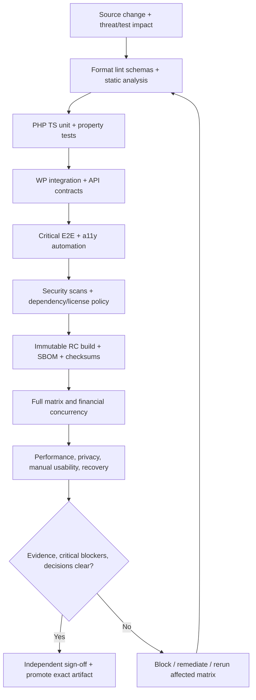

# AdPilot — Quality Assurance, Test Strategy, Automation & Release Certification Specification

**Document ID:** ADP-DOC-024  
**Filename:** `24_ADPILOT_QUALITY_ASSURANCE_TEST_AUTOMATION_RELEASE_CERTIFICATION.md`  
**Version:** 1.0.0 (implementation and verification contract proposal)  
**Status:** Proposed — requires Product Owner, QA Lead, Principal Architect, Security/Privacy, Finance, AdTech, Accessibility and Release Engineering sign-off  
**Date:** 2026-10-12  
**Product:** AdPilot — Self-Service Advertising Marketplace & Behavioral Analytics for WordPress  
**Document owner:** Principal Quality Engineering Lead  
**Implementation target:** GPT-6 High, incremental, evidence-based work packages with explicit fail/stop rules  
**Normative predecessors:** `ADP-DOC-001` through `ADP-DOC-023`  
**Proposed next document:** `ADP-DOC-025` — Deployment, Operations, Observability, Upgrade & Disaster Recovery Specification (subject to the documentation roadmap)

> **Status and truthfulness:** This is a comprehensive **proposed test and release specification**, not a record of performed tests, achieved certification, deployed software, established throughput limits or regulatory compliance. Source documents contain proposals and open design decisions. All tests here require executable implementations and captured results before any release may be declared certified. Approval cannot be inferred from a passing CI badge alone.

---

## 1. Authority, goals, terminology and requirements precedence

### 1.1 Document hierarchy and conflict policy

| Source | Preserved authority and required QA linkage |
|---|---|
| `ADP-DOC-001` | **129** `FR-*` statements with exact R1–R4 scope, `BR-001..018`, `NFR-001..016`, `INV-01..10`, `AC-001..015`, `DEC-001..012`. |
| `ADP-DOC-002` | The existing 129 `AT-*` functional acceptance cases, 18 `AT-BR-*`, 17 `E2E-*`, and `CAP-01..18`; do not replace these by a parallel simplified catalog. |
| `ADP-DOC-003` | 16 personas, 24 JTBD, 28 `UJ-*` journeys, 18 `WF-*`, 20 `UI-*` canonical screen contracts, and 28 `UXA-*` UX acceptance cases. |
| `ADP-DOC-004..005` | Independent domain state machines and `DP-*` policies; 16 `PERM-*` access tests, current authorization and 64 `D05-T-*` negative cases. |
| `ADP-DOC-006..007` | Architecture decision register and 24 `IC-*` contracts; aggregates, ports, domain events and transaction invariants. |
| `ADP-DOC-008..010` | Database persistence/locking/migrations; 145 proposed API routes, 30 domain events, 36 background jobs, inbox/outbox/watermark protocols. |
| `ADP-DOC-011..014` | UX flows, design tokens and component library, administrator console and advertiser purchasing interfaces. |
| `ADP-DOC-015..017` | Layout Studio, four Gutenberg blocks and equivalent PHP/shortcode/theme-hook integrations; immutable slot identity and render-occurrence distinction. |
| `ADP-DOC-018..020` | Delivery eligibility, SDK load budgets, measurement and attribution, privacy-governed R2 heatmaps, optional R4 replay. |
| `ADP-DOC-021..022` | Transaction-safe commercial rules, WooCommerce adapters and immutable creative/version moderation. |
| `ADP-DOC-023` | Threat registers, incident and consent controls, 120 proposed security tests and sign-off dependencies. |
| **`ADP-DOC-024`** | Specifies *how* to implement, execute, govern, retain and audit tests; it SHALL NOT silently rewrite higher-authority domain expectations, API wire formats, database schemas or release assignment. |

`MUST` and `SHALL` denote a gate applicable to the relevant enabled release. `SHOULD` permits a documented, approved, time-bound exception where explicitly noncritical. `MAY` is optional. **R1** fixed/time advertising/marketplace/checkout/basic reporting; **R2** viewability and aggregated heatmaps; **R3** qualified CPC/CPM and attribution; **R4** federation/extension and optional off-by-default replay. Unavailable release features must remain unavailable and must not be called “tested” merely because a UI prototype exists.

**When contracts conflict:** (1) record document/version/identifier pair, impact, evidence, proposed alternatives and owner; (2) fail closed on financial, authorization, creative serving or behavioral capture ambiguity; (3) block affected release or disable that specific capability under an approved degradation policy; (4) obtain upstream change control and update the contract tests, migrations and clients; (5) never hide the gap by editing a test to match unintended behavior.

### 1.2 Quality objectives

1. Prove correctness of monetary, inventory, authorization and creative-policy invariants under concurrency, retries and adversarial inputs.
2. Prove each public integration reaches one authoritative policy-aware rendering/decision path, across classic/block themes and Gutenberg.
3. Validate dense pages of **4 header + 100 sidebar + 196 in-content + 200 footer = 500 configured logical slots**, without mistaking all 500 for served or billable impressions; benchmark 1,000+ stress conditions separately.
4. Demonstrate suitable usability, visual polish, responsive operation, RTL/internationalization and **WCAG 2.2 AA target** with assistive-technology evidence.
5. Prove operational robustness: transactions, outbox, HTTP retries, Action Scheduler outages, migration rollback strategy, backups and safe degradation.
6. Guarantee R2 behavioral proxies are clearly labeled and privacy-protected; R3 metering is based on independently certified evidence; R4 replay is not activated without explicit consent and sign-offs.
7. Publish traceable, independently reproducible evidence of release decision and open risks; avoid unmeasured performance promises.

### 1.3 Definitions and evidence vocabulary

| Term | Defined meaning |
|---|---|
| Test case | Stable identifier, prerequisite, action/input, expected oracle, scoped release, severity and evidence capture contract. |
| Automated assertion | Programmatically checked predicate against actual observed outputs and authoritative state; test source alone is not evidence of execution. |
| Contract test | Producer/consumer verification of public API, hook, database adapter, event or frontend boundary, including permitted error response. |
| Invariant test | Exercise of a cross-workflow business rule under success, denial, failure and race conditions. |
| Nonfunctional benchmark | Measured, statistically reported load/resource/latency/accessibility behavior with disclosed environment and uncertainty. |
| Release qualification | Successful execution of all mandatory release suites under approved matrix, with addressed blocking defects and signed evidence. |
| Release certification | **Internal organizational sign-off**, not a governmental, OWASP, payment-industry or accessibility authority certification. |
| `PASS` | Actual evidence recorded, oracle satisfied, dependencies and environment verifiable. |
| `FAIL` | Observed result violates test oracle; for safety-critical tests this is a hard blocker. |
| `BLOCKED` | Precondition or unresolved decision prevents execution; *not* a pass. |
| `NOT_RUN` | Case has not run, or evidence is absent; *not* a pass. |
| `NOT_APPLICABLE` | Documented reason, release gate and approval, not a way to exclude required current-release cases. |
| `FLAKY` | Test intermittently fails or passes without controlled product change; unresolved flakiness affecting a release gate blocks certification. |

## 2. Governance, accountability and release sign-off

### 2.1 Responsibility matrix

| Accountable party | Responsibilities; minimum deliverables |
|---|---|
| Product Owner | Approves scope, acceptance semantics, intentional limitations and unresolved product risks; witnesses critical E2E. |
| Principal Architect | Architecture test design, module/port boundary enforcement, compatibility exception decisions and migration changes. |
| QA Lead | Owns test strategy, coverage map, exit criteria, oracle credibility, flake triage and evidence completeness. |
| WordPress Engineering Lead | WP PHPUnit tests, roles/capabilities, multisite, themes, Gutenberg compatibility, dependency safety. |
| Database and Concurrency Lead | Transactional capacity proofs, isolation constraints, migration and restore assertions, SQL plan benchmarks. |
| AdTech/Delivery Lead | Eligibility/selection parity, lightweight runtime, targeting, creative safe rendering, progressive 500-slot behavior. |
| Finance/Commerce Lead | Rate snapshots, idempotent payments, refund/credit control, reconciliation, HPOS and R3 billing verification. |
| Measurement/Analytics Lead | Event provenance, denominators, deduplication, model versioning, missingness, aggregation corrections. |
| Security Lead | STRIDE cases, privilege negative tests, upload/webhook abuses, supply chain, coordinated security approval. |
| Privacy Lead | Consent/purpose gates, cohort suppression, retention/DSR, region-specific policy sign-off, R4 replay. |
| UX/Accessibility Lead | Interaction heuristics, manual WCAG 2.2 AA, keyboard/AT validation, usability sessions, responsive/RTL. |
| Release/DevOps Lead | Reproducible images, artifact signing/checksums, CI evidence, deployment, observability, rollback and incident exercises. |
| Technical Writer/Support Lead | Installer, administrator, API and troubleshooting documentation exercised by fresh-start testers. |
| Independent reviewer | Reviews critical finance, privacy, security and concurrency evidence; cannot self-approve own unsafe exception. |

### 2.2 Change-control semantics

Every modification of a canonical `FR`, `BR`, `NFR`, `AC`, `INV`, `AT`, `E2E`, `PERM`, API route, `IC`, database version or release gate SHALL be accompanied by (a) source change request, (b) impacted-test query, (c) updated fixtures and evidence plan, (d) named approvers, and (e) review of backward compatibility. A removed test requires a signed replacement or valid deprecation decision. A newly discovered regression requires a permanent automated test whenever feasible.

### 2.3 Severity and waiver rules

| Class | Examples | Release effect |
|---|---|---|
| **P0 / Stop ship** | Cross-tenant data disclosure; double-sale; incorrect ledger posting; unapproved creative serving; unauthorized session capture; verified RCE; irreversible migration corruption. | Immediate block. No waiver based only on schedule or UX preference. |
| **P1 / Critical blocker** | Checkout cannot reconcile safely; sensitive consent gate bypass; broken access revocation; loss of necessary audit records; essential WCAG/keyboard workflow inaccessible; unsafe downgrade. | Block enabled feature/release until corrected and retested; escalate exception only through explicitly documented full risk and compensating controls where legal/safety obligations permit. |
| **P2 / Major** | Significant task failure, reproducible unapproved NFR budget miss, bad retry UI, locale accounting ambiguity, inaccurate report labels. | Normally block milestone; a deliberately disabled optional feature may be deferred with Product/QA/security/finance approval as applicable. |
| **P3 / Minor** | Small styling deviation, noncritical language polish, low-impact recoverable friction. | Time-bound issue may be accepted by Product and QA if not masking a more severe fault. |

**Never merge test-status changes with product-code changes solely to change a red required test to green.** Quarantine flaky tests only with owner, ticket, investigation deadline, risk assessment, replacement manual/automated control, and clear exclusion from release-pass counts.

## 3. Test pyramid and mandatory verification layers

| Layer | Primary tool approach (proposed; version lock required) | Contract | Typical execution |
|---|---|---|---|
| PHP unit and property tests | PHPUnit + deterministic fakes/fixtures; static analysis PHPStan/Psalm per approved profile | Value objects, policy gates, states, decimal money, identity, time windows | Every PR |
| WordPress integration | WP test framework in `@wordpress/env` or equivalent pinned real WP test environment | `wpdb`, hooks, capabilities, block registration, REST controller, site-switching | Every PR / matrix nightly |
| JavaScript unit/component | Vitest or Jest, React Testing Library, TypeScript strict, accessibility rules | Components, transitions, UI guards, browser SDK selection/observer adapter | Every PR |
| Contract testing | OpenAPI/JSON Schema consumer-driven fixtures, hook/persistence/event snapshots, real error paths | 145 proposed route ids as approved, `IC-001..024`, version negotiation | Every PR/merge |
| Integration with dependencies | Dockerized WP + test MySQL/MariaDB + WooCommerce (optional) + Action Scheduler | Actual SQL locks, HPOS, webhooks, outbox/inbox, migrations | Merge and release |
| E2E | Playwright with WordPress-specific utilities (pinned versions) | `E2E-01..17`, `UJ-*`, `WF-*`, UI states and actual DOM/billing assertions | Required PR smoke; full release |
| Browser visual/UX | Playwright stable screenshot fixture; manual review and user task studies | Design tokens, viewport/zoom, RTL, contrast, keyboard, perceived clarity | Merge/nightly/manual sign-off |
| Accessibility | axe-core as advisory automation + manual keyboard, NVDA/VoiceOver and semantic review | WCAG 2.2 AA critical journeys incl. canvas equivalents | PR automated; release manual |
| Security and privacy | SAST/SCA/secret scanning + DAST/fuzz/abuse + manual penetration review | `SEC23-*`, tenant control, privacy/data flows, upload safety | PR scans; nightly/RC adversarial |
| Load, soak, fault and resilience | k6/Locust/PHP concurrency harness; Playwright browser metrics; Toxiproxy/test fault injection where suitable | p75/p95, 500-slot bounded work, 1k+ stress, fault behavior and transactional safety | Baseline and release RC |
| Operational and distribution | Reproducible package build, SBOM, WP plugin lint, upgrade/backup drills | `AC-014..015`, rollback/recovery, docs, GPL/license provenance | RC and package promotion |

Selection of tools is a **proposed implementation decision**. Verify PHP/Node/WordPress support for pinned tool versions, software licenses, and CI-host capabilities before adoption; do not imply that all listed tools are installed in the product repository.

### 3.1 Static quality gates

- Composer `validate --strict`; coding-standard checks with WPCS/PHPCS; no error-level PHPCS suppressions without documented rationale and scope.
- PHP type/static-analysis profile agreed per module; baseline technical debt tracked and prevented from increasing. No skipping privileged or payment paths via broad exclusions.
- TypeScript `strict` mode, lint, formatting, bundle boundaries, component tests and production build. CI prevents unresolved imports and unexpectedly shipped test/mock code.
- Schema validation: API OpenAPI, `block.json`, JSON events, worker payloads, migration checksums, translation text-domain, license metadata.
- Automated source import-boundary scanner ensures modules cannot reach another module's repository tables or internal services except approved ports.
- Security scans: `composer audit`, npm audit/approved scanner, secret detection, SBOM/permissioned dependency inventory; CVE triage is context-sensitive but release-blocking risk decisions documented.
- Every built release package SHALL be generated from a fresh checkout using pinned dependency locks; compare file manifest and checksum after installation.

## 4. Environment matrix and deterministic test data

### 4.1 Hermetic environments

| Environment | Scope and controls |
|---|---|
| `qa-unit` | No external network; time/entropy abstracted; deterministic fake repos; fixed locale and currency where relevant. |
| `qa-wp` | Real WordPress integration framework and isolated site DB; rollback/reset between tests; explicit plugin activation. |
| `qa-commerce` | Test WooCommerce/HPOS and legacy-order-storage modes (if supported), fake gateway signatures, webhook replay feed, authorized refunds. |
| `qa-multisite` | At least two subsites, overlapping numeric object IDs, different prefixes/organizations, shared user memberships and network admin. |
| `qa-browser` | Playwright Chromium, Firefox and WebKit (representative supported desktop/mobile profiles); locale, 200%/400% zoom, reduced motion and no-JS conditions. |
| `qa-perf` | Named CPUs, RAM, browser, DB versions, warm/cold cache policies, network throttling, content/layout/creative fixture manifest. |
| `qa-chaos` | Fault-injected DB, worker, gateway, cache, webhooks and telemetry endpoints; recoverability and no unsafe financial effects. |
| `qa-rc` | Immutable release candidate plugin zip installed fresh and upgraded from specified previous versions; no developer privileges bypass. |

**Supported-version matrix:** Establish support bounds explicitly from the approved product compatibility decision: lowest/highest declared WordPress, supported PHP minors, MySQL/MariaDB engine versions and storage engines, WooCommerce (absent, enabled legacy, HPOS), classic/block themes and major browser engines. The exact version numbers are **not invented here**; generate a version-pinned matrix file and review against official platform support before freezing a release. Use pairwise coverage for ordinary combinations and exhaustive targeted combinations for financial transaction and security boundary variants. Required `qa-commerce` and `qa-multisite` cases must not be silently dropped in matrix reduction.

### 4.2 Fixture design contract

Test fixture objects SHALL have stable semantic keys, random opaque public IDs where required, site/org ownership tags, deterministic UTC timestamps, explicit separate payment/approval/delivery states, version references, and clear cleanup operations. Use synthetic PII only. Reset queues, options, caches, scheduler state and test webhook secrets. For financial tests, maintain separate test-ledger namespace and compare aggregate balances before/after. File uploads include safe images, known nonexec malformed/polyglot samples and strict byte limits. No real payment details, real personal analytics, or live customer records may be used in CI.

### 4.3 Clock and idempotency control

Use injected `Clock` and controlled event timestamps for TTL, time-zone and DST tests; database transaction tests run on a genuine transactional storage engine. Vary event arrival order and repeated delivery independently of wall clock. Use a fixed seeded PRNG to reproduce selector distributions while also testing unbiased live entropy and fairness with statistically meaningful intervals. Do **not** mock away database isolation or external webhook signature checks in the final integration suites.

## 5. Domain and invariant testing strategy

### 5.1 State-machine model testing

For each `SM-*` in Document 04 create a transition graph and executable table: source state, action, actor, target state, current policy/authority, version precondition, committed records, emitted outbox event, audit record, expected result, error type, retry semantics. Include every forbidden transition and independence cross-product: payment status does not imply creative approval; approval does not imply an active reservation; delivered creative must be bound to an allowed version. Run property-based sequences with shrinking; store seeds when a failure is found.

### 5.2 Critical invariants to prove

- `BR-001/005`, `INV-*`: atomic capacity and exclusive interval non-overlap. Two simultaneous buyers, reordered locks and retry after crash do not double-sell.
- `BR-002`: no expired-hold revival by late payment. Explicit extension is a separately authorized transaction, not a mutation of the old TTL.
- `BR-003/004/007/008`: settled payment, review result and actual serving remain independently gated, including stale cache, creative revision, emergency pause and compensating remedy.
- `BR-006/018`: material layout/priority override changes require accurate contract-impact diff, reason, permission, approved compensating action and immutable audit.
- `BR-009/011/012/013`: preview and synthetic events are excluded; advertiser reports contain qualified aggregates with proven provenance, finite raw retention and valid model labels.
- `BR-014`: all financial arithmetic uses exact decimal/minor-unit arithmetic under currency policy; serialize amounts without float round-trip.
- `BR-015`: UTC `[start,end)` window and DST fold/gap correctness verified at backend and user display.
- `BR-010/016`: density, accessibility and mobile layout policies hold even at large configured slot counts.
- `BR-017`: tracking adapters/heatmaps/replay are policy- and consent-gated with documented purpose/data flow.

### 5.3 Positive, negative, boundary and metamorphic test design

For each high-risk rule include a valid transition, nonexistent ID, foreign tenant, stale revision, wrong role, malformed field, duplicate command, concurrent modification, future/expired clock, gateway retry, cache staleness and injected persistence failure. Metamorphic properties: reordering independent reads does not change business authority; duplicate event delivery does not change final ledger state; rendering through PHP/shortcode/block/hook yields equivalent eligibility; changing viewport changes CSS geometry but not `logical_slot_id` and paid contract; changing language does not change UTC scheduling or money totals.

## 6. API and integration contract tests

### 6.1 Route-wide coverage obligations

For every approved `API-*` or equivalent route registry ID defined by Document 09, generate a case manifest with method, path, release, owner, permission, input schema, valid response, invalid input, direct object-level denial, conditional mutation and rate limit behavior. A proposed route not yet approved is a contract gap, not an assumed implemented dependency. For all privileged routes require `permission_callback` verification, current site/org/resource authorization, nonce or channel-appropriate authentication, and output field allowlisting. Verify `403` versus `404` semantics without cross-tenant information leak. Each route must handle malformed JSON, wrong content type where relevant, wrong `If-Match`, unavailable dependency, oversized payload and unknown version.

### 6.2 Integration parity

The four blocks `adpilot/ad-slot`, `adpilot/ad-zone`, `adpilot/ad-repeater`, `adpilot/ad-showcase`, three public PHP functions, four shortcodes and supported theme-hook bindings call the **same** authoritative renderer. Compare decision IDs, approved creative version, fallback logic, cache key components, logical slot identity and unique occurrence/render identifiers. A demo shortcode must not create more favorable serving permissions than a dynamic Gutenberg block. Editor previews and administration must be tagged nonbillable all the way through downstream qualified analytics.

### 6.3 Webhook and worker contracts

Verify provider signature and trusted secret selection before effects. Send duplicate, out-of-order, cross-site, revoked-provider, expired and altered-payload callbacks. Verify exactly-once *business effect* through idempotent handlers despite at-least-once delivery. Poison payloads are bounded, audited and dead-lettered with no infinite hot loop. Outbound webhook SSRF protections include DNS rebinding/redirect revalidation and blocked private IP destinations; R1/R4 enablement discrepancy across Documents 08–10 is unresolved and must remain feature-gated pending approval.

## 7. Persistence, migration and distributed execution QA

### 7.1 DB transactional concurrency

Test with real parallel connections and barriers. Each executor must attempt the critical transaction concurrently (not sequential mocks). Verify row/unique constraint behavior, deterministic lock order, deadlock retries with budgets, isolation level assumptions, overlapping half-open intervals, rollback of partial operations and identical final results across retry orders. Record DB engine/version, isolation level, SQL digests/EXPLAIN and final row counts. No correctness inference from a single thread or timing sleep alone.

### 7.2 Migration and upgrade matrix

Execute fresh install, every approved supported upgrade path, partially failed step restart, replay of an already completed migration, mixed old/new worker schema, network/site-specific migration, failed capability provisioning and safe deactivation/reactivation. Check ownership and no modification of unrelated WordPress pages/options. Verify immutable historic layout/quote/ledger records after upgrade; no automatic historical financial rewrite. Where DDL cannot be rolled back, require forward-repair runbook, backups and a proven maintenance rollback/deployment strategy rather than misleading `ROLLBACK` documentation.

### 7.3 Outbox/queue reliability

Crash the worker (a) before claim, (b) after claim before effect, (c) after effect before acknowledge; rerun with two workers and expired lease. Assert eventual processing or appropriately quarantined failure, no duplicate ledger/contract effects, stable event IDs, scheduled catch-up, terminal state and alert. Disconnect object cache, analytics, WooCommerce and delivery separately. WordPress public content must remain accessible through allowed fallback when measurement fails.

## 8. Rendering, high-density, browser-runtime and frontend QA

### 8.1 Production-representative high-density scenarios

- Baseline exact 500 logical configured slots: 4 header, 100 sidebar, 196 in-content, 200 footer; publish layout revision and verify serialized size/identity invariants.
- A single `adpilot/ad-zone` block references 200 footer slots without generating 200 serialized blocks; verify editor reopen round trip and block validation.
- Stress fixture ≥1,000 logical slots with virtualization/compact manifest, responsive breakpoint toggles, partial viewport exposure and caching warm/cold runs.
- Track **configured**, selected, server-served, client-rendered, viewable, qualifying clicked and billable counts as separate non-aliased counters. Always present denominators, missingness and nonmeasurement status.
- Assert bounded fetch concurrency and no per-slot PHP SQL query explosion; isolate initial document HTML cost, ad runtime bundle load, creative image network and observer subscription count.
- Verify observer cleanup and no event loss/miscount under route change, DOM removal, Query Loop repetition, lazy markup insertion and browser back/forward lifecycle.

### 8.2 Frontend quality and visual regression

Capture screenshots for canonical `UI-01..20` across approved layout/viewports/densities and light/dark where supported; snapshots SHALL be reviewed visually as well as pixel-diffed. Test empty/loading/skeleton/success/denied/conflict/error/offline/degraded states. Exclude nondeterministic timestamps/creative rotation only through controlled test data; do not mask entire components. Verify focus return, busy indicator semantics, error summaries, invalid fields, currency/timezone labels and advertiser vs publisher permissions. All API-bound actions must display final authoritative state, not optimistic “paid/approved/activated” claims.

### 8.3 Cross-browser and RTL

Test Chrome/Chromium, Firefox, WebKit/Safari-equivalent execution and declared mobile breakpoints with LTR and RTL at zoom 200% and 400%, reduced motion, high contrast/forced colors, keyboard navigation and touch. Representative languages should include English and Persian/Arabic RTL, plus a longer-string European locale. RTL must not reverse numerical and currency semantics or inadvertently change logical reading order. Locale preferences do not mutate persisted commercial UTC timestamps.

## 9. Accessibility and real-user usability validation

### 9.1 WCAG acceptance model

Target **WCAG 2.2 AA** for critical user journeys and manual alternatives to visualization-only features. Automated axe checks cannot certify complete conformance: use keyboard-only tests, NVDA and VoiceOver/supported screen readers, heading landmarks, name/role/value, zoom/reflow, focus visibility/obscuration, accessible error reporting, text alternatives, pointer target sizing as applicable, and contrast calculations against rendered tokens. Avoid broad claims that entire websites meet WCAG from green automated scanners alone.

### 9.2 Critical task sessions

Recruit representative publisher/adops, moderator, advertiser owner, analyst/billing users, novice and experienced WordPress editors, keyboard-only and screen-reader participants where feasible. Test task completion, misclick/overbooking risk, comprehension of pending payment vs awaiting moderation, bulk slot discovery, financial exports, responsive editor and heatmap table alternatives. Define completion/abandonment/time-on-task and observed severe errors before sessions; record consent for studies, de-identify findings and avoid overclaiming statistical representativeness. Fix or explicitly adjudicate issues before release.

## 10. Measurement, attribution, heatmaps and privacy QA

### 10.1 Metric evidence and aggregation

Validate metric definition registry from Document 19, model version, attribution eligibility, dedup key, projection lag, late arrivals, UTC bucket boundaries and append-only correction provenance. Verified aggregates may be recomputed from permitted retained evidence; do not rewrite financial ledger based on raw event replay. Unknown denominators/insufficient samples display unknown, suppressed or incomplete—not zero and not a fabricated percentage. Classify preview/load-test/adblock/unmeasurable rather than treating every discarded observation as fraud.

### 10.2 Heatmaps (R2)

Verify consent/purpose gate before collection and before query/export; secure provenance of geometric anchors, viewport changes, zoom, sticky elements, AJAX and infinite scroll. Layout comparisons must refuse incompatible geometry unless an explicitly approved mapping exists. Report click/tap, scroll, visibility and activity-based attention proxies separately; never label as gaze or mind-reading. Require cohort privacy thresholds and anti-differencing controls for every query/filter/export/cache path. **Schema gaps identified in Document 20 (distinct contributor threshold and non-ad page-event references) remain release blockers until an approved design is migrated and tested.**

### 10.3 Session replay (R4 optional)

Replay remains off by default. Verify pre-capture sensitive-field masking, consent revocation, bounded recording, encryption/access checks, sampling, raw artifact retention/deletion, user disclosure, audit, redacted support access, and irreversible disablement. Test password fields, payment screens, medical/sensitive inputs and other blocked DOM areas with direct network capture inspection. No replay activation without independent Security+Privacy approval and applicable legal basis determination.

## 11. Finance, reservations and WooCommerce QA

- Unit and integration tests exercise rate cards, immutable quotes, TTL, offer acceptance, contract schedules, UTC half-open windows, currencies, tax/discount decisions, exact arithmetic and version conflicts.
- Race test exclusive inventory with >=2 simultaneous contenders; verify exactly one successful contract and no duplicate ledger entries; test independent repeat with different isolation settings if supported.
- Simulate gateway authorize/paid/failed/refunded/chargeback callbacks, duplicated and out-of-order arrival, tampered signatures, delayed WooCommerce order transitions, HPOS/non-HPOS and unavailable gateway.
- Confirm paid but unapproved creative does not serve; approved creative without valid financial entitlement does not serve; expired hold plus late paid callback enters safe remedy path.
- Reconciliation tests compare gateway evidence, WooCommerce order facts, AdPilot append-only ledger, contracts and refund/remedy obligations. Every discrepancy has a stable incident ID, observable status and designated owner; no silent balancing plug.
- R3 metered billing requires independently qualified CPM/CPC evidence, approved measurement model/version, budget/spend control, refund/dispute scenarios and rigorous reprocessing idempotency; no automated conversion of raw browser events to charges.
- Manual allocation or refund override requires separation of duties, reason, audit and test that self-approval is prohibited when policy forbids it.

## 12. Performance engineering and reliability SLO gates

### 12.1 Measure, do not invent thresholds

The project SHALL publish an approved environment-specific benchmark budget file with p75/p95 latency, DB queries per render, creative requests, JS bytes, browser memory, Core Web Vitals, queue lag, report lag and error rate. **Do not declare numeric values in this document as product-approved limits without real baseline runs and accountable sign-off.** Compare median and tail distributions over representative samples; label warm/cold cache, hardware, dataset and load schedule. Record confidence bounds where practical. A performance regression threshold is versioned and cannot be relaxed by an implementation change without independent approval.

### 12.2 Scenario matrix

| Scenario | Measured quantities | Fail/stop criteria |
|---|---|---|
| 500 slots first load | LCP, INP, CLS, initial creative bytes, requests, query count and TTFB overhead | Budget miss, eager fetch of all configured slots, counting placeholders as impressions |
| 1,000+ stress | JS heap peak, DOM nodes, FPS/editor responsiveness, virtualization effectiveness | Unbounded increase, editor crash, unsaved changes, unsafe commercial allocation |
| Request burst | p75/p95 decision latency, errors, cache hit/miss, DB saturation | Fail-open eligibility or request cost violating approved budget |
| Measurement surge | ingest queue depth, duplicate rate, projection freshness, recovery time | Analytics crash breaking publisher site or false billable aggregation |
| Woo gateway delay | hold expiration, unpaid/pending orders, verified resume, remedy logic | Unsafe seat revival, double charge or double contract |
| Worker outage and recovery | catch-up lag, reconciliation, duplicate processing, dead-letter count | Lost paid contract, repeat money effect or silent terminal failure |
| Cache and CDN stress | per-site key correctness, user-privacy absence, stale status invalidation | Cached prohibited creative or cross-site/tenant leak |
| DB migration | time, lock impact, integrity checks, recoverability | Data corruption, silent loss of ledger and inability to recover |

### 12.3 Resilience/failure policy

Injected dependency failure must yield a typed error or agreed safe fallback; public content remains readable when ad analytics fails. Finance, authorization, approval and privacy shall **fail closed** where sufficient authoritative evidence is missing. Every degraded mode has an observability signal and clear user-facing state; no false successful purchase/serving/replay indicators.

## 13. Security, privacy and supply-chain verification gates

Execute Document 23 STRIDE and privacy test catalog, including BOLA/IDOR, stale membership, privilege escalation, CSRF/nonce misuse, hostile `block.json` attributes, SQL/XSS/SSRF, file upload polyglots, webhook spoofing, secrets leakage, payment callback replays and cross-site cache isolation. Do not limit to source scanning; use HTTP exploitation simulations and verify authoritative DB/audit/outbox state remains unchanged after denial. Any P0 finding blocks release. Record SAST/SCA/secret-scan versions, database of advisories and exception rationale. SBOM/license output must be produced from final dependency-lock files and shipped assets, including fonts/media, with reviewed GPL compatibility and notices.

## 14. CI/CD workflows and artifact provenance

### 14.1 Pipeline stages and branch policy



| Trigger | Required checks | Artifact and retention |
|---|---|---|
| Pull request | Build, code style, PHP/TS unit, changed contract tests, permissions negative tests, critical E2E smoke, scan/secret checks | Immutable test summary and failed screenshots; link change request. |
| Merge to protected main | Full integration, API schema/consumer verification, WordPress smoke in declared baseline, migration dry run, major E2E | Signed/pinned build input manifest and junit/coverage reports. |
| Nightly | Full browsers/locales, multisite, randomized/property tests, compatibility matrix, load smoke, security DAST as appropriate | Matrix trend dashboard; isolate flaky cases. |
| Release candidate | **All release-applicable** FR/AT/BR/AC/INV/SEC/UX tests, commerce concurrency, manual accessibility, performance, migration/restore, SBOM/legal/license docs | Release dossier and exception register signed by owners. |
| Post-install canary | Health/read-only smoke, queue probes, analytics nonbillable checks, payment reconciliation watch | Canary decision log; alerts and roll-forward/recovery criteria. |

No real third-party payment capture or destructive external action is permitted from ordinary CI. Real production monitoring and provider integration require separate authorized staged/canary procedures. Test-only bypass flags, fixtures, debug secrets and mock endpoints must be absent from release artifacts.

### 14.2 Example CI topology (illustrative, not production-complete)

```yaml
name: adpilot-verification
on: [pull_request, push]
jobs:
  verify:
    runs-on: ubuntu-latest
    permissions:
      contents: read
    steps:
      - uses: actions/checkout@v4 # Pin to immutable SHA in the real security-reviewed workflow.
      - name: Install pinned runtimes and dependencies
        run: echo 'Replace with approved immutable PHP/Node/Composer/npm setup actions and lockfiles'
      - name: PHP and frontend static gates
        run: composer validate --strict && composer run lint && npm ci && npm run lint && npm run typecheck
      - name: Unit tests
        run: composer run test:unit && npm run test:unit
      - name: Integration/E2E
        run: echo 'Run pinned WP/DB/Playwright services and contract/critical E2E suites here'
      - name: Evidence and artifact capture
        run: echo 'Archive real JUnit, coverage, scan, build hashes, screenshots, logs'
```

Do not accept these example placeholder steps as executed security coverage or an installable CI pipeline. The actual implementation shall pin actions by digest, bring up isolated services, supply sanitized credentials, retain artifacts and fail when any required script is missing.

## 15. Test execution, data handling, flake control and defect lifecycle

Each run stores commit SHA, exact plugin artifact checksum, dependency lock checksums, test source version, suite filter, declared release, runner and service versions, OS/container digest, browser build, database isolation mode, random seed, test data manifest, timestamps, duration, assertion counts, failures, CI artifact URLs and redacted trace pointers. Store output encrypted/restricted where it might include cookies, user metadata or webhook messages; never attach real customer payment or session data. Failed tests require issue, owner, priority, reproducible minimal fixture, defect root cause and regression test. Flaky tests are characterized under repeated controlled runs; arbitrary retries do not turn a broken test green. CI failure and deployment emergency procedures require notification and release freeze when critical.

## 16. Release readiness, approval matrix and formal internal certification

### 16.1 Release-by-release mandatory evidence

| Release | Must pass beyond common R1 platform gates | Blocking unresolved dependencies |
|---|---|---|
| **R1** | `AC-001..015`, `E2E-01..17` wherever applicable by Document 02, all 129 `FR` filtered to R1, canonical BR/NFR, 500-slot path, four integration paths, Woo HPOS, no-Woo activation, tenant separation, moderation, safe rendering and exact payment/hold invariants. | Missing approved runtime matrix, core authorization, financial/creative safety, unusable key workflows or release package provenance. |
| **R2** | R1 regression + enabled R2 FR/AT, viewability qualification, scroll/click/tap geometry, cohort privacy and export/aggregation, map-version parity, accessible numerical equivalents. | Contributor-threshold schema, non-ad event model, consent/privacy decisions, heatmap query suppression bypass. |
| **R3** | R1/R2 regression + metered billing, certified click/impression evidence, attribution model/version, independent ledger reconciliation, disputes, finance security and fault recovery. | Undefined metering/tax/reconciliation rules, missing financial authorizations, unsafe billing evidence, unapproved schema or payment contracts. |
| **R4** | All applicable regression + off-by-default replay with consent/masking, federation site authority, optional worker/provider adapters, secret rotation and network incident recovery. | Unapproved replay purpose/consent/retention, unsafe cross-site access, unsupported third-party adapter or irreversible export leakage. |

A conditional release may disable an entire optional future-release capability if disablement is technically verified across UI/API/jobs/database behavior, and the Product Owner accepts the resulting scope. It may **not** disable critical current-release access-control or financial-safety obligations simply to get a pass.

### 16.2 Required sign-off dossier

- A machine-readable test manifest with baseline source document digests, FR/BR/AT/AC/INV/UX/API/module contract crosswalk and release applicability.
- Complete run report, reproducible logs/artifacts, screenshots/manual a11y and UX study findings, performance distributions and hardware/environment manifest.
- Evidence of source/distro build reproducibility, package checksum, SBOM, license notices, third-party audit status, and upgrade/backup/recovery exercises.
- Status of all P0/P1/P2 defects, flaky/quarantined tests, open change requests, residual risks and compensating controls with expiration.
- Named approvals by Product Owner, QA Lead, Principal Architect, Security/Privacy, Finance for commerce/metering, UX/Accessibility, DevOps and independent reviewer for critical invariants.
- Release artifact identity, installation instructions, known limitations, downgrade/roll-forward plan, monitoring/success measures and on-call handoff.

### 16.3 Decision algorithm

```text
for each applicable obligation in release scope:
    require a linked executable test or independently documented manual verification
    require actual PASS evidence from the exact candidate artifact and approved environment
    reject NOT_RUN, BLOCKED, UNREVIEWED and stale-PASS as proof
if any mandatory P0/P1, unapproved financial/security/privacy blocker or required evidence gap:
    verdict = BLOCKED
else if required matrices, migrations, or independent approvers missing:
    verdict = BLOCKED
else:
    verdict = ELIGIBLE_FOR_INTERNAL_SIGNOFF
record signoffs, verdict, artifact checksum and approvals; never invent test execution
```

## 17. Critical R1 release acceptance playbook (`AC-001..015`)

Run the exact `AC-*` conditions from Document 01 using the following witness sequence, with unique run and fixture identifiers and recorded evidence:

1. Install artifact on a fresh WordPress test site with no WooCommerce: plugin boots, documented pages/setup are usable, online checkout is truthfully unavailable (`AC-014`).
2. Create exactly 4 header, 100 sidebar, 196 content and 200 footer slots using Layout Studio, preview and publish an immutable layout version; screenshot inspect via accessible controls (`AC-001`).
3. Place the 200-slot footer via a **single** zone Gutenberg block, save/reopen, inspect serialized post for absence of 200 individual ad blocks (`AC-002`).
4. Place the same allowed inventory through Gutenberg, PHP, shortcode and registered theme hook; compare policy outputs and occurrence IDs (`AC-003`).
5. Load under browser tracing with near-viewport loading and a distant footer; verify bounded creative fetch, configured != rendered != billable (`AC-004`).
6. Enable configured test WooCommerce gateway; advertiser browses, quotes, holds, pays, uploads, requests review, waits for approval and observes allowed activation (`AC-005`).
7. Execute barrier-synchronized concurrent buyer attempts, duplicate/out-of-order callbacks and activation worker retries; inspect reservations and append-only ledger (`AC-006..007`).
8. Modify an approved creative and attempt unauthorized serving; verify exact-version moderation and emergency stop (`AC-008`).
9. Cross-organization and cross-site REST, exports, caches and UI data requests with overlapping IDs; deny every unauthorized access without leaking metadata (`AC-009`).
10. Repeat tests under classic and block themes, supported caching mode and Woo HPOS/legacy mode where declared (`AC-010`).
11. Intentionally fail the analytics endpoint; reading remains functional and no fictitious billable events are created (`AC-011`).
12. Exercise sensitive-input pages and denied/revoked consent under DevTools network recording; prohibited tracking absent (`AC-012`).
13. Manually test keyboard, screen reader, zoom, RTL and end-to-end usability of publishing, purchasing and moderation (`AC-013`).
14. Inspect reproducible zip, migrations, changelog, notices, docs, tests, manifest and security checklist; verify installation from distributed archive (`AC-015`).

**The ordering above is a witness script, not a substitute for the 15 exact product acceptance statements** appended in the traceability section. Missing evidence blocks qualification.

---
## 18. Reference test implementation patterns (illustrative, must be completed against actual code)

### 18.1 PHP domain policy unit test

```php
<?php
// Conceptual example: replace invented class names with the approved Document 07 port.
use PHPUnit\Framework\TestCase;

final class PaymentDoesNotApproveCreativeTest extends TestCase
{
    public function testPaidOrderCannotServeUnapprovedVersion(): void
    {
        $fixture = AdPilotTestFixture::paidOrderWithUnapprovedCreative();
        $decision = $fixture->delivery()->decide($fixture->publicSlotRequest());
        self::assertFalse($decision->hasApprovedCreative());
        self::assertSame(0, $fixture->ledger()->newEntriesDuringDecision());
        self::assertSame([], $fixture->measurement()->billableEvidence());
    }
}
```

The test runner must initialize the real current policy code and fail if the module API or assertions are missing. Fake helper definitions in this snippet are **not** part of an approved public product API. Never replace a failure with a noop stub to satisfy CI.

### 18.2 REST permission/data-isolation test

```php
<?php
// Conceptual WP_UnitTestCase pattern: resolve the actual approved API routes and context.
final class CrossTenantReadTest extends WP_UnitTestCase
{
    public function testAdvertiserCannotReadForeignOrder(): void
    {
        $siteId = $this->fixtureSiteId();
        $orgA = $this->makeOrganization($siteId);
        $orgB = $this->makeOrganization($siteId);
        $actor = $this->makeMember($orgA, 'billing');
        $foreignOrder = $this->makeOrder($orgB);
        wp_set_current_user($actor);
        $response = rest_do_request($this->foreignOrderEndpoint($foreignOrder));
        self::assertContains($response->get_status(), [403, 404]);
        self::assertSame($this->orderRevision($foreignOrder), $this->initialForeignOrderRevision());
        self::assertFalse($this->logsContainRestrictedPayload());
    }
}
```

### 18.3 Browser E2E test for nonbillable editor preview

```typescript
import { test, expect } from '@playwright/test';

test('editor preview never qualifies for billing', async ({ page }) => {
  // Fixture setup authenticates a legitimate publisher and seeds a draft placement.
  await page.goto('/wp-admin/post.php?post=123&action=edit');
  await expect(page.getByRole('button', { name: /preview/i })).toBeVisible();
  // Drive approved AdPilot preview controls, await explicit completion condition.
  // Query a privileged test-only introspection fixture for immutable event outcomes.
  // Required oracle: zero newly qualified/billable evidence in real DB/ledger.
});
```

Playwright browser/UI interaction alone cannot establish financial absence; test must assert authoritative backend evidence. Avoid reliance on hardcoded production post IDs or mock API success responses in a final test.

### 18.4 Concurrent reservation test orchestration

```text
seed exactly one exclusive slot, a shared half-open availability interval, two authorized orgs
open two separate real database transactions/connections A and B
synchronize at a reusable start barrier before reservation creation
A -> createHold(site, slot, [start,end), idempotency=A)
B -> createHold(site, slot, [start,end), idempotency=B)
join with bounded timeout; retry only for documented transient deadlocks
assert count(successful holds or contracts on exclusive overlapping interval) == 1
assert losing buyer receives stable capacity/conflict result with no paid entitlement
assert immutable ledger/order facts reflect only verified financial effects
repeat 100+ runs across controlled seeds; report actual count, not hypothetical pass
```

These examples are **behavioral templates**, not runnable code committed to AdPilot. Implementers must adapt them to real approved service types and routes, and provide committed runnable tests and actual output.

## 19. Canonical test fixture register (`QA24-FX-001..040`)

Fixtures are independently reproducible and intentionally cross-cut product surfaces. Every fixture has an owning factory, cleanup strategy, UTC clock seed, site/tenant and release tag. The list below is the minimum *test data contract*, not a claim that the factories are implemented.

| Fixture | Purpose and deterministic scenario |
|---|---|
| `QA24-FX-001` — Empty WordPress single-site | No WooCommerce; no existing AdPilot tables; clean admin and subscriber; R1 |
| `QA24-FX-002` — Classic theme | Representative supported classic theme with sidebar/header/footer hooks; R1 |
| `QA24-FX-003` — Block/FSE theme | Block theme with reusable template parts, Query Loop and Site Editor; R1 |
| `QA24-FX-004` — Two multisite blogs | Overlapping numeric IDs and different site prefixes; no implicit cross-blog grant; R1 isolation |
| `QA24-FX-005` — Two advertiser organizations | Shared WP user is member of one; foreign resources in second; R1 |
| `QA24-FX-006` — Mixed membership | User with different roles across two orgs; revoked membership midway through job; R1 |
| `QA24-FX-007` — Role/grant matrix | Publisher moderator, finance, operations, analyst, administrator and support privilege variants; R1 |
| `QA24-FX-008` — Canonical 500-slot layout | 4 header +100 sidebar+196 content+200 footer; immutable published revision; R1 |
| `QA24-FX-009` — Single 200-slot footer zone | One adpilot/ad-zone block references dynamic compact container; R1 |
| `QA24-FX-010` — Long-page 1200-slot stress | Virtualized page with 1,200 logical slots and progressive viewport browsing; R1 stress |
| `QA24-FX-011` — Responsive layout family | Desktop/tablet/mobile grid arrangements preserving slot identity; R1 |
| `QA24-FX-012` — Occupied layout revision | Current paid reservations and incompatible proposed slot changes; R1 |
| `QA24-FX-013` — Duplicate logical render | Same slot embedded in two template instances with distinct render IDs; R1 |
| `QA24-FX-014` — Campaign state cross-product | Draft/review/rejected/approved/paused and independent paid/unpaid/delivery; R1 |
| `QA24-FX-015` — Approved creative version | Safe raster/text with original digest, immutable approved version; R1 |
| `QA24-FX-016` — Unapproved creative replacement | New media/destination version after approved version; R1 |
| `QA24-FX-017` — Hostile creative bundle | Polyglot, executable HTML/SVG, oversized image, invalid URL and decompression abuse; R1 |
| `QA24-FX-018` — Test gateway events | Verified signed payment/settled/refund/duplicate/late/tampered gateway events; R1 |
| `QA24-FX-019` — Exclusive slot and two buyers | Two organizations attempt same overlap via actual parallel DB connections; R1 |
| `QA24-FX-020` — Mixed time windows | Adjacent and overlapping half-open intervals; UTC/DST fold and gap; R1 |
| `QA24-FX-021` — Multiple currencies | Approved minor-unit/precision examples, refunds/taxes, no binary float; R1 |
| `QA24-FX-022` — Hold expiry | Frozen clock around TTL expiration, late payment and explicit extension; R1 |
| `QA24-FX-023` — Ledger mismatch | Provider, Woo and AdPilot ledger disagree; correction requires audit; R1 |
| `QA24-FX-024` — HPOS order | WooCommerce with HPOS and mapped plugin order; R1 optional integration |
| `QA24-FX-025` — Legacy Woo order mode | Supported compatibility configuration without direct wp_posts assumptions; R1 |
| `QA24-FX-026` — Worker crash permutations | Crash before claim, after claim, after side effect, before ack; R1 |
| `QA24-FX-027` — Webhook replay batch | Duplicate/out-of-order notifications across sites and event versions; R1 |
| `QA24-FX-028` — Render and telemetry states | Configured, decisioned, rendered, viewable, qualified and billable separately; R1/R2/R3 |
| `QA24-FX-029` — Event-invalidity sample | Duplicate, preview, synthetic, malformed, out-of-window, bot-risk, unknown; R1 |
| `QA24-FX-030` — Aggregate lateness | UTC bucket boundaries, delayed events, projection corrections and incomplete data; R1/R2 |
| `QA24-FX-031` — Heatmap geometry | R2 page with sticky header, zoom, AJAX, infinite scroll, layout snapshots |
| `QA24-FX-032` — Heatmap protected cohort | R2 low contributors, filter differencing and export bypass attempts |
| `QA24-FX-033` — Denied consent | Consent denied/revoked across collection, ingest, queue, cache, report; R1/R2 |
| `QA24-FX-034` — Sensitive-input page | Password/checkout/sensitive fields near observable DOM; R1/R2/R4 |
| `QA24-FX-035` — Replay opt-in profile | R4 explicitly enabled, masked recording, short retention, revocation |
| `QA24-FX-036` — Slow network/cache fail | Cache stale, analytics down, CDN invalidation, 2G/4G emulation; R1 |
| `QA24-FX-037` — A11y editor tasks | Keyboard-only/AT role flows and nonvisual bulk/heatmap alternatives; R1/R2 |
| `QA24-FX-038` — RTL localization | FA/AR RTL with EUR/USD/IRR examples, timezone transitions, long text; R1 |
| `QA24-FX-039` — Migration history | Fresh, old version, partial migration and roll-forward restore; R1 |
| `QA24-FX-040` — Release package integrity | Built zip, manifest/SBOM/licenses, clean install and unsupported dependency; R1 |

### 19.1 Fixture compliance controls

- A scenario is reproducible only when its DB seed, expected first-version schema, clock override, queue state, actor identities, signed mock provider evidence and test asset checksum are recorded.
- Never copy customer/order/user behavioral data from production for seed generation. If an error cannot be reproduced synthetically, request restricted incident review under privacy and security procedures.
- Fixture factories must be invoked from a clean namespace/site with cleanup hooks. Assert absence of user memberships, WordPress options, background jobs and test artifacts after teardown.
- Set locale and time zone explicitly; timezone tests must include a real DST-observing zone and non-DST zone, never infer offsets from user locale.

## 20. Executable acceptance and adversarial test catalog (`QA24-T-001..120`)

Each row below is a **distinct proposed executable test obligation**, not a recorded execution. The `Given/When` text is a minimal reproducible stimulus, the expected outcome is the release oracle. Test implementation SHALL include assertion details, setup fixtures, cleanup, suite tags, environment references and evidence from the actual runtime. `R1+` means mandatory throughout the release progression unless replaced by approved source changes; future-release specific cases are enabled only for that release and subsequent compatible releases.

### 20.1 Installation, architecture and compatibility

| Test | Release | Given / When | Expected authoritative oracle | Fixtures |
|---|---|---|---|---|
| `QA24-T-001` | R1+ | Install plugin without WooCommerce, with clean WP | Plugin boots; commerce reports unavailable; no unrelated site mutations | `QA24-FX-001`; `QA24-FX-040` |
| `QA24-T-002` | R1+ | Reinstall/activate twice with existing records | No duplicate schema/options, roles or page alterations; owned data remains intact | `QA24-FX-001`; `QA24-FX-039` |
| `QA24-T-003` | R1+ | Build clean package from pinned dependency locks | Repeatable artifact manifest, no dev secrets/debug mocks and license notices | `QA24-FX-040` |
| `QA24-T-004` | R1+ | Attempt forbidden cross-module infrastructure import | Static boundary checker rejects call and names owned contract | `QA24-FX-001` |
| `QA24-T-005` | R1+ | Install with classic and block themes | Admin and public integration render safely without global CSS collisions | `QA24-FX-002`; `QA24-FX-003` |
| `QA24-T-006` | R1+ | Switch to second multisite blog and query site-bound repo | Correct prefix and site/org authorization; no stale repository reuse | `QA24-FX-004` |
| `QA24-T-007` | R1+ | Simulate unsupported PHP/DB/WP feature configuration | Installer stops unsafe features with actionable diagnostic, not silent corruption | `QA24-FX-001` |
| `QA24-T-008` | R1+ | Run fresh install and declared upgrade with migration replay | Idempotent checksummed steps and preserved financial/layout versions | `QA24-FX-039` |
| `QA24-T-009` | R1+ | Inject failure after partially applied migration | Resumable or documented safe-repair plan; preserved authoritative records | `QA24-FX-039` |
| `QA24-T-010` | R1+ | Deactivate then reactivate and run explicit uninstall flow | No accidental ledger loss; uninstall only approved owned data under policy | `QA24-FX-039` |

### 20.2 Identity, permissions and organizational isolation

| Test | Release | Given / When | Expected authoritative oracle | Fixtures |
|---|---|---|---|---|
| `QA24-T-011` | R1+ | Advertiser member requests foreign campaign by guessed ID | No foreign record/metadata leaks; authoritative state unchanged | `QA24-FX-005` |
| `QA24-T-012` | R1+ | Billing user requests campaign approval or allocation override | Denied regardless of direct REST or UI force | `QA24-FX-007` |
| `QA24-T-013` | R1+ | Moderator reads unrelated finance ledger/export | Denied by resource and sensitive field policy | `QA24-FX-007` |
| `QA24-T-014` | R1+ | Revoke organization membership during active session | Next authoritative operation and export download are denied | `QA24-FX-006` |
| `QA24-T-015` | R1+ | Change selected org in browser without changing server grants | No access union; site/org/object decision derives from trusted context | `QA24-FX-006` |
| `QA24-T-016` | R1+ | Use WP nonce with missing capability | Mutation denied; nonce not treated as authorization | `QA24-FX-007` |
| `QA24-T-017` | R1+ | Cross-site resource ID collision in multisite | Foreign site data not fetched, cached, queued or exported | `QA24-FX-004` |
| `QA24-T-018` | R1+ | Attempt direct export download with revoked/expired token | Revalidation denies and artifact stays protected | `QA24-FX-006` |
| `QA24-T-019` | R1+ | Attempt support impersonation through headers or context | Explicit permitted workflow required; no implicit actor elevation | `QA24-FX-007` |
| `QA24-T-020` | R1+ | Perform high-risk refund or policy override as self-approver | Separation of duties and durable rejection/audit satisfied | `QA24-FX-007` |

### 20.3 Inventory, layout and reservation-sensitive changes

| Test | Release | Given / When | Expected authoritative oracle | Fixtures |
|---|---|---|---|---|
| `QA24-T-021` | R1+ | Build/publish exact 500-slot canonical fixture | Correct 4/100/196/200 counts and stable unique logical slot IDs | `QA24-FX-008` |
| `QA24-T-022` | R1+ | Publish compact 200-slot footer from one zone block | One block record; 200 logical slot definitions; no block explosion | `QA24-FX-009` |
| `QA24-T-023` | R1+ | Navigate 1,200-slot editor and select large ranges | Virtualized/paginated controls; keyboard alternate; bounded memory | `QA24-FX-010` |
| `QA24-T-024` | R1+ | Change responsive breakpoint/columns for sold slot | Commercial slot identity unchanged and valid responsive output | `QA24-FX-011` |
| `QA24-T-025` | R1+ | Attempt publish of breaking sold-slot change | Requires accurate impact resolution; unsafe publication rejected | `QA24-FX-012` |
| `QA24-T-026` | R1+ | Save stale layout draft against newly published revision | Optimistic version conflict with understandable recoverable UI | `QA24-FX-012` |
| `QA24-T-027` | R1+ | Rollback compatible layout and compare immutable history | New approved publication event, not mutation of old revisions | `QA24-FX-011`; `QA24-FX-012` |
| `QA24-T-028` | R1+ | Repeat same logical zone twice within template parts | Different render occurrence IDs, policy-driven duplication handling | `QA24-FX-013` |
| `QA24-T-029` | R1+ | Generate 500 slots with pathological configuration | Limits validated without fixed product maximum; no uncontrolled work | `QA24-FX-008`; `QA24-FX-010` |
| `QA24-T-030` | R1+ | Test ad-density policy on small mobile viewport | Warning/restriction and accessible layout preserved | `QA24-FX-011` |

### 20.4 Gutenberg, PHP, shortcode, theme and runtime parity

| Test | Release | Given / When | Expected authoritative oracle | Fixtures |
|---|---|---|---|---|
| `QA24-T-031` | R1+ | Render same authorized slot through four integration surfaces | Same eligibility/creative version, independent occurrence identifiers | `QA24-FX-002`; `QA24-FX-003`; `QA24-FX-013` |
| `QA24-T-032` | R1+ | Preview creative in Gutenberg editor | Zero qualified/billable events; no live visitor delivery credential | `QA24-FX-015` |
| `QA24-T-033` | R1+ | Edit malicious block attribute or shortcode overrides | Unauthorized targeting/approval/payment override rejected | `QA24-FX-017` |
| `QA24-T-034` | R1+ | Save/reopen each of four registered dynamic blocks | Metadata and attributes validate, frontend uses server-side renderer | `QA24-FX-003`; `QA24-FX-009` |
| `QA24-T-035` | R1+ | Use repeater inside supported Query Loop anchors | No recursion/duplicate insertion; unique actual occurrences | `QA24-FX-003`; `QA24-FX-013` |
| `QA24-T-036` | R1+ | Try repeater in unsupported recursive/template context | Fail safely with editor diagnostic and no uncontrolled output | `QA24-FX-003` |
| `QA24-T-037` | R1+ | Render via PHP when plugin disabled | Safe documented empty or graceful behavior, no fatal error | `QA24-FX-002` |
| `QA24-T-038` | R1+ | Change creative version after cached HTML published | Fresh eligibility/purge prevents unapproved creative from serving | `QA24-FX-016`; `QA24-FX-036` |
| `QA24-T-039` | R1+ | Scroll to distant footer on 500-slot page | Bounded near-viewport fetch; no 500 eager heavy creative loads | `QA24-FX-008`; `QA24-FX-036` |
| `QA24-T-040` | R1+ | Remove node, navigate back/forward and insert AJAX zone | SDK observer cleanup, bounded jobs and accurate occurrence counts | `QA24-FX-013`; `QA24-FX-036` |

### 20.5 Commercial booking, WooCommerce and ledger integrity

| Test | Release | Given / When | Expected authoritative oracle | Fixtures |
|---|---|---|---|---|
| `QA24-T-041` | R1+ | Barrier-sync two buyers reserving same exclusive interval | At most one successful valid contract; loser never charged by assumption | `QA24-FX-019` |
| `QA24-T-042` | R1+ | Try adjacent [end,start) versus overlapping intervals | Correct half-open boundary admission and overlap exclusion | `QA24-FX-020` |
| `QA24-T-043` | R1+ | Expire hold then deliver valid late paid callback | No entitlement revival; governed remedy/reconciliation state | `QA24-FX-018`; `QA24-FX-022` |
| `QA24-T-044` | R1+ | Replay same valid payment callback 10 times | One successful business/ledger effect under same idempotency scope | `QA24-FX-018`; `QA24-FX-027` |
| `QA24-T-045` | R1+ | Send tampered or foreign-site payment notification | Invalid provenance rejected before order/ledger mutation | `QA24-FX-018`; `QA24-FX-027` |
| `QA24-T-046` | R1+ | Take gateway down before authoritative settlement | Pending state preserved; no optimistic paid activation | `QA24-FX-018` |
| `QA24-T-047` | R1+ | Refund partially and repeat worker job | Exactly one authorized adjustment and balanced audit trail | `QA24-FX-021`; `QA24-FX-023` |
| `QA24-T-048` | R1+ | Reconcile Woo HPOS authoritative order data | Adapter uses WC CRUD, no unsafe postmeta assumption | `QA24-FX-024` |
| `QA24-T-049` | R1+ | Reconcile supported legacy Woo order storage | Consistent adapter facts without undocumented direct-table writes | `QA24-FX-025` |
| `QA24-T-050` | R1+ | Test extreme minor-unit and discount/tax combinations | Exact money outcome; no float drift or unknown tax fabrication | `QA24-FX-021` |

### 20.6 Creative versioning, moderation and emergency suspension

| Test | Release | Given / When | Expected authoritative oracle | Fixtures |
|---|---|---|---|---|
| `QA24-T-051` | R1+ | Upload safe raster and valid destination | Quarantine/validation, approved storage and immutable digest | `QA24-FX-015` |
| `QA24-T-052` | R1+ | Upload executable/polyglot/oversized payload | Blocked before public use; error and security audit without execution | `QA24-FX-017` |
| `QA24-T-053` | R1+ | Change destination URL of previously approved creative | New unapproved version; old approval not inherited | `QA24-FX-016` |
| `QA24-T-054` | R1+ | Attempt reviewer approval of stale digest | Revision conflict, no invalid approved pointer or delivery | `QA24-FX-015`; `QA24-FX-016` |
| `QA24-T-055` | R1+ | Pay for a campaign whose creative is rejected | Paid rejection remedy path; no unapproved serving | `QA24-FX-014`; `QA24-FX-018` |
| `QA24-T-056` | R1+ | Try self-approval without required separation | Server rejects; audit captures denied attempt as appropriate | `QA24-FX-007`; `QA24-FX-015` |
| `QA24-T-057` | R1+ | Emergency suspend creative with stale caches | No future authorized decisions for suspended version; observable purge | `QA24-FX-016`; `QA24-FX-036` |
| `QA24-T-058` | R1+ | Scan service timeout during upload | Quarantine stays nonpublic; fail-closed and retryable status | `QA24-FX-017` |
| `QA24-T-059` | R1+ | Campaign paused while approval exists | Delivery denied based on current campaign state | `QA24-FX-014`; `QA24-FX-015` |
| `QA24-T-060` | R1+ | Compare exact immutable review history after policy update | Historic decision/version preserved; new decision follows current approved policy | `QA24-FX-015`; `QA24-FX-016` |

### 20.7 API, async outbox, scheduling and failure recovery

| Test | Release | Given / When | Expected authoritative oracle | Fixtures |
|---|---|---|---|---|
| `QA24-T-061` | R1+ | Fuzz a representative privileged REST schema | Consistent typed validation; no unauthorized effects | `QA24-FX-005`; `QA24-FX-007` |
| `QA24-T-062` | R1+ | Invoke current API route with stale If-Match | 409/412-equivalent approved conflict response, no overwrite | `QA24-FX-012` |
| `QA24-T-063` | R1+ | Crash worker after side effect before ack | Replayed job does not repeat ledger/contract effect | `QA24-FX-026` |
| `QA24-T-064` | R1+ | Run concurrent outbox consumers claiming same message | Fenced ownership; one logical effect and traceable retries | `QA24-FX-026` |
| `QA24-T-065` | R1+ | Reorder signed gateway callbacks and event delivery | Eventual correct state; no phantom paid/approved state | `QA24-FX-027` |
| `QA24-T-066` | R1+ | Send unsupported event schema version to consumer | Version rejection/dead-letter policy without destructive writes | `QA24-FX-027` |
| `QA24-T-067` | R1+ | Exhaust retry budget on poison scheduled task | Terminal quarantine with alert and protected diagnostic | `QA24-FX-026` |
| `QA24-T-068` | R1+ | Prevent WP-Cron triggers, then run scheduled catch-up | Safe catch-up and no double activation/invoicing | `QA24-FX-026` |
| `QA24-T-069` | R1+ | Make analytics backend unavailable during public delivery | Content and approved creatives degrade safely; no fictitious billing | `QA24-FX-036` |
| `QA24-T-070` | R1+ | Make cache unavailable during multi-tenant request | Fallback authorization authoritative; no cross-tenant entry reuse | `QA24-FX-004`; `QA24-FX-036` |

### 20.8 Measurement, reports, viewability and attribution

| Test | Release | Given / When | Expected authoritative oracle | Fixtures |
|---|---|---|---|---|
| `QA24-T-071` | R1+ | Replay preview and synthetic events via tracking endpoint | No qualifying revenue-bearing events in reporting/ledger | `QA24-FX-028`; `QA24-FX-029` |
| `QA24-T-072` | R1+ | Send duplicate click/impression envelopes | Event deduplication and stable qualified counters | `QA24-FX-028`; `QA24-FX-029` |
| `QA24-T-073` | R1+ | Compare configured versus rendered counts on long page | Different counters; no artificial billable impressions | `QA24-FX-008`; `QA24-FX-028` |
| `QA24-T-074` | R1+ | Deliver event after aggregation watermark passes | Versioned correction and explicit freshness status | `QA24-FX-030` |
| `QA24-T-075` | R1+ | Attempt cross-org advertiser report query | Only own qualified aggregate projection exposed | `QA24-FX-005`; `QA24-FX-030` |
| `QA24-T-076` | R1+ | Request unavailable denominator metric | Unknown/suppressed label, not invented zero or ratio | `QA24-FX-030` |
| `QA24-T-077` | R1+ | Claim modeled conversion as observed causal lift | UI/API label preserves model and evidence distinction | `QA24-FX-030` |
| `QA24-T-078` | R1+ | Export qualified performance as authorized analyst | Only allowed aggregate data; sensitive rows absent | `QA24-FX-005`; `QA24-FX-030` |
| `QA24-T-079` | R1+ | Reverse event arrival order around UTC day boundary | Correct bucket semantics and stable corrected projection | `QA24-FX-020`; `QA24-FX-030` |
| `QA24-T-080` | R1+ | Delete raw events by retention while keeping ledger | Financial facts remain independent and auditable under policy | `QA24-FX-023`; `QA24-FX-029` |

### 20.9 UX, accessibility, mobile, localization and usability

| Test | Release | Given / When | Expected authoritative oracle | Fixtures |
|---|---|---|---|---|
| `QA24-T-081` | R1+ | Complete advertiser registration-to-checkout with keyboard | Every critical focus/field/error reachable and understandable | `QA24-FX-037` |
| `QA24-T-082` | R1+ | Edit 500-slot Layout Studio without dragging | Equivalent keyboard operation, inspector feedback and undo | `QA24-FX-008`; `QA24-FX-037` |
| `QA24-T-083` | R1+ | Run axe and manual NVDA/VoiceOver on critical journeys | No unapproved critical WCAG 2.2 AA failure; manual record | `QA24-FX-037` |
| `QA24-T-084` | R1+ | Render 200% and 400% zoom viewport | Content reflow without clipped critical actions or lost focus | `QA24-FX-037` |
| `QA24-T-085` | R1+ | Switch light/dark/forced colors and reduced motion | Semantic focus/contrast/feedback preserved | `QA24-FX-037` |
| `QA24-T-086` | R1+ | Switch between Persian RTL and English LTR | Appropriate layout direction and stable numeric semantics | `QA24-FX-038` |
| `QA24-T-087` | R1+ | Translate currency/time-zone/DST schedule display | Contract and ledger facts unchanged with locale | `QA24-FX-020`; `QA24-FX-038` |
| `QA24-T-088` | R1+ | Force stale quote during campaign wizard | Accessible conflict and safe re-quote path, no false purchase | `QA24-FX-018`; `QA24-FX-037` |
| `QA24-T-089` | R1+ | Revoke permission mid-dashboard interaction | Fresh authorization failure shown; no stale sensitive data retained | `QA24-FX-006`; `QA24-FX-037` |
| `QA24-T-090` | R1+ | Run task-based novice/experienced usability sessions | Observed completion/error evidence measured against agreed goals | `QA24-FX-037` |

### 20.10 Performance, caches, compatibility and upgrade resilience

| Test | Release | Given / When | Expected authoritative oracle | Fixtures |
|---|---|---|---|---|
| `QA24-T-091` | R1+ | Benchmark 500 slots with cold/warm cache and slow network | Report p75/p95 and budget verdict with declared hardware/config | `QA24-FX-008`; `QA24-FX-036` |
| `QA24-T-092` | R1+ | Stress 1,200 slots through editor and browser | Bounded heap/DOM/network concurrency and no editor crash | `QA24-FX-010` |
| `QA24-T-093` | R1+ | Profile PHP query count as slots increase 1 to 500 | No N+1 per-slot query pattern; budget approved and enforced | `QA24-FX-008` |
| `QA24-T-094` | R1+ | Run delivery selection burst across multiple workers | Tail latency and DB saturation within approved budgets | `QA24-FX-036` |
| `QA24-T-095` | R1+ | Run 8-hour soak of event ingest and scheduler | No unbounded growth or silent loss; lag metrics recorded | `QA24-FX-026`; `QA24-FX-030` |
| `QA24-T-096` | R1+ | Drop CDN purge then stop approved creative | Fail-closed cache-coherence rules prevent forbidden serving | `QA24-FX-016`; `QA24-FX-036` |
| `QA24-T-097` | R1+ | Disconnect analytics while visitors load content | Public content remains operable; telemetry loss accurately marked | `QA24-FX-036` |
| `QA24-T-098` | R1+ | Recover from real DB backup of protected records | Ledger/layout consistency and expected recovery timing proven | `QA24-FX-039` |
| `QA24-T-099` | R1+ | Compare fresh install to upgrade from supported old build | Schema/data/permissions and UI state remain coherent | `QA24-FX-039` |
| `QA24-T-100` | R1+ | Run tested browser/theme/WP/PHP/DB compatibility pairs | Release-supported matrix passing or explicitly blocked | `QA24-FX-002`; `QA24-FX-003`; `QA24-FX-039` |

### 20.11 Security and privacy adversarial assurance

| Test | Release | Given / When | Expected authoritative oracle | Fixtures |
|---|---|---|---|---|
| `QA24-T-101` | R1+ | Attempt API IDOR/BOLA via changed org/resource IDs | No private data; no unauthorized state mutation | `QA24-FX-005` |
| `QA24-T-102` | R1+ | Attempt escaped/unsafe HTML destination injection | Safe creative/URL output; no executable markup | `QA24-FX-017` |
| `QA24-T-103` | R1+ | Exploit known executable upload/polyglot samples | Quarantine and scanner prevent browser execution | `QA24-FX-017` |
| `QA24-T-104` | R1+ | Try SSRF to loopback/cloud metadata via outbound webhook | Destination blocked through redirects and DNS changes | `QA24-FX-027` |
| `QA24-T-105` | R1+ | Attempt CSRF using nonce without capability | Request denied by current resource/role checks | `QA24-FX-007` |
| `QA24-T-106` | R1+ | Record network traffic from sensitive input page | No prohibited payload fields emitted | `QA24-FX-034` |
| `QA24-T-107` | R1+ | Revoke consent during active page collection | Prohibited future capture stopped across SDK/ingest | `QA24-FX-033`; `QA24-FX-034` |
| `QA24-T-108` | R1+ | Request retention erasure then query exports/caches | Approved scope erased/suppressed; proof without personal leak | `QA24-FX-033` |
| `QA24-T-109` | R2+ | Attempt report differencing to isolate visitor | R2 suppression and anti-differencing must hold when enabled | `QA24-FX-032` |
| `QA24-T-110` | R1+ | Scan final zip SBOM/licenses/secrets and test emergency pause | Security provenance documented; unsafe secrets absent; pause effective | `QA24-FX-040`; `QA24-FX-016` |

### 20.12 Future-release qualification and capability gates

| Test | Release | Given / When | Expected authoritative oracle | Fixtures |
|---|---|---|---|---|
| `QA24-T-111` | R2+ | Enable R2 scroll/click/visibility visualizations | Provenance and geometry accurate; not labeled gaze/eye tracking | `QA24-FX-031` |
| `QA24-T-112` | R2+ | Compare two incompatible R2 layout revisions | Comparison refused or approved mapping used; no false overlay | `QA24-FX-031` |
| `QA24-T-113` | R2+ | Query/export small R2 heatmap cohort | Suppression uses verified distinct-contributor policy; no bypass | `QA24-FX-032` |
| `QA24-T-114` | R2+ | Ingest R2 non-ad page interaction | Approved event schema supports it or feature remains disabled | `QA24-FX-031`; `QA24-FX-032` |
| `QA24-T-115` | R2+ | Calculate R2 viewability for partial/hidden creative | Measurable/viewable distinct and correctly qualified | `QA24-FX-028`; `QA24-FX-031` |
| `QA24-T-116` | R3+ | Charge R3 CPC after duplicate/invalid click events | Only independently qualified evidence reaches ledger once | `QA24-FX-028`; `QA24-FX-029` |
| `QA24-T-117` | R3+ | Reconcile R3 CPM after late correction/dispute | Compensating adjustments auditable, not silent ledger rewrite | `QA24-FX-023`; `QA24-FX-030` |
| `QA24-T-118` | R3+ | Test R3 spend-cap and billing model attribution | Approved model/time/currency budgets authoritative | `QA24-FX-021`; `QA24-FX-030` |
| `QA24-T-119` | R4 | Enable R4 replay with consent then revoke | Masked capture gated before network, access/retention verified | `QA24-FX-034`; `QA24-FX-035` |
| `QA24-T-120` | R4 | Enable R4 network worker/provider with multisite | No cross-site authority transfer; adapter fail-closed and observable | `QA24-FX-004`; `QA24-FX-035` |

### 20.13 Evidence and execution notes

- Every test case must have at least one **negative** or boundary assertion when it concerns money, consent, privilege or delivery eligibility. Where a row uses several fixtures, its executable setup shall cite the exact `QA24-FX-*` set (the catalog abbreviates secondary fixtures).
- A green PR unit test is not sufficient evidence for tests requiring real concurrency, browser runtime, gateway provider signature, multisite or a live database transaction. Release dossier must name the highest layer in which the critical guarantee was exercised.
- For release compatibility, each mandatory scenario is rerun after any changes to its upstream production ports, schema, token/caching policy, regulatory decision or dependencies. Use stable IDs; preserve old execution reports.
- R1 security tests remain mandatory at R2–R4. `QA24-T-109` is an R2-only enablement gate: a disabled future R2 endpoint must still fail closed in R1. R4 replay tests do not authorize capturing replay data before R4 opt-in approval.

---

## 21. Implementation work packages (`QA24-WP-001..028`)

Packages represent bounded implementation-ready slices for GPT-6 High. Each one SHALL ship runnable code/tests, reproducible invocation, artifacts, README and mapping to upstream IDs. The exit criteria listed below supplement the more detailed test catalog.

| Package | Owner | Implementation scope | Completion gate |
|---|---|---|---|
| `QA24-WP-001` — Traceability compiler and coverage dashboard | QA | Import canonical 129 FR, BR/NFR/AC, UI, E2E, tests from source snapshots; identify missing/duplicate/unsupported links | Automated manifest 100% canonical IDs with release-qualified gaps and version digests |
| `QA24-WP-002` — Deterministic fixture factory | QA+Backend | WP/DB/org/campaign/order/creative/layout builders with cleanup, clock and seeded entropy | 40 fixtures reproducibly instantiate and teardown |
| `QA24-WP-003` — Static quality and source boundaries | Architecture | PHPCS/WPCS, PHP static analysis, TS strict, lint, import-boundary tests, JSON schema checking | No unapproved error-level source or boundary violation |
| `QA24-WP-004` — WordPress test host | WordPress | Pin WP test suite, phpunit bootstrap, DB reset and WP capability integration | Real WP unit/integration suites reproducible in CI |
| `QA24-WP-005` — Browser E2E platform | Frontend QA | Playwright with WP authenticated fixtures, capture and supported browser engines | Canonical critical user journeys run without manual preconditions |
| `QA24-WP-006` — API schema and authorization generator | API+Security | Link all approved routes to valid/invalid/foreign-tenant/wrong-version tests | Every current-release route has typed positive/negative coverage |
| `QA24-WP-007` — Domain state and property suite | Domain | Compile transition tables, business invariants, seeded property-run reducer | Transitions, invalid transitions and critical business rules are asserted |
| `QA24-WP-008` — Finance and actual SQL race harness | DB+Finance | Parallel DB barrier, exclusive hold, idempotency, deadlock/backoff tests | No double-sale or duplicate ledger effect across repeated synchronized runs |
| `QA24-WP-009` — WooCommerce adapters | Commerce | HPOS and legacy supported modes, payment evidence, gateway mocks and refunds | No direct posts assumption; delayed/duplicated notifications safe |
| `QA24-WP-010` — Outbox and Action Scheduler recovery | Async | Crash/fenced claim/dead-letter/catch-up replay runners | Business effects once; at-least-once delivery recoverable |
| `QA24-WP-011` — Layout Studio 500+/1000+ | Layout+Frontend | Compact layout/immutable revision, virtualization and conflict snapshots | Publish 500; stress >=1000 without layout identity corruption |
| `QA24-WP-012` — Four Gutenberg block suite | Gutenberg | block.json schema, save/reopen, Site Editor and repeater semantics | Every block respects server policy and nonbillable preview |
| `QA24-WP-013` — Theme integration parity | WordPress | PHP/shortcode/hook/classic/block comparisons and plugin-absent fallback | Uniform policy, distinct occurrence IDs and clean unloaded state |
| `QA24-WP-014` — Public SDK performance instrumentation | AdTech | DOM observers, fetch budgets, lifecycle cleanup, visibility/telemetry separation | Network/browser budgets measurable; no configured-to-impression alias |
| `QA24-WP-015` — Creative validation and moderation | Creative+Security | Hostile file corpus, scanner failure, version approval, cache stop | No unsafe upload execution or unapproved creative selection |
| `QA24-WP-016` — Measurement metric contract tests | Measurement | Metric registry, event provenance, invalidity/late arrivals/UTC corrections | Reports carry truthful denominators, provenance and freshness |
| `QA24-WP-017` — Privacy and consent E2E | Privacy | Sensitive pages, network tap, data subject rights, protected exports | No prohibited collection or cross-tenant behavioral data |
| `QA24-WP-018` — Accessibility and manual usability program | UX+A11y | Automated checks, keyboard/AT and real-person role tasks, RTL | Evidence for WCAG target and critical task comprehension |
| `QA24-WP-019` — Finance screens and reconciliation | Finance+Frontend | Billing approval, order discrepancies, double-control, exporter rights | No misleading payment completion; auditable discrepancies |
| `QA24-WP-020` — Performance baseline and budget registry | Performance | Controlled p75/p95, Core Web Vitals, browser memory, query and event lag baselines | Owners approve machine-versioned budgets and regression thresholds |
| `QA24-WP-021` — Security and supply chain | Security | STRIDE/OWASP cases, SAST/DAST, SBOM/licenses, secret policy | No open P0/unauthorized data path; documented scan evidence |
| `QA24-WP-022` — Migration, installation and restore | DB+DevOps | Fresh/upgrade/partial-failure/restore and no-Woo install | Data safety and exact distribution zip verification |
| `QA24-WP-023` — R2 viewability and heatmap geometry | Measurement+UX | Consent-aware anchors/viewport and accessible heatmap tables | Layout/version-safe signals, no false gaze claim |
| `QA24-WP-024` — R2 privacy cohort controls | Privacy+DB | Distinct-contributor schema policy, differencing and export denial | Suppression cannot be bypassed; approved schema deployed |
| `QA24-WP-025` — R3 certified metering and attribution | Finance+Measurement | Qualified CPC/CPM evidence, adjustments, spend caps and disputes | Finance signs qualified billing and correction audit |
| `QA24-WP-026` — R4 replay security and federation | Security+Privacy | Off-by-default capture masking, retention, network isolation | Privacy/security approval for opt-in; no cross-site data transfer |
| `QA24-WP-027` — RC evidence and signed internal certification | Release+QA | Machine-generated dossier, test run links, waiver controls, signers | Single immutable artifact and proven conditions for approval |
| `QA24-WP-028` — Continuous regression governance | QA+DevOps | Flake triage, change-impact graph, performance drift, exceptions expiry | No stale PASS; reliable mandatory suite quality |

### 21.1 Package workflow instructions for GPT-6 High

1. Identify package objective, controlling documents and exact existing code/API/DB types; inspect actual repository first. Do not assume proposed contracts have been implemented.
2. List every mandatory upstream invariant touched and its corresponding existing `AT`, `BR`, `PERM`, `E2E`, `SEC23`, and `QA24` test IDs. Mark any missing contract with a named blocker.
3. Build or reuse deterministic fixtures; write failing tests against current behavior; prove failure for the correct reason before changing production logic when feasible.
4. Implement the smallest coherent vertical slice, including domain, persistence, API, UI and background consumers as needed. Keep authorization and financial decisions inside server authority.
5. Execute unit, integration, boundary and appropriate E2E/safety tests using actual tools; collect commands, environment, source/artifact digests, and evidence.
6. Obtain independent review for security/privacy/financial invariants; update docs and source-derived traceability. Report unexecuted/blocked cases as such.
7. Never fill execution results with synthetic PASS labels; never claim to have certified a product by writing this Markdown.

---

## 22. Open test architecture and certification decisions (`QA24-DEC-001..030`)

The following decisions require design review; they are **not approvals** and do not override upstream `DEC`, ADR or cross-document change requests. Each decision needs owner, alternatives, rationale, affected release, evidence, implementation change and closure date before the dependent gate can be marked passed.

| Decision | Gate release | Accountable reviewers | Required closure test/evidence |
|---|---|---|---|
| `QA24-DEC-001` — Exact supported WP/PHP/DB/browser/version matrix | R1 | Architecture + WP + Release | Reviewed ADR/change request, bound tests and signed results before enablement |
| `QA24-DEC-002` — Pinned PHPUnit/Playwright/Node/toolchain profile and CI runner provenance | R1 | QA + DevOps | Reviewed ADR/change request, bound tests and signed results before enablement |
| `QA24-DEC-003` — Static-analysis error budget and module boundary enforcement implementation | R1 | Architecture + QA | Reviewed ADR/change request, bound tests and signed results before enablement |
| `QA24-DEC-004` — Quantitative p75/p95 budgets for the 500-slot baseline and 1,000+ stress | R1 | Performance + Product | Reviewed ADR/change request, bound tests and signed results before enablement |
| `QA24-DEC-005` — Approved build reproducibility and artifact signature/checksum process | R1 | Release + Security | Reviewed ADR/change request, bound tests and signed results before enablement |
| `QA24-DEC-006` — Accepted WordPress extension and theme compatibility profiles | R1 | WordPress + QA | Reviewed ADR/change request, bound tests and signed results before enablement |
| `QA24-DEC-007` — Actual DB engine/isolation guarantees for transactional booking | R1 | Database + Finance | Reviewed ADR/change request, bound tests and signed results before enablement |
| `QA24-DEC-008` — Allowed payment providers, HPOS/legacy support and gateway test coverage | R1 | Finance + WooCommerce | Reviewed ADR/change request, bound tests and signed results before enablement |
| `QA24-DEC-009` — Final tax/currency precision, rounding and refund behavior oracle | R1 | Finance + Legal/Product | Reviewed ADR/change request, bound tests and signed results before enablement |
| `QA24-DEC-010` — Role/capability decisions and network super-admin authority restrictions | R1 | Security + WP | Reviewed ADR/change request, bound tests and signed results before enablement |
| `QA24-DEC-011` — Consent/purpose/retention policy per supported jurisdiction | R1 | Privacy + Legal | Reviewed ADR/change request, bound tests and signed results before enablement |
| `QA24-DEC-012` — Security incident severity, manual waiver policy and independent reviewers | R1 | Security + Product | Reviewed ADR/change request, bound tests and signed results before enablement |
| `QA24-DEC-013` — Creative scanner and decoder support, MIME allowlist and failure fallback | R1 | Security + Creative | Reviewed ADR/change request, bound tests and signed results before enablement |
| `QA24-DEC-014` — Supported ad density and mobile accessibility thresholds | R1 | UX + AdTech | Reviewed ADR/change request, bound tests and signed results before enablement |
| `QA24-DEC-015` — Valid preview/synthetic event exclusion tagging and test semantics | R1 | Measurement + AdTech | Reviewed ADR/change request, bound tests and signed results before enablement |
| `QA24-DEC-016` — Versioned API/hook public compatibility, routes still pending design approval | R1 | Architecture + API | Reviewed ADR/change request, bound tests and signed results before enablement |
| `QA24-DEC-017` — Outbox/cron/worker execution host and fault recovery budgets | R1 | DevOps + Backend | Reviewed ADR/change request, bound tests and signed results before enablement |
| `QA24-DEC-018` — Observability log retention, evidence encryption and safe CI artifact access | R1 | Security + Privacy + QA | Reviewed ADR/change request, bound tests and signed results before enablement |
| `QA24-DEC-019` — Usability study sample and task threshold approval | R1 | UX + Product | Reviewed ADR/change request, bound tests and signed results before enablement |
| `QA24-DEC-020` — Accessibility manual test tools/matrix and ownership of outstanding findings | R1 | Accessibility + Product | Reviewed ADR/change request, bound tests and signed results before enablement |
| `QA24-DEC-021` — Outbound webhook R1 vs R4 discrepancy recorded in Documents 08–10 | R1/R4 | Architecture + API + Security | Reviewed ADR/change request, bound tests and signed results before enablement |
| `QA24-DEC-022` — Published geometry snapshot precision and layout-version mapping | R2 | Layout + Measurement | Reviewed ADR/change request, bound tests and signed results before enablement |
| `QA24-DEC-023` — Distinct eligible contributor schema and suppression method | R2 | Privacy + Database | Reviewed ADR/change request, bound tests and signed results before enablement |
| `QA24-DEC-024` — Non-ad page-event schema for full-page heatmaps | R2 | Measurement + Database | Reviewed ADR/change request, bound tests and signed results before enablement |
| `QA24-DEC-025` — Heatmap privacy-query differencing/exclusion policies | R2 | Privacy + Analytics | Reviewed ADR/change request, bound tests and signed results before enablement |
| `QA24-DEC-026` — Qualified R3 CPC/CPM model, certification and billing evidence | R3 | Finance + Measurement | Reviewed ADR/change request, bound tests and signed results before enablement |
| `QA24-DEC-027` — Attribution models, lookback, consent and disputes | R3 | Product + Finance + Privacy | Reviewed ADR/change request, bound tests and signed results before enablement |
| `QA24-DEC-028` — R3 metering schema, ledger amendments and post-settlement correction | R3 | Finance + Database | Reviewed ADR/change request, bound tests and signed results before enablement |
| `QA24-DEC-029` — R4 replay legal basis, pre-capture masking and recording retention | R4 | Privacy + Security | Reviewed ADR/change request, bound tests and signed results before enablement |
| `QA24-DEC-030` — R4 network federation/worker provider authorization and incident authority | R4 | Security + DevOps | Reviewed ADR/change request, bound tests and signed results before enablement |

### 22.1 Cross-document issues that cannot be automatically waived

- Outbound webhook storage and API release scope disagreement remains explicit (`ADP-DOC-008..010`); do not claim R1 certified outbound hook subscription behavior until governance resolves it or it is disabled by approved release gate.
- R2 heatmap privacy contributor-count and general interaction reference/schema gaps (`ADP-DOC-020`) require actual schema design and suppression tests before enabling collection/visualization.
- R3 attribution/metering/reporting fields (`ADP-DOC-019`, `ADP-DOC-021`) are proposed extensions and must not be inferred from old event/aggregate tables.
- Creative approved-version pointer and current review sequence (`ADP-DOC-022`) and precise editor selection routes (`ADP-DOC-016`) remain approved-contract dependencies; test suite must report `BLOCKED` until reconciled, not fake PASS.
- Exact production throughput targets, retention intervals, tax rules, accepted gateways and legal/privacy determinations are not established merely by writing a QA plan; owner approval is mandatory.

---

## 23. Bidirectional functional requirement traceability (exact 129 canonical IDs)

The following ledger imports every `FR-*` from the Product Requirements Document verbatim (besides line-break normalization). Each row names the primary QA suite and at least one `QA24-T-*` example, while the canonical `AT-*` from Document 02 remains the independent line-level acceptance obligation. **R1/R2/R3/R4 scopes are copied from source, not derived from downstream release opinions.**

| Requirement | Canonical release | Exact source requirement | Canonical acceptance test | Primary QA suite | Relevant supplementary tests |
|---|---|---|---|---|
| `FR-INV-001` | `R1` | Authorized administrators SHALL create, rename, archive, clone and search zones with stable unique IDs and descriptions. | `AT-INV-001` | Inventory/Layout | `QA24-T-021..030` |
| `FR-INV-002` | `R1` | Zones SHALL contain multiple containers; containers SHALL support single, row, vertical stack and responsive grid configurations. | `AT-INV-002` | Inventory/Layout | `QA24-T-021..030` |
| `FR-INV-003` | `R1` | Administrators SHALL configure slot count without a hard-coded 500-slot product maximum. Tested baseline: 500 logical slots on one page; stress test: 1,000+. Hosting-specific safe limits MAY be enforced with transparent diagnostics. | `AT-INV-003` | Inventory/Layout | `QA24-T-021..030` |
| `FR-INV-004` | `R1` | A single container SHALL generate 100 sidebar or 200 footer slots from a compact configuration, not 100/200 manually persisted Gutenberg blocks. | `AT-INV-004` | Inventory/Layout | `QA24-T-021..030` |
| `FR-INV-005` | `R1` | Responsive layouts SHALL support desktop/tablet/mobile column count, minimum width, aspect ratio, gaps and visibility rules without mutating contractual slot identity. | `AT-INV-005` | Inventory/Layout | `QA24-T-021..030` |
| `FR-INV-006` | `R1` | The system SHALL resolve placement bindings for posts, pages, archives, search contexts, product pages where integrated, template parts and approved custom hooks. | `AT-INV-006` | Inventory/Layout | `QA24-T-021..030` |
| `FR-INV-007` | `R1` | Administrators SHALL preview zones and slots with availability, reservation occupancy, breakpoint and empty-state information. | `AT-INV-007` | Inventory/Layout | `QA24-T-021..030` |
| `FR-INV-008` | `R1` | Layout edits SHALL support draft, preview, validate, publish, immutable version history and controlled rollback. | `AT-INV-008` | Inventory/Layout | `QA24-T-021..030` |
| `FR-INV-009` | `R1` | Changes affecting reserved/sold inventory SHALL warn, block or initiate explicit migration/reapproval before publication. | `AT-INV-009` | Inventory/Layout | `QA24-T-021..030` |
| `FR-INV-010` | `R1` | Administrators SHALL bulk assign, unassign, edit, duplicate and filter generated slots using paginated/virtualized controls. | `AT-INV-010` | Inventory/Layout | `QA24-T-021..030` |
| `FR-INV-011` | `R1` | Slots SHALL have explicit inactive, eligible, reserved, occupied and unavailable states where applicable. | `AT-INV-011` | Inventory/Layout | `QA24-T-021..030` |
| `FR-INV-012` | `R2` | Container types SHOULD extend to carousel, masonry, sticky and conditional/repeater presentations with accessibility and density constraints. | `AT-INV-012` | Inventory/Layout | `QA24-T-021..030` |
| `FR-INV-013` | `R1` | On empty eligible inventory, configurable house creative, collapsed placeholder or reserved blank layout space SHALL be possible without falsely counting impressions. | `AT-INV-013` | Inventory/Layout | `QA24-T-021..030` |
| `FR-INV-014` | `R1` | The system SHALL detect duplicate unintended injection and distinguish it from permitted repeated rendering. | `AT-INV-014` | Inventory/Layout | `QA24-T-021..030` |
| `FR-INT-001` | `R1` | Register dynamic blocks `adpilot/ad-slot`, `adpilot/ad-zone`, `adpilot/ad-repeater`, `adpilot/ad-showcase` using `block.json` and server-rendered output. | `AT-INT-001` | Rendering/WordPress integration | `QA24-T-031..040` |
| `FR-INT-002` | `R1` | Each block SHALL expose relevant configuration, accessible editor controls, responsive preview and bounded representative rendering; editor previews SHALL not count as paid ad delivery. | `AT-INT-002` | Rendering/WordPress integration | `QA24-T-031..040` |
| `FR-INT-003` | `R1` | `adpilot/ad-zone` SHALL store a compact stable zone reference and permitted overrides instead of one block per generated slot. | `AT-INT-003` | Rendering/WordPress integration | `QA24-T-031..040` |
| `FR-INT-004` | `R1` | Repeater behavior SHALL support explicit interval policies for eligible content contexts; integrations into query loops, product grids and third-party layouts SHALL be adapter-controlled, not assumed universal. | `AT-INT-004` | Rendering/WordPress integration | `QA24-T-031..040` |
| `FR-INT-005` | `R1` | Provide public PHP functions `adpilot_render_slot()`, `adpilot_render_zone()`, and `adpilot_render_container()` with stable, documented argument and return/error semantics. | `AT-INT-005` | Rendering/WordPress integration | `QA24-T-031..040` |
| `FR-INT-006` | `R1` | Provide corresponding shortcodes, e.g. `[adpilot_slot]`, `[adpilot_zone]`, `[adpilot_repeater]`, and `[adpilot_showcase]`. | `AT-INT-006` | Rendering/WordPress integration | `QA24-T-031..040` |
| `FR-INT-007` | `R1` | Provide extensible action/filter hooks and a capability-gated REST API; all integration paths SHALL invoke the same authorization/eligibility/rendering core. | `AT-INT-007` | Rendering/WordPress integration | `QA24-T-031..040` |
| `FR-INT-008` | `R1` | Support classic themes, block themes, template parts and traditional widget areas through appropriately scoped adapters. | `AT-INT-008` | Rendering/WordPress integration | `QA24-T-031..040` |
| `FR-INT-009` | `R1` | Avoid overriding theme global styles; use scoped styles and namespaced classes/CSS variables. | `AT-INT-009` | Rendering/WordPress integration | `QA24-T-031..040` |
| `FR-INT-010` | `R1` | No shortcode, Gutenberg parameter or PHP template option SHALL bypass purchased inventory, creative approval, commercial restrictions, or security rules. | `AT-INT-010` | Rendering/WordPress integration | `QA24-T-031..040` |
| `FR-INT-011` | `R2` | Provide layout/theme diagnostics for unresolved hooks, unsupported selectors, duplicates and rendering conflicts. | `AT-INT-011` | Rendering/WordPress integration | `QA24-T-031..040` |
| `FR-INT-012` | `R1` | Documentation SHALL give minimal working examples for each supported theme integration path. | `AT-INT-012` | Rendering/WordPress integration | `QA24-T-031..040` |
| `FR-MKT-001` | `R1` | Advertisers SHALL browse a public, filterable catalog of published placements and packages, with dimensions, format eligibility, price, schedule and clear terms. | `AT-MKT-001` | Identity/Advertiser onboarding/Commerce | `QA24-T-011..020, QA24-T-041..050` |
| `FR-MKT-002` | `R1` | Published placement pages SHALL include sanitized preview, responsive context and measured historical estimates when available, labeled as estimates rather than guarantees. | `AT-MKT-002` | Identity/Advertiser onboarding/Commerce | `QA24-T-011..020, QA24-T-041..050` |
| `FR-MKT-003` | `R1` | Authorized advertisers SHALL register, manage business profiles, view their campaigns, invoices and notifications, and resume saved drafts. | `AT-MKT-003` | Identity/Advertiser onboarding/Commerce | `QA24-T-011..020, QA24-T-041..050` |
| `FR-MKT-004` | `R1` | Advertiser organizations SHALL support owner/manager/analyst/billing membership with least-privilege permissions and secure invitations. | `AT-MKT-004` | Identity/Advertiser onboarding/Commerce | `QA24-T-011..020, QA24-T-041..050` |
| `FR-MKT-005` | `R1` | Campaign wizard SHALL guide placement selection, creative upload, targeting where allowed, scheduling, quote review, submission and checkout. | `AT-MKT-005` | Identity/Advertiser onboarding/Commerce | `QA24-T-011..020, QA24-T-041..050` |
| `FR-MKT-006` | `R1` | The wizard SHALL provide validation and clear recoverable errors, maintain drafts and preserve state during normal navigation. | `AT-MKT-006` | Identity/Advertiser onboarding/Commerce | `QA24-T-011..020, QA24-T-041..050` |
| `FR-MKT-007` | `R1` | Advertisers SHALL see distinguishable approval, payment and delivery states. | `AT-MKT-007` | Identity/Advertiser onboarding/Commerce | `QA24-T-011..020, QA24-T-041..050` |
| `FR-MKT-008` | `R1` | Public catalog SHALL expose no advertiser-private, financial-sensitive or visitor-personal records. | `AT-MKT-008` | Identity/Advertiser onboarding/Commerce | `QA24-T-011..020, QA24-T-041..050` |
| `FR-MKT-009` | `R1` | Administrators SHALL manage advertisers, verify organizations where configured, suspend accounts, and audit changes. | `AT-MKT-009` | Identity/Advertiser onboarding/Commerce | `QA24-T-011..020, QA24-T-041..050` |
| `FR-MKT-010` | `R2` | Campaign renewal, duplication, packaged purchasing and organization reporting enhancements SHOULD be available. | `AT-MKT-010` | Identity/Advertiser onboarding/Commerce | `QA24-T-011..020, QA24-T-041..050` |
| `FR-CAM-001` | `R1` | Campaigns SHALL have separately managed approval, financial and delivery state machines. | `AT-CAM-001` | Campaign/moderation/creative | `QA24-T-051..060` |
| `FR-CAM-002` | `R1` | Campaigns SHALL support drafts, submission, review, changes requested, approval, rejection, schedule, activation, pause, completion and cancellation/suspension paths. | `AT-CAM-002` | Campaign/moderation/creative | `QA24-T-051..060` |
| `FR-CAM-003` | `R1` | Creatives SHALL support safe raster images and text/native ad templates; file dimensions, format, size, destination URL and alt text SHALL be validated. | `AT-CAM-003` | Campaign/moderation/creative | `QA24-T-051..060` |
| `FR-CAM-004` | `R1` | Advertisers SHALL upload multiple creative versions and request edits; policy-relevant changes require reapproval before serving. | `AT-CAM-004` | Campaign/moderation/creative | `QA24-T-051..060` |
| `FR-CAM-005` | `R1` | Moderators SHALL approve/reject with reasons, maintain audit trails and support emergency stop. | `AT-CAM-005` | Campaign/moderation/creative | `QA24-T-051..060` |
| `FR-CAM-006` | `R1` | Paid placement SHALL not imply automatic creative approval; rejection SHALL invoke documented revision, cancellation and refund policies. | `AT-CAM-006` | Campaign/moderation/creative | `QA24-T-051..060` |
| `FR-CAM-007` | `R1` | Native/sponsored formats SHALL expose sponsorship disclosure and appropriate link attributes. | `AT-CAM-007` | Campaign/moderation/creative | `QA24-T-051..060` |
| `FR-CAM-008` | `R1` | Arbitrary advertiser-controlled JavaScript, unsanitized SVG and unrestricted HTML SHALL be prohibited. Safe interactive/sandboxed formats may be separately designed for later release. | `AT-CAM-008` | Campaign/moderation/creative | `QA24-T-051..060` |
| `FR-CAM-009` | `R2` | Video and interactive advertising MAY be supported subject to explicit format, security, performance and accessibility acceptance tests. | `AT-CAM-009` | Campaign/moderation/creative | `QA24-T-051..060` |
| `FR-CAM-010` | `R1` | Campaign audit trail SHALL record high-value actions including owner, time, previous/new state, and safe explanation. | `AT-CAM-010` | Campaign/moderation/creative | `QA24-T-051..060` |
| `FR-COM-001` | `R1` | Support fixed-price, time-based and exclusive sponsorship price plans with clear units and rate-card version. | `AT-COM-001` | Commercial/ledger/metering | `QA24-T-041..050, QA24-T-116..118` |
| `FR-COM-002` | `R1` | Availability SHALL be calculated from binding, capacity, exclusions, reservations and active allocations for the requested period. | `AT-COM-002` | Commercial/ledger/metering | `QA24-T-041..050, QA24-T-116..118` |
| `FR-COM-003` | `R1` | Reservation creation SHALL be concurrency-safe, have bounded expiry and be idempotent on retries. | `AT-COM-003` | Commercial/ledger/metering | `QA24-T-041..050, QA24-T-116..118` |
| `FR-COM-004` | `R1` | Quote SHALL include currency, units, dates/time zone, inventory, discounts, taxes where configured, expiration and applicable approval/refund conditions. | `AT-COM-004` | Commercial/ledger/metering | `QA24-T-041..050, QA24-T-116..118` |
| `FR-COM-005` | `R1` | WooCommerce adapter SHALL map AdPilot commercial orders to WooCommerce orders using supported WooCommerce CRUD/HPOS-compatible APIs. | `AT-COM-005` | Commercial/ledger/metering | `QA24-T-041..050, QA24-T-116..118` |
| `FR-COM-006` | `R1` | Payment status SHALL be obtained only from authoritative commerce/gateway callbacks, not browser redirect success alone. | `AT-COM-006` | Commercial/ledger/metering | `QA24-T-041..050, QA24-T-116..118` |
| `FR-COM-007` | `R1` | Duplicate, delayed and out-of-order callbacks SHALL not double-allocate inventory or duplicate invoices/charges. | `AT-COM-007` | Commercial/ledger/metering | `QA24-T-041..050, QA24-T-116..118` |
| `FR-COM-008` | `R1` | Refunds, cancellation, payment reversals, expired quotes and declined creatives SHALL have explicit policy-governed workflows. | `AT-COM-008` | Commercial/ledger/metering | `QA24-T-041..050, QA24-T-116..118` |
| `FR-COM-009` | `R1` | Financial records SHALL maintain auditable adjustments and reconciliation against commercial orders. | `AT-COM-009` | Commercial/ledger/metering | `QA24-T-041..050, QA24-T-116..118` |
| `FR-COM-010` | `R1` | Administrators SHALL view order, payment, reservation and fulfillment discrepancies. | `AT-COM-010` | Commercial/ledger/metering | `QA24-T-041..050, QA24-T-116..118` |
| `FR-COM-011` | `R3` | Qualified, reconciled CPM/CPC, spending caps, credits and share-of-voice contracts SHALL be introduced only after measurement/billing certification tests. | `AT-COM-011` | Commercial/ledger/metering | `QA24-T-041..050, QA24-T-116..118` |
| `FR-COM-012` | `R4` | Additional payment/billing providers MAY be implemented without entangling the core inventory and campaign domains. | `AT-COM-012` | Commercial/ledger/metering | `QA24-T-041..050, QA24-T-116..118` |
| `FR-COM-013` | `R1` | When WooCommerce is absent, product SHALL still support administrator-approved complimentary/manual campaigns and all non-checkout functions; online self-service payment UI SHALL clearly state its prerequisite. | `AT-COM-013` | Commercial/ledger/metering | `QA24-T-041..050, QA24-T-116..118` |
| `FR-COM-014` | `R1` | Time ranges SHALL be stored in UTC, rendered in selected site/account timezone, and tested across daylight-saving transitions. | `AT-COM-014` | Commercial/ledger/metering | `QA24-T-041..050, QA24-T-116..118` |
| `FR-DEL-001` | `R1` | Delivery decisions SHALL gate on approved creative, valid contract, active schedule, available allocation, policy eligibility and budget/hold rules. | `AT-DEL-001` | Delivery browser/runtime | `QA24-T-031..040, QA24-T-091..100` |
| `FR-DEL-002` | `R1` | Support fixed assignment, priority, weighted rotation and house-ad fallback with auditable selection rules. | `AT-DEL-002` | Delivery browser/runtime | `QA24-T-031..040, QA24-T-091..100` |
| `FR-DEL-003` | `R1` | Eligible targeting SHALL include page, post type, category/taxonomy, device/breakpoint and locale; advanced geo/audience policies require privacy/legal review. | `AT-DEL-003` | Delivery browser/runtime | `QA24-T-031..040, QA24-T-091..100` |
| `FR-DEL-004` | `R1` | Layout markup SHALL reserve predictable space or use controlled collapsing to minimize layout shifts. | `AT-DEL-004` | Delivery browser/runtime | `QA24-T-031..040, QA24-T-091..100` |
| `FR-DEL-005` | `R1` | Load creatives progressively as slots approach the viewport and batch backend decisions; do not fetch every heavy creative upfront on a 500-slot page. | `AT-DEL-005` | Delivery browser/runtime | `QA24-T-031..040, QA24-T-091..100` |
| `FR-DEL-006` | `R1` | Limit in-flight fetches, observers and event handlers; reuse shared browser primitives where appropriate. | `AT-DEL-006` | Delivery browser/runtime | `QA24-T-031..040, QA24-T-091..100` |
| `FR-DEL-007` | `R1` | Different occurrences of the same slot/zone on a page SHALL have unique render identifiers and correct event attribution. | `AT-DEL-007` | Delivery browser/runtime | `QA24-T-031..040, QA24-T-091..100` |
| `FR-DEL-008` | `R1` | Integration SHALL be resilient to full-page caching and common CDNs and shall not cache visitor-specific sensitive decisions in shared contexts. | `AT-DEL-008` | Delivery browser/runtime | `QA24-T-031..040, QA24-T-091..100` |
| `FR-DEL-009` | `R1` | Failure of delivery/analytics endpoints SHALL not break the containing WordPress page. | `AT-DEL-009` | Delivery browser/runtime | `QA24-T-031..040, QA24-T-091..100` |
| `FR-DEL-010` | `R1` | Admin previews, editor screens, tests and staging mode SHALL be flagged as nonbillable/nonproduction. | `AT-DEL-010` | Delivery browser/runtime | `QA24-T-031..040, QA24-T-091..100` |
| `FR-DEL-011` | `R1` | Ad density, slot count and large creative configurations SHALL produce configurable UX/performance warnings; supported logical capacity does not equal permission to show all creatives simultaneously. | `AT-DEL-011` | Delivery browser/runtime | `QA24-T-031..040, QA24-T-091..100` |
| `FR-DEL-012` | `R2/R3` | Advanced frequency caps, pacing, viewability-aware delivery and spend-limited allocation SHALL be implemented with explicit data-collection constraints. | `AT-DEL-012` | Delivery browser/runtime | `QA24-T-031..040, QA24-T-091..100` |
| `FR-DEL-013` | `R1` | A page SHALL remain navigable and accessible with JavaScript disabled, with documented limitations to dynamic filling and metrics. | `AT-DEL-013` | Delivery browser/runtime | `QA24-T-031..040, QA24-T-091..100` |
| `FR-MET-001` | `R1` | Separate ad requested, selected/served, browser rendered, click observed, click qualified and billable event types. | `AT-MET-001` | Measurement/quality/attribution | `QA24-T-071..080, QA24-T-111..118` |
| `FR-MET-002` | `R1` | Distinguish counts and denominators in UI/API; metrics SHALL not silently conflate served with viewable. | `AT-MET-002` | Measurement/quality/attribution | `QA24-T-071..080, QA24-T-111..118` |
| `FR-MET-003` | `R1` | Validate events server-side for schema, origin/context where practicable, bounded payload and rate limits. | `AT-MET-003` | Measurement/quality/attribution | `QA24-T-071..080, QA24-T-111..118` |
| `FR-MET-004` | `R1` | Provide event IDs and bounded deduplication/aggregation with at-least-once delivery assumptions. | `AT-MET-004` | Measurement/quality/attribution | `QA24-T-071..080, QA24-T-111..118` |
| `FR-MET-005` | `R1` | Exclude editor previews, testing traffic and known invalid automation under defined rules. | `AT-MET-005` | Measurement/quality/attribution | `QA24-T-071..080, QA24-T-111..118` |
| `FR-MET-006` | `R1` | Aggregate campaign, creative, page, zone and slot statistics by time bucket without requiring an unbounded raw-event history. | `AT-MET-006` | Measurement/quality/attribution | `QA24-T-071..080, QA24-T-111..118` |
| `FR-MET-007` | `R2` | Measure viewability with explicit observable-browser thresholds and time-in-view; document unsupported/browser-limited measurement. | `AT-MET-007` | Measurement/quality/attribution | `QA24-T-071..080, QA24-T-111..118` |
| `FR-MET-008` | `R2` | Report measurable vs nonmeasurable impressions and reasons where known. | `AT-MET-008` | Measurement/quality/attribution | `QA24-T-071..080, QA24-T-111..118` |
| `FR-MET-009` | `R3` | CPC/CPM billing SHALL be based on qualified, reconciled events and contract-specific rules, not client-reported counters alone. | `AT-MET-009` | Measurement/quality/attribution | `QA24-T-071..080, QA24-T-111..118` |
| `FR-MET-010` | `R3` | Maintain invalid-traffic investigation and adjustment workflow without claiming perfect fraud detection. | `AT-MET-010` | Measurement/quality/attribution | `QA24-T-071..080, QA24-T-111..118` |
| `FR-MET-011` | `R3` | Off-site conversions SHALL require advertiser-installed or otherwise authorized integrations, with attribution model/windows explicitly labeled. | `AT-MET-011` | Measurement/quality/attribution | `QA24-T-071..080, QA24-T-111..118` |
| `FR-HEAT-001` | `R2` | Provide click/tap, scroll-depth and element/slot-visibility heatmaps, with an optional attention-time **proxy** view; never label proxies as eye tracking. | `AT-HEAT-001` | Heatmaps/privacy/replay | `QA24-T-101..110, QA24-T-111..115, QA24-T-119` |
| `FR-HEAT-002` | `R2` | Admin SHALL inspect full-page, zone, container and slot-level overlays on vertically scrollable pages. | `AT-HEAT-002` | Heatmaps/privacy/replay | `QA24-T-101..110, QA24-T-111..115, QA24-T-119` |
| `FR-HEAT-003` | `R2` | Browser collector SHALL use normalized coordinates plus stable semantic element/slot references. | `AT-HEAT-003` | Heatmaps/privacy/replay | `QA24-T-101..110, QA24-T-111..115, QA24-T-119` |
| `FR-HEAT-004` | `R2` | Aggregates SHALL be segmented by page layout version and responsive device class; incompatible geometries shall not be combined silently. | `AT-HEAT-004` | Heatmaps/privacy/replay | `QA24-T-101..110, QA24-T-111..115, QA24-T-119` |
| `FR-HEAT-005` | `R2` | Editor SHALL show selected date range, event sample size, sampling status, denominator, measurement limitations and empty states. | `AT-HEAT-005` | Heatmaps/privacy/replay | `QA24-T-101..110, QA24-T-111..115, QA24-T-119` |
| `FR-HEAT-006` | `R2` | Administrators SHALL filter by eligible campaign, creative, zone, page/template, device and reporting period. | `AT-HEAT-006` | Heatmaps/privacy/replay | `QA24-T-101..110, QA24-T-111..115, QA24-T-119` |
| `FR-HEAT-007` | `R2` | Support side-by-side comparison of compatible layout periods and numeric accessible alternatives to color-only heatmaps. | `AT-HEAT-007` | Heatmaps/privacy/replay | `QA24-T-101..110, QA24-T-111..115, QA24-T-119` |
| `FR-HEAT-008` | `R2` | Tracking SHALL be consent-aware where required, exclude protected/sensitive content, and minimize visitor identifiers. | `AT-HEAT-008` | Heatmaps/privacy/replay | `QA24-T-101..110, QA24-T-111..115, QA24-T-119` |
| `FR-HEAT-009` | `R2` | Changing page geometry, infinite scroll or AJAX insertion SHALL not silently assign historical events to the wrong placement. | `AT-HEAT-009` | Heatmaps/privacy/replay | `QA24-T-101..110, QA24-T-111..115, QA24-T-119` |
| `FR-HEAT-010` | `R4` | Optional sampled session replay SHALL be disabled by default, separately permissioned, sensitive-content-safe, retention-controlled, and never a prerequisite for regular ad serving. | `AT-HEAT-010` | Heatmaps/privacy/replay | `QA24-T-101..110, QA24-T-111..115, QA24-T-119` |
| `FR-HEAT-011` | `R2` | Heatmap tracking and visualization SHALL operate without mandating Hotjar, Clarity or another proprietary hosted service. | `AT-HEAT-011` | Heatmaps/privacy/replay | `QA24-T-101..110, QA24-T-111..115, QA24-T-119` |
| `FR-REP-001` | `R1` | Administrator dashboard SHALL surface revenue/order state, active/pending campaigns, placement occupancy, basic delivery status and operational alerts. | `AT-REP-001` | Reporting/exports | `QA24-T-071..080` |
| `FR-REP-002` | `R1` | Advertiser dashboard SHALL expose only their own campaigns, approval/payment status, qualified statistics and invoices where available. | `AT-REP-002` | Reporting/exports | `QA24-T-071..080` |
| `FR-REP-003` | `R1` | Reports SHALL support period, campaign, creative, zone/slot and device filters where data is available. | `AT-REP-003` | Reporting/exports | `QA24-T-071..080` |
| `FR-REP-004` | `R1` | Report values SHALL identify units, currencies, denominators, time zone and data freshness. | `AT-REP-004` | Reporting/exports | `QA24-T-071..080` |
| `FR-REP-005` | `R2` | Add viewability, scroll, placement exposure and heatmap summaries; export aggregate CSV/JSON as allowed. | `AT-REP-005` | Reporting/exports | `QA24-T-071..080` |
| `FR-REP-006` | `R3` | Add conversion attribution, finance reconciliations, experiments, anomaly analysis and evidence-based placement recommendations. | `AT-REP-006` | Reporting/exports | `QA24-T-071..080` |
| `FR-REP-007` | `R3` | Forecasts and estimates SHALL be visually labeled and accompanied by assumptions and uncertainty. | `AT-REP-007` | Reporting/exports | `QA24-T-071..080` |
| `FR-REP-008` | `R2` | Long-running report exports SHALL use queued background processing and scoped download authorization. | `AT-REP-008` | Reporting/exports | `QA24-T-071..080` |
| `FR-REP-009` | `R2` | Administrators SHALL review pending jobs, delivery/aggregation health and retention cleanup status. | `AT-REP-009` | Reporting/exports | `QA24-T-071..080` |
| `FR-REP-010` | `R1` | Operational metrics, raw behavioral data and replay recordings SHALL not be exposed through ordinary advertiser reporting. | `AT-REP-010` | Reporting/exports | `QA24-T-071..080` |
| `FR-UX-001` | `R1` | Provide distinct admin console, advertiser portal, public storefront, Gutenberg block controls and Layout Studio, under one coherent design system. | `AT-UX-001` | Usability/accessibility/i18n | `QA24-T-081..090` |
| `FR-UX-002` | `R1` | Every primary workflow SHALL specify empty/loading/error/success/confirmation states and recovery paths. | `AT-UX-002` | Usability/accessibility/i18n | `QA24-T-081..090` |
| `FR-UX-003` | `R1` | Layout Studio SHALL use visual canvas + zone tree + inspector, while also supporting keyboard-accessible and nonvisual editing. | `AT-UX-003` | Usability/accessibility/i18n | `QA24-T-081..090` |
| `FR-UX-004` | `R1` | Screens containing hundreds of slots SHALL display summarized/paginated controls rather than hundreds of simultaneously mounted edit widgets. | `AT-UX-004` | Usability/accessibility/i18n | `QA24-T-081..090` |
| `FR-UX-005` | `R1` | Advertiser wizard SHALL autosave drafts, show a transparent cost/approval summary, and avoid silent loss of changes. | `AT-UX-005` | Usability/accessibility/i18n | `QA24-T-081..090` |
| `FR-UX-006` | `R1` | Primary interface SHALL meet WCAG 2.2 AA as a project target, with automated and manual verification. | `AT-UX-006` | Usability/accessibility/i18n | `QA24-T-081..090` |
| `FR-UX-007` | `R1` | Use WordPress localization APIs; support RTL/LTR layouts, locale-aware dates, numbers and currency presentation. | `AT-UX-007` | Usability/accessibility/i18n | `QA24-T-081..090` |
| `FR-UX-008` | `R1` | Responsive controls and page previews SHALL work across phone, tablet and desktop representative widths. | `AT-UX-008` | Usability/accessibility/i18n | `QA24-T-081..090` |
| `FR-UX-009` | `R1` | Avoid unnecessary global theme CSS/JS and unrelated plugin side effects. | `AT-UX-009` | Usability/accessibility/i18n | `QA24-T-081..090` |
| `FR-UX-010` | `R2/R4` | Offer richer saved report views, white-label/site branding and advanced multisite workflows subject to individual release scopes. | `AT-UX-010` | Usability/accessibility/i18n | `QA24-T-081..090` |
| `FR-UX-011` | `R1` | AdPilot SHALL expose high-quality diagnostic feedback rather than generic fatal errors for configuration and integration failures. | `AT-UX-011` | Usability/accessibility/i18n | `QA24-T-081..090` |
| `FR-OPS-001` | `R1` | Apply capability checks plus resource ownership to every sensitive REST/UI/CLI operation. | `AT-OPS-001` | Platform/security/operations | `QA24-T-001..020, QA24-T-061..070, QA24-T-091..110` |
| `FR-OPS-002` | `R1` | Validate and sanitize inputs, escape output by context, use prepared SQL and defend against CSRF, XSS, SSRF, upload abuse, replay and broken object authorization. | `AT-OPS-002` | Platform/security/operations | `QA24-T-001..020, QA24-T-061..070, QA24-T-091..110` |
| `FR-OPS-003` | `R1` | Audit financial changes, campaign approval, placement publication, account membership and emergency pause. | `AT-OPS-003` | Platform/security/operations | `QA24-T-001..020, QA24-T-061..070, QA24-T-091..110` |
| `FR-OPS-004` | `R1` | Enable privacy policy guidance, configurable retention, eligible data export/deletion and consent integration points. | `AT-OPS-004` | Platform/security/operations | `QA24-T-001..020, QA24-T-061..070, QA24-T-091..110` |
| `FR-OPS-005` | `R1` | Exclude sensitive DOM/form/payment values from any analytics collection; absence of user consent must prevent collection where required. | `AT-OPS-005` | Platform/security/operations | `QA24-T-001..020, QA24-T-061..070, QA24-T-091..110` |
| `FR-OPS-006` | `R1` | Provide diagnostics, explicit job retries, failed-job reporting, queue monitoring and supportable system cron/WP-CLI execution. | `AT-OPS-006` | Platform/security/operations | `QA24-T-001..020, QA24-T-061..070, QA24-T-091..110` |
| `FR-OPS-007` | `R1` | Implement schema-versioned installation/upgrades, data-preserving deactivation, intentional uninstall behavior and upgrade testing. | `AT-OPS-007` | Platform/security/operations | `QA24-T-001..020, QA24-T-061..070, QA24-T-091..110` |
| `FR-OPS-008` | `R1` | Distributable libraries, assets and source code SHALL have documented GPL-compatible licensing; generate dependency register/SBOM and required notices. | `AT-OPS-008` | Platform/security/operations | `QA24-T-001..020, QA24-T-061..070, QA24-T-091..110` |
| `FR-OPS-009` | `R1` | Use a versioned REST namespace and stable hooks/shortcodes/PHP APIs; changes SHALL follow documented deprecation policy. | `AT-OPS-009` | Platform/security/operations | `QA24-T-001..020, QA24-T-061..070, QA24-T-091..110` |
| `FR-OPS-010` | `R1` | Expose structured, redacted logs, health checks, and safe administrator diagnostic exports. | `AT-OPS-010` | Platform/security/operations | `QA24-T-001..020, QA24-T-061..070, QA24-T-091..110` |
| `FR-OPS-011` | `R4` | Support optional independently deployed workers/analytics integrations without a forced redesign of core WordPress services. | `AT-OPS-011` | Platform/security/operations | `QA24-T-001..020, QA24-T-061..070, QA24-T-091..110` |
| `FR-OPS-012` | `R1` | Plugin bootstrap SHALL not require WooCommerce or proprietary remote services merely to load. | `AT-OPS-012` | Platform/security/operations | `QA24-T-001..020, QA24-T-061..070, QA24-T-091..110` |
| `FR-OPS-013` | `R1` | Plugin activation SHALL create only documented, owned resources and SHALL avoid modifying unrelated existing pages/settings without authorization. | `AT-OPS-013` | Platform/security/operations | `QA24-T-001..020, QA24-T-061..070, QA24-T-091..110` |

**Reverse mapping obligation:** An implementation automation must parse all current `QA24-T-*` manifests and upstream `AT-*`, then fail if a current-release FR has no applicable actual test, if an output links to an unknown ID, or if source release scopes have been mutated. This overview table is a planning index: matching a family range alone **does not** establish executable coverage; every FR requires an explicit direct test map in the machine-readable test manifest.

---

## 24. Exact baseline business rules and canonical invariant test owners

The following are the original `BR-001..018` statements, not newly invented acceptance semantics. They must remain enforced independent of release and must retain Document 02 `AT-BR-*` and Document 04 policy test obligations.

| Rule | Exact PRD statement | QA evidence domain |
|---|---|---|
| `BR-001` | Inventory sale is permitted only for an active, publishable placement with sufficient eligible capacity. | `QA24-T-041..050` + `AT-BR-001` |
| `BR-002` | A temporary hold expires after its configured TTL; extension requires an explicit transaction. | `QA24-T-041..050` + `AT-BR-002` |
| `BR-003` | A successful online payment does not bypass creative moderation. | `QA24-T-041..050` + `AT-BR-003` |
| `BR-004` | If a paid campaign is rejected, revision/refund/cancellation options follow recorded policy; never silently keep funds without an enforceable fulfillment path. | `QA24-T-041..050` + `AT-BR-004` |
| `BR-005` | An exclusive reservation cannot be double sold over overlapping contract time. | `QA24-T-041..050` + `AT-BR-005` |
| `BR-006` | Changes to a slot's commercial meaning require impact analysis and resolution of affected contracts. | `QA24-T-021..040` + `AT-BR-006` |
| `BR-007` | A rejected or unapproved creative cannot serve; approved prior versions may serve only if contract and policy permit. | `QA24-T-021..040` + `AT-BR-007` |
| `BR-008` | Delivery eligibility is recomputed against current authoritative campaign state, not based solely on a stale cached creative. | `QA24-T-021..040` + `AT-BR-008` |
| `BR-009` | Ad-preview, administrator-editing and synthetic load-test events are excluded from revenue-bearing analytics. | `QA24-T-071..080, QA24-T-101..120` + `AT-BR-009` |
| `BR-010` | Advertising density policies and ad-network restrictions are configurable; default warnings should discourage excessive clutter and inadvertent clicks. | `QA24-T-021..040` + `AT-BR-010` |
| `BR-011` | Advertiser reports show validated aggregate outcomes, not visitor-level session content. | `QA24-T-071..080, QA24-T-101..120` + `AT-BR-011` |
| `BR-012` | Raw events have finite retention and are not a permanent financial source of truth; reconciled financial entries are independently retained under applicable policy. | `QA24-T-071..080, QA24-T-101..120` + `AT-BR-012` |
| `BR-013` | Conversion and performance claims distinguish observed facts, attribution models, estimates and projections. | `QA24-T-071..080, QA24-T-101..120` + `AT-BR-013` |
| `BR-014` | Currency arithmetic uses precise decimal/minor-unit representations, never floating point for ledger authority. | `QA24-T-041..050` + `AT-BR-014` |
| `BR-015` | Timestamps are stored in UTC; contract terms display user-selected time zone and daylight-saving behavior explicitly. | `QA24-T-041..050` + `AT-BR-015` |
| `BR-016` | Accessibility and mobile usability may constrain a particular layout even when there is ample logical inventory capacity. | `QA24-T-021..040` + `AT-BR-016` |
| `BR-017` | Any third-party tracking, behavioral replay, or remote conversion adapter requires disclosure, consent gating where appropriate, and documented data flows. | `QA24-T-071..080, QA24-T-101..120` + `AT-BR-017` |
| `BR-018` | Manual administrator overrides of paid placement allocation require reason, authorization and audit logging. | `QA24-T-041..050` + `AT-BR-018` |

### 24.1 Canonical `INV-01..10` assurance

All ten baseline invariant identifiers remain mandatory. The test harness SHALL extract their exact wording from Document 01 and establish at least one positive+negative test linked to each. The source of truth is `ADP-DOC-001`; this document does not redefine their wording. Invariant coverage report must include `INV-01` through `INV-10` individually and fail if any ID is absent, unresolved or only linked by broad family range.

---

## 25. Nonfunctional requirement certification crosswalk (exact baseline)

| NFR | Exact source specification | Required proof |
|---|---|---|
| `NFR-001` | **Architecture** — Modular-monolith design with explicit domain/application/infrastructure/presentation boundaries; PHP WordPress host; no mandatory external application server in R1. | Architecture import graph/static boundary checks and WordPress smoke; QA24-WP-003/004 |
| `NFR-002` | **Maintainability** — WordPress Coding Standards, PHP static analysis, TypeScript strict mode, clear module APIs, source-level documentation and reviewed dependencies. | WPCS, PHP/TS analysis, docs, reviewed dependencies; QA24-WP-003 |
| `NFR-003` | **Rendering** — A 500-logical-slot page must not eagerly fetch or paint 500 heavy creatives. Browser work and network concurrency must be bounded; no per-slot PHP query pattern. | 500-slot 4/100/196/200 render/browser network captures; QA24-T-034/039/091/093 |
| `NFR-004` | **Performance** — Establish and validate environment-specific p75/p95 budgets for request overhead, Core Web Vitals, query count, JS bundle size, browser memory, batching and queue lag; declare benchmark hardware, creative sizes and cache configuration. | Approved p75/p95 hardware/creative/cache benchmark manifest; QA24-T-091..095 |
| `NFR-005` | **Reliability** — Idempotent payment webhooks and jobs; resilient scheduler; safe fallback if ad delivery or analytics endpoint fails. | Gateway/job duplicate/crash and analytics failure drills; QA24-T-043/044/063..070 |
| `NFR-006` | **Financial correctness** — Database-enforced uniqueness/capacity controls, concurrency testing, reconciliation, immutable adjustment trail and precise currency arithmetic. | Parallel DB hold race, exact money, reconciliation and immutable correction; QA24-T-041..050 |
| `NFR-007` | **Security** — Threat model, dependency scans, permission tests, hardened creative handling, secure REST, server-side validation and emergency shutdown. | STRIDE, tenant IDOR, upload/webhook attack and emergency stop; QA24-T-011..020/101..110 |
| `NFR-008` | **Privacy** — Data minimization, regional consent policy, no sensitive input collection, finite behavioral-event retention and protected access. | Consent/purpose, no sensitive-input leakage, raw retention and export access; QA24-T-106..109 |
| `NFR-009` | **Accessibility** — WCAG 2.2 AA target for critical UIs, including nonvisual alternatives to heatmaps and drag/drop interactions. | Manual + automated WCAG 2.2 AA, screen readers, keyboard and heatmap tables; QA24-T-081..090 |
| `NFR-010` | **Compatibility** — Validated WordPress/PHP/MySQL/MariaDB matrix; support classic and block themes, modern browsers, WooCommerce HPOS when commerce adapter enabled. | Pinned WP/PHP/DB/browser/classic/block/Woo HPOS matrix; QA24-T-005/099/100 |
| `NFR-011` | **Internationalization** — Translation-ready strings, RTL/LTR support, reliable date/time-zone and currency displays. | RTL, translated content, date/DST and monetary formatting; QA24-T-086/087 |
| `NFR-012` | **Observability** — Logs, queue metrics, failed-event reporting, health diagnostics, financial discrepancy alerts and safe support exports. | Logs/traces/queue/incident diagnostics with redaction; QA24-T-066/067/095 |
| `NFR-013` | **Extensibility** — Versioned REST API, documented hooks, stable PHP and shortcode contracts, adapter interfaces and deprecation policy. | API/hooks/event versions and backward compatibility contract tests; QA24-T-031..040/061/066 |
| `NFR-014` | **Licensing** — GPL-compatible distribution, recorded license texts/notices, transitive dependency screening, no unclear copyrighted assets. | SBOM, GPL/license notice audit, malware/secret scan and asset provenance; QA24-T-003/110 |
| `NFR-015` | **Upgrade safety** — Idempotent migrations, version compatibility checks, reliable backup guidance, data-preserving deactivation and explicit uninstall. | Reproducible migrations and restore/deactivation tests; QA24-T-008..010/098/099 |
| `NFR-016` | **Usability** — Critical flows verified through task-based usability tests; major actions provide comprehensible states, feedback and undo/recovery when feasible. | Task-based role studies, error/conflict comprehension, recovery affordances; QA24-T-081..090 |

---

## 26. Canonical first-release product acceptance criteria (exact baseline)

These criteria are required in the initial R1 release subject only to formally approved source change control. Each exact `AC-*` statement is linked to a witness and a controlled verification artifact.

| AC | Exact PRD acceptance condition | Witness / test proof |
|---|---|---|
| `AC-001` | Publisher creates and publishes a 500-slot page consisting of 4 header, 100 sidebar, 196 in-content and 200 footer logical slots. Layout Studio remains usable; publishing and responsive preview succeed. | QA24-T-021/023, AC witness #2 |
| `AC-002` | One `adpilot/ad-zone` block can reference a 200-slot footer container without storing 200 Gutenberg blocks. | QA24-T-022/034, AC witness #3 |
| `AC-003` | Four supported integration paths (Gutenberg, PHP function, shortcode, and supported hook binding) render through one policy-aware engine with correct per-occurrence identifiers. | QA24-T-031, AC witness #4 |
| `AC-004` | Public page initially loads bounded creatives near viewport and does not miscount 500 configured slots as impressions. | QA24-T-039/073/091, AC witness #5 |
| `AC-005` | Advertiser can discover an available slot, obtain a quote, reserve, pay through configured WooCommerce, upload creative, request review and observe activation when approved. | QA24-T-041..050, AC witness #6 |
| `AC-006` | Two concurrent buyers cannot successfully reserve the same exclusive inventory over overlapping time windows. | QA24-T-041..042, AC witness #7 |
| `AC-007` | Duplicate payment callbacks and campaign activation retries do not double-allocate, double-invoice or double-activate. | QA24-T-044/063, AC witness #7 |
| `AC-008` | Creative changes requiring reapproval cannot bypass review and cannot serve in an unapproved state. | QA24-T-053/059, AC witness #8 |
| `AC-009` | Advertiser A cannot access advertiser B's campaigns, invoices, raw behavioral data or privileged reports through UI or direct API calls. | QA24-T-011/017/075, AC witness #9 |
| `AC-010` | Classic theme, block theme, common caching setup and supported WooCommerce HPOS mode pass the declared compatibility suite. | QA24-T-005/048/049/100, AC witness #10 |
| `AC-011` | Broken analytics endpoint does not crash the public site, block reading content or silently produce fictitious billable events. | QA24-T-069/097, AC witness #11 |
| `AC-012` | Privacy-sensitive pages/inputs are excluded from collection; denied consent prevents prohibited collection. | QA24-T-106..108, AC witness #12 |
| `AC-013` | All primary application workflows pass agreed manual accessibility and usability gates. | QA24-T-081..090, AC witness #13 |
| `AC-014` | Installer works without WooCommerce for nonpayment functions and provides an accurate diagnostic for unavailable online checkout. | QA24-T-001, AC witness #1 |
| `AC-015` | Release contains reproducible build, automated tests, license notices, migrations and administrator/developer documentation. | QA24-T-003/010/099/110, AC witness #14 |

---

## 27. Other canonical coverage and end-to-end acceptance

| Canonical catalog | Count/source | Release execution obligations |
|---|---|---|
| `CAP-01..18` | 18 capability groups — Document 02 | Map each feature slice to at least one runnable test; maintain owner and release. |
| `AT-*` | 129 functional acceptance tests — Document 02 | One-to-one `FR-*` coverage, not replaced by `QA24-T-*`. |
| `AT-BR-001..018` | 18 business rule acceptance tests — Document 02 | Execute with positive and negative state/role/data variants. |
| `E2E-01..17` | 17 canonical E2E tests — Document 02 | R1 tests and release-specific upgrades per source; result attached to artifact. |
| `UI-01..20` | 20 canonical screens — Documents 02/03 | Accessibility, responsive, permission and complete state coverage. |
| `UJ-01..28` | 28 user journeys — Document 03 | Role/task-specific E2E or evidence-backed usability verification. |
| `WF-01..18` | 18 atomic workflows — Document 03 | State/error/undo-recovery assertions. |
| `UXA-01..28` | 28 UX acceptance cases — Document 03 | Automated + manual accessibility and usability validation. |
| `PERM-001..016` | 16 canonical permission cases — Document 04 | Cross-actor/site/org/financial negative test. |
| `D05-T-001..064` | 64 permission tests — Document 05 | Preserve detailed expectations, execute in appropriate matrix. |
| `IC-001..024` | 24 module integration contracts — Document 06 | Producer/consumer contract and failure-injection proof. |
| `EV-001..030` | 30 domain event schemas — Documents 07/10 | Schema/ordering/idempotency/unauthorized consumer tests. |
| `SEC23-T-001..120` | 120 security tests — Document 23 | Required attack/assertion evidence per scope and threats. |
| `QA24-T-001..120` | 120 *additional cross-cutting* QA cases — This document | Execute at required layers; not a replacement for earlier catalog IDs. |

### 27.1 Canonical E2E suite names and invariant witness focus

- `E2E-01` — \| End-to-end scenario \| `E2E-01` \| Complete cross-module user or operational journey \|
- `E2E-02` — \| `AC-001` \| Publisher creates and publishes a 500-slot page consisting of 4 header, 100 sidebar, 196 in-content and 200 footer logical slots. Layout Studio remains usable; publishing and responsive
- `E2E-03` — \| `AC-003` \| Four supported integration paths (Gutenberg, PHP function, shortcode, and supported hook binding) render through one policy-aware engine with correct per-occurrence identifiers. \| `E2E
- `E2E-04` — \| `AC-004` \| Public page initially loads bounded creatives near viewport and does not miscount 500 configured slots as impressions. \| `E2E-04` \| Waterfall/network capture and qualified event count
- `E2E-05` — \| `AC-006` \| Two concurrent buyers cannot successfully reserve the same exclusive inventory over overlapping time windows. \| `E2E-05` \| Concurrent transaction logs, inventory invariant and reconci
- `E2E-06` — \| `AC-007` \| Duplicate payment callbacks and campaign activation retries do not double-allocate, double-invoice or double-activate. \| `E2E-06` \| Replay callback trace, unique ledger references and
- `E2E-07` — \| `AC-008` \| Creative changes requiring reapproval cannot bypass review and cannot serve in an unapproved state. \| `E2E-07` \| Creative version transition and negative delivery decision after chang
- `E2E-08` — \| `AC-009` \| Advertiser A cannot access advertiser B's campaigns, invoices, raw behavioral data or privileged reports through UI or direct API calls. \| `E2E-08` \| Cross-organization UI/API authori
- `E2E-09` — \| `AC-010` \| Classic theme, block theme, common caching setup and supported WooCommerce HPOS mode pass the declared compatibility suite. \| `E2E-09` \| Theme/WooCommerce HPOS/cache matrix results \|
- `E2E-10` — \| `AC-011` \| Broken analytics endpoint does not crash the public site, block reading content or silently produce fictitious billable events. \| `E2E-10` \| Fault-injection trace and content accessib
- `E2E-11` — \| `AC-012` \| Privacy-sensitive pages/inputs are excluded from collection; denied consent prevents prohibited collection. \| `E2E-11` \| Browser network/privacy payload inspection under denied consen
- `E2E-12` — \| `AC-013` \| All primary application workflows pass agreed manual accessibility and usability gates. \| `E2E-12` \| Manual screen-reader/keyboard and usability research evidence \|
- `E2E-13` — \| `AC-014` \| Installer works without WooCommerce for nonpayment functions and provides an accurate diagnostic for unavailable online checkout. \| `E2E-13` \| No-WooCommerce activation and clearly un
- `E2E-14` — \| `AC-015` \| Release contains reproducible build, automated tests, license notices, migrations and administrator/developer documentation. \| `E2E-14` \| Signed release checklist, SBOM, tests, migrat
- `E2E-15` — ### E2E-15 — Full-page heatmap with layout changes (R2)
- `E2E-16` — ### E2E-16 — Metered billing accuracy and dispute workflow (R3)
- `E2E-17` — ### E2E-17 — R4 session replay, multisite and adapter isolation (R4)

**Completion protocol:** `QA24` is an additive QA orchestration document. The release certificate must enumerate all relevant existing catalogs, not report only the 120 newly defined cases. A test-case family range shown in this document is not in itself evidence that the individual canonical case has been implemented or run.

---

## 28. Release artifact contents and handover package

A candidate is releasable only when its immutable handover bundle includes:

1. Exact candidate plugin ZIP checksum, Git commit/tag, dependency locks, build/container digests, release version and build-time flags.
2. `coverage-manifest.json` generated from canonical source docs with all original ID/release mappings and current applicable case status.
3. JUnit/structured test runs, static analysis, SAST/SCA/secret check outputs, SBOM, GPL-compatible dependency/asset notices and license evidence.
4. Real database/HPOS/multisite run reports, SQL lock contention/concurrency result, migration/recovery log and test database snapshots without sensitive data.
5. Performance report including p75/p95, Core Web Vitals, fixture/network state, browser memory, PHP query counts, 500-slot and 1,000+ scenarios.
6. Manual accessibility findings and screen reader/keyboard scripts, UI screenshots/RTL artifacts and UX task observation summaries.
7. Approval decision register with open blockers, reviewed exceptions, named signatories, expiry dates and release-to-release follow-up.
8. Developer, administrator, advertiser and support documentation; default-safe config, WooCommerce optionality, privacy/retention/consent guidance, emergency-stop and rollback runbooks.
9. Rollout/canary plan, alert ownership and post-deployment verification actions; explicit contingency if rollback is unsafe due to schema changes.
10. Exactly one final internal release verdict referencing the verified artifact digest: `BLOCKED`, `REQUIRES_REVIEW` or `APPROVED_FOR_CONTROLLED_RELEASE`—never `CERTIFIED` without the organization's actual sign-off record.

## 29. Primary external verification references (implementation-time review)

These references are guidance for implementing test infrastructure and verification criteria. Re-check current versions and licenses when pinning the actual toolchain.

- WordPress Developer Blog: [Getting started writing WordPress E2E Tests with Playwright (May 2026)](https://developer.wordpress.org/news/2026/05/getting-started-writing-wordpress-e2e-tests-with-playwright/).
- WordPress Developer: [`@wordpress/env` reference](https://developer.wordpress.org/block-editor/reference-guides/packages/packages-env/).
- WordPress Developer: [E2E testing with Playwright and WordPress Playground](https://developer.wordpress.org/playground/handbook/guides/e2e-testing-with-playwright/).
- WordPress Developer: [`@wordpress/e2e-tests` and Playwright migration notice](https://developer.wordpress.org/block-editor/reference-guides/packages/packages-e2e-tests/).
- WooCommerce: [High Performance Order Storage documentation](https://woocommerce.com/document/high-performance-order-storage/).
- WooCommerce Developer: [Large-store HPOS migration and testing guide](https://developer.woocommerce.com/docs/features/orders/high-performance-order-storage/guide-large-store/).
- W3C: [Web Content Accessibility Guidelines (WCAG) 2.2 Recommendation](https://www.w3.org/TR/WCAG22/).
- OWASP: [Application Security Verification Standard project](https://owasp.org/www-project-application-security-verification-standard/) and [API Security Top 10](https://owasp.org/API-Security/).
- NIST: [SP 800-61 Rev. 3 — Computer Security Incident Handling / Incident Response](https://csrc.nist.gov/pubs/sp/800/61/r3/final).

---

## 30. Final implementation and release certification checkpoint

Before declaring this document's deliverable complete as a *specification*:

1. Validate all **129** exact `FR-*` source descriptions/releases, **18** exact `BR-*`, **16** exact `NFR-*`, **15** exact `AC-*` and `INV-01..10` ID coverage.
2. Ensure supplementary test IDs `QA24-T-001..120`, fixtures `QA24-FX-001..040`, packages `QA24-WP-001..028` and open decisions `QA24-DEC-001..030` are unique and have no holes.
3. Verify every executed future run will map to current approved upstream API/DB, creative, delivery, measurement, privacy and finance contracts rather than invented route behavior.
4. Require actual execution evidence for any PASS claim and fail-safe handling of unknown release/legal/finance/security decisions.
5. Verify R1 checkout, 500-slot rendering, role isolation, moderation and no-Woo behavior; R2 privacy/geometry, R3 billing, R4 replay/federation are not implicitly promoted.
6. Preserve manual accessibility, UX, threat/penetration review and financial independent approvals as hard gates where applicable.
7. Block production promotion for missing mandatory tests, unsupported matrix cells, unresolved P0/P1 defects, failed restoration or unapproved privacy/finance dependencies.
8. Capture package hash, reviewers and decision receipt before any artifact is marked approved.

**GPT-6 High execution directive:** Implement the agreed scope incrementally, read predecessor documents and inspect the actual plugin repository, then construct real test environments and executable suites; keep every source identifier stable. Present changed files, command logs, real machine outputs, failing/blocked cases and next actionable work packages after each slice. A written test plan is *not* a test run. Do not imply verified functionality without proof.

**Document-end checkpoint:** `ADP-DOC-024` is a proposed, comprehensive Quality Assurance and Release Certification specification. It supplements Documents 01–23, does not claim production certification or live test results, and is subject to accountable release authority approval.
