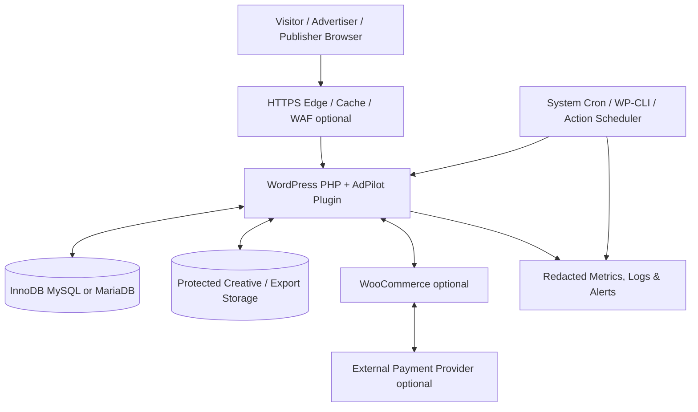
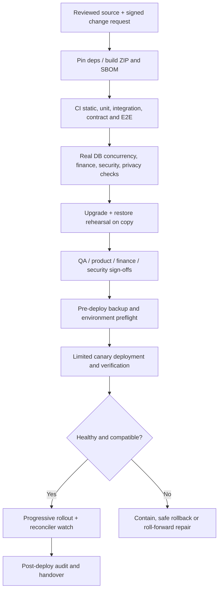

# AdPilot — Deployment, Operations, Observability, Upgrade & Disaster Recovery Specification

**Document ID:** `ADP-DOC-025`  
**Filename:** `25_ADPILOT_DEPLOYMENT_OPERATIONS_OBSERVABILITY_UPGRADE_DISASTER_RECOVERY.md`  
**Version:** 1.0.0 — proposed implementation and operational-readiness contract  
**Status:** Proposed; release/operations, product, architecture, finance, privacy, security and QA sign-off required  
**Date:** 2026-10-12  
**Product:** AdPilot — Self-Service Advertising Marketplace & Behavioral Analytics for WordPress  
**Document owner:** Principal SRE / DevOps / Release Engineering Lead  
**Primary implementers:** WordPress/PHP, database, security, payment/commerce, AdTech, measurements, frontend, QA, support, hosting and incident-response engineering  
**Implementation target:** GPT-6 High; bounded work packages with real operational verification  
**Normative predecessors:** `ADP-DOC-001` through `ADP-DOC-024`  
**Proposed next document:** `ADP-DOC-026` — Configuration, Feature Flags, Localization & Multisite Administration Specification (subject to roadmap review)

> **Assurance and deployment statement:** This file is a proposed, implementation-oriented operations specification; it does **not** assert that AdPilot is deployed, load tested, certified, restored successfully, or production ready. Values marked **proposed**, **example**, or **TBD** require environment-specific benchmarking and signed approval. Illustrative commands must be reviewed against the actual installed WordPress, WooCommerce, Action Scheduler, WP-CLI, database engine and hosting provider. A documented plan is not evidence of a successful recovery drill.

---

## 1. Authority, scope, precedence and operational objectives

### 1.1 Documentary precedence

| Source | Binding obligations |
|---|---|
| `ADP-DOC-001` | 129 canonical `FR-*` (exact words and release scope), `BR-001..018`, `INV-01..10`, `NFR-001..016`, `AC-001..015`, `DEC-001..012` and R1–R4 boundaries. |
| `ADP-DOC-002..003` | Canonical `AT-*`, `AT-BR-*`, `E2E-01..17`, capabilities, `UI-01..20`, `UJ-01..28`, `WF-01..18`, usability and recovery. |
| `ADP-DOC-004..005` | Domain policy/state-machine guards, 22 site-plane baseline capabilities, organization memberships, separation of duties, authorization revocation and multisite isolation. |
| `ADP-DOC-006..007` | Modular monolith, 24 `IC-*` contracts, domain aggregate ownership, immutable authority, outbox/inbox and transaction boundaries. |
| `ADP-DOC-008..010` | 50-table proposed persistence baseline, DDL/migrations, 145 proposed REST routes, 30 domain events, 36 job definitions, Action Scheduler, idempotent payment and observation flows. |
| `ADP-DOC-011..017` | UX and design system, publisher/advertiser apps, Layout Studio (500+ slots), four Gutenberg blocks, one shared PHP/shortcode/theme rendering core. |
| `ADP-DOC-018..020` | Fail-safe delivery, true measurement provenance, R2 heatmap aggregation and privacy-gated R4 replay. |
| `ADP-DOC-021..022` | Fixed/time commercial contracts and R3 metering, verified WooCommerce payment state, creative quarantine, exact-version approval and emergency stop. |
| `ADP-DOC-023` | Threat scenarios, data classification, consent/retention, secrets, security incidents and protected diagnostics. |
| `ADP-DOC-024` | Test execution, environment evidence, internal release qualification, mandatory gates and non-waivable P0 conditions. |
| **`ADP-DOC-025`** | Defines HOW the above is deployed, configured, supervised, upgraded, backed up, recovered and operated; it may not silently redefine upstream semantics. |

`MUST/SHALL` denotes a release-applicable requirement. `SHOULD` allows an explicitly reviewed, time-limited exception. `MAY` is optional. New identifiers `OPS25-*` are supplementary and never replace `FR-*`, `AT-*`, `QA24-*`, database migrations or `IC-*`. Do not infer a completed capability, validated hosting benchmark or legal conclusion from illustrative examples.

### 1.2 Goals and non-goals

- Make first installation, normal operation, upgrade, rollback, backup/restore and emergency containment independently reproducible and observable.
- Preserve paid inventory, exact-money ledgers, refunds, approved creative state, organization isolation and historical reports across faults.
- Maintain public-site availability when optional advertising/analytics integrations fail; fail closed on financially unsafe, unauthorized or unapproved creative operations.
- Support ordinary shared/managed WordPress installations where platform prerequisites pass, plus audited high-throughput profiles without mandatory R1 SaaS dependencies.
- Avoid promises of exact scheduler timing, delivery consistency, RTO/RPO, host support or Core Web Vitals without measured evidence.
- **Non-goals:** providing a universal host benchmark, automating legal deletion exceptions, treating CDN purge as authoritative revocation, making third-party WooCommerce payments transactionally reversible, or offering a distributed multi-region transactional system in R1.

### 1.3 Release controls

| Release | Operationally active | Deliberately gated |
|---|---|---|
| **R1** | Core plugin boot, site tables, migration registry, inventory/layout, public rendering, fixed/time bookings, WooCommerce optional checkout, creative approval, basic measurement, reports, Action Scheduler/outbox, audit and backups. | R2 heatmaps, R3 CPC/CPM, R4 session replay/federation. |
| **R2** | Consent-controlled behavioral metrics, privacy-safe heatmap aggregates, geometry/version retention and corresponding workers. | Session replay, metered billing. |
| **R3** | Auditable qualified CPC/CPM, model/versioned attribution, spend limits and reconciliation. | Browser-supplied billing authority, implicit finance changes on analytics outage. |
| **R4** | Optional independently deployed workers, cross-site federation, adapter ecosystems and replay strictly off by default. | Automatic network-level access or transfer of protected data. |

The D08/D09 outbound webhook subscription release discrepancy stays **open** and the feature stays disabled until approved upstream resolution and compatible persistence/API/QA changes. No ops flag can bypass release gating.

### 1.4 Operational actors and accountability

| Role | Primary responsibility | Independent approval needed |
|---|---|---|
| Product/Business Owner | Revenue and customer impact, acceptable maintenance, business continuity communications. | Price/remedy and reduced-service decisions. |
| Release Manager | Artifact provenance, release plan, environment promotion, go/no-go coordination. | Production deployment approver. |
| SRE / Hosting Lead | Schedulers, storage, backups, monitoring, incident command and on-call handover. | Recovery budget approval. |
| Principal Architect | Compatibility/rollback windows, migration ordering, feature gates, service boundaries. | Breaking architecture/DDL decisions. |
| Database Lead | Transaction support, backups/PITR, integrity and lock/index monitoring. | Risky DDL and data repair. |
| Commerce/Finance Lead | Payment reconciliation, financial discrepancies, ledger and refund correctness. | Settlement, refund and reconciliation overrides. |
| Security/Privacy Leads | Secrets, access, PII, consent, erasure, incident categorization. | Security and privacy release exceptions. |
| QA Lead | Reproducible evidence, canary verification, restore drills, P0/P1 assessment. | Release-quality sign-off. |
| Support Lead | Customer notices, diagnostics and escalation; no default privilege to export private data. | Privacy-sensitive support access. |

Accountable and supporting actors must be named in the real release manifest; a generated list of hypothetical personnel is not sign-off.

---

## 2. Operating modes and deployment reference topology

### 2.1 Topology



WordPress remains the authoritative application host. A fast CDN and object cache improve latency but must never independently determine current delivery eligibility, consent, contract rights, or payment status. An optional R4 worker may run outside the PHP web tier only if scoped to the same approved domain services, site authorizations and idempotent job contracts.

### 2.2 Proposed hosting profiles

| Property | P0 basic/managed WP | P1 dedicated/managed high-throughput | P2 R4 extended |
|---|---|---|---|
| Web tier | PHP-FPM or supported equivalent, HTTPS, WordPress | Multiple stateless PHP nodes, tested shared file and object-cache behavior | P1 plus separately deployed optional worker/analytics adapter |
| SQL | Host-provided compatible InnoDB with transactional support **required for commerce** | Dedicated managed SQL with backup/PITR where supported, measured replica strategy | Explicit multi-site boundaries; no assumed cross-DB atomicity |
| Queue | Supported scheduler with monitored system cron / WP-CLI; safe suspend paid operations if prerequisites absent | Dedicated WP-CLI runners, fenced claims and per-site operational visibility | Optional external runner with provenance, isolation and contract tests |
| Artifacts | Secure uploads and private exports; access restrictions | Object storage/private service if approved, media integrity verification | Optional tiered retention and federation per R4 privacy controls |
| Cache | Optional WP/host caching with bypass for sensitive content | Cache partitioning, purge verification, metrics | Site/network dimensions and explicit compatibility testing |
| Upgrade | Verified maintenance process and off-host backup | Staged canary sites plus schema expand/contract | Coordinated worker/API compatibility matrix |
| Restore | Host full backup/restore with tested AdPilot/Woo consistency | PITR and separately protected media/key backups | Site-scoped restore with federation reconciliation |

Profiles describe design intent, not a claim that arbitrary shared hosting meets security/transaction requirements. In any profile, if atomic exclusion cannot be demonstrated, **disable unsafe paid booking**; the free/public read-only features may continue where safe.

### 2.3 Infrastructure isolation

- Production, preproduction, test and development SHALL use separate database credentials, signing secrets, object-storage containers, domains and gateway environments.
- Staging SHALL use sanitized/masked production-derived records or synthetic data; live payment capture and outbound production webhooks prohibited.
- A staging database restore SHALL not reactivate production checkout, emails, notifications, consent collection, or production payment credentials.
- Backups, CI logs, support bundles and performance traces SHALL not expose unrestricted raw visit events, creative quarantine materials or ledger PII.
- Use network ingress restrictions, TLS, least-privilege DB users, trusted WordPress file permissions and controlled media execution policy.

### 2.4 Deployment variants and failure boundaries

| Fault | Public content | New paid reservation | Existing known safe ad | Measurement and reports |
|---|---|---|---|---|
| WordPress core unavailable | Host error/maintenance | Disabled | No server response | Offline |
| Queue runner stopped | Continue where WP works | Only if synchronous locks/state, with health policy; eventually disable on operational risk | Requires current eligibility | Mark stale; alert backlog |
| DB transaction capability missing | Existing read-only WP may work | **Blocked** | Fail closed when authoritative eligibility unknown | No fabricated events |
| Delivery decision endpoint unavailable | Continue editorial content | Independent if commerce healthy | Safe placeholder/empty state, no invented selection | No fabricated viewability/billing |
| Analytics/aggregation outage | Continue | Independent R1 booking | Continue if serving policy healthy | Missing/incomplete flag, retry/bounded buffering |
| Payment provider down | Continue | Hold rules and expiry apply; checkout pending/unavailable | Only previously verified entitled campaigns | Show pending reconciliation |
| Cache unreachable/stale | Render safe uncached when possible | Read authoritative DB | Revalidate sensitive status; emergency stop wins | Report data freshness |
| Storage quarantine scanner missing | Continue | Advertiser wizard may save draft but not publish affected creative | Existing approved exact versions only if still safe | No effect |
| Secrets/key unavailable | Continue safe nonsecret functions | Block affected gateway/remote adapter | Do not serve if safety authorization cannot be verified | Protect data rather than disclose |

---

## 3. Support matrix and installation prerequisites

### 3.1 Version policies

WordPress core, PHP, MySQL/MariaDB, WooCommerce, WP-CLI and Action Scheduler versions SHALL be stored in a centrally approved version/support matrix, supported by executable compatibility CI on **actual pinned versions**. This document does not guess a frozen minimum. Upgrade support must distinguish maintained supported versions, EOL versions (blocked), optional untested versions (unsupported) and transition grace windows. Approval: WordPress Lead, Security, DB and QA.

### 3.2 Pre-install diagnostic probes

1. Record WordPress version, PHP version/extensions/limits, locale/timezone and multisite status; no secrets in visible output.
2. Confirm `$wpdb` active-site prefix and database permissions; inspect engine, transaction support, required charset/collation and unique/index functionality.
3. Detect table-name collision, partial existing migrations, incompatible schema and stale plugin-specific options before mutation.
4. Check HTTPS for payment-facing operations, upload protections, checksum/hash support, media paths, ownership, object-store credentials if enabled.
5. Detect WP-Cron/system cron/Action Scheduler execution strategy and test actual run opportunity; an HTTP page load must not be claimed as a timing guarantee.
6. Detect WooCommerce availability and HPOS compatibility **only to enable online checkout**; core plugin bootstrap must function without it.
7. Verify backup readiness and ability to restore the relevant DB/media/options without implying that a backup exists unless a verified job produced it.
8. Validate required `WP_MEMORY_LIMIT`, PHP timeouts, uploads, mail relay and outbound API DNS/TLS against approved tier-specific measurements.
9. Confirm critical compatibility of cache, minification, CSP, private media delivery, Gutenberg packages, REST namespaces and site permission callbacks.
10. Report blockers and warnings with actionable evidence and the exact affected features; do not auto-edit unrelated site settings.

### 3.3 Prerequisite outcomes

`READY`, `READY_WITH_WARNINGS`, `UNSUPPORTED`, `MAINTENANCE_REQUIRED`, `READ_ONLY_SAFE`, and `BLOCKED_COMMERCE` are proposed operator-facing diagnostic outcomes, not domain campaign states. Each outcome SHALL include reason code, affected subsystem, safe remediation, timestamp, site scope and documentation link. An exception needs named approvers and an expiry; never downgrade a finance/security hard blocker into a dismissible notice.

---

## 4. Distribution artifacts, build reproducibility and supply chain

### 4.1 Canonical release artifact

A release consists of plugin ZIP, source revision and signed release metadata; asset manifest, PHP autoload map, compiled React/admin, advertiser, editor and lightweight public-runtime bundles, translated catalogs, schema/migration manifest, changelog, SBOM and license notices. Build only on a pinned runner/toolchain from a reviewed source commit. No generated local database or `.env` or private API keys are packaged. Validate installation from **the exact distribution ZIP** rather than only from a source checkout.

### 4.2 Required build metadata

```json
{
  "schema_version": "ops25-release-manifest-v1",
  "product": "adpilot",
  "plugin_version": "RELEASE_VERSION",
  "git_commit": "FULL_COMMIT_SHA",
  "build_id": "CI_BUILD_ID",
  "schema_compatibility": {
    "minimum_schema": "APPROVED_VALUE",
    "maximum_schema": "APPROVED_VALUE"
  },
  "frontend_manifest_digest": "SHA256",
  "sbom_digest": "SHA256",
  "artifact_sha256": "SHA256",
  "required_release_gates": ["security", "db", "financial", "accessibility", "recovery"],
  "approval_status": "PENDING"
}
```

These are proposed manifest fields, not existing production keys. Signing format, provenance service and signing-key hierarchy require approval. Record generated asset dependencies and build IDs; block distribution when provenance, GPL compatibility, transitive licenses or audit evidence is missing.

### 4.3 Packaging hardening

- Run dependency vulnerability analysis, SAST, PHP/TS linting, WP coding checks, secrets scanning and package file allowlist review.
- Verify no executable user-upload runtime, debug archives, unminified proprietary third-party binaries of unknown license, test fixtures containing PII, vendor development keys or private drafts in ZIP.
- Use integrity hashes and an authenticated distribution channel; preserve prior known-good artifacts and migration compatibility metadata.
- Ship a manifest of optional adapters, their dependency versions, WP compatibility and feature-gate state.
- Install-time readiness is not a substitute for pre-production smoke, functional, recovery and rollback tests.

---

## 5. Configuration, secrets and runtime feature flags

### 5.1 Precedence, ownership and provenance

Config precedence SHALL be explicitly designed: deployment-managed secrets and immutable environment safety controls; site-level documented settings; module defaults; approved feature flags. Never let a low-trust WordPress option weaken deployment-level `disable_replay`, audit, HTTPS or finance safeguards. Each setting must declare type, scope (network/site/tenant), default, rollout time, sensitivity, owner, validation and rollback behavior. Avoid environment-specific surprises from cache persistence.

### 5.2 Sensitive inputs

Secrets include gateway signing material, outbound webhook signing keys, HMAC/encryption keys, exporter private URLs, storage credentials, external integration tokens and operational alert credentials. Store in host-approved secrets facilities or safeguarded configuration; never autoload large secrets via `wp_options`, expose them to REST clients, browser bundles, support archives, log contexts, backup metadata or WP-CLI outputs. Key rotation must overlap old and new verification windows only for a bounded documented period; revoked keys cannot continue authenticating indefinitely.

### 5.3 Flag categories

| Flag family | Examples (proposed identifiers) | Safe change policy |
|---|---|---|
| Module availability | `delivery_enabled`, `marketplace_enabled`, `checkout_enabled` | Disable gracefully; no ledger mutation; preserve committed rights and notices. |
| Safeguard/emergency | `paid_booking_disabled`, `creative_serving_stop`, `measurement_disabled` | Operable under emergency dual-control policy where applicable; logged and versioned. |
| Release gate | `heatmap_r2_enabled`, `metering_r3_enabled`, `replay_r4_enabled` | Code presence is insufficient; require approval, migration, privacy and QA gates. |
| Performance | `decision_batch_limit`, `concurrent_media_loads`, `aggregation_batch_size` | Bounded ranges; measured rollouts; don't alter commercial/consent semantics. |
| Integration | `woocommerce_checkout_enabled`, `outbound_webhooks_enabled` | Dependency/readiness plus approved release scope; D08/D09 webhook conflict remains disabled. |

Flags must have a durable actor/time/why audit, an expiry for incident overrides, and a UI that distinguishes *configured*, *effectively active* and *not supported*.

---

## 6. WordPress activation, lifecycle and bootstrap safety

### 6.1 Fresh install

1. Verify release artifact metadata and hosting prerequisites; report incompatibilities before resource mutations.
2. Register autoloader/modules, namespaces, REST routes, capabilities, service bindings and feature-gated adapters without WooCommerce hard dependency.
3. Acquire site-scoped installation/migration lease with fencing; resolve site prefix after any multisite context switch.
4. Create only documented owned tables/options/capabilities; do not silently edit unrelated pages, templates, plugins, menus or WordPress roles.
5. Apply idempotent migrations via approved migrator; verify postconditions and record checksums/versions.
6. Configure safe default roles and capability grants; do not auto-create an advertiser organization or payment gateway credentials.
7. Install namespaced jobs and health diagnostics; avoid duplicate scheduling on reactivation.
8. Validate REST registration, passive Gutenberg blocks, shortcode helpers, cache namespace, safe public placeholder path and no-Woo bootstrap.
9. Provide administrator onboarding/readiness screen; **no payment** until connector, transaction and reconciliation tests pass.
10. Emit a redacted installation audit with plugin schema/build/site versions and test outcomes, never secrets or private identity data.

### 6.2 Activation and deactivation

Deactivate SHALL stop new AdPilot work and unregister scheduled work according to documented idempotent policy while **preserving user data**. A deactivation that would strand paid campaigns requires conspicuous warning and documented continuity/remedy steps; WordPress itself can deactivate a plugin outside its control, so there must also be monitoring. Uninstall is a separate explicitly requested, permission-checked, protected workflow with retention/legal/backup guidance; never delete financial history or unrelated WordPress resources in a routine deactivate/reinstall. Data deletion occurs only under approved explicit policy and entitlement checks.

### 6.3 Multisite

Use `$wpdb->get_blog_prefix()` or the current site-scoped prefix consistently; each site's resources and row scopes remain isolated. Network activation SHALL process sites in controlled, resumable batches, with progress, independent errors and no assumption that `switch_to_blog()` grants authority. A new site provisioning hook must only install approved site-owned objects. Multisite network managers have operational privileges only under the Document 05 security policy; sensitive AdPilot customer data is not network-visible by default.

---

## 7. Scheduler, background workers and job safety

### 7.1 Supported scheduler modes

**Mode A:** WordPress WP-Cron with traffic-driven activation. Permitted for noncritical/demo jobs only when the approved environment permits the resulting delays; operator UI must clearly warn that exact timing is not guaranteed.

**Mode B:** System cron periodically invokes `wp cron event run --due-now` on the correct WordPress install/site. Set `DISABLE_WP_CRON` only if the system runner is actually installed, monitored and tested. It does not itself guarantee that every Action Scheduler action completes on schedule.

**Mode C:** WP-CLI Action Scheduler runner (preferred for heavier queues) under least-privileged host account and reviewed concurrency. The installed CLI's `--group`/`--batch-size` parameters and behavior SHALL be verified. Avoid unreviewed `--force` and unlimited concurrent runners; do not accidentally starve unrelated WooCommerce jobs.

**Mode D (R4 optional):** External approved worker adapter with mutually authenticated job claims, per-site tenancy, inbox/outbox dedup, compatibility versions and traceability. No raw direct SQL writes across module ownership boundaries.

### 7.2 Illustrative host scheduler configuration

```bash
# Proposed illustrative crontab; edit paths, user, frequency and locks for the host.
# Executes each minute; ACTUAL completion and business deadlines are separately monitored.
* * * * * /usr/bin/flock -n /var/lock/adpilot-wp-cron.lock \
  /usr/local/bin/wp --path=/srv/www/example/public cron event run --due-now \
  >> /var/log/adpilot/cron.stdout.log 2>&1

# Optional Action Scheduler runner when verified installed:
*/2 * * * * /usr/bin/flock -n /var/lock/adpilot-actions.lock \
  /usr/local/bin/wp --path=/srv/www/example/public action-scheduler run \
  --group=adpilot --batch-size=50 --batches=5 \
  >> /var/log/adpilot/actions.stdout.log 2>&1
```

This example is **not** a production recommendation for every host: verify `flock` availability, shell quoting, group registration, runner overlap, shared locks on multi-node systems, log rotation, PHP memory/time limits, cron ownership, monitored exit status and per-site invocation. Local filesystem `flock` cannot coordinate multiple hosts that do not share reliable lock semantics; use the approved fenced DB claim there. Do not copy `--force` from emergency troubleshooting into scheduled routine execution.

### 7.3 Job lifecycle and observability

Each job needs site and org scope, canonical `ASY` job family, versioned payload schema, immutable idempotency key, actor/service provenance, due UTC, attempt cap, criticality, last failure class, fenced claim/lease, audit and correlation IDs. Workers re-read current authorization, domain status and contract timing at execution; scheduled intent never overrides present policy. Capture `queued`, `due`, `claimed`, `running`, `completed`, `retry_pending`, `dead_letter`, `quarantined`, `canceled` as worker diagnostic phases, **not** redefinitions of canonical campaign/order state machines.

### 7.4 Queue prioritization

Priority order is policy-driven, with minimum reserved capacity for payment reconciliation, overdue hold/contract repair, emergency stop propagation, high-value audit and privacy purges; lower priority: exports, historical backfills, heatmap aggregation, notifications and cache warming. Starvation prevention requires bounded quotas and measured fairness. Resource-heavy R2/R3 jobs must not starve R1 financial correctness. Define retry budgets by failure class: transient network/backpressure exponential jitter; stale business state no-op/quarantine; invalid signature permanent reject/audit; DB deadlock bounded reattempt within safety policy; schema incompatibility pause and escalate.

### 7.5 Queue health contract

Metrics: earliest due age, oldest critical outbox age, scheduled-vs-start lag, pending/failed/blocked by job family, rate, worker memory, crash count, duplicate deliveries, inbox dedup hits, stale claim count, lock timeouts, reconciliation overdue, privacy deletion overdue and retry exhaustion. A queue dashboard must show most recent successful processing and who owns the remediation. Green status cannot be based solely on HTTP 200 while critical backlog accumulates.

---

## 8. Transactional outbox, reconciliation and external payment operations

### 8.1 Consistency model

Domain state, audit and outbox must commit in one supported SQL transaction. External callback receipt is not proof of final settlement. A consumer may run multiple times, so inbox dedup and unique business keys make local effects idempotent. Payment provider reconciliation does not assume external side effects can be rolled back. An expired hold cannot become valid because the callback arrived late; manual remedies require finance approval. Scheduler backlog cannot make sold inventory safe for reselling; capacity decisions recheck locks and truth at mutation time.

### 8.2 Operational reconciliation loops

| Reconciler | Source of authority | Evidence and result | Containment |
|---|---|---|---|
| Payment attempts | Verified WooCommerce order CRUD/provider evidence | Gateway status, attempts, captured/refunded values, canonical order state | Freeze unsafe order; retry verification; never trust thank-you URL |
| Booking/holds | Reservations transaction store and half-open time intervals | Non-overlap, TTL, reallocated/released capacity | Block affected inventory transaction |
| Creative/service | Approved exact media/version, campaign policy, published layout | Delivery stop pointer, approval/current eligibility | Serve empty state instead of stale unapproved media |
| Financial ledger | Append-only signed/identified business postings | Balanced posting/immutable corrections per accounting model | Disable R3 charging or affected finance operations |
| Outbox/inbox | Committed event id and consumer-scoped effects | Undelivered/duplicate/stuck event list | Pause specific consumer, replay with dedup after root cause |
| Analytics | Accepted event partitions, aggregate revision/watermark | No double increment, completeness and lateness | Mark reporting stale; never infer billable events |
| Privacy cleanup | Purpose/retention policy ledger + storage list | Eligible purges and durable exclusion of preserved legal records | Disable unlawful collection; escalate overdue erase |

### 8.3 Escalation rules

Escalate **immediately** when duplicate booking, ambiguous payment capture, unauthorized creative delivery, ledger imbalance, known consent breach or loss of current site/org authority is suspected. UI labels `PENDING_VERIFICATION`, `RECONCILIATION_REQUIRED`, `CONTRACT_CONFLICT`, `PAYMENT_REMEDY_REQUIRED`, etc. are proposed projection states; map them to canonical domain statuses rather than inventing alternate finance authority. Support cannot mark an unresolved payment as successful or approve its own ledger correction.

---

## 9. Ad serving, frontend reliability and cache operations

### 9.1 Shared rendering and emergency control

All Gutenberg, PHP helpers, shortcode and approved theme hooks must invoke the same authorization/policy-aware server rendering and decision infrastructure. Never cache raw personally identifying ad decisions as if universally reusable. Emergency stop, paid-contract invalidation, creative rejection and consent policy must override stale optional cache decisions. If a stop cannot be propagated safely, suspend affected serving, not only a dashboard badge.

### 9.2 High-density budgets

500 logical slots are **configured capacity**, not 500 network fetches/painted creatives/qualified impressions. The canonical scenario is 4 header + 100 sidebar + 196 content + 200 footer. Runtime jobs and dashboards may show different counts (configured, decisioned, rendered, viewable, billable). Require batch decision resolution, bounded browser concurrency, shared observers and lazy loading; do not introduce a per-slot PHP query or synchronous tracking dependency. Establish p75/p95 budgets per approved fixture/profile and record actual measurement environment, cache and representative creative weights.

### 9.3 Caching matrix

| Data | Cache policy | Invalidation/expiry guarantee |
|---|---|---|
| Published layout revision / immutable creative fingerprint | Version-keyed cache with site scope | Version switch + governed cache refresh; stable historical snapshots |
| Public-safe catalog | Bounded TTL, only allowlisted fields | Publication and price/rate version change |
| Campaign current eligibility | Authoritative validation required; bounded and revocable cache only if proven | Emergency-stop version or fail closed |
| Ad decision token | Short-lived, audience-/context-scoped; no shared cross-user caching | Current authorization/consent revalidation where needed |
| Payment, quote, reservation, hold | Not a cache authority; strongly consistent reads for mutation | Fresh SQL/current verified state |
| Aggregated report | Versioned with source watermark/completeness | New revision/backfill correction |
| Heatmap data | Purpose/authorization/tenant scoped and suppression safe | Consent/retention/privacy reprocessing; R2 only |
| Protected exports and replay | Private access-controlled storage, per-download authorization | Expiry, erasure and immediate revocation |

### 9.4 Failure and degradation

If JavaScript/ad API fails, editorial content remains functional and empty slots collapse/preserve layout as the UX contract dictates. No artificial impression or click counters. If analytics ingestion fails, deliver permitted ads but record missingness and alert; do not silently backfill guessed views. Accessibility, RTL and browser compatibility remain production quality gates, not optional extras for large layouts.

---

## 10. Observability architecture, metrics, logging and tracing

### 10.1 Instrumentation contract

Every operational signal MUST carry an allowlisted `site_id`, `module`, `operation`, `outcome`, `release_version`, `schema_version`, timestamp UTC, severity and correlation/trace ID where meaningful. Resource identifiers permitted in logs are opaque and should be truncated or hashed as approved; *do not* log raw session IDs, full IPs, email, billing identities, URLs containing tokens, provider signatures, creative content, page keystrokes or replay frames. Organization identifiers in centrally shared monitoring may be sensitive; access-scope them.

Instrumentation must not alter business state, prevent checkout, block publisher content or delay emergency suspension. Logging exporters may fail and recover independently. Audit records are different from ordinary logs: audit integrity and retention are governed by immutable business and security requirements, not by transient log-collector configuration.

### 10.2 Telemetry taxonomy and cardinality

| Signal family | Example metrics (proposed names) | Labels permitted | Forbidden dimensions |
|---|---|---|---|
| Web/REST | `adp_http_requests_total`, `adp_http_latency_seconds`, API 4xx/5xx rates | Route *template*, status class, site tier, module | Raw URL/query, advertiser email, exact visitor ID |
| Decisions | `adp_decision_latency_seconds`, `adp_decision_failclosed_total`, cache hit/miss | Module, reason category, site tier | Browser fingerprint, arbitrary slot IDs in global metrics |
| Queue | `adp_job_due_lag_seconds`, `adp_job_retry_total`, `adp_outbox_oldest_age_seconds` | Job family, priority class, site tier | Event payload content, unrestricted job IDs |
| Inventory | `adp_booking_conflict_total`, `adp_hold_overdue_total`, lock-wait quantiles | Reason, operation class, site tier | Customer details, individual booking terms |
| Finance | `adp_reconciliation_discrepancies`, `adp_payment_pending_age_seconds` | Gateway adapter class, state class, site tier | Amount + customer tuple, payment tokens |
| Delivery | `adp_rendered_qualified_total`, `adp_delivery_stop_age_seconds` | Coarse creative category, status, device class | Full end-user URL, raw creative destination |
| Measurement | `adp_measurement_rejection_total`, `adp_aggregate_freshness_seconds` | Validated reason, event *type*, release | User fingerprint, free-text annotations |
| Privacy | `adp_purge_backlog_total`, `adp_consent_block_total`, cohort suppression count | Purpose category, policy revision, release | Individual subject ID |
| Storage | DB connection error, deadlock, slow-query digest, backup age, restore checks | Engine tier, table *family*, operation | Raw query with user parameters |
| Releases | `adp_migration_state`, canary error-rate ratio, artifact checksum status | Site cohort, release version | Host secrets, personal metadata |

Use bounded metric label cardinality, histogram buckets based on measured workload, fixed sampling rules and site-aware aggregate views. Avoid turning individual `logical_slot_id` across 1,200 slots into an unbounded metric label series; use protected drill-down queries instead. Consider sampling of trace spans, but never sample away mandatory financial/audit business evidence.

### 10.3 Structured log envelope

```json
{
  "event_time_utc": "2026-10-12T12:34:56Z",
  "severity": "WARN",
  "component": "adpilot.reservations",
  "event_code": "ADP_RESERVATION_CONFLICT",
  "site_ref": "site-pseudonym",
  "release": "VERSION",
  "schema_version": "SCHEMA_VERSION",
  "correlation_id": "opaque-trace-id",
  "operation": "confirm_reservation",
  "status": "REJECTED_CONFLICT",
  "retryable": false,
  "duration_ms": 48,
  "safe_details": {"reason": "overlapping_exclusive_capacity"}
}
```

`site_ref` pseudonymization and retention policy are subject to the approved privacy framework; do not hardcode names or reveal financial detail. For errors, log an allowlisted exception class and code; protect stack traces behind least privilege. Logs exported for troubleshooting SHALL be sanitized before compression/signing and may require a second-person review.

### 10.4 Request/event correlation

Trace transaction path with correlation identifiers:

`REST request -> authorized command -> DB transaction -> audit/outbox event -> fenced worker -> inbox effect -> verified payment/reconciliation -> reporting projection`.

Browser events are untrusted: a client-provided `trace_id` cannot become a privileged scope grant or reveal another organization's traces. For a payment gateway, use a separate trusted provider correlation and store authenticity evidence. Trace version compatibility across long-running workers after upgrades.

### 10.5 WordPress-native diagnostic adapter

Expose a capability-gated health page inside the administrator console and optional WP Site Health integration with redacted statuses and deep links. Include WordPress/PHP/DB compatibility, AdPilot schema/capability/layout compiler versions, active feature flags, worker mode, scheduler heartbeat, queue ages, transaction support, commerce connector readiness, protected storage, consent policy readiness, backup verification timestamp, last restore drill and migration errors. The public endpoint MUST NOT disclose schemas, secrets, customer counts or infrastructure fingerprints by default.

### 10.6 Diagnostic support export

A support bundle is generated asynchronously, scoped to one site, encrypted/privately stored when needed, with manifest, redaction version, consent/legal review, expiry, authorized actor, download-time permission recheck and audit. Bundle contents may include versions, coarse metrics, sanitized stack digests, failed-job category counts and reproduction hints, but exclude payment secrets, unredacted personal telemetry, quarantine media and R4 replay unless a separately approved incident procedure governs it.

---

## 11. Service-level objectives, error budgets and alert governance

### 11.1 Target methodology

Define independent **SLIs** for public editorial availability (WordPress-owned), AdPilot ad decision success, booking commit integrity, paid entitlement correctness, payment reconciliation age, outbox processing lag, reporting freshness, consent gating and backup recoverability. Do not declare a global availability guarantee without a contractual hosting SLA and measured tier-specific telemetry.

**Proposed SLO worksheet (all numerical targets require approval):**

| SLI | Measurement | Proposed failure budget treatment | Data source |
|---|---|---|---|
| Paid booking invariants | Incorrect confirmed exclusive overlap / attempted committed bookings | **Zero tolerated correctness violations**; any confirmed instance P0 | DB audit/reconciliation |
| Unauthorized paid or unapproved serving | Confirmed incidents | **Zero tolerated**; emergency stop | Delivery audit, incident investigation |
| Gateway mismatch age | Age since verified payment evidence not reconciled | Alert threshold TBD by provider/finance | Provider+order+ledger reconciliation |
| Critical outbox age | Current UTC minus oldest eligible unprocessed high-criticality event | Warning/critical budgets TBD by service class | Outbox monitoring |
| Scheduled campaign transition | Difference between contractual due time and proven transition, excluding approved downtime | Budget TBD based on host/cron mode | Transition/outbox logs |
| Public decision success | Policy-compliant decisions or safe empty state / eligible requests | Latency/availability budget measured by hosting tier | Bounded server+SDK traces |
| Report freshness | Age of last complete aggregate revision | R1/R2/R3 independent targets TBD | Aggregate watermarks |
| Privacy collection control | Confirmed collection after denied required consent / sensitive input capture | **Zero tolerated**; P0 and containment | Privacy/audit test and incident records |
| Backup recovery | Protected backed-up sources verified and successfully restored by exercise | RPO/RTO targets TBD and proven | Backup manifest / restore drill |
| Accessibility/regression | Mandatory release tests pass on declared platform matrix | Release-blocking per D24 | Automated/manual QA evidence |

Operational SLO is not an excuse to permit security and financial correctness violations. Prefer multiwindow burn-rate alerts for high-volume availability metrics where statistically meaningful and page only actionable signals.

### 11.2 Alert severity and ownership

- **SEV0/P0:** confirmed double-sale, unauthorized org/site read, financial double-post/ledger corruption, unapproved creative serving, prohibited behavioral recording, unrecoverable restore failure, confirmed secret compromise. Immediate containment, incident command and finance/security notification.
- **SEV1/P1:** significant payment reconciliation backlog, critical queue starvation, broad ad decision outage, production data migration stuck with paid effects at risk, privacy purge deadline breach per policy. Named on-call responder and bounded response SLA approved by organization.
- **SEV2/P2:** degraded reporting freshness, elevated noncritical worker retries, layout preview breakage, rising cache miss/slow SQL, backup delay within remaining protection window.
- **SEV3/P3:** cosmetic operational dashboard issue, advisory unsupported extension, informational dependency update without active exploit.

Severity classification and paging ownership SHALL be part of an approved on-call rotation with escalation if unacknowledged; do not invent universal 5/15-minute incident SLAs.

### 11.3 Alert payload

Every alert should contain site/site-tier scope, coarse module, impact class, first/last seen UTC, approximate affected count where safe, monitoring link requiring authorization, runbook ID, current mitigation status, last known good build, and owner. Alert messages must not carry credentials, raw visitor/user identifiers, screenshots of protected data or financial account details.

---

## 12. Database performance, capacity and routine data maintenance

### 12.1 Capacity modeling

Forecast active advertisers, campaigns, zones, slots/layout versions, bookings, order/ledger rows, creative assets, high-density decision rate, accepted measurement events, aggregate groups, R2 geometry/heatmap bins, retention and backup size. Base forecasts on actual publisher traffic and collected test telemetry rather than assumed sustained events per second.

Use normalized site-scoped compound indexes, prepared SQL, bounded cursor/keyset pagination, explicit index-change testing and query plans. Export jobs and aggregation scans must not block booking write transactions or starve ordinary WordPress queries. Load tests must include 500-slot canonical and 1,000+/1,200-slot stress fixtures on declared hardware, as well as out-of-order payment callbacks and real concurrent booking transactions.

### 12.2 Safe maintenance

| Activity | Method | Forbidden shortcut |
|---|---|---|
| Index health | Compare expected schema manifest to `INFORMATION_SCHEMA`; capture `EXPLAIN` and lock impact | Unreviewed `ALTER` on peak traffic |
| Archival/retention | Partition/time-bucket cleanup when approved; idempotent small batches | `DELETE` full raw-event table without policy checks |
| Audit/ledger preservation | Immutable business data protected by policy/required retention | Retention of ephemeral metrics as only finance evidence |
| Aggregation correction | Rebuild derived aggregates from eligible retained provenance; tag model/version | Mutate original ledger silently |
| Quarantine cleanup | Delete only after review and retention purpose expiry; preserve audit hashes as appropriate | Serve files directly from quarantine |
| Export cleanup | Verify expiry and storage deletion, revoke download token | Leave private reports in public WordPress uploads |
| Recovery catalog | Backups/schema manifest/media index and retention class consistency checks | Assume host daily backup covers all sensitive sources |

### 12.3 Database resource alerts

Monitor connection saturation, deadlock rate, lock wait tails, slow query digests, missing compound indexes, migration locks, table growth, storage pressure, outbox indexes, orphan rows, analytical backlog and report scan durations. A replica can serve only approved stale-safe reporting queries; never use an asynchronously replicated read for authoritative booking eligibility, current revocation or payment resolution.

---

## 13. Safe database and application migrations

### 13.1 Migration authority

Preserve independent version fields: database schema, capability policy, API, and layout compiler. Migrations are ordered, idempotent, checksummed, site scoped, resumable and auditable. Each step has a precondition, expected output, estimated lock/space impact, dry-run diagnostic, compatibility versions, rollback or forward-repair method and postcondition tests. `dbDelta()` may be suitable for some WordPress table creation/change operations but is not an all-purpose fully transactional schema migrator; engine-specific DDL and unsupported column/index changes require explicitly tested SQL paths.

### 13.2 Expand–migrate–contract strategy

1. **Expand:** Add compatible nullable columns/new indexes and new event/field versions; deployed old code remains functional where approved.
2. **Dual-read/write only when justified:** Guard adapters and canonical authority, never create simultaneous competing truth for commercial writes.
3. **Backfill:** Site-scoped bounded batches with checkpoints, excluded rows and deterministic safe retries; no visitor traffic side effects.
4. **Verify:** Checksums/row counts/referential constraints, ledger balances, old/new projections, `EXPLAIN`, job payload decoding and migration audit.
5. **Switch reads:** Explicit per-site feature flag after verified gates; monitor canary and rollback compatibility.
6. **Contract:** Remove obsolete columns/code only after all supported clients, PHP workers and retained events have crossed compatibility window.
7. **Close:** Release record includes migration versions, reversible boundary, operator approvals, evidence and retention decisions.

### 13.3 Migration safety classes

| Class | Examples | Deployment policy |
|---|---|---|
| M0 metadata/read-only | New dashboard label, optional index visibility | Standard staged rollout |
| M1 backward-compatible additive | Nullable indexed column, new nonauthoritative table | Preflight, incremental, tested lock budget |
| M2 data backfill/crosswalk | New layout version pointer, reporting aggregate revision | Checkpoints, canary, read compatibility, integrity test |
| M3 sensitive transactional | Reservations, order mapping, finance schema, approved-version pointer | Maintenance/safe write block, DB lead and Finance/Security approval |
| M4 destructive/contract | Drop/rename authoritative table, rewrite ledger, change key representation | New governance decision, proven restore; no routine auto-upgrade |

MySQL/MariaDB DDL transaction behavior differs by version/operation; **do not** promise SQL `ROLLBACK` reverses a committed schema change. For an irreversible schema step, the realistic route may be roll-forward repair or restore to a consistent pre-change backup plus external payment reconciliation, not simply redeploying old PHP.

### 13.4 Running workers during upgrades

Every job payload carries schema/event version. During rollout, assert new and old workers are compatible with the current table schema. Pause incompatible consumers, drain or quarantine affected jobs with persisted payloads, expand schema before new producers, and resume with current-state revalidation. Workers have a versioned compatibility handshake or local schema check and fail closed rather than deserialize unsupported payloads into uncontrolled actions. Never delete payment receipts/outbox/inbox to make migration 'green'.

### 13.5 Layout compiler and historical versions

A layout compiler upgrade must not rewrite the logical sellable slot identity in a published reservation. Store compiler versions with immutable published layouts, preserve render-instance behavior and evaluate old contracts against approved mapping. A release that changes slot eligibility or historical geometry must run `BR-006`, `INV-*`, D15/D16 tests and governed reapproval/migration before enabling new authoring.

---

## 14. Release workflow, canary, promotion and rollback

### 14.1 Promotion gates



Each arrow has evidence artifacts rather than assuming the previous step happened. Promotion is from the same checksummed ZIP; rebuilds create a new candidate. QA/Finance/Security sign-offs cannot be retroactively fabricated by a CI generator.

### 14.2 Canary candidates and sampling

Canary selection should include at least one test site with WooCommerce, one without, classic and block themes, HPOS enabled where declared, realistic 500-slot layout, two advertiser organizations, and a representative traffic/content mix. For multisite, only approved canary blog IDs may be modified until site isolation passes. A canary is not a staging environment: live payment traffic requires active finance monitoring and rollback/containment planning.

### 14.3 Safe rollout procedure

1. Announce maintenance or controlled risk window when business operation may be affected; identify on-call owners and incident bridge.
2. Pin artifact/digest, database and schema compatibility; confirm final signed D24 release dossier and supported WP/PHP/SQL matrix.
3. Snapshot consistent backup/restore checkpoint and verify offsite manifests and key availability; record retention/legal constraints.
4. Perform capability, schema, outbox, queue, public renderer and WooCommerce connector preflight for each target site.
5. If migration is sensitive, explicitly pause only affected writes/queues and show user-visible maintenance; do not silently accept paid checkout without capacity guarantee.
6. Install approved artifact through the host-supported method; run ordered migrations from CLI or controlled upgrade workflow.
7. Inspect actual migration postconditions and private health, not just plugin activation status.
8. Exercise nonbillable public synthetic preview, verified safe decision, edit/booking test on isolated canary data, queue dispatch, signed callback simulation and idempotent worker check.
9. Monitor canary p75/p95, DB locks, 4xx/5xx, outbox age, finance reconciliation, unauthorized serving, privacy and resource memory.
10. Increase cohort only if signed canary gates pass, with exact stop condition and operator name; avoid broad deploy during critical reconciliation.
11. Audit final version per site, worker scheduling, payment connector status, feature gates, documentation and open incidents.
12. Publish release notes, incident-free or incident findings, customer impact and ownership for follow-up.

### 14.4 Rollback types

| Rollback type | Scope | Feasibility and restrictions |
|---|---|---|
| App-only | PHP/JS asset and flags | Permitted only when old build can read/write present schema and event types safely |
| Flag rollback | Disable new optional component | Must preserve committed financial rights; R2/R3 feature disable may require remediation/data retention |
| Worker rollback | Pause new consumer, return to compatible one | Retained job payloads and inbox/outbox versions must remain readable |
| Schema roll-forward repair | Apply additive correction or backfill | Preferred after irreversible DDL when safe, with DB/Security/Finance approval |
| Point-in-time DB restore | Entire consistent site/commerce state | Requires checkout isolation, gateway post-snapshot reconciliation, media and key coordination |
| Full site restore | WordPress + AdPilot + WooCommerce + media | Watch out for externally captured payments, lost actions, cache/script versions and privacy erasure |

Rollback requires record of activation/deactivation time, target cohort, previous/current build, migrations already applied, restored data window, new obligations created since snapshot and reconciliation outcomes. **Do not** deploy old code against a noncompatible new schema just to meet a rollback time objective.

### 14.5 Emergency stop and backout

Commercial stop controls shall operate independently of the slow dashboard where possible, through approved authenticated and audited administrative CLI/REST, not anonymous query strings. Priority: (a) stop unsafe creative delivery/collection, (b) stop unsafe booking/capture, (c) preserve provider/ledger evidence, (d) maintain editorial content, (e) inspect actual current state, (f) reconcile outstanding obligations, (g) restart via controlled proof.

---

## 15. Backups, recovery point/time objectives and protection tiers

### 15.1 RPO/RTO decision framework

**RPO (recovery point objective):** maximum acceptable loss of committed local records, expressed as time, by operation/tier. **RTO (recovery time objective):** maximum acceptable service restoration time under a declared scenario. Both require signed organizational targets, measured exercises, provider capabilities and realistic budgets.

| Business data | Proposed policy tier | RPO target | RTO target | Important external consideration |
|---|---|---|---|---|
| Paid reservations and financial ledger | Critical | **TBD—Finance/SRE** | **TBD—Product/SRE** | Gateway history after snapshot must be reconciled |
| WooCommerce order references/metadata | Critical | **TBD—Finance/SRE** | **TBD—Commerce/SRE** | HPOS authoritative datastore selection and sync |
| Organization roles/audit | Critical | **TBD—Security** | **TBD—Security/SRE** | Revocations after snapshot cannot be silently reversed |
| Approved creative files and fingerprints | High | **TBD—AdTech** | **TBD—AdTech** | Media/digests must match immutable reviewed version |
| Published layouts/compiler version | High | **TBD—Product** | **TBD—Product/SRE** | Paid slot identity and historical layout retention |
| Outbox/inbox and job provenance | High | **TBD—SRE** | **TBD—SRE** | Replays can duplicate deliveries but not effects |
| Raw measurement events | Classified/retention-limited | **TBD—Privacy/Analytics** | **TBD—Analytics** | Purged events must not be resurrected |
| Derived aggregates/cache | Rebuildable within policy | **TBD—Analytics** | **TBD—Analytics** | Rebuild from retained lawful evidence or mark incomplete |
| R2 geometry/heatmaps and R4 replay | Purpose restricted | **TBD—Privacy** | **TBD—Privacy/SRE** | Consent, erasure and retention supersede convenience |

A host that lacks PITR cannot advertise a near-zero RPO without proven equivalent backup/replication and recovery. Avoid universal targets such as '15 minutes RPO, 1 hour RTO' until measured and contracted.

### 15.2 Backup manifest and protected media

Backup scope includes WordPress core configuration needed for app recovery, site-specific plugin tables/options/caps, WooCommerce authoritative order datastore, private creative storage, immutable media fingerprints, migration/capability/schema/asset manifests, Action Scheduler and AdPilot outbox/inbox state, consent/retention ledgers, audit logs, redacted operations and keys/secret references by secure separate process. Include media referenced by active or historical contracts, and explicitly exclude records lawfully erased or past retention as appropriate.

Define snapshot `backup_id`, UTC start/end, database consistent point/GTID or binlog position when supported, engine/WP/HPOS settings, site set, table manifest, row count/checksum digests, media manifest hash, encryption key ID reference, creation/expiry, immutability status, independent offsite copy, authorized operator and restore-test reference. Backup ciphertext must be encrypted at rest and in transit, access restricted and access audited. Rotation and deletion respect legal retention and privacy erasure policy.

### 15.3 Backup schedule and verification

Schedule cadence, on-demand pre-migration snapshot and multi-copy/offsite policy are decided by measured RPO tiers and host capabilities; verify actual full/incremental backup artifacts and error notifications rather than recording a nominal schedule as proof. Automated validation should check successful completion, stored hash, encrypted storage, destination isolation, media coverage, DB transaction consistency and periodic sandbox restore of both DB and files. A backup not restored in a controlled drill remains unproven for release purposes.

### 15.4 Consistent restore protocol

1. Declare incident, containment owner, snapshot candidate, affected sites, RPO/RTO target and payment/consent impact; preserve forensics and external-provider activity timeline.
2. Stop affected new checkout/captures and isolate workers; prevent accidental outbound webhook or email fanout from the restored clone.
3. Verify restore artifact provenance/checksum, key availability, WordPress PHP compatibility, DB engine and site prefix/multisite mapping.
4. Restore at a consistent point **across AdPilot authority and WooCommerce order state**; use provider-supported consistent DB snapshot or PITR procedure.
5. Restore private media and verify creative-version content hashes, storage ACL, quarantined-state isolation and public URL rewriting.
6. Reconstruct migration/capability/layout compiler version mapping; **never** run an incompatible older app against a newer schema.
7. Reapply privacy deletions, consent revocations and security access revocations that occurred *after* the snapshot using a separately protected deletion/revocation ledger; no unlawful data resurrection.
8. Import/reconcile external gateway events since snapshot using verified provider APIs, idempotency, outbox/inbox and immutable adjustment postings. Do not simply replay paid callbacks to resurrect expired holds.
9. Verify inventory exclusivity, reservation/hold TTL, rate/quote versions, current creative approval, ledger integrity, org isolation, audit continuity, outbox backlog and aggregate completeness.
10. Rebuild only derived caches/aggregates from accepted retained facts; mark irrecoverable historical measurement gaps honestly.
11. Resume verified safe public delivery and readonly dashboards first; resume queues/site write operations then checkout only after Finance/Security/QA clearance.
12. Record actual lost-time window, achieved RPO/RTO, unresolved inconsistencies, customer communications, evidence and corrective actions.

### 15.5 Restore acceptance

A recovery is **not successful** merely because WordPress loads. It must pass known-outcome tests: (a) no duplicate exclusive reservation; (b) no duplicate ledger posting; (c) no unapproved serving; (d) preserved consent/revocation; (e) publisher/advertiser org access isolation; (f) correct outbox/inbox resume; (g) WooCommerce source-of-truth order parity; (h) no missing keys/media for active approved creatives; (i) metrics freshness clearly labeled; (j) public content accessibility. Attach immutable drill report.

---

## 16. Incident response, triage and service containment

### 16.1 Incident lifecycle

Preparation → detection/triage → impact and owner confirmation → containment with evidence preservation → eradication/repair → staged recovery → reconciliation/customer notification evaluation → retrospective → permanent regression tests. Use the organization-approved Security/Privacy incident governance from Document 23 and reconcile with applicable notification deadlines determined by Legal; do not claim automatic compliance through this process.

### 16.2 Command structure

Incident commander directs scope, escalation, change freeze and communications; separate finance lead owns payment and ledger actions, privacy/security lead owns breach assessment, DBA owns data recovery, AdTech lead owns creative/delivery safety and SRE lead owns infrastructure. Actions that might destroy evidence or mutate financial entitlement need two-person reviewed control except where immediate protection is necessary and an approved emergency process covers it.

### 16.3 Common immediate decision rules

- Unsafe creative: stop specific creative/campaign rendering; invalidate cache/revoke tokens; capture approved version and incident ID; preserve forensic file securely.
- Duplicate sale: disable affected inventory purchasing, preserve conflicting reservations/lock evidence and gateway receipts, assign independent commercial remedy process.
- Provider callback spoofing/secret compromise: disable affected inbound/outbound adapter, rotate key with bounded old-key overlap as approved, quarantine pending receipts and verify authoritative provider states.
- Behavioral capture without required consent: immediately stop affected collector/SDK and replay, preserve privacy incident evidence under restricted access; execute legal review and approved deletion.
- Corrupt migration: stop affected writes/jobs, choose compatible roll-forward or consistent restore, never overwrite historical ledger to repair a green dashboard.
- Backup corruption: protect remaining copies, block destructive maintenance until recoverability is reassessed, alert release owner.

---

## 17. Post-incident reviews and continuous improvement

Every SEV0/SEV1 and relevant SEV2 incident requires written UTC timeline, customer/financial/privacy impact, root causes, contributing system weaknesses, evidence inventory, detector effectiveness, response and recovery times, communication decisions and follow-up work with owners/deadlines. Convert a discovered defect into a permanent regression/fault-injection test. Do not blame individuals or disclose confidential logs in shared retrospectives; corrective actions remain auditable. Track repeat incident trends, late alerts, failed backups and recurring false positives.

---

## 18. Operator runbooks and executable checklists

Runbooks below define **required steps to implement and rehearse**. Do not run commands on a production installation without validating paths, credentials, plugin hooks, site URLs and approved change controls. CLI interfaces prefixed `wp adpilot` are **proposed**, not present in WordPress today.

### 18.1 `OPS25-RB-01` — Daily readiness inspection

**Trigger:** Start of operational shift, automated daily compliance check, or prior to campaign-critical events. **Owner:** SRE/on-call. **Prerequisites:** Read-only scoped diagnostic access. **Procedure:**

1. Confirm public WordPress and privileged app health independently; compare canary ad-safe render route (never simulate a paid impression).
2. Verify last successful scheduler heartbeat, current runner mode, Action Scheduler job family counts and oldest critical outbox age.
3. Review unresolved payment/ledger/order discrepancies and holds whose TTL elapsed but work remains pending; do not mutate based only on stale UI.
4. Verify last successful backup, offsite verification age, encryption key and latest restore drill status.
5. Review creative emergency-stop propagation, site/tenant authorization anomalies, blocked consent capture, privacy retention and export expiry.
6. Confirm latest approved release artifact and schema compatibility per site; check any pinned incompatible worker payloads.
7. Record UTC evidence, findings, action owner and escalations; close with explicit `READY` or `DEGRADED` state and actionable notes.

**Abort/escalate:** Any confirmed financial/security/privacy invariant violation -> SEV0; unverified backup and critical queue backlog -> site-tier severity per thresholds.

### 18.2 `OPS25-RB-02` — Worker outage, stuck claim, backlog

**Trigger:** Queue age budget exceeded, no completed jobs, repeated worker crashes. **Owner:** SRE + module owner. **Procedure:** (1) verify heartbeat/process host/credentials; (2) inspect Action Scheduler and outbox/inbox states by **site and job family**; (3) distinguish queue wakeup failure, claim lease, DB deadlock, incompatible schema, external provider outage; (4) pause hazardous consumers if incompatibility is suspected; (5) establish that all jobs are idempotent and claims are fenced; (6) recover runner with bounded batch/concurrency from an approved checkpoint; (7) reverify payment/hold state and dedup; (8) monitor catch-up and lag until budgets recover; (9) publish incident evidence. **Never** delete or mark complete failed paid-work events merely to clear a red dashboard.

### 18.3 `OPS25-RB-03` — Payment reconciliation discrepancy

**Trigger:** Order/attempt/ledger divergence, duplicate/out-of-order callbacks, timeout. **Owner:** Finance + Commerce. **Procedure:** freeze affected paid entitlement if correctness unknown; retrieve **verified** WooCommerce CRUD records and provider-authenticated evidence; compare source amounts/currency, attempt sequence, capture/refund IDs, booking TTL and contract window; inspect immutable ledger and inbox/outbox idempotency keys; propose adjustment or remedy with independent approval; append correction rather than rewrite history; revalidate booking capacity and campaign/creative approval; monitor through settlement; issue customer notification per legal/business policy. **Never** treat gateway thank-you URL or callback body alone as authoritative.

### 18.4 `OPS25-RB-04` — Cache stale creative / revocation failure

**Trigger:** Invalid, expired, rejected or suspended creative remains visible. **Owner:** AdTech + Security. **Procedure:** activate emergency creative/serving stop, identify exact immutable version and affected sites/placements, deny affected decisions at authoritative policy layer, evict/version-bump cache, invalidate eligible tokens as designed, test with anonymous/classic/block/theme/Gutenberg paths, verify no preview events are billed, audit incident and recover only after approved version and current contract eligibility are proven.

### 18.5 `OPS25-RB-05` — Privacy/consent breach or deletion backlog

**Trigger:** Data collection with denied consent, sensitive form input captured, suppression bypass, replay leak or erasure deadline risk. **Owner:** Privacy + Security. **Procedure:** disable collector/affected purpose feature, isolate keys/download/export, preserve minimal restricted evidence, determine subjects/jurisdictions/processor obligations, stop unsafe replication, execute approved erasure/retention workflow including restored snapshots, revoke artifacts, recheck cohort suppression and cross-surface APIs, evaluate notifications with Legal, and close only after privacy review. **Never** expose raw replay to general on-call support.

### 18.6 `OPS25-RB-06` — Database migration halted

**Trigger:** checksummed step fails, lock budget exceeded, incompatible worker or missing index. **Owner:** DBA + Release Lead. **Procedure:** freeze affected writes, retain original backup and migration ledger, inspect durable step flags, compare schema with manifest, determine transactional DML versus non-rollback DDL, choose compatible resume/repair, or consistent restore with finance reconciliation; run schema and invariants test; resume queues by version with idempotency. Do not rerun destructive migration blindly or manually flip a schema version option.

### 18.7 `OPS25-RB-07` — Restore after database loss

**Trigger:** DB corruption/unavailable, lost rows or restore exercise. **Owner:** Incident Commander + DBA + Finance + Security. **Procedure:** follow §15 consistent 12-step restore; verify WooCommerce authoritative datastore configuration and provider post-snapshot evidence; restore private media/keys; replay protected deletion/revocation; verify AdPilot site-org permissions and no double-sale; track actual RPO/RTO; reopen paid operations only with independent approval. Report unresolved discrepancies honestly rather than declaring fully recovered on successful page render.

### 18.8 `OPS25-RB-08` — Gateway signing key compromise

**Trigger:** key leaked, spoofed webhook evidence or unexpected captures. **Owner:** Security + Finance. **Procedure:** disable affected adapter, revoke/rotate through provider, use bounded overlap only with explicit policy, audit previously accepted receipts/attempts, reconcile provider authority, verify webhook source signature/mapping and replay rejection, re-enable canary, update response evidence and secrets inventory.

### 18.9 `OPS25-RB-09` — Multisite scope incident

**Trigger:** Wrong site prefix used, exports/cache leak, worker handling foreign org/site. **Owner:** Security + WP Lead. **Procedure:** block affected operations and exports, preserve scoped logs, verify `switch_to_blog` restoration and service instance lifetime, partition cache/job keys by site, inspect pending claims and payment mappings, restore/repair only affected site with cross-site invariants checked, rotate/revoke access as appropriate, and certify tests across two sites before recovery.

### 18.10 `OPS25-RB-10` — Performance collapse on dense page

**Trigger:** 500-slot layout overload, network contention, JS long tasks, p95 regression. **Owner:** Frontend + AdTech + SRE. **Procedure:** capture safe benchmark profile, inspect batch decision size, observer count, per-slot DB query rate, CDN object weights and script version; use rate/feature caps without altering paid obligations; preserve density policy and accessible layout; validate 500 canonical fixture and 1,000+ stress separately; do not “fix” performance by injecting 500 eager images or turning off real measurement qualifications.

### 18.11 `OPS25-RB-11` — Release candidate emergency rollback

**Trigger:** Canaries fail, security regression or financial discrepancy post-upgrade. **Owner:** Release Commander. **Procedure:** halt cohort promotion; categorize reversible app/flag/worker versus irreversible DB state; freeze unsafe writes; maintain gateway evidence; execute reviewed compatible rollback or forward repair; compare pre/post ledger/reservations and consent; attach artifacts, reason, operator, approval and follow-up defect; do not abandon queue jobs mid-transaction without fenced recovery.

### 18.12 `OPS25-RB-12` — Export/retention storage leakage

**Trigger:** private CSV accessible publicly, expired URL still works, purge mismatch. **Owner:** Privacy + Security + SRE. **Procedure:** revoke tokens, close public access/storage ACL, terminate download sessions where possible, determine access history and exposure scope, validate auth recheck for every request, purge lawful eligible artifacts including edge caches, preserve auditable proof and coordinate regulatory review. Never share a support dump containing raw billing identities.

---

## 19. WP-CLI and operator API contract (proposed)

### 19.1 Command registry

These commands are **new AdPilot command proposals** requiring PHP implementation, capability checks, audit, per-site tenancy and tests. Do not confuse them with native `wp` commands.

| Command (proposed) | Behavior | Mutates authority? | Minimum permission |
|---|---|---|---|
| `wp adpilot status --url=<site>` | Site version, readiness, safe summary | No | Scoped diagnostics capability |
| `wp adpilot health verify --url=<site> --format=json` | Site/release/DB/queue/payment/backup checks | No | Scoped operator |
| `wp adpilot db status --url=<site>` | Installed vs expected schema, checksums | No | Scoped DBA/operator |
| `wp adpilot db migrate --dry-run --url=<site>` | Planned operations/compatibility/downtime | No | Scoped DBA/operator |
| `wp adpilot db migrate --apply --url=<site>` | Apply approved migration manifest | Yes | Elevated DBA + change approval |
| `wp adpilot db verify --url=<site>` | Whitelisted relational/invariant checks | No | Privileged DBA |
| `wp adpilot jobs status --url=<site>` | Per-family backlog/claims/dead letters | No | Scoped operator |
| `wp adpilot jobs retry --job=<opaque> --url=<site>` | Controlled replay of idempotent job | Yes | Approved ops permission |
| `wp adpilot finance reconcile --dry-run --url=<site>` | Detect missing/duplicate verified effects | No | Restricted Finance/Ops |
| `wp adpilot finance reconcile --apply --case=<id>` | Governed ledger/remedy process | Yes | Finance with separation of duties |
| `wp adpilot serving pause --scope=<site-or-campaign>` | Emergency stop and audit | Yes | Authorized AdTech/Security |
| `wp adpilot serving resume --case=<id>` | Safety checks before resuming | Yes | Independent approved actor |
| `wp adpilot diagnostics export --url=<site>` | Sanitized expiring encrypted bundle | Creates export | Restricted support/ops |
| `wp adpilot retention inspect --url=<site>` | Enumerate eligible expiry, holds | No | Privacy/Ops |
| `wp adpilot retention execute --case=<id>` | Authorized scoped purge | Yes | Privacy-approved privileged operation |
| `wp adpilot deployment verify --manifest=<file>` | Compare built/pinned compatibility | No | Release Manager |

No command SHALL accept `--skip-auth` on production. An emergency break-glass operation, if later approved, must have explicit independent provenance, hard scope, short TTL, audit and retrospect. Unknown CLI command flags or names shall be checked against the final implementation rather than copied blindly from this document.

### 19.2 Actual WordPress/Action Scheduler verification commands

```bash
# These are standard upstream tool families; verify installed version and --help first.
wp --info
wp core version
wp plugin list --format=json
wp cron test
wp cron event list --fields=hook,next_run --format=json
wp cron event run --due-now

# Only when Action Scheduler is present and its CLI integration enabled:
wp action-scheduler status
wp action-scheduler run --group=adpilot --batch-size=50 --batches=1

# Only when WooCommerce and compatible WP-CLI tools are installed:
wp wc hpos status
```

For multisite, explicitly select a trusted target `--url` and validate scope. The available `wp wc hpos` syntax varies with actual installed WooCommerce CLI version; older `wc cot` forms are not a supported normative choice. Do not switch HPOS authoritative storage in production without WooCommerce-defined sync and compatibility checks.

---

## 20. Incident/security change management and operational user experience

### 20.1 Administrator Operations Center

The administrator console (`UI-20` and related screens in Documents 11–14) SHALL expose a read-only default operations overview: plugin/schema version, scheduler health, critical queue and outbox ages, backup/restore verification, payment discrepancy count, migration status, storage capacity, consent/retention warnings, blocked features and recent approved incidents. Drill-down capabilities and finance/privacy actions use per-site WordPress capabilities + resource/purpose policy from Document 05; no global super-admin override.

Actions require deliberate confirmation with impact scope, reason code, guarded second approval where required, and durable audit. Every abnormal card includes owner, date UTC/local display and recovery instructions. Responsive and keyboard-accessible charts have tables and plain-text alternatives; RTL affects visual layout but not identifiers, gateway currency or stored UTC.

### 20.2 Maintenance notices

Public and advertiser-facing maintenance pages show affected capability and expected *policy state*, without leaking infrastructure details or unsupported time promises. Examples: “Checkout is temporarily unavailable; existing reservations remain subject to their displayed expiry”; “Campaign performance reporting is delayed; your payment status is unaffected.” Never claim a confirmed reservation or refund unless the authoritative business transaction exists.

### 20.3 High-risk change checklist

Before modifying gateway settings, payment callbacks, queue concurrency, serving eligibility, consent, replay capture, historical geometry, ledger schema or sold layout, require approved change request, owner, exact site/resource scope, maintenance window, dedicated rollback/compensation plan, observable stop conditions and independent reviewer. If an emergency override expires, revert it through policy rather than leaving an untracked permanent exception.

---

## 21. Backup/restore and upgrade example evidence formats

### 21.1 Backup evidence (illustrative, no real state)

```json
{
  "backup_id": "BACKUP-ID",
  "created_at_utc": "TIMESTAMP",
  "site_scope": ["APPROVED-SITE-ID"],
  "db_consistency_reference": "APPROVED-SNAPSHOT-POINT",
  "includes": ["adpilot-owned-tables", "wp-users-and-options", "woocommerce-authoritative-orders", "protected-media", "outbox-inbox", "audit-metadata"],
  "sha256_manifest": "DIGEST",
  "encrypted": true,
  "offsite_copy_verified": false,
  "restore_tested_at_utc": null,
  "status": "UNVERIFIED"
}
```

`encrypted: true` is a **field in an illustration**, not proof that any real storage is encrypted. A verified record must include tested key recovery, integrity, actual timestamp and independent evidence. Do not expose protected paths, keys or subject data in user-visible diagnostics.

### 21.2 Migration ledger (illustrative)

```json
{
  "site_id": "SITE-ID",
  "migration": "2026_10_12_add_aggregate_revision",
  "checksum": "CHECKSUM-OF-APPROVED-SQL",
  "from_schema": "APPROVED_OLD_VERSION",
  "to_schema": "APPROVED_NEW_VERSION",
  "started_at_utc": "TIMESTAMP",
  "finished_at_utc": null,
  "state": "PENDING_REVIEW",
  "lock_risk": "REVIEW_REQUIRED",
  "authorizing_change_id": "CHANGE-ID",
  "operator_ref": "PSEUDONYMOUS-OPERATOR"
}
```

A checksum mismatch between previously applied migration and current code is a **hard stop** pending reviewed resolution. The state machine for migration records is independent of marketing/campaign state machines.

---

## 22. Operational security, access reviews and data protection

- Apply least privilege and MFA/strong access per host/provider, approval/review for break-glass accounts, separation of deployment, finance and privacy duties, and quarterly or approved-interval access reviews.
- Prevent development/CI automation credentials from modifying production except through explicitly approved promotion workflow; signing/build tokens separated from WordPress/DB credentials.
- Require TLS and authenticated trusted webhook endpoints; outbound HTTP is SSRF restricted with DNS/IP re-resolution and endpoint policy as in D09/D23.
- Scope caches, jobs, exports and backup paths by site and organization, not merely PHP current blog global or guessed prefix; authorize every sensitive access anew.
- Prevent raw behavioral events, R4 replay contents or private media from being placed in unprotected CDN buckets or server error pages.
- Rotate credentials and keys under documented plans with backups of necessary key references and revocation validation; avoid losing ability to read retained encrypted material during restore.
- Apply approved retention and DSR to operational logs, traces, support bundles, backup copies and derived analytics; review recovery exceptions with Legal/Privacy.
- Log suspicious admin overrides and policy-change provenance separately from ordinary performance logs; immutable audit integrity is mandatory where applicable.

---

## 23. Continuous operability and support handoff

### 23.1 Readiness dossier contents

A production handoff must include architecture deployment diagram, version compatibility matrix, list of site IDs and tier, operations on-call rota, support escalation, RPO/RTO approval, monitoring dashboards and paging routes, emergency stop controls, runbooks with exercise evidence, backup encryption/recovery procedures, gateway verification/reconciliation process, schema/worker compatibility table, rollback boundary, feature flags, approved privacy/retention policies, incident response contacts, release test evidence and known risks.

### 23.2 Service review cadence

At an approved cadence, audit actual metric histograms, p75/p95 latency, booking conflict/failure classes, queue lag, alerts acknowledged, stale reports, backup/restore evidence, security patch exposure, third-party WooCommerce/WordPress compatibility, expired access grants, incidents and support tickets. Reassess capacity forecasting for 500+ configured slots and rising measurements before increasing worker concurrency or adding unbounded indexes. Rehearse a full restore and payment reconciliation at least at a formally approved interval; do not claim annual or quarterly drills occur without recorded runs.

### 23.3 External operator dependencies

Hosting providers, gateways, SMTP, media/object storage, CDN and optional alerting services may impose unavailability, API changes, storage consistency or geographic restrictions. Maintain a provider inventory, contractual service limits, retention/Data Processing Agreements as applicable, incident contacts and safe offline behavior. Core AdPilot R1 must not require a paid remote telemetry SaaS or external worker to bootstrap. Optional integrations fail gracefully where policy permits; financial and privacy safety takes precedence over convenience.

---
## 24. Operational acceptance catalog (`OPS25-T-*`)

Each case below is an **unexecuted proposed test**. Execution must record build/version, actual WordPress/PHP/SQL/WooCommerce/Action Scheduler matrix, site/tenant, time in UTC, fixture version, action inputs, authoritative SQL/API state assertions, log/trace references, expected versus observed result, reviewer and outcome `PASS`/`FAIL`/`BLOCKED`/`NOT_RUN`/`N/A`. For an external provider, use a controlled signed sandbox; never fabricate evidence. `R1+` applies to all releases; `R2+`, `R3+`, `R4` start at the named release.

| ID | Release | Test execution / fault injection | Pass oracle and evidence |
|---|---|---|---|

| `OPS25-T-001` | R1+ | Install signed ZIP on supported fresh WordPress without WooCommerce | Only owned tables/options/capabilities created; core bootstrap succeeds; checkout unavailable with clear diagnostic; attach observed state/log/trace/actor evidence |

| `OPS25-T-002` | R1+ | Install on supported WordPress with WooCommerce and HPOS | Adapters activate through Woo CRUD; order storage authority respected; attach observed state/log/trace/actor evidence |

| `OPS25-T-003` | R1+ | Reject unsupported PHP or database transaction profile | Commerce operations blocked before unsafe purchase; public content safe; attach observed state/log/trace/actor evidence |

| `OPS25-T-004` | R1+ | Scan ZIP for secrets, unexpected binaries and incompatible licenses | No disallowed files; SBOM and GPL notices match exact artifact; attach observed state/log/trace/actor evidence |

| `OPS25-T-005` | R1+ | Compare two builds from pinned commit and toolchain | Reproducibility differences explained; digest/provenance verifiable; attach observed state/log/trace/actor evidence |

| `OPS25-T-006` | R1+ | Activate/deactivate/reactivate twice | No duplicate jobs/capability grants; paid data remains intact; attach observed state/log/trace/actor evidence |

| `OPS25-T-007` | R1+ | Reinstall after incomplete installation | Idempotent resumable steps; unrelated WordPress pages untouched; attach observed state/log/trace/actor evidence |

| `OPS25-T-008` | R1+ | Network-activate on multiple sites with one failing site | Site A ready, B properly blocked; no cross-site table modifications; attach observed state/log/trace/actor evidence |

| `OPS25-T-009` | R1+ | Test multilingual/RTL and block/classic theme asset activation | Scoped bundles load and primary workflows operate without style leak; attach observed state/log/trace/actor evidence |

| `OPS25-T-010` | R1+ | Install tampered or mismatched ZIP manifest | Artifact rejected with reason; no schema mutation; attach observed state/log/trace/actor evidence |

| `OPS25-T-011` | R1+ | Disable traffic-triggered cron without setting system runner | Readiness gate fails for time-critical jobs; not falsely healthy; attach observed state/log/trace/actor evidence |

| `OPS25-T-012` | R1+ | Pause all approved job runners and advance controlled clock | Oldest due age raises alert; authoritative paid state not fabricated; attach observed state/log/trace/actor evidence |

| `OPS25-T-013` | R1+ | Resume runner after queue backlog with limited batches | Catch-up measured; all critical jobs eventually processed without duplicate effects; attach observed state/log/trace/actor evidence |

| `OPS25-T-014` | R1+ | Crash worker after claim before processing | Fenced lease recovery and safe retry; no lost event; attach observed state/log/trace/actor evidence |

| `OPS25-T-015` | R1+ | Crash worker after effect before acknowledgement | Inbox dedup prevents repeated business effect; attach observed state/log/trace/actor evidence |

| `OPS25-T-016` | R1+ | Run competing workers on same job and site | Only valid fenced claim commits effect; stale worker rejected; attach observed state/log/trace/actor evidence |

| `OPS25-T-017` | R1+ | Introduce schema-incompatible job payload | Consumer quarantines payload and alerts; no partial financial mutation; attach observed state/log/trace/actor evidence |

| `OPS25-T-018` | R1+ | Exhaust transient retry budget | Dead-letter visible with owner, original immutable event and safe retry control; attach observed state/log/trace/actor evidence |

| `OPS25-T-019` | R1+ | Attempt operator retry without current authorization | Denied and audited; original job untouched; attach observed state/log/trace/actor evidence |

| `OPS25-T-020` | R1+ | Starve low-priority jobs with huge analytics load | Critical payment/hold worker reserved capacity and measured fairness; attach observed state/log/trace/actor evidence |

| `OPS25-T-021` | R1+ | Simultaneous exclusive buyers over same half-open interval | One confirmed entitlement at most; other receives recoverable conflict; attach observed state/log/trace/actor evidence |

| `OPS25-T-022` | R1+ | Deliver verified payment after hold expires | No revival or overlap; governed refund/remedy path visible; attach observed state/log/trace/actor evidence |

| `OPS25-T-023` | R1+ | Replay valid payment callback five times | One canonical ledger/booking effect; distinct audit attempts; attach observed state/log/trace/actor evidence |

| `OPS25-T-024` | R1+ | Deliver malformed or unsigned gateway callback | Rejected; no settlement or entitlement; attach observed state/log/trace/actor evidence |

| `OPS25-T-025` | R1+ | Fail database commit after outbox creation attempt | Neither business state nor outbox committed; attach observed state/log/trace/actor evidence |

| `OPS25-T-026` | R1+ | Fail provider query during payment reconciliation | Pending verification, no fabricated paid state; attach observed state/log/trace/actor evidence |

| `OPS25-T-027` | R1+ | Deadlock same inventory locks repeatedly | Bounded retry with deterministic lock order and no double-sale; attach observed state/log/trace/actor evidence |

| `OPS25-T-028` | R1+ | Restore backup with payment captured later by provider | External verification reconciles; no duplicate capture or entitlement; attach observed state/log/trace/actor evidence |

| `OPS25-T-029` | R1+ | Pause queue between booking and creative approval | Payment state independent; unapproved creative not served; attach observed state/log/trace/actor evidence |

| `OPS25-T-030` | R1+ | Inject ledger imbalance after reconciliation | Critical alert and affected finance stop; append-only evidence preserved; attach observed state/log/trace/actor evidence |

| `OPS25-T-031` | R1+ | Migrate from each declared supported old plugin version | Only forward approved migrations; immutable records retained; attach observed state/log/trace/actor evidence |

| `OPS25-T-032` | R1+ | Interrupt additive migration between statements | Resumable/checksummed postcondition restores consistent schema; attach observed state/log/trace/actor evidence |

| `OPS25-T-033` | R1+ | Edit already-applied migration SQL checksum | Hard stop and escalation; no silent reapply; attach observed state/log/trace/actor evidence |

| `OPS25-T-034` | R1+ | Deploy old worker against new incompatible schema | Handshake rejects worker; no data corruption; attach observed state/log/trace/actor evidence |

| `OPS25-T-035` | R1+ | Apply new PHP bundle before expected schema | Compatibility gate prevents unsafe new writes; attach observed state/log/trace/actor evidence |

| `OPS25-T-036` | R1+ | Replay already-completed migration twice | No duplicate indexes, events, rows or role grants; attach observed state/log/trace/actor evidence |

| `OPS25-T-037` | R1+ | Try app-only rollback after irreversible DDL | Unsafe rollback blocked; approved roll-forward/restore path reported; attach observed state/log/trace/actor evidence |

| `OPS25-T-038` | R1+ | Backfill 500-slot published layout records | Stable commercial slot IDs and historical compiler versions verified; attach observed state/log/trace/actor evidence |

| `OPS25-T-039` | R1+ | Canary fails mid-rollout across multisite | Remaining cohorts untouched; site-scoped rollback/repair; attach observed state/log/trace/actor evidence |

| `OPS25-T-040` | R1+ | Upgrade while payment reconciliation due | Critical jobs drained or compatible; no payment evidence loss; attach observed state/log/trace/actor evidence |

| `OPS25-T-041` | R1+ | Produce consistent WordPress/AdPilot/Woo backup and checksum | Backup manifest, media, encryption and authoritative datastore recorded; attach observed state/log/trace/actor evidence |

| `OPS25-T-042` | R1+ | Delete/alter a backup segment before restoration | Integrity check detects damage; no unverified green status; attach observed state/log/trace/actor evidence |

| `OPS25-T-043` | R1+ | Restore DB without creative media | Recovery blocked for affected creatives; no broken approved media served; attach observed state/log/trace/actor evidence |

| `OPS25-T-044` | R1+ | Restore pre-erasure snapshot after legally required deletion | Revocation/deletion re-applied; erased data not exposed; attach observed state/log/trace/actor evidence |

| `OPS25-T-045` | R1+ | Restore before site membership revoked | Current revocation recovered before access granted; attach observed state/log/trace/actor evidence |

| `OPS25-T-046` | R1+ | Restore pre-capture snapshot with provider post-snapshot captures | Verified reconciliation adds correct immutable adjustments only; attach observed state/log/trace/actor evidence |

| `OPS25-T-047` | R1+ | Restore with outstanding outbox and stale job claims | Fenced reclamation and idempotent downstream effects; attach observed state/log/trace/actor evidence |

| `OPS25-T-048` | R1+ | Restore one blog in multisite network | No other site affected; correct prefix/keys/services; attach observed state/log/trace/actor evidence |

| `OPS25-T-049` | R1+ | Simulate complete analytical aggregate loss | Reports marked incomplete/rebuilt from lawful retained evidence; attach observed state/log/trace/actor evidence |

| `OPS25-T-050` | R1+ | Run timed full restore drill with incident commander | Actual RPO/RTO recorded against approved tier targets; sign-off evidence retained; attach observed state/log/trace/actor evidence |

| `OPS25-T-051` | R1+ | Publish 4+100+196+200 configured slots | Exact 500 definitions, compact zone and unchanged slot identities; attach observed state/log/trace/actor evidence |

| `OPS25-T-052` | R1+ | Disable delivery API during public page load | Editorial content remains; safe empty state; zero invented impressions; attach observed state/log/trace/actor evidence |

| `OPS25-T-053` | R1+ | Reject creative then keep stale CDN cache populated | Authoritative emergency stop blocks unapproved serving; attach observed state/log/trace/actor evidence |

| `OPS25-T-054` | R1+ | Load 500 slots under constrained mobile network | Bounded batch/concurrency and visible-near-viewport loading measured; attach observed state/log/trace/actor evidence |

| `OPS25-T-055` | R1+ | Render same logical slot twice in reusable template | Different render-instance IDs, correct logical binding, no accidental duplicate billing; attach observed state/log/trace/actor evidence |

| `OPS25-T-056` | R1+ | Compare Gutenberg, shortcode, PHP and theme hook | Equivalent policy-aware selection with safe adapter differences; attach observed state/log/trace/actor evidence |

| `OPS25-T-057` | R1+ | Use untrusted theme filter to request unapproved creative | Bypass denied; no privileged data leak; attach observed state/log/trace/actor evidence |

| `OPS25-T-058` | R1+ | Serve while reporting aggregator offline | Eligible ads may display; reports stale, no fabricated events; attach observed state/log/trace/actor evidence |

| `OPS25-T-059` | R1+ | Test 1,200 slots with approved stress host profile | CPU, memory, queries and p95 observed; resource guardrails apply; attach observed state/log/trace/actor evidence |

| `OPS25-T-060` | R1+ | Switch layout revision after signed reservation | Contract-impact guard prevents silent substitution or slot identity loss; attach observed state/log/trace/actor evidence |

| `OPS25-T-061` | R1+ | Revoke advertiser membership during an open admin session | Next sensitive API/export access denied and audited; attach observed state/log/trace/actor evidence |

| `OPS25-T-062` | R1+ | Read advertiser B data through site A scoped API | Denied with no identifying data in error body; attach observed state/log/trace/actor evidence |

| `OPS25-T-063` | R1+ | Switch to another multisite blog then resume job | Rebuilt site-scoped services prevent foreign table/cache access; attach observed state/log/trace/actor evidence |

| `OPS25-T-064` | R1+ | Generate diagnostics as limited support operator | Only whitelisted redacted data; download-time authorization; attach observed state/log/trace/actor evidence |

| `OPS25-T-065` | R1+ | Try direct public access to private export URL | Denied, revocation and expiry work; attach observed state/log/trace/actor evidence |

| `OPS25-T-066` | R1+ | Submit XSS/SQL/SSRF payloads in operations endpoints | Validation and outbound restrictions block unsafe effect; attach observed state/log/trace/actor evidence |

| `OPS25-T-067` | R1+ | Use expired incident override flag to bypass approval | Override rejected/reverted, audit intact; attach observed state/log/trace/actor evidence |

| `OPS25-T-068` | R1+ | Publish raw user identifier in proposed monitoring tags | Cardinality/privacy gate rejects it before export; attach observed state/log/trace/actor evidence |

| `OPS25-T-069` | R1+ | Trigger retention expiry with protected legal records | Eligible data purged; legally retained source integrity preserved; attach observed state/log/trace/actor evidence |

| `OPS25-T-070` | R1+ | Restore previously revoked token from backup | Current revocation and secret-rotation ledger prevails; attach observed state/log/trace/actor evidence |

| `OPS25-T-071` | R1+ | Force empty/no-jobs state in Operations Center | Clear non-alarming accessible empty state and last verified timestamp; attach observed state/log/trace/actor evidence |

| `OPS25-T-072` | R1+ | Force collector unreachable with intact REST app | UI labels telemetry missing; no false healthy status; attach observed state/log/trace/actor evidence |

| `OPS25-T-073` | R1+ | Show P0 double-sale signal to finance-disabled user | No private details or unauthorized correction controls; attach observed state/log/trace/actor evidence |

| `OPS25-T-074` | R1+ | Attempt retry of dead letter with no capability | Button hidden and server denies forged request; attach observed state/log/trace/actor evidence |

| `OPS25-T-075` | R1+ | Generate protected diagnostic bundle and expire it | Private file inaccessible after expiry; access audited; attach observed state/log/trace/actor evidence |

| `OPS25-T-076` | R1+ | Render status cards under RTL with screen reader | Logical order, correct accessible labels and keyboard operation; attach observed state/log/trace/actor evidence |

| `OPS25-T-077` | R1+ | Display cross-release R2/R3 flags in R1 site | Unavailable and not operable; no misleading success; attach observed state/log/trace/actor evidence |

| `OPS25-T-078` | R1+ | Trigger queued maintenance while advertiser checks out | Recovery message does not imply payment or hold completion; attach observed state/log/trace/actor evidence |

| `OPS25-T-079` | R1+ | Introduce incorrect local timezone on browser | UTC deadlines and explicit user timezone remain accurate; attach observed state/log/trace/actor evidence |

| `OPS25-T-080` | R1+ | Simulate status health with missing backup artifact | Readiness degrades; cannot claim successful recoverability; attach observed state/log/trace/actor evidence |

| `OPS25-T-081` | R2+ | Enable R2 on site with unapproved consent policy | Collection disabled; explicit privacy blocker; attach observed state/log/trace/actor evidence |

| `OPS25-T-082` | R2+ | Alter page geometry between heatmap events | Version-aware bins prevent false overlay alignment; attach observed state/log/trace/actor evidence |

| `OPS25-T-083` | R2+ | Backfill heatmap data after worker pause | Aggregates deduped, watermark updated, missingness visible; attach observed state/log/trace/actor evidence |

| `OPS25-T-084` | R2+ | Query small contributor group through alternate export | Same suppression applies across table, API, cache and CSV; attach observed state/log/trace/actor evidence |

| `OPS25-T-085` | R2+ | Clear denied-consent visitor data after restoring backup | No resurrection or replay in aggregates; attach observed state/log/trace/actor evidence |

| `OPS25-T-086` | R2+ | Send precise sensitive DOM field into event collector | Input excluded and audited without retaining value; attach observed state/log/trace/actor evidence |

| `OPS25-T-087` | R2+ | Compare incompatible mobile and desktop snapshots | Compatibility verdict shown; no misleading combined visual; attach observed state/log/trace/actor evidence |

| `OPS25-T-088` | R2+ | Open disabled R4 replay controls on R2 build | Feature absent/off; no recording requests; attach observed state/log/trace/actor evidence |

| `OPS25-T-089` | R2+ | Remove aggregate source partition | Mark incomplete, do not synthesize clicks or attention; attach observed state/log/trace/actor evidence |

| `OPS25-T-090` | R2+ | Revoke heatmap access with old signed export URL | Download blocked immediately on current authority; attach observed state/log/trace/actor evidence |

| `OPS25-T-091` | R3+ | Post duplicate certified billable event evidence | One effective ledger posting; original and duplicate recorded separately; attach observed state/log/trace/actor evidence |

| `OPS25-T-092` | R3+ | Use browser-reported viewability as sole billing proof | Billing rejected until independent qualification complete; attach observed state/log/trace/actor evidence |

| `OPS25-T-093` | R3+ | Correct late arrival for already invoiced period | Versioned accounting adjustment; immutable previous invoice; attach observed state/log/trace/actor evidence |

| `OPS25-T-094` | R3+ | Crash after certified evidence before ledger ack | Replay idempotently; no double charge; attach observed state/log/trace/actor evidence |

| `OPS25-T-095` | R3+ | Disable R3 meter but keep R1 fixed campaign live | Fixed contract unaffected; meter stops safely; attach observed state/log/trace/actor evidence |

| `OPS25-T-096` | R3+ | Reconcile eligible CPC event with mismatched currency | Block posting and escalate finance, exact-money preservation; attach observed state/log/trace/actor evidence |

| `OPS25-T-097` | R3+ | Attempt finance self-approval of manual meter override | Separation of duties denies and audits; attach observed state/log/trace/actor evidence |

| `OPS25-T-098` | R3+ | Lose source raw events after lawful retention expiry | Immutable accepted finance postings independently retained; attach observed state/log/trace/actor evidence |

| `OPS25-T-099` | R3+ | Run excessive analytics backfill while invoices settle | Finance queues protected; spending-cap commitments unchanged; attach observed state/log/trace/actor evidence |

| `OPS25-T-100` | R3+ | Restore before dispute decision and replay old events | Current settled dispute and provider state reconciled; no retroactive double debit; attach observed state/log/trace/actor evidence |

| `OPS25-T-101` | R1+ | Trigger payment-integrity alert with masked identifiers | Actionable severity and owner/page route; no sensitive amount-customer composite leaked; attach observed state/log/trace/actor evidence |

| `OPS25-T-102` | R1+ | Introduce high-cardinality per-slot metric labels | Metric exporter bounded or rejects unsafe dimensions; attach observed state/log/trace/actor evidence |

| `OPS25-T-103` | R1+ | Simulate tracer outage during booking command | Authoritative booking remains safe; missing telemetry visibly detected; attach observed state/log/trace/actor evidence |

| `OPS25-T-104` | R1+ | Upload raw user email into generated support diagnostics | Redaction rejects it before bundle becomes downloadable; attach observed state/log/trace/actor evidence |

| `OPS25-T-105` | R1+ | Remove on-call recipient from P0 alert route | Readiness detects unowned incident and blocks release sign-off; attach observed state/log/trace/actor evidence |

| `OPS25-T-106` | R1+ | Trigger incident emergency override and expire its approval | Automatic or governed revocation; full actor/reason audit; attach observed state/log/trace/actor evidence |

| `OPS25-T-107` | R1+ | Record incorrect successful backup metric without artifact | Monitor detects missing manifest; recovery status remains unverified; attach observed state/log/trace/actor evidence |

| `OPS25-T-108` | R1+ | Restore metrics from out-of-order log envelopes | Event time and revision semantics preserved without invented data; attach observed state/log/trace/actor evidence |

| `OPS25-T-109` | R1+ | Simulate CDN delivery regression with current emergency stop | Stop remains enforced and P0 incident reaches owner; attach observed state/log/trace/actor evidence |

| `OPS25-T-110` | R1+ | Run post-incident review without external/payment evidence | Incident remains open; permanent regression tests and follow-ups required; attach observed state/log/trace/actor evidence |

| `OPS25-T-111` | R4 | Try enabling replay without independent privacy approvals | Feature hard-gated, zero capture; attach observed state/log/trace/actor evidence |

| `OPS25-T-112` | R4 | Allow R4 replay on consented page then visit protected form | Sensitive fields pre-capture masked/excluded; restricted access only; attach observed state/log/trace/actor evidence |

| `OPS25-T-113` | R4 | Issue cross-site federated command with site A grant | Site B action denied absent separate grant; attach observed state/log/trace/actor evidence |

| `OPS25-T-114` | R4 | Stop separate worker and resume another version | Compatibility and per-site fenced processing preserved; attach observed state/log/trace/actor evidence |

| `OPS25-T-115` | R4 | Deliver signed outbound webhook twice to receiver | Stable delivery identity and duplicate-safe consumer contract; attach observed state/log/trace/actor evidence |

| `OPS25-T-116` | R4 | Restore R4 replay backup after erasure | Erasure and consent revocation replayed before access; attach observed state/log/trace/actor evidence |

| `OPS25-T-117` | R4 | Rotate external worker auth secret during pending job | Overlapping bounded verification and eventual revocation; attach observed state/log/trace/actor evidence |

| `OPS25-T-118` | R4 | Federation registry points to removed tenant | No fallback to global data reads; attach observed state/log/trace/actor evidence |

| `OPS25-T-119` | R4 | Configure third-party processor without required contract | Integration disabled pending data-flow and legal review; attach observed state/log/trace/actor evidence |

| `OPS25-T-120` | R4 | Disable R4 optional services entirely | Core R1/R2/R3 boot/serving/commerce remain independent; attach observed state/log/trace/actor evidence |


## 25. Reproducible environment and test fixtures (`OPS25-FX-*`)

Each fixture SHALL be provisioned from version-pinned infrastructure/scripts, contain synthetic or approved de-identified records, declare deterministic clock and safe random seed where applicable, and specify both initialization and teardown. Data erasure cases must use intentionally created test identities. A fixture label is not evidence that it exists or has been run.

| Fixture | Preconditions and data |
|---|---|

| `OPS25-FX-001` — Supported bare WP | Fresh WP/PHP/DB supported baseline; no WooCommerce; no real customers |

| `OPS25-FX-002` — WordPress + WooCommerce HPOS | Declared WooCommerce/HPOS pair and signed sandbox gateway |

| `OPS25-FX-003` — Legacy WC store | WooCommerce with legacy posts authoritative where tested |

| `OPS25-FX-004` — Two-site multisite | Separate site prefixes, users with mixed grants, two tenant orgs |

| `OPS25-FX-005` — Classic theme | PHP template, shortcode and theme hook integration |

| `OPS25-FX-006` — Block theme / Site Editor | Four dynamic Gutenberg blocks, template part + Query Loop |

| `OPS25-FX-007` — Exact 500-slot layout | 4 header, 100 sidebar, 196 content, 200 footer |

| `OPS25-FX-008` — Stress 1200-slot layout | 1,200 logical slots, bounded creative/media budgets |

| `OPS25-FX-009` — Paid exclusive collision | Two real DB connections; same half-open slot interval |

| `OPS25-FX-010` — Expired-hold payment | Past TTL callback plus verified gateway receipt |

| `OPS25-FX-011` — Duplicate signed callbacks | Duplicate/out-of-order payment receipts and stable provider IDs |

| `OPS25-FX-012` — Refund and ledger pair | Partial and complete refund with immutable adjustment facts |

| `OPS25-FX-013` — Ledger corruption signal | Mismatched ledger projection with preserved evidence |

| `OPS25-FX-014` — Creative revision revocation | Approved v1, rejected v2, stale CDN v2 |

| `OPS25-FX-015` — Outbox at crash boundary | Commit and before/after ack fault hooks; consumer inbox |

| `OPS25-FX-016` — Concurrent jobs | Two fenced workers, bounded leases and heartbeat loss |

| `OPS25-FX-017` — Job schema mismatch | Old event version and new incompatible consumer |

| `OPS25-FX-018` — Large analytics backlog | Eligible event partitions with duplicate and late arrival |

| `OPS25-FX-019` — Restore with provider delta | Consistent DB snapshot, newer external captured payment |

| `OPS25-FX-020` — Backup missing media | Creative file omitted while immutable digest retained |

| `OPS25-FX-021` — Backup tampered | Invalid checksum, encrypted manifest not matching |

| `OPS25-FX-022` — Post-backup erasure | Protected deletion/revocation ledger with event after backup |

| `OPS25-FX-023` — Post-backup access revoke | Former support/admin role whose grant was revoked after snapshot |

| `OPS25-FX-024` — Migration partial failure | Partially applied DDL step + checkpoint and checksum ledger |

| `OPS25-FX-025` — Migration irreversible | DB version with non-rollback DDL and pre-migration snapshot |

| `OPS25-FX-026` — Migration canary site failure | Three-site rollout, second site migration fails |

| `OPS25-FX-027` — No transaction DB | Unsupported DB engine/hosting transaction prerequisite |

| `OPS25-FX-028` — Queue disabled | WP-Cron unavailable, Action Scheduler job past due |

| `OPS25-FX-029` — Action Scheduler CLI | Installed verified runner, configured adpilot job group |

| `OPS25-FX-030` — Broken analytics endpoint | Delivery functioning, event collector returns errors |

| `OPS25-FX-031` — Unreachable delivery endpoint | Publisher page readable, no decision response |

| `OPS25-FX-032` — Poison cache | Stale creative and unauthorized data injected into cache |

| `OPS25-FX-033` — Untrusted tenant API | Advertiser A attempts org B data read and job replay |

| `OPS25-FX-034` — Private support export | Short TTL, protected storage and revoked download |

| `OPS25-FX-035` — Key rotation window | Gateway/worker active-old-new keys with bound verification |

| `OPS25-FX-036` — R2 consent cohorts | Consented/unconsented, low/high eligible contributor bins |

| `OPS25-FX-037` — R2 geometry variants | Desktop/mobile dynamic reflow, layout revision snapshots |

| `OPS25-FX-038` — R3 metering correction | Certified events, duplicate IDs, ledger adjustment and dispute |

| `OPS25-FX-039` — R4 optional replay | Masking, form exclusion, off-by-default and consent revocation |

| `OPS25-FX-040` — Release archive fixture | Signed/pinned ZIP manifest, SBOM and intentional corruption |


## 26. GPT-6 High bounded implementation work packages (`OPS25-WP-*`)

### 26.1 Agent execution rules

Work sequentially where dependencies demand, in reviewable changes. Before modifying repository code, read the corresponding upstream requirements and existing implementation; identify applicable version constraints. Do not invent test results, external service credentials, CLI behavior or schema columns. Produce production-quality PHP/TypeScript interfaces with WordPress coding rules, typed DTO/ports where possible and dependency injection. Every package MUST include code/manifest diff, executable tests, applied fixtures, threat/compatibility review and current evidence. The agent must pause an unsafe component with a precise blocker instead of supplying an untested financial workaround.

| Package | Lead / dependencies | Implementation scope | Required output and proof |
|---|---|---|---|

| `OPS25-WP-001` — Build, ZIP and provenance | Release engineering | Produce reproducible pinned artifacts, checksum/signature, source map, SBOM and license notices | Signed reproducibility report, tested install ZIP |

| `OPS25-WP-002` — Version compatibility matrix | WP/QA | Pin exact WP/PHP/MySQL/MariaDB/WC/AS browsers per tier | Executed CI version matrix and exclusions |

| `OPS25-WP-003` — Prerequisites/readiness UI | SRE/WP/UX | Implement readiness diagnostics and hard commerce gates | Ready/degraded/block test fixtures |

| `OPS25-WP-004` — Lifecycle/activation | WP/DB | Idempotent installation, capabilities, no-Woo boot, safe deactivation | Owned-resource diff and repeat activation proof |

| `OPS25-WP-005` — Multisite provisioning | WP/Security | Per-site batch installer, prefix and service scoping | Cross-site isolation and partial network failure proof |

| `OPS25-WP-006` — Configuration/secrets | Security/DevOps | Typed flags, secret hierarchy, audit, key rotation | Unauthorized weakening rejection + rotation fixture |

| `OPS25-WP-007` — System cron and Action Scheduler | SRE/PHP | Supported runners, heartbeat and no-traffic detection | Scheduler outage and catch-up measurements |

| `OPS25-WP-008` — Outbox/inbox and job leases | Async/DB | Claim fence, atomic effects, retry/dead-letter quarantine | Crash/replay/concurrency integration results |

| `OPS25-WP-009` — Payment reconciliation operations | Commerce/Finance | Verified provider/WC source checks, ledger differences, remedies | Duplicate/late callback and recovered restore case |

| `OPS25-WP-010` — Inventory due-state controls | Inventory/DB | Hold expiration/contract timing with DB locking | Real parallel connection and outage resume tests |

| `OPS25-WP-011` — Creative emergency stop | AdTech/Security | Revocable cache, creative exact-version enforcement | Stale CDN fail-close test |

| `OPS25-WP-012` — Public delivery degradation | AdTech/Frontend | Bounded batch/viewport and safe endpoint outage | 500/1,200 slot browser trace and no false billing |

| `OPS25-WP-013` — Observability SDK | SRE/Security | Redacted logs, metrics, traces and bounded labels | Privacy tagging and failure-mode verification |

| `OPS25-WP-014` — Operations Center UI | Frontend/UX | Accessible site-scoped diagnostics and action gating | UI keyboard/RTL/a11y and authorization tests |

| `OPS25-WP-015` — Alert policies and on-call | SRE | Rule severity, paging, suppression, escalation and runbook routing | Injected alert and acknowledgement drill |

| `OPS25-WP-016` — DB capacity/index maintenance | DBA | Query plans, growth forecasts, retention batches | Real engine load, locks, explain outputs |

| `OPS25-WP-017` — Schema migration engine | DBA/WP | Checksummed idempotent ordered migrator with leases | Partial/irreversible migration evidence |

| `OPS25-WP-018` — API/worker compatibility | Architect/API | Versioned payloads, expand/contract and stop conditions | Mixed old/new worker test |

| `OPS25-WP-019` — Upgrade/canary controller | Release/SRE | Rollout cohort status, business/QA gates and hold points | Canary pass/fail promotion proof |

| `OPS25-WP-020` — Rollback and forward-repair | Release/DBA | Compatibility mapping and finance-preserving recovery | Failed canary and nonrollback DDL rehearsal |

| `OPS25-WP-021` — Backup orchestration | SRE/DBA | Consistent snapshots, protected offsite manifests, keys/media | Actual verified encrypted backup |

| `OPS25-WP-022` — Restore and gateway-delta replay | DBA/Finance | Full-source restore, deletion/revocation reapply, provider reconciling | Independent measured RPO/RTO exercise |

| `OPS25-WP-023` — Privacy/deletion operations | Privacy/Analytics | Retention across raw events, cache, exports and restored copies | R2 suppression and erasure tests |

| `OPS25-WP-024` — Incident runbooks/on-call | Security/SRE | Exercise RB-01..12 with roles and control evidence | UTC incident simulation and corrective actions |

| `OPS25-WP-025` — Multisite disaster restore | WP/DBA | Isolate failed blog and cache/outbox from healthy blogs | 2+ site recovery demonstration |

| `OPS25-WP-026` — R2/R3/R4 deployment gates | Privacy/Commerce | Block unsupported collector/meter/replay and integration states | Release progression tests and blocked-feature audit |

| `OPS25-WP-027` — Support bundle and admin docs | Support/Privacy | Safe export, user-guided remediation, protected downloads | Redaction review, copy usability check |

| `OPS25-WP-028` — Internal release certification | QA/Product | Aggregate D24 gates, sign-offs, evidence immutability, go/no-go | Signed traceable release dossier |


## 27. Open decisions, risk register and formal sign-off (`OPS25-DEC-*`)

Every proposed decision below is **open until explicit approval**, even if downstream examples give one possible implementation. A decision entry should include owner, alternatives, rationale, impacted identifiers/docs, migration/API changes, validation evidence, vote/sign-off, implementation release, rollback/remediation and review date. A dependency involving commerce, tenant security, data retention or replay may not be silently waived.

| Decision | Release | Accountable reviewers | Required closure artifact |
|---|---|---|---|

| `OPS25-DEC-001` — Supported WP/PHP/SQL/AS/WC versions | R1 | WP + Security + QA | Publish pinned supported and unsupported matrix with end-of-life policy |

| `OPS25-DEC-002` — Host commerce transaction eligibility | R1 | DBA + Finance | Demonstrate actual exclusive booking transactional guarantees or block purchasing |

| `OPS25-DEC-003` — Hosting profile tiers and cost ownership | R1 | Product + SRE | Approve P0/P1 limits, provider readiness, scheduler profile |

| `OPS25-DEC-004` — Scheduler mode and allowed cron delay | R1 | SRE + Commerce | Select traffic/system/CLI runner and operational deadlines from measured tests |

| `OPS25-DEC-005` — Action Scheduler packaging/dependency | R1 | WP + SRE | Resolve optional WooCommerce/no-Woo and scheduler version coexistence |

| `OPS25-DEC-006` — Job critical priority/fairness and retry budgets | R1 | Async + SRE + Finance | Define thresholds per ASY job family and dead-letter policy |

| `OPS25-DEC-007` — Financial discrepancy stop thresholds | R1 | Finance + Security | Define review/capture/booking stop boundaries and dual control |

| `OPS25-DEC-008` — Payment gateway signature and reconciliation | R1 | Finance + Security | Verify actual provider signing and HPOS source-authority behavior |

| `OPS25-DEC-009` — Schema and layout compiler compatibility | R1 | Architect + DBA | Publish backward/forward data/worker event compatibility windows |

| `OPS25-DEC-010` — Migration lock/time and maintenance budget | R1 | DBA + SRE | Run real engine DDL rehearsal and choose expand/contract |

| `OPS25-DEC-011` — Nontransactional DDL recovery | R1 | DBA + QA | Approve roll-forward repair/consistent restore playbook |

| `OPS25-DEC-012` — RPO targets per data tier | R1 | Product + Finance + SRE | Set numeric RPO budgets tied to real backup capability |

| `OPS25-DEC-013` — RTO targets per incident tier | R1 | Product + SRE | Set numeric response/recovery budgets and verify exercises |

| `OPS25-DEC-014` — Backup cadence and retention | R1 | SRE + Privacy | Policy for full/incremental/offsite and expiry by class |

| `OPS25-DEC-015` — Backup encryption and key recovery | R1 | Security + SRE | Select key custodian, access, restore and rotation controls |

| `OPS25-DEC-016` — Provider-delta restore reconciliation | R1 | Finance + DBA | Prove payment/refund/booking compensation after snapshot |

| `OPS25-DEC-017` — Post-backup privacy/role revocation ledger | R1 | Privacy + Security | Approve protection and replay policy for erasures/revocations |

| `OPS25-DEC-018` — Monitoring backend and label privacy | R1 | SRE + Privacy | Select self-hosted/optional vendor with contracts and card limits |

| `OPS25-DEC-019` — Error budgets and alert thresholds | R1 | SRE + Product | Approve service-specific p75/p95, age and severity boundaries |

| `OPS25-DEC-020` — Support bundles and access retention | R1 | Privacy + Support | Define safe export schema, encryption and expiry |

| `OPS25-DEC-021` — Safe emergency stops and override policy | R1 | Security + AdTech + Finance | Specify who can act and independent review constraints |

| `OPS25-DEC-022` — Multisite network rollout and isolation | R1 | WP + Security | Decide network activation policy, site batch size, auth hierarchy |

| `OPS25-DEC-023` — Cache provider and revocation SLA | R1 | AdTech + SRE | Validate CDN/object cache disable/eviction/fail-closed behavior |

| `OPS25-DEC-024` — WooCommerce HPOS migration policy | R1 | Commerce + DBA | Define supported authority/sync modes and abort behavior |

| `OPS25-DEC-025` — Outbound subscription webhook release conflict | R1/R4 | Product + Architect | Resolve D08 storage R4 versus D09 route R1 with approved change |

| `OPS25-DEC-026` — R2 heatmap contributor and purge storage | R2 | Privacy + Analytics + DBA | Approve cohort evidence schema, lawful minimum bins, deletion replay |

| `OPS25-DEC-027` — R3 billing certification and evidence lifetime | R3 | Finance + Measurement | Approve certified event basis and ledger/regulatory retention |

| `OPS25-DEC-028` — R4 independent worker provenance | R4 | Security + Architect + SRE | Specify signed claims, site isolation and multi-host fencing |

| `OPS25-DEC-029` — R4 replay storage and access | R4 | Privacy + Security | Approve off-by-default purpose/consent/masking/retention and restore |

| `OPS25-DEC-030` — Final operations ownership and release sign-offs | R1+ | Product + QA + SRE | Approve on-call, maintenance windows, exception expiry and release dossier |


## 28. Operational release gates and acceptance ownership

### 28.1 Gate ownership by release

| Gate | R1 | R2 | R3 | R4 | Evidence required |
|---|---|---|---|---|---|
| Source/ZIP reproducibility, SBOM, WordPress no-Woo boot | **Required** | Regression | Regression | Regression | Manifest digests and fresh ZIP install |
| R1 transactional booking, payment, audit, creative stop, site isolation | **Required** | Regression | Regression | Regression | Real DB/gateway test cases and independent reviewer |
| Queue durability, overdue recovery and safe degradation | **Required** | Regression | Regression | Regression | Crash/replay and on-call incident simulation |
| Schema upgrade and data-preserving deactivate | **Required** | Regression | Regression | Regression | Matrix of actual schema versions, counts, checksums |
| Backup and independently verified restore drill | **Required** | Regression | Regression | Regression | Restored site/order/media and measured RPO/RTO |
| 500-slot/public frontend performance + Core Web Vitals budgets | **Required** | Regression | Regression | Regression | Environment-declared p75/p95 measured traces |
| Consent-safe R2 heatmaps and contributor suppression | Not enabled | **Required** | Regression | Regression | Consent/adversarial tests and lawful erasure |
| Certified R3 financial event metering and adjustment proof | Not enabled | Not enabled | **Required** | Regression | Financial evidence/ledger and dispute tests |
| R4 federation and independently deployed workers | Not enabled | Not enabled | Not enabled | When enabled | Per-site grants, claim fencing and compatibility |
| R4 replay consent, masking, separate storage and restore | Not enabled | Not enabled | Not enabled | If enabled | Privacy/Security approval and non-capture tests |

### 28.2 Fail/stop rules

- Any source `BR`/`INV`/`AC` safety gate or `P0` test fails: **NO-GO** for affected release.
- Test not run, missing fixture or claimed benchmark without evidence is `NOT_RUN`/`BLOCKED`, not PASS.
- Missing configured RPO/RTO for business-critical paid data is a release risk requiring explicit accountable decision and proven restore capability.
- A hosting tier not able to provide safe transactions cannot be released for paid booking just because the feature appears in the UI.
- A source conflict (e.g., external webhook R1/R4) stays disabled/blocked until authoritatively resolved.
- Preapproved reversible noncritical deviations must be documented with owner, scope, expiry, tests and customer impact; never use them to override a P0 condition.

### 28.3 Final evidence manifest (template)

```json
{
  "document": "ADP-DOC-025",
  "release_candidate": "RC-ID",
  "release_version": "VERSION",
  "artifact_digest": "SHA256",
  "runtime_matrix_reference": "APPROVED-MATRIX-ID",
  "preflight_result": "NOT_RUN",
  "migration_result": "NOT_RUN",
  "concurrency_result": "NOT_RUN",
  "security_privacy_result": "NOT_RUN",
  "backup_restore_result": "NOT_RUN",
  "canary_result": "NOT_RUN",
  "required_tests_passed": 0,
  "blocked_tests": [],
  "approvals": [],
  "decision": "NOT_CERTIFIED"
}
```

Every state above is intentionally `NOT_RUN`/`NOT_CERTIFIED`: this specification has not executed a release.


## Appendix A — Exact canonical `FR-*` crosswalk (129 of 129)

The wording and release column below are copied verbatim from **ADP-DOC-001**. `AT-*` references are the existing ADP-DOC-002 functional tests. The operational case column indicates which *supplementary operational suite* intersects the requirement; it does not substitute for the original feature owner or imply that every feature has a direct deployment implementation.

| Canonical ID | Release | Exact canonical functional requirement | Existing acceptance | Operational owner | Operational assurance references |
|---|---|---|---|---|---|

| `FR-INV-001` | `R1` | Authorized administrators SHALL create, rename, archive, clone and search zones with stable unique IDs and descriptions. | `AT-INV-001` | Inventory/Layout | `OPS25-T-031..040, OPS25-T-051..060` |

| `FR-INV-002` | `R1` | Zones SHALL contain multiple containers; containers SHALL support single, row, vertical stack and responsive grid configurations. | `AT-INV-002` | Inventory/Layout | `OPS25-T-031..040, OPS25-T-051..060` |

| `FR-INV-003` | `R1` | Administrators SHALL configure slot count without a hard-coded 500-slot product maximum. Tested baseline: 500 logical slots on one page; stress test: 1,000+. Hosting-specific safe limits MAY be enforced with transparent diagnostics. | `AT-INV-003` | Inventory/Layout | `OPS25-T-031..040, OPS25-T-051..060` |

| `FR-INV-004` | `R1` | A single container SHALL generate 100 sidebar or 200 footer slots from a compact configuration, not 100/200 manually persisted Gutenberg blocks. | `AT-INV-004` | Inventory/Layout | `OPS25-T-031..040, OPS25-T-051..060` |

| `FR-INV-005` | `R1` | Responsive layouts SHALL support desktop/tablet/mobile column count, minimum width, aspect ratio, gaps and visibility rules without mutating contractual slot identity. | `AT-INV-005` | Inventory/Layout | `OPS25-T-031..040, OPS25-T-051..060` |

| `FR-INV-006` | `R1` | The system SHALL resolve placement bindings for posts, pages, archives, search contexts, product pages where integrated, template parts and approved custom hooks. | `AT-INV-006` | Inventory/Layout | `OPS25-T-031..040, OPS25-T-051..060` |

| `FR-INV-007` | `R1` | Administrators SHALL preview zones and slots with availability, reservation occupancy, breakpoint and empty-state information. | `AT-INV-007` | Inventory/Layout | `OPS25-T-031..040, OPS25-T-051..060` |

| `FR-INV-008` | `R1` | Layout edits SHALL support draft, preview, validate, publish, immutable version history and controlled rollback. | `AT-INV-008` | Inventory/Layout | `OPS25-T-031..040, OPS25-T-051..060` |

| `FR-INV-009` | `R1` | Changes affecting reserved/sold inventory SHALL warn, block or initiate explicit migration/reapproval before publication. | `AT-INV-009` | Inventory/Layout | `OPS25-T-031..040, OPS25-T-051..060` |

| `FR-INV-010` | `R1` | Administrators SHALL bulk assign, unassign, edit, duplicate and filter generated slots using paginated/virtualized controls. | `AT-INV-010` | Inventory/Layout | `OPS25-T-031..040, OPS25-T-051..060` |

| `FR-INV-011` | `R1` | Slots SHALL have explicit inactive, eligible, reserved, occupied and unavailable states where applicable. | `AT-INV-011` | Inventory/Layout | `OPS25-T-031..040, OPS25-T-051..060` |

| `FR-INV-012` | `R2` | Container types SHOULD extend to carousel, masonry, sticky and conditional/repeater presentations with accessibility and density constraints. | `AT-INV-012` | Inventory/Layout | `OPS25-T-031..040, OPS25-T-051..060` |

| `FR-INV-013` | `R1` | On empty eligible inventory, configurable house creative, collapsed placeholder or reserved blank layout space SHALL be possible without falsely counting impressions. | `AT-INV-013` | Inventory/Layout | `OPS25-T-031..040, OPS25-T-051..060` |

| `FR-INV-014` | `R1` | The system SHALL detect duplicate unintended injection and distinguish it from permitted repeated rendering. | `AT-INV-014` | Inventory/Layout | `OPS25-T-031..040, OPS25-T-051..060` |

| `FR-INT-001` | `R1` | Register dynamic blocks `adpilot/ad-slot`, `adpilot/ad-zone`, `adpilot/ad-repeater`, `adpilot/ad-showcase` using `block.json` and server-rendered output. | `AT-INT-001` | Platform/Domain | `OPS25-T-001..080` |

| `FR-INT-002` | `R1` | Each block SHALL expose relevant configuration, accessible editor controls, responsive preview and bounded representative rendering; editor previews SHALL not count as paid ad delivery. | `AT-INT-002` | Platform/Domain | `OPS25-T-001..080` |

| `FR-INT-003` | `R1` | `adpilot/ad-zone` SHALL store a compact stable zone reference and permitted overrides instead of one block per generated slot. | `AT-INT-003` | Platform/Domain | `OPS25-T-001..080` |

| `FR-INT-004` | `R1` | Repeater behavior SHALL support explicit interval policies for eligible content contexts; integrations into query loops, product grids and third-party layouts SHALL be adapter-controlled, not assumed universal. | `AT-INT-004` | Platform/Domain | `OPS25-T-001..080` |

| `FR-INT-005` | `R1` | Provide public PHP functions `adpilot_render_slot()`, `adpilot_render_zone()`, and `adpilot_render_container()` with stable, documented argument and return/error semantics. | `AT-INT-005` | Platform/Domain | `OPS25-T-001..080` |

| `FR-INT-006` | `R1` | Provide corresponding shortcodes, e.g. `[adpilot_slot]`, `[adpilot_zone]`, `[adpilot_repeater]`, and `[adpilot_showcase]`. | `AT-INT-006` | Platform/Domain | `OPS25-T-001..080` |

| `FR-INT-007` | `R1` | Provide extensible action/filter hooks and a capability-gated REST API; all integration paths SHALL invoke the same authorization/eligibility/rendering core. | `AT-INT-007` | Platform/Domain | `OPS25-T-001..080` |

| `FR-INT-008` | `R1` | Support classic themes, block themes, template parts and traditional widget areas through appropriately scoped adapters. | `AT-INT-008` | Platform/Domain | `OPS25-T-001..080` |

| `FR-INT-009` | `R1` | Avoid overriding theme global styles; use scoped styles and namespaced classes/CSS variables. | `AT-INT-009` | Platform/Domain | `OPS25-T-001..080` |

| `FR-INT-010` | `R1` | No shortcode, Gutenberg parameter or PHP template option SHALL bypass purchased inventory, creative approval, commercial restrictions, or security rules. | `AT-INT-010` | Platform/Domain | `OPS25-T-001..080` |

| `FR-INT-011` | `R2` | Provide layout/theme diagnostics for unresolved hooks, unsupported selectors, duplicates and rendering conflicts. | `AT-INT-011` | Platform/Domain | `OPS25-T-001..080` |

| `FR-INT-012` | `R1` | Documentation SHALL give minimal working examples for each supported theme integration path. | `AT-INT-012` | Platform/Domain | `OPS25-T-001..080` |

| `FR-MKT-001` | `R1` | Advertisers SHALL browse a public, filterable catalog of published placements and packages, with dimensions, format eligibility, price, schedule and clear terms. | `AT-MKT-001` | Advertiser onboarding/Marketplace | `OPS25-T-001..010, OPS25-T-071..080` |

| `FR-MKT-002` | `R1` | Published placement pages SHALL include sanitized preview, responsive context and measured historical estimates when available, labeled as estimates rather than guarantees. | `AT-MKT-002` | Advertiser onboarding/Marketplace | `OPS25-T-001..010, OPS25-T-071..080` |

| `FR-MKT-003` | `R1` | Authorized advertisers SHALL register, manage business profiles, view their campaigns, invoices and notifications, and resume saved drafts. | `AT-MKT-003` | Advertiser onboarding/Marketplace | `OPS25-T-001..010, OPS25-T-071..080` |

| `FR-MKT-004` | `R1` | Advertiser organizations SHALL support owner/manager/analyst/billing membership with least-privilege permissions and secure invitations. | `AT-MKT-004` | Advertiser onboarding/Marketplace | `OPS25-T-001..010, OPS25-T-071..080` |

| `FR-MKT-005` | `R1` | Campaign wizard SHALL guide placement selection, creative upload, targeting where allowed, scheduling, quote review, submission and checkout. | `AT-MKT-005` | Advertiser onboarding/Marketplace | `OPS25-T-001..010, OPS25-T-071..080` |

| `FR-MKT-006` | `R1` | The wizard SHALL provide validation and clear recoverable errors, maintain drafts and preserve state during normal navigation. | `AT-MKT-006` | Advertiser onboarding/Marketplace | `OPS25-T-001..010, OPS25-T-071..080` |

| `FR-MKT-007` | `R1` | Advertisers SHALL see distinguishable approval, payment and delivery states. | `AT-MKT-007` | Advertiser onboarding/Marketplace | `OPS25-T-001..010, OPS25-T-071..080` |

| `FR-MKT-008` | `R1` | Public catalog SHALL expose no advertiser-private, financial-sensitive or visitor-personal records. | `AT-MKT-008` | Advertiser onboarding/Marketplace | `OPS25-T-001..010, OPS25-T-071..080` |

| `FR-MKT-009` | `R1` | Administrators SHALL manage advertisers, verify organizations where configured, suspend accounts, and audit changes. | `AT-MKT-009` | Advertiser onboarding/Marketplace | `OPS25-T-001..010, OPS25-T-071..080` |

| `FR-MKT-010` | `R2` | Campaign renewal, duplication, packaged purchasing and organization reporting enhancements SHOULD be available. | `AT-MKT-010` | Advertiser onboarding/Marketplace | `OPS25-T-001..010, OPS25-T-071..080` |

| `FR-CAM-001` | `R1` | Campaigns SHALL have separately managed approval, financial and delivery state machines. | `AT-CAM-001` | Campaign lifecycle/Creative delivery | `OPS25-T-021..030, OPS25-T-051..060` |

| `FR-CAM-002` | `R1` | Campaigns SHALL support drafts, submission, review, changes requested, approval, rejection, schedule, activation, pause, completion and cancellation/suspension paths. | `AT-CAM-002` | Campaign lifecycle/Creative delivery | `OPS25-T-021..030, OPS25-T-051..060` |

| `FR-CAM-003` | `R1` | Creatives SHALL support safe raster images and text/native ad templates; file dimensions, format, size, destination URL and alt text SHALL be validated. | `AT-CAM-003` | Campaign lifecycle/Creative delivery | `OPS25-T-021..030, OPS25-T-051..060` |

| `FR-CAM-004` | `R1` | Advertisers SHALL upload multiple creative versions and request edits; policy-relevant changes require reapproval before serving. | `AT-CAM-004` | Campaign lifecycle/Creative delivery | `OPS25-T-021..030, OPS25-T-051..060` |

| `FR-CAM-005` | `R1` | Moderators SHALL approve/reject with reasons, maintain audit trails and support emergency stop. | `AT-CAM-005` | Campaign lifecycle/Creative delivery | `OPS25-T-021..030, OPS25-T-051..060` |

| `FR-CAM-006` | `R1` | Paid placement SHALL not imply automatic creative approval; rejection SHALL invoke documented revision, cancellation and refund policies. | `AT-CAM-006` | Campaign lifecycle/Creative delivery | `OPS25-T-021..030, OPS25-T-051..060` |

| `FR-CAM-007` | `R1` | Native/sponsored formats SHALL expose sponsorship disclosure and appropriate link attributes. | `AT-CAM-007` | Campaign lifecycle/Creative delivery | `OPS25-T-021..030, OPS25-T-051..060` |

| `FR-CAM-008` | `R1` | Arbitrary advertiser-controlled JavaScript, unsanitized SVG and unrestricted HTML SHALL be prohibited. Safe interactive/sandboxed formats may be separately designed for later release. | `AT-CAM-008` | Campaign lifecycle/Creative delivery | `OPS25-T-021..030, OPS25-T-051..060` |

| `FR-CAM-009` | `R2` | Video and interactive advertising MAY be supported subject to explicit format, security, performance and accessibility acceptance tests. | `AT-CAM-009` | Campaign lifecycle/Creative delivery | `OPS25-T-021..030, OPS25-T-051..060` |

| `FR-CAM-010` | `R1` | Campaign audit trail SHALL record high-value actions including owner, time, previous/new state, and safe explanation. | `AT-CAM-010` | Campaign lifecycle/Creative delivery | `OPS25-T-021..030, OPS25-T-051..060` |

| `FR-COM-001` | `R1` | Support fixed-price, time-based and exclusive sponsorship price plans with clear units and rate-card version. | `AT-COM-001` | Commerce/Finance | `OPS25-T-021..030, OPS25-T-041..050` |

| `FR-COM-002` | `R1` | Availability SHALL be calculated from binding, capacity, exclusions, reservations and active allocations for the requested period. | `AT-COM-002` | Commerce/Finance | `OPS25-T-021..030, OPS25-T-041..050` |

| `FR-COM-003` | `R1` | Reservation creation SHALL be concurrency-safe, have bounded expiry and be idempotent on retries. | `AT-COM-003` | Commerce/Finance | `OPS25-T-021..030, OPS25-T-041..050` |

| `FR-COM-004` | `R1` | Quote SHALL include currency, units, dates/time zone, inventory, discounts, taxes where configured, expiration and applicable approval/refund conditions. | `AT-COM-004` | Commerce/Finance | `OPS25-T-021..030, OPS25-T-041..050` |

| `FR-COM-005` | `R1` | WooCommerce adapter SHALL map AdPilot commercial orders to WooCommerce orders using supported WooCommerce CRUD/HPOS-compatible APIs. | `AT-COM-005` | Commerce/Finance | `OPS25-T-021..030, OPS25-T-041..050` |

| `FR-COM-006` | `R1` | Payment status SHALL be obtained only from authoritative commerce/gateway callbacks, not browser redirect success alone. | `AT-COM-006` | Commerce/Finance | `OPS25-T-021..030, OPS25-T-041..050` |

| `FR-COM-007` | `R1` | Duplicate, delayed and out-of-order callbacks SHALL not double-allocate inventory or duplicate invoices/charges. | `AT-COM-007` | Commerce/Finance | `OPS25-T-021..030, OPS25-T-041..050` |

| `FR-COM-008` | `R1` | Refunds, cancellation, payment reversals, expired quotes and declined creatives SHALL have explicit policy-governed workflows. | `AT-COM-008` | Commerce/Finance | `OPS25-T-021..030, OPS25-T-041..050` |

| `FR-COM-009` | `R1` | Financial records SHALL maintain auditable adjustments and reconciliation against commercial orders. | `AT-COM-009` | Commerce/Finance | `OPS25-T-021..030, OPS25-T-041..050` |

| `FR-COM-010` | `R1` | Administrators SHALL view order, payment, reservation and fulfillment discrepancies. | `AT-COM-010` | Commerce/Finance | `OPS25-T-021..030, OPS25-T-041..050` |

| `FR-COM-011` | `R3` | Qualified, reconciled CPM/CPC, spending caps, credits and share-of-voice contracts SHALL be introduced only after measurement/billing certification tests. | `AT-COM-011` | Commerce/Finance | `OPS25-T-021..030, OPS25-T-041..050` |

| `FR-COM-012` | `R4` | Additional payment/billing providers MAY be implemented without entangling the core inventory and campaign domains. | `AT-COM-012` | Commerce/Finance | `OPS25-T-021..030, OPS25-T-041..050` |

| `FR-COM-013` | `R1` | When WooCommerce is absent, product SHALL still support administrator-approved complimentary/manual campaigns and all non-checkout functions; online self-service payment UI SHALL clearly state its prerequisite. | `AT-COM-013` | Commerce/Finance | `OPS25-T-021..030, OPS25-T-041..050` |

| `FR-COM-014` | `R1` | Time ranges SHALL be stored in UTC, rendered in selected site/account timezone, and tested across daylight-saving transitions. | `AT-COM-014` | Commerce/Finance | `OPS25-T-021..030, OPS25-T-041..050` |

| `FR-DEL-001` | `R1` | Delivery decisions SHALL gate on approved creative, valid contract, active schedule, available allocation, policy eligibility and budget/hold rules. | `AT-DEL-001` | Ad serving/runtime | `OPS25-T-051..060, OPS25-T-071..080` |

| `FR-DEL-002` | `R1` | Support fixed assignment, priority, weighted rotation and house-ad fallback with auditable selection rules. | `AT-DEL-002` | Ad serving/runtime | `OPS25-T-051..060, OPS25-T-071..080` |

| `FR-DEL-003` | `R1` | Eligible targeting SHALL include page, post type, category/taxonomy, device/breakpoint and locale; advanced geo/audience policies require privacy/legal review. | `AT-DEL-003` | Ad serving/runtime | `OPS25-T-051..060, OPS25-T-071..080` |

| `FR-DEL-004` | `R1` | Layout markup SHALL reserve predictable space or use controlled collapsing to minimize layout shifts. | `AT-DEL-004` | Ad serving/runtime | `OPS25-T-051..060, OPS25-T-071..080` |

| `FR-DEL-005` | `R1` | Load creatives progressively as slots approach the viewport and batch backend decisions; do not fetch every heavy creative upfront on a 500-slot page. | `AT-DEL-005` | Ad serving/runtime | `OPS25-T-051..060, OPS25-T-071..080` |

| `FR-DEL-006` | `R1` | Limit in-flight fetches, observers and event handlers; reuse shared browser primitives where appropriate. | `AT-DEL-006` | Ad serving/runtime | `OPS25-T-051..060, OPS25-T-071..080` |

| `FR-DEL-007` | `R1` | Different occurrences of the same slot/zone on a page SHALL have unique render identifiers and correct event attribution. | `AT-DEL-007` | Ad serving/runtime | `OPS25-T-051..060, OPS25-T-071..080` |

| `FR-DEL-008` | `R1` | Integration SHALL be resilient to full-page caching and common CDNs and shall not cache visitor-specific sensitive decisions in shared contexts. | `AT-DEL-008` | Ad serving/runtime | `OPS25-T-051..060, OPS25-T-071..080` |

| `FR-DEL-009` | `R1` | Failure of delivery/analytics endpoints SHALL not break the containing WordPress page. | `AT-DEL-009` | Ad serving/runtime | `OPS25-T-051..060, OPS25-T-071..080` |

| `FR-DEL-010` | `R1` | Admin previews, editor screens, tests and staging mode SHALL be flagged as nonbillable/nonproduction. | `AT-DEL-010` | Ad serving/runtime | `OPS25-T-051..060, OPS25-T-071..080` |

| `FR-DEL-011` | `R1` | Ad density, slot count and large creative configurations SHALL produce configurable UX/performance warnings; supported logical capacity does not equal permission to show all creatives simultaneously. | `AT-DEL-011` | Ad serving/runtime | `OPS25-T-051..060, OPS25-T-071..080` |

| `FR-DEL-012` | `R2/R3` | Advanced frequency caps, pacing, viewability-aware delivery and spend-limited allocation SHALL be implemented with explicit data-collection constraints. | `AT-DEL-012` | Ad serving/runtime | `OPS25-T-051..060, OPS25-T-071..080` |

| `FR-DEL-013` | `R1` | A page SHALL remain navigable and accessible with JavaScript disabled, with documented limitations to dynamic filling and metrics. | `AT-DEL-013` | Ad serving/runtime | `OPS25-T-051..060, OPS25-T-071..080` |

| `FR-MET-001` | `R1` | Separate ad requested, selected/served, browser rendered, click observed, click qualified and billable event types. | `AT-MET-001` | Measurement/Reporting | `OPS25-T-011..020, OPS25-T-051..060` |

| `FR-MET-002` | `R1` | Distinguish counts and denominators in UI/API; metrics SHALL not silently conflate served with viewable. | `AT-MET-002` | Measurement/Reporting | `OPS25-T-011..020, OPS25-T-051..060` |

| `FR-MET-003` | `R1` | Validate events server-side for schema, origin/context where practicable, bounded payload and rate limits. | `AT-MET-003` | Measurement/Reporting | `OPS25-T-011..020, OPS25-T-051..060` |

| `FR-MET-004` | `R1` | Provide event IDs and bounded deduplication/aggregation with at-least-once delivery assumptions. | `AT-MET-004` | Measurement/Reporting | `OPS25-T-011..020, OPS25-T-051..060` |

| `FR-MET-005` | `R1` | Exclude editor previews, testing traffic and known invalid automation under defined rules. | `AT-MET-005` | Measurement/Reporting | `OPS25-T-011..020, OPS25-T-051..060` |

| `FR-MET-006` | `R1` | Aggregate campaign, creative, page, zone and slot statistics by time bucket without requiring an unbounded raw-event history. | `AT-MET-006` | Measurement/Reporting | `OPS25-T-011..020, OPS25-T-051..060` |

| `FR-MET-007` | `R2` | Measure viewability with explicit observable-browser thresholds and time-in-view; document unsupported/browser-limited measurement. | `AT-MET-007` | Measurement/Reporting | `OPS25-T-011..020, OPS25-T-051..060` |

| `FR-MET-008` | `R2` | Report measurable vs nonmeasurable impressions and reasons where known. | `AT-MET-008` | Measurement/Reporting | `OPS25-T-011..020, OPS25-T-051..060` |

| `FR-MET-009` | `R3` | CPC/CPM billing SHALL be based on qualified, reconciled events and contract-specific rules, not client-reported counters alone. | `AT-MET-009` | Measurement/Reporting | `OPS25-T-011..020, OPS25-T-051..060` |

| `FR-MET-010` | `R3` | Maintain invalid-traffic investigation and adjustment workflow without claiming perfect fraud detection. | `AT-MET-010` | Measurement/Reporting | `OPS25-T-011..020, OPS25-T-051..060` |

| `FR-MET-011` | `R3` | Off-site conversions SHALL require advertiser-installed or otherwise authorized integrations, with attribution model/windows explicitly labeled. | `AT-MET-011` | Measurement/Reporting | `OPS25-T-011..020, OPS25-T-051..060` |

| `FR-HEAT-001` | `R2` | Provide click/tap, scroll-depth and element/slot-visibility heatmaps, with an optional attention-time **proxy** view; never label proxies as eye tracking. | `AT-HEAT-001` | Heatmap/Privacy | `OPS25-T-091..100` |

| `FR-HEAT-002` | `R2` | Admin SHALL inspect full-page, zone, container and slot-level overlays on vertically scrollable pages. | `AT-HEAT-002` | Heatmap/Privacy | `OPS25-T-091..100` |

| `FR-HEAT-003` | `R2` | Browser collector SHALL use normalized coordinates plus stable semantic element/slot references. | `AT-HEAT-003` | Heatmap/Privacy | `OPS25-T-091..100` |

| `FR-HEAT-004` | `R2` | Aggregates SHALL be segmented by page layout version and responsive device class; incompatible geometries shall not be combined silently. | `AT-HEAT-004` | Heatmap/Privacy | `OPS25-T-091..100` |

| `FR-HEAT-005` | `R2` | Editor SHALL show selected date range, event sample size, sampling status, denominator, measurement limitations and empty states. | `AT-HEAT-005` | Heatmap/Privacy | `OPS25-T-091..100` |

| `FR-HEAT-006` | `R2` | Administrators SHALL filter by eligible campaign, creative, zone, page/template, device and reporting period. | `AT-HEAT-006` | Heatmap/Privacy | `OPS25-T-091..100` |

| `FR-HEAT-007` | `R2` | Support side-by-side comparison of compatible layout periods and numeric accessible alternatives to color-only heatmaps. | `AT-HEAT-007` | Heatmap/Privacy | `OPS25-T-091..100` |

| `FR-HEAT-008` | `R2` | Tracking SHALL be consent-aware where required, exclude protected/sensitive content, and minimize visitor identifiers. | `AT-HEAT-008` | Heatmap/Privacy | `OPS25-T-091..100` |

| `FR-HEAT-009` | `R2` | Changing page geometry, infinite scroll or AJAX insertion SHALL not silently assign historical events to the wrong placement. | `AT-HEAT-009` | Heatmap/Privacy | `OPS25-T-091..100` |

| `FR-HEAT-010` | `R4` | Optional sampled session replay SHALL be disabled by default, separately permissioned, sensitive-content-safe, retention-controlled, and never a prerequisite for regular ad serving. | `AT-HEAT-010` | Heatmap/Privacy | `OPS25-T-091..100` |

| `FR-HEAT-011` | `R2` | Heatmap tracking and visualization SHALL operate without mandating Hotjar, Clarity or another proprietary hosted service. | `AT-HEAT-011` | Heatmap/Privacy | `OPS25-T-091..100` |

| `FR-REP-001` | `R1` | Administrator dashboard SHALL surface revenue/order state, active/pending campaigns, placement occupancy, basic delivery status and operational alerts. | `AT-REP-001` | Platform/Domain | `OPS25-T-001..080` |

| `FR-REP-002` | `R1` | Advertiser dashboard SHALL expose only their own campaigns, approval/payment status, qualified statistics and invoices where available. | `AT-REP-002` | Platform/Domain | `OPS25-T-001..080` |

| `FR-REP-003` | `R1` | Reports SHALL support period, campaign, creative, zone/slot and device filters where data is available. | `AT-REP-003` | Platform/Domain | `OPS25-T-001..080` |

| `FR-REP-004` | `R1` | Report values SHALL identify units, currencies, denominators, time zone and data freshness. | `AT-REP-004` | Platform/Domain | `OPS25-T-001..080` |

| `FR-REP-005` | `R2` | Add viewability, scroll, placement exposure and heatmap summaries; export aggregate CSV/JSON as allowed. | `AT-REP-005` | Platform/Domain | `OPS25-T-001..080` |

| `FR-REP-006` | `R3` | Add conversion attribution, finance reconciliations, experiments, anomaly analysis and evidence-based placement recommendations. | `AT-REP-006` | Platform/Domain | `OPS25-T-001..080` |

| `FR-REP-007` | `R3` | Forecasts and estimates SHALL be visually labeled and accompanied by assumptions and uncertainty. | `AT-REP-007` | Platform/Domain | `OPS25-T-001..080` |

| `FR-REP-008` | `R2` | Long-running report exports SHALL use queued background processing and scoped download authorization. | `AT-REP-008` | Platform/Domain | `OPS25-T-001..080` |

| `FR-REP-009` | `R2` | Administrators SHALL review pending jobs, delivery/aggregation health and retention cleanup status. | `AT-REP-009` | Platform/Domain | `OPS25-T-001..080` |

| `FR-REP-010` | `R1` | Operational metrics, raw behavioral data and replay recordings SHALL not be exposed through ordinary advertiser reporting. | `AT-REP-010` | Platform/Domain | `OPS25-T-001..080` |

| `FR-UX-001` | `R1` | Provide distinct admin console, advertiser portal, public storefront, Gutenberg block controls and Layout Studio, under one coherent design system. | `AT-UX-001` | Frontend/Accessibility | `OPS25-T-071..080` |

| `FR-UX-002` | `R1` | Every primary workflow SHALL specify empty/loading/error/success/confirmation states and recovery paths. | `AT-UX-002` | Frontend/Accessibility | `OPS25-T-071..080` |

| `FR-UX-003` | `R1` | Layout Studio SHALL use visual canvas + zone tree + inspector, while also supporting keyboard-accessible and nonvisual editing. | `AT-UX-003` | Frontend/Accessibility | `OPS25-T-071..080` |

| `FR-UX-004` | `R1` | Screens containing hundreds of slots SHALL display summarized/paginated controls rather than hundreds of simultaneously mounted edit widgets. | `AT-UX-004` | Frontend/Accessibility | `OPS25-T-071..080` |

| `FR-UX-005` | `R1` | Advertiser wizard SHALL autosave drafts, show a transparent cost/approval summary, and avoid silent loss of changes. | `AT-UX-005` | Frontend/Accessibility | `OPS25-T-071..080` |

| `FR-UX-006` | `R1` | Primary interface SHALL meet WCAG 2.2 AA as a project target, with automated and manual verification. | `AT-UX-006` | Frontend/Accessibility | `OPS25-T-071..080` |

| `FR-UX-007` | `R1` | Use WordPress localization APIs; support RTL/LTR layouts, locale-aware dates, numbers and currency presentation. | `AT-UX-007` | Frontend/Accessibility | `OPS25-T-071..080` |

| `FR-UX-008` | `R1` | Responsive controls and page previews SHALL work across phone, tablet and desktop representative widths. | `AT-UX-008` | Frontend/Accessibility | `OPS25-T-071..080` |

| `FR-UX-009` | `R1` | Avoid unnecessary global theme CSS/JS and unrelated plugin side effects. | `AT-UX-009` | Frontend/Accessibility | `OPS25-T-071..080` |

| `FR-UX-010` | `R2/R4` | Offer richer saved report views, white-label/site branding and advanced multisite workflows subject to individual release scopes. | `AT-UX-010` | Frontend/Accessibility | `OPS25-T-071..080` |

| `FR-UX-011` | `R1` | AdPilot SHALL expose high-quality diagnostic feedback rather than generic fatal errors for configuration and integration failures. | `AT-UX-011` | Frontend/Accessibility | `OPS25-T-071..080` |

| `FR-OPS-001` | `R1` | Apply capability checks plus resource ownership to every sensitive REST/UI/CLI operation. | `AT-OPS-001` | Platform/SRE/Security | `OPS25-T-001..080` |

| `FR-OPS-002` | `R1` | Validate and sanitize inputs, escape output by context, use prepared SQL and defend against CSRF, XSS, SSRF, upload abuse, replay and broken object authorization. | `AT-OPS-002` | Platform/SRE/Security | `OPS25-T-001..080` |

| `FR-OPS-003` | `R1` | Audit financial changes, campaign approval, placement publication, account membership and emergency pause. | `AT-OPS-003` | Platform/SRE/Security | `OPS25-T-001..080` |

| `FR-OPS-004` | `R1` | Enable privacy policy guidance, configurable retention, eligible data export/deletion and consent integration points. | `AT-OPS-004` | Platform/SRE/Security | `OPS25-T-001..080` |

| `FR-OPS-005` | `R1` | Exclude sensitive DOM/form/payment values from any analytics collection; absence of user consent must prevent collection where required. | `AT-OPS-005` | Platform/SRE/Security | `OPS25-T-001..080` |

| `FR-OPS-006` | `R1` | Provide diagnostics, explicit job retries, failed-job reporting, queue monitoring and supportable system cron/WP-CLI execution. | `AT-OPS-006` | Platform/SRE/Security | `OPS25-T-001..080` |

| `FR-OPS-007` | `R1` | Implement schema-versioned installation/upgrades, data-preserving deactivation, intentional uninstall behavior and upgrade testing. | `AT-OPS-007` | Platform/SRE/Security | `OPS25-T-001..080` |

| `FR-OPS-008` | `R1` | Distributable libraries, assets and source code SHALL have documented GPL-compatible licensing; generate dependency register/SBOM and required notices. | `AT-OPS-008` | Platform/SRE/Security | `OPS25-T-001..080` |

| `FR-OPS-009` | `R1` | Use a versioned REST namespace and stable hooks/shortcodes/PHP APIs; changes SHALL follow documented deprecation policy. | `AT-OPS-009` | Platform/SRE/Security | `OPS25-T-001..080` |

| `FR-OPS-010` | `R1` | Expose structured, redacted logs, health checks, and safe administrator diagnostic exports. | `AT-OPS-010` | Platform/SRE/Security | `OPS25-T-001..080` |

| `FR-OPS-011` | `R4` | Support optional independently deployed workers/analytics integrations without a forced redesign of core WordPress services. | `AT-OPS-011` | Platform/SRE/Security | `OPS25-T-001..080` |

| `FR-OPS-012` | `R1` | Plugin bootstrap SHALL not require WooCommerce or proprietary remote services merely to load. | `AT-OPS-012` | Platform/SRE/Security | `OPS25-T-001..080` |

| `FR-OPS-013` | `R1` | Plugin activation SHALL create only documented, owned resources and SHALL avoid modifying unrelated existing pages/settings without authorization. | `AT-OPS-013` | Platform/SRE/Security | `OPS25-T-001..080` |


## Appendix B — Exact business rules, operational enforcement and corresponding failure checks

The text below is the **ADP-DOC-001** business-rule baseline. Operational consequences interpret but do not change canonical semantics.

| ID | Exact authoritative rule | Deployment/operations control | Assurance |
|---|---|---|---|

| `BR-001` | Inventory sale is permitted only for an active, publishable placement with sufficient eligible capacity. | SQL transaction prerequisite, readiness; sale gate | `OPS25-T-021, OPS25-T-027` |

| `BR-002` | A temporary hold expires after its configured TTL; extension requires an explicit transaction. | Overdue sweeps, TTL and restore clock correctness | `OPS25-T-022, OPS25-T-090` |

| `BR-003` | A successful online payment does not bypass creative moderation. | Independent creative/money stages, queue outage safety | `OPS25-T-029, OPS25-T-054` |

| `BR-004` | If a paid campaign is rejected, revision/refund/cancellation options follow recorded policy; never silently keep funds without an enforceable fulfillment path. | Payment remedy queue, finance escalation | `OPS25-T-022, OPS25-T-028` |

| `BR-005` | An exclusive reservation cannot be double sold over overlapping contract time. | Locked capacity/unique conflict verification | `OPS25-T-021, OPS25-T-041` |

| `BR-006` | Changes to a slot's commercial meaning require impact analysis and resolution of affected contracts. | Immutable layout/paid-contract migration guard | `OPS25-T-040, OPS25-T-060` |

| `BR-007` | A rejected or unapproved creative cannot serve; approved prior versions may serve only if contract and policy permit. | Approved exact creative version, stale cache invalidation | `OPS25-T-054, OPS25-T-055` |

| `BR-008` | Delivery eligibility is recomputed against current authoritative campaign state, not based solely on a stale cached creative. | Authoritative emergency stop and cache revocation | `OPS25-T-053, OPS25-T-054` |

| `BR-009` | Ad-preview, administrator-editing and synthetic load-test events are excluded from revenue-bearing analytics. | Synthetic/preview exclusion, measurement provenance | `OPS25-T-056, OPS25-T-058` |

| `BR-010` | Advertising density policies and ad-network restrictions are configurable; default warnings should discourage excessive clutter and inadvertent clicks. | Dense layout performance guardrail | `OPS25-T-051, OPS25-T-059` |

| `BR-011` | Advertiser reports show validated aggregate outcomes, not visitor-level session content. | Authorized aggregate reporting + safe support export | `OPS25-T-065, OPS25-T-075` |

| `BR-012` | Raw events have finite retention and are not a permanent financial source of truth; reconciled financial entries are independently retained under applicable policy. | Retention vs authoritative ledger, backups and purges | `OPS25-T-045, OPS25-T-069` |

| `BR-013` | Conversion and performance claims distinguish observed facts, attribution models, estimates and projections. | Model/version labels, correction quality | `OPS25-T-098, OPS25-T-108` |

| `BR-014` | Currency arithmetic uses precise decimal/minor-unit representations, never floating point for ledger authority. | Exact-money reconciliation, independent ledger posting | `OPS25-T-023, OPS25-T-030` |

| `BR-015` | Timestamps are stored in UTC; contract terms display user-selected time zone and daylight-saving behavior explicitly. | UTC deadlines, DST effects and backup time consistency | `OPS25-T-020, OPS25-T-079` |

| `BR-016` | Accessibility and mobile usability may constrain a particular layout even when there is ample logical inventory capacity. | Responsive/a11y with 500+ slots | `OPS25-T-058, OPS25-T-076` |

| `BR-017` | Any third-party tracking, behavioral replay, or remote conversion adapter requires disclosure, consent gating where appropriate, and documented data flows. | Third-party data-flow disclosure, optional R4 controls | `OPS25-T-070, OPS25-T-119` |

| `BR-018` | Manual administrator overrides of paid placement allocation require reason, authorization and audit logging. | Reason/authority/audit for allocation overrides | `OPS25-T-030, OPS25-T-077` |


## Appendix C — Exact nonfunctional requirements and operational verification

The below canonical descriptions are copied from **ADP-DOC-001**. Product acceptance remains subject to full QA certification under Document 24.

| ID | Topic | Exact canonical NFR | Operational verification suites |
|---|---|---|---|

| `NFR-001` | Architecture | Modular-monolith design with explicit domain/application/infrastructure/presentation boundaries; PHP WordPress host; no mandatory external application server in R1. | `OPS25-T-001..010` |

| `NFR-002` | Maintainability | WordPress Coding Standards, PHP static analysis, TypeScript strict mode, clear module APIs, source-level documentation and reviewed dependencies. | `OPS25-T-001..010` |

| `NFR-003` | Rendering | A 500-logical-slot page must not eagerly fetch or paint 500 heavy creatives. Browser work and network concurrency must be bounded; no per-slot PHP query pattern. | `OPS25-T-051..060` |

| `NFR-004` | Performance | Establish and validate environment-specific p75/p95 budgets for request overhead, Core Web Vitals, query count, JS bundle size, browser memory, batching and queue lag; declare benchmark hardware, creative sizes and cache configuration. | `OPS25-T-051..060` |

| `NFR-005` | Reliability | Idempotent payment webhooks and jobs; resilient scheduler; safe fallback if ad delivery or analytics endpoint fails. | `OPS25-T-011..030` |

| `NFR-006` | Financial correctness | Database-enforced uniqueness/capacity controls, concurrency testing, reconciliation, immutable adjustment trail and precise currency arithmetic. | `OPS25-T-021..050` |

| `NFR-007` | Security | Threat model, dependency scans, permission tests, hardened creative handling, secure REST, server-side validation and emergency shutdown. | `OPS25-T-061..070` |

| `NFR-008` | Privacy | Data minimization, regional consent policy, no sensitive input collection, finite behavioral-event retention and protected access. | `OPS25-T-061..070,091..100` |

| `NFR-009` | Accessibility | WCAG 2.2 AA target for critical UIs, including nonvisual alternatives to heatmaps and drag/drop interactions. | `OPS25-T-071..080` |

| `NFR-010` | Compatibility | Validated WordPress/PHP/MySQL/MariaDB matrix; support classic and block themes, modern browsers, WooCommerce HPOS when commerce adapter enabled. | `OPS25-T-001..010` |

| `NFR-011` | Internationalization | Translation-ready strings, RTL/LTR support, reliable date/time-zone and currency displays. | `OPS25-T-071..080` |

| `NFR-012` | Observability | Logs, queue metrics, failed-event reporting, health diagnostics, financial discrepancy alerts and safe support exports. | `OPS25-T-011..020,071..080` |

| `NFR-013` | Extensibility | Versioned REST API, documented hooks, stable PHP and shortcode contracts, adapter interfaces and deprecation policy. | `OPS25-T-001..010,031..040` |

| `NFR-014` | Licensing | GPL-compatible distribution, recorded license texts/notices, transitive dependency screening, no unclear copyrighted assets. | `OPS25-T-001..010` |

| `NFR-015` | Upgrade safety | Idempotent migrations, version compatibility checks, reliable backup guidance, data-preserving deactivation and explicit uninstall. | `OPS25-T-031..050` |

| `NFR-016` | Usability | Critical flows verified through task-based usability tests; major actions provide comprehensible states, feedback and undo/recovery when feasible. | `OPS25-T-071..080` |


## Appendix D — Exact product acceptance criteria and evidence owners

These original acceptance criteria remain authoritative and are not certified by this document.

| ID | Exact criterion | Representative operational verification |
|---|---|---|

| `AC-001` | Publisher creates and publishes a 500-slot page consisting of 4 header, 100 sidebar, 196 in-content and 200 footer logical slots. Layout Studio remains usable; publishing and responsive preview succeed. | `OPS25-T-051, OPS25-T-059` |

| `AC-002` | One `adpilot/ad-zone` block can reference a 200-slot footer container without storing 200 Gutenberg blocks. | `OPS25-T-051, OPS25-T-056` |

| `AC-003` | Four supported integration paths (Gutenberg, PHP function, shortcode, and supported hook binding) render through one policy-aware engine with correct per-occurrence identifiers. | `OPS25-T-056` |

| `AC-004` | Public page initially loads bounded creatives near viewport and does not miscount 500 configured slots as impressions. | `OPS25-T-058` |

| `AC-005` | Advertiser can discover an available slot, obtain a quote, reserve, pay through configured WooCommerce, upload creative, request review and observe activation when approved. | `OPS25-T-002, OPS25-T-022` |

| `AC-006` | Two concurrent buyers cannot successfully reserve the same exclusive inventory over overlapping time windows. | `OPS25-T-021` |

| `AC-007` | Duplicate payment callbacks and campaign activation retries do not double-allocate, double-invoice or double-activate. | `OPS25-T-023, OPS25-T-025` |

| `AC-008` | Creative changes requiring reapproval cannot bypass review and cannot serve in an unapproved state. | `OPS25-T-054` |

| `AC-009` | Advertiser A cannot access advertiser B's campaigns, invoices, raw behavioral data or privileged reports through UI or direct API calls. | `OPS25-T-062, OPS25-T-071` |

| `AC-010` | Classic theme, block theme, common caching setup and supported WooCommerce HPOS mode pass the declared compatibility suite. | `OPS25-T-002, OPS25-T-005` |

| `AC-011` | Broken analytics endpoint does not crash the public site, block reading content or silently produce fictitious billable events. | `OPS25-T-057, OPS25-T-030` |

| `AC-012` | Privacy-sensitive pages/inputs are excluded from collection; denied consent prevents prohibited collection. | `OPS25-T-069, OPS25-T-096` |

| `AC-013` | All primary application workflows pass agreed manual accessibility and usability gates. | `OPS25-T-076` |

| `AC-014` | Installer works without WooCommerce for nonpayment functions and provides an accurate diagnostic for unavailable online checkout. | `OPS25-T-001, OPS25-T-003` |

| `AC-015` | Release contains reproducible build, automated tests, license notices, migrations and administrator/developer documentation. | `OPS25-T-004, OPS25-T-010` |


## Appendix E — Exact canonical invariants, operational enforcement and go/no-go checks

The invariant statements in this table are copied verbatim from **ADP-DOC-001 §6**. The two additional columns describe operational enforcement and *supplementary* test anchors, not substitute invariant definitions.

| Canonical invariant | Exact PRD statement | Operational guard | Proposed assurance |
|---|---|---|---|
| `INV-01` | A campaign cannot serve until required approval, financial, scheduling, allocation and targeting gates hold. | Recheck approval, verified finance, schedule, allocation and targeting against current authority before delivery | `OPS25-T-029, OPS25-T-053, OPS25-T-054` |
| `INV-02` | Inventory reservation operations cannot oversell exclusive capacity under concurrent transactions. | Use actual transaction locks, uniqueness and concurrent test DB connections; never allow overlapping exclusive confirmations | `OPS25-T-021, OPS25-T-027` |
| `INV-03` | A logical slot keeps a stable identifier across noncontract-breaking layout changes; breaking changes need impact review. | Publish immutable layout revisions with explicit sold-contract change review; retain logical slot keys | `OPS25-T-038, OPS25-T-060` |
| `INV-04` | Multiple render occurrences of a zone have distinct DOM/render identities and correct measurement attribution. | Generate per-occurrence render identity across repeaters/theme adapters and measure correct attribution | `OPS25-T-055, OPS25-T-056` |
| `INV-05` | A placement configured in layout is not automatically a rendered, viewable, or billable impression. | Keep configured, decisioned, rendered, viewed and billed layers separate in telemetry | `OPS25-T-051, OPS25-T-058` |
| `INV-06` | Editorial previews, bots filtered by policy, and staging environments do not generate production-billable events. | Exclude editor, staging and policy-filtered automation traffic from production billing | `OPS25-T-058, OPS25-T-110` |
| `INV-07` | An advertiser cannot inspect or change any other advertiser's confidential resources. | Evaluate site/org ownership at API/export/job execution and revocation time | `OPS25-T-061, OPS25-T-062, OPS25-T-070` |
| `INV-08` | A browser-generated event by itself is insufficient to create a final charge. | Never post money solely from browser events; require independently qualified certified evidence | `OPS25-T-101, OPS25-T-102` |
| `INV-09` | Optional tracking refusal does not disable safe baseline ad rendering, subject to applicable regional policies. | Declined optional tracking can coexist with lawful safe basic ad presentation | `OPS25-T-069, OPS25-T-091` |
| `INV-10` | No untrusted advertiser JavaScript receives unrestricted first-party execution privileges. | Block unrestricted first-party execution for submitted advertiser JS; enforce creative isolation | `OPS25-T-054, OPS25-T-066` |

---

## Appendix F — External operational references and validation provenance

Use official documentation as implementation references, pinned to the installed versions and checked against current release behavior. No third-party document can override AdPilot's business requirements:

1. WordPress Plugin Handbook, *Hooking WP-Cron Into the System Task Scheduler*: https://developer.wordpress.org/plugins/cron/hooking-wp-cron-into-the-system-task-scheduler/ — system cron and `DISABLE_WP_CRON` semantics.
2. WordPress WP-CLI, *wp cron event run*: https://developer.wordpress.org/cli/commands/cron/event/run/ — actual `--due-now` command syntax.
3. Action Scheduler official source documentation, *WP-CLI*: https://github.com/woocommerce/action-scheduler/blob/trunk/docs/wp-cli.md — `action-scheduler run`, `--group`, batches and `--force` cautions. Pin to the packaged version.
4. WordPress Core Developer Reference, *dbDelta()*: https://developer.wordpress.org/reference/functions/dbDelta/ — table creation/change capabilities and parser restrictions.
5. WordPress Plugin Handbook, *Creating Tables with Plugins*: https://developer.wordpress.org/plugins/creating-tables-with-plugins/ — `$wpdb->prefix` and schema migration examples.
6. WooCommerce Developer Documentation, *High-Performance Order Storage*: https://developer.woocommerce.com/docs/features/orders/high-performance-order-storage/ — WooCommerce order CRUD, supported HPOS authority and sync.
7. WooCommerce Developer Documentation, *HPOS CLI tools*: https://developer.woocommerce.com/docs/features/orders/high-performance-order-storage/cli-tools/ — verify supported `wp wc hpos` operations on installed version.
8. WordPress Advanced Administration, *Debugging in WordPress*: https://developer.wordpress.org/advanced-administration/debug/debug-wordpress/ — keep debug output off public pages and protect any logs.
9. NIST SP 800-61 Rev. 3, *Incident Response Recommendations*: https://csrc.nist.gov/pubs/sp/800/61/r3/final — security incident lifecycle where organizationally adopted.
10. `ADP-DOC-024` and original `ADP-DOC-001`–`023` — product/internal test authority; replace links with correct checked-in document revisions in the real repository.

**Verification limitation:** Documentation references were consulted when writing this specification; compatibility, uptime, measured alert thresholds, encryption, backup viability and QA claims must still be independently tested on actual deployed systems.

---

## 29. Implementation handoff and final release decision checklist

- [ ] All named accountable owners and operations approvers assigned.
- [ ] Exact supported WordPress/PHP/SQL/WooCommerce/AS matrix approved and tested.
- [ ] ZIP provenance, source checksum, dependencies/SBOM, notices and build IDs verified.
- [ ] No-Woo fresh install, plugin activation/deactivation/reactivation tests passed.
- [ ] Transaction-safe booking/finance/creative isolation passes on actual database.
- [ ] Action Scheduler/system cron mode runs with verified heartbeat and recovery.
- [ ] Outbox/inbox, dead-letter, emergency stop and idempotency fault tests passed.
- [ ] p75/p95, 500-slot and 1,000+ stress results measured on declared profile.
- [ ] Logs/metrics/traces sanitized and scoped, with working actionable alerts.
- [ ] All schema migrations tested from approved predecessor versions with failure recovery.
- [ ] Canary and rollout stop conditions tested; rollback/roll-forward policy approved.
- [ ] Full encrypted backup/media/keys coverage verified and offsite checks complete.
- [ ] Successful restore with WooCommerce/payment delta and consent/revocation reapplication proven.
- [ ] Numeric RPO/RTO per critical data tier signed and met in drill (or affected service stays blocked).
- [ ] Incident runbooks exercised and accountable on-call/support staffed.
- [ ] Site/org access, support bundles, emergency permissions, privacy and legal release policy approved.
- [ ] Feature/release gates for R2, R3 and optional R4 enforced by actual code and tests.
- [ ] All original `FR`, `BR`, `NFR`, `INV`, `AC`, `AT` and D24 evidence traced to actual `PASS`/`BLOCKED` states.
- [ ] High-risk cross-document conflicts and `OPS25-DEC-*` closed or affected operations disabled.
- [ ] Release dossier contains independent Finance, Security, Privacy, QA, Product and SRE sign-off.

**Proposed release decision:** `NOT_CERTIFIED / NOT_DEPLOYED`. The document is ready for architectural review and implementation; it is not evidence that operational controls exist or that a production AdPilot release has qualified.

---

**Document-end checkpoint:** `ADP-DOC-025`, proposed operations specification; source hierarchy preserved; all execution and certification claims intentionally withheld.

