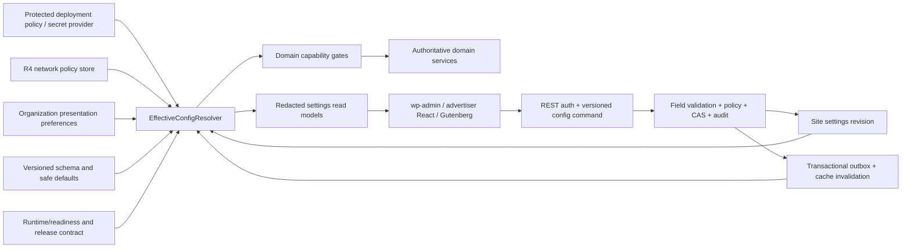
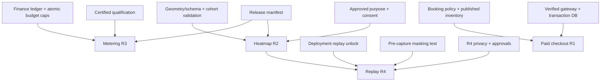

# AdPilot — Configuration, Feature Flags, Localization & Multisite Administration Specification

**Document ID:** ADP-DOC-026  
**Filename:** `26_ADPILOT_CONFIGURATION_FEATURE_FLAGS_LOCALIZATION_MULTISITE_ADMINISTRATION.md`  
**Version:** 1.0.0 — proposed implementation contract  
**Status:** Proposed; requires Product Owner, WordPress Lead, Principal Architect, Application Security, Privacy, Finance, Accessibility/Localization, Network Operations and QA sign-off  
**Date:** 2026-10-12  
**Product:** AdPilot — Self-Service Advertising Marketplace & Behavioral Analytics for WordPress  
**Accountable owner:** Platform/WordPress Configuration Lead and Principal Software Architect  
**Target implementer:** GPT-6 High, using independently verifiable work packages and explicit blocking decisions  
**Normative predecessors:** ADP-DOC-001 through ADP-DOC-025  
**Next document:** To be determined through the documentation plan; this document does not silently create a new approved milestone.

> **Status and scope warning:** This document is a specification, not deployed software, tested behavior, a regulatory certification, or an authorization for any R4 feature to ship early. Catalog names, values, additional persistence columns and proposed endpoints must be reconciled with source contracts and formally approved before they are declared stable. Illustrative PHP/TypeScript/JSON snippets need integration tests and security review before use in production. **No setting, feature flag or network administrator interface may override domain, financial, privacy or authorization invariants.**

---

## 1. Purpose, authority, source hierarchy and normative terminology

### 1.1 Purpose

Define AdPilot's complete configuration control plane: configuration schemas and data ownership; site and organization settings; immutable deployment safeguards; runtime feature availability; staged rollouts; WordPress Settings API and custom REST integration; user-interface behavior; localization and internationalization; right-to-left interface correctness; network/multisite governance; secure configuration transfers; versioned migrations; reliable invalidation; diagnostics; auditability; and full test/certification evidence. Serve as the single implementable handoff for the configuration aspects of `CAP-01`, `CAP-03`, `CAP-06`, `CAP-10..18` without replacing their owning business contracts.

### 1.2 Source precedence and conflict resolution

1. **ADP-DOC-001** controls 129 `FR-*`, 18 `BR-*`, 16 `NFR-*`, 10 `INV-*`, 15 `AC-*`, 12 `DEC-*`, original release tags and contractual meaning.
2. **ADP-DOC-002/003** control feature-to-test traceability, `AT-*`, `UI-01..20`, 28 `UJ-*`, 18 `WF-*`, 17 `E2E-*`, and UX error/recovery behavior.
3. **ADP-DOC-004/005** control domain policy, transition permission checks, 22 baseline operations, additional proposed site capabilities, org memberships and network/tenant boundaries.
4. **ADP-DOC-006/007** control 18 architectural modules, 24 inter-module contracts (`IC-001..024`), domain/application ownership and service boundaries.
5. **ADP-DOC-008..010** control database ownership, migration, REST endpoint names, asynchronous events and job contracts.
6. **ADP-DOC-011..017** control UX, UI screens, tokens, WordPress blocks, theme rendering APIs, and integration parity.
7. **ADP-DOC-018..023** control delivery, eligibility, measurement, privacy, commerce, creative moderation and security-specific decisions.
8. **ADP-DOC-024/025** control testing evidence, production operations, rollout, backups, safe upgrades and recovery; particularly Document 25 §5 on configuration provenance and safeguards.
9. **This document** elaborates only configuration-plane interfaces. Any contradiction creates a versioned, reviewable change request with linked source IDs, not an implicit modification of older decisions.

`MUST`/`SHALL`: non-negotiable for a release that includes the capability. `SHOULD`: deviation only with documented technical/business review. `MAY`: optional and release-gated. "Proposed" means a new naming/detail requiring ratification; not an already supported API.

### 1.3 Product-release boundaries

| Release | Effective configuration capability | Explicitly excluded from earlier releases |
|---|---|---|
| **R1** | Secure site settings, WordPress i18n/RTL, role-scoped admin, deployment safeguards, core delivery/marketplace/commerce toggles, basic diagnostics, consent integration and site-isolated multisite operation when installed on a network | No R2 heatmap collection, R3 metered billing, R4 replay, or centralized cross-site governance merely because a flag key exists |
| **R2** | Heatmap collection/processing/privacy controls, approved aggregated visualization settings, future-ready saved reporting/branding only where source scope permits | No R3 chargeable event metering; no R4 replay |
| **R3** | Metered CPC/CPM enablement, validated reporting model versions, spending and finance policy gates | No R4 network federation or replay |
| **R4** | Optional network-wide governance, network rollout policies, independent worker options, separately opt-in session replay | No implied customer-data visibility across sites; network super-admin has no implicit AdPilot business-data authorization |

**R1 isolation vs R4 governance:** A WordPress multisite installation needs per-site isolation, proper blog prefix, correct switching/restoration and installation safety from R1. The **centralized AdPilot network console and cross-site orchestration** are R4-only and require the special Document 05 capability `adpilot_network_governance` plus explicit policy authorization.

### 1.4 Cross-cutting non-negotiables

- Configuration changes never grant organization membership, modify financial ledger entries, approve creatives, reallocate paid inventory, or bypass explicit state machines.
- Client-supplied `site_id`, `organization_id`, role lists, locale, experiment flags or network context are untrusted assertions; derive authority from the authenticated site and object-scoped policy service.
- Paid booking requires actual transactional DB safety and current inventory. Flags cannot simulate transaction support or manufacture entitlement.
- No local or remote configuration enables prohibited tracking without approved purpose and applicable consent policy.
- A WordPress REST nonce is CSRF assistance, not proof of authorization, one-time execution or idempotency.
- Sensitive data must not enter browser bootstrap state, persisted drafts, exports, REST errors, logs or support bundles.
- R1 works without WooCommerce and without proprietary remote services. Disabling a payment adapter must not prevent browsing, inventory management, manual/complimentary campaigns or plugin startup.
- 500 configured logical slots do not force 500 active creatives, queries, billable events or DOM inspector controls. Tuning flags cannot defeat bounded runtime work.
- Control-plane failures must fail to a last-known-approved, unexpired safety-constrained state or to a documented safe disabled state; never infer consent or payment success.

---

## 2. Glossary, configuration domains and authority boundaries

| Term | Meaning and required distinction |
|---|---|
| **Definition** | Versioned, code-shipped schema with key, type, scope, default, validators, sensitivity, owners and dependencies. Not itself an authorized value. |
| **Stored value** | Versioned accepted input in a controlled store with actor/reason, timestamp and previous hash; may be ineffective because of policy. |
| **Effective value** | Computed decision after applying safety, release, network, site and dependency rules with explanatory provenance. |
| **Availability** | Whether a feature's code/build, runtime dependencies, migrations, legal approval and product-release contract permit any activation. |
| **Flag** | Toggle or rollout rule; not permission, consent, reservation, financial entitlement or a trusted client identity. |
| **Kill switch** | Safety-oriented, privileged, audited disable mechanism; a setting cannot disable mandatory logs or grant emergency override. |
| **Configuration revision** | Atomic canonical snapshot/version for optimistic concurrency and reconciliation; not identical to the WordPress options row ID. |
| **Deployment policy** | Protected constant/environment/secret-manager settings maintained outside a mutable wp-admin setting. |
| **Network policy** | An approved R4 policy applicable to opted-in member sites, usually restrictive rather than granting unbounded site rights. |
| **Site setting** | Current WordPress blog's setting, authorized by site-plane AdPilot capabilities. |
| **Organization preference** | Nonprivileged advertiser organization preference, scoped to the selected verified membership and never to publisher policy. |
| **User preference** | Presentation-only user option such as table density; never a billing, privilege or consent bypass. |
| **Locale** | WordPress effective user/site locale, separate from a campaign's targeting locale and from an invoice's contractual currency. |
| **Direction** | RTL or LTR resolved from localization; never inferred simply from arbitrary user content. |
| **Release gate** | R1/R2/R3/R4 product support fact; a flag does not install missing code or advance a release. |

### 2.1 Owner modules and forbidden coupling

- **Platform/Configuration** owns definitions, resolution, snapshots, revisions, policy checks for configuration writes, config-change outbox messages, redacted diagnostics and migration triggers (`IC-024`).
- **Identity** evaluates users, capabilities, organization membership and network policy rights (`IC-001`).
- **Privacy/Compliance** owns lawful-purpose decisions, data minimization, retention and data-subject operations (`IC-019`).
- **Inventory, Delivery, Measurement, Commerce, Creatives** each own business interpretation of their settings; only their authoritative services may execute dependent transitions.
- **Integration/Operations** owns gateway readiness, verification of external services, outbox, job execution and alerts (`IC-020..024`).
- **Frontend applications** consume an authorized **sanitized view**; they cannot create a competing policy engine.

The Configuration module may answer “feature requested and safe to offer?”; it SHALL NOT answer “is this campaign approved?”, “is invoice settled?”, or “does advertiser X own campaign Y?” by itself. Authoritative domain checks remain in their modules.

### 2.2 Trust-boundary diagram



No arrow permits public browser state to modify `ENV` or `N`, nor a network dashboard to bypass site-scoped business-data authorization.

---

## 3. Typed configuration definition contract and schema governance

### 3.1 Required definition fields

Every setting SHALL specify `id`, `namespace`, `data_type`, `default`, `allowed_values` or min/max constraints, `scope`, `storage`, `release_introduced`, `owner_module`, `required_capability`, `sensitivity`, `export_policy`, `validation_rules`, `required_dependencies`, `restart_or_rebuild_effect`, `cache_ttl`, `rollout_strategy`, `audit_criticality`, `rollback_strategy`, `deprecation_aliases`, `localization_key`, and `last_reviewed_version`. Missing metadata is a build-time defect, not an invitation to choose unrestricted defaults.

`scope`: `deployment_lock | network_policy_R4 | site | organization_preference | user_preference | computed_only`. `storage`: `host_secret | constant | network_option | site_option | owned_table | user_meta | computed`; network/option stores are not automatically suitable for audit-critical CAS. `sensitivity`: `public_safe | admin_restricted | privileged | secret`. `export`: `allowed | redacted | forbidden`. `audit`: `normal | elevated | critical`. A site key can be flagged network-constrained **only in R4**, and MUST have safe R1 behavior.

### 3.2 Proposed schema example (definition, not operator input)

```json
{
  "$schema": "https://json-schema.org/draft/2020-12/schema",
  "$id": "urn:adpilot:config-definition:v1",
  "type": "object",
  "required": ["id", "data_type", "scope", "default", "release_introduced", "owner_module", "sensitivity"],
  "properties": {
    "id": {"type": "string", "pattern": "^adpilot\\.[a-z][a-z0-9_.]*$"},
    "data_type": {"enum": ["boolean", "integer", "decimal_string", "enum", "string", "url", "string_list", "object"]},
    "scope": {"enum": ["deployment_lock", "network_policy_R4", "site", "organization_preference", "user_preference", "computed_only"]},
    "default": {},
    "release_introduced": {"enum": ["R1", "R2", "R3", "R4"]},
    "owner_module": {"type": "string", "minLength": 2},
    "sensitivity": {"enum": ["public_safe", "admin_restricted", "privileged", "secret"]}
  },
  "additionalProperties": true
}
```

The actual committed registry SHALL use a validated, closed application-level schema. `additionalProperties: true` above illustrates extensibility of the *definition document* only, not acceptance of arbitrary saved settings. Unknown operator-supplied configuration keys MUST be rejected (or explicitly quarantined for a versioned migration); they must never execute as flags.

### 3.3 Canonical value types and encoding

| Type | Storage rule | Validation and normalization |
|---|---|---|
| Boolean | JSON `true/false`, strict PHP bool | No accepting arbitrary truthy strings for protected operations |
| Integer | Bounded int; no floats | Exact min/max, reject overflow, prohibit negative batch sizes |
| Decimal string | Canonical string when precision matters | Exact decimal parser; monetary quantities are domain `Money`, never UI floats |
| Enum | Stable lowercase code | Explicit allowlist; labels translatable, stored codes invariant |
| URL | Validated HTTPS absolute URL where external | SSRF/redirect protections, DNS/IP checks during **use**, not only at save |
| Locale code | Canonical WordPress-available locale | Validate against installed/approved language packs; prevent arbitrary file path |
| Currency | ISO 4217 code when applicable | Supported gateway/country/currency matrix and contractual snapshot |
| Time zone | Valid IANA identifier | Store instant in UTC; DST-aware presentation and separate contract timezone |
| String list | Bounded list of fixed-length items | Deduplicate; no arbitrary HTML/PHP or executable patterns |
| Object | Versioned JSON payload with nested shape | Depth, size, child types and additional-property rejection |
| Secret reference | Opaque host-controlled reference | No secret value accepted in normal generic settings REST endpoint |

### 3.4 Validation stages

1. Decode with size/depth limits; disallow PHP serialized objects and executable config.
2. Authenticate and resolve trusted `site_id`/network/organization scope.
3. Authorize **each field**, including nested items; ensure current capability/membership and separation of duties.
4. Validate schema version and `If-Match`/expected revision; prohibit silent last-writer-wins for policy changes.
5. Normalize types/units using pure validators, with user-friendly per-field errors.
6. Validate dynamic dependencies **at command time**: license, release, plugin presence, DB readiness, approved consent provider, domain policy and transaction safety.
7. Validate cross-field combinations atomically (e.g., metering requires billing controls and certified measurement; replay requires privacy prerequisites).
8. Dry-run effects; return nonsecret diff, risk warnings, affected jobs/caches and required approvals.
9. Persist approved snapshot, signed/audited action metadata and outbox notifications in safe transaction boundary.
10. Recompute effective values; invalidate affected caches, serve new revision and verify feature health.

**Semantic principle:** `sanitize_text_field()` is not a substitute for typed schema checks, capability enforcement or contextual escaping.

---

## 4. Configuration resolution, precedence and provenance

### 4.1 Precedence is constraint composition, not unrestricted override

A simplistic “environment > network > site > default” merge would let a network/site key dangerously re-enable a feature explicitly forbidden by the deployment. Implement **two separate operations**:

- `requestedValue(key, site, actor)` chooses a permitted preference among site, approved network defaults (R4) and code defaults for ordinary, editable presentation settings.
- `effectiveValue(key, site, principal, context)` applies *intersection of constraints* from deploy-locked safety, product release, schema readiness, license/adapter readiness, privacy/finance guards, approved network ceiling (R4), site policy, and domain authorization. A denial at any mandatory boundary dominates requests to enable.

For monotone safety/disable switches, `effective_enabled = requested && release_supported && dependencies_ready && !deployment_disabled && !network_disabled && !site_emergency_disabled && purpose_allowed`. Do **not** model a security emergency lock as a mutable boolean that a lower layer can overwrite.

### 4.2 Effective configuration source order

| Layer (highest authority first for **constraints**) | Example | Who may change | Failure behavior |
|---|---|---|---|
| Deployment immutable lock | Forbid replay; force TLS-only providers; require audit logging | Host/release administrator via protected config + deployment change control | Missing/invalid safety lock: fail closed for dependent feature |
| Released executable version | R2 heatmap code absent from R1 plugin | Release engineering signed artifact | Feature unavailable, never add UI action |
| Domain safety/current state | Provider verification, booked inventory, consent, legal approval | Owning domain service | Reject dependent command |
| R4 network restrictive ceiling | Network caps rate/retention, disables risky integrations | Explicit R4 governance role + network policy | Valid local site cannot loosen ceiling |
| Site policy | Density warnings, supported billing mode, collector enablement | Site capabilities and domain policy | Use last known safe revision or disabled dependent feature |
| Organization/user preference | Presentation locale, view density, notification view | Verified org/member or user | Fall back to site/user locale and safe UI settings |
| Code default | Documented, versioned, low-risk value | Release engineering | Conservative predictable value |

**Network precedence is R4 governance only.** In R1–R3, network activation is an installation concern; do not silently establish central network-scoped business-control privileges.

### 4.3 Returned decision object

```json
{
  "key": "adpilot.features.heatmap_r2_enabled",
  "requested": true,
  "effective": false,
  "release": "R1",
  "reason_codes": ["RELEASE_NOT_SUPPORTED"],
  "value_source": "site_revision:42",
  "constraint_sources": ["release_manifest"],
  "configuration_revision": 42,
  "dependency_revision": "runtime-2026-10-12",
  "evaluated_at_utc": "2026-10-12T18:00:00Z"
}
```

Expose this object only through authorized, redacted policy views; public feature availability may expose a strict safe subset, not internal revisions, actor identities, infrastructure topology or private dependency names.

### 4.4 Caching and staleness policy

- Cache key includes `site_id`, `network_id` when applicable, config revision, release manifest version, relevant environment lock revision, and purpose/context class; **never include raw secrets**.
- Configuration read projections may be cached, but authorization decisions and live financial/consent gates cannot rely on a stale cache-only copy.
- A deny/emergency stop takes effect at the next authoritative check, with documented propagation SLA and revision-aware invalidation; delayed invalidation cannot permit unapproved serving.
- Cache eviction and object-cache failure must fall back to durable policy with bounded DB reads; cap cache-warm fanout.
- On `switch_to_blog()`, do not reuse an incorrectly site-bound service or option-cache key; always restore original blog context with `try/finally`.
- Browser-safe feature snapshots are hints for navigation/disabled UI controls; server evaluates current effective state for every privileged mutation.

### 4.5 Version control and change governance

Version each configuration snapshot with strictly increasing `revision` and canonical hash. Every change records actor/approved acting principal, trusted site/org, field paths, old/new redacted values or cryptographic digests, reason, policy/version, authorization decision, request and correlation IDs, timestamps, originating API/CLI, risk rating, and outbox status. No secret value in audit. Never allow a stale form to overwrite a concurrently approved privacy or billing update.

---

## 5. Typed setting registry and rollout semantics

### 5.1 Registry conventions

The authoritative implementation registry SHALL be code-versioned; tables below are **proposed names** and conservative policy defaults to be approved against Documents 01–25. `Public` means public-safe UI projection only, **not** freely writable. `Privileged` means site elevated capability, potentially dual-control. Release tag indicates earliest eligible code scope, not unconditional enablement. `False` means disabled until explicit approval, not that the related module lacks internal health checks. R2/R3/R4 keys may be registered as diagnostic schema metadata in R1 but must not activate runtime behavior or expose working controls.

The names of Document 25 flags such as `delivery_enabled`, `checkout_enabled`, `heatmap_r2_enabled`, `metering_r3_enabled`, `replay_r4_enabled` are retained as the **short aliases** of the canonical keys below. Aliases MAY be accepted only in controlled import/migration of known schema versions; the same feature must not have two independently writable sources of truth.

### 5.2 Core availability and emergency safety (R1)

| Proposed key (`adpilot.` prefix) | Type / scope | Safe default | Write authority | Earliest gate | Required constraint |
|---|---|---|---|---|---|
| `features.delivery_enabled` | `bool` / `site` | `true` | `adpilot_manage_settings` | `R1` | Only eligible published advertisements; never bypass domain gates |
| `features.marketplace_enabled` | `bool` / `site` | `true` | `adpilot_manage_settings` | `R1` | Disable browsing and new operations gracefully; preserve existing rights |
| `features.checkout_enabled` | `bool` / `site` | `false` | `adpilot_manage_settings` | `R1` | Requires approved working checkout adapter and booking transaction support |
| `features.woocommerce_checkout_enabled` | `bool` / `site` | `false` | `adpilot_manage_integrations` | `R1` | Requires HPOS-safe WooCommerce installed and verified |
| `safety.paid_booking_disabled` | `bool` / `site` | `false` | `adpilot_manage_settings + finance policy` | `R1` | True denies new paid holds/commit, not repayment/reconciliation |
| `safety.creative_serving_stop` | `bool` / `site` | `false` | `adpilot_emergency_stop` | `R1` | True stops serving and flushes eligibility path; audited emergency |
| `safety.measurement_disabled` | `bool` / `site` | `false` | `adpilot_manage_privacy` | `R1` | True denies measurement; never invent billable events |
| `safety.require_audit_log` | `bool` / `deployment_lock` | `true` | `host config only` | `R1` | Cannot be false from WP/options/remote config |
| `safety.force_https_gateway` | `bool` / `deployment_lock` | `true` | `host config only` | `R1` | External financial gateway must be TLS-protected |
| `safety.disable_replay` | `bool` / `deployment_lock` | `true` | `host config only` | `R1` | Only host approval unlocks replay; R4 still needs opt-in |

### 5.3 Inventory, layout and delivery policies (R1)

| Proposed key (`adpilot.` prefix) | Type / scope | Safe default | Write authority | Earliest gate | Required constraint |
|---|---|---|---|---|---|
| `inventory.max_generated_slots_per_container` | `int` / `site` | `200` | `adpilot_manage_inventory` | `R1` | Bounded, reviewed; capacity must support 200 footer slots |
| `inventory.warn_logical_slots_per_page` | `int` / `site` | `500` | `adpilot_manage_inventory` | `R1` | Warning threshold, not arbitrary hard limit for 1000+ stress fixtures |
| `inventory.warn_density_ratio` | `decimal_string` / `site` | `review-required` | `adpilot_manage_ads_policy` | `R1` | Threshold policy approval; no numeric assumption |
| `inventory.require_sold_impact_review` | `bool` / `deployment_lock` | `true` | `host config only` | `R1` | No disabling booked-inventory remediation gate |
| `delivery.selection_mode` | `enum` / `site` | `priority_weighted` | `adpilot_manage_ads_policy` | `R1` | fixed|priority_weighted|approved_policy; no random billable changes |
| `delivery.house_fallback_enabled` | `bool` / `site` | `true` | `adpilot_manage_inventory` | `R1` | House ad still subject to content policy and eligibility |
| `delivery.contextual_targeting_enabled` | `bool` / `site` | `true` | `adpilot_manage_ads_policy` | `R1` | Page/post-type/taxonomy/device/locale only in R1 |
| `delivery.geo_targeting_enabled` | `bool` / `site` | `false` | `adpilot_manage_privacy` | `Uncommitted future` | Requires explicit privacy and release approval; no silent geo collection |
| `delivery.frequency_controls_enabled` | `bool` / `site` | `false` | `adpilot_manage_ads_policy` | `R3` | Requires consent/context policy if visitor identifiers implicated |
| `performance.decision_batch_limit` | `int` / `site` | `25` | `adpilot_manage_settings` | `R1` | Policy-bounded 1..100; load-tested host-specific |
| `performance.concurrent_media_loads` | `int` / `site` | `4` | `adpilot_manage_settings` | `R1` | Bounded 1..12; obey lazy and consent constraints |
| `performance.max_editor_slot_widgets` | `int` / `site` | `80` | `adpilot_manage_settings` | `R1` | Bounded 10..250; never mount 500 editing widgets |

### 5.4 Marketplace, advertisers and moderation (R1)

| Proposed key (`adpilot.` prefix) | Type / scope | Safe default | Write authority | Earliest gate | Required constraint |
|---|---|---|---|---|---|
| `marketplace.public_catalog_enabled` | `bool` / `site` | `true` | `adpilot_manage_settings` | `R1` | Public-safe only; no private inventory pricing leaks |
| `marketplace.registration_mode` | `enum` / `site` | `wordpress_default` | `adpilot_manage_settings` | `R1` | wordpress_default|invitation_only|disabled |
| `marketplace.manual_campaigns_enabled` | `bool` / `site` | `true` | `adpilot_manage_campaigns` | `R1` | Policy-controlled complimentary workflows without WooCommerce |
| `organizations.require_verification_before_purchase` | `bool` / `site` | `false` | `adpilot_manage_organization_status` | `R1` | Do not make verification optional where local legal policy mandates |
| `organizations.max_pending_invites` | `int` / `site` | `25` | `adpilot_manage_advertiser_members` | `R1` | Quota 0..500; enforced per org, recheck scope |
| `creative.upload_max_bytes` | `int` / `site` | `10485760` | `adpilot_manage_ads_policy` | `R1` | Actual lower host limits apply; validate content + compression |
| `creative.allowed_formats` | `string_list` / `site` | `[jpeg,png,webp]` | `adpilot_manage_ads_policy` | `R1` | Scanned, allowlisted and verified; never trust MIME alone |
| `creative.require_exact_version_review` | `bool` / `deployment_lock` | `true` | `host config only` | `R1` | Cannot turn off versioned approval on content mutation |
| `creative.block_external_executable` | `bool` / `deployment_lock` | `true` | `host config only` | `R1` | Reject executable creatives unless separately designed later |
| `moderation.require_reason_for_reject` | `bool` / `site` | `true` | `adpilot_manage_ads_policy` | `R1` | Audit reason minimum, no leaking unsafe content to visitors |

### 5.5 Commerce, settlement and monetary policy (R1/R3)

| Proposed key (`adpilot.` prefix) | Type / scope | Safe default | Write authority | Earliest gate | Required constraint |
|---|---|---|---|---|---|
| `commerce.default_currency` | `currency` / `site` | `review-required` | `adpilot_manage_rates` | `R1` | Approved currency provider/contract, never implicit currency conversion |
| `commerce.quote_ttl_seconds` | `int` / `site` | `600` | `adpilot_manage_rates` | `R1` | Bounded and documented; quotes still server verified |
| `commerce.hold_ttl_seconds` | `int` / `site` | `900` | `adpilot_manage_rates` | `R1` | Bounded; extension must be explicit transactional command |
| `commerce.allow_online_checkout` | `bool` / `site` | `false` | `adpilot_manage_integrations` | `R1` | Only when verified gateway/mapping and DB transaction supported |
| `commerce.require_transactional_storage` | `bool` / `deployment_lock` | `true` | `host config only` | `R1` | If unavailable paid reservations fail closed |
| `commerce.enable_refunds` | `bool` / `site` | `false` | `adpilot_adjust_finance` | `R1` | Requires policy, approvals, gateway capabilities, manual remedy alternative |
| `commerce.tax_policy_reference` | `string` / `site` | `review-required` | `adpilot_adjust_finance` | `R1` | Jurisdiction-specific legal/finance decision; never guessed |
| `commerce.gateway_key_reference` | `secret_ref` / `deployment_lock` | `none` | `host config only` | `R1` | Secret-manager reference only, no REST or exporter exposure |
| `commerce.reconciliation_interval_minutes` | `int` / `site` | `15` | `adpilot_adjust_finance` | `R1` | Monitored job, not guarantee of settlement timing |
| `finance.require_dual_control_overrides` | `bool` / `deployment_lock` | `true` | `host config only` | `R1` | Cannot bypass enforced separation of duties |

### 5.6 Consent, privacy and retention (R1)

| Proposed key (`adpilot.` prefix) | Type / scope | Safe default | Write authority | Earliest gate | Required constraint |
|---|---|---|---|---|---|
| `privacy.consent_provider` | `enum` / `site` | `review-required` | `adpilot_manage_privacy` | `R1` | Approved integration|documented no-collection configuration |
| `privacy.analytics_purpose_enabled` | `bool` / `site` | `false` | `adpilot_manage_privacy` | `R1` | Processing allowed only after purpose and consent predicates |
| `privacy.raw_event_retention_days` | `int` / `site` | `review-required` | `adpilot_manage_privacy` | `R1` | Approved finite TTL 1..3660; legal hold handled separately |
| `privacy.export_artifact_ttl_hours` | `int` / `site` | `24` | `adpilot_manage_privacy` | `R1` | Bounded 1..168; always reauthorize at download |
| `privacy.require_sensitive_field_exclusion` | `bool` / `deployment_lock` | `true` | `host config only` | `R1` | Forms/payment/password fields never collected |
| `privacy.enable_dsr_jobs` | `bool` / `site` | `true` | `adpilot_manage_privacy` | `R1` | Subject request processing governed, independently audited |
| `privacy.allow_third_party_data_transfer` | `bool` / `site` | `false` | `adpilot_manage_privacy` | `R1` | Requires vendor inventory, contracts, purpose approval |
| `privacy.privacy_policy_version` | `string` / `site` | `review-required` | `adpilot_manage_privacy` | `R1` | Document version; do not infer lawful basis from text alone |

### 5.7 Measurement, reporting and data operations (R1/R2/R3)

| Proposed key (`adpilot.` prefix) | Type / scope | Safe default | Write authority | Earliest gate | Required constraint |
|---|---|---|---|---|---|
| `measurement.collect_render_events` | `bool` / `site` | `true` | `adpilot_manage_privacy` | `R1` | Consent and preview exclusions still dominate |
| `measurement.collect_click_events` | `bool` / `site` | `true` | `adpilot_manage_privacy` | `R1` | Consent/purpose, dedup and bot classification apply |
| `measurement.qualifier_model_version` | `string` / `computed_only` | `release-manifest` | `not writable` | `R1` | Immutable version attached to report/qualification outputs |
| `measurement.invalid_traffic_policy` | `enum` / `site` | `conservative` | `adpilot_manage_ads_policy` | `R1` | conservative|approved_version; no weakening billing qualification |
| `reporting.default_time_zone` | `timezone` / `site` | `site_timezone` | `adpilot_manage_settings` | `R1` | Stored business time UTC; presentation conversion only |
| `reporting.default_export_format` | `enum` / `site` | `csv` | `adpilot_export_reports` | `R1` | csv|json; export always scoped and expiring |
| `reporting.default_data_freshness_notice` | `bool` / `deployment_lock` | `true` | `host config only` | `R1` | Cannot hide incomplete data or unknown denominators |
| `performance.aggregation_batch_size` | `int` / `site` | `500` | `adpilot_manage_settings` | `R1` | Bounded by approved worker profile and memory |

### 5.8 R2 heatmap and behavioral analytics

| Proposed key (`adpilot.` prefix) | Type / scope | Safe default | Write authority | Earliest gate | Required constraint |
|---|---|---|---|---|---|
| `features.heatmap_r2_enabled` | `bool` / `site` | `false` | `adpilot_manage_privacy` | `R2` | Schema, consent, suppression, QA must pass |
| `heatmap.scroll_collection_enabled` | `bool` / `site` | `false` | `adpilot_manage_privacy` | `R2` | Aggregate scroll reach, no sensitive form payloads |
| `heatmap.click_density_enabled` | `bool` / `site` | `false` | `adpilot_manage_privacy` | `R2` | Privacy-gated and attribution geometry tested |
| `heatmap.visibility_proxy_enabled` | `bool` / `site` | `false` | `adpilot_manage_privacy` | `R2` | Proxy only, not eye tracking |
| `heatmap.cohort_threshold_policy` | `string` / `site` | `review-required` | `adpilot_manage_privacy` | `R2` | Privacy-approved contributor proof, not naive event count |
| `heatmap.sampling_rate` | `decimal_string` / `site` | `review-required` | `adpilot_manage_privacy` | `R2` | Approved bounded sample range and cohort safety |
| `heatmap.raw_event_retention_days` | `int` / `site` | `review-required` | `adpilot_manage_privacy` | `R2` | Privacy-reviewed finite retention |
| `heatmap.max_overlay_points` | `int` / `site` | `10000` | `adpilot_manage_settings` | `R2` | UI-render bounded, privacy suppression dominates |

### 5.9 R3 metered billing and advanced attribution

| Proposed key (`adpilot.` prefix) | Type / scope | Safe default | Write authority | Earliest gate | Required constraint |
|---|---|---|---|---|---|
| `features.metering_r3_enabled` | `bool` / `site` | `false` | `adpilot_adjust_finance` | `R3` | Certified measurement, settlement readiness, complete audit |
| `metering.cpc_enabled` | `bool` / `site` | `false` | `adpilot_adjust_finance` | `R3` | No billing from unqualified clicks |
| `metering.cpm_enabled` | `bool` / `site` | `false` | `adpilot_adjust_finance` | `R3` | Viewability and contract-defined basis certified |
| `metering.spending_caps_enabled` | `bool` / `site` | `false` | `adpilot_adjust_finance` | `R3` | Atomic caps and safe boundary behavior |
| `attribution.conversion_tracking_enabled` | `bool` / `site` | `false` | `adpilot_manage_privacy` | `R3` | Purpose/consent, attribution policy and bounded lookback |
| `attribution.lookback_days` | `int` / `site` | `review-required` | `adpilot_manage_privacy` | `R3` | Approved 0..365 model; do not treat attribution as causality |

### 5.10 R4 replay, network governance and worker adapters

| Proposed key (`adpilot.` prefix) | Type / scope | Safe default | Write authority | Earliest gate | Required constraint |
|---|---|---|---|---|---|
| `features.replay_r4_enabled` | `bool` / `site` | `false` | `adpilot_manage_replay_policy` | `R4` | Opt-in + deployment unlock + masking before capture |
| `replay.capture_rate` | `decimal_string` / `site` | `0` | `adpilot_manage_replay_policy` | `R4` | Zero until approved sampling + masking + retention |
| `replay.retention_days` | `int` / `site` | `review-required` | `adpilot_manage_replay_policy` | `R4` | Short approved retention, no sensitive fields |
| `replay.allow_download` | `bool` / `site` | `false` | `adpilot_manage_replay_policy` | `R4` | Default deny; explicit authorization and audit |
| `network.central_governance_enabled` | `bool` / `network_policy_R4` | `false` | `adpilot_network_governance` | `R4` | No implicit cross-site customer data access |
| `network.allowlist_site_ids` | `string_list` / `network_policy_R4` | `[]` | `adpilot_network_governance` | `R4` | Site enrollment required, reversible and audited |
| `network.max_site_retention_days` | `int` / `network_policy_R4` | `review-required` | `adpilot_network_governance` | `R4` | Restrictive ceiling only; local minima/requirements still apply |
| `network.allow_external_workers` | `bool` / `network_policy_R4` | `false` | `adpilot_network_governance` | `R4` | Approved mutually authenticated worker adapter |
| `workers.external_adapter_enabled` | `bool` / `site` | `false` | `adpilot_manage_integrations` | `R4` | Requires network policy when multisite and mTLS/service provenance |
| `network.cross_site_aggregate_reports` | `bool` / `network_policy_R4` | `false` | `adpilot_network_governance` | `R4` | Not authority to browse customer-level site data |

### 5.11 Internationalization, accessibility and UI preferences

| Proposed key (`adpilot.` prefix) | Type / scope | Safe default | Write authority | Earliest gate | Required constraint |
|---|---|---|---|---|---|
| `ui.default_locale` | `locale` / `site` | `wordpress_site_locale` | `adpilot_manage_settings` | `R1` | Prefer user locale in admin; site locale on public pages |
| `ui.locale_override_permitted` | `bool` / `site` | `true` | `adpilot_manage_settings` | `R1` | Presentation only; locale targeting is a distinct business input |
| `ui.user_table_density` | `enum` / `user_preference` | `comfortable` | `current user` | `R1` | comfortable|compact; no accessibility loss |
| `ui.default_color_scheme` | `enum` / `user_preference` | `system` | `current user` | `R1` | system|light|dark; contrast gates apply |
| `ui.reduce_motion_preference` | `enum` / `user_preference` | `system` | `current user` | `R1` | system|reduce; respect browser accessibility settings |
| `ui.default_pagination_size` | `int` / `user_preference` | `25` | `current user` | `R1` | Bounded 10..100; authorize pages and filters server side |
| `ui.advertiser_org_locale` | `locale` / `organization_preference` | `inherit` | `org owner/member preference` | `R1` | Presentation language only, never ownership or billing currency |
| `ui.white_label_branding_enabled` | `bool` / `site` | `false` | `adpilot_manage_settings` | `R2` | Only scope-approved branding, no deceptive disclosure suppression |
| `ui.brand_accent_token` | `string` / `site` | `inherit` | `adpilot_manage_settings` | `R2` | Validated design token only; contrast and disclosures preserved |

### 5.12 Integrations, storage, diagnostics and operational boundaries

| Proposed key (`adpilot.` prefix) | Type / scope | Safe default | Write authority | Earliest gate | Required constraint |
|---|---|---|---|---|---|
| `integrations.outbound_webhooks_enabled` | `bool` / `site` | `false` | `adpilot_manage_integrations` | `R4-pending-conflict` | Disabled pending D08/D09/D10 release-scope reconciliation |
| `integrations.webhook_endpoint_allowlist` | `string_list` / `site` | `[]` | `adpilot_manage_integrations` | `R4-pending-conflict` | SSRF-safe hostname/IP validation at registration and dispatch |
| `integrations.webhook_signing_key_reference` | `secret_ref` / `deployment_lock` | `none` | `host config only` | `R4-pending-conflict` | No webhook secret in wp_options |
| `operations.scheduler_mode` | `enum` / `site` | `auto_diagnostic` | `adpilot_manage_settings` | `R1` | wp_cron|system_cron|action_scheduler; cannot claim punctual SLA without actual worker |
| `operations.alert_sink_reference` | `secret_ref` / `deployment_lock` | `none` | `host config only` | `R1` | Protected notifier credentials and rotation |
| `operations.disable_debug_exports` | `bool` / `deployment_lock` | `false` | `host config only` | `R1` | True forces support export disabled; always redact |
| `operations.job_retry_limit` | `int` / `site` | `5` | `adpilot_retry_jobs` | `R1` | Bounded 0..10; policy-specific retry classifiers override |
| `operations.config_snapshot_retention_days` | `int` / `site` | `90` | `adpilot_manage_settings` | `R1` | Bounded and approved; privacy/financial audit retention distinct |
| `operations.support_health_enabled` | `bool` / `site` | `true` | `adpilot_view_diagnostics` | `R1` | Redacted diagnostics only |

**Catalog size:** 100 candidate typed keys across 11 families. These are a *proposed registry*; exact values, retention periods, gateway/currency defaults, legal constraints and release conflict resolutions require review. Registries are not a feature-license bypass or a substitute for Document 09 route approval.

## 6. Feature-flag engine, dependencies, rollout and kill-switch rules

### 6.1 Formal feature capability model

For each requested feature, evaluate five *independent* decisions:

1. **Shipped**: feature code, supported API, installed schema and release manifest are present.
2. **Ready**: external adapter, transaction support, worker, approved legal/privacy policy and required instrumentation are healthy.
3. **Permitted**: deployment locks, site/network rules, license/contractual obligations and domain state allow operation.
4. **Enabled**: approved site/network requested toggle/rollout includes the caller's context.
5. **Authorized**: current actor and resource policy permit the action, or the public visitor meets applicable delivery policy.

Return `unavailable | blocked | disabled | enabled`, together with stable explanation codes (e.g. `RELEASE_NOT_SUPPORTED`, `SCHEMA_NOT_READY`, `CONSENT_POLICY_MISSING`, `REQUIRES_DUAL_APPROVAL`, `DEPENDENCY_UNAVAILABLE`, `DEPLOYMENT_DENY`, `NETWORK_DENY`, `SITE_DISABLED`, `AUTHORIZATION_DENIED`). A user-visible button is not evidence of policy satisfaction. For public surfaces never reveal internal security details; show a safe generic fallback.

### 6.2 Flag classes and safe actions

| Flag class | Change behavior | Example | Mandatory safeguard |
|---|---|---|---|
| Read-only release gate | Build manifest; never site-writable | R2 collector installed | Deny missing release even if stored flag true |
| Routine configuration | Versioned CAS save | page size, UI theme | Input bounds, accessibility test and audit |
| Risk-bearing module gate | Elevated approval and readiness | paid checkout enable | Re-verify transactions and gateway/consent |
| Emergency deny | Immediate safe impact, audited | creative stop, paid booking disable | Explicit incident, TTL/remediation and cache propagation |
| Operational tuning | Controlled bounded rollout | decision batch and worker batch | Quotas, performance evidence, rollback |
| Privacy processing | Purpose-specific governance | heatmap capture | Explicit purpose/consent, retention and suppression proof |
| R3 finance | Certified readiness + finance sign-off | CPC/CPM | Ledger-only financial effects and dispute handling |
| R4 sensitive data | Hard default off and controlled enable | replay | Host unlock, independent privilege, capture masking |
| R4 network | Restricted site opt-in | network policy | No network super-admin business-data shortcut |

### 6.3 Dependency DAG, no implicit enablement



A dependency being **present** does not imply permission or approval. A missing dependency must block enabling the dependent feature with a remediation description and a non-mutating diagnostics link. No automatic “fix” may grant capabilities, turn on collection or edit unrelated WordPress options.

### 6.4 Rollout targeting and experimentation

- For R1/2/3 **only implement site-scoped rollout** unless a precise future feature contract approves a cohort-based experiment; do not use arbitrary visitor fingerprinting.
- Proposed R4 network staged rollout: eligible opt-in sites selected by an explicit allowlist/percentage of *site IDs* with a deterministic, versioned HMAC bucketing key; never bucket financial operations by request randomness.
- No randomized rollout may change a signed quote, active reservation, paid fulfillment rule, creative approval, consent processing or ledger semantics within a transaction.
- Every rollout stores start/end UTC, owner, cohort definition, experiment hypothesis, required metrics, risks, audit correlation and rollback plan.
- Safety overrides bypass rollout percentages **toward disablement only**; hard re-enable needs a new authorized operation and readiness assessment.
- For a change impacting serving, publish an effective revision atomically and attach config/model revision to delivery diagnostic evidence; never serve a mixture of incompatible policy revisions without an approved compatibility window.

### 6.5 Protected kill-switch runbook

1. Confirm reporter, site/incident, scope and reason. Ensure actor has `adpilot_emergency_stop` or the approved specific safety capability.
2. Apply an authoritative, short-TTL control-plane disable with durable audit/outbox; if DB cannot commit, use the protected host emergency policy and document operator intervention.
3. Invalidate or version eligibility caches; new decisions must re-evaluate current restriction before service.
4. Verify no new paid decision or tracking events violate the disable policy, while pre-existing financial obligations remain intact.
5. Communicate status in administrator console without exposing sensitive details publicly.
6. Re-enable only after affected underlying fault is repaired, second approval when required, and live smoke tests pass.

**Never** implement “disable audit”, “skip approval”, “trust any gateway callback”, “disable tenant checks” or “ignore consent” as emergency flags.

---

## 7. Persistence, versioning, CAS, cache and data lifecycle

### 7.1 WordPress storage strategy

- Site-local public/admin settings may use a namespaced, **autoload-disabled** `wp_options` key such as `adpilot_config_snapshot_v1` for a modest nonsecret read model; use custom ownership tables for transactional revisions/audits and network fanout when needed.
- Proposed new schema, requiring the Document 08 migration/change process: `adp_config_revisions` (`site_id`, `revision`, `schema_version`, `canonical_hash`, `public_snapshot_json`, `actor_id`, `reason_code`, `created_at_utc`, `previous_revision`, unique `(site_id, revision)`), `adp_config_outbox` is the **existing transactional outbox contract** (do not create a competing table), and optionally `adp_config_network_revisions` R4 owned by approved network administration.
- A `wp_options` blob alone does not provide reliable compare-and-swap of arbitrary concurrent financial/privacy updates. Implement safe DB CAS with a unique revision/update predicate and atomic transaction; if the DB cannot support required transactional guarantees, decline high-risk changes and report incompatibility.
- Define truth: the transactional revision record is authoritative for critical config; the WP option is a **derived projection/cache** updated idempotently after commit. If this proposed schema is not approved, redesign and document an equivalent atomic mechanism before R1 privacy/finance controls ship.
- WordPress users and media remain native. Organization preferences belong to the existing site-scoped org data model; do not store them as raw global site preferences.
- On multisite, `$wpdb->prefix` or `$wpdb->get_blog_prefix($site_id)` is site-specific; avoid hardcoding `wp_`. `get_site_option()` is network-wide on multisite, but not an R1 license for sensitive network governance.

### 7.2 Suggested revision record

```json
{
  "site_id": 7,
  "revision": 44,
  "schema_version": "config-v1",
  "values": {
    "adpilot.features.delivery_enabled": true,
    "adpilot.performance.decision_batch_limit": 25,
    "adpilot.safety.creative_serving_stop": false
  },
  "public_digest_sha256": "<calculated-by-implementation>",
  "actor_id": 105,
  "reason_code": "ADMIN_APPROVED_CHANGE",
  "correlation_id": "<opaque-request-id>",
  "created_at_utc": "2026-10-12T18:00:00Z"
}
```

The digest must be calculated over canonical encoded data, never taken from the client. Enforce a maximum settings document size. Settings containing sensitive metadata may be split into independently protected families and their hashes combined into a manifest. Never include `actor_id` or internal digest in unauthenticated output.

### 7.3 Atomic update algorithm

```text
Input: trusted site context; verified current user/service principal;
       canonical key changes; expected_config_revision; human reason
BEGIN TRANSACTION
  SELECT config_revision FROM authoritative_config WHERE site_id = ? FOR UPDATE
  IF revision != expected: ROLLBACK -> CONFIG_REVISION_CONFLICT
  Resolve field authorizations against current policy (site/org/network)
  Validate every changed field and cross-field invariants
  Check highest-priority immutable host constraints and release manifest
  Compute diff; refuse unexpected legacy/unknown keys
  WRITE new revision, policy audit, and outbox event in same transaction
COMMIT
  Attempt safe derived-options/cache rebuild (idempotent)
  Eventual consumers receive revision-tagged configuration.updated event
  High-risk domain services consult authoritative policy until caches catch up
Return {new_revision, redacted_diff, effective_outcome, diagnostics}
```

In the event of a committed revision but failed cache rebuild, return a semantically correct “change saved; propagation pending” result, create an operational retry and **block unsafe dependent behavior until synchronization**. Do not roll back unrelated paid transactions on failed notification delivery.

### 7.4 Migration lifecycle and reversibility

- Track `configuration_schema_version` separately from DB schema and release version; check for compatible reader/writer combinations before update.
- Migrations use known previous schema versions and deterministic conversion functions; no arbitrary JSON/object deserialization.
- Review deprecated aliases and collisions explicitly. When old and new keys disagree, do not choose a dangerous `true`; prefer blocked status with resolution procedure.
- Backfill only owned AdPilot keys; preserve unknown WordPress settings, translation packs and theme options unchanged.
- Preflight audit snapshot → migrate in bounded atomic site batches → verify hash → install derived projection → record outcome. Resumable and idempotent upon retry.
- Config rollback is a **new audited revision restoring compatible values**, not deletion of provenance or resurrection of a revoked secret. Re-evaluate release, dependency and finance state before rollback.
- Destructive uninstall requires explicit policy and legal/financial retention review. Deactivation preserves configuration and disables unsafe background operations without destroying paid contract history.

### 7.5 Secret handling and key rotation

- Store actual gateway/webhook/crypto secrets in an approved host secret provider or protected configuration injection; WP option/REST only holds an opaque reference when allowed.
- Never serialize secret material into browser HTML, localized JS variables, translation files, support diagnostics, CLI `--format=json`, config export, logs, event payloads or network setting diff.
- Rotate signing keys by explicit audited workflow, bounded verify overlap, protected key IDs and cache invalidation; no undisclosed indefinite old-key acceptance.
- A secret-key reference becoming unavailable means `DEPENDENCY_UNAVAILABLE`, not a silent downgrade to unsigned callbacks or disabled TLS.

### 7.6 Data minimization and retention

Config history includes actor identifiers, sensitive policy metadata and potentially protected business configurations. Define classification, restricted read scopes, TTL/legal hold approval and backup erasure strategy independently from visitor telemetry and financial ledgers. Audit and financial retention cannot be shortened by an ordinary site admin setting in violation of approved obligations. Never place arbitrary user personal data inside configuration keys.

---

## 8. WordPress Settings API and custom administration REST contracts

### 8.1 Site Settings API integration

- Use WordPress' `register_setting()` for appropriate site-level keys on supported WordPress versions, with precise `type`, `default`, `sanitize_callback` and `show_in_rest` schema. `register_setting()` alone is not the authorization or multi-field transaction implementation.
- Avoid generic `wp/v2/settings` exposure of confidential AdPilot control-plane options; where stronger permission and revision semantics are required, register a dedicated approved AdPilot REST resource using `permission_callback`, validated args and explicit serializers.
- For an array exposed through registered REST settings, declare `show_in_rest.schema.items`; validate nested objects and all enum lists rigorously.
- Register scripts/styles on correct admin/editor screens; translations require registered script handles. Do not inject full configuration into `wp_localize_script()` as a global state dump.
- Use WordPress nonce for CSRF mitigation but never treat it as access control; after nonce check evaluate site capability, object policy, current user session and revision.

### 8.2 Existing API endpoints (Document 09)

| Canonical API route ID | Route suffix under `adpilot/v1` (per D09) | Responsibility and permission |
|---|---|---|
| `OPS-001` | `GET /admin/settings` | Sanitized, typed, scoped site settings snapshot; `adpilot_manage_settings` |
| `OPS-002` | `PATCH /admin/settings` | Strict allowlist, per-field capability, expected revision, audit; `adpilot_manage_settings` is **necessary but not sufficient** for privileged fields |
| `OPS-003..004` | `/admin/roles-capabilities...` | Delegable roles with no self-escalation; `adpilot_manage_roles` |
| `OPS-005` | `GET /admin/diagnostics` | Redacted health, missing dependencies, configuration sources; `adpilot_view_diagnostics` |
| `OPS-007` | `GET /admin/audit-log` | Protected redacted history; `adpilot_view_audit_log` |
| `OPS-008` | `GET /admin/integrations` | Redacted service readiness; `adpilot_manage_integrations` |
| `OPS-014` | `GET /admin/feature-availability` | Scoped effective feature state; `adpilot_manage_settings` |
| `OPS-015` / `OPS-016` | `GET/PATCH /admin/privacy` | Privacy policy path with `adpilot_manage_privacy`; cannot be flattened into general settings |
| `OPS-018` | `GET /network/sites` | R4 network read with `adpilot_network_governance`, not cross-site data visibility |

`OPS-001/002` must never implicitly grant editing `adpilot_manage_privacy`, `adpilot_manage_integrations`, `adpilot_manage_ads_policy`, `adpilot_adjust_finance` or `adpilot_manage_replay_policy` settings. Where a dedicated route is absent from the canonical API, **propose a reviewed D09 extension**, rather than assuming an endpoint already exists.

### 8.3 Proposed, not approved, incremental endpoint contracts

| Proposal ID | Purpose | Release | Gate / dependency |
|---|---|---|---|
| `CFG26-PAPI-01` | `POST /admin/settings/actions/validate` — nonmutating dry run and sanitized diff | R1 | Authorized field-by-field, no persistence of invalid payload |
| `CFG26-PAPI-02` | `GET /admin/settings/revisions` — paginated redacted history | R1 | Audited, permission-filtered, immutable revisions |
| `CFG26-PAPI-03` | `POST /admin/settings/actions/restore` — new restoration revision | R1 | Elevated when content is sensitive; never resurrect secrets |
| `CFG26-PAPI-04` | `POST /admin/settings/actions/import-preview` — validate signed/verified manifest, no write | R1 optional | Strict schema, size limits, scope controls |
| `CFG26-PAPI-05` | `POST /admin/settings/actions/import-commit` — atomic approved import | R1 optional | Reauthorization, diff approval, CAS, audit |
| `CFG26-PAPI-06` | `POST /admin/settings/actions/export` — create redacted artifact | R1 optional | Protected expiring export + download recheck |
| `CFG26-PAPI-07` | `GET /network/policies` / `PATCH /network/policies` | R4 | Network-governance role; per-site ceilings and approvals |
| `CFG26-PAPI-08` | `POST /network/sites/actions/enroll` | R4 | Explicit target-site confirmation, audit, no data exposure |
| `CFG26-PAPI-09` | `GET /admin/feature-rollouts` / `PATCH /admin/feature-rollouts` | R4 or narrower approved scope | No visitor fingerprint rollout; control-plane safety |

**Do not implement proposed endpoint names as stable public contracts until the API owner updates Document 09's registry and tests.** If import/export is deferred, offer safe manual audited configuration via the existing site settings interface rather than inventing an insecure admin-ajax bypass.

### 8.4 Example site settings mutation (illustrative)

```http
PATCH /wp-json/adpilot/v1/admin/settings HTTP/1.1
Content-Type: application/json
X-WP-Nonce: <valid-session-nonce>
If-Match: "adpilot-config-revision-43"

{
  "changes": {
    "adpilot.features.delivery_enabled": true,
    "adpilot.performance.decision_batch_limit": 25
  },
  "reason": "Measured production performance tuning"
}
```

```json
{
  "status": "applied",
  "revision": 44,
  "effective_features": {"delivery_enabled": true},
  "changed_fields": ["adpilot.features.delivery_enabled", "adpilot.performance.decision_batch_limit"],
  "warnings": [],
  "correlation_id": "redacted-safe-id"
}
```

For an unauthorized field in a mixed patch, reject the **entire mutation** with a typed error; never silently apply a safe subset while ignoring an unauthorized privacy/finance flag. `If-Match` handling and error response bodies must conform to D09's existing envelope after the API owner reconciles exact structure.

### 8.5 Error taxonomy and UX obligations

| Stable application error code | HTTP suggestion | User-safe response | Recovery action |
|---|---|---|---|
| `CONFIG_REVISION_CONFLICT` | 409/412 | Settings changed since edit started | Diff/merge or reload; do not lose user's draft |
| `CONFIG_FIELD_FORBIDDEN` | 403 | Insufficient permission for named category | Show role requirement, contact authorized admin |
| `CONFIG_SCHEMA_INVALID` | 422 | Fix listed field validations | Keep in-progress nonsecret form data |
| `CONFIG_DEPENDENCY_UNREADY` | 409 | Required service not ready | Link permission-safe diagnostics |
| `CONFIG_RELEASE_UNAVAILABLE` | 409/404 by policy | Feature not available in this release | Explain release gate, no activation button |
| `CONFIG_APPROVAL_REQUIRED` | 409 | Additional approval required | Submit approval workflow only when defined |
| `CONFIG_MIGRATION_REQUIRED` | 503/409 by request type | Site configuration upgrade pending | No unsafe writes; approved migration path |
| `CONFIG_ENVIRONMENT_LOCKED` | 403 | Deployment policy prevents change | Operator help text, not override action |
| `CONFIG_SITE_SCOPE_MISMATCH` | 404/403 | Resource inaccessible | No existence disclosure about foreign site |
| `CONFIG_EXPORT_UNAVAILABLE` | 503 | Secure export cannot be produced | Retry safely, no debug/plaintext attachment |

Do not use `success: true` on a pending or partial propagation state. Read model should disclose `saved_revision`, `effective_revision`, `propagation_state` (if authorized), and a restart/rebuild notice when relevant.

---

## 9. Site administrator settings UX and interaction design

### 9.1 Information architecture

Integrate with `UI-20` platform/system configuration and the existing administration design system (`ADP-DOC-011..013`). No unnecessary new top-level menu. Provide permission-aware navigation and canonical breadcrumbs:

1. **Overview** — setup health and effective/blocked feature count, site ID/locale and nonsecret environment readiness.
2. **General & Appearance** — marketplace, locale, display, accessibility and theme-safe options.
3. **Inventory & Delivery** — density policy, rendering limits, fallback, contextual targeting, preview policy.
4. **Campaigns & Creatives** — moderation formats, version-review invariants, upload limits, emergency stop status.
5. **Checkout & Finance** — paid mode, gateway readiness, currencies, holds/quotes, verified settlement; elevated permissions.
6. **Privacy & Measurement** — consent, collection, retention, restrictions, validated metrics; elevated permissions.
7. **R2 Heatmaps / R3 Billing / R4 Replay** — visible as permitted **release-aware diagnostics**, not interactive controls when unavailable.
8. **Integrations** — verified connectors, redacted credential status, webhooks only after release conflict resolved.
9. **Operations** — scheduler, queues, diagnostics, audit logs, snapshots and migration health.
10. **Advanced / R4 Network Governance** — network administrator context only; never present R4 network write actions in R1 site panel.

### 9.2 Field anatomy and effective-state display

Each form control renders translated label, one-sentence explanation, scope badge as **ordinary subdued metadata**, source (`default/site/network/deployment`), validation rule, effective value, requested value, dependencies, policy lock reasons, modified-at timestamp, save control and rollback eligibility. A safety-disabled feature must not appear “On” because a stale checkbox is checked. For secrets, show only `configured/unavailable/rotation required`, a provider reference ID fragment when approved, last rotated date and authorized rotate action—not the actual credential or an unconstrained text echo.

### 9.3 Required page states

- `loading`: skeletons and bounded wait, accessible busy state.
- `ready`: current revision, capability-filtered sections and effective/readiness badges.
- `dirty`: sticky unsaved-change indicator, accessible leave warning, nonsecret draft retention.
- `validating`: per-field and cross-field errors, no false “Saved” toast.
- `approval_required`: explain approver/owner and show pending request state.
- `saved`: server-authoritative revision, propagation state, audit reference.
- `partial_propagation`: do not claim features enabled until downstream effective state acknowledged.
- `revision_conflict`: diff and conflict resolution, never silent overwrite.
- `dependency_missing`: actionable readiness diagnostic with no self-activation.
- `permission_revoked`: cancel edit, clear local sensitive state, announce restriction.
- `offline`: prevent risky false-positive saves; retry only idempotent, versioned command when online.
- `upgrade_required`: read-only safe view with migration guidance.
- `safe_mode`: show blocked operation and recovery without revealing protected debug secrets.

### 9.4 UX quality attributes

Responsive layouts from narrow mobile to desktop; keyboard-first controls, WCAG 2.2 AA, correct focus return from modal, discernible status not conveyed only by color, no inaccessible drag-only setting reordering, readable translated labels, clear copy for legal/policy obligations, no hidden approvals, screen-reader announcement of conflicts and saves, and warning text for changes affecting live ads or billing. Long configuration pages use grouped searchable indexes and virtualization only where compatible with screen-reader semantics; no monolithic settings form with 100 reactive widgets rendering at once.

---

## 10. Internationalization and localization architecture

### 10.1 WordPress-native integration

- Text domain **`adpilot`** matching plugin slug; PHP user-facing strings wrapped in WordPress gettext APIs (`__`, `esc_html__`, `esc_attr__`, `_x`, `_n`, and friends as appropriate).
- JavaScript uses `@wordpress/i18n`; register/enqueue correct script and call `wp_set_script_translations( $handle, 'adpilot', $language_directory )` after script registration. Test both network and single-site deployments.
- Extraction pipeline creates POT/catalog source; machine translation alone does not count as reviewed release localization.
- Keep translatable content away from business keys, persistent enum/status identifiers, REST property names, stable hooks, log reason codes and SQL indexes.
- For WordPress administration, prefer the current *user* locale (`get_user_locale()`); for public site render use approved effective *site* locale (`get_locale()` / context-resolved); explicit multilingual plugins may expose per-page locale through reviewed adapter, not hidden global overrides.
- Do not overwrite other plugins' text domains or language options. Respect WordPress locale switching hooks and restore locale after scoped operations when used.

### 10.2 Locale precedence and audience-specific behavior

| Surface | Locale source | Direction / formatting | Security and domain notes |
|---|---|---|---|
| WordPress administrator | Authenticated user's preferred admin locale | WordPress `is_rtl()` or verified context locale; locale Intl formatting | Cannot alter authority by switching language |
| Advertiser portal | Authenticated user locale, optional verified org presentation preference | User-selected RTL/LTR and precise bidi containment | Do not change campaign targeting or invoices automatically |
| Public marketplace | Site locale or approved translation adapter page locale | Locale-aware label/number/date rendering | Public page should not expose protected admin strings |
| Gutenberg editor | Editor user's locale for controls; post language preview only when supported | LTR/RTL preview and keyboard parity | Editing permissions remain WordPress/object-scoped |
| Advertising creative | Approved creative language/version contract | Display content bidi-safe without rewriting advertiser copy | Changing language content invalidates approval when materially changed |
| Targeting | Canonical campaign targeting locale codes | Not a UI presentation setting | Server-validated page/context target only |
| Financial document | Contractually approved currency, tax jurisdiction and invoice language | Store integer minor units/decimal Money; presentation Intl | A translation cannot change due amount, tax or settlement evidence |
| Reports | UTC storage, user-selectable presentation time zone | Show zone name/DST; stable bucket semantics | No silent reconciliation shifting by timezone |
| R2 heatmap | Snapshot's recorded layout/language/revision | Compare only geometrically and semantically compatible cohorts | Privacy suppression independent of locale |

### 10.3 Formatting, plurals and textual security

- Use context-aware plural APIs; provide translator comments for variable substitutions and disambiguate “hold”, “slot”, “approval”, “impression” and “reserve” as domain terms.
- Do not concatenate translated fragments to assemble sentences. Use numbered placeholders and escape *after* formatting for the output context.
- Use `Intl.NumberFormat`/`Intl.DateTimeFormat` on JS clients with an explicit locale/timezone/currency; server uses compatible PHP `Intl` where deployed and approved fallback otherwise. Never perform money calculations on localized output strings.
- Store UTC timestamps and commercial interval `[start, end)`; show local time, timezone, calendar and DST ambiguity warnings for bookings. ISO 8601 UTC in APIs.
- Support long translations, CJK and combining characters with flexible layouts and no fixed-width buttons; protect user content with `dir="auto"` and Unicode-bidi isolation, not wholesale direction forcing.
- All text that can contain organization names, URLs and advertiser creative labels is escaped by context. Translated HTML is never trusted simply because it came from a catalog.

### 10.4 RTL and bidirectional layout contract

- Use CSS logical properties `margin-inline-start`, `padding-inline-end`, `inset-inline-start`, `border-inline-*`, `text-align: start`, and direction-aware icon placement.
- Layout Studio coordinate model remains canonical and independent of UI text direction: changing admin locale must not change persisted commercial slots, visual geometry or sold inventory.
- Arrow keys, tree navigation, calendar previous/next buttons and drag handles must be audited for mirrored *visual* behavior without changing chronological direction or keyboard semantics unexpectedly.
- Keep numeric invoice, SKU, money, URLs, email addresses, timestamps, SQL/code identifiers and opaque IDs bidi-isolated, not re-ordered.
- Charts: preserve chronological and numeric meaning, logical legends, keyboard tooltips, and accessible tables; visually mirror layout chrome only where it improves comprehension.
- Gutenberg and theme CSS are encapsulated; do not apply global `direction: rtl` or reset unrelated theme components.
- PDF/CSV exports, if supported, use encoding and direction metadata appropriate to output format; CSV records remain parseable canonical values and must neutralize spreadsheet formula injection.

### 10.5 Translation lifecycle and QA

1. Extract source strings from PHP/JS without dynamic text-domain names.
2. Maintain stable glossary of domain terms and translator comments; track source text/version.
3. Validate placeholders, plural forms, ICU tokens and HTML sanitization for all distributed locales.
4. Review screen screenshots and keyboard task flows for English LTR, Persian/Arabic RTL and at least one long-string language before launch; wider language list is product roadmap, not assumed shipped translations.
5. Test currency/locale matrices (USD/EUR/IRR examples as presentation only), IANA time zones and DST transition dates against canonical UTC contracts.
6. Verify missing language pack fallback is usable English or WordPress-provided locale, never raw undefined token or fatal error.
7. Ensure translation updates are signed/trusted distribution artifacts where supported; prohibit arbitrary uploaded executable language bundles.

---

## 11. Multisite isolation, network governance and safe administration

### 11.1 R1–R3 WordPress multisite support (without federation)

- A network-activated plugin SHALL preserve **site-local** rows/options, per-site prefix, user-site capability scoping, org ownership and job context. No resource lookup by global ID alone.
- Activation of 100+ sites is batched, resumable, reportable, rate-limited and does not perform uncontrolled network-wide migration inside a timeout-prone request.
- New sites created later need idempotent activation/migrations of *owned* AdPilot resources only; no automatic publishing of unrelated WordPress pages or configuration changes.
- Each site's setup, migrations and errors are independent; failure on site X cannot corrupt Y or accidentally reuse Y's settings cache.
- `switch_to_blog()` and `restore_current_blog()` always paired with `try/finally` and fresh tenant-scoped repository/config instances. A context switch is not authorization.
- Site administrators cannot read, modify, export or roll back another site's settings unless a separately approved R4 governance action explicitly permits that operation.
- Network super-admin role is not a substitute for the Document 05 AdPilot resource-level authorization and privacy purpose checks.

### 11.2 R4 network governance model

The advanced network plane is optional and default off, with a distinct `adpilot_network_governance` operation and approved `OPS-018` read route. It owns **policy ceilings and operator orchestration**, not direct ownership of advertiser records or arbitrary replay data.

| R4 action | Additional authorization, safeguards and limits |
|---|---|
| Network site inventory | Scope to managed sites, no advertiser identities or financial summaries without separate policy |
| Enroll/unenroll site | Network role plus site consent/administrator approval if required; signed audit trail and reversal plan |
| Apply network deny ceiling | Restrictive only; site cannot undo; logged rollout/override rationale |
| Set retention maximum | Must comply with applicable local legal minima, data-subject obligations and approved jurisdiction policy |
| Network key/adapter readiness | Secrets remain host-controlled; never export service credentials across blogs |
| Rollout R4 worker | Per-site workload quota, service provenance, job tenant context and fallback |
| Cross-site aggregate report | Formal data aggregation privacy assessment; explicit release+purpose+authorization, not implicit super-admin read |
| Bulk diagnostic export | Redacted, site-specific capability boundary and download-time reauthorization |

### 11.3 R4 policy conflict examples

| Network policy | Site request | Effective result |
|---|---|---|
| Replay disabled | Replay enabled | **Disabled**, explain `NETWORK_DENY` |
| 7-day heatmap maximum approved | 30-day site request | **Blocked or capped** after privacy/legal validation; do not silently truncate legally required records |
| External worker prohibited | Worker enabled | **Disabled** and job remains on approved local execution |
| No cross-site reporting | Site admin requests network analytics | **Not available**, no query execution |
| Site suspended for incident | Site forces delivery on | **Delivery disabled** until authorized remediation |
| Site unenrolled | Network default brand changes | Site remains outside rollout; no mutation |

### 11.4 WordPress examples (illustrative and authorization-sensitive)

```php
<?php
$original_site_id = get_current_blog_id();
$target_site_id   = 42; // MUST be derived from trusted, authorized operation.

if ( ! $network_policy->canInspectSiteConfig( $actor, $target_site_id ) ) {
    throw new \RuntimeException( 'Access denied' );
}

switch_to_blog( $target_site_id );
try {
    // Resolve a NEW site-bound scoped config service after switching.
    $settings = $service_factory->forSite( get_current_blog_id() )->redactedSnapshot();
} finally {
    restore_current_blog();
}

if ( get_current_blog_id() !== $original_site_id ) {
    throw new \LogicException( 'Blog context not restored' );
}
```

Network configuration must explicitly bind network ID; `get_network_option()` is appropriate for reading approved network policy data only after corresponding policy and R4 scope checks. Never use it as a global storage bin for private financial or advertiser data.

---

## 12. Configuration import, export and reproducible environment promotion

### 12.1 Export contract

Export only an approved, allowlisted subset of nonsecret settings. Artifact manifest includes product/build version, schema revision, source release and source site logical identity, UTC exported time, recognized key/value names, redacted field list, nonsecret provenance and canonical digest. **Omit** gateway keys, signing material, WordPress salts, DB credentials, user secrets, raw personal data, organization tokens, financial ledger records, private reporting access, and third-party visitor identifiers.

- Protected downloadable artifact with limited TTL, nonpublic storage and download-time capability recheck (see Document 09/24).
- CSV only for reviewed tabular views; JSON is preferred for structured config. Escaped canonical JSON is not executable PHP or serialized objects.
- A support diagnostics bundle does **not** automatically include configuration exports or incident secrets.
- A cryptographic signature, if used, proves integrity with a **trusted provider key**; never treat user-provided signature/public key inside the same artifact as authorization.

### 12.2 Import threat model and process

1. Restrict upload to authorized operator with per-field permissions and policy; resource limits before parsing.
2. Decode bounded JSON; reject prototypes/arbitrary object classes, duplicate keys if parser can detect, unknown source version and malformed encodings.
3. Map only approved source schema versions; migration preview lists dropped/redacted/renamed fields.
4. Dry-run effective settings and cross-field constraints under **destination site's** current release, host locks, network ceiling, gateway readiness, privacy and financial approvals.
5. Show high-impact diff; require explicit typed confirmation for financial/privacy changes and independent approval where configured.
6. Commit with exact revision CAS, audit/outbox and idempotency; no partial application of unauthorized or invalid fields.
7. Verify derived projection/cache/worker propagation; rollback via a new approved revision when compatible.

**Portability:** Do not copy `site_id`, blog prefix, org IDs, user IDs, absolute filesystem paths, WordPress URLs, secret references, gateway credentials, or privacy/legal decisions as valid destination authority. Rebind destination-specific dependencies after import.

### 12.3 Environment profiles and reproducibility

- `local` and `development`: safe fixture-only payment modes, masked/consented analytics test data and nonbillable previews; no production gateway secrets.
- `staging`: production-like WordPress/WooCommerce/multisite topology but isolated gateways, webhooks, emails, analytics events, tokens, jobs and storage; never clone a live key into staging.
- `production`: host controls and approved live policy; no debug error display; changes through authenticated audited action/deployment pipeline.
- `wp_get_environment_type()` is a signal, not a security control. If misconfigured or missing, never downgrade safeguards based on an assumed development environment.
- Release-controlled fixture imports must be explicit and disabled for live sites; no automatic sample campaign creation that accidentally serves paid ads.

---

## 13. Background work, eventing, observability and failure recovery

### 13.1 Configuration-changed event model

Proposed internal event `configuration.changed.v1` maps to Document 10's existing outbox/inbox semantics; requires a reviewed event-catalog extension if the canonical registry does not already name it. Payload is metadata only: `event_id`, `site_id`, `network_id` (only where appropriate), `old_revision`, `new_revision`, `changed_key_paths` (sensitivity-filtered), `effective_gate_digest`, `policy_version`, `actor_reference`, `occurred_at_utc`, `correlation_id`. No secret values, unredacted personal data or tenant-private content. Consumers are idempotent and authorized by internal service provenance.

### 13.2 Dependent jobs

- Rebuild sanitized site settings projection after a verified revision.
- Invalidate/resynchronize delivery eligibility caches after policy-affecting changes.
- Reevaluate scheduler readiness and paid-booking status after gateway changes.
- Update future analytics retention jobs after privacy policy changes; do not retroactively erase or extend legal obligations without approval.
- Regenerate application locale bundles/layout direction only through supported build and WordPress translation APIs, not arbitrary remote JS execution.
- R4 network policy fanout in bounded batches with per-site acknowledgements and independent retry budgets.

These use the established `ASY` job framework/transactional outbox from Document 10; **do not create a second unsupervised scheduler**. A failed optional notification does not roll back a committed financial change or hide partial propagation.

### 13.3 Observability and health checks

Suggested metrics (names proposed; avoid high-cardinality raw setting values): `adpilot_config_resolve_errors_total{reason}`, `adpilot_config_revision_age_seconds{site_bucket}`, `adpilot_config_propagation_lag_seconds{family}`, `adpilot_config_denied_mutations_total{reason}`, `adpilot_config_migration_failures_total{family}`, `adpilot_flag_blocked_total{feature_class}`, `adpilot_locale_missing_messages_total{locale_bucket}`, `adpilot_rtl_visual_failures_total{test_suite}` and `adpilot_network_policy_divergence_sites` (R4 only).

Structured log: UTC timestamp, pseudonymous actor reference, trusted site, op, component, revision pair, reason code, correlation, outcome and redacted key paths; never log secret values or arbitrary input blobs. Site-level monitoring may be aggregated operationally without granting cross-tenant business access. Alerts target policies for invalid audit behavior, unexpected R2/R3/R4 activation, replay without consent, finance config drift, excessive policy propagation lag and network split brain.

### 13.4 Failure and recovery table

| Failure | Safe behavior | Recovery evidence |
|---|---|---|
| Missing config option on fresh install | Use conservative code defaults; blocked dependent risky feature | Fresh install test, no fatal |
| Inconsistent revision/options projection | Authoritative revision wins; repair projection idempotently | Rebuild audit, matching hash |
| Invalid stored enum/type | Quarantine bad key/revision, apply restricted safe state | Log redacted diagnostic, fix/migration decision |
| Partial update with multiple fields | Transaction rollback (all or none) | Both values unchanged; audit failed attempt |
| Unavailable secret manager | Disable dependent payment/webhook integration | No unsigned fallback; incident |
| Consent provider missing | Disable collection that requires it | No events sent; UI diagnostic |
| Cache stale after emergency stop | Check authoritative deny at decision time | New serve requests blocked |
| Network fanout failed for one site (R4) | Isolate site, retain tighter effective limit | Retry/resolution and site-level ack |
| Unsupported older plugin reads new setting | Versioned compatibility or feature blocked | Upgrade/downgrade test |
| Failed import after preview | No state change; preserve operator report | Immutable audit, no partial key writes |
| Translator placeholder mismatch | Safe fallback language, log defect | Runtime no fatal/XSS |
| RTL-only missing keyboard action | Block accessibility sign-off | Manual keyboard evidence |
| Settings POST repeats/retries | Idempotency key + revision CAS prevents duplicate effects | One audit/effective revision |
| Worker runs on switched blog | Rebind site services or reject wrong provenance | No cross-site effects |

---

## 14. PHP and TypeScript implementation contracts

### 14.1 Proposed PHP interfaces

```php
<?php
namespace AdPilot\Modules\Platform\Application\Config;

interface ConfigDefinitionRegistry {
    public function forKey(string $key): ConfigDefinition;
    public function allForRelease(string $release): array;
}

interface EffectiveConfigResolver {
    public function resolve(SiteId $site, ConfigKey $key, ConfigContext $context): ConfigDecision;
    public function featureAvailable(SiteId $site, FeatureId $feature, ConfigContext $context): FeatureDecision;
}

interface VersionedConfigRepository {
    public function currentForSite(SiteId $site): ConfigRevision;
    public function saveIfRevision(
        SiteId $site,
        ConfigPatch $patch,
        int $expectedRevision,
        AuditContext $actor
    ): ConfigMutationResult;
}

interface SecretReferenceResolver {
    /** No implementation may return secret material to a REST serializer. */
    public function resolveForTrustedOperation(SecretRef $ref, InternalPrincipal $principal): SecretMaterial;
}

interface PolicyAwareSettingsCommandHandler {
    public function validate(ConfigChangeCommand $command): ValidationReport;
    public function apply(ConfigChangeCommand $command): ConfigMutationResult;
}
```

These are **interfaces to implement**, not runnable classes. Construct domain objects via validated factories; define idempotency, the transaction boundary and PHP exception/result mapping in actual code. No domain module receives a raw WordPress options array or unrestricted secret provider.

### 14.2 Proposed safe resolver pseudocode

```php
<?php
function effective_bool_feature(
    FeatureDefinition $definition,
    SiteContext $site,
    ActorContext $actor,
    ReadinessSnapshot $readiness
): FeatureDecision {
    if (! $definition->shippedFor($readiness->release)) {
        return FeatureDecision::blocked('RELEASE_NOT_SUPPORTED');
    }
    if (! $readiness->supports($definition->requiredDependencies())) {
        return FeatureDecision::blocked('DEPENDENCY_UNAVAILABLE');
    }
    if ($readiness->deploymentPolicy->denies($definition->name())) {
        return FeatureDecision::blocked('DEPLOYMENT_DENY');
    }
    if ($readiness->networkPolicy->denies($site, $definition->name())) {
        return FeatureDecision::blocked('NETWORK_DENY');
    }
    if (! $readiness->domainPolicy->permits($site, $actor, $definition)) {
        return FeatureDecision::blocked('DOMAIN_POLICY_DENY');
    }
    return $readiness->siteRequested($site, $definition)
        ? FeatureDecision::enabled()
        : FeatureDecision::disabled('SITE_DISABLED');
}
```

In production, resolver policy must also account for consent/legal basis, finance readiness, org/object authorization and emergency stops **without** passing sensitive actor or visitor identifiers into cross-tenant caches. Type-specific settings (not booleans) require typed constraint mergers rather than the boolean algorithm.

### 14.3 Proposed TypeScript client representation

```ts
export type ConfigFieldState<T> =
  | { status: 'available'; requested: T; effective: T; source: string; editable: boolean }
  | { status: 'blocked'; requested?: T; reasonCode: string; editable: false }
  | { status: 'unsupported'; earliestRelease: 'R2' | 'R3' | 'R4'; editable: false };

export type SettingsView = {
  siteId: string;                 // trusted, server resolved; no write authority
  revision: number;
  fields: Record<string, ConfigFieldState<unknown>>;
  diagnostics: Array<{ code: string; severity: 'info' | 'warning' | 'error' }>;
};

export type ConfigPatchRequest = {
  expectedRevision: number;
  changes: Record<string, unknown>; // server validates per known schema and field policy
  reason: string;
};
```

The UI uses schema-generated per-field presentation with accessible help/error and never interprets `editable: true` as sufficient server authorization. Validate server responses and strip secret-looking keys defensively from client logs and analytics.

### 14.4 PHP/WordPress registration example

```php
<?php
add_action( 'admin_init', static function (): void {
    register_setting(
        'adpilot_general',
        'adpilot_config_ui_projection',
        array(
            'type'              => 'object',
            'default'           => array(),
            'sanitize_callback' => 'adpilot_sanitize_public_projection', // implement strictly
            'show_in_rest'      => false, // privileged settings use approved AdPilot REST
        )
    );
} );

add_action( 'admin_enqueue_scripts', static function ($hook): void {
    if ( ! adpilot_is_settings_screen($hook) ) { // implement exact screen detection
        return;
    }
    wp_enqueue_script( 'adpilot-admin-settings' ); // handle must already be registered
    wp_set_script_translations(
        'adpilot-admin-settings',
        'adpilot',
        plugin_dir_path( ADPILOT_PLUGIN_FILE ) . 'languages'
    );
} );
```

The example deliberately does not expose privileged settings through WP core REST. Never infer `register_setting()` performs the complete authorization/CAS/audit contract.

---

## 15. UX workflows: exact user/actor state transitions

| Workflow | Preconditions | Successful result | Failure/recovery behavior |
|---|---|---|---|
| Site administrator edits ordinary display option | WP capability + site context + current revision | Atomic new settings revision; sanitized toast | 409 diff on conflict; no loss of draft |
| AdOps changes density warning | `adpilot_manage_ads_policy`, policy review | Publish bounded policy and update Layout Studio warnings | Rejected if would violate effective network/deploy ceiling |
| Moderator changes creative format allowlist | Policy authority distinct from creative approval | Versioned media policy; new uploads comply | Existing approved assets governed by review/impact policy |
| Finance enables online checkout | Integration authority + transactional DB + verified adapter + approval | Feature effective with diagnostics and audit | Missing requirement: disabled with explicit repair |
| Privacy admin changes retention | Elevated privacy capability, legal approval, configured purge | Future processing plan updated with safe job provenance | Cannot silently shorten ledger retention or resurrect deleted PII |
| Analyst chooses locale/time zone | Authorized user presentation preference | Localized metrics, explicit timezone and units | No alteration of UTC stored buckets or currency |
| Advertiser org owner changes org language | Verified org membership and policy | Organization presentation preference only | No publisher/site privilege or cross-org effects |
| Network operator restricts feature (R4) | Network governance plus explicit site selection | Ceiling applied to enrolled sites; per-site ack | Partial fanout flagged; sites with stale restrictive state fail closed |
| Operator imports config JSON | Approved route, valid schema, scoped permissions | New audited destination revision | Dry-run conflicts; no secret/site ID transplant |
| Security operator invokes creative kill switch | Emergency capability, site and reason | Immediate authoritative deny and propagation | If downstream unhealthy, maintain deny and page operator |

For each workflow implement accessible loading, empty, validation, conflict, waiting approval, error and success states, plus appropriate capability-sensitive navigation. Map to `UJ-17`, `UJ-18`, `UJ-27`, `UJ-06` and relevant dashboard journeys from Document 03.

---

## 16. Security and privacy controls for the configuration plane

### 16.1 Attacker scenarios and defenses

| Attacker behavior | Prevention and deterministic negative test |
|---|---|
| Subscriber calls `OPS-002` to enable replay or disable audit | Current permission evaluation + deployment lock; zero writes |
| Advertiser passes foreign organization/site ID in config patch | Trusted context and tenant repository; no foreign existence disclosure |
| Site admin manipulates network policy through normal settings | Network R4 route and special capability; normal route rejects |
| User spoofs `WP_ENVIRONMENT_TYPE=development` via request | Host-only signal, never request-derived; safeguards unchanged |
| Forged REST nonce used as authorization | Capability/object check separately; reject |
| Prototype pollution / nested unknown import keys | Strict validated parser; reject unknown properties |
| Gateway signing key appears in support export | Secret classification and redaction; fail export if leak scanner detects |
| Downgrade restores `heatmap_r2_enabled=true` into R1 build | Release manifest overrides; no collector initialized |
| Stale cache ignores creative emergency stop | Authoritative stop revision checked before serving |
| Malicious translation contains HTML/JS | Output contextual escaping, translation artifact validation |
| Retry reuses stale admin role after revocation | Recheck current authorization and revision; deny |
| Config import changes contract currency after checkout | Immutable signed order snapshot; no retroactive repricing |
| Two administrators concurrently edit retention and checkout | Transactional CAS and per-field rights; no lost update |
| Network super-admin requests advertiser financial data | Scope/purpose/resource authorization still denies by default |

### 16.2 Audit and separation of duties

High-risk changes (privacy consent, paid checkout readiness, finance controls, integrations, company-wide retention, replay, network enrollment, emergency restoration) require actor ID, site, reason, policy rule, prior/new hashes, audit envelope, and an approver when the governing policy mandates. The initiating actor may not approve their own governed override; no generic manage-options exemption. Evidence supports GDPR/CCPA obligations where applicable but this document does not establish legal compliance or a lawful basis.

### 16.3 Network and third-party data boundaries

Network governance carries no automatic third-party data processing agreement, no permission to disclose advertiser/visitor data across legal entities, and no right to forward events to unapproved analytics services. Third-party integration keys and endpoints are explicitly reviewed against Document 23's SSRF, signature, egress, privacy and consent model. The Document 08/09 outbound-webhook release conflict remains an **unresolved blocking decision**; its flag is off until resolved.

---

## 17. Performance, accessibility, integration compatibility and release QA

- On 500-slot and 1,200-slot fixtures, read effective configuration in bounded batches and avoid one DB option fetch per slot or one React settings control per slot.
- Config evaluation must have a measured hot-path cache budget; no external network call for every ad decision. Critical denial and live eligibility cannot be cached more loosely than accepted correctness requires.
- Profile typed schema validation and revision lookup under stressed object-cache and DB backends; publish p75/p95 and query-count outcomes **measured in the approved host**, not invented targets.
- No WordPress global CSS/JS, no global `register_setting()` key collision, no mutation of unrelated core/theme/plugin options on activation or upgrade.
- Verify compatibility with WooCommerce active/inactive and HPOS mode, object cache present/absent, PHP extension variation, WordPress multisite 2/50/500-site fixture, classic and block themes, current supported PHP/DB/WP versions per D25 support matrix.
- Every settings form, notice, source/effective-state explanation and reviewer dialogue meets WCAG 2.2 AA target; test screen readers and keyboard operation in RTL and LTR.
- Confirm timezone/currency formatting with actual WordPress locale and Intl browser support; persist canonical values unaffected by locale.
- Document 24 release dossier must contain exact config schema, migration dry-run logs, negative security tests, API contract approval, R1/2/3/4 flag suppression, RTL screenshots, performance measurements and signed operator acceptance.

---

## 18. Deployment, rollout, upgrade and recovery runbooks

### 18.1 Fresh install

1. Detect WordPress/site context, supported runtime and DB transaction support; do not assume WooCommerce present.
2. Install owned per-site revision/audit schema only after Document 08 approval; register code defaults and initial safe revision.
3. Mark unresolved privacy/commercial dependencies `blocked`; do not invent gateway, currency, tax or consent choices.
4. Create no unrelated pages/options; no automatic advertising delivery/collection in sensitive contexts before required authorization and policy.
5. Show setup health and explicit remediation; ready marketplace/manual paths remain usable.

### 18.2 Upgrade from previous release

1. Preflight schema compatibility, backups, actor/host rights and rollout flags.
2. Validate new definitions against old snapshots; run pure migration simulation; record checksum.
3. Deploy code capable of reading old/new versions (expand-then-contract migration) where possible.
4. Migrate site batches transactionally; rewrite projections; recheck effective safety gates.
5. Roll out changed behavior behind disabled-by-default flags until QA and owner sign-off; monitor.
6. Freeze risky writes on failed migration and offer repair/diagnostic path; do not let old config silently bypass new privacy/finance controls.

### 18.3 Network policy rollout R4

1. Obtain explicit site list and approvals; validate network operator and every enrolled site's policy and compatibility.
2. Calculate restrictive effective diffs; dry-run in staging with 2/50/500-site fixtures.
3. Apply a versioned network policy; enqueue bounded per-site acknowledgement jobs.
4. Hold stricter policy during split-brain/slow fanout; alert divergent sites.
5. Reconcile acknowledged revisions and material effects; expose nonprivate progress dashboard.
6. To reverse, submit a **new revision** and re-check the site-level approval requirements; no override of legal/host constraints.

### 18.4 Restore and disaster recovery

- Restore owned configuration revision tables, audit, policy snapshots and outbox consistently with other application data; respect backup/restore plan from Document 25.
- After backup restoration re-check secret references against current secret manager; do not restore revoked credentials, deleted privacy data or expired consent as effective.
- Current payment settlements and external gateway states require authoritative reconciliation before paid checkout resumes; config rollback does not reverse funds.
- Regenerate caches and read models, re-evaluate deployment locks, replay/heatmap gates, site enrollment and network policy revisions.
- Verify WordPress blog IDs/prefixes after multisite restore; rebind site context and avoid accidental cross-tenant access.
- Run smoke suite, retain audit of recovered source/timestamp and unresolved consistency gaps; block unsafe writes until cleared.

---

## 19. Documentation and decision change-control obligations

Before a proposal becomes stable, the owning reviewers update: Document 09 for added settings/network endpoints; Document 08 for transactional config revision schema; Document 10 for `configuration.changed.v1`; Document 05 for any additional capability; Document 24 for certification tests; Document 25 for hosting/restore runbooks; Document 23 for privacy/legal security controls. Each cross-document change identifies source and destination IDs, migration path, rollback procedure, actor and approval date. No appended proposal implicitly modifies already-approved public API, slot ID, currency arithmetic, consent policy or release scope.

---

## 20. Reproducible configuration test fixtures (`CFG26-FX-001..040`)

Each fixture SHALL have a deterministic clock/locale, explicit WordPress/PHP/DB profile, site/actor capability graph, code release, event/network isolation, seeded settings revision, expected audit and prohibited-side-effect assertions. Use fictional identities and sandbox credentials only. Refresh all test state between scenarios.

| Fixture | Environment/state | Required use |
|---|---|---|
| `CFG26-FX-001` — Clean single-site WordPress install | One site; no AdPilot tables; WooCommerce absent; PHP/DB supported | R1 baseline safe defaults, no remote services |
| `CFG26-FX-002` — WooCommerce absent site | Manual campaign and marketplace content without checkout adapter | Plugin boots; paid checkout unavailable with diagnostic |
| `CFG26-FX-003` — WooCommerce HPOS live site | Gateway in sandbox, HPOS on and valid site capability roles | Verified checkout readiness without treating orders as posts |
| `CFG26-FX-004` — Read-only config option corruption | Malformed JSON in derived wp_options projection, authoritative revision intact | Safe restore, do not enable stale features |
| `CFG26-FX-005` — Two-admin revision collision | Admin A and B read revision 11 and each patch distinct policy fields | Second must conflict, no lost update |
| `CFG26-FX-006` — Unauthorized subscriber | Subscriber with no site AdPilot privileges and forged settings payload | 403 no write or data leak |
| `CFG26-FX-007` — Advertiser agency memberships | User in org A and B; org C omitted | Only selected verified org preference changes |
| `CFG26-FX-008` — Elevated privacy manager | Actor with privacy capability but not finance or roles | Scoped privacy writes, denied finance/role writes |
| `CFG26-FX-009` — Role revoked during editing | User had settings capability at screen load; revoked before PATCH | Next request rejects, no revision update |
| `CFG26-FX-010` — Deployment replay deny | Host disable_replay=true and site requests R4 replay | Effective false, cached and uncached |
| `CFG26-FX-011` — R1 executable with future toggles | Stored R2/R3/R4 flags true from hypothetical newer snapshot | Effective unavailable, collectors not started |
| `CFG26-FX-012` — R2 ready heatmaps | Approved consent, schema, geometry, contributor privacy proof | R2 enabled only after explicit current-site opt-in |
| `CFG26-FX-013` — R2 missing consent | Heatmap desired true but consent adapter absent | No collector or heatmap export |
| `CFG26-FX-014` — R3 metering unqualified | Metering desired on while qualifier/ledger certification missing | No chargeable events or ledger effects |
| `CFG26-FX-015` — R4 masked replay approved | Host unlock, consent/masking/retention approved and privileged user | Controlled opt-in and audit without raw form capture |
| `CFG26-FX-016` — R4 replay prior to masking | Replay desired on with masking test failed | Disabled, no session stream recorded |
| `CFG26-FX-017` — Valid quote and hold | Published inventory + valid transactional DB; paid mode toggle off | No new paid hold, existing rights persisted |
| `CFG26-FX-018` — Failed transactional storage | No InnoDB transaction/lock guarantee | Paid booking disabled, explicit diagnostic |
| `CFG26-FX-019` — Late paid gateway callback | Paid callback after expired hold, checkout feature disabled | Reconcile and remedy; never reserve sold slot |
| `CFG26-FX-020` — Creative emergency stop | Active creative and stale delivery cache, emergency stop applied | No new eligible serving; no audit bypass |
| `CFG26-FX-021` — 500-slot production layout | 4 header,100 sidebar,196 content,200 footer; progressive runtime | Bounded render/config lookup; semantics unchanged |
| `CFG26-FX-022` — 1200-slot stress layout | Many compact zones and varied responsive grids | Warn appropriately, remain available for testing |
| `CFG26-FX-023` — Mixed RTL admin | Persian labels, English domain names, money + IDs, keyboard nav | Bidi correct, screen-reader and keyboard usable |
| `CFG26-FX-024` — LTR long string | Pseudo locale with 60% expanded labels | No clipped control, no unlabeled shortcut |
| `CFG26-FX-025` — Date/time edge | DST spring/fall ambiguous times, UTC quote intervals | Explicit zone/disambiguation, invariant stored UTC |
| `CFG26-FX-026` — Locale-specific currency | IRR/USD/EUR display with signed order amount unchanged | No float rounding, stable accounting |
| `CFG26-FX-027` — Foreign network/site context | Site 1 actor requests Site 2 settings, site 2 existing | 404/403 no foreign existence or writes |
| `CFG26-FX-028` — Network super-admin without site grant | WP network user without AdPilot R4 governance | No site business data or global settings edit |
| `CFG26-FX-029` — R4 enrolled sites | 3 sites: enrolled1, enrolled2, nonmember3, restrictive network policy | Apply only to enrolled; no cross-site data leak |
| `CFG26-FX-030` — R4 fanout interrupted | 100 sites targeted, 23 acknowledged, worker outage | Track divergence, safe ceiling, bounded resumable retry |
| `CFG26-FX-031` — Network activation 500 sites | 500 WordPress blogs with mixed upgrade states | Batched per-site failures isolated and repaired |
| `CFG26-FX-032` — Config import with secret fields | Signed or unsigned JSON includes gateway key and target site ID | Reject or redact as specified; no credential transplant |
| `CFG26-FX-033` — Valid config import dry run | Approved nonsecret bundle, revision collision simulated | Diff and no writes until explicit authorized commit |
| `CFG26-FX-034` — Old schema migration | Config v0 with deprecated aliases, one ambiguous collision | Deterministic migration or quarantine; no unsafe true |
| `CFG26-FX-035` — Partial migration crash | Worker dies between authoritative write and derived rebuild | Idempotent projection repair and outbox restart |
| `CFG26-FX-036` — Backup restore old credentials | Restore snapshot with revoked gateway key reference and deleted privacy data | Key rebind and privacy reconciled, no secret resurrection |
| `CFG26-FX-037` — Analytics outage and queue lag | Aggregation queued, settings UI available | Accurate data freshness status, no false complete |
| `CFG26-FX-038` — Public cache/CDN active | Page cache and object cache serve stale feature hint | Authoritative deny applies to new ad decisions |
| `CFG26-FX-039` — Broken translation catalog | Missing placeholder and unexpected HTML in translated label | Safe fallback/escape, build test failure |
| `CFG26-FX-040` — Accessibility audit fixture | WCAG 2.2 AA keyboard, mobile 320px, screen-reader focus, RTL | All settings workflows testable without pointer |

---

## 21. Configuration acceptance and adversarial test catalog (`CFG26-T-001..120`)

Each case is a *specification* requiring a runnable PHPUnit/WordPress integration, REST/API, Playwright, property-based or fault-injection test with setup, actor, request, expected code/response, authoritative DB pre/post diff, audit/outbox check, tenant-leak check and replay proof. “Reject” means **no unauthorized side effects**, not just an error banner. Tests carry the original `AT-*` and `E2E-*` links via the traceability appendix.

### Schema/validation/canonical values

| Case | Scenario | Required expected evidence |
|---|---|---|
| `CFG26-T-001` | Reject unknown setting key | Submit invented adpilot.admin_root_enabled=true; expect 422 and zero stored mutations. |
| `CFG26-T-002` | Enforce strict boolean | Send “yes”, 1, and arrays to bool field; reject rather than PHP truthiness. |
| `CFG26-T-003` | Reject oversized numeric tuning | Set decision_batch_limit above reviewed max; no partial save. |
| `CFG26-T-004` | Validate decimal string | Send NaN, exponential overflows and locale separators; reject uncertain precision. |
| `CFG26-T-005` | Closed nested object schema | Submit extra JSON properties and depth over limit; reject entirely. |
| `CFG26-T-006` | Preserve canonical currency | Switch display locale while currency code/order snapshot unchanged. |
| `CFG26-T-007` | Reject unsafe endpoint URL | Supply private IP, redirect to loopback or HTTP webhook; reject in registration and on use. |
| `CFG26-T-008` | Reject unknown IANA timezone | Use invalid zone and confirm field-level error preserving safe draft. |
| `CFG26-T-009` | Return localized field validation | Present translated validation without altering stable machine error code. |
| `CFG26-T-010` | Schema regression checksum | Modify a definition without schema bump; static CI contract test fails. |

### Authorization and ownership

| Case | Scenario | Required expected evidence |
|---|---|---|
| `CFG26-T-011` | Subscriber cannot patch settings | POST authenticated request with valid nonce but no capability; no DB writes. |
| `CFG26-T-012` | Mixed patch is atomic | Site manager attempts general+privacy without privacy privilege; reject whole patch. |
| `CFG26-T-013` | Organization preference isolated | Org A member writes org B locale; deny, no foreign presence leak. |
| `CFG26-T-014` | Site manager cannot mutate network | Attempt R4 policy via site REST; reject and log. |
| `CFG26-T-015` | Network super-admin is not tenant auditor | Request advertiser ledger with only core network privilege; deny. |
| `CFG26-T-016` | Capability revocation effective | Revoke settings capability after form load; next PATCH fails. |
| `CFG26-T-017` | Faked site identifier ignored | Cross-site ID in body/header cannot move trusted execution scope. |
| `CFG26-T-018` | Emergency stop requires special capability | General manage_settings alone cannot issue stop. |
| `CFG26-T-019` | Finance dual-control | Initiator tries to self-approve refund/override flag; deny. |
| `CFG26-T-020` | Protected audit read | Support user sees sanitized audit projection, no secret or restricted actor details. |

### Feature gates and release readiness

| Case | Scenario | Required expected evidence |
|---|---|---|
| `CFG26-T-021` | R1 rejects future heatmaps | Even with stored true, R2 collection inaccessible and no background jobs. |
| `CFG26-T-022` | R2 cannot meter | R3 billing toggle true in R2 build; no CPC/CPM debit. |
| `CFG26-T-023` | R3 cannot replay | R4 replay toggle true but R3 manifest; no recording. |
| `CFG26-T-024` | Host replay lock dominates | Release R4/site enabled but host locks replay; disabled. |
| `CFG26-T-025` | No consent provider | R2 heatmap requested; effective blocked and no raw events. |
| `CFG26-T-026` | No payment dependency | Enable checkout without verified gateway; deny, site stays operable. |
| `CFG26-T-027` | No transactional DB | Paid booking enabled by site but DB locks unavailable; effective blocked. |
| `CFG26-T-028` | Emergency deny propagation | After kill switch, stale browser config hint cannot initiate new valid serve. |
| `CFG26-T-029` | Disable financial feature safely | Disable checkout while orders outstanding; reconciliation and remedies continue. |
| `CFG26-T-030` | Unresolved webhook release conflict | Outbound webhook flag stays false unless approved source document changes. |

### Transactional settings/concurrency

| Case | Scenario | Required expected evidence |
|---|---|---|
| `CFG26-T-031` | Concurrent PATCH conflict | Two admins update same revision; one succeeds, other 409, no lost update. |
| `CFG26-T-032` | Multi-field all-or-none | Valid+invalid patch produces no changes. |
| `CFG26-T-033` | Outbox atomic on success | Applied settings revision writes audit and event metadata atomically. |
| `CFG26-T-034` | Outbox failure rollback | DB insert failed before commit; no visible config change. |
| `CFG26-T-035` | Projection write fails postcommit | Authoritative revision persists; feature safe, repair queued, UI propagation pending. |
| `CFG26-T-036` | Idempotency replay | Repeat command with same idempotency key; one actual mutation. |
| `CFG26-T-037` | Revision restore is new revision | Restore old values but preserve revision history and revalidate current policy. |
| `CFG26-T-038` | Cache partitioning | Site A config cache never used for site B. |
| `CFG26-T-039` | Emergency revision freshness | Stale cache cannot bypass authoritative safety denial. |
| `CFG26-T-040` | Async job current policy | Consumer retries after revoke; re-evaluates current domain state before effects. |

### Financial safety and commercial integrity

| Case | Scenario | Required expected evidence |
|---|---|---|
| `CFG26-T-041` | Quote TTL setting not retroactive | Change hold TTL after signed quote; existing committed terms remain unchanged. |
| `CFG26-T-042` | Currency change cannot reprice | Modify site currency while existing order paid; financial ledger unaffected. |
| `CFG26-T-043` | Tax reference requires approval | Try unknown jurisdiction tax policy; blocked and audited. |
| `CFG26-T-044` | Refund toggle cannot erase obligation | Disable refunds while remedy pending; route follows governing legal policy. |
| `CFG26-T-045` | Paid booking disabled after orders | Old orders continue reconciliation without new inventory sale. |
| `CFG26-T-046` | Gateway key reference missing | No unsigned payment fallback or false completed checkout. |
| `CFG26-T-047` | Quote and hold remain separate | Enable marketplace but checkout off; browsing works without creating commitment. |
| `CFG26-T-048` | Financial log cannot be disabled | Normal site setting attempts to disable ledger audit; locked. |
| `CFG26-T-049` | Manual campaign without Woo | WooCommerce missing; authorized complimentary campaign works. |
| `CFG26-T-050` | Metering certification required | R3 paid event flag cannot bypass measurement or caps certification. |

### Import/export, backups and secrets

| Case | Scenario | Required expected evidence |
|---|---|---|
| `CFG26-T-051` | Export strips secrets | Gateway key, signing key and token excluded; scan exported artifact. |
| `CFG26-T-052` | Export protected download | Revoked operator cannot download a previously generated export. |
| `CFG26-T-053` | Import source site spoof | Source site ID carried in file does not authorize destination edit. |
| `CFG26-T-054` | Import schema mismatch | Unsupported schema version rejected before writes. |
| `CFG26-T-055` | Import unknown keys | Unknown nested keys rejected or explicitly quarantined; never execute. |
| `CFG26-T-056` | Import preview zero mutation | Preview and invalid consent policy leave canonical revision unchanged. |
| `CFG26-T-057` | Import commit CAS | Mutation after preview requires exact current revision and renewed authorization. |
| `CFG26-T-058` | Import mixed permissions | Financial key present for ordinary site admin; reject whole import. |
| `CFG26-T-059` | Restore revoked secret | Restore backup containing stale key ref; do not restore credential authority. |
| `CFG26-T-060` | Cross-version downgrade | Old plugin reads new schema; refuse unsafe operations and alert. |

### Multisite and network governance

| Case | Scenario | Required expected evidence |
|---|---|---|
| `CFG26-T-061` | Two-site isolation | Same business ID on two sites; repository and config isolate rows. |
| `CFG26-T-062` | Blog context restoration | Exception during switch must restore blog and object cache context. |
| `CFG26-T-063` | R1 network-activated without governance | Network activation works site-local; centralized console remains unavailable. |
| `CFG26-T-064` | R4 network policy caps | Network forbids replay; site cannot enable even with capability. |
| `CFG26-T-065` | Network unenrolled site | Apply policy to allowed sites only, nonmember remains unchanged. |
| `CFG26-T-066` | Bulk site install retry | 500-site activation handles partial failures and resumes without duplicates. |
| `CFG26-T-067` | R4 worker tenant provenance | Worker job for site B cannot mutate site A after site switch. |
| `CFG26-T-068` | Network super-admin lacks blanket data scope | AdPilot advertiser finance reads stay denied. |
| `CFG26-T-069` | Policy fanout backlog | Divergent sites tracked; restrictive policy maintained pending ack. |
| `CFG26-T-070` | Cross-site cache collision | Network/site IDs and revisions in cache prevent reuse. |

### Internationalization/RTL and numeric invariants

| Case | Scenario | Required expected evidence |
|---|---|---|
| `CFG26-T-071` | Server PHP translations | All PHP UI strings have adpilot domain and placeholder review. |
| `CFG26-T-072` | JavaScript script translations | Registered JS handle loads appropriate translation catalog. |
| `CFG26-T-073` | Locale fallback | Missing translation pack safely displays comprehensible fallback. |
| `CFG26-T-074` | Arabic/Persian RTL settings | Settings forms, nav and dialogs mirror logically with keyboard parity. |
| `CFG26-T-075` | Mixed-script URL and invoice | Emails/URLs/SKUs and numbers remain ordered and selectable in RTL. |
| `CFG26-T-076` | Long translated labels | Pseudo locale expansion does not truncate core controls. |
| `CFG26-T-077` | Plural forms | Zero/one/many counts reflect locale plural rules. |
| `CFG26-T-078` | Time zones and DST | Ambiguous scheduling times require disambiguation and UTC storage. |
| `CFG26-T-079` | Reporting display timezone | Switch timezone changes labels only, not stored UTC totals. |
| `CFG26-T-080` | Currency presentation only | IRR/EUR/USD formatting leaves integer minor unit amounts invariant. |

### Privacy, consent and retention

| Case | Scenario | Required expected evidence |
|---|---|---|
| `CFG26-T-081` | No consent means no collection | Switch feature on without approved purpose; no collector and no side effects. |
| `CFG26-T-082` | Invalid retention policy | Out-of-range raw retention rejected, never indefinite. |
| `CFG26-T-083` | Privacy policy change elevated | Ordinary site settings capability cannot edit consent configuration. |
| `CFG26-T-084` | Sensitive exclusion cannot be disabled | Deployment lock dominates all site flags. |
| `CFG26-T-085` | Subject deletion after backup restore | Replay old backup and reapply erasure ledger; no resurrected PII. |
| `CFG26-T-086` | Third-party transfer disabled | Unapproved remote analytics sink never receives event. |
| `CFG26-T-087` | Heatmap cohort threshold unresolved | No heatmap published on event-count-only pseudo-cohort proof. |
| `CFG26-T-088` | Replay masking prerequisite | R4 replay remains off until precapture masking verified. |
| `CFG26-T-089` | Protected privacy export | Privacy setting export has reauth and no raw visitor data. |
| `CFG26-T-090` | Consent policy time changes | Events evaluated under current valid consent/purpose and recorded model version. |

### Reliability, observability and recovery

| Case | Scenario | Required expected evidence |
|---|---|---|
| `CFG26-T-091` | Config corrupted on boot | Plugin loads with safe feature defaults and diagnostics. |
| `CFG26-T-092` | Object-cache outage | Read durable config with bounded queries and deny freshness. |
| `CFG26-T-093` | Queue lag | Show propagation pending and alert, not falsely ready. |
| `CFG26-T-094` | Scheduler unavailable | R1 critical paid timing warns and blocks unsafe new purchases per policy. |
| `CFG26-T-095` | Missing secret manager | Checkout/webhooks block; site remains otherwise operational. |
| `CFG26-T-096` | Telemetry redaction | Logs contain no credentials or full sensitive config value. |
| `CFG26-T-097` | Crash during migration | Resume idempotently from durable state and checkpoint. |
| `CFG26-T-098` | Database failure on high-risk edit | Mutation fails closed, old approved revision remains. |
| `CFG26-T-099` | Rollback old policy | Restored revision is reauthorized against current host and release constraints. |
| `CFG26-T-100` | Config propagation race | Old effective policy cannot re-enable emergency-disabled delivery. |

### UX, accessibility and admin usability

| Case | Scenario | Required expected evidence |
|---|---|---|
| `CFG26-T-101` | Form loading/readiness | Loading skeleton with assistive status until current revision arrives. |
| `CFG26-T-102` | Conflict UX | Show diff and explicit reload/merge, preserve safe nonsecret draft. |
| `CFG26-T-103` | Permission-aware navigation | Finance/moderator can access permitted section without unrelated parent capability. |
| `CFG26-T-104` | Disabled reason clarity | Deployment-locked flags show explainable read-only outcome. |
| `CFG26-T-105` | Save confirmation accuracy | Pending downstream propagation is not reported as fully enabled. |
| `CFG26-T-106` | Mobile 320px | All critical settings workflows usable without horizontal clipping. |
| `CFG26-T-107` | Keyboard and screen-reader | All actions and statuses announced with WCAG 2.2 AA target. |
| `CFG26-T-108` | RTL error alignment | Mixed text errors and links remain accessible and readable. |
| `CFG26-T-109` | Offline save protection | Untrusted offline mutation does not claim server success. |
| `CFG26-T-110` | Translation-sensitive validation | Field errors localized while machine code is stable. |

### Release certification / adversarial combinations

| Case | Scenario | Required expected evidence |
|---|---|---|
| `CFG26-T-111` | R1 full install suite | Install without Woo, no future flags, all R1 settings and tests pass. |
| `CFG26-T-112` | R2 feature upgrade suite | Migration, cohort privacy and R2 UI proof required before activation. |
| `CFG26-T-113` | R3 metered finance suite | Billing certification, idempotency, spending cap and reports signed off. |
| `CFG26-T-114` | R4 replay suite | Host unlock, privacy mask, opt-in, rights and bounded retention certified. |
| `CFG26-T-115` | R4 federation suite | Network scope, site isolation, enrollment, rollback and fanout tests pass. |
| `CFG26-T-116` | WP update compatibility | Supported WP and PHP/DB versions, theme and object cache tested. |
| `CFG26-T-117` | Woo HPOS modes | Gateway integration and HPOS-safe mapping, or no-Woo startup tested. |
| `CFG26-T-118` | RTL/LTR manual sign-off | Critical UI journeys pass keyboard and screen-reader checks. |
| `CFG26-T-119` | Threat model negative suite | Security tests assert both failure response AND no forbidden side effects. |
| `CFG26-T-120` | Evidence bundle completeness | Versioned config schema, trace links, logs, approvals and reproducible commands bundled. |

### 21.1 Evidence quality and negative assertion rule

Capture deterministic setup hash, actor/site/network/org context, code/schema/release versions, exact request and returned error codes, before/after configuration and financial/inventory state, audit/outbox IDs, redacted relevant logs, browser screenshots/video only where privacy-safe, test environment profile and git commit. Test failures must be reproducible and never marked “passed” by a GPT implementation agent absent tool output. Integrate with original `AT-*` acceptance test IDs and Document 24 certification; new `CFG26-T-*` tests supplement and do not rename canonical requirements.

---

## 22. GPT-6 High implementation work packages (`CFG26-WP-001..026`)

**Execution contract:** For each package, inspect existing code and canonical sources, identify ambiguous/blocked decisions, define paths and interfaces, write or refactor bounded code, run static/tests, report exact changed files and test logs, perform adversarial review, and update traceability. Do not claim end-to-end readiness until every dependency package and release gate is verified. Packages are intentionally small enough to implement and review independently.

| Package | Lead | Required deliverable / completion contract | Primary new tests |
|---|---|---|---|
| `CFG26-WP-001` — Definition registry and schema compiler | Platform | Versioned registry, closed shape validators, schema lint and type-safe defaults | `CFG26-T-001..010` |
| `CFG26-WP-002` — Immutable host policy and secrets | Security/DevOps | Host-enforced disable/HTTPS/audit locks, secret provider ports, no option leaks | `CFG26-T-021..024, CFG26-T-051` |
| `CFG26-WP-003` — Site config revision persistence | Database | Transactional CAS revisions, audit/outbox and safe derived wp_option projection | `CFG26-T-031..037` |
| `CFG26-WP-004` — Effective config resolver | Platform/Domain | Constraint intersection, provenance and fail-closed dependencies | `CFG26-T-021..030` |
| `CFG26-WP-005` — Permissions and tenant scopes | Identity/Security | Per-field site/org/network gates; no self-escalation or cross-site read | `CFG26-T-011..020` |
| `CFG26-WP-006` — General settings API integration | API | D09 OPS-001/002/014 with typed data, IF-MATCH, errors and redaction | `CFG26-T-001, CFG26-T-031..036` |
| `CFG26-WP-007` — Privacy settings integration | Compliance | D09 OPS-015/016 elevated, consent/purpose and retention decisions | `CFG26-T-081..090` |
| `CFG26-WP-008` — Integration readiness and WooCommerce | Commerce/Integrations | Gateway dependency/secret status, no-Woo safe startup, HPOS gates | `CFG26-T-041..050` |
| `CFG26-WP-009` — Inventory/delivery controls | Inventory/Delivery | Density warnings, batch/media bounds, creative emergency stop | `CFG26-T-021..030, CFG26-T-101..110` |
| `CFG26-WP-010` — Config history UI and recovery | Frontend/API | Diff, audit-revision detail, conflict merge, accessible notices | `CFG26-T-032, CFG26-T-112` |
| `CFG26-WP-011` — Import/export preview and gates | API/Security | Proposed endpoints ratified, bounded manifest, secret redaction, safe commit | `CFG26-T-051..060` |
| `CFG26-WP-012` — Configuration migrations | Platform/Database | Versioned adapters, checksums, compatibility and repair | `CFG26-T-061, CFG26-T-106..109` |
| `CFG26-WP-013` — WP site activation/multisite isolation | WordPress/QA | Site-local resources, switch restore, incremental network activation | `CFG26-T-061..070` |
| `CFG26-WP-014` — R4 network policy & enrollment | Network/Security | R4-only restrictive ceilings, explicit site opt-in and worker fanout | `CFG26-T-064..070` |
| `CFG26-WP-015` — PHP/JS localization pipeline | Localization/Frontend | Text domain adpilot, gettext and script translation extraction | `CFG26-T-071..075` |
| `CFG26-WP-016` — RTL and bidi-aware components | UX/Accessibility | Directional CSS logic, mixed-script receipts, charts/calendar behavior | `CFG26-T-074..080` |
| `CFG26-WP-017` — Locale/date/number formatting | Frontend/Commerce | UTC-backed timezone display, Intl and stable currency math | `CFG26-T-077..080` |
| `CFG26-WP-018` — R2 heatmap settings gates | Heatmap/Privacy | Consent, cohort proof and geometry readiness; no R1 collection | `CFG26-T-012, CFG26-T-087` |
| `CFG26-WP-019` — R3 metering readiness gates | Finance/Measurement | Certified qualification+ledger, atomic spending caps, auditable toggles | `CFG26-T-024, CFG26-T-043, CFG26-T-113` |
| `CFG26-WP-020` — R4 replay controls | Privacy/Security | Host unlock, mask-before-capture, explicit approvals, retention | `CFG26-T-015, CFG26-T-088, CFG26-T-114` |
| `CFG26-WP-021` — Outbox/cache propagation | Platform/Operations | Safe invalidation and idempotent async consumers; no second scheduler | `CFG26-T-034..040, CFG26-T-101..110` |
| `CFG26-WP-022` — Config observability & diagnostics | DevOps | Redacted audit/metrics, compatibility probes, alerts, support bundle scan | `CFG26-T-101..107` |
| `CFG26-WP-023` — Accessible settings console | UX/Frontend | Site overview, forms, responsive 320px, WCAG and translated error states | `CFG26-T-111..120` |
| `CFG26-WP-024` — Feature rollout safety | Release/QA | Release manifest, site rollout deterministic, emergency deny precedence | `CFG26-T-021..030` |
| `CFG26-WP-025` — Reproducible tests/CI | QA | PHP unit/WP API/Playwright/security property tests with original E2E mapping | `CFG26-T-001..120` |
| `CFG26-WP-026` — Documentation, approvals and handoff | Tech lead/Product | Resolve cross-doc changes, update D08/D09/D10 and release dossier | `CFG26-T-120` |

### 22.1 Critical package dependencies

`WP-001 → WP-003 → WP-004 → WP-006 → WP-010/023` is the site-config baseline. `WP-002` immutable locks and `WP-005` authorization precede all high-risk feature toggles. `WP-012` migration and `WP-013` multisite isolation are release prerequisites. `WP-015..017` must integrate into the design system before R1 localization sign-off. `WP-018`, `WP-019`, `WP-020`, `WP-014` are **R2/R3/R4-only** packages, respectively, and cannot be activated early. `WP-025/026` deliver evidence and source-document approvals, not merely an implementation summary.

---

## 23. Open decisions, approval owners and safe interim behavior (`CFG26-DEC-001..030`)

The following are **not pre-approved architectural decisions**. Required reviewers must record a decision, impact, migration, QA and date in the central decision ledger. Until approved, follow the blocked or conservative interim behavior stated here.

| Decision | Responsible reviewers | Required determination | Interim safe behavior |
|---|---|---|---|
| `CFG26-DEC-001` — Schema storage truth for critical config | Architecture+DB | Approve transactional revision tables vs equivalent strong CAS in supported DB | No high-risk policy edits without atomic proof |
| `CFG26-DEC-002` — WordPress option key and nonautoload policy | WordPress Lead | Confirm owned projection naming, activation and uninstall behavior | No large autoloaded secret blob |
| `CFG26-DEC-003` — Public/REST config API extension | API Lead | Ratify CFG26-PAPI-01..06 in Document 09 | Do not expose provisional route names as stable |
| `CFG26-DEC-004` — R4 network API extension | API+Security | Ratify CFG26-PAPI-07..09 and permissions | No network writes before approved extension |
| `CFG26-DEC-005` — Outbound webhooks release conflict | Product+Architecture | Reconcile D08 R4 storage vs D09 R1 routes / D10 blocker | Keep outbound webhook toggle disabled |
| `CFG26-DEC-006` — Configuration.changed event name | Events Lead | Reconcile new event with D07/D10 event registry and outbox | Use approved internal routing only |
| `CFG26-DEC-007` — Config audit retention | Privacy+Security | Classify revisions, DSR treatment, legal hold and purge window | Do not auto-delete governed audit |
| `CFG26-DEC-008` — Privacy retention default and range | Privacy Counsel | Approve finite raw/heatmap/replay retention for deployment jurisdictions | Keep collection blocked until approved |
| `CFG26-DEC-009` — Consent provider integration default | Privacy Counsel | Approve supported adapters and absence semantics | No collection without required purpose/consent |
| `CFG26-DEC-010` — Cohort contributor proof schema | Heatmap+Privacy | Approve distinct eligible-contributor proof beyond event count | Suppress unsafe heatmap bins |
| `CFG26-DEC-011` — Currency defaults & fraction precision | Finance+Product | Approve currency list, gateway compatibility and currency snapshot | No guessed amount semantics |
| `CFG26-DEC-012` — Tax policy and jurisdiction sources | Finance+Legal | Approve policy references and tax calculation integration | Block dependent checkout if not available |
| `CFG26-DEC-013` — Gateway secret provider | Security+DevOps | Choose approved vault/config, rotation protocol and backup key strategy | Never expose secret in site settings |
| `CFG26-DEC-014` — Dual-control finance exception rules | Finance+Security | Specify thresholds/approver roles and evidence | No unapproved privileged override |
| `CFG26-DEC-015` — Density thresholds vs high slot counts | UX+AdOps | Approve warnings; separate warning threshold from hard limits | Do not arbitrarily reject valid 500/1200-layout fixtures |
| `CFG26-DEC-016` — Runtime batching defaults | Performance Lead | Benchmark max decision batch and media concurrency by hosting profile | Use bounded conservative defaults and measured tuning |
| `CFG26-DEC-017` — Editor list virtualization | Frontend/Accessibility | Approve virtualization thresholds and AT-compatible focus/position behavior | Do not render 500 simultaneous edit widgets |
| `CFG26-DEC-018` — Locale preference hierarchy | Localization/Product | Approve per-user, per-site, per-org fallback and multilingual adapters | Do not couple locale preference to targeting |
| `CFG26-DEC-019` — Supported locale set and QA gates | Localization/UX | Decide priority reviewed translations including Persian/Arabic RTL | Fallback safely, no false localization-complete status |
| `CFG26-DEC-020` — Export/import feature release status | Product/API | Approve whether full secure import/export is R1 or deferred | No unauthorized file-based workaround |
| `CFG26-DEC-021` — Operator backup/restore reconciliation | DevOps+Finance+Privacy | Approve config restore versus revoked secrets and DSR ledger | No old privacy/financial authority restored |
| `CFG26-DEC-022` — Network enrollment consent | Network+Security | Define required site administrator consent before central policy | No implicit site enrollment |
| `CFG26-DEC-023` — Network policy precedence with law | Legal+Architecture | Define ceiling treatment vs local mandatory minima | Most restrictive lawful safe state |
| `CFG26-DEC-024` — Network config table topology | DB+Network | Choose approved network shared vs per-site policy representation | No raw cross-site business storage |
| `CFG26-DEC-025` — R4 worker operation & provenance | DevOps+Security | Specify credentials, mTLS and bounded tenant queues | Disable external adapter until certified |
| `CFG26-DEC-026` — R4 replay enablement ceremony | Privacy+Security | Host unlock, separate permission, masking and emergency kill gates | Off by default, no pre-mask raw capture |
| `CFG26-DEC-027` — R3 metering qualification link | Measurement+Finance | Approve configuration dependency schema for certified billable basis | Never charge from raw browser events |
| `CFG26-DEC-028` — Configuration flag naming aliases | Architecture+API | Ratify canonical adpilot.* aliases vs D25 short names | One writable source of truth |
| `CFG26-DEC-029` — Feature rollout cohort scope | Product+Privacy | Approve only site-based versioned rollout unless further reviewed | No user fingerprinting for experiments |
| `CFG26-DEC-030` — Support/diagnostic redaction | Security+Support | Decide safe export fields, TTL, watermark and requester logging | No secret-bearing support artifacts |

---

## 24. Requirements traceability and release preservation

The tables below reproduce the original canonical IDs, exact source wording where applicable and release labels. The mapping is a **configuration-plane integration overlay**: owner modules and canonical source acceptance suites remain authoritative. A non-config feature listed here is preserved for completeness and is not silently reassigned to this document.

### 24.1 Functional requirements — canonical 129/129

| Canonical ID | Original release | Exact canonical requirement | Existing acceptance anchor | Configuration-plane relationship / tests |
|---|---|---|---|---|
| `FR-INV-001` | `R1` | Authorized administrators SHALL create, rename, archive, clone and search zones with stable unique IDs and descriptions. | `AT-INV-001` | Inventory/Layout; inventory/delivery settings; `CFG26-T-016, CFG26-T-055` |
| `FR-INV-002` | `R1` | Zones SHALL contain multiple containers; containers SHALL support single, row, vertical stack and responsive grid configurations. | `AT-INV-002` | Inventory/Layout; inventory/delivery settings; `CFG26-T-016, CFG26-T-055` |
| `FR-INV-003` | `R1` | Administrators SHALL configure slot count without a hard-coded 500-slot product maximum. Tested baseline: 500 logical slots on one page; stress test: 1,000+. Hosting-specific safe limits MAY be enforced with transparent diagnostics. | `AT-INV-003` | Inventory/Layout; inventory/delivery settings; `CFG26-T-016, CFG26-T-055` |
| `FR-INV-004` | `R1` | A single container SHALL generate 100 sidebar or 200 footer slots from a compact configuration, not 100/200 manually persisted Gutenberg blocks. | `AT-INV-004` | Inventory/Layout; inventory/delivery settings; `CFG26-T-016, CFG26-T-055` |
| `FR-INV-005` | `R1` | Responsive layouts SHALL support desktop/tablet/mobile column count, minimum width, aspect ratio, gaps and visibility rules without mutating contractual slot identity. | `AT-INV-005` | Inventory/Layout; inventory/delivery settings; `CFG26-T-016, CFG26-T-055` |
| `FR-INV-006` | `R1` | The system SHALL resolve placement bindings for posts, pages, archives, search contexts, product pages where integrated, template parts and approved custom hooks. | `AT-INV-006` | Inventory/Layout; inventory/delivery settings; `CFG26-T-016, CFG26-T-055` |
| `FR-INV-007` | `R1` | Administrators SHALL preview zones and slots with availability, reservation occupancy, breakpoint and empty-state information. | `AT-INV-007` | Inventory/Layout; inventory/delivery settings; `CFG26-T-016, CFG26-T-055` |
| `FR-INV-008` | `R1` | Layout edits SHALL support draft, preview, validate, publish, immutable version history and controlled rollback. | `AT-INV-008` | Inventory/Layout; inventory/delivery settings; `CFG26-T-016, CFG26-T-055` |
| `FR-INV-009` | `R1` | Changes affecting reserved/sold inventory SHALL warn, block or initiate explicit migration/reapproval before publication. | `AT-INV-009` | Inventory/Layout; inventory/delivery settings; `CFG26-T-016, CFG26-T-055` |
| `FR-INV-010` | `R1` | Administrators SHALL bulk assign, unassign, edit, duplicate and filter generated slots using paginated/virtualized controls. | `AT-INV-010` | Inventory/Layout; inventory/delivery settings; `CFG26-T-016, CFG26-T-055` |
| `FR-INV-011` | `R1` | Slots SHALL have explicit inactive, eligible, reserved, occupied and unavailable states where applicable. | `AT-INV-011` | Inventory/Layout; inventory/delivery settings; `CFG26-T-016, CFG26-T-055` |
| `FR-INV-012` | `R2` | Container types SHOULD extend to carousel, masonry, sticky and conditional/repeater presentations with accessibility and density constraints. | `AT-INV-012` | Inventory/Layout; inventory/delivery settings; `CFG26-T-016, CFG26-T-055` |
| `FR-INV-013` | `R1` | On empty eligible inventory, configurable house creative, collapsed placeholder or reserved blank layout space SHALL be possible without falsely counting impressions. | `AT-INV-013` | Inventory/Layout; inventory/delivery settings; `CFG26-T-016, CFG26-T-055` |
| `FR-INV-014` | `R1` | The system SHALL detect duplicate unintended injection and distinguish it from permitted repeated rendering. | `AT-INV-014` | Inventory/Layout; inventory/delivery settings; `CFG26-T-016, CFG26-T-055` |
| `FR-INT-001` | `R1` | Register dynamic blocks `adpilot/ad-slot`, `adpilot/ad-zone`, `adpilot/ad-repeater`, `adpilot/ad-showcase` using `block.json` and server-rendered output. | `AT-INT-001` | WordPress Integration; block/theme config and locale; `CFG26-T-071, CFG26-T-106` |
| `FR-INT-002` | `R1` | Each block SHALL expose relevant configuration, accessible editor controls, responsive preview and bounded representative rendering; editor previews SHALL not count as paid ad delivery. | `AT-INT-002` | WordPress Integration; block/theme config and locale; `CFG26-T-071, CFG26-T-106` |
| `FR-INT-003` | `R1` | `adpilot/ad-zone` SHALL store a compact stable zone reference and permitted overrides instead of one block per generated slot. | `AT-INT-003` | WordPress Integration; block/theme config and locale; `CFG26-T-071, CFG26-T-106` |
| `FR-INT-004` | `R1` | Repeater behavior SHALL support explicit interval policies for eligible content contexts; integrations into query loops, product grids and third-party layouts SHALL be adapter-controlled, not assumed universal. | `AT-INT-004` | WordPress Integration; block/theme config and locale; `CFG26-T-071, CFG26-T-106` |
| `FR-INT-005` | `R1` | Provide public PHP functions `adpilot_render_slot()`, `adpilot_render_zone()`, and `adpilot_render_container()` with stable, documented argument and return/error semantics. | `AT-INT-005` | WordPress Integration; block/theme config and locale; `CFG26-T-071, CFG26-T-106` |
| `FR-INT-006` | `R1` | Provide corresponding shortcodes, e.g. `[adpilot_slot]`, `[adpilot_zone]`, `[adpilot_repeater]`, and `[adpilot_showcase]`. | `AT-INT-006` | WordPress Integration; block/theme config and locale; `CFG26-T-071, CFG26-T-106` |
| `FR-INT-007` | `R1` | Provide extensible action/filter hooks and a capability-gated REST API; all integration paths SHALL invoke the same authorization/eligibility/rendering core. | `AT-INT-007` | WordPress Integration; block/theme config and locale; `CFG26-T-071, CFG26-T-106` |
| `FR-INT-008` | `R1` | Support classic themes, block themes, template parts and traditional widget areas through appropriately scoped adapters. | `AT-INT-008` | WordPress Integration; block/theme config and locale; `CFG26-T-071, CFG26-T-106` |
| `FR-INT-009` | `R1` | Avoid overriding theme global styles; use scoped styles and namespaced classes/CSS variables. | `AT-INT-009` | WordPress Integration; block/theme config and locale; `CFG26-T-071, CFG26-T-106` |
| `FR-INT-010` | `R1` | No shortcode, Gutenberg parameter or PHP template option SHALL bypass purchased inventory, creative approval, commercial restrictions, or security rules. | `AT-INT-010` | WordPress Integration; block/theme config and locale; `CFG26-T-071, CFG26-T-106` |
| `FR-INT-011` | `R2` | Provide layout/theme diagnostics for unresolved hooks, unsupported selectors, duplicates and rendering conflicts. | `AT-INT-011` | WordPress Integration; block/theme config and locale; `CFG26-T-071, CFG26-T-106` |
| `FR-INT-012` | `R1` | Documentation SHALL give minimal working examples for each supported theme integration path. | `AT-INT-012` | WordPress Integration; block/theme config and locale; `CFG26-T-071, CFG26-T-106` |
| `FR-MKT-001` | `R1` | Advertisers SHALL browse a public, filterable catalog of published placements and packages, with dimensions, format eligibility, price, schedule and clear terms. | `AT-MKT-001` | Marketplace/Identity; marketplace/org preferences; `CFG26-T-013, CFG26-T-042` |
| `FR-MKT-002` | `R1` | Published placement pages SHALL include sanitized preview, responsive context and measured historical estimates when available, labeled as estimates rather than guarantees. | `AT-MKT-002` | Marketplace/Identity; marketplace/org preferences; `CFG26-T-013, CFG26-T-042` |
| `FR-MKT-003` | `R1` | Authorized advertisers SHALL register, manage business profiles, view their campaigns, invoices and notifications, and resume saved drafts. | `AT-MKT-003` | Marketplace/Identity; marketplace/org preferences; `CFG26-T-013, CFG26-T-042` |
| `FR-MKT-004` | `R1` | Advertiser organizations SHALL support owner/manager/analyst/billing membership with least-privilege permissions and secure invitations. | `AT-MKT-004` | Marketplace/Identity; marketplace/org preferences; `CFG26-T-013, CFG26-T-042` |
| `FR-MKT-005` | `R1` | Campaign wizard SHALL guide placement selection, creative upload, targeting where allowed, scheduling, quote review, submission and checkout. | `AT-MKT-005` | Marketplace/Identity; marketplace/org preferences; `CFG26-T-013, CFG26-T-042` |
| `FR-MKT-006` | `R1` | The wizard SHALL provide validation and clear recoverable errors, maintain drafts and preserve state during normal navigation. | `AT-MKT-006` | Marketplace/Identity; marketplace/org preferences; `CFG26-T-013, CFG26-T-042` |
| `FR-MKT-007` | `R1` | Advertisers SHALL see distinguishable approval, payment and delivery states. | `AT-MKT-007` | Marketplace/Identity; marketplace/org preferences; `CFG26-T-013, CFG26-T-042` |
| `FR-MKT-008` | `R1` | Public catalog SHALL expose no advertiser-private, financial-sensitive or visitor-personal records. | `AT-MKT-008` | Marketplace/Identity; marketplace/org preferences; `CFG26-T-013, CFG26-T-042` |
| `FR-MKT-009` | `R1` | Administrators SHALL manage advertisers, verify organizations where configured, suspend accounts, and audit changes. | `AT-MKT-009` | Marketplace/Identity; marketplace/org preferences; `CFG26-T-013, CFG26-T-042` |
| `FR-MKT-010` | `R2` | Campaign renewal, duplication, packaged purchasing and organization reporting enhancements SHOULD be available. | `AT-MKT-010` | Marketplace/Identity; marketplace/org preferences; `CFG26-T-013, CFG26-T-042` |
| `FR-CAM-001` | `R1` | Campaigns SHALL have separately managed approval, financial and delivery state machines. | `AT-CAM-001` | Campaigns/Creatives; moderation and emergency policy; `CFG26-T-018, CFG26-T-020` |
| `FR-CAM-002` | `R1` | Campaigns SHALL support drafts, submission, review, changes requested, approval, rejection, schedule, activation, pause, completion and cancellation/suspension paths. | `AT-CAM-002` | Campaigns/Creatives; moderation and emergency policy; `CFG26-T-018, CFG26-T-020` |
| `FR-CAM-003` | `R1` | Creatives SHALL support safe raster images and text/native ad templates; file dimensions, format, size, destination URL and alt text SHALL be validated. | `AT-CAM-003` | Campaigns/Creatives; moderation and emergency policy; `CFG26-T-018, CFG26-T-020` |
| `FR-CAM-004` | `R1` | Advertisers SHALL upload multiple creative versions and request edits; policy-relevant changes require reapproval before serving. | `AT-CAM-004` | Campaigns/Creatives; moderation and emergency policy; `CFG26-T-018, CFG26-T-020` |
| `FR-CAM-005` | `R1` | Moderators SHALL approve/reject with reasons, maintain audit trails and support emergency stop. | `AT-CAM-005` | Campaigns/Creatives; moderation and emergency policy; `CFG26-T-018, CFG26-T-020` |
| `FR-CAM-006` | `R1` | Paid placement SHALL not imply automatic creative approval; rejection SHALL invoke documented revision, cancellation and refund policies. | `AT-CAM-006` | Campaigns/Creatives; moderation and emergency policy; `CFG26-T-018, CFG26-T-020` |
| `FR-CAM-007` | `R1` | Native/sponsored formats SHALL expose sponsorship disclosure and appropriate link attributes. | `AT-CAM-007` | Campaigns/Creatives; moderation and emergency policy; `CFG26-T-018, CFG26-T-020` |
| `FR-CAM-008` | `R1` | Arbitrary advertiser-controlled JavaScript, unsanitized SVG and unrestricted HTML SHALL be prohibited. Safe interactive/sandboxed formats may be separately designed for later release. | `AT-CAM-008` | Campaigns/Creatives; moderation and emergency policy; `CFG26-T-018, CFG26-T-020` |
| `FR-CAM-009` | `R2` | Video and interactive advertising MAY be supported subject to explicit format, security, performance and accessibility acceptance tests. | `AT-CAM-009` | Campaigns/Creatives; moderation and emergency policy; `CFG26-T-018, CFG26-T-020` |
| `FR-CAM-010` | `R1` | Campaign audit trail SHALL record high-value actions including owner, time, previous/new state, and safe explanation. | `AT-CAM-010` | Campaigns/Creatives; moderation and emergency policy; `CFG26-T-018, CFG26-T-020` |
| `FR-COM-001` | `R1` | Support fixed-price, time-based and exclusive sponsorship price plans with clear units and rate-card version. | `AT-COM-001` | Commerce/Finance; currency/checkout/transactional safeguards; `CFG26-T-041..050` |
| `FR-COM-002` | `R1` | Availability SHALL be calculated from binding, capacity, exclusions, reservations and active allocations for the requested period. | `AT-COM-002` | Commerce/Finance; currency/checkout/transactional safeguards; `CFG26-T-041..050` |
| `FR-COM-003` | `R1` | Reservation creation SHALL be concurrency-safe, have bounded expiry and be idempotent on retries. | `AT-COM-003` | Commerce/Finance; currency/checkout/transactional safeguards; `CFG26-T-041..050` |
| `FR-COM-004` | `R1` | Quote SHALL include currency, units, dates/time zone, inventory, discounts, taxes where configured, expiration and applicable approval/refund conditions. | `AT-COM-004` | Commerce/Finance; currency/checkout/transactional safeguards; `CFG26-T-041..050` |
| `FR-COM-005` | `R1` | WooCommerce adapter SHALL map AdPilot commercial orders to WooCommerce orders using supported WooCommerce CRUD/HPOS-compatible APIs. | `AT-COM-005` | Commerce/Finance; currency/checkout/transactional safeguards; `CFG26-T-041..050` |
| `FR-COM-006` | `R1` | Payment status SHALL be obtained only from authoritative commerce/gateway callbacks, not browser redirect success alone. | `AT-COM-006` | Commerce/Finance; currency/checkout/transactional safeguards; `CFG26-T-041..050` |
| `FR-COM-007` | `R1` | Duplicate, delayed and out-of-order callbacks SHALL not double-allocate inventory or duplicate invoices/charges. | `AT-COM-007` | Commerce/Finance; currency/checkout/transactional safeguards; `CFG26-T-041..050` |
| `FR-COM-008` | `R1` | Refunds, cancellation, payment reversals, expired quotes and declined creatives SHALL have explicit policy-governed workflows. | `AT-COM-008` | Commerce/Finance; currency/checkout/transactional safeguards; `CFG26-T-041..050` |
| `FR-COM-009` | `R1` | Financial records SHALL maintain auditable adjustments and reconciliation against commercial orders. | `AT-COM-009` | Commerce/Finance; currency/checkout/transactional safeguards; `CFG26-T-041..050` |
| `FR-COM-010` | `R1` | Administrators SHALL view order, payment, reservation and fulfillment discrepancies. | `AT-COM-010` | Commerce/Finance; currency/checkout/transactional safeguards; `CFG26-T-041..050` |
| `FR-COM-011` | `R3` | Qualified, reconciled CPM/CPC, spending caps, credits and share-of-voice contracts SHALL be introduced only after measurement/billing certification tests. | `AT-COM-011` | Commerce/Finance; currency/checkout/transactional safeguards; `CFG26-T-041..050` |
| `FR-COM-012` | `R4` | Additional payment/billing providers MAY be implemented without entangling the core inventory and campaign domains. | `AT-COM-012` | Commerce/Finance; currency/checkout/transactional safeguards; `CFG26-T-041..050` |
| `FR-COM-013` | `R1` | When WooCommerce is absent, product SHALL still support administrator-approved complimentary/manual campaigns and all non-checkout functions; online self-service payment UI SHALL clearly state its prerequisite. | `AT-COM-013` | Commerce/Finance; currency/checkout/transactional safeguards; `CFG26-T-041..050` |
| `FR-COM-014` | `R1` | Time ranges SHALL be stored in UTC, rendered in selected site/account timezone, and tested across daylight-saving transitions. | `AT-COM-014` | Commerce/Finance; currency/checkout/transactional safeguards; `CFG26-T-041..050` |
| `FR-DEL-001` | `R1` | Delivery decisions SHALL gate on approved creative, valid contract, active schedule, available allocation, policy eligibility and budget/hold rules. | `AT-DEL-001` | Delivery/Runtime; targeting/throughput/eligibility config; `CFG26-T-021..030` |
| `FR-DEL-002` | `R1` | Support fixed assignment, priority, weighted rotation and house-ad fallback with auditable selection rules. | `AT-DEL-002` | Delivery/Runtime; targeting/throughput/eligibility config; `CFG26-T-021..030` |
| `FR-DEL-003` | `R1` | Eligible targeting SHALL include page, post type, category/taxonomy, device/breakpoint and locale; advanced geo/audience policies require privacy/legal review. | `AT-DEL-003` | Delivery/Runtime; targeting/throughput/eligibility config; `CFG26-T-021..030` |
| `FR-DEL-004` | `R1` | Layout markup SHALL reserve predictable space or use controlled collapsing to minimize layout shifts. | `AT-DEL-004` | Delivery/Runtime; targeting/throughput/eligibility config; `CFG26-T-021..030` |
| `FR-DEL-005` | `R1` | Load creatives progressively as slots approach the viewport and batch backend decisions; do not fetch every heavy creative upfront on a 500-slot page. | `AT-DEL-005` | Delivery/Runtime; targeting/throughput/eligibility config; `CFG26-T-021..030` |
| `FR-DEL-006` | `R1` | Limit in-flight fetches, observers and event handlers; reuse shared browser primitives where appropriate. | `AT-DEL-006` | Delivery/Runtime; targeting/throughput/eligibility config; `CFG26-T-021..030` |
| `FR-DEL-007` | `R1` | Different occurrences of the same slot/zone on a page SHALL have unique render identifiers and correct event attribution. | `AT-DEL-007` | Delivery/Runtime; targeting/throughput/eligibility config; `CFG26-T-021..030` |
| `FR-DEL-008` | `R1` | Integration SHALL be resilient to full-page caching and common CDNs and shall not cache visitor-specific sensitive decisions in shared contexts. | `AT-DEL-008` | Delivery/Runtime; targeting/throughput/eligibility config; `CFG26-T-021..030` |
| `FR-DEL-009` | `R1` | Failure of delivery/analytics endpoints SHALL not break the containing WordPress page. | `AT-DEL-009` | Delivery/Runtime; targeting/throughput/eligibility config; `CFG26-T-021..030` |
| `FR-DEL-010` | `R1` | Admin previews, editor screens, tests and staging mode SHALL be flagged as nonbillable/nonproduction. | `AT-DEL-010` | Delivery/Runtime; targeting/throughput/eligibility config; `CFG26-T-021..030` |
| `FR-DEL-011` | `R1` | Ad density, slot count and large creative configurations SHALL produce configurable UX/performance warnings; supported logical capacity does not equal permission to show all creatives simultaneously. | `AT-DEL-011` | Delivery/Runtime; targeting/throughput/eligibility config; `CFG26-T-021..030` |
| `FR-DEL-012` | `R2/R3` | Advanced frequency caps, pacing, viewability-aware delivery and spend-limited allocation SHALL be implemented with explicit data-collection constraints. | `AT-DEL-012` | Delivery/Runtime; targeting/throughput/eligibility config; `CFG26-T-021..030` |
| `FR-DEL-013` | `R1` | A page SHALL remain navigable and accessible with JavaScript disabled, with documented limitations to dynamic filling and metrics. | `AT-DEL-013` | Delivery/Runtime; targeting/throughput/eligibility config; `CFG26-T-021..030` |
| `FR-MET-001` | `R1` | Separate ad requested, selected/served, browser rendered, click observed, click qualified and billable event types. | `AT-MET-001` | Measurement; consent and qualifier version; `CFG26-T-083, CFG26-T-087` |
| `FR-MET-002` | `R1` | Distinguish counts and denominators in UI/API; metrics SHALL not silently conflate served with viewable. | `AT-MET-002` | Measurement; consent and qualifier version; `CFG26-T-083, CFG26-T-087` |
| `FR-MET-003` | `R1` | Validate events server-side for schema, origin/context where practicable, bounded payload and rate limits. | `AT-MET-003` | Measurement; consent and qualifier version; `CFG26-T-083, CFG26-T-087` |
| `FR-MET-004` | `R1` | Provide event IDs and bounded deduplication/aggregation with at-least-once delivery assumptions. | `AT-MET-004` | Measurement; consent and qualifier version; `CFG26-T-083, CFG26-T-087` |
| `FR-MET-005` | `R1` | Exclude editor previews, testing traffic and known invalid automation under defined rules. | `AT-MET-005` | Measurement; consent and qualifier version; `CFG26-T-083, CFG26-T-087` |
| `FR-MET-006` | `R1` | Aggregate campaign, creative, page, zone and slot statistics by time bucket without requiring an unbounded raw-event history. | `AT-MET-006` | Measurement; consent and qualifier version; `CFG26-T-083, CFG26-T-087` |
| `FR-MET-007` | `R2` | Measure viewability with explicit observable-browser thresholds and time-in-view; document unsupported/browser-limited measurement. | `AT-MET-007` | Measurement; consent and qualifier version; `CFG26-T-083, CFG26-T-087` |
| `FR-MET-008` | `R2` | Report measurable vs nonmeasurable impressions and reasons where known. | `AT-MET-008` | Measurement; consent and qualifier version; `CFG26-T-083, CFG26-T-087` |
| `FR-MET-009` | `R3` | CPC/CPM billing SHALL be based on qualified, reconciled events and contract-specific rules, not client-reported counters alone. | `AT-MET-009` | Measurement; consent and qualifier version; `CFG26-T-083, CFG26-T-087` |
| `FR-MET-010` | `R3` | Maintain invalid-traffic investigation and adjustment workflow without claiming perfect fraud detection. | `AT-MET-010` | Measurement; consent and qualifier version; `CFG26-T-083, CFG26-T-087` |
| `FR-MET-011` | `R3` | Off-site conversions SHALL require advertiser-installed or otherwise authorized integrations, with attribution model/windows explicitly labeled. | `AT-MET-011` | Measurement; consent and qualifier version; `CFG26-T-083, CFG26-T-087` |
| `FR-HEAT-001` | `R2` | Provide click/tap, scroll-depth and element/slot-visibility heatmaps, with an optional attention-time **proxy** view; never label proxies as eye tracking. | `AT-HEAT-001` | Heatmap/Privacy; R2/R4 privacy release gates; `CFG26-T-081..090` |
| `FR-HEAT-002` | `R2` | Admin SHALL inspect full-page, zone, container and slot-level overlays on vertically scrollable pages. | `AT-HEAT-002` | Heatmap/Privacy; R2/R4 privacy release gates; `CFG26-T-081..090` |
| `FR-HEAT-003` | `R2` | Browser collector SHALL use normalized coordinates plus stable semantic element/slot references. | `AT-HEAT-003` | Heatmap/Privacy; R2/R4 privacy release gates; `CFG26-T-081..090` |
| `FR-HEAT-004` | `R2` | Aggregates SHALL be segmented by page layout version and responsive device class; incompatible geometries shall not be combined silently. | `AT-HEAT-004` | Heatmap/Privacy; R2/R4 privacy release gates; `CFG26-T-081..090` |
| `FR-HEAT-005` | `R2` | Editor SHALL show selected date range, event sample size, sampling status, denominator, measurement limitations and empty states. | `AT-HEAT-005` | Heatmap/Privacy; R2/R4 privacy release gates; `CFG26-T-081..090` |
| `FR-HEAT-006` | `R2` | Administrators SHALL filter by eligible campaign, creative, zone, page/template, device and reporting period. | `AT-HEAT-006` | Heatmap/Privacy; R2/R4 privacy release gates; `CFG26-T-081..090` |
| `FR-HEAT-007` | `R2` | Support side-by-side comparison of compatible layout periods and numeric accessible alternatives to color-only heatmaps. | `AT-HEAT-007` | Heatmap/Privacy; R2/R4 privacy release gates; `CFG26-T-081..090` |
| `FR-HEAT-008` | `R2` | Tracking SHALL be consent-aware where required, exclude protected/sensitive content, and minimize visitor identifiers. | `AT-HEAT-008` | Heatmap/Privacy; R2/R4 privacy release gates; `CFG26-T-081..090` |
| `FR-HEAT-009` | `R2` | Changing page geometry, infinite scroll or AJAX insertion SHALL not silently assign historical events to the wrong placement. | `AT-HEAT-009` | Heatmap/Privacy; R2/R4 privacy release gates; `CFG26-T-081..090` |
| `FR-HEAT-010` | `R4` | Optional sampled session replay SHALL be disabled by default, separately permissioned, sensitive-content-safe, retention-controlled, and never a prerequisite for regular ad serving. | `AT-HEAT-010` | Heatmap/Privacy; R2/R4 privacy release gates; `CFG26-T-081..090` |
| `FR-HEAT-011` | `R2` | Heatmap tracking and visualization SHALL operate without mandating Hotjar, Clarity or another proprietary hosted service. | `AT-HEAT-011` | Heatmap/Privacy; R2/R4 privacy release gates; `CFG26-T-081..090` |
| `FR-REP-001` | `R1` | Administrator dashboard SHALL surface revenue/order state, active/pending campaigns, placement occupancy, basic delivery status and operational alerts. | `AT-REP-001` | Reporting; locale/timezone/data freshness; `CFG26-T-077..080` |
| `FR-REP-002` | `R1` | Advertiser dashboard SHALL expose only their own campaigns, approval/payment status, qualified statistics and invoices where available. | `AT-REP-002` | Reporting; locale/timezone/data freshness; `CFG26-T-077..080` |
| `FR-REP-003` | `R1` | Reports SHALL support period, campaign, creative, zone/slot and device filters where data is available. | `AT-REP-003` | Reporting; locale/timezone/data freshness; `CFG26-T-077..080` |
| `FR-REP-004` | `R1` | Report values SHALL identify units, currencies, denominators, time zone and data freshness. | `AT-REP-004` | Reporting; locale/timezone/data freshness; `CFG26-T-077..080` |
| `FR-REP-005` | `R2` | Add viewability, scroll, placement exposure and heatmap summaries; export aggregate CSV/JSON as allowed. | `AT-REP-005` | Reporting; locale/timezone/data freshness; `CFG26-T-077..080` |
| `FR-REP-006` | `R3` | Add conversion attribution, finance reconciliations, experiments, anomaly analysis and evidence-based placement recommendations. | `AT-REP-006` | Reporting; locale/timezone/data freshness; `CFG26-T-077..080` |
| `FR-REP-007` | `R3` | Forecasts and estimates SHALL be visually labeled and accompanied by assumptions and uncertainty. | `AT-REP-007` | Reporting; locale/timezone/data freshness; `CFG26-T-077..080` |
| `FR-REP-008` | `R2` | Long-running report exports SHALL use queued background processing and scoped download authorization. | `AT-REP-008` | Reporting; locale/timezone/data freshness; `CFG26-T-077..080` |
| `FR-REP-009` | `R2` | Administrators SHALL review pending jobs, delivery/aggregation health and retention cleanup status. | `AT-REP-009` | Reporting; locale/timezone/data freshness; `CFG26-T-077..080` |
| `FR-REP-010` | `R1` | Operational metrics, raw behavioral data and replay recordings SHALL not be exposed through ordinary advertiser reporting. | `AT-REP-010` | Reporting; locale/timezone/data freshness; `CFG26-T-077..080` |
| `FR-UX-001` | `R1` | Provide distinct admin console, advertiser portal, public storefront, Gutenberg block controls and Layout Studio, under one coherent design system. | `AT-UX-001` | UX/Localization; translated responsive settings and state; `CFG26-T-071..080` |
| `FR-UX-002` | `R1` | Every primary workflow SHALL specify empty/loading/error/success/confirmation states and recovery paths. | `AT-UX-002` | UX/Localization; translated responsive settings and state; `CFG26-T-071..080` |
| `FR-UX-003` | `R1` | Layout Studio SHALL use visual canvas + zone tree + inspector, while also supporting keyboard-accessible and nonvisual editing. | `AT-UX-003` | UX/Localization; translated responsive settings and state; `CFG26-T-071..080` |
| `FR-UX-004` | `R1` | Screens containing hundreds of slots SHALL display summarized/paginated controls rather than hundreds of simultaneously mounted edit widgets. | `AT-UX-004` | UX/Localization; translated responsive settings and state; `CFG26-T-071..080` |
| `FR-UX-005` | `R1` | Advertiser wizard SHALL autosave drafts, show a transparent cost/approval summary, and avoid silent loss of changes. | `AT-UX-005` | UX/Localization; translated responsive settings and state; `CFG26-T-071..080` |
| `FR-UX-006` | `R1` | Primary interface SHALL meet WCAG 2.2 AA as a project target, with automated and manual verification. | `AT-UX-006` | UX/Localization; translated responsive settings and state; `CFG26-T-071..080` |
| `FR-UX-007` | `R1` | Use WordPress localization APIs; support RTL/LTR layouts, locale-aware dates, numbers and currency presentation. | `AT-UX-007` | UX/Localization; translated responsive settings and state; `CFG26-T-071..080` |
| `FR-UX-008` | `R1` | Responsive controls and page previews SHALL work across phone, tablet and desktop representative widths. | `AT-UX-008` | UX/Localization; translated responsive settings and state; `CFG26-T-071..080` |
| `FR-UX-009` | `R1` | Avoid unnecessary global theme CSS/JS and unrelated plugin side effects. | `AT-UX-009` | UX/Localization; translated responsive settings and state; `CFG26-T-071..080` |
| `FR-UX-010` | `R2/R4` | Offer richer saved report views, white-label/site branding and advanced multisite workflows subject to individual release scopes. | `AT-UX-010` | UX/Localization; translated responsive settings and state; `CFG26-T-071..080` |
| `FR-UX-011` | `R1` | AdPilot SHALL expose high-quality diagnostic feedback rather than generic fatal errors for configuration and integration failures. | `AT-UX-011` | UX/Localization; translated responsive settings and state; `CFG26-T-071..080` |
| `FR-OPS-001` | `R1` | Apply capability checks plus resource ownership to every sensitive REST/UI/CLI operation. | `AT-OPS-001` | Platform/Security/Ops; settings, privileges, i18n, migration; `CFG26-T-011..020` |
| `FR-OPS-002` | `R1` | Validate and sanitize inputs, escape output by context, use prepared SQL and defend against CSRF, XSS, SSRF, upload abuse, replay and broken object authorization. | `AT-OPS-002` | Platform/Security/Ops; settings, privileges, i18n, migration; `CFG26-T-011..020` |
| `FR-OPS-003` | `R1` | Audit financial changes, campaign approval, placement publication, account membership and emergency pause. | `AT-OPS-003` | Platform/Security/Ops; settings, privileges, i18n, migration; `CFG26-T-011..020` |
| `FR-OPS-004` | `R1` | Enable privacy policy guidance, configurable retention, eligible data export/deletion and consent integration points. | `AT-OPS-004` | Platform/Security/Ops; settings, privileges, i18n, migration; `CFG26-T-011..020` |
| `FR-OPS-005` | `R1` | Exclude sensitive DOM/form/payment values from any analytics collection; absence of user consent must prevent collection where required. | `AT-OPS-005` | Platform/Security/Ops; settings, privileges, i18n, migration; `CFG26-T-011..020` |
| `FR-OPS-006` | `R1` | Provide diagnostics, explicit job retries, failed-job reporting, queue monitoring and supportable system cron/WP-CLI execution. | `AT-OPS-006` | Platform/Security/Ops; settings, privileges, i18n, migration; `CFG26-T-011..020` |
| `FR-OPS-007` | `R1` | Implement schema-versioned installation/upgrades, data-preserving deactivation, intentional uninstall behavior and upgrade testing. | `AT-OPS-007` | Platform/Security/Ops; settings, privileges, i18n, migration; `CFG26-T-011..020` |
| `FR-OPS-008` | `R1` | Distributable libraries, assets and source code SHALL have documented GPL-compatible licensing; generate dependency register/SBOM and required notices. | `AT-OPS-008` | Platform/Security/Ops; settings, privileges, i18n, migration; `CFG26-T-011..020` |
| `FR-OPS-009` | `R1` | Use a versioned REST namespace and stable hooks/shortcodes/PHP APIs; changes SHALL follow documented deprecation policy. | `AT-OPS-009` | Platform/Security/Ops; settings, privileges, i18n, migration; `CFG26-T-011..020` |
| `FR-OPS-010` | `R1` | Expose structured, redacted logs, health checks, and safe administrator diagnostic exports. | `AT-OPS-010` | Platform/Security/Ops; settings, privileges, i18n, migration; `CFG26-T-011..020` |
| `FR-OPS-011` | `R4` | Support optional independently deployed workers/analytics integrations without a forced redesign of core WordPress services. | `AT-OPS-011` | Platform/Security/Ops; settings, privileges, i18n, migration; `CFG26-T-011..020` |
| `FR-OPS-012` | `R1` | Plugin bootstrap SHALL not require WooCommerce or proprietary remote services merely to load. | `AT-OPS-012` | Platform/Security/Ops; settings, privileges, i18n, migration; `CFG26-T-011..020` |
| `FR-OPS-013` | `R1` | Plugin activation SHALL create only documented, owned resources and SHALL avoid modifying unrelated existing pages/settings without authorization. | `AT-OPS-013` | Platform/Security/Ops; settings, privileges, i18n, migration; `CFG26-T-011..020` |

### 24.2 Exact baseline business rules (18/18)

| Canonical ID | Exact source text | Configuration enforcement / QA anchor |
|---|---|---|
| `BR-001` | Inventory sale is permitted only for an active, publishable placement with sufficient eligible capacity. | `CFG26-T-018` plus original `AT-*/E2E-*` suites |
| `BR-002` | A temporary hold expires after its configured TTL; extension requires an explicit transaction. | `CFG26-T-041` plus original `AT-*/E2E-*` suites |
| `BR-003` | A successful online payment does not bypass creative moderation. | `CFG26-T-047` plus original `AT-*/E2E-*` suites |
| `BR-004` | If a paid campaign is rejected, revision/refund/cancellation options follow recorded policy; never silently keep funds without an enforceable fulfillment path. | `CFG26-T-045` plus original `AT-*/E2E-*` suites |
| `BR-005` | An exclusive reservation cannot be double sold over overlapping contract time. | `CFG26-T-048` plus original `AT-*/E2E-*` suites |
| `BR-006` | Changes to a slot's commercial meaning require impact analysis and resolution of affected contracts. | `CFG26-T-055` plus original `AT-*/E2E-*` suites |
| `BR-007` | A rejected or unapproved creative cannot serve; approved prior versions may serve only if contract and policy permit. | `CFG26-T-020` plus original `AT-*/E2E-*` suites |
| `BR-008` | Delivery eligibility is recomputed against current authoritative campaign state, not based solely on a stale cached creative. | `CFG26-T-028` plus original `AT-*/E2E-*` suites |
| `BR-009` | Ad-preview, administrator-editing and synthetic load-test events are excluded from revenue-bearing analytics. | `CFG26-T-086` plus original `AT-*/E2E-*` suites |
| `BR-010` | Advertising density policies and ad-network restrictions are configurable; default warnings should discourage excessive clutter and inadvertent clicks. | `CFG26-T-055` plus original `AT-*/E2E-*` suites |
| `BR-011` | Advertiser reports show validated aggregate outcomes, not visitor-level session content. | `CFG26-T-096` plus original `AT-*/E2E-*` suites |
| `BR-012` | Raw events have finite retention and are not a permanent financial source of truth; reconciled financial entries are independently retained under applicable policy. | `CFG26-T-082` plus original `AT-*/E2E-*` suites |
| `BR-013` | Conversion and performance claims distinguish observed facts, attribution models, estimates and projections. | `CFG26-T-083` plus original `AT-*/E2E-*` suites |
| `BR-014` | Currency arithmetic uses precise decimal/minor-unit representations, never floating point for ledger authority. | `CFG26-T-079` plus original `AT-*/E2E-*` suites |
| `BR-015` | Timestamps are stored in UTC; contract terms display user-selected time zone and daylight-saving behavior explicitly. | `CFG26-T-078` plus original `AT-*/E2E-*` suites |
| `BR-016` | Accessibility and mobile usability may constrain a particular layout even when there is ample logical inventory capacity. | `CFG26-T-115` plus original `AT-*/E2E-*` suites |
| `BR-017` | Any third-party tracking, behavioral replay, or remote conversion adapter requires disclosure, consent gating where appropriate, and documented data flows. | `CFG26-T-089` plus original `AT-*/E2E-*` suites |
| `BR-018` | Manual administrator overrides of paid placement allocation require reason, authorization and audit logging. | `CFG26-T-019` plus original `AT-*/E2E-*` suites |

### 24.3 Exact baseline nonfunctional requirements (16/16)

| Canonical ID | Exact source text | Configuration enforcement / QA anchor |
|---|---|---|
| `NFR-001 — Architecture` | Modular-monolith design with explicit domain/application/infrastructure/presentation boundaries; PHP WordPress host; no mandatory external application server in R1. | `CFG26-T-106` plus original `AT-*/E2E-*` suites |
| `NFR-002 — Maintainability` | WordPress Coding Standards, PHP static analysis, TypeScript strict mode, clear module APIs, source-level documentation and reviewed dependencies. | `CFG26-T-120` plus original `AT-*/E2E-*` suites |
| `NFR-003 — Rendering` | A 500-logical-slot page must not eagerly fetch or paint 500 heavy creatives. Browser work and network concurrency must be bounded; no per-slot PHP query pattern. | `CFG26-T-106` plus original `AT-*/E2E-*` suites |
| `NFR-004 — Performance` | Establish and validate environment-specific p75/p95 budgets for request overhead, Core Web Vitals, query count, JS bundle size, browser memory, batching and queue lag; declare benchmark hardware, creative sizes and cache configuration. | `CFG26-T-105` plus original `AT-*/E2E-*` suites |
| `NFR-005 — Reliability` | Idempotent payment webhooks and jobs; resilient scheduler; safe fallback if ad delivery or analytics endpoint fails. | `CFG26-T-101` plus original `AT-*/E2E-*` suites |
| `NFR-006 — Financial correctness` | Database-enforced uniqueness/capacity controls, concurrency testing, reconciliation, immutable adjustment trail and precise currency arithmetic. | `CFG26-T-048` plus original `AT-*/E2E-*` suites |
| `NFR-007 — Security` | Threat model, dependency scans, permission tests, hardened creative handling, secure REST, server-side validation and emergency shutdown. | `CFG26-T-012` plus original `AT-*/E2E-*` suites |
| `NFR-008 — Privacy` | Data minimization, regional consent policy, no sensitive input collection, finite behavioral-event retention and protected access. | `CFG26-T-084` plus original `AT-*/E2E-*` suites |
| `NFR-009 — Accessibility` | WCAG 2.2 AA target for critical UIs, including nonvisual alternatives to heatmaps and drag/drop interactions. | `CFG26-T-117` plus original `AT-*/E2E-*` suites |
| `NFR-010 — Compatibility` | Validated WordPress/PHP/MySQL/MariaDB matrix; support classic and block themes, modern browsers, WooCommerce HPOS when commerce adapter enabled. | `CFG26-T-116` plus original `AT-*/E2E-*` suites |
| `NFR-011 — Internationalization` | Translation-ready strings, RTL/LTR support, reliable date/time-zone and currency displays. | `CFG26-T-078` plus original `AT-*/E2E-*` suites |
| `NFR-012 — Observability` | Logs, queue metrics, failed-event reporting, health diagnostics, financial discrepancy alerts and safe support exports. | `CFG26-T-119` plus original `AT-*/E2E-*` suites |
| `NFR-013 — Extensibility` | Versioned REST API, documented hooks, stable PHP and shortcode contracts, adapter interfaces and deprecation policy. | `CFG26-T-060` plus original `AT-*/E2E-*` suites |
| `NFR-014 — Licensing` | GPL-compatible distribution, recorded license texts/notices, transitive dependency screening, no unclear copyrighted assets. | `CFG26-T-107` plus original `AT-*/E2E-*` suites |
| `NFR-015 — Upgrade safety` | Idempotent migrations, version compatibility checks, reliable backup guidance, data-preserving deactivation and explicit uninstall. | `CFG26-T-103` plus original `AT-*/E2E-*` suites |
| `NFR-016 — Usability` | Critical flows verified through task-based usability tests; major actions provide comprehensible states, feedback and undo/recovery when feasible. | `CFG26-T-118` plus original `AT-*/E2E-*` suites |

### 24.4 Exact baseline release acceptance criteria (15/15)

| Canonical ID | Exact source text | Configuration enforcement / QA anchor |
|---|---|---|
| `AC-001` | Publisher creates and publishes a 500-slot page consisting of 4 header, 100 sidebar, 196 in-content and 200 footer logical slots. Layout Studio remains usable; publishing and responsive preview succeed. | `CFG26-T-111` plus original `AT-*/E2E-*` suites |
| `AC-002` | One `adpilot/ad-zone` block can reference a 200-slot footer container without storing 200 Gutenberg blocks. | `CFG26-T-101` plus original `AT-*/E2E-*` suites |
| `AC-003` | Four supported integration paths (Gutenberg, PHP function, shortcode, and supported hook binding) render through one policy-aware engine with correct per-occurrence identifiers. | `CFG26-T-020` plus original `AT-*/E2E-*` suites |
| `AC-004` | Public page initially loads bounded creatives near viewport and does not miscount 500 configured slots as impressions. | `CFG26-T-106` plus original `AT-*/E2E-*` suites |
| `AC-005` | Advertiser can discover an available slot, obtain a quote, reserve, pay through configured WooCommerce, upload creative, request review and observe activation when approved. | `CFG26-T-044` plus original `AT-*/E2E-*` suites |
| `AC-006` | Two concurrent buyers cannot successfully reserve the same exclusive inventory over overlapping time windows. | `CFG26-T-049` plus original `AT-*/E2E-*` suites |
| `AC-007` | Duplicate payment callbacks and campaign activation retries do not double-allocate, double-invoice or double-activate. | `CFG26-T-020` plus original `AT-*/E2E-*` suites |
| `AC-008` | Creative changes requiring reapproval cannot bypass review and cannot serve in an unapproved state. | `CFG26-T-012` plus original `AT-*/E2E-*` suites |
| `AC-009` | Advertiser A cannot access advertiser B's campaigns, invoices, raw behavioral data or privileged reports through UI or direct API calls. | `CFG26-T-106` plus original `AT-*/E2E-*` suites |
| `AC-010` | Classic theme, block theme, common caching setup and supported WooCommerce HPOS mode pass the declared compatibility suite. | `CFG26-T-029` plus original `AT-*/E2E-*` suites |
| `AC-011` | Broken analytics endpoint does not crash the public site, block reading content or silently produce fictitious billable events. | `CFG26-T-037` plus original `AT-*/E2E-*` suites |
| `AC-012` | Privacy-sensitive pages/inputs are excluded from collection; denied consent prevents prohibited collection. | `CFG26-T-081` plus original `AT-*/E2E-*` suites |
| `AC-013` | All primary application workflows pass agreed manual accessibility and usability gates. | `CFG26-T-117` plus original `AT-*/E2E-*` suites |
| `AC-014` | Installer works without WooCommerce for nonpayment functions and provides an accurate diagnostic for unavailable online checkout. | `CFG26-T-042` plus original `AT-*/E2E-*` suites |
| `AC-015` | Release contains reproducible build, automated tests, license notices, migrations and administrator/developer documentation. | `CFG26-T-120` plus original `AT-*/E2E-*` suites |

### 24.5 Canonical invariants and release boundaries

Preserve `INV-01..INV-10` unchanged as defined in ADP-DOC-001 §5 and the exact enforcement crosswalk of Documents 04–25. Configuration never replaces them. R1 must not enable R2 heatmaps, R3 metering or R4 replay/federation; **original multi-release labels `R2/R3` and `R2/R4` are preserved verbatim in §24.1**. Network activation in R1 means isolated per-site operation, not network-wide commercial permissions. The separate config test cases are additional assurance and cannot become a substitute for canonical `AT-*` and `E2E-*`.

### 24.6 Journey, screen, API and architecture linkage

| Baseline | Config/control-plane touchpoint | Verification gate |
|---|---|---|
| `UI-20` and admin setting panels | Site settings, status and migration health | CFG26-T-111..120 |
| `UI-03..05` Layout Studio | Ad density, responsive warnings, high-volume view | CFG26-T-015, CFG26-T-101 |
| `UI-06..11` advertiser surfaces | Org language preference and checkout readiness | CFG26-T-013, CFG26-T-041..050 |
| `UI-17` R2 heatmap | Privacy/consent gating and suppressed data | CFG26-T-081..090 |
| `UJ-17` / `UJ-27` operations | Scheduler, upgrades, diagnostics, recovery | CFG26-T-101..110 |
| `UJ-18` privacy | Purpose, retention and consent config | CFG26-T-081..090 |
| `WF-01..18` workflows | Only own workflows activated; no bypass | CFG26-T-021..050 |
| `IC-001` / `IC-024` | Authorization and configuration module | CFG26-T-011..040 |
| `OPS-001/002/014` | Current site read/patch/feature readiness | CFG26-T-001..040 |
| `OPS-015/016` | Elevated privacy policy path | CFG26-T-081..090 |
| `OPS-018` R4 | Network read policy under special capability | CFG26-T-061..070 |
| `E2E-01..17` | Existing product certification suite preserved | CFG26-T-111..120 plus D24 |

---

## 25. Source references, implementation notes and document-end checkpoint

### 25.1 Official implementation references (accessed 2026-10-12)

- [WordPress `register_setting()`](https://developer.wordpress.org/reference/functions/register_setting/) — verify against actual WordPress/WooCommerce support matrix in Document 25 during implementation.
- [WordPress get/set network options](https://developer.wordpress.org/reference/functions/get_network_option/) — verify against actual WordPress/WooCommerce support matrix in Document 25 during implementation.
- [WordPress multisite `switch_to_blog()`](https://developer.wordpress.org/reference/functions/switch_to_blog/) — verify against actual WordPress/WooCommerce support matrix in Document 25 during implementation.
- [WordPress `restore_current_blog()`](https://developer.wordpress.org/reference/functions/restore_current_blog/) — verify against actual WordPress/WooCommerce support matrix in Document 25 during implementation.
- [WordPress plugin internationalization](https://developer.wordpress.org/plugins/internationalization/how-to-internationalize-your-plugin/) — verify against actual WordPress/WooCommerce support matrix in Document 25 during implementation.
- [WordPress `wp_set_script_translations()`](https://developer.wordpress.org/reference/functions/wp_set_script_translations/) — verify against actual WordPress/WooCommerce support matrix in Document 25 during implementation.
- [WordPress `is_rtl()`](https://developer.wordpress.org/reference/functions/is_rtl/) — verify against actual WordPress/WooCommerce support matrix in Document 25 during implementation.
- [WordPress `wp_get_environment_type()`](https://developer.wordpress.org/reference/functions/wp_get_environment_type/) — verify against actual WordPress/WooCommerce support matrix in Document 25 during implementation.
- [WordPress Plugin API](https://developer.wordpress.org/plugins/) — verify against actual WordPress/WooCommerce support matrix in Document 25 during implementation.
- [WordPress REST API](https://developer.wordpress.org/rest-api/) — verify against actual WordPress/WooCommerce support matrix in Document 25 during implementation.
- [Action Scheduler API](https://actionscheduler.org/api/) — verify against actual WordPress/WooCommerce support matrix in Document 25 during implementation.
- [WooCommerce HPOS](https://developer.woocommerce.com/docs/features/orders/high-performance-order-storage/) — verify against actual WordPress/WooCommerce support matrix in Document 25 during implementation.

### 25.2 GPT-6 High execution instruction and no-fabrication rule

For each `CFG26-WP-*`: (1) load the relevant canonical predecessors; (2) identify real repository structure and package versions; (3) state applicable R1/R2/R3/R4 boundaries; (4) decide a bounded patch and update only owned modules; (5) write explicit PHP/TS tests, including an unauthorized direct REST/object test; (6) execute checks and capture tool output; (7) verify schema/side effects/RTL/accessibility; (8) record unresolved decisions; (9) provide reviewer-ready diff and rollback; (10) never assert tests pass without executing them. If architecture or privacy approvals are missing, implement a safe scaffold/disabled gate and report the blocker rather than inventing a legal rule, API permission or production key.

### 25.3 Final acceptance checklist

- [ ] All 100 proposed config definitions have owner, typed validator, scope, sensitivity, release, default, dependency and access policy; decisions recorded before freezing.
- [ ] All 129 `FR-*` plus 18 `BR-*`, 16 `NFR-*`, 15 `AC-*` retain original meaning and release assignments.
- [ ] Dangerous R2/R3/R4 toggles are not effectively enabled in R1; R4 network governance is separately authorized.
- [ ] Payment, booked inventory, approved creative, privacy consent, replay and financial audit gates are independent and non-bypassable.
- [ ] WordPress single-site/multisite, no-WooCommerce boot, HPOS, network activation and site-switch restoration are tested.
- [ ] User/admin locales, date/timezone/currency, long strings, RTL and mixed-script interactions pass agreed QA.
- [ ] Config mutations are atomic, version-checked, authorized per field, audited, recoverable and idempotent.
- [ ] Exports/imports are nonsecret, reauthorized, versioned, tenant-scoped and verified after import.
- [ ] Operator docs define service dependencies, emergency stop, policy propagation, restore, rollback and legal decisions.
- [ ] All 120 CFG26 test cases and original QA acceptance suites have actual reproducible execution evidence before release sign-off.

**End of ADP-DOC-026.** All setting schemas, APIs, governance extensions, runbooks and tests in this document are proposed implementation obligations. The document does **not** assert any AdPilot feature has already been deployed, tested, legally approved or certified.
