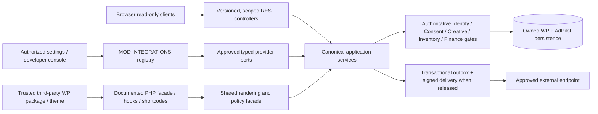

# AdPilot — Extensibility, Third-Party Integrations & Developer SDK Specification

**Document ID:** ADP-DOC-027  
**Filename:** `27_ADPILOT_EXTENSIBILITY_THIRD_PARTY_INTEGRATIONS_DEVELOPER_SDK.md`  
**Version:** 1.0.0 — proposed implementation contract  
**Status:** Proposed for Product Owner, Architecture, WordPress, Security, Privacy, AdTech, Commerce, UX, QA and Legal/Licensing approval  
**Date:** 2026-10-12  
**Product:** AdPilot — Self-Service Advertising Marketplace & Behavioral Analytics for WordPress  
**Implementation target:** GPT-6 High, working from reviewable, bounded engineering packages  
**Predecessors:** ADP-DOC-001 through ADP-DOC-026; no predecessor may be silently overridden  
**Accountable owner:** Principal Software Architect and Integrations Lead  
**Reviewers:** WordPress Lead; Domain Lead; API Lead; AdTech Lead; Finance Lead; Security/Privacy Lead; Frontend/Accessibility Lead; SRE; QA; Licensing Counsel as applicable

> **Implementation disclaimer.** This is an engineering specification for code and interfaces that must be built and verified; it is not an assertion that the SDK, adapter registry, certifications, security controls, or optional providers already exist. All proposed identifiers introduced here carry the `EXT27-*` prefix. Previously documented `TI17-*`, `IC-*`, `UC-*`, `OPS-*`, `FR-*`, `AT-*` and `CFG26-*` IDs keep their original meaning and release status.

---

## 1. Purpose, priorities, source authority and scope

### 1.1 Objective

AdPilot SHALL permit trusted WordPress developers, themes and approved third-party adapters to extend integration behavior **without** introducing a parallel campaign, allocation, approval, money, measurement, authorization or consent engine. The project SHALL expose a versioned, discoverable and testable developer surface consisting of documented WordPress hooks, public rendering functions, shortcodes, capability-gated REST endpoints, immutable domain-service ports and narrowly scoped optional adapter interfaces. Every extension must be safe to remove, must report capability and readiness honestly, and must remain compatible with common WordPress hosting configurations.

The central architectural constraint is a **modular WordPress monolith**, not a mandatory cloud integration platform. Public site rendering continues to work without WooCommerce, developer SDK packages, proprietary services or external telemetry. A provider must never be installed merely to satisfy plugin boot.

### 1.2 Document precedence

| Source | Governing obligation here |
|---|---|
| `ADP-DOC-001` | Canonical 129 `FR-*`, 18 `BR-*`, 16 `NFR-*`, 10 `INV-*`, 15 `AC-*`, `DEC-001..012`, R1–R4 milestones. |
| `ADP-DOC-002..004` | Feature acceptance IDs, journey/recovery contracts, domain policies and independent state machines. |
| `ADP-DOC-005` | Publisher capability plane, advertiser organization memberships, object/site/network authority, immutable audit requirements. |
| `ADP-DOC-006` | Module ownership, architecture boundary guards `ARCH-BND-*`, contracts `IC-001..024`, ADR approval procedure. |
| `ADP-DOC-007` | Integration module `MOD-INTEGRATIONS`, `UC-INT-*`, domain commands/queries, value-object/error conventions. |
| `ADP-DOC-008..010` | Persistence ownership, REST endpoint registry, verified payments, durable outbox, queue and webhook contracts. |
| `ADP-DOC-011..017` | 20 canonical UI contracts, design system, Layout Studio, Gutenberg, exact theme API and `TI17-FLT-001..016`/`TI17-ACT-001..010`. |
| `ADP-DOC-018..022` | Delivery, measurement, heatmap, financial and creative policy invariants: adapters do not override mandatory gates. |
| `ADP-DOC-023..025` | Threat model, release QA, operational monitoring, deployment and recovery gates. |
| `ADP-DOC-026` | 100 typed settings, effective capability resolution and R4 network governance restrictions. |

**Conflict protocol:** identify source ID, impacted contract, security/release effect, alternative, owner and decision record. A downstream example, hook proposal, config toggle or third-party package is not permission to alter a published source contract.

### 1.3 Release matrix

| Release | Required extensibility | Explicitly not presumed available |
|---|---|---|
| **R1** | Stable theme PHP helpers and shortcodes, four Gutenberg blocks, 26 proposed `TI17` public hook contracts after approval, scoped REST clients, optional WooCommerce adapter, approved theme integration adapters, capability/documentation and extension failure isolation. | Network federation, arbitrary checkout gateways, unreviewed external decision engines, paid third-party telemetry, R2 heatmaps, R3 metered charging. |
| **R2** | Privacy-governed heatmap query adapters and layout diagnostics **only where separately approved**; read-only aggregated visual integrations with safe suppression. | Raw session export, eye-tracking claims, privacy bypass. |
| **R3** | Certified metered billing integrations and advanced optimization/attribution hooks as formally versioned ports **after finance and compliance certification**. | Browser-originated charges, extension-authoritative click qualification, unaudited ledger writes. |
| **R4** | Approved optional independently deployed worker/analytics adapters, centrally governed multisite network extensions, separately consented/default-off replay, and network federation if approved. | Automatic cross-site data access or network-super-admin entitlement. |

**Known unresolved discrepancy (`EXT27-DEC-001`):** `ADP-DOC-009` registers `OPS-009..013` outbound webhook subscription/delivery operations as R1, whereas the storage, asynchronous processing and `ADP-DOC-026` configuration registry gate subscriptions/storage to R4 pending reconciliation. **Safe interim state:** no live webhook subscription activation, secret issuance, retry delivery or promise of R1 availability until the architectural change is approved; show read-only capability/diagnostics if the relevant existing endpoint is present and access-approved. This document does not create a replacement route.

### 1.4 Normative vocabulary

`MUST` and `SHALL` are release obligations for features supported in that release. `SHOULD` requires documented exception approval; `MAY` is optional. **Adapter** is a trusted code integration registered through a typed contract. **Extension** is an external package using stable public interfaces. **Provider** is a specific adapter implementation. **Port** is an interface owned by its canonical module. **Capability manifest** declares features and constraints, not grants. **Certified** means evidence-based verification against a specified matrix for a specific release and environment—not OpenAI, WordPress or government certification.

---

## 2. Invariants and safe extensibility principles (`EXT27-INV-*`)

| ID | Non-negotiable invariant | Enforcement and proof |
|---|---|---|
| `EXT27-INV-001` | Every integration path uses shared inventory, layout, delivery and authorization services; no duplicate decision core. | Dependency architecture tests; cross-adapter parity. |
| `EXT27-INV-002` | Extension callbacks may narrow published placement choices but cannot add unapproved slots/creatives or bypass payment/approval/consent. | Revalidate post-filter; malicious provider fixtures. |
| `EXT27-INV-003` | No external package writes authoritative domain tables, payment ledgers or eligibility/cache stop fences directly. | Repository ownership, static scan and database permission review. |
| `EXT27-INV-004` | A WordPress nonce, provider declaration or registered callback is not authorization. | Fresh site/org/actor/object policy at operation time. |
| `EXT27-INV-005` | A provider's outage cannot fabricate a successful payment, valid booking, billable impression or accepted consent. | Fault injection and state-machine assertions. |
| `EXT27-INV-006` | Full-page visitor actions or heatmap data cannot be exported to an unapproved endpoint; privacy purpose governs before serialization. | Privacy policy + payload allowlist + export proof. |
| `EXT27-INV-007` | Cross-site reads/writes require explicit site/network scope and never inherit a prior `switch_to_blog()` context. | Two-site fixtures; context restoration. |
| `EXT27-INV-008` | Public hooks are synchronous, best-effort, nondurable; financial/outbox events are durable and module-owned. | Crash/retry tests and outbox diagnostics. |
| `EXT27-INV-009` | Disabled or uninstalled provider preserves core plugin boot and safe ad rendering. | No-provider installation/reinstall tests. |
| `EXT27-INV-010` | Hooks and SDK clients disclose no PII, raw replay, payment secrets or private tenancy records without independently authorized policy. | DTO/serializer contract and taint tests. |
| `EXT27-INV-011` | Core fallback is explicit and safe; no “last-known-success” when payment, approval, booking or privacy authority is stale. | Stop-fence and cache churn tests. |
| `EXT27-INV-012` | Public API evolution is versioned, contract-tested and follows documented deprecation. | Consumer compatibility matrix and migration tests. |
| `EXT27-INV-013` | Developer UX and accessible integration diagnostics are permission-aware, localized and RTL-safe. | UI screen, WCAG and RTL gates. |
| `EXT27-INV-014` | R2/R3/R4 features must pass all `ADP-DOC-026` shipped/ready/permitted/enabled/authorized checks. | Feature-flag dependency test matrix. |
| `EXT27-INV-015` | Runtime hooks do not unboundedly create new ad decisions, DOM observers, network origins or scripts. | 500/1,200-slot browser and callback budget profiling. |
| `EXT27-INV-016` | Extensions must be removable/upgradeable without corrupting authoritative domain history or disabling unrelated integrations. | Deactivation, rollback and owned-resource cleanup. |
| `EXT27-INV-017` | Network callbacks, external webhooks and log sinks cannot silently become visitor-tracking services. | Purpose review, provenance and telemetry leak tests. |
| `EXT27-INV-018` | A package being open-source or GPL-compatible does not make its code or endpoint trustworthy. | Threat review, SBOM, malware/dependency scan, permissions. |
| `EXT27-INV-019` | Failed adapter registration leaves the previous published registry usable; no partial activation. | Atomic revisioned registry swap and recovery. |
| `EXT27-INV-020` | Integration certification states evidence and exclusions; test specifications must never be mislabeled as executed or passed. | Signed release dossier and environment evidence. |

---

## 3. System context, trust boundaries and forbidden coupling

### 3.1 Logical extension topology



**No edge** connects an extension directly to financial tables, raw heatmap data, booking locks, approval state, private S3-style storage or cross-site WordPress users. Generic WordPress plugins can in practice execute privileged PHP; AdPilot cannot sandbox arbitrary PHP loaded in the same process. Therefore only **trusted, administrator-installed code** may register server adapters. Restrict untrusted integration input to validated data-only manifests/configuration, never arbitrary PHP/JS; use deployment/application isolation where a truly untrusted party must execute custom code.

### 3.2 Four extension execution planes

| Plane | Runtime / code trust | Allowed functions | Forbidden behavior |
|---|---|---|---|
| Public presentation | Theme PHP + shortcode + Gutenberg PHP wrapper; trusted code; public visitor context | Render published zone/slot/container and safe approved presentation customization | Authenticate as another actor; choose paid creative; force billable event; private DTO. |
| Privileged management | Authenticated WP admin/portal + REST; operator/editor context | Scoped settings, registered adapter controls, status queries, audited amendments | Override capability via UI; cross-tenant lookup; self-approve finance; network impersonation. |
| Async/egress | Trusted internal job principal, outbox, endpoint connector | Retry authorized side effect, deliver allowlisted signed payload, reconcile with provider evidence | Fabricate financial settlement from a callback; send raw telemetry; replay after consent revocation. |
| Browser SDK | Untrusted browser with no core secrets | Progressive render, call approved public decisions, report bounded observations | Developer-managed privileged token, visitor fingerprinting, uncontrolled third-party script insertion. |

### 3.3 Mandatory service ownership

Integrations owns *registration, interface dispatch, transformations and egress policy*. Identity owns authority, Inventory/Layout own commercial slot semantics, Creatives own approved versions, Delivery owns current eligibility and selection, Measurement owns qualified metrics, Commerce owns money and ledgers, Compliance owns purpose and retention, Platform owns reliable infrastructure. An adapter requesting a new behavior must call the corresponding published application port, never copy its repository SQL.

### 3.4 Zero-trust entry sequence

For any sensitive adapter operation: derive current blog/site from trusted runtime; authenticate actual user or internal principal; resolve organization membership at current revision; validate provider registration and feature release; normalize operation and input; fetch target by `(site, organization, resource)` scope; evaluate live business/state/consent policy; invoke canonical application service; persist audited domain state and outbox transactionally if required; return a least-privilege DTO. Provider-reported `approved=true`, `site_id`, `is_paid`, `billable=true`, or `consent=true` fields are untrusted claims, never proof.

---

## 4. Public extension surface inventory and lifecycle

### 4.1 Stability tiers (`EXT27-API-*`)

| Tier | Consumers | Compatibility promise | Examples |
|---|---|---|---|
| `S1-stable-public` | Themes/plugins and documented developers | SemVer for the published public surface; upgrade notices/tests | Document 17 functions/shortcodes/26 hooks after approval; established REST namespace. |
| `S2-certified-provider` | Registered, reviewed provider packages | Explicit `interface_version` and adapter contract tests | Payment, layout adapter, approved analytics/notifications provider ports. |
| `S3-internal` | AdPilot implementation only | May change with coordinated migrations; **not for third parties** | Repositories, UoW, transaction locks, outbox tables, compiler internals. |
| `S4-experimental` | Opt-in preview, no production compatibility promise | Must carry experimental namespace and visible warning | Potential new SDK helper or R4 worker adapter. |

Do not publish a stable type simply because a PHP class happens to be autoloadable. Publish a generated `PublicApiManifest` listing symbol, version, release gate, owner, argument/DTO schema, auth policy, intended phase and deprecation status. Disallow names beginning with `experimental_` from stable release registry.

### 4.2 Core existing public contract ledger

| Interface | Source | Release | Status and safe usage |
|---|---|---|---|
| `adpilot_render_slot()` | `FR-INT-005`, `TI17-PHP-*` | R1 | Document 17 public safe HTML rendering contract. |
| `adpilot_render_zone()` | `FR-INT-005`, `TI17-PHP-*` | R1 | Server-rendered compact zone, many logical slots. |
| `adpilot_render_container()` | `FR-INT-005`, `TI17-PHP-*` | R1 | Published container binding; no cross-contract override. |
| `[adpilot_slot]` / `[adpilot_zone]` | `FR-INT-006`, `TI17-SC-*` | R1 | Sanitized attributes, no private authority. |
| `[adpilot_repeater]` / `[adpilot_showcase]` | `FR-INT-006`, `TI17-SC-*` | R1 | Only approved template adapters and curated lists. |
| Four `adpilot/*` dynamic blocks | `FR-INT-001..004`, Doc 16 | R1 | `block.json` plus common PHP renderer; editor preview nonbillable. |
| `TI17-FLT-001..016` | Doc 17 §7.2 | R1 proposed | Public filters with mandatory post-filter normalization. |
| `TI17-ACT-001..010` | Doc 17 §7.3 | R1 proposed | Observational hooks; nondurable and never billing triggers. |
| REST endpoints (`API-*`, `OPS-*` etc.) | Doc 09 | Per-route | No new route or altered verb/version created here. |
| `UC-INT-Q01/Q02`, `UC-INT-C01/C02/C03` | Doc 07 | R1/R4 scoped | Internal application contract; expose only via explicitly supported adapter facade. |
| `IC-001..024` | Doc 06 | Per-owner | Inter-module contracts, not all public SDK signatures. |

### 4.3 Callback dispatch design (`EXT27-CBK-*`)

1. Register hooks by WordPress standard `add_action`/`add_filter`; validate that callback is callable and declared args match public manifest in tests.
2. Copy immutable public context summaries into new value objects or read-only arrays; do not pass mutable domain entities, private repositories, raw HTTP tokens or `$wpdb` handles.
3. Set a recursion guard (site + request + reference + phase) to stop self-reentrant render loops; define maximum depth and a safe fallback.
4. Run filter callbacks only at their documented phase and whitelist output type, bounds and allowed changes; **re-run hard policy after all filters**.
5. Catch `Throwable` where supported by runtime policy, log safe diagnostic and apply no-op/fallback. Fatal errors, process aborts and arbitrary slow PHP cannot be reliably recovered within the same request; therefore reject untrusted code registration and monitor budgets.
6. For actions, use redacted immutable event projections. They must not be used for durable operational guarantees. A plugin must never post charge/refund by receiving a render action.
7. Detect callback registration conflict, namespace reuse and unexpected type. Log extension package ID/version and public hook ID without logging raw visitor input.
8. Preserve WordPress locale and current-blog state (`try/finally` on context switching); restore global state after registered adapters.

### 4.4 Display and public-render filter contract

**Filters cannot change mandatory commercial meaning:** slot identity, contracted period, reservation exclusivity, approved creative digest, kill-switch revision, consent purpose, selected financial product, currency or publisher authority. They may narrow candidate sets, set allowlisted visual classes, choose a safe fallback, or reduce resource ceilings as specified in Document 17. A callback returning a broadening candidate list, unsafe URL, attribute event handler or oversized budget must be ignored, diagnosed and covered by `EXT27-T-*` cases.

### 4.5 Hook naming and adoption

Retain all exact `TI17` names and signatures. New hooks require a **new** entry in the documented registry, security/privacy review, owner, consistency phase, performance budget, release gate, sample test and SemVer effect. Do not invent an undocumented public `adpilot_override_campaign_eligibility` hook. Emit `_deprecated_hook()` only in compatible WordPress circumstances and retain old hook behavior per approved migration policy. WordPress core recommends side-effect-free filters and action callbacks for observable effects; AdPilot adds stricter authorization/financial rules.

---

## 5. Third-party provider architecture and interfaces (`EXT27-PROV-*`)

### 5.1 Approved adapter registry state model

Proposed lifecycle: `discovered → declared → validated → pending_review → approved → enabled → degraded → disabled → revoked` (with `rejected`, `quarantined`, `upgrade_required` terminal/intermediate exceptions). **Declaration does not install or run arbitrary code.** All transitions are site-scoped, compare-and-swap versioned and audited when they change authority, external data egress or commercial capability. Administrative rollback may restore previous metadata but never resurrect a revoked credential or prior high-risk approval without new policy check.

### 5.2 Manifest schema (`EXT27-MAN-001`)

```json
{
  "schema_version": "1.0",
  "provider_id": "vendor.example-layout-bridge",
  "package_version": "1.2.0",
  "adapter_interface": "layout-context/v1",
  "supported_release": ["R1", "R2"],
  "php_min": "approved-runtime-min",
  "wordpress_min": "approved-supported-version",
  "capabilities": ["layout_context_read"],
  "permissions_requested": ["adpilot_manage_integrations"],
  "outbound_hosts": [],
  "personal_data_categories": [],
  "required_purposes": [],
  "secrets": [],
  "build_artifacts": ["dist/plugin.php"],
  "license": "GPL-compatible-license-subject-to-review",
  "support_url": "https://example.invalid/support"
}
```

This is a **data-only illustrative declaration**, not an executable package signature, a real dependency claim or an automatic entitlement. Production validators must resolve version ranges with explicitly supported comparator semantics, check manifest path integrity, use allowlisted capability identifiers, and never infer license compatibility solely from a string field. `example.invalid` is a non-routable documentation placeholder.

### 5.3 Registration and validation pipeline

`RegisterProviderAdapter` (`UC-INT-C01`) receives a trusted installed adapter reference from WordPress plugin bootstrap, not a visitor-supplied class name or arbitrary `include` path. Pipeline: plugin is known/installable → manifest structural validation → code and dependency provenance review → requested egress/data classification → interface conformance → site authority → dependency and feature readiness → conflict resolution → optional human/dual approval → atomic registry revision → cache invalidation → redacted diagnostics. On failure, retain old known-good registry and do not partially expose endpoints. Static and dynamic discovery SHALL not perform network egress before approved activation.

### 5.4 Provider interface catalog

| Port ID | Provider type | Owning core boundary | Release / privileges | Mandatory safety/fallback |
|---|---|---|---|---|
| `EXT27-P-01` | Approved theme-placement bridge | Integrations → Layout | R1, published context only | Cannot generate a new sellable slot or override bindings. |
| `EXT27-P-02` | Content-loop anchor adapter | Integrations → Layout | R1 allowlisted contexts | Reject recursion/unstable query identity; safe no-op. |
| `EXT27-P-03` | Editor/UI integration provider | Integrations → Design/Gutenberg | R1 site-editor rights | No false live ad preview; prevent unreviewed code injection. |
| `EXT27-P-04` | WooCommerce checkout provider | Commerce via Integrations | R1 when Woo installed | HPOS-safe CRUD; verified transaction, finance-owned writes. |
| `EXT27-P-05` | Manual/complimentary settlement evidence adapter | Commerce | R1 only governed documented flows | Requires audited authority; no synthetic gateway paid status. |
| `EXT27-P-06` | External notifications transport | Notifications | R1 optionally approved | Least-privilege payload, backoff and no source-of-truth mutation. |
| `EXT27-P-07` | Safe URL reputation lookup | Creatives/Compliance | R1 optional, privacy reviewed | Egress controls, no fail-open if policy requires check. |
| `EXT27-P-08` | Asset transformation renderer | Creatives | R1 optional locally hosted | Hardened decoder; immutable approved fingerprint, quarantine. |
| `EXT27-P-09` | Consent-policy integration | Compliance | R1 optional supported CMP | No vendor flag treated as statutory compliance; deny if not permitted. |
| `EXT27-P-10` | Publisher report export format | Reporting | R1 authorized aggregates | Sanitize spreadsheet injections and protect artifacts. |
| `EXT27-P-11` | Advertising CDN asset delivery | Delivery | R1 optional | Correct cache keys, signed/approved URLs, stop fences. |
| `EXT27-P-12` | Health/alert transport | Platform | R1 optional | Redacted telemetry; secrets are host-owned. |
| `EXT27-P-13` | Aggregated heatmap visualization | BehavioralAnalytics | R2 | Enforce suppression before adapter, no visitor-level raw data. |
| `EXT27-P-14` | Heatmap geometry compatibility profiler | Layout/Heatmap | R2 | Preserve immutable geometry, no unsupported overlay claims. |
| `EXT27-P-15` | Advanced ad targeting input | Delivery | R3 proposal after policy approval | Allowed contextual facts only; final core eligibility always authoritative. |
| `EXT27-P-16` | Metered billing evidence adapter | Measurement/Commerce | R3 certified | Qualification in core, never direct ledger charge. |
| `EXT27-P-17` | Attribution destination adapter | Optimization | R3 privacy approved | Aggregated, purpose-scoped, no causal claims. |
| `EXT27-P-18` | Alternate payment gateway adapter | Commerce | R4 unless separately approved | Provider evidence verification, atomic reservation reconciliation. |
| `EXT27-P-19` | Independently deployed job worker | Platform | R4 | Authenticated/signed jobs, idempotency, site isolation, replay defense. |
| `EXT27-P-20` | Network policy federation adapter | Identity/Platform | R4 | Explicit enrolled-site grant, no implicit super-admin data visibility. |
| `EXT27-P-21` | External privacy-governed analytics sink | Measurement/Compliance | R4 | Explicit purpose, redacted/aggregated DTO, egress allowlist. |
| `EXT27-P-22` | Session replay storage/player | BehavioralAnalytics | R4 off by default | Before-capture masking, explicit authorization, short retention/erasure. |
| `EXT27-P-23` | Outbound webhook transport | Integrations | Pending `EXT27-DEC-001` | SSRF-safe signed data, replay, retry, log without payload secrets. |
| `EXT27-P-24` | Developer diagnostic visualization | Platform | R1 authorized diagnostics | Redacted evidence and non-disruptive read-only behavior. |

Adapter eligibility must be composed from **code shipped + dependency ready + approved policy + configured enablement + current authority**, not inferred from registration alone. Do not automatically promote any R3/R4 provider into R1.

### 5.5 Provider failure classes and behavior

| Failure | Required core behavior | Operator view |
|---|---|---|
| Provider missing/deactivated | Disable adapter, retain authoritative inventory and ledger, render safe fallback | Clear `PROVIDER_UNAVAILABLE` plus dependency remediation. |
| Interface mismatch | Refuse activation of new revision; retain old safe version | `INTERFACE_VERSION_UNSUPPORTED`, permitted diagnostics. |
| Timeout or network errors | Apply bounded retries only to idempotent transport jobs; no silent finance success | Health degraded, retry schedule and last redacted reason. |
| Invalid payload/type | Reject or strip with audit where material; no contract broadening | Provider validation failure and redacted field path. |
| Unapproved external host | Egress denied before DNS or connection | `EGRESS_POLICY_DENIED`, no network attempt. |
| Cross-site request | Deny, audit suspicious permission attempt; restore original blog | `SITE_SCOPE_DENIED` without foreign metadata. |
| Privacy permission revoked | Stop collection/export; invalidate derived grants and pending jobs | Suppression/retention workflow state. |
| Payment contradiction | Hold for reconciliation, no phantom entitlement; manual financial review | Separate gateway vs booking status. |
| Stop-fence stale | Refuse creative delivery until fresh authoritative check | Diagnostic code, not stale paid creative. |
| Callback fatal/slow | Contain where PHP permits; disable extension or enforce host isolation if necessary | Incident, sampled telemetry and rollback. |

---

## 6. PHP SDK: contracts, packaging and dependency injection

### 6.1 Supported PHP package split

Proposed package structure (a module layout **proposal**, not claim of existing files):

```text
adpilot/
  src/Modules/Integrations/{Domain,Application,Infrastructure,Presentation}/
  src/PublicApi/{Rendering,Context,Contracts,Exceptions}/
  src/ProviderSdk/V1/{Contracts,DTO,ValueObjects}/
  src/WordPress/{Hooks,Rest,Blocks,Shortcodes,ThemeAdapters}/
  tests/{unit,integration,contract,security,compatibility}/
  docs/developers/{quickstart,hooks,php-api,rest,providers,errors,migrations}/
  tools/generate-public-api-manifest
adpilot-provider-example/           # separate optional example plugin
  adpilot-provider-example.php
  src/ExampleAdapter.php
  tests/ContractTest.php
  composer.json
```

The core plugin's public functions remain callable with WordPress-style signatures documented by Document 17, not undercut by a new namespaced facade. Provider interface packages MAY be extracted after license and version review. Avoid requiring Composer installation by a site administrator; distribute production vendor assets in the plugin artifact according to WordPress norms and its GPL-compatible dependency register.

### 6.2 Typed provider contract (`EXT27-SDK-PHP-01`)

```php
<?php
// PROPOSED interface only; not a complete production implementation.
namespace AdPilot\ProviderSdk\V1;

interface LayoutContextProvider
{
    /** Stable provider ID with site-specific registration in core registry. */
    public function id(): string;

    /** Only a vetted site-local contextual descriptor; never WP globals or secrets. */
    public function supports(PublicPageContext $context): bool;

    /** Returns optional inert context labels. No allocation or campaign decisions. */
    public function describe(PublicPageContext $context): ContextDescription;
}

final class ContextDescription
{
    /** @param list<string> $approvedLabels */
    public function __construct(
        public readonly array $approvedLabels,
        public readonly string $sourceVersion,
    ) {}
}
```

Production must supply imports/types for `PublicPageContext`, enforce declared supported PHP version for `readonly`, normalize labels to an allowlist, and invoke `describe` only under approved adapter budget. No provider receives a live `Campaign` or `PaymentAttempt` aggregate. Exceptions are caught at boundary, but fatal abort and malicious in-process code are **not sandboxable** by this interface.

### 6.3 Trusted registration sketch (`EXT27-SDK-PHP-02`)

```php
<?php
// Illustrative host integration; API names are proposed, not established WordPress functions.
add_action( 'plugins_loaded', function (): void {
    if ( ! class_exists( \AdPilot\ProviderSdk\V1\ProviderRegistration::class ) ) {
        return; // AdPilot inactive: provider must degrade safely.
    }
    // Registration MUST be directed into an explicit AdPilot adapter registry.
    // The registry validates manifest, interface version, current site and policy.
    // It MUST NOT grant privileges based on this call alone.
} );
```

`ProviderRegistration` is an illustrative future facade and cannot be used by third-party developers until formally published and compatibility-tested. A plugin cannot use `plugins_loaded` ordering as sole proof that core dependencies are ready; bootstrap must support deterministic late registration or typed unavailable status. Extension updates should not change scope without operator review.

### 6.4 Public PHP facade rules

`adpilot_render_slot()`, `adpilot_render_zone()` and `adpilot_render_container()` return safe HTML strings or a documented safe empty state, as Document 17 specifies. They SHALL NOT echo by default, return private domain objects, change global `$post`/site permanently or accept raw SQL/PHP callback strings. The developer quickstart must show guarding `function_exists` for inactive AdPilot and escaping only context-specific developer-owned wrappers; do not double-escape safe pre-rendered HTML when outputting to the trusted template location. All public entrypoints must share one occurrence registry and enqueue runtime scripts once.

### 6.5 Composer, namespaces and autoloading

Use PSR-4 namespaces for SDK/interfaces and WordPress-compliant hook names. Pin dependency versions in tested release artifacts; provide `composer.lock` if Composer is used and compatible production build output. Avoid namespace collisions or polyfill redefinitions. Do not perform network calls in class autoload; avoid large autoloaded WordPress options. Uninstallation SHALL not remove another package's data or modify third-party WordPress settings.

---
## 7. REST API and typed client SDKs (`EXT27-SDK-REST-*`)

### 7.1 Existing REST namespace and endpoint authority

The public/privileged API remains the exact Document 09 versioned WordPress REST namespace (`adpilot/v1` as proposed there). Do not create an extra `/developer/v1` or `POST /pay` endpoint under this document. The SDK is a **typed client of previously defined resource contracts**, not a shadow API backend. Every endpoint retains its existing method, DTO, release gate, permission callback, error envelope, pagination limits, idempotency semantics and owning module.

| Developer integration need | Existing contract(s) | Allowed client | Additional developer obligations |
|---|---|---|---|
| Marketplace catalog and public published inventory | Document 09 public catalog/inventory GET | Browser/read-only PHP | Strip tenant-private fields and unpublished inventory. |
| Layout Studio and site/editor preview | Document 09 `LAY-*`, `GB-*` | Authenticated WordPress editor | Recheck site, capability, revision; preview has no billable events. |
| Advertiser organization/campaign mutations | Document 09 `ORG-*`, `CAM-*`, `CRT-*` | Authorized organization member | Organization context **not** user-claimed; optimistic concurrency. |
| Quote/hold/checkout | Document 09 `PRC-*`, `RES-*`, `FIN-*` | Authorized advertiser | Server monetary authority; idempotency key; no direct provider charge APIs. |
| Public decision and click | Document 09 `DEL-001..003` | Public lightweight SDK | Opaque decision tokens, bounded observations, validated click context. |
| Public measurement | Document 09 `MET-001..003` | Public lightweight SDK | Event provenance; never mark a browser event billable. |
| Reporting/export | Document 09 `RPT-*` and relevant authorized routes | Authorized console/portal | Aggregate-only scope and download-time re-authorization. |
| Heatmap | Document 09 `HEAT-001..005` | R2 authorized explorer/client | Suppression, layout-version, purpose/consent, no raw visitor replay. |
| Integration settings/health | `OPS-008`, `OPS-014`, `OPS-005` | Site integration operator | Redacted only; no secret values in responses. |
| Webhook subscriptions | `OPS-009..013` | **Not enabled pending** `EXT27-DEC-001` | Names exist in doc 09 but release/persistence blocked; do not autogenerate usable SDK methods prematurely. |
| R3 metering or R4 network | Release-specific Document 09 routes | Certified enterprise/operator as authorized | Not exposed as executable methods in an R1 build. |

The SDK uses `WP_REST_Controller`/`register_rest_route()` only when implementing approved AdPilot owned endpoints in the core plugin; adapters cannot publish arbitrary routes under AdPilot's reserved namespace. If a trusted provider publishes its own WordPress REST route, it must use **its own namespace** and permission callbacks, no shared AdPilot tokens, and pass an explicit security/privacy review.

### 7.2 TypeScript client architecture

```text
packages/adpilot-sdk/
  src/core/{transport,errors,schemas,pagination,idempotency,context}.ts
  src/public/{catalog,decision,measurement}.ts
  src/admin/{inventory,layout,creative,moderation,integrations}.ts
  src/advertiser/{organization,campaign,quote,checkout,reports}.ts
  src/optional/{heatmaps,attribution,network}.ts
  src/types/generated.ts
  test/{contract,auth,pagination,retry,tenant,abort}.test.ts
  package.json
```

**Tree-shaking requirement:** browser/public imports must not pull administrator/authenticated API clients, live payment integration code, export modules, large chart engines or customer secrets into the public bundle. `public` SDK is read-only plus bounded measurement signals; WordPress admin SDK requires an authenticated, same-origin context and only uses the current session's REST nonce where appropriate. Never persist nonce, payment tokens or tenant credentials in browser localStorage; pass them through a trusted server-provided bootstrap context with minimal scope and short lifetime. A nonce is **not** capability evidence.

### 7.3 Example typed transport (`EXT27-SDK-TS-01`)

```ts
// Illustrative TypeScript interface; production requires full response schema validation.
export type ApiProblem = {
  code: string;
  message: string;
  request_id?: string;
  details?: unknown; // Never display arbitrary HTML or raw internal data.
};

export interface AdPilotTransport {
  get<T>(path: string, opts?: { signal?: AbortSignal }): Promise<T>;
  command<T>(
    path: string,
    body: unknown,
    opts: {
      method: 'POST' | 'PATCH' | 'DELETE';
      idempotencyKey?: string;
      ifMatch?: string;
      signal?: AbortSignal;
    },
  ): Promise<T>;
}

export function assertRelativeAdPilotPath(
  path: string,
  approvedRoutePatterns: readonly RegExp[],
): void {
  // Patterns MUST be generated from the exact Document 09 route catalog.
  if (!path.startsWith('/') || path.startsWith('//')
      || path.includes('..') || /[\\?#]/.test(path)
      || !approvedRoutePatterns.some((pattern) => pattern.test(path))) {
    throw new Error('SDK_PATH_NOT_ALLOWED');
  }
}
```

The supplied route patterns must be **generated from the authoritative Document 09 route registry**, anchored to exact allowed methods/paths, and constructed by the trusted build tool—not accepted from untrusted user input. A production client SHALL support all approved endpoint groups without accidentally dropping them and prevent absolute URL injection. Do not use an arbitrary proxy/base URL supplied by page content. Treat response JSON as untrusted until schema validated; never assume a successful HTTP response means a settled financial state.

### 7.4 Auth, retries, pagination and cache

- Use same-origin WordPress REST nonce for eligible browser administration; check server capability, object and org membership independently. For external server-to-server clients, require a specifically approved auth scheme and scope; WordPress Application Passwords, where approved, demand TLS, least privilege, secret rotation and revocation. Do not expose them to frontend bundles.
- Safe idempotent GET requests MAY retry on bounded network failures with jitter and `Retry-After`; POST/PATCH retry only with a valid persisted idempotency key and server contract that guarantees deduplication, and not on an ambiguous payment state without reconciliation.
- Paginate large lists; impose server max sizes, capped filter cardinalities and permitted sorts. Never download the entire 500-slot inventory for routine admin tables when viewport/summary APIs are available.
- GET cache keys include site, organization scope (where applicable), permission/policy version, locale when material, layout revision, feature availability and accepted content negotiation; purge or partition on membership revocation.
- API errors use Document 09's stable error envelope. Map 401/403/404/409/412/422/429/503 to distinct UX recovery states; prevent enumeration through privileged 403 vs 404 detail differences.
- Cross-origin browser clients are **not enabled by default**; CORS and CSRF exceptions require explicit reviewed client credentials and threat model. No wildcard `Access-Control-Allow-Origin` with credentials.
- JSON schema generation MAY create TypeScript definitions and validation; schema evolution is backward-compatible where possible, and generated snapshots must be included in release tests.

### 7.5 Client UX integration contract

All provider UI controls conform to Document 12's design tokens, WP component compatibility and WCAG 2.2 AA target for core tasks. Permission-sensitive actions are omitted/disabled with accessible explanations but always rechecked server-side. Advertiser and publisher toolbars do not merge organization memberships; a cross-tenant result is a security incident, not an empty autocomplete issue. Show stale-report/asynchronous data status distinctly from payment/hold state. Localization via WordPress text domain and `@wordpress/i18n`; use CSS logical properties, direction-safe punctuation and native number/date display, while API values remain UTC and integer minor currency units.

---

## 8. Browser runtime plugin points and presentation extension controls

### 8.1 Supported frontend hooks (`EXT27-BRW-001`)

R1 frontend extension should favor **data attributes and approved CSS tokens** rather than a public arbitrary JavaScript plugin execution system. Browser SDK listeners can be registered internally for SDK initialization, decision result, lazy render, visibility classification and teardown, but these are not stable external events until individually approved with a versioned event name, safe payload and documented callback budget. Do not infer an official browser event API from the existence of a DOM CustomEvent in development.

### 8.2 Safe presentation customization

- Visual extension options must be an allowlisted JSON/attributes schema: size class, accessible label, variation, safe custom class tokens, disclosure text (nonempty), safe fallback preference, lazy-load policy within core bounds and supported locale.
- Reject HTML fragments that contain script handlers, `javascript:`/`data:` execution URLs, arbitrary iframe origins or unauthorized tracking pixels. If controlled HTML creatives are ever supported later, require a separate sandboxing and moderation approval decision; do not use a presentation filter as the authorization path.
- Any custom DOM wrapper retains the stable logical slot reference for allocation and a **different per-occurrence render instance ID** for measurements.
- Preview/lint/monitoring mode must remain nonbillable regardless of provider scripts. No custom callback can mark viewability or CPC/CPM billability from itself.
- All SDK measurements are observational inputs; server side applies event deduplication, anti-abuse qualification, accepted purpose and current decision eligibility.
- CDN integration never caches advertiser-personalized sensitive data in a shared public cache.

### 8.3 High-density page and resource budget

For the canonical 500 configured slots (and 1,000+/1,200-slot stress configurations), frontend adapter selection SHALL be bounded by visible viewport and shared observers, not one unbounded listener/timer/fetch per slot. A provider must declare expected JS/CSS byte impact and per-activation DOM nodes, listeners, observers, network requests and peak memory profile; release budgets must be set from measured baselines, not fabricated fixed numbers. Runtime can disable costly experimental extensions on long pages with a user-visible/admin diagnostic without losing canonical inventory identity or billing semantics. Verify mobile throttling, BFCache resume, SPA/navigation updates, delayed fragment insertion, duplicate shortcodes, RTL, reduced-motion and low-data modes.

### 8.4 External asset restrictions

By default, do not introduce a third-party script, stylesheet, pixel or font from a provider's remote origin. External assets demand approved domain/redirect and subresource/transport policy, CSP review, privacy/data-transfer assessment, license notice, outage fallback and dependency-version controls. WordPress enqueue handles must be namespaced; no arbitrary global polyfills, jQuery monkey-patches or modification to other plugins' script dependencies. A plugin switch-off must remove its assets without removing AdPilot's required core SDK.

---

## 9. Gutenberg, Site Editor, template builders and content adapters

### 9.1 Canonical four-block contract

Preserve `adpilot/ad-slot`, `adpilot/ad-zone`, `adpilot/ad-repeater`, `adpilot/ad-showcase` from Document 16 with server rendering and inert editor previews. All extensions should register supplemental **supports/context adapters**, not replace `render_callback` with a second selection algorithm. A theme's template-part insertion must pass the page context and approved binding to the common renderer. Generated slots remain compact data under one zone/block; do not generate hundreds of child blocks or store 500 individual slot attributes in post content.

### 9.2 Adapter resolution and identity

An adapter's `supports` contract is evaluated against a bounded, trusted context from WordPress: supported post type, taxonomy, archive, Query Loop, WooCommerce product grid or registered builder canvas. Third-party builder compatibility is **explicitly opt-in** via a verified provider; unsupported builder selectors return `UNSUPPORTED_CONTEXT` rather than guessed placement. Repeated page components use stable logical slot identity and unique render instance identity, avoiding double insertion where a builder renders a component twice. Theme hook mismatches and ambiguous selectors are not silently auto-corrected in production. R2 diagnostics add operator inspection without altering committed layouts.

### 9.3 Example provider compatibility matrix

| Environment | R1 stance | Evidence required |
|---|---|---|
| WordPress classic theme templates | Supported through PHP helpers/shortcodes and reviewed hook bindings | Render parity, inactive plugin fallback, taxonomy/archive context. |
| WordPress block theme + Site Editor | Supported via dynamic blocks/template parts | Preview nonbillable, published render eligibility, template-part occurrence IDs. |
| Standard Gutenberg Query Loop | Conditional support via approved bounded repeater contexts | No recursion, stable item/page context, no per-loop duplicate billable count. |
| WooCommerce product grid | Optional installed plugin integration, approved adapter required | HPOS/order independence, correct Woo block/query context and product cache. |
| Third-party page builders | Specific adapters only; never assumed universal | Declared supported versions, semantic anchors, unsupported diagnostic. |
| Custom theme framework | PHP helper or approved binding; opt-in extension | Sanitization, accessibility and one-renderer parity. |
| AJAX/SPA navigation | Only if SDK has a documented lifecycle adapter | Teardown, dedupe, latest decision/consent, no orphan observers. |
| Multisite site template library | R1 site-local rendering only; R4 federation separate | Site context restoration and tenant isolation. |

### 9.4 Integration testing requirements

Test same approved placement through block, PHP helper, shortcode and registered theme hook with identical eligibility and safe fallback while allowing wrapper DOM differences. Test absent AdPilot activation; mixed RTL; block editor reload; Gutenberg block metadata round-trip; theme switch; duplicate and recursive insertion; WooCommerce inactive; dynamically appended loops; 500-slot and 1,200-slot scenarios; revoked approval while cached placement present; asset enqueue exactly once. Theme publishers must be able to see why an adapter is unsupported or unhealthy without seeing advertiser finance or visitor PII.

---

## 10. Commerce and payment adapters, external gateways, financial safety

### 10.1 Merchant/payment source-of-truth

Commerce (`MOD-COMMERCE`) alone owns payment evidence and ledger posting; Reservations alone owns capacity, leases/holds and entitlement intervals; Creatives owns approved creative versions; Delivery owns eligibility. A payment integration only returns **provider-verified evidence** and must never write AdPilot charge rows or `wc_order` metadata directly as a shortcut. WooCommerce integration is optional but R1-certified when installed; HPOS must be supported using WooCommerce CRUD/order APIs. Gateways always undergo their own fraud/refund/currency capability review.

### 10.2 Proposed payment adapter contract (`EXT27-FIN-001`)

```php
<?php
namespace AdPilot\ProviderSdk\V1\Commerce;

interface PaymentEvidenceAdapter
{
    public function providerId(): string;

    /** Parses inbound data as untrusted until signature/source/time verified. */
    public function verify(PaymentWebhookEnvelope $inbound): PaymentEvidenceResult;

    /** Query authoritative provider status to reconcile an ambiguous attempt. */
    public function reconcile(PaymentReference $reference): PaymentEvidenceResult;
}
```

**Not a license to use this in R1 for arbitrary alternate gateways.** The authoritative data types, allowed provider list, signature algorithms, secret reference semantics and release gate must first be approved and added to the public provider manifest. WooCommerce's own payment handling remains the supported R1 implementation via the approved commerce adapter, not this hypothetical generic interface.

### 10.3 Payment and reservation choreography

1. Advertiser receives server-calculated quote and a real capacity hold in the Reservations module.
2. Commerce maps a single immutable commercial snapshot to the WooCommerce order, preserving AdPilot site/org/order scope.
3. Provider sends signed/verified payment evidence; reject duplicate, out-of-order, stale, invalid or conflicting evidence as specified by Documents 09, 10 and 21.
4. Commerce reconciles payment, Reservations revalidates actual hold/entitlement **in its own locked transaction**. Expired or sold inventory cannot be resurrected by an external success event.
5. If money received but booking invalid, record unresolved financial liability and invoke governed remedy/refund; never silently mark campaign `LIVE` or ledger `SETTLED` without required evidence.
6. Delivery checks **current** creative approval, campaign/contract/stop state and entitlements independently of payment notification.
7. Refund/chargeback actions require high-risk authorization, audit and dual-control policy where applicable; a payment provider cannot decide the publisher's creative moderation outcome.

### 10.4 Money, metering and finance hooks

- Monetary values represented in integer minor units or approved precise-decimal value objects with currency/scale; browser floating-point totals are advisory and cannot post charges.
- Fixed/time/exclusive R1 products cannot be replaced with uncapped R3 CPM/CPC through a provider config flag.
- Metered R3 billing demands Measurement-approved qualification, Commerce-owned immutable ledger effects and replay-resistant idempotency. A provider callback or web pixel alone cannot trigger a charge.
- If financial ledger transactions are unavailable on hosting, disable unsafe paid purchase, surface actionable diagnostics, preserve nonpayment features.
- Dispute lifecycle and reversal are not silently inferred from WooCommerce order status; record missing API/schema decisions for formal change control.

---

## 11. External webhooks, service-to-service APIs and egress controls

### 11.1 Inbound and outbound are different trust models

**Inbound provider webhook:** the caller is untrusted until exact scheme-specific HMAC/asymmetric signature, timestamp, canonicalized body and provider endpoint identity are verified. It is not a WordPress REST nonce. Replay windows and idempotency keys are persisted and checked with site/order scope. **Outbound AdPilot webhook:** the destination is untrusted egress. It requires publisher-approved topic/purpose/subscription, redacted allowlisted payload, DNS/IP and redirect SSRF defenses, per-subscription signing secret referenced from protected host storage, bounded retry and unsubscribe/revocation semantics. Outbound activation is blocked pending `EXT27-DEC-001` reconciliation.

### 11.2 Egress policy (`EXT27-EGR-*`)

1. Restrict allowed protocols to TLS HTTPS and approved ports; disallow `file:`, `ftp:`, `gopher:`, `data:`, `javascript:` and local network schemes.
2. Validate URLs on registration **and every dispatch**; normalize hostnames and IDNs, resolve A/AAAA at connection and reject loopback, private, link-local, multicast, metadata/reserved addresses including IPv4-mapped IPv6; prevent DNS rebinding and unsafe redirects. Use a vetted SSRF-safe HTTP transport and deployment-level egress firewall where possible.
3. Avoid following redirects by default; if explicitly enabled, revalidate each hop and bound redirects.
4. Limit request payload sizes, response sizes, connection timeouts and retry concurrency; do not follow a giant response to exhaustion.
5. Sign canonical payload bytes with a per-subscription key reference and an unambiguous key ID/version; include event ID, sent timestamp, schema version and consumer idempotency key. Never put secrets in query parameters or logs.
6. Payloads are allowlisted public/integration DTOs derived **after** privacy/authorization policy; never raw domain aggregates, visitor identifiers, payment details, full creatives or session replay.
7. Retry only from durable outbox/delivery records, exponential backoff, jitter, bounded max attempts and dead-letter; do not repeat authoritative domain transaction on retry.
8. Receiving endpoint responses are **not** authorization to mark a paid campaign approved, to delete core data or to change financial state.
9. Revocation must suppress unsent eligible jobs, enforce key rotation and delete stored personal payloads by retention rule; an old queued job must re-check current subscription/purpose authorization.
10. Expose redacted request trace IDs, retry count and HTTP class in authorized diagnostics, never raw endpoint authentication headers.

### 11.3 Proposed webhook transport payload (illustrative)

```json
{
  "id": "evt_opaque_01",
  "type": "adpilot.campaign.status_changed",
  "schema_version": "1.0",
  "site_ref": "site_pseudonym",
  "occurred_at": "2026-10-12T12:00:00Z",
  "delivery_id": "delivery_opaque_01",
  "data": {
    "campaign_ref": "campaign_public_01",
    "status": "paused"
  }
}
```

This is a proposed format only; it is **not** an approved R1 topic, existing subscribed endpoint or raw `EV-*` outbox representation. Event names/DTOs must be versioned, approved and explicitly mapped to the canonical `EV-001..030` sources. Payment and high-risk details MUST be excluded unless the data-classification/recipient contract explicitly permits narrowly scoped fields.

### 11.4 Webhook delivery state machine

`proposed → validated → approved → active → paused → revoked` for subscriptions, and `pending → leased → attempted → acknowledged | retry_wait | dead_letter | cancelled` for individual deliveries, with worker fencing and idempotent consumer keys. A callback HTTP 2xx is evidence of transport acknowledgement only, not proof that the recipient processed business data. Delivery retries preserve identical signed event identity while potentially rotating the transport signature according to documented key policy. Do not place raw webhook bodies in public debug files.

---

## 12. Analytics, consent, heatmap and optimization integration

### 12.1 Measurement domain exclusivity

`MOD-MEASUREMENT` validates public observations, deduplicates, qualifies and aggregates. An external analytics provider is permitted to receive **only** approved and purpose-scoped outputs through an allowlisted port; it does not choose authoritative metric denominators, supply a replacement billing ledger or retroactively classify unqualified events as valid. Separate configured, selected, rendered, viewable, and billable counts as specified by Documents 18 and 19. Reports state metric version, cohort, exclusions and freshness; missing data is `unknown/incomplete`, not zero and not a made-up 100% success rate.

### 12.2 Privacy review for every analytical connector

Every connector SHALL declare: data categories, controller/processor role as locally determined, legal basis/purpose, origin region, subprocessor chain, retention, deletion path, access restrictions, minimization, sampling, logging and breach responsibilities. This document gives engineering controls, **not universal legal conclusions**. A provider claiming “GDPR-compliant” or “anonymous” is not accepted without data-flow review, jurisdiction-specific policy and technical evidence.

### 12.3 Heatmap and replay release restrictions

R2 connectors receive only privacy-approved, suppressed **aggregated** bins or compatible layout geometry summaries and can render overlays/tables without accessing per-visitor raw clicks. Layout revision compatibility must be proven before comparison; different responsive geometry cannot be overlayed as if equivalent. Small-cohort suppression must survive filtering, cache, API pagination and export to resist differencing. R4 replay remains separate, default-off, opt-in/consent-governed, masked before capture and restricted by site/role/retention; no R1/R2 SDK may opportunistically record text input, email, payment or health-related fields.

### 12.4 Attribution and optimization adapters

R3 attribution/optimization results have versioned provenance and labels distinguishing observed correlation, attribution rules and actual causal evidence. No provider may claim “true attention”, “eye tracking”, “incremental lift” or automatic purchase conversion merely from proxy heatmaps. Experiment or recommender candidate scores may be advisory **after** privacy and traffic-policy constraints, but cannot bypass fixed sponsorship, booked inventory, legal disclosures or emergency stop. Public SDK must not create persistent cross-site visitor identifiers by default.

---

## 13. Security, access governance, tenant isolation and threat modeling

### 13.1 Actor and role boundaries

| Actor | Typical rights | Explicit denial |
|---|---|---|
| Site publisher integration administrator | See/review provider manifests, site-scoped integration settings with `adpilot_manage_integrations` | Financial ledger edits; network-wide impersonation; replay data unless separately granted. |
| Site security/operations approver | Approve policy-sensitive egress, pause/revoke provider and inspect redacted audit | Grant private advertiser membership through a provider toggle. |
| Advertiser organization operator | Authorized campaigns/reports through org-scoped API | Install PHP adapters, site-wide settings, see other organizations' data. |
| Finance operator | Finance-specific domain commands through its own capability/dual control | Modify integration policy in order to self-approve refunds. |
| Frontend theme developer | Trusted PHP rendering or Gutenberg authoring within WP permissions | Bypass creative moderation or delivery policy with callback. |
| External webhook receiver | Decrypted **allowed** signed event facts after AdPilot sends | Read WordPress REST/private API or request arbitrary database dump. |
| Network administrator (R4) | Explicitly approved network governance operations only | Automatic cross-site access to customers, raw analytics and financial records. |

Any detailed role/capability names are inherited from Documents 04/05, not invented by an SDK package. A registered integration must not create `administrator` users, new super-admins, or wildcard organization memberships. Scope changes require a new review, and revocation is enforced on the next protected request or job.

### 13.2 Extension threat register highlights

- **Arbitrary PHP execution:** an already privileged plugin can call global WordPress functions. **Mitigation:** trusted installation and supply-chain controls, code review, explicit documentation of non-sandboxability. Do not claim hook validation prevents malicious PHP access to WordPress globals.
- **Unauthorized new REST route:** provider attempts to add permissive endpoint under reserved namespace. **Mitigation:** namespace ownership, approved registration manifest, automated route diff/security review, per-route permission callbacks.
- **Broken object-level authorization:** provider accepts arbitrary site/org IDs. **Mitigation:** bound repository queries and current-membership checks; matrix tests with two unrelated organizations/sites.
- **SSRF/credential exfiltration:** provider endpoint resolves to internal metadata service or redirects there. **Mitigation:** per-connection address blocking, locked redirects, HTTP timeouts, secret isolation, egress firewalls.
- **Event forgery:** provider reports fake clicks/“billable” outcomes. **Mitigation:** immutable decision provenance, Measurement qualification, Finance-only ledger authority.
- **Payment replay:** duplicate/late webhook changes order/hold. **Mitigation:** signature, per-provider transaction ID uniqueness, durable idempotency and reconciliation.
- **Creative policy bypass:** HTML filter inserts active unapproved creative. **Mitigation:** allowlisted inert attributes, exact-version approval and content integrity check after adapter callbacks.
- **Consent bypass:** analytics sink receives events after withdrawal. **Mitigation:** egress policy recheck on dispatch, queued-job cancellation, retention/erasure evidence.
- **Plugin collision:** two providers use same registry ID or enqueue same asset handle. **Mitigation:** namespace uniqueness, deterministic collision refusal and redacted diagnostics.
- **Supply-chain compromise:** dependency update changes capabilities/origins. **Mitigation:** SBOM, pinned versions, provenance and permission-diff approval before promoting release.
- **Long-running callback:** provider starves frontend on 500-slot page. **Mitigation:** design limits, profiling, disable/degrade, host isolation where necessary; in-process timeout not assumed.
- **Cohort reidentification:** repeated filtered heatmap queries isolate one visitor. **Mitigation:** suppression under all filter compositions, range bounds and query accounting.

### 13.3 Sensitive-data classifications and logs

Allowed provider diagnostic log fields: event category, opaque site-scoped provider ID, package version, `request_id`, timestamp, redacted error code, latency bucket, attempt counter, release gate. Disallowed: webhook signing secret, Authorization header, raw request body, visitor IP/user agent combination, Woo payment tokens, precise heatmap paths, unapproved media, private user email and raw replay. Logs and diagnostic exports follow finite, approved retention and download-time scope check. Never promise immutable logging by writing only to a log file; high-risk audit uses canonical audit domain/outbox.

---

## 14. Configuration, secrets, feature flags and multisite

### 14.1 Existing `CFG26` policy ownership

`ADP-DOC-026` already defines `integrations.outbound_webhooks_enabled`, `integrations.webhook_endpoint_allowlist`, `integrations.webhook_signing_key_reference`, `operations.scheduler_mode`, and other infrastructure settings with typed scopes and release gates. Document 27 SHALL reuse those exact keys and NOT register duplicate `adpilot_*` options with competing priority. Effective provider enablement is a constrained composition: deployment deny / network deny where R4 allowed / site value / dependency readiness / current authority / consent+business policy. Any safety deny wins over a provider's preference.

### 14.2 Secrets design

Secrets reside outside public option/autoload stores: environment/secret manager or separately approved encrypted credential references; no plaintext JavaScript bootstrap, media URL, webhook query string, email, support export or PHP exception. `secret_ref` values are references, not secret contents. Rotation procedure must support old/new overlap only for signed receiver compatibility, with expiry and explicit job re-evaluation; a deleted secret must not be reconstructed from backup logs. Encrypting with a constant committed to the plugin repository is not meaningful protection.

### 14.3 Per-site activation and R4 network governance

R1: each `blog_id`/table prefix and provider registry is isolated, including access checks after `switch_to_blog()`, cache prefixes, queue job provenance and export artifact storage. A provider package may be network-activated but its **data and authorization** remain site-scoped. R4 network controls require approved site enrollment and narrow network policies; no parent network setting can silently enable replay or charge creation on a child site; restrictive deny and consent remain effective at each site. Network-export and cross-site diagnostics are never granted just by WordPress `is_super_admin()`.

### 14.4 Configuration changes and recovery

Settings edits use existing `OPS-001/002` routes with compare-and-swap revision/ETag, typed schema, reason/actor, audit and safe preview/diff. Provider configuration changes with data egress, scopes, billing or retention implications require confirmation and, where governed, separate approval. Configuration import/export never includes raw secrets. A rollback cannot restore revoked credentials, expired consent or already-executed external payments. Schema migrations use owned, idempotent registry revisions and rollback diagnostics from Documents 08/25/26.

---

## 15. Package governance, open-source compatibility and release lifecycle

### 15.1 Source and binary dependency policy

All shipped third-party libraries, distributed SDKs, fonts/assets and provider examples require legally approved licenses compatible with the target distribution, reproducible sources, notices and SPDX-style SBOM where practical (`FR-OPS-008`). A plugin marketplace entry must not assert WordPress.org acceptance or GPL compatibility without review. Do not dynamically load unpinned code from arbitrary CDNs or install external runtime packages without administrator authorization.

### 15.2 Public API semantic versioning

- **PATCH:** fixes with no intentional externally observable API break, including security hardening that narrows already-invalid inputs.
- **MINOR:** additive optional fields, new provider capability with explicit release gate or new hook; never a silent new required parameter.
- **MAJOR:** incompatible public signature, removed endpoint, changed meaning, altered filter side effects or dropped supported PHP/WP runtime; requires approved migration and deprecation plan.
- Block new enabled release behavior when required schema/worker policy is not ready; a version number alone is not an availability grant.
- Preserve exact REST namespace and `TI17` hook argument ordering until an approved major migration. Informed behavior changes require changelog and contract tests even if signature remains identical.

### 15.3 Deprecation and migration procedure

Publish replacement name + version, supported overlap window, migration guide, compatibility shim limitations, contract test fixtures, telemetry counters for legacy use without collecting secrets, operator release notice and retirement date. Mark old hook using appropriate WordPress depreciation utilities (including `_deprecated_hook` only when applicable); do not continue executing unsafe hooks merely to honor an old integration—security exceptions require explicit governance and may warrant immediate blocked use. Verify SDK version skew (old provider/new core and new provider/old core) and failure modes.

### 15.4 Provider update/disable/uninstall process

- Stage manifest/code and dependency diff, scan and run provider tests; do not modify live registry until review gates pass.
- Verify compatibility against staging WP matrix and current commercial/consent state. Use feature flags and kill switches for risky changes.
- Activate atomically, observe health/resource budget, roll back provider revision on new errors without rolling back financial domain facts.
- Deactivation disables its callbacks/jobs and ingress/egress subscriptions, but preserves AdPilot aggregate history and outstanding financial remedy obligations.
- Uninstall removes only provider-owned resources according to retention policy, not core AdPilot data or unrelated WordPress assets; purge provider secret refs and credentials through governed process.

---

## 16. Developer experience, documentation and sandbox environments

### 16.1 Documentation deliverables

The development team must ship a **Developer Guide** including: 15-minute theme embed, shortcode/Gutenberg recipes, public PHP API reference, callback/hook reference including full `TI17` registry, provider manifest schema, adapter quickstart, authenticated REST client walkthrough, error catalog, R1–R4 feature compatibility, permissions matrix, non-billable preview guidance, performance budgets, privacy/consent rules, examples for deactivation/multisite, changelog and deprecation notices. Every sample must state the minimum release and dependency readiness; show a *working* fallback when AdPilot is absent.

### 16.2 Provider developer console UX (`EXT27-UX-*`)

Proposed integration management view built within existing authorized `UI-*`/`OPS-*` surfaces (do not invent a new canonical `UI-21` without change control):

| Region | Primary information | Required interaction |
|---|---|---|
| Provider inventory | ID/name/version, interface, release/status, last health, egress/data categories | Filter/search, accessible status badges, compare version/diff. |
| Details / manifest | Required capabilities, supported contexts, compatibility, license, purpose and outbound host list | Read-only validated manifest and safe source provenance. |
| Configuration | Typed site settings from `ADP-DOC-026`, effective precedence, feature availability | Server-validated save, error recovery, staged approval, reset. |
| Test connection | Dry-run/diagnostic without recording paid/ad behavior | Rate-limited, explicit no-side-effect mode with evidence receipt. |
| Health | Failures, retries, compatibility, worker backlog, redacted trace and audit | Authorized retry only for eligible idempotent jobs. |
| Lifecycle | Enable/disable/revoke/upgrade | Confirmation, consequence preview and scoped audit. |
| Developer reference | SDK versions, example code, REST schema, hook explorer | Copyable examples, downloadable machine-readable manifest. |

The console must use existing Document 12 visual tokens, accessible field labels, keyboard navigation, meaningful focus, RTL/LTR with developer-code LTR islands, predictable dialogs and actionable errors. Block impossible actions early but always validate at the API. Never show a green “certified” state based merely on a manifest registration.

### 16.3 Example repositories and fixtures

Provide small separate reference examples for classic theme, block theme template, shortcode, safe public filter, approved layout provider, WordPress REST read-only client, WooCommerce installed/not installed, and redacted notification transport. Examples SHALL run against a reproducible WordPress test setup and declare all optional dependencies. Never distribute real gateway keys, webhook tokens, private visitor events or customer data in example fixtures.

---

## 17. Performance, resilience, observability and compatibility

### 17.1 Operational budgets (`EXT27-OPS-*`)

Provider registration should be lazy and side-effect-free until activation. Each callback should have observable call count, duration distribution, cache hit/miss and validation error rate; avoid huge serialized hooks, `SELECT *` on event firehoses, remote calls in render loops, re-entrant WordPress hook chains and per-slot polling. CI must benchmark current supported PHP/WP/DB versions under the same fixtures as Document 24 rather than inventing p95 latency guarantees. Adapters that cannot meet an approved resource budget should degrade/disable without changing contract ownership.

### 17.2 Circuit breaker and fallback model

Track optional transport failures by `(site, provider, operation)` with bounded, privacy-safe counters. For read-only contextual providers, default to no added enrichment; for notifications, queue or emit a clearly degraded status; for unverified financial evidence, **hold state and reconcile**; for mandatory policy reputation checks, deny until approved alternative; for external analytics, stop egress but do not backfill unauthorized collection. Never let a circuit breaker “temporarily skip” authentication, creative approval, consent or ledger rules.

### 17.3 Runtime support matrix

| Environment | Required test coverage |
|---|---|
| Standard WordPress PHP runtime without optional integrations | Clean boot, rendering, settings and safe no-payment behavior. |
| WooCommerce inactive/active | Conditional adapter bootstrap; checkout unavailable vs verified HPOS CRUD checkout. |
| Different supported PHP versions | Syntax and dependency checks; interface compatibility. |
| MySQL/MariaDB supported versions | Transaction requirements for paid bookings; no assumptions about unsupported SQL features. |
| Cached/CDN publisher page | Public structural caching, no stale eligibility, correct decision tokens. |
| Multisite two-blog fixture | Site-prefixed registry, cache, queue, permissions and context restoration. |
| Block theme and classic theme | Same approved ad policy, responsive layouts and correct asset enqueue. |
| React/Gutenberg RTL/mobile | Accessibility, keyboard, layout and translation behavior. |
| High-density 500- and 1,200-slot page | Incremental initialization, response/memory budgets, no duplicate decision/measurement. |
| Partial migration/failed queue/provider outage | Protected fail-closed commercial behavior and diagnostics. |
| R2 heatmap, R3 metered, R4 replay/network | Separate release-gated acceptance and privacy/finance policy readiness. |

### 17.4 Operational event model

Emit structured, redacted integration telemetry such as `provider_registered`, `provider_rejected`, `provider_enabled`, `provider_degraded`, `sdk_contract_mismatch`, `external_delivery_failed`, and `callback_budget_exceeded` as **operational diagnostics**. These names are not automatically new canonical `EV-001..030` domain events; add durable authoritative events only through Document 07/10 registry change control. Provide alert thresholds, owner, escalation and runbook references to Document 25; use sampling to avoid log amplification on high-density pages.

---
## 18. Data contracts, persistence, migration and retention for extensions

### 18.1 Provider-owned metadata versus authoritative aggregates

**Proposed registry design (requires Document 08 schema change approval):** store approved provider identity, interface version, site scope, enabled state, manifest digest, capability/purpose revision, associated non-secret configuration reference, activation revision and health summary. Registration history records actor, reason, previous/new state, review decision and audit correlation. Credential material belongs in protected `secret_ref` facilities, not generic settings or an extension-owned custom post type. Provider tables must use the site's current `$wpdb->prefix` or a formally approved network schema with explicit isolation; avoid globally autoloaded options for manifests or large event queues.

The extension registry SHALL NOT store or become the source of truth for active reservation count, payment state, creative approval, geometry snapshots, user consent or financial ledger. Where a provider needs supplemental data, use a dedicated provider-prefixed table only after namespace, schema-version, retention and uninstall review; index queries by site/org as appropriate and do not add unrestricted foreign-key-like joins across module ownership boundaries.

### 18.2 Proposed storage fields (`EXT27-DB-001`)

| Logical record | Fields (minimum proposal) | Uniqueness/ownership and constraints |
|---|---|---|
| Provider registration | `site_id`, `provider_id`, `package_version`, `interface_id`, `interface_version`, `manifest_digest`, `review_status`, `enabled`, `revision`, `reviewed_by`, `reviewed_at` | Unique site/provider; CAS mutation, normalized data-only IDs. |
| Provider capability grant | `site_id`, `provider_id`, `capability_key`, `data_scope`, `approved_policy_revision`, `approved_by`, `valid_until` | Unique grant tuple; no wildcard authority. |
| Provider config revision | `site_id`, `provider_id`, `config_revision`, `schema_version`, `redacted_snapshot_digest`, `actor_id`, `created_at` | Immutable revision; secrets referenced, never embedded. |
| Provider health | `site_id`, `provider_id`, `operation`, `last_check_at`, `status`, `last_error_code`, `failure_count_bucket` | Bounded/latest projection; telemetry TTL, no PII. |
| Provider compatibility evaluation | `site_id`, `provider_id`, `core_version`, `wp_version`, `php_version`, `result_digest`, `checked_at` | Ephemeral/projection; not entitlement to enable. |
| Webhook subscription/delivery | Reuse exact approved Document 08/10 records **after** `EXT27-DEC-001` approval | Do **not** create shadow subscription or retry tables to evade release gating. |

The table names, SQL DDL, foreign-key strategy and migration numbers must be assigned by Document 08's owning schema registry and formally approved before production. This proposal does not authorize manual tables or a new `getById` that leaks cross-site data.

### 18.3 Registry state transactions and concurrency

Register/enable/disable is a version-checked domain command: lock the site/provider registry row; verify actor and readiness; write new revision and audit/outbox where durable; commit; invalidate only targeted cache namespaces; perform external nontransactional side effects through idempotent workers. If network egress fails after activation, mark provider `degraded`, do not undo already confirmed AdPilot booking/payment history. Interface mismatch on upgrade retains the last safe provider state or disables with explicit diagnostic; do not silently coerce incompatible message schemas.

### 18.4 Retention and deletion

Provider registration/audit retention is governed by operational policy; egress deliveries and telemetry by transport/purpose-specific retention; personal data by approved privacy/erasure policy; financial history by statutory/accounting decision. Site deletion/uninstall must not wipe another provider's or an unrelated site's records. On subject erasure or consent withdrawal, invalidate exports and queued egress payloads before retention jobs delete eligible copies; restored backups require replay of deletion policy and reconciliation rather than reactivation of consent.

---

## 19. Threat-driven provider certification methodology (`EXT27-CERT-*`)

### 19.1 Certification levels

| Level | Meaning | Required evidence |
|---|---|---|
| `C0-declared` | Manifest parsed and dependency ID known | Manifest schema validation only; **not production safe**. |
| `C1-functional` | Approved public contract behavior in sandbox | SDK conformance, compatibility, public-render parity, lifecycle tests. |
| `C2-security-privacy` | Risk controls validated for declared data/egress | BOLA/BFLA, CSRF/XSS/SSRF, consent, secret/log hygiene, SBOM review. |
| `C3-commercial` | Safe financial/inventory boundary for commerce provider | Concurrency, verified gateway evidence, compensation, refund/ledger, fault injection. |
| `C4-operational` | Deployment/runbook and rollback validated | High-density performance, upgrades, availability, incident recoverability. |
| `R2/R3/R4-specialized` | Release-feature-specific approval beyond core levels | Heatmap suppression, certified billable events, replay masking, network governance. |

A provider may need different levels according to risk: a presentation-only CSS token extension does not need payment gateway certification, while a payments adapter does. None of these labels confers an external accreditation or general legal-compliance guarantee. Certification is version-specific and expires on material code, capability, purpose, provider origin or platform-version changes.

### 19.2 Certification evidence bundle

Required machine-readable dossier fields: `core_version`, `provider_id`, `package_version`, `interface_version`, `manifest_digest`, `target_release`, `wordpress/php/db/browser matrix`, environment fixture IDs, executed command, timestamp, run identifier, test ID, pass/fail/block/skip, evidence artifact SHA-256, reviewer, findings, expiry/waivers and owner approval. Tests marked `not_run` are not passes; disabled release features are recorded as correctly gated, not as tested functionality. Publishing a passing status requires verified immutable CI output and manual sign-offs where finance/security/privacy concerns cannot be fully automated.

### 19.3 Quality gates (hard blockers)

1. Any unreviewed exfiltration origin, secret in a browser bundle, or unauthenticated provider admin route.
2. Any ability for provider callbacks to change paid inventory, payment evidence, creative approval or consent via an unauthorized path.
3. Any test showing cross-site or cross-organization leaks in read/write/cache/queue/export planes.
4. Any inconsistent currency/minor-unit arithmetic, double charge or double sold exclusive inventory.
5. Any R1 build accidentally enabling R2 collector, R3 metering or R4 replay/network/webhooks pending resolution.
6. Any missing accessible alternative for critical management workflow or inability to finish the primary test journey without a mouse.
7. Any unpinned external dependency or package license incompatible with the approved distribution rules.
8. Any unbounded provider retry, external request or 500-slot performance regression beyond approved baseline.
9. Any inability to disable/revoke adapter without breaking core plugin boot or public WordPress page.
10. Any misleading evidence claiming “certified/passed” when test execution is not available.

### 19.4 Certification pipeline

```mermaid
flowchart LR
 A[Package SBOM + signed manifest digest] --> B[Static checks / license / dependencies]
 B --> C[Core interface and schema contract tests]
 C --> D[Security and privacy adversarial matrix]
 D --> E[Performance / 500+ placement and worker fault injection]
 E --> F[Release-specific finance / heatmap / replay gates]
 F --> G[Manual approvals and documented exceptions]
 G --> H[Promote approved provider manifest revision]
 H --> I[Health monitoring / revocation / upgrade]
```



A manual exception cannot waive missing authoritative payment verification, live tenancy authorization, creative approval or consent: these are architectural invariants and must be corrected, disabled or release-blocked.

---

## 20. Canonical extension test data and adversarial harness

### 20.1 Test harness architecture

Tests must use a real WordPress installation, per-site custom tables under supported MySQL/MariaDB transactions, optional WooCommerce HPOS environments, mocked approved external endpoints, controlled UTC clock, deterministic decision seed, canonical 500-slot layout, data classification fixtures and a two-site/two-organization authorization grid. Provide request/event traces and precise assertions on **both response and persistent state**. A caught error without verifying no unauthorized state mutation is insufficient. The initial test suite IDs in this document are additive to Documents 02 and 24 and shall not rename `AT-*`, `D24-*` or `E2E-*`.

### 20.2 Required test harness adapters

- WordPress: PHPUnit-compatible integration tests with controlled roles/capabilities, multisite `switch_to_blog()` fixtures, theme/block rendering equivalence and WP REST nonce/session control.
- React/TypeScript: generated schema snapshots, unit tests, accessibility assertions and Playwright flows for enable/disable/upgrade, portal and Site Editor.
- HTTP provider mock: private/link-local/metadata addresses, DNS rebinding, redirect chains, oversized response, TLS failures and timeout simulation, with **no real live malicious egress**.
- Financial provider mock: correct/invalid signatures, duplicates, delayed success after expired hold, partial refund and provider status contradiction.
- Queue/outbox: duplicate delivery, process crash after side effect before acknowledgement, expired leases, stale consent and revocation during dispatch.
- Security static scan: route/permission callback registry diff, unsafe SQL ownership imports, known secret patterns in compiled assets and dangerous WordPress API usage.
- Data and privacy: multiple small-cohort heatmap queries, suppressed export, deletion after backed-up restore and cross-org reporting probes.
- High-density browser: 500 configured slots, 1,200 stress slots, viewport-limited rendering, repeated instance handling, no billable preview traffic.

### 20.3 Required assertions for each test

Every `EXT27-T-*` case specifies setup fixture, actor, endpoint/hook/adapter, stimulus, observable response, authoritative database/outbox effects, audit/telemetry redaction, release gate and automated test harness. Failure tests MUST assert that campaign/creative/payment/reservation states remain unchanged unless a separately authorized command was made. For async cases, assert idempotent final state after retries, and separately record transport attempts. For privacy cases, assert zero unauthorized outgoing requests **and** no prohibited retained payloads.

---


## 21. Test fixtures and reproducible environments (`EXT27-FX-*`)

Each fixture is a **proposed reproducible setup**, not an existing test artifact. Versions, seed hashes, site IDs, timezone, enabled modules, keys and cleanup instructions SHALL be committed to the test harness; no real customer data or credentials are permitted. Build fixtures with provisioned isolation and real SQL transactions where tested.

| Fixture ID | Name | Deterministic setup / relevant assertion |
|---|---|---|
| `EXT27-FX-001` | Base WP install | Fresh supported WordPress site, no WooCommerce, no AdPilot-dependent extension, safe empty inventory; boot/activation and helper fallback. |
| `EXT27-FX-002` | Basic classic theme | Theme template calls each of the three public PHP rendering helpers, also handles inactive AdPilot. |
| `EXT27-FX-003` | Block theme and Site Editor | Block theme template part embeds all four official blocks with nonbillable editor preview. |
| `EXT27-FX-004` | Compact large layout | 4 header + 100 sidebar + 196 content + 200 footer configured logical slots, with published immutable revision. |
| `EXT27-FX-005` | Stress layout | 1,200 logically configured slots with viewport-limited activation and repeated zone occurrences. |
| `EXT27-FX-006` | Repeated logical slot | Same logical slot appears in two Query Loop items; separate render instance IDs and no accidental duplicates. |
| `EXT27-FX-007` | Two unrelated organizations | Two advertiser organizations on one WordPress site, overlapping users and different resources. |
| `EXT27-FX-008` | Two multisite blogs | Separate inventory, ads, registry, queues and cache prefixes; nested site switch/restoration. |
| `EXT27-FX-009` | Publisher role matrix | Admin, inventory editor, finance operator, moderator, support viewer, and role-revoked principal. |
| `EXT27-FX-010` | Advertiser org matrix | Owner, manager, billing, analyst, outsider, revoked member and expired invitation. |
| `EXT27-FX-011` | Disabled provider | Registered provider disabled on one site; public rendering and admin boot otherwise healthy. |
| `EXT27-FX-012` | Provider interface mismatch | Provider declares supported `layout-context/v1` but returns wrong method shape or incompatible schema. |
| `EXT27-FX-013` | Provider ID collision | Two packages declare the same provider_id and incompatible versions, with different package digests. |
| `EXT27-FX-014` | Malformed manifest | Invalid capability, unknown field, oversized manifest, malformed version and unsafe URL. |
| `EXT27-FX-015` | Provider with dangerous hook | Registered callback attempts to broaden candidate inventory, remove disclosure, add inline `onload`. |
| `EXT27-FX-016` | Fatal or slow callback | Callback throws, recurses, sleeps or allocates excessive memory under profiling constraints. |
| `EXT27-FX-017` | Approved safe hook | Filter narrows binding candidates and adds an allowlisted CSS token without changing approval. |
| `EXT27-FX-018` | Concurrent provider revision | Two authorized operators update same registry/feature configuration with stale `If-Match`. |
| `EXT27-FX-019` | Cross-site request forgery | Actor holds capability on site A but targets site B or passes forged org/site query ID. |
| `EXT27-FX-020` | REST error suite | 401/403/404/409/412/422/429/503 from existing canonical REST endpoint with request IDs. |
| `EXT27-FX-021` | SDK npm production bundle | Tree-shaken public SDK with no admin/payment module imports, nonce or secret leak. |
| `EXT27-FX-022` | SDK abort/retry | AbortSignal cancellation and bounded 429/503 retry with unsafe POST uncertainty. |
| `EXT27-FX-023` | WooCommerce HPOS | Woo installed with HPOS enabled, provider adapter uses CRUD and verified gateway evidence. |
| `EXT27-FX-024` | WooCommerce absent | Optional commerce module disabled, manual/complimentary path available under admin policy. |
| `EXT27-FX-025` | Competing exclusive buyers | Two real DB transactions reserve same exclusive slot/time interval under high contention. |
| `EXT27-FX-026` | Late gateway success | Hold expired and sold before valid delayed provider payment success notification. |
| `EXT27-FX-027` | Webhook SSRF endpoints | Mocked loopback, RFC1918, link-local, metadata host, redirect and rebinding addresses. |
| `EXT27-FX-028` | Webhook lifecycle | Signed valid/invalid duplicate/out-of-order events; worker retries and key revocation. |
| `EXT27-FX-029` | Consent withdrawn | Pending external analytics job while consent/purpose revoked before dispatch. |
| `EXT27-FX-030` | Small heatmap cohort | R2 aggregate with suppression thresholds, intersecting filter variants and export requests. |
| `EXT27-FX-031` | Replay disabled | R4 replay package installed in R1/R2 environment with feature flag false and missing policy. |
| `EXT27-FX-032` | Provider bundle compromise | SBOM/lockfile detects added dependency, changed host egress and forbidden inline script. |
| `EXT27-FX-033` | Migration interruption | Registry schema upgrade interrupted after partial staged write, old revision remains readable. |
| `EXT27-FX-034` | Provider uninstall | Uninstall provider with pending queue and old audit, site core ownership preserved. |
| `EXT27-FX-035` | CDN stale page | Cached structural HTML with revoked creative/campaign, current server eligibility requires no-fill. |
| `EXT27-FX-036` | High-density 3G/mobile | Slow device, network throttling, repeated slots, mixed sizes and responsive/RTL breakpoints. |
| `EXT27-FX-037` | Accessible operator console | Keyboard-only and screen-reader integration settings, disable/revoke, errors and manifest diffs. |
| `EXT27-FX-038` | RTL multilingual provider | Arabic/Persian UI with LTR code samples, local date formatting, UTC contract times. |
| `EXT27-FX-039` | Backup restore and revocation | Restored data contains previously revoked provider key and erased analytics request. |
| `EXT27-FX-040` | Nightly certification job | Versioned release matrix, generated API schemas, test artifacts, signed approval evidence, skew tests. |


## 22. Acceptance, adversarial and integration test catalog (`EXT27-T-*`)

**Test oracle:** for every case assert HTTP/UI result, authoritative state unchanged or validly changed, outbox delivery effects, privacy egress, site/org authorization and redacted operational logs. Test IDs below are unique **additive** IDs and do not claim the tests have run. The `Fixture` column points to a reproducible setup; many tests also need fixtures from earlier documents.

### 22.1 Public render and WordPress hooks (R1)

| Test ID | Stimulus | Required independent assertion | Fixture | Gate |
|---|---|---|---|---|
| `EXT27-T-001` | Valid layout theme helper | Call three documented render helpers with a published permitted zone; assert safe HTML and matching shared renderer decision. | `EXT27-FX-002` | `R1` |
| `EXT27-T-002` | Missing plugin fallback | Deactivate AdPilot and load theme guard; assert no fatal, no external request and accessible page. | `EXT27-FX-001` | `R1` |
| `EXT27-T-003` | Shortcode restricted parameters | Request override of creative/paid state through all four shortcodes; assert attribute rejection and no financial mutation. | `EXT27-FX-003` | `R1` |
| `EXT27-T-004` | Block preview isolation | Render official block in editor/preview; assert no production decision, viewable or billable metric. | `EXT27-FX-015` | `R1` |
| `EXT27-T-005` | Filter candidate expansion | Provider adds unpublished slot ID to `adpilot_binding_candidates`; assert revalidation drops it and logs safe code. | `EXT27-FX-015` | `R1` |
| `EXT27-T-006` | Filter removes disclosure | Provider returns empty disclosure; assert core restores mandatory sponsorship label. | `EXT27-FX-015` | `R1` |
| `EXT27-T-007` | Filter adds executable HTML | Return `onload`, script URL and unsafe style; assert final HTML escapes/drops and no execution. | `EXT27-FX-015` | `R1` |
| `EXT27-T-008` | Action callback misuse | Hook listener tries to emit charge on render_completed; assert no core ledger/booking changes. | `EXT27-FX-015` | `R1` |
| `EXT27-T-009` | Wrong callback type | Provider returns object/string to list filter; assert no-op fallback and no public exception leak. | `EXT27-FX-012` | `R1` |
| `EXT27-T-010` | Recursion and duplicate binding | Recursive theme hook and repeated zone; assert depth guard, correct occurrence IDs and no double-billing. | `EXT27-FX-006` | `R1` |

### 22.2 Manifest, discovery and registry (R1)

| Test ID | Stimulus | Required independent assertion | Fixture | Gate |
|---|---|---|---|---|
| `EXT27-T-011` | Valid data-only manifest | Parse approved layout-context/v1 package; assert declared capabilities do not become grants. | `EXT27-FX-014` | `R1` |
| `EXT27-T-012` | Untrusted dynamic class | Submit user-supplied class/file path in manifest; assert never instantiated or included. | `EXT27-FX-014` | `R1` |
| `EXT27-T-013` | Provider ID collision | Attempt second incompatible package ID; assert registry refuses update and old provider remains functional. | `EXT27-FX-013` | `R1` |
| `EXT27-T-014` | Stale registry revision | Submit `If-Match`/CAS mismatch on enable; assert conflict and no partial activation. | `EXT27-FX-018` | `R1` |
| `EXT27-T-015` | Unsupported interface major | Upgrade provider to incompatible interface; assert activation blocked and previous revision retained. | `EXT27-FX-012` | `R1` |
| `EXT27-T-016` | Changed outbound domain | Modify manifest hosts without new approval; assert egress disabled and review required. | `EXT27-FX-014` | `R1` |
| `EXT27-T-017` | Disabled provider | Disable one provider with WordPress still live; assert core render and unrelated providers unaffected. | `EXT27-FX-011` | `R1` |
| `EXT27-T-018` | Registration while inactive | Provider boots before AdPilot; assert deterministic unavailable/retry state without fatal. | `EXT27-FX-001` | `R1` |
| `EXT27-T-019` | Invalid capability declaration | Manifest requests finance/replay wildcard; assert requested grant refused and audited. | `EXT27-FX-014` | `R1` |
| `EXT27-T-020` | Network-activated registry | Provider activated network-wide in R1; assert per-blog opt-in/authorization and no data federation. | `EXT27-FX-008` | `R1` |

### 22.3 REST authorization and API contracts (R1)

| Test ID | Stimulus | Required independent assertion | Fixture | Gate |
|---|---|---|---|---|
| `EXT27-T-021` | Route namespace ownership | Extension tries to register privileged AdPilot namespace route; assert registry/security scanner blocks approval. | `EXT27-FX-020` | `R1` |
| `EXT27-T-022` | Missing permission callback | Expose provider REST route without `permission_callback`; fail certification and reject deployment. | `EXT27-FX-020` | `R1` |
| `EXT27-T-023` | Cross-org getById | Org A calls org B resource through client; assert no foreign record, cache or enum leak. | `EXT27-FX-007` | `R1` |
| `EXT27-T-024` | Revoked site capability | Revoke operator capability then call existing `OPS-008`; assert immediate policy denial. | `EXT27-FX-009` | `R1` |
| `EXT27-T-025` | Nonce mistaken for right | Use valid WordPress nonce without required organization membership; assert 403/404 safe denial. | `EXT27-FX-010` | `R1` |
| `EXT27-T-026` | Stale optimistic concurrency | Two simultaneous PATCH changes with old ETag; assert one succeeds, other conflicts. | `EXT27-FX-018` | `R1` |
| `EXT27-T-027` | Invalid JSON body | Inject extra authority fields, oversized IDs and invalid enum; assert 422, no mutation. | `EXT27-FX-014` | `R1` |
| `EXT27-T-028` | Client injected URL | Supply absolute internal host path to SDK; assert client rejects or server enforces approved route. | `EXT27-FX-022` | `R1` |
| `EXT27-T-029` | Pagination stress | Query thousands of resources with unbounded page size; assert capped results and stable cursor. | `EXT27-FX-004` | `R1` |
| `EXT27-T-030` | Response secret leak | Exercise every integration admin DTO; assert no raw secrets, private emails or financial source tokens. | `EXT27-FX-020` | `R1` |

### 22.4 Browser SDK and frontend lifecycle (R1)

| Test ID | Stimulus | Required independent assertion | Fixture | Gate |
|---|---|---|---|---|
| `EXT27-T-031` | Public bundle purity | Inspect production import graph and emitted chunks; assert no admin or gateway credential modules. | `EXT27-FX-021` | `R1` |
| `EXT27-T-032` | Shared observer usage | Load 500 slots; assert viewport-appropriate observers/requests rather than one per logical slot. | `EXT27-FX-004` | `R1` |
| `EXT27-T-033` | Same slot repeated | Duplicate logical slot renders twice; assert separate instance IDs and qualified event provenance. | `EXT27-FX-006` | `R1` |
| `EXT27-T-034` | No JS readable page | Disable JS; assert host page remains navigable and ad limitations documented. | `EXT27-FX-001` | `R1` |
| `EXT27-T-035` | Abort old navigation | Abort outstanding decisions during SPA/fragment navigation; assert no stale injection. | `EXT27-FX-022` | `R1` |
| `EXT27-T-036` | Retry idempotent read | Simulate GET 503/429; assert bounded jitter and response freshness handling. | `EXT27-FX-022` | `R1` |
| `EXT27-T-037` | Unsafe payment retry | Simulate ambiguous POST checkout; assert no blind duplicate creation without idempotency/reconcile. | `EXT27-FX-022` | `R1` |
| `EXT27-T-038` | CSP violation prevention | Try injecting third-party pixel/inline script via adapter; assert blocked until origin security review. | `EXT27-FX-032` | `R1` |
| `EXT27-T-039` | RTL and reduced motion | Run RTL layout and reduced-motion browser; assert accessible disclosure, focus and stable measurements. | `EXT27-FX-038` | `R1` |
| `EXT27-T-040` | CDN cached skeleton | Serve stale structural HTML after creative pause; assert current decision recheck prevents paid delivery. | `EXT27-FX-035` | `R1` |

### 22.5 Gutenberg and layout provider compatibility (R1)

| Test ID | Stimulus | Required independent assertion | Fixture | Gate |
|---|---|---|---|---|
| `EXT27-T-041` | Four block contract parity | Check all four blocks and PHP/shortcode rendering against same published slot identity. | `EXT27-FX-003` | `R1` |
| `EXT27-T-042` | Compact 200-slot zone | Serialize 200 footer slots through one zone reference, not 200 block child nodes. | `EXT27-FX-004` | `R1` |
| `EXT27-T-043` | Unsupported builder | Invoke unregistered builder selector; assert no injection and `UNSUPPORTED_CONTEXT` diagnostic. | `EXT27-FX-014` | `R1` |
| `EXT27-T-044` | Query Loop recursion | Invoke repeater from nested Query Loop; assert loop depth guard and safe stop. | `EXT27-FX-006` | `R1` |
| `EXT27-T-045` | Context identity stability | Change responsive columns; assert commercial logical slot ID unchanged. | `EXT27-FX-004` | `R1` |
| `EXT27-T-046` | Conflict with sold layout | Provider attempts publish change to sold slot; assert domain impact review blocks unauthorized change. | `EXT27-FX-025` | `R1` |
| `EXT27-T-047` | Ambiguous template hook | Two publishers bind same region unintentionally; assert duplicate detection before serving. | `EXT27-FX-006` | `R1` |
| `EXT27-T-048` | Product grid without Woo | Call Woo adapter without WooCommerce; assert no plugin fatal or fake product context. | `EXT27-FX-024` | `R1` |
| `EXT27-T-049` | Post edit revalidation | Editor loses capability mid-session; assert preview and save revalidate and deny. | `EXT27-FX-009` | `R1` |
| `EXT27-T-050` | Asset handles collision | Provider and theme use same JS handle; assert scoped names and no core asset deregistration. | `EXT27-FX-032` | `R1` |

### 22.6 WooCommerce and financial safety (R1)

| Test ID | Stimulus | Required independent assertion | Fixture | Gate |
|---|---|---|---|---|
| `EXT27-T-051` | HPOS order mapping | Create mapped order using Woo CRUD; verify storage works with HPOS and legacy mode. | `EXT27-FX-023` | `R1` |
| `EXT27-T-052` | Woo absent bootstrap | Disable WooCommerce; assert AdPilot boot, marketplace and complimentary admin path remain. | `EXT27-FX-024` | `R1` |
| `EXT27-T-053` | Concurrent exclusive purchase | Run competing locked transaction for one exclusive slot; assert at most one reservation. | `EXT27-FX-025` | `R1` |
| `EXT27-T-054` | Late payment expired hold | Receive valid late success after exclusive slot resold; assert no resurrected hold and remedy. | `EXT27-FX-026` | `R1` |
| `EXT27-T-055` | Duplicate gateway webhook | Send identical payment callback twice; assert one ledger effect and one booking finalization. | `EXT27-FX-028` | `R1` |
| `EXT27-T-056` | Out-of-order payment state | Send refund/paid events in conflicting order; assert authoritative provider reconciliation. | `EXT27-FX-028` | `R1` |
| `EXT27-T-057` | Wrong currency decimal | Provide mutated currency/scale from browser; assert core exact-money quote enforced. | `EXT27-FX-023` | `R1` |
| `EXT27-T-058` | Unauthorized refund | Have campaign manager trigger refund adapter; assert deny, no ledger effect, auditable attempt. | `EXT27-FX-009` | `R1` |
| `EXT27-T-059` | Fake provider approval | Provider returns `is_paid=true` without verified payment; assert no entitlement/serve. | `EXT27-FX-028` | `R1` |
| `EXT27-T-060` | R3 billing enabled in R1 | Provider declares CPC/CPM metering in R1; assert feature unavailable, zero event charges. | `EXT27-FX-023` | `R1` |

### 22.7 Webhook delivery and SSRF hardening (R4-pending)

| Test ID | Stimulus | Required independent assertion | Fixture | Gate |
|---|---|---|---|---|
| `EXT27-T-061` | Subscription release blocked | Attempt to activate `OPS-009` subscription while conflict unresolved; assert disabled with reason. | `EXT27-FX-027` | `R4-pending` |
| `EXT27-T-062` | Private IPv4 target | Mock webhook URL resolves to RFC1918; assert no network dispatch. | `EXT27-FX-027` | `R4-pending` |
| `EXT27-T-063` | IPv6 mapped link-local target | Resolve mapped/private/metadata IPv6; assert blocked per egress policy. | `EXT27-FX-027` | `R4-pending` |
| `EXT27-T-064` | DNS rebinding | Resolve safe address at registration but unsafe during dispatch; assert connection blocked. | `EXT27-FX-027` | `R4-pending` |
| `EXT27-T-065` | Unsafe redirect | Safe host responds 302 to loopback; assert no follow or hop revalidation denies. | `EXT27-FX-027` | `R4-pending` |
| `EXT27-T-066` | Invalid signature | Inbound provider posts corrupted signature/timestamp; assert rejection before monetary effects. | `EXT27-FX-028` | `R4-pending` |
| `EXT27-T-067` | Duplicate replay | Re-deliver same signed event; assert deduped effect and bounded attempts. | `EXT27-FX-028` | `R4-pending` |
| `EXT27-T-068` | Worker crash after send | Crash after HTTP ack before queue ack; assert idempotent replay and no duplicate domain effect. | `EXT27-FX-028` | `R4-pending` |
| `EXT27-T-069` | Expired signing key | Rotate/revoke key with queued job; assert current subscription/policy recheck and safe handling. | `EXT27-FX-028` | `R4-pending` |
| `EXT27-T-070` | Leaked payload prevention | Inspect delivery logs and exports; assert no full body, secret or forbidden PII. | `EXT27-FX-028` | `R4-pending` |

### 22.8 Measurement, heatmap and privacy (R2)

| Test ID | Stimulus | Required independent assertion | Fixture | Gate |
|---|---|---|---|---|
| `EXT27-T-071` | Consent denied collection | Disable required purpose then invoke analytics connector; assert zero outgoing data and no storage. | `EXT27-FX-029` | `R2` |
| `EXT27-T-072` | Consent revoked midqueue | Queue export then revoke purpose; assert job re-evaluation suppresses dispatch. | `EXT27-FX-029` | `R2` |
| `EXT27-T-073` | No visitor PII DTO | Attempt raw IP/email/user agent export; assert serialization filter and policy deny. | `EXT27-FX-029` | `R2` |
| `EXT27-T-074` | Qualified vs observed click | Provider submits click marked billable; assert Measurement ignores field and Commerce ledger unchanged. | `EXT27-FX-029` | `R2` |
| `EXT27-T-075` | Small cohort suppression | R2 query below contributor threshold; assert suppressed result including accessible table. | `EXT27-FX-030` | `R2` |
| `EXT27-T-076` | Differencing probes | Run intersecting heatmap filters; assert suppression preserved against cohort inference. | `EXT27-FX-030` | `R2` |
| `EXT27-T-077` | Geometry mismatch | Compare incompatible layout versions; assert no misleading overlay and visible compatibility verdict. | `EXT27-FX-030` | `R2` |
| `EXT27-T-078` | Historical delete replay | Restore snapshot after deletion request; assert policy re-applies deletion and blocks egress. | `EXT27-FX-039` | `R2` |
| `EXT27-T-079` | Eye-tracking claim | Provider labels attention proxy as eye tracking; assert certification failure/correct metric disclosure. | `EXT27-FX-030` | `R2` |
| `EXT27-T-080` | Replay opt-in default | Install replay adapter in R1/R2; assert no recorder instantiation, API or data storage. | `EXT27-FX-031` | `R2` |

### 22.9 Security, tenant and supply chain (R1)

| Test ID | Stimulus | Required independent assertion | Fixture | Gate |
|---|---|---|---|---|
| `EXT27-T-081` | SQL authority violation | Static scan finds extension directly writes AdPilot ledger table; assert certification blocked. | `EXT27-FX-032` | `R1` |
| `EXT27-T-082` | Cross-site worker token | Job carries valid provider from site A and targets site B; assert denial and context restore. | `EXT27-FX-019` | `R1` |
| `EXT27-T-083` | Role self-escalation | Integration admin tries to grant superadmin/org owner via manifest; assert rejection. | `EXT27-FX-010` | `R1` |
| `EXT27-T-084` | Malicious upload path | Adapter bypasses creative quarantine with executable upload; assert storage/delivery denied. | `EXT27-FX-015` | `R1` |
| `EXT27-T-085` | Secret in source assets | Scan compiled SDK maps/logs for example key; assert CI failure. | `EXT27-FX-032` | `R1` |
| `EXT27-T-086` | Unknown external origin | Provider adds outbound analytics host not allowlisted; assert no call and approval request. | `EXT27-FX-032` | `R1` |
| `EXT27-T-087` | Unpinned dependency | Change dependency hash without SBOM update; assert provenance gate failure. | `EXT27-FX-032` | `R1` |
| `EXT27-T-088` | Public data enumeration | Automate ID guessing through provider REST client; assert scope, rate and response policy. | `EXT27-FX-020` | `R1` |
| `EXT27-T-089` | Hook filter mutation | Callback mutates provided domain object or global blog context; assert immutable facade/restoration. | `EXT27-FX-015` | `R1` |
| `EXT27-T-090` | Audit tampering | Extension tries to rewrite audit entries; assert denied and incident classification. | `EXT27-FX-009` | `R1` |

### 22.10 Operational resilience and performance (R1)

| Test ID | Stimulus | Required independent assertion | Fixture | Gate |
|---|---|---|---|---|
| `EXT27-T-091` | Slow callback load | Callback adds latency on each of 500 slots; assert budget/alert and safe disable path. | `EXT27-FX-016` | `R1` |
| `EXT27-T-092` | Provider outage fallback | Disconnect optional notification service; assert page and financial state unaffected. | `EXT27-FX-011` | `R1` |
| `EXT27-T-093` | Mandatory check unavailable | Fail required safety reputation check; assert explicit deny/hold, not fail-open. | `EXT27-FX-031` | `R1` |
| `EXT27-T-094` | Worker dead letter | Force repeated approved webhook failure; assert bounded attempts and protected operator recovery. | `EXT27-FX-028` | `R1` |
| `EXT27-T-095` | Cache namespace isolation | Query cached provider results in site A vs B; assert no cross-site value reuse. | `EXT27-FX-008` | `R1` |
| `EXT27-T-096` | Config migration interruption | Crash during registry upgrade; assert atomic old safe state and repair diagnostics. | `EXT27-FX-033` | `R1` |
| `EXT27-T-097` | Deactivation idempotency | Disable provider twice; assert no duplicate side effect and safe queue cancellation. | `EXT27-FX-034` | `R1` |
| `EXT27-T-098` | 500 slot render | Measure bounded API calls/DOM/CPU with optional provider and no bogus event counts. | `EXT27-FX-036` | `R1` |
| `EXT27-T-099` | 1,200 slot stress | Trigger high-density stress under memory throttle; assert graceful degraded behavior and page accessibility. | `EXT27-FX-036` | `R1` |
| `EXT27-T-100` | Observability redaction | Error emits trace to logger/export; assert code+correlation only and no payload PII. | `EXT27-FX-035` | `R1` |

### 22.11 Developer console, localization and governance (R1)

| Test ID | Stimulus | Required independent assertion | Fixture | Gate |
|---|---|---|---|---|
| `EXT27-T-101` | Operator capability | Unauthorized staff member opens provider console; assert no manifest private data or mutations. | `EXT27-FX-009` | `R1` |
| `EXT27-T-102` | Keyboard enable flow | Keyboard-only operator views manifest and disables provider; assert full focus and status feedback. | `EXT27-FX-037` | `R1` |
| `EXT27-T-103` | Screen reader health states | Assistive technology announces degraded/blocked without color-only signals. | `EXT27-FX-037` | `R1` |
| `EXT27-T-104` | RTL config workflow | Persian/Arabic interface edits provider settings; assert logical alignment and LTR code sample. | `EXT27-FX-038` | `R1` |
| `EXT27-T-105` | Stale config revision | Two admin tabs save provider settings; assert CAS conflict and safe reload/merge. | `EXT27-FX-018` | `R1` |
| `EXT27-T-106` | Effective config deny | Site enables provider but deployment emergency deny true; assert feature remains blocked. | `EXT27-FX-040` | `R1` |
| `EXT27-T-107` | Pending review UX | Manifest requests new data category; assert explicit review state, no auto-activation. | `EXT27-FX-014` | `R1` |
| `EXT27-T-108` | Safe secret rotation | Rotate secret reference; assert no secret display and previous key bounded expiry. | `EXT27-FX-038` | `R1` |
| `EXT27-T-109` | Import config redaction | Export and reimport settings; assert no raw tokens, no automatic enabled egress. | `EXT27-FX-038` | `R1` |
| `EXT27-T-110` | No false compliance badges | C0-declared provider is shown as declared, not certified or privacy-approved. | `EXT27-FX-040` | `R1` |

### 22.12 Release, upgrade, contract and certification (R1)

| Test ID | Stimulus | Required independent assertion | Fixture | Gate |
|---|---|---|---|---|
| `EXT27-T-111` | Old SDK new core | Run supported old SDK client with new minor core; assert contract and error compatibility. | `EXT27-FX-040` | `R1` |
| `EXT27-T-112` | New SDK old core | Try unsupported new API against old core; assert feature detection/unavailable, no undefined behavior. | `EXT27-FX-040` | `R1` |
| `EXT27-T-113` | Hook signature drift | Change `TI17` arg order; assert snapshot/consumer contract test failure. | `EXT27-FX-040` | `R1` |
| `EXT27-T-114` | Unapproved new hook | Add undocumented public ad override hook; assert registry diff gate blocks release. | `EXT27-FX-040` | `R1` |
| `EXT27-T-115` | Graceful deprecation | Deprecate approved public hook; assert shim, notice and documented migration. | `EXT27-FX-040` | `R1` |
| `EXT27-T-116` | Provider version downgrade | Rollback provider after failed health; assert authoritative payment/audit history unchanged. | `EXT27-FX-034` | `R1` |
| `EXT27-T-117` | Package uninstall | Uninstall provider with queued job; assert no future side effect, core data remains. | `EXT27-FX-034` | `R1` |
| `EXT27-T-118` | R2 release gating | Use heatmap provider in R1; assert unavailable and no collector side effects. | `EXT27-FX-031` | `R1` |
| `EXT27-T-119` | R4 network authorization | Enable network adapter without site enrollment; assert no cross-site result or replay. | `EXT27-FX-008` | `R1` |
| `EXT27-T-120` | Evidence authenticity | Mark unexecuted contract tests passed in manifest; assert release dossier rejects assertion. | `EXT27-FX-040` | `R1` |


## 23. Implementation work packages for GPT-6 High (`EXT27-WP-*`)

Each package is a vertical, reviewable engineering increment. **Read exact upstream identifiers first**, implement only the described release scope, add positive/negative tests, update API/schema manifest and changelog, and attach an evidence bundle. Do not generate placeholder “pass” reports or speculative unapproved external operations.

| WP ID | Work package | Definition of done / acceptance evidence | Accountable roles | Release |
|---|---|---|---|---|
| `EXT27-WP-01` | Public API manifest and classification | Define S1–S4 API catalog; distinguish source-implemented interfaces from proposed SDK types; bind to Document 17. **Done:** Versioned symbols + owners + release gates + consumer snapshots | Platform/Integrations | R1 |
| `EXT27-WP-02` | Core integration registry and site scope | Implement approved `UC-INT-C01` registration, CAS revision, typed manifest parser and namespace collision handling. **Done:** Two-site/role matrix with atomic fail-safe updates | Integrations/Identity | R1 |
| `EXT27-WP-03` | Manifest format and review workflow | Implement data-only manifest, schema/security/licensing review states and operator sign-off. **Done:** Malicious manifest fixture rejected, no arbitrary include/JS | Integrations/Security | R1 |
| `EXT27-WP-04` | WordPress hooks and safe dispatch | Implement exact 16 filters and 10 actions from Document 17 with immutable context, type validation and recursion guards. **Done:** Hook snapshots and policy-narrowing negative tests | WordPress/Delivery | R1 |
| `EXT27-WP-05` | Public PHP helper parity | Preserve three PHP helpers with shared renderer and safe absence behavior. **Done:** Shortcode/block/helper/hook parity suite | WordPress/Delivery | R1 |
| `EXT27-WP-06` | Shortcode and block SDK recipes | Ship production-ready examples/fixtures for four shortcodes and four Gutenberg blocks. **Done:** 200-slot compact saved content and nonbillable preview | Gutenberg/Docs | R1 |
| `EXT27-WP-07` | Theme/builders adapter contracts | Implement allowlisted classic/block/context adapters and incompatible-builder diagnostics. **Done:** Theme switching, Query Loop recursion and loop identity | Frontend/Layout | R1 |
| `EXT27-WP-08` | Typed REST OpenAPI-like schemas | Generate typed DTOs/client schemas from Document 09 without new endpoint semantics. **Done:** All approved route contracts and permission/error snapshot tests | API/Integrations | R1 |
| `EXT27-WP-09` | Public TypeScript SDK bundle | Implement minimal public SDK, tree shaking, abort, bounded retries and no secrets. **Done:** Bundle static scan, 500-slot browser budget tests | Frontend/SDK | R1 |
| `EXT27-WP-10` | Authorized portal/admin clients | Implement REST client for operator and advertiser with current capability and org context. **Done:** Cross-org denial, CAS conflict, usability and WCAG | Frontend/Security | R1 |
| `EXT27-WP-11` | Integration settings UX | Extend existing admin UI using Document 12 tokens and Document 26 schema. **Done:** Accessible manifest/status/update, RTL, revocation | UX/Platform | R1 |
| `EXT27-WP-12` | Provider health and diagnostics | Expose redacted readiness/health through existing `OPS-*` routes and platform diagnostics. **Done:** No secret/PII leak; correct degraded states | SRE/Platform | R1 |
| `EXT27-WP-13` | WooCommerce certified adapter | Use Woo CRUD/HPOS and canonical verified payment integration; no shadow order state. **Done:** Late/duplicate callback, reservation competition, refund review | Commerce/Woo | R1 |
| `EXT27-WP-14` | Consent provider contracts | Integrate approved CMP signals with current core purpose policy and denial. **Done:** Revocation before egress, missing consent denial | Privacy/Integration | R1 |
| `EXT27-WP-15` | Notification and reputation ports | Bounded optional notification and URL reputation services with strict fallback. **Done:** SSRF, resilience and stop-fence safety tests | Security/Notifications | R1 |
| `EXT27-WP-16` | Egress transport and SSRF infrastructure | Create reusable approved safe HTTP transport with DNS/IP checks and protected secrets. **Done:** Redirect/rebinding/private IP negative tests | Security/SRE | R1 foundation |
| `EXT27-WP-17` | Webhook reconciliation design | Resolve cross-document R1/R4 discrepancy before implementing subscriptions; update schema/route/config matrices. **Done:** Formal signed change record plus disabled behavior while pending | Architecture/Product | BLOCKED |
| `EXT27-WP-18` | Outbound webhook service after approval | Implement only if release approved; signed/redacted payload, durable outbox, bounded retries. **Done:** Worker crash/replay, key rotation, deletion tests | Integrations/Platform | R4-pending |
| `EXT27-WP-19` | Provider persistence and migration | Add site-prefixed registry schema to Document 08 with reversible staged migrations. **Done:** Migrate/interruption/restart and multisite isolation | Database/Platform | R1 |
| `EXT27-WP-20` | Feature flags and dependency readiness | Wire Document 26 effective configuration + release/consent/authority decisions to provider registry. **Done:** Forbidden R2/R3/R4 states cannot turn on via import | Platform/Identity | R1 |
| `EXT27-WP-21` | R2 heatmap read-only adapters | Expose approved aggregates and compatible geometry only after suppression. **Done:** Filter differencing, export parity, geometry mismatch | Heatmap/Privacy | R2 |
| `EXT27-WP-22` | R3 qualified metric and attribution adapters | Implement typed advisory/certified ports without money write access. **Done:** Fake billable counters cannot charge ledger | Measurement/Commerce | R3 |
| `EXT27-WP-23` | R4 external worker/network adapters | Provenance, site enrollment and replay default-off across network. **Done:** Worker cross-site attack and key revocation tests | Platform/Identity | R4 |
| `EXT27-WP-24` | Extension performance regression gates | Enforce callback budget/asset policy and high-density instrumentation. **Done:** 500 baseline/1,200 stress comparisons | Frontend/SRE | R1 |
| `EXT27-WP-25` | Developer docs and example package | Ship quickstart, error glossary, package templates, downloadable manifest/spec examples. **Done:** Examples execute cleanly; inactive plugin fallback | DX/Docs | R1 |
| `EXT27-WP-26` | Provider certification pipeline | Versioned C0–C4 evidence, source SBOM, threat/finance gates, manual signoff. **Done:** No false certification or skipped blocker | QA/Security | R1 |
| `EXT27-WP-27` | Upgrades/deprecation compatibility | Publish SemVer, provider skew matrix, deprecation notes, legacy adapters and rollback procedure. **Done:** Old/new contract fixtures and safe uninstall | Platform/SDK | R1 |
| `EXT27-WP-28` | Operations, incidents and release signoff | Alert, kill switch, incident runbooks, retention/recovery, final approval dossier. **Done:** Rollback preserves commerce ledger and consent revocation | SRE/QA/Product | R1–R4 |

### 23.1 Dependency and release order

**Phase A (R1 foundation):** `EXT27-WP-01..04` establish the public manifest, registry, review and hooks; `WP-05..12` add render clients and operator DX; `WP-13..16` ensure commerce/consent/egress security; `WP-19..20` own safe persistence and feature gates; `WP-24..28` close test, docs, upgrade, certification and operations. `WP-17` is a **mandatory architecture decision checkpoint**. `WP-18` stays blocked pending release reconciliation. **Phase B (R2):** `WP-21`. **Phase C (R3):** `WP-22`. **Phase D (R4):** `WP-23`, optional `WP-18` only if approved. Never sequence optional releases ahead of commercial/security foundation.

### 23.2 Mandatory engineering prompt contract

For each WP, GPT-6 High SHALL (a) summarize owning module and prerequisite signed-off decisions; (b) list files it will edit; (c) locate the exact existing interfaces before code; (d) implement a bounded slice with explicit PHP/TS types; (e) add realistic fixtures and failure tests; (f) run formatting, lint/static analysis and focused tests, capturing exit status; (g) compare public API manifest snapshots; (h) record security/privacy/finance impact and code owner review; (i) provide a concise change summary, remaining blockers and truthful evidence links. If schema/approval/dependency is missing, produce a clearly marked blocked decision and safe stub only—not an imaginary implementation.


## 24. Decision register and unresolved integration dependencies (`EXT27-DEC-*`)

The following are **open proposals** requiring a named owner to approve or reject and to propagate changes into earlier documents when affected. The record must contain status, chosen option, rationale, scope, impact, reviewer/date and linked migration/test evidence. A blocker listed below cannot be waived merely by flipping a feature flag.

| Decision ID | Decision / unresolved question | Owner | Blocking effect |
|---|---|---|---|
| `EXT27-DEC-001` | Outbound webhook release — Reconcile R1 Document 09 API with R4 Document 08/10/26 storage/config gating. | Architecture/Product/Security | BLOCKS webhook activation |
| `EXT27-DEC-002` | Provider registry DDL — Finalize exact table names, indexes, tenancy, FK policy, migrations with Document 08. | Database/Architecture | BLOCKS registry persistence |
| `EXT27-DEC-003` | SDK PHP min version — Approve minimum supported PHP, WordPress and WooCommerce versions in release matrix. | Platform/WordPress | BLOCKS artifact compatibility |
| `EXT27-DEC-004` | Public hook freeze — Confirm exact TI17 hook arguments/context types, sequencing and stability tier. | WordPress/Architecture | BLOCKS public S1 API freeze |
| `EXT27-DEC-005` | Provider activation review — Approve human and dual-control policies for egress/payment/privacy-sensitive providers. | Security/Product | BLOCKS risky provider activation |
| `EXT27-DEC-006` | Provider trust boundary — Confirm trusted PHP plugins only and separate process for untrusted executable extensions. | Security/Architecture | BLOCKS untrusted runtime proposals |
| `EXT27-DEC-007` | REST client auth — Approve supported server-to-server application authentication, scopes and rotation. | Security/API | BLOCKS external privileged clients |
| `EXT27-DEC-008` | SDK distribution — Choose Composer/npm package naming, versions and GPL-compatible terms. | Legal/DX | BLOCKS public SDK release |
| `EXT27-DEC-009` | External asset policy — Define allowlisted CDN/origin exceptions and CSP/privacy approvals. | Security/Frontend | BLOCKS arbitrary external scripts |
| `EXT27-DEC-010` | Builder compatibility catalog — Approve which builders/version families have verified adapters. | WordPress/QA | BLOCKS specific builder support claim |
| `EXT27-DEC-011` | Callback budget — Measure and approve p75/p95 time/bytes/memory and 500-slot/1,200-slot thresholds. | Performance/QA | BLOCKS performance certification |
| `EXT27-DEC-012` | Operational circuit breakers — Define error classes, retry budget and provider disable/escalation rules. | SRE/Architecture | BLOCKS high-risk provider operations |
| `EXT27-DEC-013` | Consent provider protocol — Approve supported consent signals/purpose model and jurisdiction-specific policy integration. | Privacy/Legal | BLOCKS analytics egress |
| `EXT27-DEC-014` | Geo/visitor context — Approve what contextual visitor facts adapters may read without fingerprinting. | Privacy/AdTech | BLOCKS advanced targeting extension |
| `EXT27-DEC-015` | Payment provider policy — Freeze WooCommerce evidence adapter and R4 alternate gateway certification path. | Commerce/Finance | BLOCKS alternate payments |
| `EXT27-DEC-016` | Currency and tax rules — Approve legal/tax/currency representations for adapters per market. | Finance/Legal | BLOCKS jurisdiction-specific commerce |
| `EXT27-DEC-017` | R3 billing evidence — Define qualified-event proof, dispute and ledger adjustments before metered SDK. | Measurement/Finance | BLOCKS R3 metering |
| `EXT27-DEC-018` | R2 heatmap egress — Decide whether any third-party heatmap sink is allowed and what suppression proof required. | Privacy/Heatmap | BLOCKS third-party heatmaps |
| `EXT27-DEC-019` | R4 replay integration — Approve masking, consent, access, storage, and replay retention. | Privacy/Security | BLOCKS replay |
| `EXT27-DEC-020` | Network federation — Approve site enrollment, network operator authority and data segregation. | Identity/Architecture | BLOCKS R4 network integration |
| `EXT27-DEC-021` | Secret key storage — Choose host secret reference manager, key rotation/backup and audit method. | Security/SRE | BLOCKS secret-bearing providers |
| `EXT27-DEC-022` | Webhook signing details — Freeze header names, algorithm, timestamp tolerance, canonical bytes and overlap window. | Security/Integrations | BLOCKS outbound webhooks |
| `EXT27-DEC-023` | Egress infrastructure — Approve DNS rebinding-safe HTTP transport and host firewall capabilities. | Security/SRE | BLOCKS outbound providers |
| `EXT27-DEC-024` | Provider data retention — Freeze per-category telemetry/delivery/audit retention and erasure operations. | Privacy/SRE | BLOCKS sensitive data processing |
| `EXT27-DEC-025` | API compatibility window — Approve major release overlap and legacy hook deprecation periods. | Architecture/DX | BLOCKS incompatible change |
| `EXT27-DEC-026` | Policy narrowing semantics — Approve hook response types and safe narrowed result fallback after invalid callback. | Security/WordPress | BLOCKS TI17 public hook freeze |
| `EXT27-DEC-027` | UI console placement — Approve admin navigation without creating unapproved UI-21 and role-specific landing. | UX/Product | BLOCKS UI navigation claim |
| `EXT27-DEC-028` | Certification labels — Approve internal C0–C4 naming, evidence validity and signoff authority. | QA/Product | BLOCKS certification badge |
| `EXT27-DEC-029` | Local vs remote code — Approve extension code provenance, update hosting and malicious package response. | Security/Legal | BLOCKS marketplace/listing program |
| `EXT27-DEC-030` | Optional diagnostics exposure — Approve redaction and operator-only downloadable diagnostics scope. | Security/Operations | BLOCKS diagnostic export |


## 25. Source requirement traceability and preservation appendix

### 25.1 All canonical functional requirements, original release scope and acceptance IDs

This appendix reproduces the exact `FR-*` description and R1–R4 label from `ADP-DOC-001` and attaches the original `AT-*` identifier from `ADP-DOC-002`. **Mapping does not mean every feature is directly implemented in the integration module.** For non-integration features, the `Relation` column marks the requirement as owned by its original module, with adapter-enforced boundaries and tests only; this prevents claiming an SDK replaces the inventory/payment/heatmap implementation.

| FR ID | Original release | Canonical requirement (unchanged) | Original acceptance | Relation/extension guard |
|---|---|---|---|---|
| `FR-INV-001` | `R1` | Authorized administrators SHALL create, rename, archive, clone and search zones with stable unique IDs and descriptions. | `AT-INV-001` | **Inherited** (Inventory/Layout remains authoritative); §05/09 |
| `FR-INV-002` | `R1` | Zones SHALL contain multiple containers; containers SHALL support single, row, vertical stack and responsive grid configurations. | `AT-INV-002` | **Inherited** (Inventory/Layout remains authoritative); §05/09 |
| `FR-INV-003` | `R1` | Administrators SHALL configure slot count without a hard-coded 500-slot product maximum. Tested baseline: 500 logical slots on one page; stress test: 1,000+. Hosting-specific safe limits MAY be enforced with transparent diagnostics. | `AT-INV-003` | **Inherited** (Inventory/Layout remains authoritative); §05/09 |
| `FR-INV-004` | `R1` | A single container SHALL generate 100 sidebar or 200 footer slots from a compact configuration, not 100/200 manually persisted Gutenberg blocks. | `AT-INV-004` | **Inherited** (Inventory/Layout remains authoritative); §05/09 |
| `FR-INV-005` | `R1` | Responsive layouts SHALL support desktop/tablet/mobile column count, minimum width, aspect ratio, gaps and visibility rules without mutating contractual slot identity. | `AT-INV-005` | **Inherited** (Inventory/Layout remains authoritative); §05/09 |
| `FR-INV-006` | `R1` | The system SHALL resolve placement bindings for posts, pages, archives, search contexts, product pages where integrated, template parts and approved custom hooks. | `AT-INV-006` | **Inherited** (Inventory/Layout remains authoritative); §05/09 |
| `FR-INV-007` | `R1` | Administrators SHALL preview zones and slots with availability, reservation occupancy, breakpoint and empty-state information. | `AT-INV-007` | **Inherited** (Inventory/Layout remains authoritative); §05/09 |
| `FR-INV-008` | `R1` | Layout edits SHALL support draft, preview, validate, publish, immutable version history and controlled rollback. | `AT-INV-008` | **Inherited** (Inventory/Layout remains authoritative); §05/09 |
| `FR-INV-009` | `R1` | Changes affecting reserved/sold inventory SHALL warn, block or initiate explicit migration/reapproval before publication. | `AT-INV-009` | **Inherited** (Inventory/Layout remains authoritative); §05/09 |
| `FR-INV-010` | `R1` | Administrators SHALL bulk assign, unassign, edit, duplicate and filter generated slots using paginated/virtualized controls. | `AT-INV-010` | **Inherited** (Inventory/Layout remains authoritative); §05/09 |
| `FR-INV-011` | `R1` | Slots SHALL have explicit inactive, eligible, reserved, occupied and unavailable states where applicable. | `AT-INV-011` | **Inherited** (Inventory/Layout remains authoritative); §05/09 |
| `FR-INV-012` | `R2` | Container types SHOULD extend to carousel, masonry, sticky and conditional/repeater presentations with accessibility and density constraints. | `AT-INV-012` | **Inherited** (Inventory/Layout remains authoritative); §05/09 |
| `FR-INV-013` | `R1` | On empty eligible inventory, configurable house creative, collapsed placeholder or reserved blank layout space SHALL be possible without falsely counting impressions. | `AT-INV-013` | **Inherited** (Inventory/Layout remains authoritative); §05/09 |
| `FR-INV-014` | `R1` | The system SHALL detect duplicate unintended injection and distinguish it from permitted repeated rendering. | `AT-INV-014` | **Inherited** (Inventory/Layout remains authoritative); §05/09 |
| `FR-INT-001` | `R1` | Register dynamic blocks `adpilot/ad-slot`, `adpilot/ad-zone`, `adpilot/ad-repeater`, `adpilot/ad-showcase` using `block.json` and server-rendered output. | `AT-INT-001` | **Direct** (`EXT27` SDK/adapter layer); §04/09 |
| `FR-INT-002` | `R1` | Each block SHALL expose relevant configuration, accessible editor controls, responsive preview and bounded representative rendering; editor previews SHALL not count as paid ad delivery. | `AT-INT-002` | **Direct** (`EXT27` SDK/adapter layer); §04/09 |
| `FR-INT-003` | `R1` | `adpilot/ad-zone` SHALL store a compact stable zone reference and permitted overrides instead of one block per generated slot. | `AT-INT-003` | **Direct** (`EXT27` SDK/adapter layer); §04/09 |
| `FR-INT-004` | `R1` | Repeater behavior SHALL support explicit interval policies for eligible content contexts; integrations into query loops, product grids and third-party layouts SHALL be adapter-controlled, not assumed universal. | `AT-INT-004` | **Direct** (`EXT27` SDK/adapter layer); §04/09 |
| `FR-INT-005` | `R1` | Provide public PHP functions `adpilot_render_slot()`, `adpilot_render_zone()`, and `adpilot_render_container()` with stable, documented argument and return/error semantics. | `AT-INT-005` | **Direct** (`EXT27` SDK/adapter layer); §04/09 |
| `FR-INT-006` | `R1` | Provide corresponding shortcodes, e.g. `[adpilot_slot]`, `[adpilot_zone]`, `[adpilot_repeater]`, and `[adpilot_showcase]`. | `AT-INT-006` | **Direct** (`EXT27` SDK/adapter layer); §04/09 |
| `FR-INT-007` | `R1` | Provide extensible action/filter hooks and a capability-gated REST API; all integration paths SHALL invoke the same authorization/eligibility/rendering core. | `AT-INT-007` | **Direct** (`EXT27` SDK/adapter layer); §04/09 |
| `FR-INT-008` | `R1` | Support classic themes, block themes, template parts and traditional widget areas through appropriately scoped adapters. | `AT-INT-008` | **Direct** (`EXT27` SDK/adapter layer); §04/09 |
| `FR-INT-009` | `R1` | Avoid overriding theme global styles; use scoped styles and namespaced classes/CSS variables. | `AT-INT-009` | **Direct** (`EXT27` SDK/adapter layer); §04/09 |
| `FR-INT-010` | `R1` | No shortcode, Gutenberg parameter or PHP template option SHALL bypass purchased inventory, creative approval, commercial restrictions, or security rules. | `AT-INT-010` | **Direct** (`EXT27` SDK/adapter layer); §04/09 |
| `FR-INT-011` | `R2` | Provide layout/theme diagnostics for unresolved hooks, unsupported selectors, duplicates and rendering conflicts. | `AT-INT-011` | **Direct** (`EXT27` SDK/adapter layer); §04/09 |
| `FR-INT-012` | `R1` | Documentation SHALL give minimal working examples for each supported theme integration path. | `AT-INT-012` | **Direct** (`EXT27` SDK/adapter layer); §04/09 |
| `FR-MKT-001` | `R1` | Advertisers SHALL browse a public, filterable catalog of published placements and packages, with dimensions, format eligibility, price, schedule and clear terms. | `AT-MKT-001` | **Inherited** (Advertisers remains authoritative); §07/10 |
| `FR-MKT-002` | `R1` | Published placement pages SHALL include sanitized preview, responsive context and measured historical estimates when available, labeled as estimates rather than guarantees. | `AT-MKT-002` | **Inherited** (Advertisers remains authoritative); §07/10 |
| `FR-MKT-003` | `R1` | Authorized advertisers SHALL register, manage business profiles, view their campaigns, invoices and notifications, and resume saved drafts. | `AT-MKT-003` | **Inherited** (Advertisers remains authoritative); §07/10 |
| `FR-MKT-004` | `R1` | Advertiser organizations SHALL support owner/manager/analyst/billing membership with least-privilege permissions and secure invitations. | `AT-MKT-004` | **Inherited** (Advertisers remains authoritative); §07/10 |
| `FR-MKT-005` | `R1` | Campaign wizard SHALL guide placement selection, creative upload, targeting where allowed, scheduling, quote review, submission and checkout. | `AT-MKT-005` | **Inherited** (Advertisers remains authoritative); §07/10 |
| `FR-MKT-006` | `R1` | The wizard SHALL provide validation and clear recoverable errors, maintain drafts and preserve state during normal navigation. | `AT-MKT-006` | **Inherited** (Advertisers remains authoritative); §07/10 |
| `FR-MKT-007` | `R1` | Advertisers SHALL see distinguishable approval, payment and delivery states. | `AT-MKT-007` | **Inherited** (Advertisers remains authoritative); §07/10 |
| `FR-MKT-008` | `R1` | Public catalog SHALL expose no advertiser-private, financial-sensitive or visitor-personal records. | `AT-MKT-008` | **Inherited** (Advertisers remains authoritative); §07/10 |
| `FR-MKT-009` | `R1` | Administrators SHALL manage advertisers, verify organizations where configured, suspend accounts, and audit changes. | `AT-MKT-009` | **Inherited** (Advertisers remains authoritative); §07/10 |
| `FR-MKT-010` | `R2` | Campaign renewal, duplication, packaged purchasing and organization reporting enhancements SHOULD be available. | `AT-MKT-010` | **Inherited** (Advertisers remains authoritative); §07/10 |
| `FR-CAM-001` | `R1` | Campaigns SHALL have separately managed approval, financial and delivery state machines. | `AT-CAM-001` | **Inherited** (Campaigns/Creatives remains authoritative); §05/09 |
| `FR-CAM-002` | `R1` | Campaigns SHALL support drafts, submission, review, changes requested, approval, rejection, schedule, activation, pause, completion and cancellation/suspension paths. | `AT-CAM-002` | **Inherited** (Campaigns/Creatives remains authoritative); §05/09 |
| `FR-CAM-003` | `R1` | Creatives SHALL support safe raster images and text/native ad templates; file dimensions, format, size, destination URL and alt text SHALL be validated. | `AT-CAM-003` | **Inherited** (Campaigns/Creatives remains authoritative); §05/09 |
| `FR-CAM-004` | `R1` | Advertisers SHALL upload multiple creative versions and request edits; policy-relevant changes require reapproval before serving. | `AT-CAM-004` | **Inherited** (Campaigns/Creatives remains authoritative); §05/09 |
| `FR-CAM-005` | `R1` | Moderators SHALL approve/reject with reasons, maintain audit trails and support emergency stop. | `AT-CAM-005` | **Inherited** (Campaigns/Creatives remains authoritative); §05/09 |
| `FR-CAM-006` | `R1` | Paid placement SHALL not imply automatic creative approval; rejection SHALL invoke documented revision, cancellation and refund policies. | `AT-CAM-006` | **Inherited** (Campaigns/Creatives remains authoritative); §05/09 |
| `FR-CAM-007` | `R1` | Native/sponsored formats SHALL expose sponsorship disclosure and appropriate link attributes. | `AT-CAM-007` | **Inherited** (Campaigns/Creatives remains authoritative); §05/09 |
| `FR-CAM-008` | `R1` | Arbitrary advertiser-controlled JavaScript, unsanitized SVG and unrestricted HTML SHALL be prohibited. Safe interactive/sandboxed formats may be separately designed for later release. | `AT-CAM-008` | **Inherited** (Campaigns/Creatives remains authoritative); §05/09 |
| `FR-CAM-009` | `R2` | Video and interactive advertising MAY be supported subject to explicit format, security, performance and accessibility acceptance tests. | `AT-CAM-009` | **Inherited** (Campaigns/Creatives remains authoritative); §05/09 |
| `FR-CAM-010` | `R1` | Campaign audit trail SHALL record high-value actions including owner, time, previous/new state, and safe explanation. | `AT-CAM-010` | **Inherited** (Campaigns/Creatives remains authoritative); §05/09 |
| `FR-COM-001` | `R1` | Support fixed-price, time-based and exclusive sponsorship price plans with clear units and rate-card version. | `AT-COM-001` | **Inherited** (Reservations/Commerce remains authoritative); §10/13 |
| `FR-COM-002` | `R1` | Availability SHALL be calculated from binding, capacity, exclusions, reservations and active allocations for the requested period. | `AT-COM-002` | **Inherited** (Reservations/Commerce remains authoritative); §10/13 |
| `FR-COM-003` | `R1` | Reservation creation SHALL be concurrency-safe, have bounded expiry and be idempotent on retries. | `AT-COM-003` | **Inherited** (Reservations/Commerce remains authoritative); §10/13 |
| `FR-COM-004` | `R1` | Quote SHALL include currency, units, dates/time zone, inventory, discounts, taxes where configured, expiration and applicable approval/refund conditions. | `AT-COM-004` | **Inherited** (Reservations/Commerce remains authoritative); §10/13 |
| `FR-COM-005` | `R1` | WooCommerce adapter SHALL map AdPilot commercial orders to WooCommerce orders using supported WooCommerce CRUD/HPOS-compatible APIs. | `AT-COM-005` | **Inherited** (Reservations/Commerce remains authoritative); §10/13 |
| `FR-COM-006` | `R1` | Payment status SHALL be obtained only from authoritative commerce/gateway callbacks, not browser redirect success alone. | `AT-COM-006` | **Inherited** (Reservations/Commerce remains authoritative); §10/13 |
| `FR-COM-007` | `R1` | Duplicate, delayed and out-of-order callbacks SHALL not double-allocate inventory or duplicate invoices/charges. | `AT-COM-007` | **Inherited** (Reservations/Commerce remains authoritative); §10/13 |
| `FR-COM-008` | `R1` | Refunds, cancellation, payment reversals, expired quotes and declined creatives SHALL have explicit policy-governed workflows. | `AT-COM-008` | **Inherited** (Reservations/Commerce remains authoritative); §10/13 |
| `FR-COM-009` | `R1` | Financial records SHALL maintain auditable adjustments and reconciliation against commercial orders. | `AT-COM-009` | **Inherited** (Reservations/Commerce remains authoritative); §10/13 |
| `FR-COM-010` | `R1` | Administrators SHALL view order, payment, reservation and fulfillment discrepancies. | `AT-COM-010` | **Inherited** (Reservations/Commerce remains authoritative); §10/13 |
| `FR-COM-011` | `R3` | Qualified, reconciled CPM/CPC, spending caps, credits and share-of-voice contracts SHALL be introduced only after measurement/billing certification tests. | `AT-COM-011` | **Inherited** (Reservations/Commerce remains authoritative); §10/13 |
| `FR-COM-012` | `R4` | Additional payment/billing providers MAY be implemented without entangling the core inventory and campaign domains. | `AT-COM-012` | **Inherited** (Reservations/Commerce remains authoritative); §10/13 |
| `FR-COM-013` | `R1` | When WooCommerce is absent, product SHALL still support administrator-approved complimentary/manual campaigns and all non-checkout functions; online self-service payment UI SHALL clearly state its prerequisite. | `AT-COM-013` | **Inherited** (Reservations/Commerce remains authoritative); §10/13 |
| `FR-COM-014` | `R1` | Time ranges SHALL be stored in UTC, rendered in selected site/account timezone, and tested across daylight-saving transitions. | `AT-COM-014` | **Inherited** (Reservations/Commerce remains authoritative); §10/13 |
| `FR-DEL-001` | `R1` | Delivery decisions SHALL gate on approved creative, valid contract, active schedule, available allocation, policy eligibility and budget/hold rules. | `AT-DEL-001` | **Inherited** (Delivery remains authoritative); §08/09 |
| `FR-DEL-002` | `R1` | Support fixed assignment, priority, weighted rotation and house-ad fallback with auditable selection rules. | `AT-DEL-002` | **Inherited** (Delivery remains authoritative); §08/09 |
| `FR-DEL-003` | `R1` | Eligible targeting SHALL include page, post type, category/taxonomy, device/breakpoint and locale; advanced geo/audience policies require privacy/legal review. | `AT-DEL-003` | **Inherited** (Delivery remains authoritative); §08/09 |
| `FR-DEL-004` | `R1` | Layout markup SHALL reserve predictable space or use controlled collapsing to minimize layout shifts. | `AT-DEL-004` | **Inherited** (Delivery remains authoritative); §08/09 |
| `FR-DEL-005` | `R1` | Load creatives progressively as slots approach the viewport and batch backend decisions; do not fetch every heavy creative upfront on a 500-slot page. | `AT-DEL-005` | **Inherited** (Delivery remains authoritative); §08/09 |
| `FR-DEL-006` | `R1` | Limit in-flight fetches, observers and event handlers; reuse shared browser primitives where appropriate. | `AT-DEL-006` | **Inherited** (Delivery remains authoritative); §08/09 |
| `FR-DEL-007` | `R1` | Different occurrences of the same slot/zone on a page SHALL have unique render identifiers and correct event attribution. | `AT-DEL-007` | **Inherited** (Delivery remains authoritative); §08/09 |
| `FR-DEL-008` | `R1` | Integration SHALL be resilient to full-page caching and common CDNs and shall not cache visitor-specific sensitive decisions in shared contexts. | `AT-DEL-008` | **Inherited** (Delivery remains authoritative); §08/09 |
| `FR-DEL-009` | `R1` | Failure of delivery/analytics endpoints SHALL not break the containing WordPress page. | `AT-DEL-009` | **Inherited** (Delivery remains authoritative); §08/09 |
| `FR-DEL-010` | `R1` | Admin previews, editor screens, tests and staging mode SHALL be flagged as nonbillable/nonproduction. | `AT-DEL-010` | **Inherited** (Delivery remains authoritative); §08/09 |
| `FR-DEL-011` | `R1` | Ad density, slot count and large creative configurations SHALL produce configurable UX/performance warnings; supported logical capacity does not equal permission to show all creatives simultaneously. | `AT-DEL-011` | **Inherited** (Delivery remains authoritative); §08/09 |
| `FR-DEL-012` | `R2/R3` | Advanced frequency caps, pacing, viewability-aware delivery and spend-limited allocation SHALL be implemented with explicit data-collection constraints. | `AT-DEL-012` | **Inherited** (Delivery remains authoritative); §08/09 |
| `FR-DEL-013` | `R1` | A page SHALL remain navigable and accessible with JavaScript disabled, with documented limitations to dynamic filling and metrics. | `AT-DEL-013` | **Inherited** (Delivery remains authoritative); §08/09 |
| `FR-MET-001` | `R1` | Separate ad requested, selected/served, browser rendered, click observed, click qualified and billable event types. | `AT-MET-001` | **Inherited** (Measurement remains authoritative); §07/12 |
| `FR-MET-002` | `R1` | Distinguish counts and denominators in UI/API; metrics SHALL not silently conflate served with viewable. | `AT-MET-002` | **Inherited** (Measurement remains authoritative); §07/12 |
| `FR-MET-003` | `R1` | Validate events server-side for schema, origin/context where practicable, bounded payload and rate limits. | `AT-MET-003` | **Inherited** (Measurement remains authoritative); §07/12 |
| `FR-MET-004` | `R1` | Provide event IDs and bounded deduplication/aggregation with at-least-once delivery assumptions. | `AT-MET-004` | **Inherited** (Measurement remains authoritative); §07/12 |
| `FR-MET-005` | `R1` | Exclude editor previews, testing traffic and known invalid automation under defined rules. | `AT-MET-005` | **Inherited** (Measurement remains authoritative); §07/12 |
| `FR-MET-006` | `R1` | Aggregate campaign, creative, page, zone and slot statistics by time bucket without requiring an unbounded raw-event history. | `AT-MET-006` | **Inherited** (Measurement remains authoritative); §07/12 |
| `FR-MET-007` | `R2` | Measure viewability with explicit observable-browser thresholds and time-in-view; document unsupported/browser-limited measurement. | `AT-MET-007` | **Inherited** (Measurement remains authoritative); §07/12 |
| `FR-MET-008` | `R2` | Report measurable vs nonmeasurable impressions and reasons where known. | `AT-MET-008` | **Inherited** (Measurement remains authoritative); §07/12 |
| `FR-MET-009` | `R3` | CPC/CPM billing SHALL be based on qualified, reconciled events and contract-specific rules, not client-reported counters alone. | `AT-MET-009` | **Inherited** (Measurement remains authoritative); §07/12 |
| `FR-MET-010` | `R3` | Maintain invalid-traffic investigation and adjustment workflow without claiming perfect fraud detection. | `AT-MET-010` | **Inherited** (Measurement remains authoritative); §07/12 |
| `FR-MET-011` | `R3` | Off-site conversions SHALL require advertiser-installed or otherwise authorized integrations, with attribution model/windows explicitly labeled. | `AT-MET-011` | **Inherited** (Measurement remains authoritative); §07/12 |
| `FR-HEAT-001` | `R2` | Provide click/tap, scroll-depth and element/slot-visibility heatmaps, with an optional attention-time **proxy** view; never label proxies as eye tracking. | `AT-HEAT-001` | **Inherited** (BehavioralAnalytics remains authoritative); §12/13 |
| `FR-HEAT-002` | `R2` | Admin SHALL inspect full-page, zone, container and slot-level overlays on vertically scrollable pages. | `AT-HEAT-002` | **Inherited** (BehavioralAnalytics remains authoritative); §12/13 |
| `FR-HEAT-003` | `R2` | Browser collector SHALL use normalized coordinates plus stable semantic element/slot references. | `AT-HEAT-003` | **Inherited** (BehavioralAnalytics remains authoritative); §12/13 |
| `FR-HEAT-004` | `R2` | Aggregates SHALL be segmented by page layout version and responsive device class; incompatible geometries shall not be combined silently. | `AT-HEAT-004` | **Inherited** (BehavioralAnalytics remains authoritative); §12/13 |
| `FR-HEAT-005` | `R2` | Editor SHALL show selected date range, event sample size, sampling status, denominator, measurement limitations and empty states. | `AT-HEAT-005` | **Inherited** (BehavioralAnalytics remains authoritative); §12/13 |
| `FR-HEAT-006` | `R2` | Administrators SHALL filter by eligible campaign, creative, zone, page/template, device and reporting period. | `AT-HEAT-006` | **Inherited** (BehavioralAnalytics remains authoritative); §12/13 |
| `FR-HEAT-007` | `R2` | Support side-by-side comparison of compatible layout periods and numeric accessible alternatives to color-only heatmaps. | `AT-HEAT-007` | **Inherited** (BehavioralAnalytics remains authoritative); §12/13 |
| `FR-HEAT-008` | `R2` | Tracking SHALL be consent-aware where required, exclude protected/sensitive content, and minimize visitor identifiers. | `AT-HEAT-008` | **Inherited** (BehavioralAnalytics remains authoritative); §12/13 |
| `FR-HEAT-009` | `R2` | Changing page geometry, infinite scroll or AJAX insertion SHALL not silently assign historical events to the wrong placement. | `AT-HEAT-009` | **Inherited** (BehavioralAnalytics remains authoritative); §12/13 |
| `FR-HEAT-010` | `R4` | Optional sampled session replay SHALL be disabled by default, separately permissioned, sensitive-content-safe, retention-controlled, and never a prerequisite for regular ad serving. | `AT-HEAT-010` | **Inherited** (BehavioralAnalytics remains authoritative); §12/13 |
| `FR-HEAT-011` | `R2` | Heatmap tracking and visualization SHALL operate without mandating Hotjar, Clarity or another proprietary hosted service. | `AT-HEAT-011` | **Inherited** (BehavioralAnalytics remains authoritative); §12/13 |
| `FR-REP-001` | `R1` | Administrator dashboard SHALL surface revenue/order state, active/pending campaigns, placement occupancy, basic delivery status and operational alerts. | `AT-REP-001` | **Inherited** (Canonical domain remains authoritative); §01 |
| `FR-REP-002` | `R1` | Advertiser dashboard SHALL expose only their own campaigns, approval/payment status, qualified statistics and invoices where available. | `AT-REP-002` | **Inherited** (Canonical domain remains authoritative); §01 |
| `FR-REP-003` | `R1` | Reports SHALL support period, campaign, creative, zone/slot and device filters where data is available. | `AT-REP-003` | **Inherited** (Canonical domain remains authoritative); §01 |
| `FR-REP-004` | `R1` | Report values SHALL identify units, currencies, denominators, time zone and data freshness. | `AT-REP-004` | **Inherited** (Canonical domain remains authoritative); §01 |
| `FR-REP-005` | `R2` | Add viewability, scroll, placement exposure and heatmap summaries; export aggregate CSV/JSON as allowed. | `AT-REP-005` | **Inherited** (Canonical domain remains authoritative); §01 |
| `FR-REP-006` | `R3` | Add conversion attribution, finance reconciliations, experiments, anomaly analysis and evidence-based placement recommendations. | `AT-REP-006` | **Inherited** (Canonical domain remains authoritative); §01 |
| `FR-REP-007` | `R3` | Forecasts and estimates SHALL be visually labeled and accompanied by assumptions and uncertainty. | `AT-REP-007` | **Inherited** (Canonical domain remains authoritative); §01 |
| `FR-REP-008` | `R2` | Long-running report exports SHALL use queued background processing and scoped download authorization. | `AT-REP-008` | **Inherited** (Canonical domain remains authoritative); §01 |
| `FR-REP-009` | `R2` | Administrators SHALL review pending jobs, delivery/aggregation health and retention cleanup status. | `AT-REP-009` | **Inherited** (Canonical domain remains authoritative); §01 |
| `FR-REP-010` | `R1` | Operational metrics, raw behavioral data and replay recordings SHALL not be exposed through ordinary advertiser reporting. | `AT-REP-010` | **Inherited** (Canonical domain remains authoritative); §01 |
| `FR-UX-001` | `R1` | Provide distinct admin console, advertiser portal, public storefront, Gutenberg block controls and Layout Studio, under one coherent design system. | `AT-UX-001` | **Inherited** (Frontend/Platform remains authoritative); §07/11 |
| `FR-UX-002` | `R1` | Every primary workflow SHALL specify empty/loading/error/success/confirmation states and recovery paths. | `AT-UX-002` | **Inherited** (Frontend/Platform remains authoritative); §07/11 |
| `FR-UX-003` | `R1` | Layout Studio SHALL use visual canvas + zone tree + inspector, while also supporting keyboard-accessible and nonvisual editing. | `AT-UX-003` | **Inherited** (Frontend/Platform remains authoritative); §07/11 |
| `FR-UX-004` | `R1` | Screens containing hundreds of slots SHALL display summarized/paginated controls rather than hundreds of simultaneously mounted edit widgets. | `AT-UX-004` | **Inherited** (Frontend/Platform remains authoritative); §07/11 |
| `FR-UX-005` | `R1` | Advertiser wizard SHALL autosave drafts, show a transparent cost/approval summary, and avoid silent loss of changes. | `AT-UX-005` | **Inherited** (Frontend/Platform remains authoritative); §07/11 |
| `FR-UX-006` | `R1` | Primary interface SHALL meet WCAG 2.2 AA as a project target, with automated and manual verification. | `AT-UX-006` | **Inherited** (Frontend/Platform remains authoritative); §07/11 |
| `FR-UX-007` | `R1` | Use WordPress localization APIs; support RTL/LTR layouts, locale-aware dates, numbers and currency presentation. | `AT-UX-007` | **Inherited** (Frontend/Platform remains authoritative); §07/11 |
| `FR-UX-008` | `R1` | Responsive controls and page previews SHALL work across phone, tablet and desktop representative widths. | `AT-UX-008` | **Inherited** (Frontend/Platform remains authoritative); §07/11 |
| `FR-UX-009` | `R1` | Avoid unnecessary global theme CSS/JS and unrelated plugin side effects. | `AT-UX-009` | **Inherited** (Frontend/Platform remains authoritative); §07/11 |
| `FR-UX-010` | `R2/R4` | Offer richer saved report views, white-label/site branding and advanced multisite workflows subject to individual release scopes. | `AT-UX-010` | **Inherited** (Frontend/Platform remains authoritative); §07/11 |
| `FR-UX-011` | `R1` | AdPilot SHALL expose high-quality diagnostic feedback rather than generic fatal errors for configuration and integration failures. | `AT-UX-011` | **Inherited** (Frontend/Platform remains authoritative); §07/11 |
| `FR-OPS-001` | `R1` | Apply capability checks plus resource ownership to every sensitive REST/UI/CLI operation. | `AT-OPS-001` | **Direct** (`EXT27` SDK/adapter layer); §13/14 |
| `FR-OPS-002` | `R1` | Validate and sanitize inputs, escape output by context, use prepared SQL and defend against CSRF, XSS, SSRF, upload abuse, replay and broken object authorization. | `AT-OPS-002` | **Direct** (`EXT27` SDK/adapter layer); §13/14 |
| `FR-OPS-003` | `R1` | Audit financial changes, campaign approval, placement publication, account membership and emergency pause. | `AT-OPS-003` | **Direct** (`EXT27` SDK/adapter layer); §13/14 |
| `FR-OPS-004` | `R1` | Enable privacy policy guidance, configurable retention, eligible data export/deletion and consent integration points. | `AT-OPS-004` | **Direct** (`EXT27` SDK/adapter layer); §13/14 |
| `FR-OPS-005` | `R1` | Exclude sensitive DOM/form/payment values from any analytics collection; absence of user consent must prevent collection where required. | `AT-OPS-005` | **Direct** (`EXT27` SDK/adapter layer); §13/14 |
| `FR-OPS-006` | `R1` | Provide diagnostics, explicit job retries, failed-job reporting, queue monitoring and supportable system cron/WP-CLI execution. | `AT-OPS-006` | **Direct** (`EXT27` SDK/adapter layer); §13/14 |
| `FR-OPS-007` | `R1` | Implement schema-versioned installation/upgrades, data-preserving deactivation, intentional uninstall behavior and upgrade testing. | `AT-OPS-007` | **Direct** (`EXT27` SDK/adapter layer); §13/14 |
| `FR-OPS-008` | `R1` | Distributable libraries, assets and source code SHALL have documented GPL-compatible licensing; generate dependency register/SBOM and required notices. | `AT-OPS-008` | **Direct** (`EXT27` SDK/adapter layer); §13/14 |
| `FR-OPS-009` | `R1` | Use a versioned REST namespace and stable hooks/shortcodes/PHP APIs; changes SHALL follow documented deprecation policy. | `AT-OPS-009` | **Direct** (`EXT27` SDK/adapter layer); §13/14 |
| `FR-OPS-010` | `R1` | Expose structured, redacted logs, health checks, and safe administrator diagnostic exports. | `AT-OPS-010` | **Direct** (`EXT27` SDK/adapter layer); §13/14 |
| `FR-OPS-011` | `R4` | Support optional independently deployed workers/analytics integrations without a forced redesign of core WordPress services. | `AT-OPS-011` | **Direct** (`EXT27` SDK/adapter layer); §13/14 |
| `FR-OPS-012` | `R1` | Plugin bootstrap SHALL not require WooCommerce or proprietary remote services merely to load. | `AT-OPS-012` | **Direct** (`EXT27` SDK/adapter layer); §13/14 |
| `FR-OPS-013` | `R1` | Plugin activation SHALL create only documented, owned resources and SHALL avoid modifying unrelated existing pages/settings without authorization. | `AT-OPS-013` | **Direct** (`EXT27` SDK/adapter layer); §13/14 |

### 25.2 Business-rule traceability (exact canonical wording)

| BR ID | Canonical text | Extensibility enforcement |
|---|---|---|
| `BR-001` | Inventory sale is permitted only for an active, publishable placement with sufficient eligible capacity. | Extension cannot weaken domain rule; see §§2, 3, 10–14, 22. |
| `BR-002` | A temporary hold expires after its configured TTL; extension requires an explicit transaction. | Extension cannot weaken domain rule; see §§2, 3, 10–14, 22. |
| `BR-003` | A successful online payment does not bypass creative moderation. | Extension cannot weaken domain rule; see §§2, 3, 10–14, 22. |
| `BR-004` | If a paid campaign is rejected, revision/refund/cancellation options follow recorded policy; never silently keep funds without an enforceable fulfillment path. | Extension cannot weaken domain rule; see §§2, 3, 10–14, 22. |
| `BR-005` | An exclusive reservation cannot be double sold over overlapping contract time. | Extension cannot weaken domain rule; see §§2, 3, 10–14, 22. |
| `BR-006` | Changes to a slot's commercial meaning require impact analysis and resolution of affected contracts. | Extension cannot weaken domain rule; see §§2, 3, 10–14, 22. |
| `BR-007` | A rejected or unapproved creative cannot serve; approved prior versions may serve only if contract and policy permit. | Extension cannot weaken domain rule; see §§2, 3, 10–14, 22. |
| `BR-008` | Delivery eligibility is recomputed against current authoritative campaign state, not based solely on a stale cached creative. | Extension cannot weaken domain rule; see §§2, 3, 10–14, 22. |
| `BR-009` | Ad-preview, administrator-editing and synthetic load-test events are excluded from revenue-bearing analytics. | Extension cannot weaken domain rule; see §§2, 3, 10–14, 22. |
| `BR-010` | Advertising density policies and ad-network restrictions are configurable; default warnings should discourage excessive clutter and inadvertent clicks. | Extension cannot weaken domain rule; see §§2, 3, 10–14, 22. |
| `BR-011` | Advertiser reports show validated aggregate outcomes, not visitor-level session content. | Extension cannot weaken domain rule; see §§2, 3, 10–14, 22. |
| `BR-012` | Raw events have finite retention and are not a permanent financial source of truth; reconciled financial entries are independently retained under applicable policy. | Extension cannot weaken domain rule; see §§2, 3, 10–14, 22. |
| `BR-013` | Conversion and performance claims distinguish observed facts, attribution models, estimates and projections. | Extension cannot weaken domain rule; see §§2, 3, 10–14, 22. |
| `BR-014` | Currency arithmetic uses precise decimal/minor-unit representations, never floating point for ledger authority. | Extension cannot weaken domain rule; see §§2, 3, 10–14, 22. |
| `BR-015` | Timestamps are stored in UTC; contract terms display user-selected time zone and daylight-saving behavior explicitly. | Extension cannot weaken domain rule; see §§2, 3, 10–14, 22. |
| `BR-016` | Accessibility and mobile usability may constrain a particular layout even when there is ample logical inventory capacity. | Extension cannot weaken domain rule; see §§2, 3, 10–14, 22. |
| `BR-017` | Any third-party tracking, behavioral replay, or remote conversion adapter requires disclosure, consent gating where appropriate, and documented data flows. | Extension cannot weaken domain rule; see §§2, 3, 10–14, 22. |
| `BR-018` | Manual administrator overrides of paid placement allocation require reason, authorization and audit logging. | Extension cannot weaken domain rule; see §§2, 3, 10–14, 22. |

### 25.3 Nonfunctional requirements (exact canonical wording)

| NFR ID | Topic | Canonical requirement | Extension verification |
|---|---|---|---|
| `NFR-001` | Architecture | Modular-monolith design with explicit domain/application/infrastructure/presentation boundaries; PHP WordPress host; no mandatory external application server in R1. | SDK conformance + corresponding performance/security/compatibility test in §22 |
| `NFR-002` | Maintainability | WordPress Coding Standards, PHP static analysis, TypeScript strict mode, clear module APIs, source-level documentation and reviewed dependencies. | SDK conformance + corresponding performance/security/compatibility test in §22 |
| `NFR-003` | Rendering | A 500-logical-slot page must not eagerly fetch or paint 500 heavy creatives. Browser work and network concurrency must be bounded; no per-slot PHP query pattern. | SDK conformance + corresponding performance/security/compatibility test in §22 |
| `NFR-004` | Performance | Establish and validate environment-specific p75/p95 budgets for request overhead, Core Web Vitals, query count, JS bundle size, browser memory, batching and queue lag; declare benchmark hardware, creative sizes and cache configuration. | SDK conformance + corresponding performance/security/compatibility test in §22 |
| `NFR-005` | Reliability | Idempotent payment webhooks and jobs; resilient scheduler; safe fallback if ad delivery or analytics endpoint fails. | SDK conformance + corresponding performance/security/compatibility test in §22 |
| `NFR-006` | Financial correctness | Database-enforced uniqueness/capacity controls, concurrency testing, reconciliation, immutable adjustment trail and precise currency arithmetic. | SDK conformance + corresponding performance/security/compatibility test in §22 |
| `NFR-007` | Security | Threat model, dependency scans, permission tests, hardened creative handling, secure REST, server-side validation and emergency shutdown. | SDK conformance + corresponding performance/security/compatibility test in §22 |
| `NFR-008` | Privacy | Data minimization, regional consent policy, no sensitive input collection, finite behavioral-event retention and protected access. | SDK conformance + corresponding performance/security/compatibility test in §22 |
| `NFR-009` | Accessibility | WCAG 2.2 AA target for critical UIs, including nonvisual alternatives to heatmaps and drag/drop interactions. | SDK conformance + corresponding performance/security/compatibility test in §22 |
| `NFR-010` | Compatibility | Validated WordPress/PHP/MySQL/MariaDB matrix; support classic and block themes, modern browsers, WooCommerce HPOS when commerce adapter enabled. | SDK conformance + corresponding performance/security/compatibility test in §22 |
| `NFR-011` | Internationalization | Translation-ready strings, RTL/LTR support, reliable date/time-zone and currency displays. | SDK conformance + corresponding performance/security/compatibility test in §22 |
| `NFR-012` | Observability | Logs, queue metrics, failed-event reporting, health diagnostics, financial discrepancy alerts and safe support exports. | SDK conformance + corresponding performance/security/compatibility test in §22 |
| `NFR-013` | Extensibility | Versioned REST API, documented hooks, stable PHP and shortcode contracts, adapter interfaces and deprecation policy. | SDK conformance + corresponding performance/security/compatibility test in §22 |
| `NFR-014` | Licensing | GPL-compatible distribution, recorded license texts/notices, transitive dependency screening, no unclear copyrighted assets. | SDK conformance + corresponding performance/security/compatibility test in §22 |
| `NFR-015` | Upgrade safety | Idempotent migrations, version compatibility checks, reliable backup guidance, data-preserving deactivation and explicit uninstall. | SDK conformance + corresponding performance/security/compatibility test in §22 |
| `NFR-016` | Usability | Critical flows verified through task-based usability tests; major actions provide comprehensible states, feedback and undo/recovery when feasible. | SDK conformance + corresponding performance/security/compatibility test in §22 |

### 25.4 Product acceptance criteria (exact canonical wording)

| AC ID | Canonical acceptance criterion | Verification ownership |
|---|---|---|
| `AC-001` | Publisher creates and publishes a 500-slot page consisting of 4 header, 100 sidebar, 196 in-content and 200 footer logical slots. Layout Studio remains usable; publishing and responsive preview succeed. | Source acceptance remains owned by Documents 01/02/24; extension parity added here |
| `AC-002` | One `adpilot/ad-zone` block can reference a 200-slot footer container without storing 200 Gutenberg blocks. | Source acceptance remains owned by Documents 01/02/24; extension parity added here |
| `AC-003` | Four supported integration paths (Gutenberg, PHP function, shortcode, and supported hook binding) render through one policy-aware engine with correct per-occurrence identifiers. | Source acceptance remains owned by Documents 01/02/24; extension parity added here |
| `AC-004` | Public page initially loads bounded creatives near viewport and does not miscount 500 configured slots as impressions. | Source acceptance remains owned by Documents 01/02/24; extension parity added here |
| `AC-005` | Advertiser can discover an available slot, obtain a quote, reserve, pay through configured WooCommerce, upload creative, request review and observe activation when approved. | Source acceptance remains owned by Documents 01/02/24; extension parity added here |
| `AC-006` | Two concurrent buyers cannot successfully reserve the same exclusive inventory over overlapping time windows. | Source acceptance remains owned by Documents 01/02/24; extension parity added here |
| `AC-007` | Duplicate payment callbacks and campaign activation retries do not double-allocate, double-invoice or double-activate. | Source acceptance remains owned by Documents 01/02/24; extension parity added here |
| `AC-008` | Creative changes requiring reapproval cannot bypass review and cannot serve in an unapproved state. | Source acceptance remains owned by Documents 01/02/24; extension parity added here |
| `AC-009` | Advertiser A cannot access advertiser B's campaigns, invoices, raw behavioral data or privileged reports through UI or direct API calls. | Source acceptance remains owned by Documents 01/02/24; extension parity added here |
| `AC-010` | Classic theme, block theme, common caching setup and supported WooCommerce HPOS mode pass the declared compatibility suite. | Source acceptance remains owned by Documents 01/02/24; extension parity added here |
| `AC-011` | Broken analytics endpoint does not crash the public site, block reading content or silently produce fictitious billable events. | Source acceptance remains owned by Documents 01/02/24; extension parity added here |
| `AC-012` | Privacy-sensitive pages/inputs are excluded from collection; denied consent prevents prohibited collection. | Source acceptance remains owned by Documents 01/02/24; extension parity added here |
| `AC-013` | All primary application workflows pass agreed manual accessibility and usability gates. | Source acceptance remains owned by Documents 01/02/24; extension parity added here |
| `AC-014` | Installer works without WooCommerce for nonpayment functions and provides an accurate diagnostic for unavailable online checkout. | Source acceptance remains owned by Documents 01/02/24; extension parity added here |
| `AC-015` | Release contains reproducible build, automated tests, license notices, migrations and administrator/developer documentation. | Source acceptance remains owned by Documents 01/02/24; extension parity added here |

### 25.5 Canonical invariants (exact source wording)

| Invariant | Canonical source wording | Extensibility guard |
|---|---|---|
| `INV-01` | A campaign cannot serve until required approval, financial, scheduling, allocation and targeting gates hold. | EXT27-INV-001..020; mandatory core revalidation |
| `INV-02` | Inventory reservation operations cannot oversell exclusive capacity under concurrent transactions. | EXT27-INV-001..020; mandatory core revalidation |
| `INV-03` | A logical slot keeps a stable identifier across noncontract-breaking layout changes; breaking changes need impact review. | EXT27-INV-001..020; mandatory core revalidation |
| `INV-04` | Multiple render occurrences of a zone have distinct DOM/render identities and correct measurement attribution. | EXT27-INV-001..020; mandatory core revalidation |
| `INV-05` | A placement configured in layout is not automatically a rendered, viewable, or billable impression. | EXT27-INV-001..020; mandatory core revalidation |
| `INV-06` | Editorial previews, bots filtered by policy, and staging environments do not generate production-billable events. | EXT27-INV-001..020; mandatory core revalidation |
| `INV-07` | An advertiser cannot inspect or change any other advertiser's confidential resources. | EXT27-INV-001..020; mandatory core revalidation |
| `INV-08` | A browser-generated event by itself is insufficient to create a final charge. | EXT27-INV-001..020; mandatory core revalidation |
| `INV-09` | Optional tracking refusal does not disable safe baseline ad rendering, subject to applicable regional policies. | EXT27-INV-001..020; mandatory core revalidation |
| `INV-10` | No untrusted advertiser JavaScript receives unrestricted first-party execution privileges. | EXT27-INV-001..020; mandatory core revalidation |

### 25.6 Existing integration contract crosswalk

| Source contract | Required consistency proof |
|---|---|
| `TI17-FLT-001..016` | Exact name, timing, argument, narrowing semantics, output type and post-filter revalidation. |
| `TI17-ACT-001..010` | Informational, synchronous, nondurable, redacted payload, no ledger posting. |
| `IC-001..024` | Owner-specific inter-module ports; publicly exposed subset explicitly whitelisted. |
| `UC-INT-Q01/Q02`, `UC-INT-C01/C02/C03` | Existing application service names and their release guards, no shadow domain service. |
| `OPS-008`, `OPS-014` | Read-only authorized current integrations/feature state. |
| `OPS-009..013` | Outbound webhook service blocked pending explicit R1/R4 reconciliation. |
| `DEL-001..003`, `MET-001..003` | Public runtime only through canonical decision/measurement APIs, never client billability. |
| `HEAT-001..005` | R2 suppression and geometry-compatible aggregate access; no R1 collection. |
| `EV-001..030` | Canonical domain event identities; optional egress topics map to committed sources after approval. |
| `CFG26` 100 typed settings | Configuration precedence, secret_ref storage, no duplicate option authority. |
| `D24-*` QA and `E2E-01..17` | Extension certification adds coverage but cannot replace source test obligation. |


## 26. Definition of completion, acceptance checklist and production handoff

### 26.1 Definition of done for each approved release

A release-specific extension surface is considered **ready for certification review**, not automatically production certified, only if all of the following evidence exists:

1. Published public API manifest, generated typed DTOs, exact `TI17` hook contracts and explicit release/support tiers.
2. At least one working WordPress PHP example, one Gutenberg/block-theme example, and one safe inactive-AdPilot fallback example.
3. Approved manifest/schema, provenance/SBOM, dependency compatibility, licensing review and package signature/digest evidence as applicable.
4. No direct writes outside the provider registry and its explicitly owned supplemental metadata; Finance/Reservations/Measurement policies still authoritative.
5. Real two-site/two-organization BOLA/BFLA tests, permission revocation and restricted secret/diagnostic access.
6. Callback filtering/candidate narrowing tests and same-renderer parity across PHP, shortcode, Gutenberg and theme hooks.
7. Payment/checkout verification, queue retries, no double billing or oversold contracts when a finance provider is shipped.
8. Approved consent and data-purpose policies and verified suppression/erasure where any analytics connector is shipped.
9. R1–R4 feature gates in server, SDK/UI, jobs, configuration, and stored data; no use of R4 replay/network or unresolved webhooks in R1.
10. 500-slot performance baseline and 1,200-slot stress results with actual environment and comparison methodology.
11. Accessibility, RTL, multilingual, screen-reader, reduced-motion and error-recovery tests on all shipped developer UI controls.
12. Observability, redaction, provider health, disable/uninstall and incident-recovery runbooks verified without affecting unrelated WordPress features.
13. Upgrade/deprecation/rollback matrix, public SDK compatibility snapshots and per-provider schema migration rollback.
14. A traceability report showing 129/129 source `FR-*` refs; `BR-001..018`, `NFR-001..016`, `AC-001..015`, `INV-01..10`, and all exact R1–R4 labels.
15. Executed evidence IDs and accountable reviewer signoff; no `SKIPPED`, `BLOCKED`, or `NOT_RUN` result represented as passed.

### 26.2 Scope and defects that block release

**No go** if an unapproved extension can (a) register a privileged REST route without policy, (b) bypass moderation or current delivery entitlement, (c) mark browser events billable or write immutable finance, (d) expose raw visitor/organization data across sites, (e) send data to an SSRF destination, (f) hide its actual external scripts/secret handling, (g) enable an unshipped R2/R3/R4 feature, (h) violate approved 500-slot performance baseline, or (i) invent successful QA evidence. Downgrade to a smaller release scope rather than waive such invariants.

### 26.3 Implementation artifacts

Deliver: versioned PHP/TS SDK contracts, WordPress hook manifest, documented provider interface and data-only manifests, registry/configuration migrations (once approved), sample provider plugin, safe client DTO generator, SDK smoke tests, threat and licensing register, automated compatibility suites, R1–R4 feature gate tests, financial/privacy extension test evidence, performance reports, developer documentation, changelog, deprecation guidance and production runbooks. Publish a decision log explaining any intentionally unimplemented optional provider and related release constraints.

### 26.4 Final engineering verdict

AdPilot extensibility is **acceptable only as a policy-constrained adapter system**: stable WordPress facade and hooks in R1, explicit optional provider contracts, strict module ownership, no implicit trust in installed code/manifests, no privacy/financial bypass, and auditable compatibility and certification. Future R2–R4 integrations must extend the approved contracts and gating model rather than create parallel business logic.

---

## 27. External platform reference index (non-normative)

These are implementation reference materials, not substitutes for AdPilot's canonical documents, approved runtime support matrix, security requirements or decision register. Verify WordPress/WooCommerce runtime behavior against the versions actually supported by each release.

| Platform area | Maintainer documentation | Integration consequence |
|---|---|---|
| WordPress actions and filters | https://developer.wordpress.org/plugins/hooks/ | Public callbacks use `add_action`/`add_filter`, preserving distinction between effects and filtered values. |
| WordPress filters | https://developer.wordpress.org/plugins/hooks/filters/ | Filters should be side-effect-free; AdPilot also validates and rechecks mandatory policy. |
| WordPress REST endpoints and permission callbacks | https://developer.wordpress.org/rest-api/extending-the-rest-api/adding-custom-endpoints/ | Use the approved namespace/route schema, and a real permission callback for each privileged operation. |
| Gutenberg `block.json` | https://developer.wordpress.org/block-editor/reference-guides/block-api/block-metadata/ | Register server-side block metadata with supported attributes and dynamic rendering. |
| WooCommerce HPOS extension support | https://developer.woocommerce.com/docs/features/orders/high-performance-order-storage/recipe-book/ | Use WooCommerce supported order CRUD; avoid direct `shop_order`/postmeta access. |
| Action Scheduler | https://actionscheduler.org/api/ | Use documented scheduling adapters where installed, with application-level provenance and deduplication. |

---

**Document-end checkpoint:** `ADP-DOC-027` is a proposed implementation specification. Its examples and acceptance cases require real implementation and test execution. All unresolved decisions remain visible. Do not certify integrations or enable release-gated endpoints until their named owners approve the required contracts and evidence.
