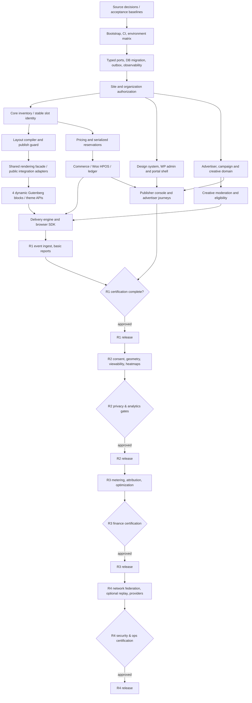

# AdPilot — Implementation Roadmap, Dependency Graph, Development Milestones & GPT-6 High Execution Plan

**Document ID:** `ADP-DOC-028`  
**Filename:** `28_ADPILOT_IMPLEMENTATION_ROADMAP_DEPENDENCY_GRAPH_MILESTONES_GPT6_HIGH_EXECUTION.md`  
**Version:** 1.0.0 — proposed integrated execution baseline  
**Status:** Proposed for Product Owner, Engineering Lead, WordPress Lead, UX Lead, Security/Privacy, Finance, AdTech, QA and Operations sign-off  
**Date:** 2026-10-13  
**Product:** AdPilot — Self-Service Advertising Marketplace & Behavioral Analytics for WordPress  
**Document owner:** Principal Engineering Program Architect / Technical Lead  
**Implementation target:** GPT-6 High; short, auditable, repository-scoped work packages; human approval on policy and production-risk decisions  
**Normative predecessors:** `ADP-DOC-001` through `ADP-DOC-027` (the complete numbered document set)  
**Purpose:** Establish a single, dependency-safe implementation order, verification handoff, milestone evidence model, risk register and release-level definition of done. This document authorizes **planning and execution sequencing**, not unilateral modification of earlier product, technical, financial or privacy contracts.

> **Integrity notice.** This is an engineering plan, not a claim that software, migration scripts, tests, operational controls or release certification have already been implemented. Work packages are proposed, their completion conditions are normative targets, and dates/durations are not delivery promises. Estimates below are **illustrative planning ranges** that must be calibrated against team capacity, approved runtime matrix and a measured repository baseline. Blocking product decisions require explicit sign-off.

---

## 1. Executive implementation directive and precedence

AdPilot SHALL be built as a **self-hosted WordPress modular monolith**, with bounded PHP modules and application contracts, React/TypeScript for rich publisher/advertiser interfaces, four server-rendered Gutenberg blocks, a shared public rendering facade for PHP/shortcodes/theme hooks, and a small progressively activated browser SDK. The first public release SHALL remain usable without WooCommerce for nonpayment features. WooCommerce is an optional integrated checkout adapter. No proprietary hosted analytics service is required.

**Normative precedence:** `ADP-DOC-001` defines product, 129 `FR-*`, 18 `BR-*`, 16 `NFR-*`, 15 `AC-*`, 10 `INV-*`, 12 `DEC-*`, and R1–R4 release assignments; `ADP-DOC-002` defines capability/acceptance mapping; `003–005` define journeys, policies and authorization; `006–010` architecture, domain, persistence, REST, event processing; `011–017` UX, frontend and WordPress entry points; `018–022` delivery, measurement, heatmap, commerce and moderation; `023–027` security, QA, operations, configuration and extensibility. A downstream inconsistency is a tracked blocker or signed change, **not** permission to override higher-authority text.

### 1.1 Engineering outcome and release semantics

| Release | Shippable business outcome | Mandatory primary proofs | Explicitly excluded before relevant certification |
|---|---|---|---|
| **R1** | Complete fixed/time-based advertising marketplace and reliable served ads | Publisher publishes 4/100/196/200 logical-slot page; four Gutenberg blocks and equivalent PHP/shortcode/hook output; self-service advertiser quote→hold→optional Woo payment→creative approval→active delivery; authoritative basic analytics; tenant/privacy/security/accessible UX; reproducible install/recovery | Full R2 heatmaps, R3 certified CPM/CPC, R4 session replay/network federation; provisional endpoint presence does not make features ready |
| **R2** | Trustworthy placement/visitor engagement intelligence | Consent-gated viewability and full-page click/tap/scroll/attention-proxy aggregation; version-compatible geometry; suppression, retention, protected exports, visual and nonvisual explorer | Eye-tracking claims, unrestricted visitor replay, unqualified metered billing |
| **R3** | Audited metered monetization and measured optimization | Verified CPC/CPM events, pacing, caps, conversion attribution assumptions, dispute resolution and append-only reconciled charges; financial approvals and fault tests | Charges derived from browser claims, uncertified models, universal causal attribution |
| **R4** | Controlled network/extension scale and explicitly optional replay | Authorized cross-site enrollment, federation, independent worker adapters, white-label checks, optional masked/consented replay; provider certification | Automatic cross-site data access, opt-out replay, new gateways bypassing Commerce |

### 1.2 Execution rules that cannot be traded for velocity

1. Preserve separate authoritative **inventory, layout, booking, order/payment, campaign, creative-review, delivery, measurement and financial-ledger states**.
2. A purchaser-facing availability estimate is not an atomic hold; a paid order cannot revive an expired hold or bypass creative moderation.
3. R1 must support 500 logical slots without 500 expensive network fetches; test above 1,000 slots without a hard-coded product cap.
4. Stable `logical_slot_id` and immutable `published_layout_revision` persist across noncontract-breaking changes; every render occurrence has a distinct `render_instance_id`.
5. A configured slot is not a served/rendered/viewable/qualified/billable event; browser claims alone cannot create charges.
6. `site_id` and `organization_id` policy are checked server-side at each protected boundary; multisite `switch_to_blog()` never grants authority.
7. Third-party hooks/providers may narrow or enrich **allowlisted** data, never override mandatory security, creative approval, finance or consent verdicts.
8. Private event, media, payment and organization data are least-privilege, purpose-scoped and subject to approved finite retention.
9. Missing scheduler/transactional storage/payment proof yields a disabled unsafe commercial feature and an actionable diagnostic rather than fictitious success.
10. GPT-6 High must not invent tests as having passed, create unapproved tables/routes/settings, silently accept a pending ADR, or merge code with an unresolved release blocker.

## 2. Program governance, engineering roles and decision rights

| Role | Accountable deliverables | Authority / cannot self-approve |
|---|---|---|
| Product Owner | Scope, R1–R4 criteria, canonical decisions, pilot acceptance | Signs product behavior; cannot waive security/finance gates alone |
| Principal Architect / Tech Lead | Module contract freeze, dependency graph, ADRs, repository layering | Signs technical integrity, approves interfaces with owners |
| WordPress/PHP Lead | Plugin lifecycle, REST, site APIs, Gutenberg and classic theme compatibility | Owns WP/runtime integration, not personal data policy |
| Domain & Database Lead | Aggregate ownership, indexed persistence, migrations, exclusive reservation locking | Must furnish real DB evidence; cannot substitute mock-only race tests |
| Commerce/Finance Lead | Price/hold/order, WooCommerce HPOS, payment proof, refund and ledger | Independently approves accounting and financial test proofs |
| AdTech/Delivery Lead | Selection, runtime SDK, caching, safe creative display, selection quality | No finance-table writes; must pass stop/eligibility checks |
| Measurement/Analytics Lead | Signal semantics, idempotent ingestion, aggregate metric versions, attribution | No ledger posting from raw browser event |
| Security & Privacy Leads | Threat model, permissions, consent, retention, creative upload security | Own fail-closed rules, legal counsel decides jurisdiction obligations |
| UX/Accessibility Lead | Design system, flow and screen acceptance, RTL, WCAG target | Accessibility evidence mandatory even if visual mocks approved |
| Frontend/Gutenberg Lead | Admin/storefront React, 4 blocks, theme parity, high-density performance | Cannot expose backend-protected features by UI-only flag |
| Platform/SRE Lead | Scheduler, outbox, deployment, observability, backup/restore, operations | Defines operator runbooks and recovery evidence |
| QA/Release Lead | Test taxonomy, cross-document traceability, CI gates, final dossier | Rejects claims without executed, reproducible proof |
| Technical Writer / DX Lead | API/SDK documentation, operator/admin manuals, examples and notices | Publishes only interfaces that passed compatibility checks |
| GPT-6 High implementing agent(s) | One bounded change set at a time with code, tests, evidence and handoff | **No decision-making authority** over legal, consent, tax, accounting or risky production rollouts |

### 2.1 Sign-off and change control

Use a versioned decision ledger with `id`, source document, scenario, affected `FR/BR/IC/API/DB/UI` IDs, options, recommendation, risk, accountable approver(s), chosen resolution, approval date, implementation delta and regression obligations. An approved change is propagated to the corresponding upstream specifications **before** dependent work merges. A rejected decision leaves the gated feature disabled. No unsigned assumption is treated as an approved default.

**Four approval classes:** P0 product/scope, S0 security/privacy, F0 finances/contracting, A0 architecture/compatibility; some decisions need multiple classes. A normal code review is not a substitute for S0/F0 sign-off. Emergency rollback is authorized by incident runbook, logged and later reviewed; it must preserve money/consent invariants.

### 2.2 Definition of Ready (DoR) for a work package

A package is ready only when (i) release and owner are known, (ii) required source `FR-*`, `BR-*`, `IC-*`, `API-*`, `DM-*`, UI, DB and test IDs are listed, (iii) prerequisite contracts exist or are explicitly stubbed as approved ports, (iv) approvals for any high-risk behavior are recorded, (v) expected paths and public interfaces are identified, (vi) fixtures/environment are reproducible, (vii) at least one negative test and failure/recovery behavior are specified, (viii) evidence can be observed, and (ix) scope fits one reviewable change or is split.

### 2.3 Definition of Done (DoD) for a work package

A work package is done only after application code, migration/change-control notes, unit/integration/contract tests, required negative tests, documentation, code-owner review, formatting/static analysis, no newly exposed secrets/PII, accessibility/performance evidence if relevant, green focused CI, and an auditable handoff with exact commands, exit codes, environment versions and known limitations. Mock tests alone cannot complete financial concurrency, security authorization, browser performance or restore packages.

## 3. Dependency architecture and implementation topology

### 3.1 Canonical bounded contexts (Document 06)

| Module | Primary authority | May depend on published contracts | Early prerequisite |
|---|---|---|---|
| Platform/Core | Clock, transaction, migration, outbox, cache, telemetry and bootstrap ports | WordPress infrastructure adapters | Bootstrap/runtime choice |
| Identity/Authorization | Current actor/site/org/role/state authorization | Platform, WordPress capability adapter | Permission matrix approval |
| Advertisers | Organization profile, memberships/invitations collaboration | Identity, Platform | Site-scoped organization schema |
| Inventory | Zones, containers, stable logical-slot definitions | Platform, policy reads | Storage identity/migration |
| Layout | Draft compiler, immutable versions, sold-impact publication | Inventory, Reservations query contracts | Identity + compiler |
| Campaigns | Campaign intent, schedule and independent lifecycle | Advertisers, Inventory, Creatives and Commerce projections | Domain transitions |
| Creatives/Moderation | Quarantine, immutable versions, policy verdict and reviews | Compliance, Platform | Secure storage and moderator auth |
| Pricing | Immutable rates/quotes, money policies | Inventory, availability read | Currency/tax sign-off |
| Reservations | Holds, exclusive-capacity locks, allocation contracts | Inventory, Pricing, Platform transactional port | Real DB concurrency proof |
| Commerce/Billing | Verified payments, order mapping, refunds, ledger | Reservations and WooCommerce adapter | Holds, gateway, finance sign-off |
| Delivery | Eligibility, targeting, selection and safe creative decision | Layout, Campaigns, Creatives, Reservations, Compliance | Freshness/stop contract |
| Measurement | Event qualification/deduplication, official metric aggregates | Delivery facts, Platform outbox | SDK identity/event schema |
| BehavioralAnalytics | R2 geometry, privacy-gated heatmap aggregates | Layout, Measurement, Privacy | R2 schema/consent approvals |
| Reporting | Authorized business read models, exports | Measurement, Commerce, Inventory | Current authorization and metric registry |
| Optimization | R3 experiments, attribution and recommendations | Measurement, Delivery, Reporting projections | R3 financial/metric signoff |
| Compliance/Privacy | Consent, restrictions, retention, erasure policy | Identity and Platform | Policy decision and DPIA/legal review as needed |
| Notifications | Localized notice intents and delivery outcomes | Identity, event projections | Queue and safe templates |
| Integrations | PHP/REST/block/theme/provider adaptation and external webhook ports | All via approved public application facades | Stable IC contracts, provider trust policy |

**Execution invariant:** Boundaries are one deployable WordPress plugin, not separate microservices. Module source imports point inward to domain/ports; cross-module access consumes published interfaces, never foreign repositories or ad-hoc SQL. A module's schedule, status or API endpoint does not authorize its code to write another module's authoritative storage.

### 3.2 Dependency DAG — architecture and release build



**DAG interpretation:** The release pipeline displays the planned R1→R2→R3→R4 product sequence, but R4 network/replay technical packages may consume their approved R1/R2 interfaces independently of R3 financial implementation; final public R4 launch still follows the approved release policy. Feature branches can run in parallel **after** stable consuming/provider contracts are frozen; the arrow denotes a prerequisite verified artifact, not necessarily a completed screen. R2/R3/R4 coding may be prototyped on isolated branches, but unreleased routes/queues/nav/configuration remain disabled and cannot ship as active features. QA, security, UX and operations test development is continuous and **not** postponed until G1.

### 3.3 Critical-path chains, merge conflicts, parallelism

| Critical chain | Dependency-sensitive components | Failure consequence | Shortening strategy without bypass |
|---|---|---|---|
| Commercial correctness | DB transaction support → stock definitions → serialized holds → Woo payment verification → ledger → reconciliation → R1 checkout | Oversold inventory / money without deliverable entitlement | In parallel create payment and booking test harness; block final integration until real DB proof |
| Delivery truth | Slot identity/layout → published placement facade → approved creative + paid allocation → decision engine → browser render → qualified measurement | Stale creative, fake impressions, misattribution | Freeze small DTOs and test parity fixtures before UI work |
| 500-slot UX | Grid compiler → immutable published layout → compact Gutenberg zone → bounded public SDK → responsive/perf/accessibility benchmark | Unusable editor/public page | Early vertical proof with 4/100/196/200 fixtures and telemetry |
| Tenant/Privacy | Site/org auth → REST row/field policies → upload/storage isolation → tracking purpose policy → protected reports/exports | Cross-tenant disclosure | First-class negative tests for every endpoint and background job |
| R2 geometry | Published layout revision → snapshot protocol → normalized signals → contributor-safe aggregation → explorer/table | Misleading heatmap, privacy leak | Prototype snapshot matching and cohort suppression with synthetic data |
| R3 finance | Qualified event definitions → invalid traffic policy → certified dispute evidence → exact ledger adjustments | Misbilling | Finance-led acceptance certification before enabling billable routes |
| R4 network | R1 site-safe architecture → site enrollment/authority → provider trust/secret isolation → worker provenance | Cross-site privilege escalation | Cross-site isolation fixtures maintained from R1 |

### 3.4 Merge and data migration rules

- No implementation branch writes an owned table from a different module; no feature branch invents a competing `site_id`/`organization_id` standard, currency format, date handling or error envelope.
- Lock and index decisions are verified on the **real supported MySQL/MariaDB engine**, not SQLite or WordPress options. Confirm transactional storage engine and safe lock ordering before enabling exclusive booking.
- Migration changes are additive/expand-first until old/new code compatibility is tested; migration scripts record version/checksum, idempotence and recovery; production rollback is not always a simple down migration.
- Public API/block metadata, `TI17` hooks, events, job envelopes, and typed SDKs are compatibility contracts; frozen versions need explicit reviewed change records.
- No seeded sample content, page or option may clobber unrelated WordPress data; activation is bounded to documented owned resources.
- Finance and privacy features have deliberate independent approvals, so the Product Owner or agent cannot mark their gates green on its own.

## 4. Program delivery framework and workstream structure

### 4.1 Workstreams

| ID | Workstream | Leads | Deliverables |
|---|---|---|---|
| `P28-WS-01` | Product decisions and governance | Product + Architecture | Approved DEC/ADR register, R1 scope, metrics, issue ownership |
| `P28-WS-02` | Build and developer infrastructure | Platform + DevOps | Composer/npm workspace, version matrix, CI, SBOM and reproducible fixtures |
| `P28-WS-03` | Identity and privacy foundation | Security + Identity | WP site caps, org membership, auth policy and consent gates |
| `P28-WS-04` | Persistence and transactional commerce | DB + Finance | schema, holds, reconciliation, Woo HPOS and ledgers |
| `P28-WS-05` | Inventory and layout compiler | Layout + AdTech | 500+ generated slots, stable identities, publishing safety |
| `P28-WS-06` | UX, design system and frontend apps | UX + Frontend | accessible admin/portal, responsive/RTL journeys |
| `P28-WS-07` | Gutenberg and theme API | WordPress Lead | 4 dynamic blocks, PHP/shortcode/hook render parity |
| `P28-WS-08` | Campaigns, creatives, moderation | Campaign/Creative + Security | safe versioned approvals, publisher moderation UX |
| `P28-WS-09` | Delivery and public performance | AdTech + Frontend | current eligibility, safe decisions, progressive SDK |
| `P28-WS-10` | Measurement and business intelligence | Measurement + Reporting | R1 qualified metrics, R2 heatmaps, R3 finance basis |
| `P28-WS-11` | Extensions, providers and localization | DX + WordPress | trusted adapters, 100 typed config keys, i18n/RTL support |
| `P28-WS-12` | Quality, operations, release | QA + SRE | test gates, staging/canary, recovery drills, signed release dossier |

### 4.2 Operating model for GPT-6 High execution

The canonical unit of implementation is a **bounded, independently verifiable work package**. An individual model turn should complete one coherent vertical slice (or a small approved group of tightly coupled edits): first inspect actual repository files, freeze the expected interfaces, implement production code, add/execute tests, capture honest output, then report diffs and unresolved blockers. If the change is too large for one cycle, split into **design/contract → implementation → integration → adversarial validation** batches; do not skip test stages or claim a whole subsystem is complete from pseudocode.

Use no fabricated `done` labels. Maintain separate statuses `not_started`, `ready`, `in_progress`, `blocked`, `review`, `verified`, `released` with timestamp, owner and evidence location. `verified` requires actual green artifact evidence; `released` requires release committee approval and deployment confirmation.

## 5. Development phases, milestones and handoff gates

### 5.1 Planning units and uncertainty

Use the phases below as **dependency milestones**, not calendar guarantees. Suggested planning unit is one independently demonstrable slice, normally a small PR or coherent vertical integration branch; package sizing must be measured in the actual codebase. Work effort estimates should be expressed as a range, assigned only after repository inspection, complexity/risk scoring and identification of constrained reviewer capacity. Estimate **three-point** `(optimistic, most likely, pessimistic)` effort, record assumptions and revisit after a pilot slice; never treat GPT output-token volume as working software progress.

Define a capacity calendar by role, an integration/reviewer bandwidth limit, staging access, and a release-code-freeze window. Maintain a rolling 2–3 iteration lookahead while preserving frozen milestone acceptance. Rebaseline dates only by explicit project governance; do not hide slip by dropping mandatory NFRs or moving R1 essentials to later releases.

### 5.2 Program gates and milestone registry

| Milestone | Gate and dependencies | Customer-visible demonstration | Formal exit evidence | Owner |
|---|---|---|---|---|
| `P28-M-00` | Source and architecture readiness | Product demo storyboard and navigation prototypes | Signed critical DEC/ADR list; version matrix; baseline fixtures | Product + Architect |
| `P28-M-01` | Reproducible platform foundation | Install/activate without Woo; zero foreign page mutations | R1 bootstrap + CI/static analysis + migration dry run + safe no-Woo diagnostic | Platform/QA |
| `P28-M-02` | Authorization and isolation | Site/org role-bound screens and safe refusal | Two-org/two-site read/write/export negative tests, revocation, audit, grant review | Identity/Security |
| `P28-M-03` | Inventory and immutable layouts | Create and publish 4+100+196+200 slots from compact definitions | Stable ID and sold-slot guard evidence, responsive/keyboard Layout Studio QA | Inventory/UX |
| `P28-M-04` | Rendering and editor integrations | Four Gutenberg blocks and PHP/shortcode/hook demos on block/classic theme | Parity snapshots, unique occurrence identity, editor nonbillability, 500+ browser proof | WordPress/AdTech |
| `P28-M-05` | Campaign and moderation | Advertiser uploads creative and editor accepts/rejects exact version | Malicious upload tests, approval revocation/stop, independent lifecycle audits | Campaign/Security |
| `P28-M-06` | Commercial and payment correctness | Two buyers race for exclusive slot; one holds, pays, receives governed entitlement | Real DB concurrency, late callbacks, Woo HPOS, ledger reconciliation and refund remedies | Finance/DB/QA |
| `P28-M-07` | Delivery and R1 reporting | Authorized paid/approved creative appears in near-viewport slot | Decision eligibility/parity, 500-slot perf, view/click count truth, tracking denial | AdTech/Measurement |
| `P28-M-08` | Complete R1 user experience | Buyer and publisher complete entire task without developer intervention | UX validation, RTL/accessibility, API and manual recovery, AC-001..015 witness | Product/UX/QA |
| `P28-M-09` | R1 release certification | Installable release candidate and pilot on pinned matrix | Signed QA24/Security23/Ops25 dossier, backup drill, SBOM, zero mandatory blockers | Release Committee |
| `P28-M-10` | R2 privacy/geometry | Full-page overlay aligned to valid layout version and numerical alternatives | Approved cohort proof, consent/erasure, API/schema migration and heatmap test dossier | Privacy/Analytics |
| `P28-M-11` | R3 billing/optimization | Reconciled metered delivery and disputed event correction | Qualified metric cert, ledger proof, budgets, traffic fraud tests and finance signoff | Finance/Measurement |
| `P28-M-12` | R4 network/provider/replay | Network opt-in demo, separately enabled masked replay | Site authority isolation, provider cert, consent masking, retention and ops recovery | Security/SRE/QA |

### 5.3 R1 vertical-slice demonstration ladder

1. **Hello WordPress:** activation, nonpayment inventory bootstrap, translations and safe disabling; evidence from real WordPress runtime.
2. **Publisher-only:** authorize admin, generate 500 slots using compact definitions and publish immutable revision; demo on classic and block theme.
3. **Delivery-only house ad:** safe HTML placeholder, lazy hydration of eligible creative, no false event or third-party execution.
4. **Advertiser-only:** organization creation, isolated campaign and creative draft, upload quarantine and submission; permissions verified through direct API abuse tests.
5. **Booking-only:** two competing accounts quote/hold same exclusive interval; exactly one succeeds; expiration/retry/late payment recovery logged.
6. **Paid + approved:** Woo HPOS payment verified, creative version separately approved, eligible active campaign selected and served.
7. **Reporting-only:** browser events qualified at ingestion and rendered in scoped basic dashboards; intentionally broken analytics cannot block content or charge money.
8. **Whole journey:** full E2E-01..17 + AC-001..15 on pinned matrix, WCAG/RTL and disaster recovery exercise; pilot release sign-off.

### 5.4 Continuous gates (never deferred to end of phase)

- `G-POLICY`: any blocked commercial/privacy/legal decision prevents affected operation. `G-AUTH`: unauthorized mutation/read/export returns deny with zero side effects. `G-STATE`: current authoritative states and immutable versions validated. `G-TRANSACTION`: real locking, idempotency and ledger/audit atomicity proven. `G-WP`: compatible and no mandatory Woo dependency. `G-UX`: focus/keyboard/RTL/responsive and approved tokens checked. `G-BROWSER`: bounded 500-slot initial work, safe creative, no editor billing. `G-PRIVACY`: consent/purpose/retention/erasure and suppression. `G-RELEASE`: no speculative feature enabled across R boundaries. `G-EVIDENCE`: test run recorded with reproducible environment and artifact IDs.

### 5.5 Controlled parallel tracks

| Parallel track | Can start after | Can merge to stable main after | Integration rendezvous |
|---|---|---|---|
| UX design system and clickable mocks | `M-00` | Tokens, accessibility and `UI-01..20` shell contracts frozen | `M-03/M-08` |
| Database schema/migration and async framework | `M-00/M-01` | Real DB + WP lifecycle migrations and outbox conformance | `M-02/M-06` |
| Inventory/layout and placeholder renderer | Core typed ports, `IC-003/004` prototypes | Sold-impact and unique identity tests | `M-03/M-04` |
| Creative/quarantine and campaign app | Authorization + tenant schema | Approved-version and policy service tests | `M-05/M-07` |
| Pricing/holds and Woo adapter | Pricing/availability/transaction DTOs frozen | Payment evidence + locking + compensating remedies | `M-06` |
| Four block editor and developer PHP APIs | Shared render facade and published layout shape | Integration parity and Site Editor scoped preview | `M-04` |
| R1 measurement/reporting | Event envelope + decision identity frozen | Qualification/retention/data-freshness tests | `M-07` |
| Release QA and operations | Day 1 | Per-slice evidence | Every milestone, especially `M-09` |
| R2/R3/R4 prototypes | Approved isolated feature branch and relevant ADR | Only after respective release/privacy/finance gates | `M-10/M-11/M-12` |

## 6. Canonical work-package interface and planning data model

A roadmap package is a **planning object**, not an alias for an implementation done in another document. Use `P28-WP-###` as the program-level work item and link `ARCH-WP-*`, `D07-WP-*`, `DB08-*`, `API09-*`, `AS10-*`, `UX11-*`, `DS12-*`, `ADM13-*`, `ADV14-*`, `LS15-*`, `GB16-*`, `TI17-*`, `DE18-*`, `ME19-*`, `HM20-*`, `CO21-*`, `CM22-*`, `SEC23-*`, `QA24-*`, `OPS25-*`, `CFG26-*`, `EXT27-*` only where such source identifiers **actually exist** in their referenced source. This document does not assume a naming prefix exists merely because a document number does. Confirm exact upstream ID and scope before linking in the task tracker.

**Canonical package fields:** `id`, `name`, `release`, `owner_role`, `reviewer_roles`, `prerequisite_package_ids`, `external_decision_ids`, `module_owner`, `source_document_ids`, `source_requirement_ids`, `affected_public_contracts`, `target_repo_paths`, `data_migrations`, `API_changes`, `acceptance_test_ids`, `nonfunctional_budgets`, `user_demonstration`, `rollback_or_disable_strategy`, `estimated_size_range`, `status`, `evidence_links` and `approval_record`.

```yaml
# Planning example only. Replace placeholder evidence with real approved records.
id: P28-WP-024
name: Exclusive reservation and hold engine
release: R1
status: blocked
module_owner: Reservations
owner_role: Database / Commerce Lead
prerequisite_package_ids: [P28-WP-005, P28-WP-013, P28-WP-023]
source_documents: [ADP-DOC-001, ADP-DOC-004, ADP-DOC-007, ADP-DOC-008, ADP-DOC-021]
source_requirements: [BR-001, BR-002, BR-005, INV-02, AC-006]
contracts: [IC-005, IC-007, IC-008]
blockers:
  - Supported database locking behavior awaiting confirmed test environment
completion_evidence:
  - Real transactional exclusive-hold race with exactly one authorized winner
  - Duplicated idempotency key produces one hold and one audit effect
  - Expiry and late-provider notification cannot resurrect inventory
  - Tenant/site isolation and verified authorization before every write
rollback_policy: Disable new purchases if transaction capability unavailable; retain ledger and audit
```

**Package size rule:** A package may contain multiple PRs, but a PR should remain a coherent, reviewable unit. Split a package if it crosses two independent module owners, requires unrelated migrations, or mixes production payment and experimental analytics. Each split gets a child ID (e.g. `P28-WP-024.1`) in the tracker without redefining the canonical package.


## 7. Complete dependency-ordered work-package register (`P28-WP-001..054`)

**Status:** All items proposed/not yet executed; source documents may have their own lower-level WP catalogs. Dependency edges are the mandatory prerequisites for the program-level package, not a claim of completed software. The table order is topological; dependencies may be developed as stable contract skeletons if full behavior is later, but production integration cannot pass until prerequisites are verified.

| ID | Release | Implementation slice | Owner | Prerequisite package IDs | Gate |
|---|---|---|---|---|---|
| `P28-WP-001` | R1 | Policy, decision and ADR baseline | Product/Architecture | Baseline | P28-M-00..09 |
| `P28-WP-002` | R1 | Runtime support matrix and reproducible WordPress environments | Platform/QA | `P28-WP-001` | P28-M-00..09 |
| `P28-WP-003` | R1 | Repository, build system, CI and software supply chain | Platform/DX | `P28-WP-002` | P28-M-00..09 |
| `P28-WP-004` | R1 | Core ports, module composition and WordPress bootstrap | Platform/Architecture | `P28-WP-002`, `P28-WP-003` | P28-M-00..09 |
| `P28-WP-005` | R1 | Site-scoped schema and safe migrations | Database/Platform | `P28-WP-002`, `P28-WP-004` | P28-M-00..09 |
| `P28-WP-006` | R1 | Actor, organization and object authorization | Identity/Security | `P28-WP-004`, `P28-WP-005` | P28-M-00..09 |
| `P28-WP-007` | R1 | Advertiser organizations and team lifecycle | Advertisers/Identity | `P28-WP-005`, `P28-WP-006` | P28-M-00..09 |
| `P28-WP-008` | R1 | Privacy, consent, retention and policy-port foundation | Compliance/Security | `P28-WP-004`, `P28-WP-005`, `P28-WP-006` | P28-M-00..09 |
| `P28-WP-009` | R1 | Typed configuration, flags and effective readiness | Platform/Configuration | `P28-WP-004`, `P28-WP-006`, `P28-WP-008` | P28-M-00..09 |
| `P28-WP-010` | R1 | Outbox, queue, scheduler and job provenance | Platform/Jobs | `P28-WP-004`, `P28-WP-005`, `P28-WP-006`, `P28-WP-009` | P28-M-00..09 |
| `P28-WP-011` | R1 | Design tokens, components and accessibility foundation | UX/Frontend | `P28-WP-001`, `P28-WP-003` | P28-M-00..09 |
| `P28-WP-012` | R1 | Publisher and advertiser app shells | Frontend/WordPress | `P28-WP-006`, `P28-WP-009`, `P28-WP-011` | P28-M-00..09 |
| `P28-WP-013` | R1 | Zones, containers, stable logical slot registry | Inventory/Database | `P28-WP-005`, `P28-WP-006`, `P28-WP-009` | P28-M-00..09 |
| `P28-WP-014` | R1 | Responsive layout compiler, drafts and published snapshots | Layout/Frontend | `P28-WP-013`, `P28-WP-011` | P28-M-00..09 |
| `P28-WP-015` | R1 | Contract impact, publish and rollback guards | Layout/Reservations | `P28-WP-014`, `P28-WP-006` | P28-M-00..09 |
| `P28-WP-016` | R1 | Layout Studio three-pane editing workspace | UX/Frontend/Layout | `P28-WP-012`, `P28-WP-013`, `P28-WP-014`, `P28-WP-015` | P28-M-00..09 |
| `P28-WP-017` | R1 | Shared server-side ad rendering facade | Integrations/Delivery | `P28-WP-004`, `P28-WP-013`, `P28-WP-014`, `P28-WP-008` | P28-M-00..09 |
| `P28-WP-018` | R1 | Public PHP helpers, shortcodes and theme hooks | WordPress/Integrations | `P28-WP-017`, `P28-WP-006` | P28-M-00..09 |
| `P28-WP-019` | R1 | Four dynamic Gutenberg blocks and Site Editor integration | WordPress/Gutenberg | `P28-WP-012`, `P28-WP-014`, `P28-WP-017` | P28-M-00..09 |
| `P28-WP-020` | R1 | Safe creative upload, storage and immutable versions | Creatives/Security | `P28-WP-005`, `P28-WP-006`, `P28-WP-008`, `P28-WP-010` | P28-M-00..09 |
| `P28-WP-021` | R1 | Creative moderation, policy bundles and emergency stop | Creatives/Compliance | `P28-WP-020`, `P28-WP-006`, `P28-WP-010` | P28-M-00..09 |
| `P28-WP-022` | R1 | Campaign lifecycle and eligibility projections | Campaigns/AdTech | `P28-WP-007`, `P28-WP-013`, `P28-WP-021`, `P28-WP-010` | P28-M-00..09 |
| `P28-WP-023` | R1 | Published rate cards, quote and exact-money rules | Pricing/Finance | `P28-WP-005`, `P28-WP-013`, `P28-WP-008` | P28-M-00..09 |
| `P28-WP-024` | R1 | Exclusive availability, hold and reservation transactions | Reservations/Database | `P28-WP-005`, `P28-WP-013`, `P28-WP-023`, `P28-WP-006` | P28-M-00..09 |
| `P28-WP-025` | R1 | WooCommerce checkout and payment evidence adapter | Commerce/Woo | `P28-WP-024`, `P28-WP-010`, `P28-WP-023` | P28-M-00..09 |
| `P28-WP-026` | R1 | Ledger, remedies, refunds and reconciliation | Commerce/Finance | `P28-WP-025`, `P28-WP-024`, `P28-WP-010` | P28-M-00..09 |
| `P28-WP-027` | R1 | Public marketplace, placement discovery and quoting UX | Frontend/Advertisers | `P28-WP-012`, `P28-WP-013`, `P28-WP-023` | P28-M-00..09 |
| `P28-WP-028` | R1 | Advertiser portal, wizard, checkout and reporting shell | Frontend/Advertisers | `P28-WP-007`, `P28-WP-012`, `P28-WP-020`, `P28-WP-022`, `P28-WP-024`, `P28-WP-025` | P28-M-00..09 |
| `P28-WP-029` | R1 | Publisher admin, moderation, finance and diagnostics console | Frontend/Operations | `P28-WP-012`, `P28-WP-016`, `P28-WP-021`, `P28-WP-026` | P28-M-00..09 |
| `P28-WP-030` | R1 | Authoritative ad selection, targeting and stop policy | Delivery/AdTech | `P28-WP-017`, `P28-WP-022`, `P28-WP-024`, `P28-WP-021`, `P28-WP-008` | P28-M-00..09 |
| `P28-WP-031` | R1 | Lightweight public runtime SDK and progressive loading | Frontend/Delivery | `P28-WP-017`, `P28-WP-019`, `P28-WP-030` | P28-M-00..09 |
| `P28-WP-032` | R1 | Event ingestion, deduplication and basic qualified analytics | Measurement/Privacy | `P28-WP-030`, `P28-WP-031`, `P28-WP-008`, `P28-WP-010` | P28-M-00..09 |
| `P28-WP-033` | R1 | Scoped metrics dashboard, basic reports and exports | Reporting/Measurement | `P28-WP-032`, `P28-WP-006`, `P28-WP-026` | P28-M-00..09 |
| `P28-WP-034` | R1 | Notification, operator diagnostics and redacted exports | Notifications/Platform | `P28-WP-010`, `P28-WP-006`, `P28-WP-033` | P28-M-00..09 |
| `P28-WP-035` | R1 | Controlled extension points, provider registry and SDK skeleton | Integrations/DX | `P28-WP-017`, `P28-WP-018`, `P28-WP-006`, `P28-WP-009` | P28-M-00..09 |
| `P28-WP-036` | R1 | Internationalization, RTL and localization completeness | UX/Frontend | `P28-WP-011`, `P28-WP-012`, `P28-WP-027`, `P28-WP-028`, `P28-WP-029` | P28-M-00..09 |
| `P28-WP-037` | R1 | Threat-driven security and privacy hardening | Security/Privacy | `P28-WP-006`, `P28-WP-008`, `P28-WP-020`, `P28-WP-021`, `P28-WP-024`, `P28-WP-025`, `P28-WP-030`, `P28-WP-032` | P28-M-00..09 |
| `P28-WP-038` | R1 | High-density, reliability and compatibility benchmark | Performance/SRE | `P28-WP-015`, `P28-WP-019`, `P28-WP-030`, `P28-WP-031`, `P28-WP-032` | P28-M-00..09 |
| `P28-WP-039` | R1 | Formal R1 QA and accessibility certification | QA/Release | `P28-WP-027`, `P28-WP-028`, `P28-WP-029`, `P28-WP-033`, `P28-WP-034`, `P28-WP-036`, `P28-WP-037`, `P28-WP-038` | P28-M-00..09 |
| `P28-WP-040` | R1 | R1 distribution, staged rollout and support handoff | SRE/Product | `P28-WP-039`, `P28-WP-003`, `P28-WP-010` | P28-M-00..09 |
| `P28-WP-041` | R2 | Viewability and measurement expansion | Measurement/Privacy | `P28-WP-040`, `P28-WP-032` | P28-M-10 |
| `P28-WP-042` | R2 | Geometry anchors, snapshots and layout-change mapping | Layout/Behavior | `P28-WP-040`, `P28-WP-014`, `P28-WP-031` | P28-M-10 |
| `P28-WP-043` | R2 | Privacy-safe heatmap ingestion and aggregation | Behavior/Privacy | `P28-WP-041`, `P28-WP-042`, `P28-WP-008`, `P28-WP-010` | P28-M-10 |
| `P28-WP-044` | R2 | Heatmap explorer, overlays and accessible alternatives | Frontend/Behavior | `P28-WP-042`, `P28-WP-043`, `P28-WP-011`, `P28-WP-033` | P28-M-10 |
| `P28-WP-045` | R2 | R2 privacy/analytics release certification | QA/Privacy | `P28-WP-041`, `P28-WP-042`, `P28-WP-043`, `P28-WP-044` | P28-M-10 |
| `P28-WP-046` | R3 | Certified billable CPC/CPM qualification pipeline | Measurement/Finance | `P28-WP-045`, `P28-WP-026`, `P28-WP-041` | P28-M-11 |
| `P28-WP-047` | R3 | Budgets, pacing, weighted shares and metered pricing | AdTech/Commerce | `P28-WP-046`, `P28-WP-030`, `P28-WP-023`, `P28-WP-024` | P28-M-11 |
| `P28-WP-048` | R3 | Conversion attribution, experiments and recommendations | Optimization/Analytics | `P28-WP-046`, `P28-WP-047`, `P28-WP-033` | P28-M-11 |
| `P28-WP-049` | R3 | Disputes, adjustments and advanced finance reporting | Commerce/Finance | `P28-WP-046`, `P28-WP-047`, `P28-WP-048` | P28-M-11 |
| `P28-WP-050` | R3 | R3 metered billing certification and rollout | QA/Finance | `P28-WP-046`, `P28-WP-047`, `P28-WP-048`, `P28-WP-049` | P28-M-11 |
| `P28-WP-051` | R4 | Site network federation and delegated administration | Identity/Platform | `P28-WP-040`, `P28-WP-006`, `P28-WP-009` | P28-M-12 |
| `P28-WP-052` | R4 | Opt-in masked session replay subsystem | Behavior/Privacy | `P28-WP-045`, `P28-WP-043`, `P28-WP-008` | P28-M-12 |
| `P28-WP-053` | R4 | Alternate providers, external worker adapters and whitelabel | Integrations/SRE | `P28-WP-051`, `P28-WP-035`, `P28-WP-026`, `P28-WP-010` | P28-M-12 |
| `P28-WP-054` | R4 | R4 full-system release and recovery certification | QA/Product | `P28-WP-051`, `P28-WP-052`, `P28-WP-053` | P28-M-12 |

### 7.1 Acceptance contracts for every work package

#### `P28-WP-001` — Policy, decision and ADR baseline (R1)

**Owning team:** Product/Architecture. **Prerequisites:** Approved source baseline and confirmed runtime matrix. **Applicable milestone:** `P28-M-00..09`.

**Implementation contract:** Freeze 12 PRD decisions, open security/finance/UX questions, normalized release policy, approved contract register; log every blocker with source and decision owner.

**Adversarial / failure proof:** Missing tax/consent/hosting decision must block only its dependent operation; no silent default or changed release.

**Exit demonstration and evidence:** Signed P0/S0/F0/A0 baseline and canonical source checksum. Evidence must include source diffs, tests run with exit codes, fixture/environment manifest, owner review, release flag status, migration/API changes (if any), and current blockers.

**Do not mark complete if:** a required upstream ADR is unsigned, an authoritative transaction/state guard is mocked instead of verified, an R2–R4 feature becomes accidentally active in R1, a privileged route lacks current actor/site/object authorization, or a blocked safety condition is silently converted to success.

#### `P28-WP-002` — Runtime support matrix and reproducible WordPress environments (R1)

**Owning team:** Platform/QA. **Prerequisites:** `P28-WP-001`. **Applicable milestone:** `P28-M-00..09`.

**Implementation contract:** Select tested WordPress, PHP, DB and browser versions; bootstrap classic/block theme, no-Woo, Woo HPOS, multisite fixture; pin versions in CI.

**Adversarial / failure proof:** Unsupported PHP/database fails activation preflight safely; WC absent never fatals inventory/reporting.

**Exit demonstration and evidence:** Repeatable clean install and teardown with environment manifests. Evidence must include source diffs, tests run with exit codes, fixture/environment manifest, owner review, release flag status, migration/API changes (if any), and current blockers.

**Do not mark complete if:** a required upstream ADR is unsigned, an authoritative transaction/state guard is mocked instead of verified, an R2–R4 feature becomes accidentally active in R1, a privileged route lacks current actor/site/object authorization, or a blocked safety condition is silently converted to success.

#### `P28-WP-003` — Repository, build system, CI and software supply chain (R1)

**Owning team:** Platform/DX. **Prerequisites:** `P28-WP-002`. **Applicable milestone:** `P28-M-00..09`.

**Implementation contract:** Establish Composer autoload modules, strict PHP/TS workspaces, lint/type/WPCS/static analysis, SBOM/licensing and fixture scripts.

**Adversarial / failure proof:** Build intentionally fails on lint/static/secret/license violation and resumes after fix.

**Exit demonstration and evidence:** Reproducible build with hashes and documented clean-start commands. Evidence must include source diffs, tests run with exit codes, fixture/environment manifest, owner review, release flag status, migration/API changes (if any), and current blockers.

**Do not mark complete if:** a required upstream ADR is unsigned, an authoritative transaction/state guard is mocked instead of verified, an R2–R4 feature becomes accidentally active in R1, a privileged route lacks current actor/site/object authorization, or a blocked safety condition is silently converted to success.

#### `P28-WP-004` — Core ports, module composition and WordPress bootstrap (R1)

**Owning team:** Platform/Architecture. **Prerequisites:** `P28-WP-002`, `P28-WP-003`. **Applicable milestone:** `P28-M-00..09`.

**Implementation contract:** Implement DI/typed clock, transaction, cache, queue, feature availability, site resolver, logging ports; isolate WordPress in adapters.

**Adversarial / failure proof:** Domain import scanner catches WP/Woo calls; bootstrap never creates pages/options beyond owned resources.

**Exit demonstration and evidence:** Domain tests without WP and activation smoke with WP. Evidence must include source diffs, tests run with exit codes, fixture/environment manifest, owner review, release flag status, migration/API changes (if any), and current blockers.

**Do not mark complete if:** a required upstream ADR is unsigned, an authoritative transaction/state guard is mocked instead of verified, an R2–R4 feature becomes accidentally active in R1, a privileged route lacks current actor/site/object authorization, or a blocked safety condition is silently converted to success.

#### `P28-WP-005` — Site-scoped schema and safe migrations (R1)

**Owning team:** Database/Platform. **Prerequisites:** `P28-WP-002`, `P28-WP-004`. **Applicable milestone:** `P28-M-00..09`.

**Implementation contract:** Apply Document 08 custom tables, indexes, migration version/checksum, rollback/expand plan and site-specific table resolution.

**Adversarial / failure proof:** Repeated/partial migrations recover; failed migration cannot enable paid purchasing or cross-site data access.

**Exit demonstration and evidence:** Verified real DB migration with upgrade/restore evidence. Evidence must include source diffs, tests run with exit codes, fixture/environment manifest, owner review, release flag status, migration/API changes (if any), and current blockers.

**Do not mark complete if:** a required upstream ADR is unsigned, an authoritative transaction/state guard is mocked instead of verified, an R2–R4 feature becomes accidentally active in R1, a privileged route lacks current actor/site/object authorization, or a blocked safety condition is silently converted to success.

#### `P28-WP-006` — Actor, organization and object authorization (R1)

**Owning team:** Identity/Security. **Prerequisites:** `P28-WP-004`, `P28-WP-005`. **Applicable milestone:** `P28-M-00..09`.

**Implementation contract:** Implement WP capabilities, current org membership, object-state predicates, audit; common protected command decorator and permission service.

**Adversarial / failure proof:** Cross-organization IDOR, revoked membership, forged nonce, stale export token and switch_to_blog scope all deny without side effects.

**Exit demonstration and evidence:** Two-org/two-site API/CLI/job permission suite passes. Evidence must include source diffs, tests run with exit codes, fixture/environment manifest, owner review, release flag status, migration/API changes (if any), and current blockers.

**Do not mark complete if:** a required upstream ADR is unsigned, an authoritative transaction/state guard is mocked instead of verified, an R2–R4 feature becomes accidentally active in R1, a privileged route lacks current actor/site/object authorization, or a blocked safety condition is silently converted to success.

#### `P28-WP-007` — Advertiser organizations and team lifecycle (R1)

**Owning team:** Advertisers/Identity. **Prerequisites:** `P28-WP-005`, `P28-WP-006`. **Applicable milestone:** `P28-M-00..09`.

**Implementation contract:** Implement organization profile, membership/invitation, actor-bound team management, brand metadata and scoped projections.

**Adversarial / failure proof:** Forged invitations, self-escalation, owner-transfer without required review, cross-site membership replay denied.

**Exit demonstration and evidence:** Invite→accept→revoke flow and isolated organization dashboards. Evidence must include source diffs, tests run with exit codes, fixture/environment manifest, owner review, release flag status, migration/API changes (if any), and current blockers.

**Do not mark complete if:** a required upstream ADR is unsigned, an authoritative transaction/state guard is mocked instead of verified, an R2–R4 feature becomes accidentally active in R1, a privileged route lacks current actor/site/object authorization, or a blocked safety condition is silently converted to success.

#### `P28-WP-008` — Privacy, consent, retention and policy-port foundation (R1)

**Owning team:** Compliance/Security. **Prerequisites:** `P28-WP-004`, `P28-WP-005`, `P28-WP-006`. **Applicable milestone:** `P28-M-00..09`.

**Implementation contract:** Implement server policy verdicts, purpose gates, sensitive-page exclusions, bounded deletion/retention and current consent records.

**Adversarial / failure proof:** Denied/withdrawn consent produces zero prohibited collector egress; preview/protected forms never become tracking data.

**Exit demonstration and evidence:** Policy unit/integration tests with deletion and consent reversal. Evidence must include source diffs, tests run with exit codes, fixture/environment manifest, owner review, release flag status, migration/API changes (if any), and current blockers.

**Do not mark complete if:** a required upstream ADR is unsigned, an authoritative transaction/state guard is mocked instead of verified, an R2–R4 feature becomes accidentally active in R1, a privileged route lacks current actor/site/object authorization, or a blocked safety condition is silently converted to success.

#### `P28-WP-009` — Typed configuration, flags and effective readiness (R1)

**Owning team:** Platform/Configuration. **Prerequisites:** `P28-WP-004`, `P28-WP-006`, `P28-WP-008`. **Applicable milestone:** `P28-M-00..09`.

**Implementation contract:** Implement Document 26 typed keys, site/deploy precedence, source provenance, CAS updates and feature readiness engine.

**Adversarial / failure proof:** Imported config cannot enable R2–R4 or override financial/privacy kill switch; secrets never leak in export.

**Exit demonstration and evidence:** Admin can view effective/blocked setting with origin and audit. Evidence must include source diffs, tests run with exit codes, fixture/environment manifest, owner review, release flag status, migration/API changes (if any), and current blockers.

**Do not mark complete if:** a required upstream ADR is unsigned, an authoritative transaction/state guard is mocked instead of verified, an R2–R4 feature becomes accidentally active in R1, a privileged route lacks current actor/site/object authorization, or a blocked safety condition is silently converted to success.

#### `P28-WP-010` — Outbox, queue, scheduler and job provenance (R1)

**Owning team:** Platform/Jobs. **Prerequisites:** `P28-WP-004`, `P28-WP-005`, `P28-WP-006`, `P28-WP-009`. **Applicable milestone:** `P28-M-00..09`.

**Implementation contract:** Implement Document 10 event envelope, transactional outbox/inbox, Action Scheduler scheduling, worker locks/retries/DLQ and queue metrics.

**Adversarial / failure proof:** Duplicate/out-of-order jobs, crashed lease, forged service principal and wrong-site payload yield no double mutation.

**Exit demonstration and evidence:** Deterministic job replay tests plus real worker crash-recovery proof. Evidence must include source diffs, tests run with exit codes, fixture/environment manifest, owner review, release flag status, migration/API changes (if any), and current blockers.

**Do not mark complete if:** a required upstream ADR is unsigned, an authoritative transaction/state guard is mocked instead of verified, an R2–R4 feature becomes accidentally active in R1, a privileged route lacks current actor/site/object authorization, or a blocked safety condition is silently converted to success.

#### `P28-WP-011` — Design tokens, components and accessibility foundation (R1)

**Owning team:** UX/Frontend. **Prerequisites:** `P28-WP-001`, `P28-WP-003`. **Applicable milestone:** `P28-M-00..09`.

**Implementation contract:** Implement Document 12 semantic tokens, typography, form/table/navigation primitives, WCAG states, reduced motion and RTL support.

**Adversarial / failure proof:** Keyboard-only and forced-colors flows remain navigable; dark mode/RTL preserves semantics; no contrast regressions.

**Exit demonstration and evidence:** Storybook-equivalent documented component showcase with accessibility scans. Evidence must include source diffs, tests run with exit codes, fixture/environment manifest, owner review, release flag status, migration/API changes (if any), and current blockers.

**Do not mark complete if:** a required upstream ADR is unsigned, an authoritative transaction/state guard is mocked instead of verified, an R2–R4 feature becomes accidentally active in R1, a privileged route lacks current actor/site/object authorization, or a blocked safety condition is silently converted to success.

#### `P28-WP-012` — Publisher and advertiser app shells (R1)

**Owning team:** Frontend/WordPress. **Prerequisites:** `P28-WP-006`, `P28-WP-009`, `P28-WP-011`. **Applicable milestone:** `P28-M-00..09`.

**Implementation contract:** Implement scoped React bundles, WordPress admin navigation, advertiser routes, route-level permission UX, typed client base.

**Adversarial / failure proof:** Role with finance-only grant retains proper WP menu landing; browser UI denial never substitutes backend auth.

**Exit demonstration and evidence:** Accessible skeletons for UI-01..UI-20 with loading/empty/error. Evidence must include source diffs, tests run with exit codes, fixture/environment manifest, owner review, release flag status, migration/API changes (if any), and current blockers.

**Do not mark complete if:** a required upstream ADR is unsigned, an authoritative transaction/state guard is mocked instead of verified, an R2–R4 feature becomes accidentally active in R1, a privileged route lacks current actor/site/object authorization, or a blocked safety condition is silently converted to success.

#### `P28-WP-013` — Zones, containers, stable logical slot registry (R1)

**Owning team:** Inventory/Database. **Prerequisites:** `P28-WP-005`, `P28-WP-006`, `P28-WP-009`. **Applicable milestone:** `P28-M-00..09`.

**Implementation contract:** Implement immutable IDs, compact sequences, zone/container CRUD, slot hierarchy, allocation class and site-scoped indexes.

**Adversarial / failure proof:** 100/200 sequences require no per-slot block; identity collision and cross-site slot reads blocked.

**Exit demonstration and evidence:** Create 4+100+196+200 stable slots in one page fixture. Evidence must include source diffs, tests run with exit codes, fixture/environment manifest, owner review, release flag status, migration/API changes (if any), and current blockers.

**Do not mark complete if:** a required upstream ADR is unsigned, an authoritative transaction/state guard is mocked instead of verified, an R2–R4 feature becomes accidentally active in R1, a privileged route lacks current actor/site/object authorization, or a blocked safety condition is silently converted to success.

#### `P28-WP-014` — Responsive layout compiler, drafts and published snapshots (R1)

**Owning team:** Layout/Frontend. **Prerequisites:** `P28-WP-013`, `P28-WP-011`. **Applicable milestone:** `P28-M-00..09`.

**Implementation contract:** Implement compile/validate for grid/stack/row/breakpoints, semantic anchors, version hashes and immutable published layout revisions.

**Adversarial / failure proof:** Responsive changes never silently change paid slot ID; invalid geometry/oversized input receives safe diagnostics.

**Exit demonstration and evidence:** Desktop/tablet/mobile snapshot equality and diff preview. Evidence must include source diffs, tests run with exit codes, fixture/environment manifest, owner review, release flag status, migration/API changes (if any), and current blockers.

**Do not mark complete if:** a required upstream ADR is unsigned, an authoritative transaction/state guard is mocked instead of verified, an R2–R4 feature becomes accidentally active in R1, a privileged route lacks current actor/site/object authorization, or a blocked safety condition is silently converted to success.

#### `P28-WP-015` — Contract impact, publish and rollback guards (R1)

**Owning team:** Layout/Reservations. **Prerequisites:** `P28-WP-014`, `P28-WP-006`. **Applicable milestone:** `P28-M-00..09`.

**Implementation contract:** Implement preview→impact assessment→authorized remedy→atomic pointer publication, historical revisions, cache invalidation through a reservations contract port; **final sold-slot integration cannot certify until P28-WP-024 is verified**.

**Adversarial / failure proof:** Reserved/sold slot move/removal blocked absent approved remedy; stale ETag/draft revision cannot overwrite.

**Exit demonstration and evidence:** Safe sold-layout simulation and explicit nonbreaking publish. Evidence must include source diffs, tests run with exit codes, fixture/environment manifest, owner review, release flag status, migration/API changes (if any), and current blockers.

**Do not mark complete if:** a required upstream ADR is unsigned, an authoritative transaction/state guard is mocked instead of verified, an R2–R4 feature becomes accidentally active in R1, a privileged route lacks current actor/site/object authorization, or a blocked safety condition is silently converted to success.

#### `P28-WP-016` — Layout Studio three-pane editing workspace (R1)

**Owning team:** UX/Frontend/Layout. **Prerequisites:** `P28-WP-012`, `P28-WP-013`, `P28-WP-014`, `P28-WP-015`. **Applicable milestone:** `P28-M-00..09`.

**Implementation contract:** Implement virtualized tree, bulk selection, property inspector, responsive canvas, density warnings, undo, conflict resolution and nonvisual editor.

**Adversarial / failure proof:** 500-slot edit usable without 500 editor blocks; keyboard-only bulk operations work; paid impact cannot bypass via UI.

**Exit demonstration and evidence:** UI-03 500-slot guided task with UX/perf and accessibility evidence. Evidence must include source diffs, tests run with exit codes, fixture/environment manifest, owner review, release flag status, migration/API changes (if any), and current blockers.

**Do not mark complete if:** a required upstream ADR is unsigned, an authoritative transaction/state guard is mocked instead of verified, an R2–R4 feature becomes accidentally active in R1, a privileged route lacks current actor/site/object authorization, or a blocked safety condition is silently converted to success.

#### `P28-WP-017` — Shared server-side ad rendering facade (R1)

**Owning team:** Integrations/Delivery. **Prerequisites:** `P28-WP-004`, `P28-WP-013`, `P28-WP-014`, `P28-WP-008`. **Applicable milestone:** `P28-M-00..09`.

**Implementation contract:** Implement one PHP application facade for zone, slot and container, passive bounded descriptors, site context and occurrence IDs.

**Adversarial / failure proof:** Editor/staging preview yields no billing; duplicate injection recognized; missing plugin/helper fails cleanly.

**Exit demonstration and evidence:** Identical policy behavior from all approved insertion paths. Evidence must include source diffs, tests run with exit codes, fixture/environment manifest, owner review, release flag status, migration/API changes (if any), and current blockers.

**Do not mark complete if:** a required upstream ADR is unsigned, an authoritative transaction/state guard is mocked instead of verified, an R2–R4 feature becomes accidentally active in R1, a privileged route lacks current actor/site/object authorization, or a blocked safety condition is silently converted to success.

#### `P28-WP-018` — Public PHP helpers, shortcodes and theme hooks (R1)

**Owning team:** WordPress/Integrations. **Prerequisites:** `P28-WP-017`, `P28-WP-006`. **Applicable milestone:** `P28-M-00..09`.

**Implementation contract:** Implement Document 17 proposed public functions, four shortcode contracts, verified theme hook provider signatures and safe empty results.

**Adversarial / failure proof:** Invalid attributes, recursive calls, untrusted overrides, missing hook and cross-site binding cannot bypass eligibility.

**Exit demonstration and evidence:** Classic/block theme integration parity and developer examples. Evidence must include source diffs, tests run with exit codes, fixture/environment manifest, owner review, release flag status, migration/API changes (if any), and current blockers.

**Do not mark complete if:** a required upstream ADR is unsigned, an authoritative transaction/state guard is mocked instead of verified, an R2–R4 feature becomes accidentally active in R1, a privileged route lacks current actor/site/object authorization, or a blocked safety condition is silently converted to success.

#### `P28-WP-019` — Four dynamic Gutenberg blocks and Site Editor integration (R1)

**Owning team:** WordPress/Gutenberg. **Prerequisites:** `P28-WP-012`, `P28-WP-014`, `P28-WP-017`. **Applicable milestone:** `P28-M-00..09`.

**Implementation contract:** Register ad-slot/ad-zone/ad-repeater/ad-showcase with block.json, SSR, scoped editor preview, inspector controls, template support.

**Adversarial / failure proof:** Zone block renders 200 slots without 200 saved block nodes; editing/staging produces no production billable event.

**Exit demonstration and evidence:** Block/site editor compatibility, save/restore, keyboard and RTL tests. Evidence must include source diffs, tests run with exit codes, fixture/environment manifest, owner review, release flag status, migration/API changes (if any), and current blockers.

**Do not mark complete if:** a required upstream ADR is unsigned, an authoritative transaction/state guard is mocked instead of verified, an R2–R4 feature becomes accidentally active in R1, a privileged route lacks current actor/site/object authorization, or a blocked safety condition is silently converted to success.

#### `P28-WP-020` — Safe creative upload, storage and immutable versions (R1)

**Owning team:** Creatives/Security. **Prerequisites:** `P28-WP-005`, `P28-WP-006`, `P28-WP-008`, `P28-WP-010`. **Applicable milestone:** `P28-M-00..09`.

**Implementation contract:** Implement signed/quarantined ingestion, file/MIME checks, safe image/text renditions, immutable fingerprints, destination validation and media purge.

**Adversarial / failure proof:** SVG/HTML/script/PHP polyglot and unsafe redirect blocked; uploader cannot run first-party JS.

**Exit demonstration and evidence:** Secure upload/edit with exact version and quarantine/cleanup tests. Evidence must include source diffs, tests run with exit codes, fixture/environment manifest, owner review, release flag status, migration/API changes (if any), and current blockers.

**Do not mark complete if:** a required upstream ADR is unsigned, an authoritative transaction/state guard is mocked instead of verified, an R2–R4 feature becomes accidentally active in R1, a privileged route lacks current actor/site/object authorization, or a blocked safety condition is silently converted to success.

#### `P28-WP-021` — Creative moderation, policy bundles and emergency stop (R1)

**Owning team:** Creatives/Compliance. **Prerequisites:** `P28-WP-020`, `P28-WP-006`, `P28-WP-010`. **Applicable milestone:** `P28-M-00..09`.

**Implementation contract:** Implement review state machine, moderator queue, reason/audit, policy revisions, reviewer permissions and stop fences.

**Adversarial / failure proof:** Changing destination invalidates approval; stale review cannot approve new digest; emergency stop defeats cached served response.

**Exit demonstration and evidence:** Approve/request-change/reject/suspend exact-version workflow. Evidence must include source diffs, tests run with exit codes, fixture/environment manifest, owner review, release flag status, migration/API changes (if any), and current blockers.

**Do not mark complete if:** a required upstream ADR is unsigned, an authoritative transaction/state guard is mocked instead of verified, an R2–R4 feature becomes accidentally active in R1, a privileged route lacks current actor/site/object authorization, or a blocked safety condition is silently converted to success.

#### `P28-WP-022` — Campaign lifecycle and eligibility projections (R1)

**Owning team:** Campaigns/AdTech. **Prerequisites:** `P28-WP-007`, `P28-WP-013`, `P28-WP-021`, `P28-WP-010`. **Applicable milestone:** `P28-M-00..09`.

**Implementation contract:** Implement independent campaign state, schedule, contract reference, current delivery status and lifecycle events.

**Adversarial / failure proof:** Payment success without review remains noneligible; stale activation job cannot restart suspended or expired campaign.

**Exit demonstration and evidence:** Draft→review→scheduled→active→completed lifecycle with refusal cases. Evidence must include source diffs, tests run with exit codes, fixture/environment manifest, owner review, release flag status, migration/API changes (if any), and current blockers.

**Do not mark complete if:** a required upstream ADR is unsigned, an authoritative transaction/state guard is mocked instead of verified, an R2–R4 feature becomes accidentally active in R1, a privileged route lacks current actor/site/object authorization, or a blocked safety condition is silently converted to success.

#### `P28-WP-023` — Published rate cards, quote and exact-money rules (R1)

**Owning team:** Pricing/Finance. **Prerequisites:** `P28-WP-005`, `P28-WP-013`, `P28-WP-008`. **Applicable milestone:** `P28-M-00..09`.

**Implementation contract:** Implement versioned price books, immutable quote snapshots, tax/currency policy adapter and signed quote expiry.

**Adversarial / failure proof:** Browser-supplied price, fake discount, wrong currency, stale rate version and DST ambiguity denied.

**Exit demonstration and evidence:** Price breakdown, quote expiry and localized display validated against finance policy. Evidence must include source diffs, tests run with exit codes, fixture/environment manifest, owner review, release flag status, migration/API changes (if any), and current blockers.

**Do not mark complete if:** a required upstream ADR is unsigned, an authoritative transaction/state guard is mocked instead of verified, an R2–R4 feature becomes accidentally active in R1, a privileged route lacks current actor/site/object authorization, or a blocked safety condition is silently converted to success.

#### `P28-WP-024` — Exclusive availability, hold and reservation transactions (R1)

**Owning team:** Reservations/Database. **Prerequisites:** `P28-WP-005`, `P28-WP-013`, `P28-WP-023`, `P28-WP-006`. **Applicable milestone:** `P28-M-00..09`.

**Implementation contract:** Implement transaction-scoped lock ordering, exact interval capacity, TTL holds, idempotent transition and confirmed allocations.

**Adversarial / failure proof:** Two concurrent buyers cannot reserve same exclusive interval; expired hold cannot revive; lock timeout returns actionable retry.

**Exit demonstration and evidence:** Real MySQL/MariaDB multi-process race and audit consistency proof. Evidence must include source diffs, tests run with exit codes, fixture/environment manifest, owner review, release flag status, migration/API changes (if any), and current blockers.

**Do not mark complete if:** a required upstream ADR is unsigned, an authoritative transaction/state guard is mocked instead of verified, an R2–R4 feature becomes accidentally active in R1, a privileged route lacks current actor/site/object authorization, or a blocked safety condition is silently converted to success.

#### `P28-WP-025` — WooCommerce checkout and payment evidence adapter (R1)

**Owning team:** Commerce/Woo. **Prerequisites:** `P28-WP-024`, `P28-WP-010`, `P28-WP-023`. **Applicable milestone:** `P28-M-00..09`.

**Implementation contract:** Implement HPOS-safe order linkage, checkout handoff, verified provider callback/status, idempotent retry and no-Woo mode.

**Adversarial / failure proof:** Duplicate/late callbacks, fake WC status, site mismatch and absent WC cannot allocate or trigger unearned delivery.

**Exit demonstration and evidence:** Paid campaign purchase, provider outage and no-Woo/manual path demonstrable. Evidence must include source diffs, tests run with exit codes, fixture/environment manifest, owner review, release flag status, migration/API changes (if any), and current blockers.

**Do not mark complete if:** a required upstream ADR is unsigned, an authoritative transaction/state guard is mocked instead of verified, an R2–R4 feature becomes accidentally active in R1, a privileged route lacks current actor/site/object authorization, or a blocked safety condition is silently converted to success.

#### `P28-WP-026` — Ledger, remedies, refunds and reconciliation (R1)

**Owning team:** Commerce/Finance. **Prerequisites:** `P28-WP-025`, `P28-WP-024`, `P28-WP-010`. **Applicable milestone:** `P28-M-00..09`.

**Implementation contract:** Implement append-only financial entries, exact money, refund/remedy cases, discrepancy detection and independent finance approvals.

**Adversarial / failure proof:** Twice-delivered callback never double-posts; failed refund not marked settled; unsupported transaction blocks purchase.

**Exit demonstration and evidence:** Reconciled order/payment/hold/creative state with ledger proof and audit. Evidence must include source diffs, tests run with exit codes, fixture/environment manifest, owner review, release flag status, migration/API changes (if any), and current blockers.

**Do not mark complete if:** a required upstream ADR is unsigned, an authoritative transaction/state guard is mocked instead of verified, an R2–R4 feature becomes accidentally active in R1, a privileged route lacks current actor/site/object authorization, or a blocked safety condition is silently converted to success.

#### `P28-WP-027` — Public marketplace, placement discovery and quoting UX (R1)

**Owning team:** Frontend/Advertisers. **Prerequisites:** `P28-WP-012`, `P28-WP-013`, `P28-WP-023`. **Applicable milestone:** `P28-M-00..09`.

**Implementation contract:** Implement published catalog, placement preview/format, safe availability estimate, filters and server quote flow.

**Adversarial / failure proof:** Public page discloses no private price/contract/competitor; displayed availability never represented as guaranteed hold.

**Exit demonstration and evidence:** Accessible marketplace search→quote journey on responsive/RTL UI. Evidence must include source diffs, tests run with exit codes, fixture/environment manifest, owner review, release flag status, migration/API changes (if any), and current blockers.

**Do not mark complete if:** a required upstream ADR is unsigned, an authoritative transaction/state guard is mocked instead of verified, an R2–R4 feature becomes accidentally active in R1, a privileged route lacks current actor/site/object authorization, or a blocked safety condition is silently converted to success.

#### `P28-WP-028` — Advertiser portal, wizard, checkout and reporting shell (R1)

**Owning team:** Frontend/Advertisers. **Prerequisites:** `P28-WP-007`, `P28-WP-012`, `P28-WP-020`, `P28-WP-022`, `P28-WP-024`, `P28-WP-025`. **Applicable milestone:** `P28-M-00..09`.

**Implementation contract:** Implement org switcher, draft autosave, creative steps, quote→hold→checkout, payment recovery, permission-aware dashboards.

**Adversarial / failure proof:** Other-org object IDs, double-click holds, stale quote or lost payment callback produce safe recoverable state.

**Exit demonstration and evidence:** UJ buyer task test with keyboard/RTL, finance statuses and honest progress. Evidence must include source diffs, tests run with exit codes, fixture/environment manifest, owner review, release flag status, migration/API changes (if any), and current blockers.

**Do not mark complete if:** a required upstream ADR is unsigned, an authoritative transaction/state guard is mocked instead of verified, an R2–R4 feature becomes accidentally active in R1, a privileged route lacks current actor/site/object authorization, or a blocked safety condition is silently converted to success.

#### `P28-WP-029` — Publisher admin, moderation, finance and diagnostics console (R1)

**Owning team:** Frontend/Operations. **Prerequisites:** `P28-WP-012`, `P28-WP-016`, `P28-WP-021`, `P28-WP-026`. **Applicable milestone:** `P28-M-00..09`.

**Implementation contract:** Implement dashboard shell, inventory occupancy, review queue, sale/order/finance views, redacted health and safe alerts; integrate the final aggregate reporting read models from `P28-WP-033` before R1 certification.

**Adversarial / failure proof:** Nonfinance admin cannot access ledger; editor preview not billable; stale record operations show conflict.

**Exit demonstration and evidence:** Publisher end-to-end operations task with finance/moderation role split. Evidence must include source diffs, tests run with exit codes, fixture/environment manifest, owner review, release flag status, migration/API changes (if any), and current blockers.

**Do not mark complete if:** a required upstream ADR is unsigned, an authoritative transaction/state guard is mocked instead of verified, an R2–R4 feature becomes accidentally active in R1, a privileged route lacks current actor/site/object authorization, or a blocked safety condition is silently converted to success.

#### `P28-WP-030` — Authoritative ad selection, targeting and stop policy (R1)

**Owning team:** Delivery/AdTech. **Prerequisites:** `P28-WP-017`, `P28-WP-022`, `P28-WP-024`, `P28-WP-021`, `P28-WP-008`. **Applicable milestone:** `P28-M-00..09`.

**Implementation contract:** Implement ordered eligibility gates, fixed contract precedence, safe weighted selection, contextual policy and hard stop freshness.

**Adversarial / failure proof:** Unapproved creative, suspended campaign, invalid entitlement and disallowed targeting receive no ad despite stale cache.

**Exit demonstration and evidence:** Deterministic selection tests and stop-propagation proof. Evidence must include source diffs, tests run with exit codes, fixture/environment manifest, owner review, release flag status, migration/API changes (if any), and current blockers.

**Do not mark complete if:** a required upstream ADR is unsigned, an authoritative transaction/state guard is mocked instead of verified, an R2–R4 feature becomes accidentally active in R1, a privileged route lacks current actor/site/object authorization, or a blocked safety condition is silently converted to success.

#### `P28-WP-031` — Lightweight public runtime SDK and progressive loading (R1)

**Owning team:** Frontend/Delivery. **Prerequisites:** `P28-WP-017`, `P28-WP-019`, `P28-WP-030`. **Applicable milestone:** `P28-M-00..09`.

**Implementation contract:** Implement shared observer, bounded decision batching, near-viewport hydration, safe DOM cleanup and render instance identity.

**Adversarial / failure proof:** 500 slots must not mean 500 initial media/requests; duplicate mounts and AJAX reflow do not duplicate billable events.

**Exit demonstration and evidence:** 4/100/196/200 page works with JS off/on, accessibility and perf budget. Evidence must include source diffs, tests run with exit codes, fixture/environment manifest, owner review, release flag status, migration/API changes (if any), and current blockers.

**Do not mark complete if:** a required upstream ADR is unsigned, an authoritative transaction/state guard is mocked instead of verified, an R2–R4 feature becomes accidentally active in R1, a privileged route lacks current actor/site/object authorization, or a blocked safety condition is silently converted to success.

#### `P28-WP-032` — Event ingestion, deduplication and basic qualified analytics (R1)

**Owning team:** Measurement/Privacy. **Prerequisites:** `P28-WP-030`, `P28-WP-031`, `P28-WP-008`, `P28-WP-010`. **Applicable milestone:** `P28-M-00..09`.

**Implementation contract:** Implement bounded untrusted envelope ingestion, preview/bot suppression, dedup, event lifecycle and primary aggregate projection.

**Adversarial / failure proof:** Forged rendered event or double-click not counted as billable; denied consent prevents prohibited collection.

**Exit demonstration and evidence:** Request/served/render/click layers demonstrably distinct with failure recovery. Evidence must include source diffs, tests run with exit codes, fixture/environment manifest, owner review, release flag status, migration/API changes (if any), and current blockers.

**Do not mark complete if:** a required upstream ADR is unsigned, an authoritative transaction/state guard is mocked instead of verified, an R2–R4 feature becomes accidentally active in R1, a privileged route lacks current actor/site/object authorization, or a blocked safety condition is silently converted to success.

#### `P28-WP-033` — Scoped metrics dashboard, basic reports and exports (R1)

**Owning team:** Reporting/Measurement. **Prerequisites:** `P28-WP-032`, `P28-WP-006`, `P28-WP-026`. **Applicable milestone:** `P28-M-00..09`.

**Implementation contract:** Implement metric catalog, denominator/source version, freshness, scoped reports and protected export jobs.

**Adversarial / failure proof:** No advertiser can see raw visitor sessions or another advertiser's records; export download rechecks permission.

**Exit demonstration and evidence:** Publisher/advertiser reports reconcile against same qualified aggregate facts. Evidence must include source diffs, tests run with exit codes, fixture/environment manifest, owner review, release flag status, migration/API changes (if any), and current blockers.

**Do not mark complete if:** a required upstream ADR is unsigned, an authoritative transaction/state guard is mocked instead of verified, an R2–R4 feature becomes accidentally active in R1, a privileged route lacks current actor/site/object authorization, or a blocked safety condition is silently converted to success.

#### `P28-WP-034` — Notification, operator diagnostics and redacted exports (R1)

**Owning team:** Notifications/Platform. **Prerequisites:** `P28-WP-010`, `P28-WP-006`, `P28-WP-033`. **Applicable milestone:** `P28-M-00..09`.

**Implementation contract:** Implement trusted event-driven template notices, alert dedup, operator health snapshots, retention and localization.

**Adversarial / failure proof:** Revoked recipient never receives sensitive report; logs/diagnostics contain no secrets or raw prohibited data.

**Exit demonstration and evidence:** Alert outage/retry and user-visible recoverable status tests. Evidence must include source diffs, tests run with exit codes, fixture/environment manifest, owner review, release flag status, migration/API changes (if any), and current blockers.

**Do not mark complete if:** a required upstream ADR is unsigned, an authoritative transaction/state guard is mocked instead of verified, an R2–R4 feature becomes accidentally active in R1, a privileged route lacks current actor/site/object authorization, or a blocked safety condition is silently converted to success.

#### `P28-WP-035` — Controlled extension points, provider registry and SDK skeleton (R1)

**Owning team:** Integrations/DX. **Prerequisites:** `P28-WP-017`, `P28-WP-018`, `P28-WP-006`, `P28-WP-009`. **Applicable milestone:** `P28-M-00..09`.

**Implementation contract:** Implement approved `TI17` hooks, public interface versions, trusted provider registration, API client typings and certification stub.

**Adversarial / failure proof:** Untrusted PHP not described as sandboxed; provider cannot override mandatory eligibility/finance/consent or access cross-site data.

**Exit demonstration and evidence:** Signed interface manifest and hostile adapter contract suite. Evidence must include source diffs, tests run with exit codes, fixture/environment manifest, owner review, release flag status, migration/API changes (if any), and current blockers.

**Do not mark complete if:** a required upstream ADR is unsigned, an authoritative transaction/state guard is mocked instead of verified, an R2–R4 feature becomes accidentally active in R1, a privileged route lacks current actor/site/object authorization, or a blocked safety condition is silently converted to success.

#### `P28-WP-036` — Internationalization, RTL and localization completeness (R1)

**Owning team:** UX/Frontend. **Prerequisites:** `P28-WP-011`, `P28-WP-012`, `P28-WP-027`, `P28-WP-028`, `P28-WP-029`. **Applicable milestone:** `P28-M-00..09`.

**Implementation contract:** Implement translated PHP/JS strings, CSS logical properties, RTL navigation, currency/timezone/date presentation and error localization.

**Adversarial / failure proof:** LTR numeric/currency in RTL context remains unambiguous; unsupported locale safe fallback; no PII translation leakage.

**Exit demonstration and evidence:** Representative English/RTL complete purchasing and admin journeys. Evidence must include source diffs, tests run with exit codes, fixture/environment manifest, owner review, release flag status, migration/API changes (if any), and current blockers.

**Do not mark complete if:** a required upstream ADR is unsigned, an authoritative transaction/state guard is mocked instead of verified, an R2–R4 feature becomes accidentally active in R1, a privileged route lacks current actor/site/object authorization, or a blocked safety condition is silently converted to success.

#### `P28-WP-037` — Threat-driven security and privacy hardening (R1)

**Owning team:** Security/Privacy. **Prerequisites:** `P28-WP-006`, `P28-WP-008`, `P28-WP-020`, `P28-WP-021`, `P28-WP-024`, `P28-WP-025`, `P28-WP-030`, `P28-WP-032`. **Applicable milestone:** `P28-M-00..09`.

**Implementation contract:** Complete STRIDE tests, audit protections, secure uploads, APIs, provider egress, CSP and secrets, consent/data-subject flows.

**Adversarial / failure proof:** IDOR, CSRF, SSRF, replay, unsafe creative, exfiltration, privilege escalation and finance tampering produce no unauthorized effects.

**Exit demonstration and evidence:** SEC23 priority proof and independent security review, documented findings closed. Evidence must include source diffs, tests run with exit codes, fixture/environment manifest, owner review, release flag status, migration/API changes (if any), and current blockers.

**Do not mark complete if:** a required upstream ADR is unsigned, an authoritative transaction/state guard is mocked instead of verified, an R2–R4 feature becomes accidentally active in R1, a privileged route lacks current actor/site/object authorization, or a blocked safety condition is silently converted to success.

#### `P28-WP-038` — High-density, reliability and compatibility benchmark (R1)

**Owning team:** Performance/SRE. **Prerequisites:** `P28-WP-015`, `P28-WP-019`, `P28-WP-030`, `P28-WP-031`, `P28-WP-032`. **Applicable milestone:** `P28-M-00..09`.

**Implementation contract:** Measure 500 slot / 1,000+ stress, query count, p75/p95, browser memory, bundle size, Core Web Vitals, WC/classic/block/browser matrix.

**Adversarial / failure proof:** Slow cache, broken analytics, partial hydration, missing WC or scheduler lag do not crash site or invent events.

**Exit demonstration and evidence:** Approved environment-specific budget report with reproducible profiles. Evidence must include source diffs, tests run with exit codes, fixture/environment manifest, owner review, release flag status, migration/API changes (if any), and current blockers.

**Do not mark complete if:** a required upstream ADR is unsigned, an authoritative transaction/state guard is mocked instead of verified, an R2–R4 feature becomes accidentally active in R1, a privileged route lacks current actor/site/object authorization, or a blocked safety condition is silently converted to success.

#### `P28-WP-039` — Formal R1 QA and accessibility certification (R1)

**Owning team:** QA/Release. **Prerequisites:** `P28-WP-027`, `P28-WP-028`, `P28-WP-029`, `P28-WP-033`, `P28-WP-034`, `P28-WP-036`, `P28-WP-037`, `P28-WP-038`. **Applicable milestone:** `P28-M-00..09`.

**Implementation contract:** Execute AC-001..015, E2E-01..17, role/tenant/finance/UX/accessibility/privacy, migration and recovery suites.

**Adversarial / failure proof:** Any critical/blocking case failed means no release; no fake test result; waiver cannot hide privacy/finance defect.

**Exit demonstration and evidence:** Evidence-linked release dossier, signed defect/decision register and go/no-go. Evidence must include source diffs, tests run with exit codes, fixture/environment manifest, owner review, release flag status, migration/API changes (if any), and current blockers.

**Do not mark complete if:** a required upstream ADR is unsigned, an authoritative transaction/state guard is mocked instead of verified, an R2–R4 feature becomes accidentally active in R1, a privileged route lacks current actor/site/object authorization, or a blocked safety condition is silently converted to success.

#### `P28-WP-040` — R1 distribution, staged rollout and support handoff (R1)

**Owning team:** SRE/Product. **Prerequisites:** `P28-WP-039`, `P28-WP-003`, `P28-WP-010`. **Applicable milestone:** `P28-M-00..09`.

**Implementation contract:** Build release archive, provenance/SBOM/licenses, upgrade path, admin docs, pilot install, backups/restore, canary, rollback strategy.

**Adversarial / failure proof:** Failed pilot/restore/payment reconciliation stops promotion; deactivation retains data by policy.

**Exit demonstration and evidence:** Approved reproducible R1 artifact and operator release record. Evidence must include source diffs, tests run with exit codes, fixture/environment manifest, owner review, release flag status, migration/API changes (if any), and current blockers.

**Do not mark complete if:** a required upstream ADR is unsigned, an authoritative transaction/state guard is mocked instead of verified, an R2–R4 feature becomes accidentally active in R1, a privileged route lacks current actor/site/object authorization, or a blocked safety condition is silently converted to success.

#### `P28-WP-041` — Viewability and measurement expansion (R2)

**Owning team:** Measurement/Privacy. **Prerequisites:** `P28-WP-040`, `P28-WP-032`. **Applicable milestone:** `P28-M-10`.

**Implementation contract:** Implement explicit measurability/viewability definition, no eye-tracking claims, interval qualification, coverage and denominators.

**Adversarial / failure proof:** Occluded/offscreen/editor ad cannot become viewable; unmeasurable share shown not treated as zero.

**Exit demonstration and evidence:** R2 viewability contract suite plus metric-version evidence. Evidence must include source diffs, tests run with exit codes, fixture/environment manifest, owner review, release flag status, migration/API changes (if any), and current blockers.

**Do not mark complete if:** a required upstream ADR is unsigned, an authoritative transaction/state guard is mocked instead of verified, an R2–R4 feature becomes accidentally active in R1, a privileged route lacks current actor/site/object authorization, or a blocked safety condition is silently converted to success.

#### `P28-WP-042` — Geometry anchors, snapshots and layout-change mapping (R2)

**Owning team:** Layout/Behavior. **Prerequisites:** `P28-WP-040`, `P28-WP-014`, `P28-WP-031`. **Applicable milestone:** `P28-M-10`.

**Implementation contract:** Implement per-layout/device snapshot references, semantic element anchors and coordinate normalization under sticky/AJAX/infinite-scroll.

**Adversarial / failure proof:** No silent overlay across incompatible layout revision, viewport, zoom or missing geometry.

**Exit demonstration and evidence:** Full-page geometry fixtures align for mobile, desktop and repeated zones. Evidence must include source diffs, tests run with exit codes, fixture/environment manifest, owner review, release flag status, migration/API changes (if any), and current blockers.

**Do not mark complete if:** a required upstream ADR is unsigned, an authoritative transaction/state guard is mocked instead of verified, an R2–R4 feature becomes accidentally active in R1, a privileged route lacks current actor/site/object authorization, or a blocked safety condition is silently converted to success.

#### `P28-WP-043` — Privacy-safe heatmap ingestion and aggregation (R2)

**Owning team:** Behavior/Privacy. **Prerequisites:** `P28-WP-041`, `P28-WP-042`, `P28-WP-008`, `P28-WP-010`. **Applicable milestone:** `P28-M-10`.

**Implementation contract:** Implement consent/purpose gates, quantized click/tap/scroll proxies, distinct eligible contributor proof and cohort suppression.

**Adversarial / failure proof:** Low cohort/differencing/retained raw signal and protected-form capture cannot be exposed via API or export.

**Exit demonstration and evidence:** Privacy-approved aggregate fixture, erasure and stop-collection tests. Evidence must include source diffs, tests run with exit codes, fixture/environment manifest, owner review, release flag status, migration/API changes (if any), and current blockers.

**Do not mark complete if:** a required upstream ADR is unsigned, an authoritative transaction/state guard is mocked instead of verified, an R2–R4 feature becomes accidentally active in R1, a privileged route lacks current actor/site/object authorization, or a blocked safety condition is silently converted to success.

#### `P28-WP-044` — Heatmap explorer, overlays and accessible alternatives (R2)

**Owning team:** Frontend/Behavior. **Prerequisites:** `P28-WP-042`, `P28-WP-043`, `P28-WP-011`, `P28-WP-033`. **Applicable milestone:** `P28-M-10`.

**Implementation contract:** Implement cross-layout compatibility verdicts, full-page overlay, filters, sample notes, nonvisual tables and protected export.

**Adversarial / failure proof:** Incompatible geometry or low sample shows explanation instead of heatmap; keyboard-only comparison works.

**Exit demonstration and evidence:** Publisher user research task and privacy-safe export parity. Evidence must include source diffs, tests run with exit codes, fixture/environment manifest, owner review, release flag status, migration/API changes (if any), and current blockers.

**Do not mark complete if:** a required upstream ADR is unsigned, an authoritative transaction/state guard is mocked instead of verified, an R2–R4 feature becomes accidentally active in R1, a privileged route lacks current actor/site/object authorization, or a blocked safety condition is silently converted to success.

#### `P28-WP-045` — R2 privacy/analytics release certification (R2)

**Owning team:** QA/Privacy. **Prerequisites:** `P28-WP-041`, `P28-WP-042`, `P28-WP-043`, `P28-WP-044`. **Applicable milestone:** `P28-M-10`.

**Implementation contract:** Execute R2 measurement/geometry/suppression/performance, consent, rollback and incident drills.

**Adversarial / failure proof:** Privacy/schema decisions pending or partial erasure/small-cohort leakage prevent R2 enablement.

**Exit demonstration and evidence:** Signed R2 release dossier with independent Privacy review. Evidence must include source diffs, tests run with exit codes, fixture/environment manifest, owner review, release flag status, migration/API changes (if any), and current blockers.

**Do not mark complete if:** a required upstream ADR is unsigned, an authoritative transaction/state guard is mocked instead of verified, an R2–R4 feature becomes accidentally active in R1, a privileged route lacks current actor/site/object authorization, or a blocked safety condition is silently converted to success.

#### `P28-WP-046` — Certified billable CPC/CPM qualification pipeline (R3)

**Owning team:** Measurement/Finance. **Prerequisites:** `P28-WP-045`, `P28-WP-026`, `P28-WP-041`. **Applicable milestone:** `P28-M-11`.

**Implementation contract:** Implement immutable metric-definition version, invalid traffic, event evidence ledger input and reconciliation boundary.

**Adversarial / failure proof:** Forged browser event, replay, duplicated aggregate or stale contract cannot create money.

**Exit demonstration and evidence:** Independent qualified event-to-finance audit, certification and financial negative tests. Evidence must include source diffs, tests run with exit codes, fixture/environment manifest, owner review, release flag status, migration/API changes (if any), and current blockers.

**Do not mark complete if:** a required upstream ADR is unsigned, an authoritative transaction/state guard is mocked instead of verified, an R2–R4 feature becomes accidentally active in R1, a privileged route lacks current actor/site/object authorization, or a blocked safety condition is silently converted to success.

#### `P28-WP-047` — Budgets, pacing, weighted shares and metered pricing (R3)

**Owning team:** AdTech/Commerce. **Prerequisites:** `P28-WP-046`, `P28-WP-030`, `P28-WP-023`, `P28-WP-024`. **Applicable milestone:** `P28-M-11`.

**Implementation contract:** Implement approved pacing caps, share-of-voice allocation and contract-specific rate application under concurrency.

**Adversarial / failure proof:** Budget exhaustion and stop event defeat stale cache; fractional currency/cap calculations reconcile.

**Exit demonstration and evidence:** Metered campaign with limits and audit-verified expenditure. Evidence must include source diffs, tests run with exit codes, fixture/environment manifest, owner review, release flag status, migration/API changes (if any), and current blockers.

**Do not mark complete if:** a required upstream ADR is unsigned, an authoritative transaction/state guard is mocked instead of verified, an R2–R4 feature becomes accidentally active in R1, a privileged route lacks current actor/site/object authorization, or a blocked safety condition is silently converted to success.

#### `P28-WP-048` — Conversion attribution, experiments and recommendations (R3)

**Owning team:** Optimization/Analytics. **Prerequisites:** `P28-WP-046`, `P28-WP-047`, `P28-WP-033`. **Applicable milestone:** `P28-M-11`.

**Implementation contract:** Implement authorized conversion providers, attribution windows, versioned models, safe experimentation and recommendation read models.

**Adversarial / failure proof:** No unconsented cross-site linkage or false causal claims; conversion signal not automatically billable.

**Exit demonstration and evidence:** Explainable attribution dataset, treatment-assignment and uncertainty tests. Evidence must include source diffs, tests run with exit codes, fixture/environment manifest, owner review, release flag status, migration/API changes (if any), and current blockers.

**Do not mark complete if:** a required upstream ADR is unsigned, an authoritative transaction/state guard is mocked instead of verified, an R2–R4 feature becomes accidentally active in R1, a privileged route lacks current actor/site/object authorization, or a blocked safety condition is silently converted to success.

#### `P28-WP-049` — Disputes, adjustments and advanced finance reporting (R3)

**Owning team:** Commerce/Finance. **Prerequisites:** `P28-WP-046`, `P28-WP-047`, `P28-WP-048`. **Applicable milestone:** `P28-M-11`.

**Implementation contract:** Implement disputes, certified event provenance, compensating ledger adjustments and protected finance investigations.

**Adversarial / failure proof:** Refund/dispute cannot directly rewrite historical charge; advertiser cannot see competitor data.

**Exit demonstration and evidence:** Auditable invoice→billable facts→adjustment investigation demonstration. Evidence must include source diffs, tests run with exit codes, fixture/environment manifest, owner review, release flag status, migration/API changes (if any), and current blockers.

**Do not mark complete if:** a required upstream ADR is unsigned, an authoritative transaction/state guard is mocked instead of verified, an R2–R4 feature becomes accidentally active in R1, a privileged route lacks current actor/site/object authorization, or a blocked safety condition is silently converted to success.

#### `P28-WP-050` — R3 metered billing certification and rollout (R3)

**Owning team:** QA/Finance. **Prerequisites:** `P28-WP-046`, `P28-WP-047`, `P28-WP-048`, `P28-WP-049`. **Applicable milestone:** `P28-M-11`.

**Implementation contract:** Execute provider verification, concurrency, fraud, financial reconciliation, load, privacy, accounting review.

**Adversarial / failure proof:** Any unmatched billable event, ledger integrity defect or tax decision unresolved blocks rollout.

**Exit demonstration and evidence:** Signed finance and security certification with canary/rollback plan. Evidence must include source diffs, tests run with exit codes, fixture/environment manifest, owner review, release flag status, migration/API changes (if any), and current blockers.

**Do not mark complete if:** a required upstream ADR is unsigned, an authoritative transaction/state guard is mocked instead of verified, an R2–R4 feature becomes accidentally active in R1, a privileged route lacks current actor/site/object authorization, or a blocked safety condition is silently converted to success.

#### `P28-WP-051` — Site network federation and delegated administration (R4)

**Owning team:** Identity/Platform. **Prerequisites:** `P28-WP-040`, `P28-WP-006`, `P28-WP-009`. **Applicable milestone:** `P28-M-12`.

**Implementation contract:** Implement explicit site enrollment, network governance scopes and isolated report/read models; these depend on R1 site isolation and R4 authorization approval, not on R3 billing implementation.

**Adversarial / failure proof:** WP super-admin/switch_to_blog not implicit cross-site permission; site enrollment revocation immediate.

**Exit demonstration and evidence:** Two-site/three-org penetration fixture and network policy audit. Evidence must include source diffs, tests run with exit codes, fixture/environment manifest, owner review, release flag status, migration/API changes (if any), and current blockers.

**Do not mark complete if:** a required upstream ADR is unsigned, an authoritative transaction/state guard is mocked instead of verified, an R2–R4 feature becomes accidentally active in R1, a privileged route lacks current actor/site/object authorization, or a blocked safety condition is silently converted to success.

#### `P28-WP-052` — Opt-in masked session replay subsystem (R4)

**Owning team:** Behavior/Privacy. **Prerequisites:** `P28-WP-045`, `P28-WP-043`, `P28-WP-008`. **Applicable milestone:** `P28-M-12`.

**Implementation contract:** Implement independent consent and enabled-state controls, pre-capture masking, access approval, storage/expiry and erasure.

**Adversarial / failure proof:** Private forms, credentials, payment data and sensitive page content cannot enter recorder or diagnostics.

**Exit demonstration and evidence:** Replay default-off with manual privacy approval and masking proof. Evidence must include source diffs, tests run with exit codes, fixture/environment manifest, owner review, release flag status, migration/API changes (if any), and current blockers.

**Do not mark complete if:** a required upstream ADR is unsigned, an authoritative transaction/state guard is mocked instead of verified, an R2–R4 feature becomes accidentally active in R1, a privileged route lacks current actor/site/object authorization, or a blocked safety condition is silently converted to success.

#### `P28-WP-053` — Alternate providers, external worker adapters and whitelabel (R4)

**Owning team:** Integrations/SRE. **Prerequisites:** `P28-WP-051`, `P28-WP-035`, `P28-WP-026`, `P28-WP-010`. **Applicable milestone:** `P28-M-12`.

**Implementation contract:** Implement certified provider manifests, scoped remote workers, alternate payment evidence adapters and safe optional branding.

**Adversarial / failure proof:** Forged job principal, external SSRF, payment bypass, extension kill-switch failure and role crossover rejected.

**Exit demonstration and evidence:** C0–C4 provider certification dossiers and secret rotation/incident exercises. Evidence must include source diffs, tests run with exit codes, fixture/environment manifest, owner review, release flag status, migration/API changes (if any), and current blockers.

**Do not mark complete if:** a required upstream ADR is unsigned, an authoritative transaction/state guard is mocked instead of verified, an R2–R4 feature becomes accidentally active in R1, a privileged route lacks current actor/site/object authorization, or a blocked safety condition is silently converted to success.

#### `P28-WP-054` — R4 full-system release and recovery certification (R4)

**Owning team:** QA/Product. **Prerequisites:** `P28-WP-051`, `P28-WP-052`, `P28-WP-053`. **Applicable milestone:** `P28-M-12`.

**Implementation contract:** Execute federation, replay, provider, storage migration, network recovery, multi-site consent and downgrade tests.

**Adversarial / failure proof:** Any cross-site leak, unmasked replay, uncertified provider or irrecoverable finance/retention violation blocks release.

**Exit demonstration and evidence:** Signed R4 release artifact, disaster recovery drill and support handoff. Evidence must include source diffs, tests run with exit codes, fixture/environment manifest, owner review, release flag status, migration/API changes (if any), and current blockers.

**Do not mark complete if:** a required upstream ADR is unsigned, an authoritative transaction/state guard is mocked instead of verified, an R2–R4 feature becomes accidentally active in R1, a privileged route lacks current actor/site/object authorization, or a blocked safety condition is silently converted to success.

### 7.2 Package register usage rules

- The source-of-truth remains Documents 01–27; this register provides dependency order and exit evidence, not a new architecture implementation.
- Any package requiring an unresolved policy or API/schema change is `blocked` until the owning committee approves its outcome and corresponding source docs are updated.
- Every PR links one or more `P28-WP-*` IDs and adds the exact lower-level requirement/test IDs.
- CI and reviewer evidence are attached to the package, not simply summarized by the model as “passed”.
- Parallel packages may consume a published immutable DTO snapshot; changing it requires coordinated consumer migrations and contract tests.

## 8. Release-specific integration checkpoints and use-case demonstrations

### 8.1 R1 checkpoint — complete publisher/advertiser contract

**Golden publisher fixture:** On a clean WordPress installation, create a versioned layout containing **4 header, 100 sidebar, 196 in-content and 200 footer logical slots** with compact container sequences. Render equivalent eligible placements through a single `adpilot/ad-zone` block, PHP function, shortcode and approved hook. The inspector must use virtualized or paginated slot lists. Preview is nonbillable. Repeat the tests with a block theme and classic theme, an RTL locale, WooCommerce disabled and enabled (HPOS), cache on/off, and a deliberate broken analytics endpoint. Demonstrate a valid immutable layout revision, tested rollback path and nonbreaking responsive reflow.

**Golden buyer fixture:** Publisher publishes sellable terms; advertiser A signs in, establishes correct org membership, searches a public placement, requests server-side quote, obtains one atomic hold, checks out through WooCommerce where present, uploads a safe creative, submits it, receives exact-version moderator approval, and observes the campaign activate when time, contract and other eligibility predicates all hold. Concurrent advertiser B attempting the same exclusive interval loses the race predictably and sees recoverable UX. Attempt stale quote, expired hold, duplicate payment, change to creative after approval, paused campaign and cross-org access. Assert no unsafe delivery or duplicated ledger.

**Golden measurement fixture:** With 500 configured slots, only near-viewport elements initiate bounded batch decisions and creative media work. Confirm distinctions among configured, decisioned, rendered, viewable (later R2 measurement), qualified clicks and billable (later R3 certified). Preview, bot-filtered, staging and synthetic traffic are not production billable. A broken analytics endpoint cannot impact editorial rendering or fabricate finance events; advertiser B receives no advertiser A telemetry.

### 8.2 R1 milestone gates by acceptance criterion

| PRD acceptance | Demonstration/evidence | Primary execution owner | Mandatory verification |
|---|---|---|---|
| `AC-001` | 4/100/196/200 layout/preview/publish with stable IDs | Layout + QA | `WP-013..016`, storage/integration and UI test |
| `AC-002` | One 200-slot zone block; compact saved markup | Gutenberg | `WP-019`, serialization/DOM snapshot |
| `AC-003` | Gutenberg/PHP/shortcode/hook parity; unique occurrences | WordPress/Delivery | `WP-017..019`, path-parity suite |
| `AC-004` | Progressive bounded page render; truthful event counters | Delivery/Measurement | `WP-030..032`, 500-slot browser trace |
| `AC-005` | Advertiser quote→hold→Woo→creative review→activation | Product/Commerce | `WP-020..028`, full E2E witness |
| `AC-006` | Concurrent exclusive booking serialized | Reservations/DB | `WP-024`, parallel real-DB race |
| `AC-007` | Duplicate callback/retries idempotent | Commerce/Platform | `WP-010/025/026`, ledger + outbox proof |
| `AC-008` | New creative version requires new approval | Creative/Security | `WP-020/021/030`, mutation/stop tests |
| `AC-009` | Advertiser isolation including finance/reporting | Identity/Security | `WP-006/033/037`, direct API/CLI tests |
| `AC-010` | Classic/block/Woo HPOS/caching matrix | WordPress/QA | `WP-002/038`, pinned compatibility evidence |
| `AC-011` | Analytics outage safe fallback | Measurement/Delivery | `WP-032/038`, controlled fault injection |
| `AC-012` | Sensitive page/consent exclusion | Privacy | `WP-008/032/037`, purpose telemetry inspect |
| `AC-013` | Real accessibility/usability task validation | UX/QA | `WP-011/016/028/029/036/039` |
| `AC-014` | No-Woo nonpayment installation and checkout diagnostic | Platform/Commerce | `WP-002/025/040`, disabled adapter fixture |
| `AC-015` | Installable reproducible package, docs/migrations/licenses/tests | Release/Operations | `WP-003/039/040`, provenance dossier |

### 8.3 R2 incremental acceptance and deliberate exclusions

Start R2 from the **certified** R1 baseline. Add version-specific viewability and eligibility of measured denominators; snapshot semantic page anchors and responsive geometry; record consent-allowed **click/tap/scroll** (not inferred gaze); redact and aggregate by allowed purpose/cohort; separate measured coverage from missing samples; and expose visual overlays with equivalent nonvisual accessible tables. If geometry is incompatible, render an explicit incompatibility verdict, not a plausible but inaccurate overlay. Any missing distinct contributor evidence or consent decision blocks affected aggregate publication. R2 records may not be sent to unapproved third-party services. Session replay remains unavailable unless the R4 authorization/consent rules are signed and enabled.

### 8.4 R3 incremental acceptance and independent finance authority

Do not enable CPC/CPM until both the measurement owner and finance owner sign a versioned definition of `qualified` and `billable` including denominator, invalid traffic handling, delayed corrections, idempotency, attribution assumptions, settlement and dispute evidence. Demonstrate two parallel metered campaigns under budgets, click replay, refund/chargeback and late event. Assert ledger entries can be traced to approved contract/rate/version and certified evidence; compensating adjustments are append-only. Experiments and recommendations may never override hard booked inventory, privacy restrictions or spending caps.

### 8.5 R4 incremental acceptance and isolation

A network administrator may coordinate enrolled sites only within documented delegated authority. Explicitly test cross-site object IDs, cache partitions, queues, exports, analytics and secret keys. Replay is separately licensed/policy-gated and must be off by default, consented, masked **before collection**, purpose-restricted and finitely retained. External workers must present valid site/service provenance; alternate payment adapters use approved Commerce evidence ports and independent provider certification. Reverting from R4 feature enablement may require data-preserving disabling instead of schema down migration.

## 9. Data, API, UX, integration and events: freeze points

| Contract set | Governing docs | Freeze milestone | Enforcement and compatibility strategy |
|---|---|---|---|
| Core aggregate IDs, time/money/site identifiers | 004,006,007 | M-01/M-02 | Typed value object interfaces, versioned mapping tests |
| Schema tables/indexes/migration ownership | 008,025 | M-01 before paid flow | Real DB migration/test; no foreign module direct writes |
| ActorScope and org permission predicates (`IC-001/002`) | 005–007 | M-02 | Two-org/two-site deny tests and session revocation |
| Inventory, layout and active binding (`IC-003/004`) | 006–008,015 | M-03 | Stable IDs, immutable published version and impact diff tests |
| Availability/quote/hold/allocation (`IC-005..008`) | 006–009,021 | M-06 | Locked transaction; explicit estimate vs hold; exact money |
| Approved creative/campaign/payment/ledger (`IC-009..012`) | 007–010,021–022 | M-05/M-06 | Separate state machines, signed/verified provider evidence |
| Delivery/measurement/policy contracts (`IC-013..015/019`) | 009–010,018–019 | M-07 | Safe dynamic eligibility, event validation, no browser billing |
| Geometry/heatmap (`IC-016/017`) | 008–010,020 | M-10 | Snapshot coherence, suppression, retention and permissions |
| Protected exports/diagnostics/config (`IC-018/023/024`) | 005,009,024–026 | M-08 | Reauthorization on artifact retrieval, typed release readiness |
| Background events, notification and integration (`IC-020..022`) | 010,017,027 | M-01 onward | Outbox/inbox, provenance, durable retry and no unapproved egress |
| WordPress blocks/shortcodes/theme helpers/hook surface | 016–017,027 | M-04 | Manifest/compatibility snapshots and parity tests |
| REST v1 endpoint and DTO catalog | 009 | Per module, final M-08 | Contract tests; additive changes/explicit API version policy |
| Visual tokens, canonical 20 screens and journeys | 003,011–015 | Design baseline M-00; QA M-08 | Accessibility/RTL/UX review, approved component tokens |

### 9.1 Contract-change protocol

A provider wishing to change a public DTO/event/hook/table opens a contract change request naming: old and proposed shapes, rationale, required migration/upcaster, release compatibility, producer/consumer list, data classification and scope, security/finance/privacy impacts, test fixture deltas, deprecation window, rollout flag and rollback. Consumers cannot merge until they independently validate the change. The API, DB, jobs and SDK contracts must remain aligned; documentation can reflect an approved migration but cannot itself create one.

### 9.2 Error contracts and safe fallback matrix

| Failure | Required user-visible behavior | Durable state policy | Operator action / test |
|---|---|---|---|
| Layout publish version conflict | Show diff, reload/merge without losing draft | Existing published pointer unchanged | Audit conflicting revision |
| Sold-slot edit | Explain affected contract, block or route to approved remedy | Reservation and active layout unchanged | Authorize explicit migration only |
| Quote or hold expires | State expiration and return user to requote | Expired hold cannot reclaim capacity | TTL and raced checkout test |
| Woo unavailable | Explain online checkout unavailable | Inventory, manual/complimentary functions available | Non-Woo smoke |
| Duplicate gateway callback | Idempotent existing result, no duplicate invoice | One committed financial effect | Provider replay and ledger audit |
| Moderation reject after pay | Explain remedy options and review state | Money and moderation separate | Refund/resubmission policy enforcement |
| Delivery API timeout | Preserve editorial content, safe empty/house placeholder | No fabricated impression or charge | Circuit breaker trace |
| Tracking denied/offline | Render allowed safe baseline content | No prohibited telemetry, no fake counters | Consent-off browser trace |
| Heatmap geometry incompatible | Show warning and tabular compatible results only | No guessed pixel overlay | Snapshot mismatch negative test |
| Small cohort / no proof | Suppressed/not-enough-data state | No prohibited aggregate/export | Privacy differencing test |
| R3 billing discrepancy | Pause disputed charge or use governed remedy | Append-only evidence and adjustments | Reconciliation exception queue |
| R4 replay masking failure | Disable collection/playback and surface controlled diagnostic | No unmasked storage/effect | Privacy incident simulation |

## 10. Nonfunctional engineering budgets and evidence

The PRD deliberately does not fix universal CPU, memory, latency or traffic values. An owner must set **environment-specific budgets before benchmarking**. Benchmarks must capture PHP/runtime/database versions, plugin/theme stack, cache/CDN, host resources, creative dimensions, event volumes, viewport, device and network profile. Design-time targets are not production evidence.

| Quality attribute | Measurable acceptance approach | Tooling / witness | Release |
|---|---|---|---|
| Browser progressive workload | Initial decisions/media bounded; no 500 eager image requests | Network trace, performance entries and long-task/memory snapshots | R1 |
| Database/query complexity | No N+1 query per 500 slots; capacity lookups appropriately indexed | Query logging, EXPLAIN and cold/warm DB profile | R1 |
| API p75/p95 | Compare against **approved host-specific** time/size/error budget | Load suite with client/server percentiles and resource manifest | R1–R4 |
| Exclusive booking | Exactly one winner for overlapping sold exclusive slot; audit immutable | Real parallel MySQL/MariaDB transactions and row/lock inspection | R1 |
| Event idempotence | Replays create no duplicate qualified/ledger effect | Property-based and multi-worker fault harness | R1–R3 |
| Emergency stop freshness | Stale cache/job cannot serve suspended/unapproved creative | Controlled state flip with active browser/edge cache | R1 |
| Page content reliability | Ad/analytics/queue failures do not blank WordPress content | Browser/HTTP fault injection and monitored WordPress error log | R1 |
| WCAG 2.2 AA critical tasks | Keyboard/screen-reader/zoom/motion/contrast and manual task completion | Browser automation plus human expert checks | R1–R4 |
| Localization and RTL | Safe mixed-script totals, dates, locale route, mobile nav | RTL browser/user snapshots | R1–R4 |
| Isolation and permission revocation | Each direct entry point denies stale/wrong-scope access | API/CLI/webhook/export/job negative suite | R1–R4 |
| Consent and finite retention | Denied/revoked signals never stored/egressed where disallowed | Collector trace, DB audit, deletion/restore tests | R1–R4 |
| Aggregate consistency | Definitions/version/coverage match official metric catalog | Independent fixture-based computations and late-event replay | R1–R3 |
| Provider failure containment | Optional integrations disabled after bounded failures | Poison message/timeout/SSRF simulator | R1–R4 |
| Upgrade and restore | Data preservation, no unsafe schema downgrade, reconciliation | Clean/upgrade/partial migration and restore rehearsal | R1–R4 |
| Licensing | GPL compatibility and no unexplained bundled code/assets | SBOM/license/notice and source provenance review | R1–R4 |

### 10.1 Observability requirements as gates

Deliver a minimum telemetry vocabulary: build/version/site scope (safely hashed/redacted), feature readiness, migration status, scheduler lag, outbox pending/oldest/dead-letter, payment reconciliation discrepancy, booking lock error, decision latency and empty-reason distribution, creative stop fence, qualified event rejects, aggregate freshness, consent/retention operation health, and restore evidence. Do not log raw credentials, secret tokens, full behavior payloads, visitor input fields or another tenant's unredacted business details. Alert fatigue is addressed by documented severity, routing and runbooks in Document 25.

## 11. CI/CD and branch-to-release certification pipeline

```mermaid
flowchart LR
  PR[Package PR + requirement IDs] --> STATIC[PHP/TS lint, type, WPCS, SAST, SBOM]
  STATIC --> UNIT[Domain unit and property tests]
  UNIT --> DB[Real DB migrations, locking, finance invariants]
  DB --> API[REST, tenant, event, adapter contract tests]
  API --> BROWSER[Gutenberg, classic/block, RTL, accessible E2E]
  BROWSER --> PERF[500-slot, adversarial/load/profile runs]
  PERF --> SEC[Threat / privacy / finance review]
  SEC --> DOSSIER[Provenance + signed evidence dossier]
  DOSSIER --> DECIDE{Go / No-go decision}
  DECIDE -->|approve| CANARY[Staged rollout and monitored recovery]
  DECIDE -->|reject| HOLD[Blocked / remediation]
```



**Mandatory non-negotiable gates:** no critical or high-risk exploitable security findings accepted into production; no unexplained ledger reconciliation differences; no known exclusive double-sell; no irreversible sensitive data disclosure; no nonconsensual tracking or raw replay; no unapproved schema/role/API contract change; no unsupported runtime; no fake status reporting. Exceptional release waivers, where policy allows, require explicit owner, scope, expiry, compensating controls and independent reviewers; finance/privacy fundamental invariants are not waived as convenience.

### 11.1 CI job outline (illustrative; commands must be adapted to actual repository)

```yaml
# Example CI stages; not a tested executable workflow.
stages:
  - source-contract-validation
  - composer-and-js-install
  - static-security-license
  - php-unit-and-property
  - database-migrations-and-races
  - api-tenant-contract
  - browser-accessibility-integration
  - rendering-and-performance
  - backup-upgrade-disaster-recovery
  - release-approval-and-provenance

required_evidence:
  environment_manifest: true
  command_exit_status: true
  scenario_identifiers: true
  job_logs_redacted: true
  output_checksums: true
  signed_human_reviews: true
  known_failure_and_waiver_register: true
```

### 11.2 Test proof classification

`E0` = specified test but not executed; `E1` = static/lint/type evidence; `E2` = focused unit/test double evidence; `E3` = real WordPress/DB/API/browser integration evidence; `E4` = threat/performance/concurrency/recovery evidence on pinned representative environment; `E5` = independent review and signed release gate. Report evidence level per acceptance case; an E2 mock cannot satisfy a critical E4 financial race or E5 privacy/release sign-off.

### 11.3 Environment promotion

Promote only reproducible packaged artifacts whose digest equals tested candidate. Keep separate dev/test/staging/production secrets, database names, consent/sample policies, payment provider keys and WP environment URLs. Test fixtures may use synthetic/staging provider traffic only. Seed scripts must not run in production. Schema migrations must use version compatibility and backup/rollback plan; where effects are irreversible, roll forward with a documented repair path. Observe error budgets and automatic/manual abort conditions during canary. Never assume a WordPress plugin ZIP rollback can roll back external payment settlement.

## 12. Risk register, unresolved source dependencies and decision escalation

A source decision appears across multiple documentation records (e.g., `DEC-*`, `AR-ADR-*`, `QA24-DEC-*`, `OPS25-DEC-*`, `EXT27-DEC-*`). These IDs are **not synonyms**. The program tracker must retain each original ID plus a consolidated `P28-DEC-*` alias and one designated resolution record. The alias does not change upstream release definitions. Start only unaffected work while an independent decision is pending.

| Program decision | Issue / risk | Release / blocking package | Accountable resolution and minimum evidence |
|---|---|---|---|
| `P28-DEC-001` | Approved WP/PHP/DB/browser support matrix (`DEC-001`) | R1 `WP-002/005` | WP/Platform/QA freeze supported versions, test matrix |
| `P28-DEC-002` | Transactional storage engine and exclusive locking guarantee | R1 `WP-024..026` | DB+Finance real race results; fail closed otherwise |
| `P28-DEC-003` | Hold TTL, extension, cancellation, refund (`DEC-007`) | R1 `WP-023..026` | Product+Finance signed financial and legal policy |
| `P28-DEC-004` | Currency precision, rounding, tax jurisdiction and compliance | R1 `WP-023/026` | Finance+Legal exact-money and regional validation |
| `P28-DEC-005` | First payment gateway/evidence protocol (`DEC-002`) | R1 `WP-025` | Commerce+Security verified Woo HPOS/gateway matrix |
| `P28-DEC-006` | No-Woo/manual entitlement process (`DEC-003`) | R1 `WP-025/028` | Product+Finance no fictitious payment states |
| `P28-DEC-007` | Safe R1 creative formats and scanning policy (`DEC-004`) | R1 `WP-020` | Creative+Security storage/quarantine threat tests |
| `P28-DEC-008` | Review policy: approved version and moderation dual-control | R1 `WP-021/022` | Policy/UX/Security approved independent transitions |
| `P28-DEC-009` | Stop-fence/cache freshness under campaign suspension | R1 `WP-030/038` | AdTech/Security p95 delay target + stale cache test |
| `P28-DEC-010` | Consent signal model, jurisdiction/purpose policy (`DEC-005`) | R1 `WP-008/032`, R2 `WP-043` | Privacy/Legal governing data-flow decision |
| `P28-DEC-011` | Retention, DSAR, immutable financial-record exception (`DEC-006`) | R1 `WP-008/033`, R2 `WP-043` | Privacy/Finance/SRE approved schedule and restore rule |
| `P28-DEC-012` | Release-scope conflict for **outbound webhooks**: API R1 versus DB/config R4 pending | `WP-035/053`, webhook service not enabled | Architecture/Product/Security sign coordinated changes in 08/09/10/26/27; default off |
| `P28-DEC-013` | Public shortcode/PHP/hook freeze and external extension stability | R1 `WP-017..019/035` | WP+Architecture final argument signatures/compat tests |
| `P28-DEC-014` | Editor-safe slot/showcase selector API and auth | R1 `WP-019` | WP/API/Security route, DTO and permission contract |
| `P28-DEC-015` | Shared rendering and decision service contract freshness | R1 `WP-017/030` | AdTech/Security DTO/fail-closed approval |
| `P28-DEC-016` | High-density baseline, host-specific resource budgets | R1 `WP-016/031/038` | UX/Performance/QA approved benchmark envelope |
| `P28-DEC-017` | Initial classic/block theme/builder matrix (`DEC-008`) | R1 `WP-018/019/038` | WP/QA concrete tested support claims |
| `P28-DEC-018` | Product naming, package slug/license/asset provenance (`DEC-011`) | R1 `WP-003/040` | Product/Legal naming and GPL-compatible SBOM |
| `P28-DEC-019` | First release language set and RTL validation (`DEC-012`) | R1 `WP-036` | Product/Localization/UX approved target coverage |
| `P28-DEC-020` | WordPress capability mapping + organization role delegation | R1 `WP-006/007/029` | Security+Product evidence for least privilege |
| `P28-DEC-021` | Nonce/session revocation and protected export tokens | R1 `WP-006/033` | Security precise grant and download-time recheck |
| `P28-DEC-022` | Public API rate limit, anti-abuse and identity payload TTL | R1 `WP-030/032` | API/Security measured abuse/false reject bounds |
| `P28-DEC-023` | Provider registry persistence and host secret storage | R1 `WP-035` | DB/Security migrations, key rotation and tenancy proof |
| `P28-DEC-024` | Scheduler readiness under low-traffic hosting | R1 `WP-010/025/040` | SRE/Commerce cron/backlog and reconciliation runbook |
| `P28-DEC-025` | Backup/restore objectives and financial recovery method | R1 `WP-039/040` | SRE/Finance recovery and post-restore reconciliation drill |
| `P28-DEC-026` | R1 launch performance/quality thresholds and acceptance sign-off | R1 `WP-038/039` | QA/Product clear go/no-go owner |
| `P28-DEC-027` | R2 full-page/non-ad event schema extension | R2 `WP-042/043` | DB/Measurement/Privacy approved migration |
| `P28-DEC-028` | R2 distinct-contributor cohort proof / suppression / differencing | R2 `WP-043/045` | Privacy+DB schema, query test, governance approval |
| `P28-DEC-029` | R2 layout geometry compatibility verdict and versions | R2 `WP-042/044` | Layout/Analytics no silent remapping |
| `P28-DEC-030` | R2 viewability metric version and attention proxy labeling | R2 `WP-041/045` | Measurement/Product exact definitions and coverage |
| `P28-DEC-031` | R3 qualified CPM/CPC evidence, invalid-traffic policy (`DEC-010`) | R3 `WP-046/050` | Finance+Measurement independent certification |
| `P28-DEC-032` | R3 billing schema/meters/disputes/adjustments | R3 `WP-046..050` | DB/Finance migration + ledger reconciliation |
| `P28-DEC-033` | Conversion attribution consent/window/model and reporting claims | R3 `WP-048` | Privacy/Analytics/Finance reviewed limits |
| `P28-DEC-034` | Multisite network scope and operator authority (`DEC-009`) | R4 `WP-051` | Identity/Security/Architecture network enrollment test |
| `P28-DEC-035` | Optional R4 replay opt-in, masking, viewer permissions and retention | R4 `WP-052` | Privacy/Legal/Security review, default off |
| `P28-DEC-036` | External workers/alternate payments/provider certification | R4 `WP-053` | Platform/Finance/Security signed provider program |

### 12.1 Risk register severity, ownership and trigger

| Risk | Likelihood/impact evaluation | Early warning | Required response |
|---|---|---|---|
| Architecture/permission scope drift | Threat-dependent, potentially critical | Duplicate permission logic, same site/object check coded differently | Block merge; centralize authority; regression IDOR |
| Booking oversell | Critical financial and contractual impact | Mock-only booking tests, missing engine support, lock timeouts | Disable paid inventory; run real parallel race |
| Payment without valid stock | Critical finance/consumer impact | Late callback accepted, hold expiry ignored | Quarantine entitlement, open remedy incident, reconcile |
| Layout geometry identity drift | High analytics/contract impact | Slot IDs change with breakpoints, overlay moves without verdict | Revert publish, immutable revision compatibility tests |
| 500-slot client overload | High UX/performance impact | Burst media fetches, high memory, per-slot PHP queries | Batch/virtualize/lazy load; rebenchmark supported host |
| Malicious creative upload | Critical site security | Executable media, changed destination served unreviewed | Quarantine/kill switch, update moderation and incident review |
| Tenant data leakage | Critical confidentiality impact | Unscoped repo lookup/export or cached mixed-org data | Immediate disable, containment, incident response |
| Consent or tracking policy mismatch | Critical compliance/privacy risk | Collector active after denial/withdrawal | Disable collection/exports, purge as policy, privacy review |
| Uncertified R3 billing | Critical financial risk | Ledger charges derived from browser totals or stale contracts | Disable metering, reconcile/compensate |
| Dependency/release creep | High program risk | R2–R4 feature appears active in R1 UI/queues | Backend release gate, scope review and contract freeze |
| WP host incompatibility | High distribution risk | WP-Cron stalls, PHP version/build lacks engine support | Diagnostics, supported-matrix correction, fail-safe purchase disabled |
| AI incomplete/hallucinated output | High engineering/release risk | Claimed tests with no logs, nonexistent classes/routes | Reject package; inspect repository, run tests, return blockers |
| Third-party egress/SSRF | High security risk | Unvalidated provider URL/redirect/DNS | Deny egress and rotate credentials, threat-driven tests |
| Irreversible upgrade/restore mismatch | Critical data integrity risk | Down migration run against live payment tables | Freeze deployment, restore in isolated staging, audited roll forward |

### 12.2 Dependency blocker escalation

A blocking issue must specify `blocked_package`, impacted release gate, owner, source citations/IDs, minimal safe substitute (only if policy allows), priority, due-for-decision milestone, and acceptance needed to clear. Never use a fake local implementation to quiet a missing API/schema contract. A safe internal interface stub may enable parallel frontend work only if nonpublic, feature-gated, and unmistakably represented as a mock in tests.

## 13. GPT-6 High — controlled implementation protocol

### 13.1 Mandatory agent prompt (copy into an implementation session)

```text
SYSTEM / ROLE CONTRACT
You are GPT-6 High acting as a coordinated senior engineering team for
AdPilot: Principal WordPress/PHP Architect, Domain Lead, Security/Privacy
Lead, Commerce/Finance Lead, AdTech Lead, React/Gutenberg UX Lead,
Database/Platform Lead, QA/Release Engineer, and DevOps Operator.
You are implementing, not just describing, ONE assigned bounded work
package in the real repository. You have no authority to decide pending
legal, commercial, consent, release, or material architecture questions.

AUTHORITATIVE DOCUMENT SET
Read ADP-DOC-001 through ADP-DOC-028 and the exact lower-level source
sections cited by this package. Resolve source conflicts by hierarchy,
not imagination. All FR/BR/NFR/AC/INV IDs retain original meaning and
R1/R2/R3/R4 gating. Reuse published IC-001..024, API09, DB08,
events/queues, PHP/theme/Gutenberg facade, and UI/design-system contracts.

INPUTS
- Package: <P28-WP-### / child ID>
- Approved release: <R1/R2/R3/R4>
- Repository root/branch: <path>
- Prerequisite package evidence: <commit/test log/approval IDs>
- Canonical requirement & negative-test IDs: <list>
- Decision ledger records (approved/blocked): <list>
- Allowed file/module scope: <paths>
- Verified runtime/tooling matrix: <versions>

EXECUTION ORDER (NO SKIPPING)
1. Inspect repository files and actual interfaces, current tests and
   migration state; report what truly exists. Do not assume pseudocode
   in documentation is executable.
2. Confirm source requirements, owning bounded context, dependencies,
   entry points, security/tenant scope and acceptance cases.
3. Check release flag and blockers. If an unresolved signed decision is
   essential, STOP that risky operation, report blocker and implement
   only independently safe prerequisites.
4. List planned changes by exact paths, public API/database/event changes,
   review owners, compatibility/migration implications and rollback.
5. Implement smallest complete vertical slice with PHP types/WP
   conventions, strict TypeScript, central policy, sanitized output,
   stable interfaces and reusable UI tokens.
6. Add deterministic positive AND adversarial tests including tenant
   isolation, state/revision conflict, cancellation/retry, accessibility
   or finance/privacy faults as applicable. For concurrency/settlement
   assertions use real DB/provider-shaped verified test harnesses.
7. Execute formatting, static analysis, unit, integration, selected E2E,
   performance and security checks required by the slice; report exact
   executed commands, exit status, environment, fixtures and artifacts.
   If no tool/environment can run a test, say UNEXECUTED, never PASS.
8. Inspect differences for module boundary violations, new unsafe
   dependencies, optional Woo coupling, changing contractual IDs,
   nonbillable preview and R2-R4 leak; repair issues.
9. Supply reviewable code changes, migration/upcaster, tests, docs,
   changelog, evidence manifest, observed limitations, risk and rollback.
10. Mark package REVIEW only until owners independently approve; never
    self-declare production/release certification.

OUTPUT FORMAT
A. Readiness and source-of-truth checklist (IDs, decisions, blocked items)
B. Repository inventory and proposed file edits
C. Implemented changes (files/commits and interfaces)
D. Security/privacy/finance/UX/compatibility impacts
E. Positive and adversarial test matrix with executed status/evidence
F. Migration/upgrade/rollback and observability proof
G. Remaining failures, blockers, owner approvals and next dependent WP
H. One-paragraph truthful handoff; no invented metrics, dates or success

STOP CONDITIONS
- Unapproved policy for money, consent, retention, replay or gateway
- Unsupported transactional inventory storage
- Known cross-tenant privilege or data disclosure
- Fake or missing billable event qualification
- Public API/schema drift requiring approval
- Critical security or failed release-blocking test
```

### 13.2 Prompt input generator example (task framing; no automatic authority)

```json
{
  "project": "AdPilot",
  "model": "GPT-6 High",
  "phase": "R1",
  "package_id": "P28-WP-024",
  "source_docs": ["ADP-DOC-001", "ADP-DOC-004", "ADP-DOC-007", "ADP-DOC-008", "ADP-DOC-021", "ADP-DOC-028"],
  "requirements": ["BR-001", "BR-002", "BR-005", "INV-02", "AC-006"],
  "published_contracts": ["IC-005", "IC-007", "IC-008"],
  "required_fixtures": ["P28-FX-011", "P28-FX-012"],
  "decisions": ["P28-DEC-002", "P28-DEC-003"],
  "safe_mode_if_blocked": "disable_new_exclusive_purchases",
  "evidence_status_initial": "unexecuted"
}
```

### 13.3 Agent-specific review rubric

| Focus | What GPT-6 High must explicitly demonstrate | Required human reviewer |
|---|---|---|
| PHP/WordPress | Activation safety, capability callbacks, prefixes, nonce-not-auth, WPCS, HPOS support | WordPress Lead |
| DDD/contracts | Aggregates own writes, no UI business-policy duplication, typed ports, state guards | Principal Architect |
| SQL/transaction | Real locking/isolation, indexes, idempotency, money precision, migration safety | DB + Finance |
| React/UX | Token reuse, keyboard/RTL, async states, virtualized large sets | UX + Frontend |
| Delivery | Current eligibility, safe HTML, progressive SDK, exact render instance | AdTech + Security |
| Analytics | Event taxonomy, metric provenance, no fabricated denominators, privacy | Measurement + Privacy |
| Security/privacy | Threat scenarios, data classification, consent revocation, secrets, SAST | Security + Privacy |
| QA/Release | Stable fixtures, reproducibility, test execution, release gate evidence | QA/Release |

### 13.4 Multi-agent or parallel coding safety

When multiple GPT sessions run, one coordination owner maintains a **file ownership and interface change ledger**. Two sessions must not independently edit core DTOs, migrations, published hook manifests or authorization predicates. Integrate upstream stable contracts first; hold dependent branches on pinned interface hashes. Each branch is tested after merge (not only before merge). Do not infer one model's context or prior changes without reading the actual repository and artifacts. Explicitly re-run full compatibility and security/finance tests after conflict resolution.

### 13.5 Prompt-specific quality controls

- Prefer **tests-as-contracts** before implementing high-risk interfaces. A fully detailed prompt that never runs the real SQL race is not sufficient.
- Limit per-iteration scope by domain owner and test harness; use a separate integration PR for consuming multiple domains.
- Keep a `DECISION_BLOCKED.md` or equivalent controlled tracker of genuine open questions, not a guessed solution file checked into product code.
- For every new REST route require permission callback, schema validation, error shape and object/site/org scope; for every new job require trusted provenance, retry/idempotency and observability.
- For every UI screen require default/empty/loading/success/error/conflict/forbidden states, keyboard/focus/RTL and protected conditional actions.
- For every public insertion path require unified eligibility, safe HTML, distinct occurrence reference, no preview billing and JS-safe fallback.
- For financial/security/privacy packages require a human second-line review; AI can prepare evidence but not approve itself.

## 14. Metrics, progress reporting and earned evidence

Track completion as **verified package exits and requirement witnesses**, not total source lines or generated Markdown pages. Track counts of `ready`, `blocked`, `review`, `verified`, `released` by release/workstream; time-to-decision for blockers; incident and security issues by severity; code coverage by critical invariant (not just branch percentage); passed compatibility targets; DB race outcomes; performance regression against signed budgets; and source requirement witness status. Do not assign percent complete to a blocker as if it were passed.

### 14.1 Minimum program status entry

```json
{
  "package_id": "P28-WP-024",
  "release": "R1",
  "status": "review",
  "authoritative_sources": ["ADP-DOC-001", "ADP-DOC-008", "ADP-DOC-021"],
  "commit_hashes": ["REPLACE_WITH_ACTUAL_COMMIT"],
  "test_cases": [{"id": "P28-T-041", "status": "unexecuted", "evidence_uri": null}],
  "migrations": ["REPLACE_WITH_APPROVED_MIGRATION_ID"],
  "blocking_decisions": [],
  "reviewers": ["Database Lead", "Finance Lead", "Security Lead"],
  "last_verified_utc": null,
  "production_released": false
}
```

### 14.2 Baseline risk and progress dashboard definition

Provide per-release views of requirement-to-witness coverage, package readiness, open unresolved financial/privacy architecture decisions, failed blocking tests, unattended review queues, environment drift, critical dependency path status and release gates. The product team's roadmap dashboard is **not** AdPilot's actual customer analytics; it can live in the repository issue tracker or planning spreadsheet. Source acceptance truth stays linked to test reports and signed release dossiers.


## 15. Reproducible test and integration fixture register (`P28-FX-001..040`)

All fixtures SHALL be checked into the test harness or generated from documented synthetic scripts; labels are planning fixture IDs, not claims of existing files. Every test records the fixture version, seed, time/calendar, site/user roles and expected state. No production customer data are used.

| Fixture | Target release | Reproducible environment / seed | Required assertion |
|---|---|---|---|
| `P28-FX-001` | R1 | Fresh WordPress site with no WooCommerce | Activation leaves unrelated WP content untouched and nonpayment features usable. |
| `P28-FX-002` | R1 | Supported block theme with template parts | All four blocks save, SSR-render and tolerate editor navigation. |
| `P28-FX-003` | R1 | Supported classic theme with PHP template hooks | Helpers/shortcodes/hooks return safe HTML or empty results without fatal errors. |
| `P28-FX-004` | R1 | WooCommerce HPOS enabled fixture | Order mapping uses WooCommerce public order CRUD, not postmeta assumptions. |
| `P28-FX-005` | R1 | Multisite 2 sites, 3 organizations and mixed members | Cross-site and cross-org reads/writes/job/export are denied by current policy. |
| `P28-FX-006` | R1 | WordPress site with consent denied/withdrawn | Ad display remains policy-safe and prohibited telemetry is absent. |
| `P28-FX-007` | R1 | 500-slot 4/100/196/200 published layout | Compact generation, stable IDs, editor usability and bounded browser loading. |
| `P28-FX-008` | R1 | 1,200-slot stress layout across breakpoints | Measure query complexity, memory, batching and UI responsiveness without product limit. |
| `P28-FX-009` | R1 | Responsive layout with sellable slot movement | Commercial impact service rejects unapproved breaking change. |
| `P28-FX-010` | R1 | Same zone repeated twice in Query Loop | Different render instance IDs, stable slot IDs, no unintended duplicate counting. |
| `P28-FX-011` | R1 | Exclusive slot competition 20 simultaneous buyers | At most one successful committed overlapping exclusive booking. |
| `P28-FX-012` | R1 | Expired hold concurrent with payment callback | Late verified payment does not resurrect inventory; remedy is recorded. |
| `P28-FX-013` | R1 | Duplicate WooCommerce callback and worker retry | Only one financial/contract effect; audit traces duplicates. |
| `P28-FX-014` | R1 | Partial refund, rejected creative and chargeback | Ledger uses exact signed adjustments, remedy policy and independent review. |
| `P28-FX-015` | R1 | Invalid creative media and malicious destination URL | Quarantine and refusal, with no first-party script execution. |
| `P28-FX-016` | R1 | Creative edit after approval and stale moderation response | Old/new approved fingerprints never conflated; proper re-review. |
| `P28-FX-017` | R1 | Campaign with paused state and stale delivery cache | Emergency stop wins and no further eligible delivery occurs. |
| `P28-FX-018` | R1 | Mixed role grants: finance-only, reviewer-only, admin | Menus visible appropriately, object actions denied without correct scope. |
| `P28-FX-019` | R1 | Analytics endpoint outage and CDN cache on | Editorial content remains; empty/house fallback and no fake events. |
| `P28-FX-020` | R1 | Mock browser signals: preview, bot, forged click | Qualified analytics filter invalid claims; no final charge. |
| `P28-FX-021` | R1 | Real keyboard/screen reader user flow | Accessible buy, publish, moderation and report navigation. |
| `P28-FX-022` | R1 | RTL locale and mixed Latin currency/date | Readable currency/amount/time and logical component layout. |
| `P28-FX-023` | R1 | No-JS and slow/mobile browser profiles | Noncritical ad enhancements fail safely and content remains readable. |
| `P28-FX-024` | R1 | Action Scheduler stalled queue then recovery | Reconciled jobs resume idempotently with current policy. |
| `P28-FX-025` | R1 | Database migration interrupted then replayed | Idempotent, additive migration and safe paid-feature-disable policy. |
| `P28-FX-026` | R1 | Restore backup taken before new payment settled | Post-restore reconciliation checks external provider and ledger. |
| `P28-FX-027` | R1 | Export URL after organization revocation | Download-time permission recheck denies expired scope. |
| `P28-FX-028` | R1 | Outbound provider with DNS rebinding and redirect | SSRF protections reject egress without exposing secrets. |
| `P28-FX-029` | R1 | No permissions to access sensitive WP admin route | Route, screen, REST, CLI and job each independently deny. |
| `P28-FX-030` | R1 | Translations with missing and malformed locale file | English-safe fallback without leaking raw keys/PII. |
| `P28-FX-031` | R2 | Long page with sticky header and AJAX content | Geometry anchors normalize at appropriate viewport/layout revision. |
| `P28-FX-032` | R2 | Same page before/after incompatible layout revisions | No silent heatmap overlay; explicit incompatibility verdict. |
| `P28-FX-033` | R2 | Consent-gated full-page tap/scroll fixture | Restricted pages/fields never collect prohibited events. |
| `P28-FX-034` | R2 | Sparse cohort and differencing-query attack | Privacy suppression survives filter combinations and exports. |
| `P28-FX-035` | R2 | Viewability covered/occluded/unknown viewport | Measurable denominator distinct from unmeasurable observations. |
| `P28-FX-036` | R3 | CPC click replay and fraudulent traffic | Invalid traffic excluded from finance evidence, adjustment auditable. |
| `P28-FX-037` | R3 | CPM billing with delayed late event and correction | Reconciliation produces compensating facts, no mutable historical rewrite. |
| `P28-FX-038` | R3 | Campaign budget cap near edge under concurrency | Enforced cap/stop and no overspend under parallel events. |
| `P28-FX-039` | R4 | Network admin switching site context and revocation | No implicit access based on super-admin or switch_to_blog. |
| `P28-FX-040` | R4 | Replay recorder on checkout/private/password field | Mask-before-capture or fail closed; no raw private data in storage. |

## 16. Acceptance, adversarial and readiness test catalog (`P28-T-001..120`)

These are **additional roadmap orchestration cases** and do not replace source document `AT-*`, `AT-BR-*`, `E2E-*`, `QA24-T-*` or module-specific acceptance suites. Every row is a proposed executable case; status defaults to **unexecuted**. A case is `pass` only when its required proof level and signed evidence exist.

### Source governance, compatibility and bootstrap (R1)

**Verification owners:** Product/Platform. **Implementation package coverage:** `P28-WP-001,002,003,004,005` (ranges/comma values are shorthand for the actual work package IDs; tracker expansion is mandatory).

| Test ID | Given / when | Expected verified result | Proof level |
|---|---|---|---|
| `P28-T-001` | Run the relevant fixture and action for the described scenario | A fresh checkout of the repository can build a plugin without hidden external SaaS dependencies and emits a reproducible artifact hash. | E3 |
| `P28-T-002` | Run the relevant fixture and action for the described scenario | Activation on supported WordPress with Woo absent leaves inventory available and a truthful online-checkout diagnostic. | E3 |
| `P28-T-003` | Run the relevant fixture and action for the described scenario | Unsupported PHP/DB version or missing required transaction capability fails unsafe features before mutation. | E3 |
| `P28-T-004` | Run the relevant fixture and action for the described scenario | A repeated activation and migration produces no duplicate tables, pages, grants or misleading success messages. | E3 |
| `P28-T-005` | Run the relevant fixture and action for the described scenario | Domain packages import no WordPress or WooCommerce runtime objects; architecture lint rejects a deliberate violation. | E3 |
| `P28-T-006` | Run the relevant fixture and action for the described scenario | A source-contract checker flags any modified FR identifier or R1/R2/R3/R4 assignment. | E3 |
| `P28-T-007` | Run the relevant fixture and action for the described scenario | Manifest and SBOM include all bundled transitive code and asset licenses; unknown license rejects release. | E3 |
| `P28-T-008` | Run the relevant fixture and action for the described scenario | Stage/production build manifests identify code and database schema version and prevent accidental fixture seed. | E3 |
| `P28-T-009` | Run the relevant fixture and action for the described scenario | Feature readiness flags cannot activate R2/R3/R4 by changing only a browser UI state. | E3 |
| `P28-T-010` | Run the relevant fixture and action for the described scenario | A release decision without recorded Product/Security/Finance signoff remains blocked and is not marked ready. | E3 |

### Identity, tenant, permissions and privacy (R1)

**Verification owners:** Identity/Security. **Implementation package coverage:** `P28-WP-006,007,008,009` (ranges/comma values are shorthand for the actual work package IDs; tracker expansion is mandatory).

| Test ID | Given / when | Expected verified result | Proof level |
|---|---|---|---|
| `P28-T-011` | Run the relevant fixture and action for the described scenario | A request for advertiser A resources by advertiser B is rejected even when IDs are known and request nonce valid. | E3 |
| `P28-T-012` | Run the relevant fixture and action for the described scenario | Revoked organization membership is denied by the next privileged read, write, export and job policy check. | E3 |
| `P28-T-013` | Run the relevant fixture and action for the described scenario | WordPress super admin and switch_to_blog do not grant implicit access to another site confidential data. | E3 |
| `P28-T-014` | Run the relevant fixture and action for the described scenario | Finance-only role can access its authorized landing without opening moderation or campaign permissions. | E3 |
| `P28-T-015` | Run the relevant fixture and action for the described scenario | A user cannot grant itself owner, financial or privacy administrator powers via direct REST mutations. | E3 |
| `P28-T-016` | Run the relevant fixture and action for the described scenario | Site-bound cache keys and repositories do not leak resource projections when current site context switches. | E3 |
| `P28-T-017` | Run the relevant fixture and action for the described scenario | A protected export is inaccessible following permission revocation despite previously valid signed download URL. | E3 |
| `P28-T-018` | Run the relevant fixture and action for the described scenario | Consent refusal prevents disallowed signals; baseline allowed ad rendering remains available when policy permits. | E3 |
| `P28-T-019` | Run the relevant fixture and action for the described scenario | Retention erasure deletes disallowed behavior records while honoring only approved financial preservation rules. | E3 |
| `P28-T-020` | Run the relevant fixture and action for the described scenario | Sensitive form fields and credential/session tokens do not reach logs, metrics, browser SDK or export artifacts. | E3 |

### Inventory, Layout Studio and publishing (R1)

**Verification owners:** Inventory/Layout/UX. **Implementation package coverage:** `P28-WP-013,014,015,016` (ranges/comma values are shorthand for the actual work package IDs; tracker expansion is mandatory).

| Test ID | Given / when | Expected verified result | Proof level |
|---|---|---|---|
| `P28-T-021` | Run the relevant fixture and action for the described scenario | Publisher builds exactly 4 header, 100 sidebar, 196 content and 200 footer logical slots from compact definitions. | E3+E4 |
| `P28-T-022` | Run the relevant fixture and action for the described scenario | Changing viewport columns without a breaking commercial change preserves logical slot IDs across layout versions. | E3+E4 |
| `P28-T-023` | Run the relevant fixture and action for the described scenario | A 1,200-slot stress configuration receives bounded processing and no silent hard-coded product maximum. | E3+E4 |
| `P28-T-024` | Run the relevant fixture and action for the described scenario | Slot edit and bulk virtualized selection work with keyboard and never require 500 mounted heavyweight editors. | E3+E4 |
| `P28-T-025` | Run the relevant fixture and action for the described scenario | Layout publish with stale expected revision is rejected, leaving previous published revision and reservations intact. | E3+E4 |
| `P28-T-026` | Run the relevant fixture and action for the described scenario | Paid slot meaning change requires impact assessment; silent removal or reassignment without remedy is refused. | E3+E4 |
| `P28-T-027` | Run the relevant fixture and action for the described scenario | Published layout revisions are immutable and historical analytics can resolve the exact original version. | E3+E4 |
| `P28-T-028` | Run the relevant fixture and action for the described scenario | Invalid grid constraint, density policy or inaccessible configuration is rejected with actionable diagnostics. | E3+E4 |
| `P28-T-029` | Run the relevant fixture and action for the described scenario | Repeating a zone differentiates each occurrence ID and valid duplicate policy without changing logical slot identity. | E3+E4 |
| `P28-T-030` | Run the relevant fixture and action for the described scenario | Layout rollback is guarded by current paid contract impact, not a blind pointer rewrite. | E3+E4 |

### Gutenberg, theme and public rendering (R1)

**Verification owners:** WordPress/Delivery. **Implementation package coverage:** `P28-WP-017,018,019` (ranges/comma values are shorthand for the actual work package IDs; tracker expansion is mandatory).

| Test ID | Given / when | Expected verified result | Proof level |
|---|---|---|---|
| `P28-T-031` | Run the relevant fixture and action for the described scenario | All four dynamic blocks register from valid block metadata and SSR through one approved rendering facade. | E3+E4 |
| `P28-T-032` | Run the relevant fixture and action for the described scenario | One zone block references a 200-slot container without saving 200 child ad blocks. | E3+E4 |
| `P28-T-033` | Run the relevant fixture and action for the described scenario | PHP helper, shortcode, Gutenberg and registered theme hook produce equivalent eligibility and safe output. | E3+E4 |
| `P28-T-034` | Run the relevant fixture and action for the described scenario | Editor preview and staging context never generate production-billable events regardless of cache state. | E3+E4 |
| `P28-T-035` | Run the relevant fixture and action for the described scenario | A classic theme and a block theme can invoke public facade without a mandatory WooCommerce class load. | E3+E4 |
| `P28-T-036` | Run the relevant fixture and action for the described scenario | Unsafe shortcode attributes or arbitrary template overrides cannot bypass sanitization or campaign approval. | E3+E4 |
| `P28-T-037` | Run the relevant fixture and action for the described scenario | Query Loop repeats, reentrant hooks or dynamic content never recurse infinitely or misattribute render IDs. | E3+E4 |
| `P28-T-038` | Run the relevant fixture and action for the described scenario | Block attributes cannot be exploited for unscoped private site/tenant records through public endpoints. | E3+E4 |
| `P28-T-039` | Run the relevant fixture and action for the described scenario | A missing/inactive plugin leaves theme helper usage safe with graceful empty result. | E3+E4 |
| `P28-T-040` | Run the relevant fixture and action for the described scenario | Four block previews remain keyboard/RTL accessible and browser render not bloated by editor code. | E3+E4 |

### Pricing, reservations, WooCommerce and ledger (R1)

**Verification owners:** DB/Finance/Commerce. **Implementation package coverage:** `P28-WP-023,024,025,026` (ranges/comma values are shorthand for the actual work package IDs; tracker expansion is mandatory).

| Test ID | Given / when | Expected verified result | Proof level |
|---|---|---|---|
| `P28-T-041` | Run the relevant fixture and action for the described scenario | Twenty parallel buyers compete for one exclusive contract interval; exactly one transaction allocates it. | E4+E5 |
| `P28-T-042` | Run the relevant fixture and action for the described scenario | An expired hold followed by a verified late provider success does not reclaim already sold capacity. | E4+E5 |
| `P28-T-043` | Run the relevant fixture and action for the described scenario | Submitting an idempotent hold/checkout request repeatedly cannot mint multiple paid commitments. | E4+E5 |
| `P28-T-044` | Run the relevant fixture and action for the described scenario | A forged provider webhook or stale Woo order state cannot grant entitlement or post revenue. | E4+E5 |
| `P28-T-045` | Run the relevant fixture and action for the described scenario | A duplicate/out-of-order real provider callback creates one verified ledger and contract effect. | E4+E5 |
| `P28-T-046` | Run the relevant fixture and action for the described scenario | Precise currency operations round under approved policy and neither binary float nor hidden fee is used as money. | E4+E5 |
| `P28-T-047` | Run the relevant fixture and action for the described scenario | A paid rejected creative enters explicit remedy process, not an undeclared refund or silent retention. | E4+E5 |
| `P28-T-048` | Run the relevant fixture and action for the described scenario | Partial refund, adjustment and chargeback are append-only, independently authorized and reconcilable. | E4+E5 |
| `P28-T-049` | Run the relevant fixture and action for the described scenario | A booking transaction engine without required locks disables new exclusive purchases rather than overselling. | E4+E5 |
| `P28-T-050` | Run the relevant fixture and action for the described scenario | Non-Woo installation still supports approved nonpayment flows with no fictitious online payment state. | E4+E5 |

### Creative safety, review and campaign state (R1)

**Verification owners:** Creatives/Campaigns/Security. **Implementation package coverage:** `P28-WP-020,021,022` (ranges/comma values are shorthand for the actual work package IDs; tracker expansion is mandatory).

| Test ID | Given / when | Expected verified result | Proof level |
|---|---|---|---|
| `P28-T-051` | Run the relevant fixture and action for the described scenario | Uploaded executable/polyglot media, dangerous URL scheme or unsafe destination redirect is quarantined/rejected. | E3 |
| `P28-T-052` | Run the relevant fixture and action for the described scenario | A creative review approval targets the exact content and destination digest, not a mutable draft alias. | E3 |
| `P28-T-053` | Run the relevant fixture and action for the described scenario | Editing approved creative material requires governed reapproval before the new version can serve. | E3 |
| `P28-T-054` | Run the relevant fixture and action for the described scenario | Payment success alone does not mark campaign reviewed, approved or delivery-eligible. | E3 |
| `P28-T-055` | Run the relevant fixture and action for the described scenario | A reviewer without exact authorization or an altered review sequence cannot force approval. | E3 |
| `P28-T-056` | Run the relevant fixture and action for the described scenario | Emergency creative stop is respected by cached decision requests and asynchronous activation retries. | E3 |
| `P28-T-057` | Run the relevant fixture and action for the described scenario | An outdated moderation callback does not approve a later creative version. | E3 |
| `P28-T-058` | Run the relevant fixture and action for the described scenario | Rejection/cancellation after payment records a traceable offer of permitted commercial remedies. | E3 |
| `P28-T-059` | Run the relevant fixture and action for the described scenario | An advertiser cannot upload active HTML/JS to execute in the first-party publishing origin. | E3 |
| `P28-T-060` | Run the relevant fixture and action for the described scenario | A tenant-scoped moderation audit contains actor, exact version, policy, reason and before/after state. | E3 |

### Ad delivery, browser SDK and edge failure (R1)

**Verification owners:** AdTech/Frontend. **Implementation package coverage:** `P28-WP-030,031,038` (ranges/comma values are shorthand for the actual work package IDs; tracker expansion is mandatory).

| Test ID | Given / when | Expected verified result | Proof level |
|---|---|---|---|
| `P28-T-061` | Run the relevant fixture and action for the described scenario | The decision engine refuses creative not approved for its currently served version. | E3+E4 |
| `P28-T-062` | Run the relevant fixture and action for the described scenario | Campaign stop, schedule, entitlement, site and slot all gate every selected creative despite stale cache. | E3+E4 |
| `P28-T-063` | Run the relevant fixture and action for the described scenario | Fixed exclusive placements are not displaced by weighted rotation or editorial preview content. | E3+E4 |
| `P28-T-064` | Run the relevant fixture and action for the described scenario | A 500-slot page does not eagerly request and display 500 expensive creatives at initial paint. | E3+E4 |
| `P28-T-065` | Run the relevant fixture and action for the described scenario | The runtime uses bounded batch decisions and shared viewport observer without per-slot unbounded polling. | E3+E4 |
| `P28-T-066` | Run the relevant fixture and action for the described scenario | Two occurrences of one slot have distinguishable render/decision IDs and legitimate event deduplication. | E3+E4 |
| `P28-T-067` | Run the relevant fixture and action for the described scenario | JS disabled and delivery timeout preserve editorial content with safe empty or approved house fallback. | E3+E4 |
| `P28-T-068` | Run the relevant fixture and action for the described scenario | CDN edge cache cannot serve cross-site/user-sensitive creative policy or unapproved stopped content. | E3+E4 |
| `P28-T-069` | Run the relevant fixture and action for the described scenario | Lazy hydration cleanup correctly handles DOM removal, infinite scroll, reflow and browser back navigation. | E3+E4 |
| `P28-T-070` | Run the relevant fixture and action for the described scenario | Publisher density and accessibility guardrails cannot be disabled by advertiser creative settings. | E3+E4 |

### Measurement, dashboards and immutable business truth (R1)

**Verification owners:** Measurement/Reporting. **Implementation package coverage:** `P28-WP-032,033,034` (ranges/comma values are shorthand for the actual work package IDs; tracker expansion is mandatory).

| Test ID | Given / when | Expected verified result | Proof level |
|---|---|---|---|
| `P28-T-071` | Run the relevant fixture and action for the described scenario | Configured slots, selected ads, rendered ads and qualified clicks are separate counts with clear definitions. | E3+E4 |
| `P28-T-072` | Run the relevant fixture and action for the described scenario | Editor, staging, bot-filtered and synthetic events do not enter production billing qualification. | E3+E4 |
| `P28-T-073` | Run the relevant fixture and action for the described scenario | Duplicated browser telemetry and worker replay do not count an impression or qualified click twice. | E3+E4 |
| `P28-T-074` | Run the relevant fixture and action for the described scenario | A forged browser event cannot create a settled monetary ledger entry. | E3+E4 |
| `P28-T-075` | Run the relevant fixture and action for the described scenario | An event accepted before slow-worker outage is processed idempotently on recovery. | E3+E4 |
| `P28-T-076` | Run the relevant fixture and action for the described scenario | An advertiser report uses only validated aggregate and current site/org authorization. | E3+E4 |
| `P28-T-077` | Run the relevant fixture and action for the described scenario | Report exports recheck authorization on download and preserve metric definition/freshness labels. | E3+E4 |
| `P28-T-078` | Run the relevant fixture and action for the described scenario | A broken analytics endpoint never blocks WordPress content rendering or invents metrics. | E3+E4 |
| `P28-T-079` | Run the relevant fixture and action for the described scenario | Late event corrections are traceable and do not overwrite immutable money evidence. | E3+E4 |
| `P28-T-080` | Run the relevant fixture and action for the described scenario | An unavailable denominator shows missing/not-measurable rather than deceptive zero or infinity. | E3+E4 |

### UI/UX, accessibility, localization and workflows (R1)

**Verification owners:** UX/Frontend/QA. **Implementation package coverage:** `P28-WP-011,012,016,027,028,029,036` (ranges/comma values are shorthand for the actual work package IDs; tracker expansion is mandatory).

| Test ID | Given / when | Expected verified result | Proof level |
|---|---|---|---|
| `P28-T-081` | Run the relevant fixture and action for the described scenario | A buyer completes discover→quote→hold→checkout→creative→review with accessible recovery. | E3+E4 |
| `P28-T-082` | Run the relevant fixture and action for the described scenario | An authorized moderator completes review/decision with keyboard only and explicit state change feedback. | E3+E4 |
| `P28-T-083` | Run the relevant fixture and action for the described scenario | Publisher can find, bulk-edit and publish a 500-slot layout with understandable virtualized controls. | E3+E4 |
| `P28-T-084` | Run the relevant fixture and action for the described scenario | Admin dashboard obeys finance/moderation roles without hiding permitted capability menus. | E3+E4 |
| `P28-T-085` | Run the relevant fixture and action for the described scenario | RTL mode renders page regions, forms, mixed LTR IDs, prices, dates and error messages correctly. | E3+E4 |
| `P28-T-086` | Run the relevant fixture and action for the described scenario | Light/dark, forced-colors, high zoom and reduced-motion controls keep tasks comprehensible. | E3+E4 |
| `P28-T-087` | Run the relevant fixture and action for the described scenario | An interrupted checkout or duplicate-click shows current authoritative state rather than invented success. | E3+E4 |
| `P28-T-088` | Run the relevant fixture and action for the described scenario | Empty/loading/error/conflict/forbidden UI states have accessible labels and next-step guidance. | E3+E4 |
| `P28-T-089` | Run the relevant fixture and action for the described scenario | Manual WCAG 2.2 AA review validates nonvisual alternatives for drag-and-drop and complex charts. | E3+E4 |
| `P28-T-090` | Run the relevant fixture and action for the described scenario | Representative task-based usability study reports objective completion/failure, not subjective visual approval alone. | E3+E4 |

### Security, QA and release discipline (R1)

**Verification owners:** Security/QA/Release. **Implementation package coverage:** `P28-WP-037,038,039,040` (ranges/comma values are shorthand for the actual work package IDs; tracker expansion is mandatory).

| Test ID | Given / when | Expected verified result | Proof level |
|---|---|---|---|
| `P28-T-091` | Run the relevant fixture and action for the described scenario | Direct API IDOR, CLI misuse, forged background principal and file export access are denied without writes. | E4+E5 |
| `P28-T-092` | Run the relevant fixture and action for the described scenario | CSRF, XSS, SQL injection, SSRF, upload polyglot and unsafe creative attempts are blocked by tested controls. | E4+E5 |
| `P28-T-093` | Run the relevant fixture and action for the described scenario | A signed provider callback replay or misdirected site nonce cannot affect foreign financial data. | E4+E5 |
| `P28-T-094` | Run the relevant fixture and action for the described scenario | Outbox worker crash/restart does not duplicate a financial or delivery entitlement mutation. | E4+E5 |
| `P28-T-095` | Run the relevant fixture and action for the described scenario | Schema migration interruption and rollback/rollforward strategy preserve licensed data and financial audit. | E4+E5 |
| `P28-T-096` | Run the relevant fixture and action for the described scenario | All R1 AC-001..015 have executed evidence, pinned environment and reviewer signoff. | E4+E5 |
| `P28-T-097` | Run the relevant fixture and action for the described scenario | Supply-chain license, SBOM, secrets scan and artifact digest gates are enforced on the final package. | E4+E5 |
| `P28-T-098` | Run the relevant fixture and action for the described scenario | Consent/retention and protected reports pass negative security review including restoration edge case. | E4+E5 |
| `P28-T-099` | Run the relevant fixture and action for the described scenario | Unsupported environment, missing secrets or failed finance readiness yields controlled disablement and diagnostics. | E4+E5 |
| `P28-T-100` | Run the relevant fixture and action for the described scenario | A known unwaivable critical defect causes no-go decision, not a green release status. | E4+E5 |

### Operations, upgrade, recovery and readiness (R1)

**Verification owners:** SRE/QA. **Implementation package coverage:** `P28-WP-010,034,039,040` (ranges/comma values are shorthand for the actual work package IDs; tracker expansion is mandatory).

| Test ID | Given / when | Expected verified result | Proof level |
|---|---|---|---|
| `P28-T-101` | Run the relevant fixture and action for the described scenario | Action Scheduler backlog, job lag, retries and DLQ are monitorable and alerts include redacted context. | E3+E4 |
| `P28-T-102` | Run the relevant fixture and action for the described scenario | Controlled service outage causes safe frontend fallback and supportable operational diagnostic. | E3+E4 |
| `P28-T-103` | Run the relevant fixture and action for the described scenario | Backup restoration on isolated staging validates WordPress content, AdPilot tables, versions and secrets strategy. | E3+E4 |
| `P28-T-104` | Run the relevant fixture and action for the described scenario | Payment settling after snapshot date is reconciled without duplicate or missing ledger effects. | E3+E4 |
| `P28-T-105` | Run the relevant fixture and action for the described scenario | Retained privacy deletion decisions are respected following backup restore and reprocessing. | E3+E4 |
| `P28-T-106` | Run the relevant fixture and action for the described scenario | Canary rollback does not pretend a PHP ZIP downgrade undoes irreversible schema or payment changes. | E3+E4 |
| `P28-T-107` | Run the relevant fixture and action for the described scenario | Installed plugin with Woo absent can still be operated, configured and cleanly deactivated. | E3+E4 |
| `P28-T-108` | Run the relevant fixture and action for the described scenario | Multisite one-site failure does not leak or corrupt another site tenant rows and recovery context. | E3+E4 |
| `P28-T-109` | Run the relevant fixture and action for the described scenario | Production package records compatible versions, support runbooks, incident owner and post-release monitoring. | E3+E4 |
| `P28-T-110` | Run the relevant fixture and action for the described scenario | Restoration time and point are measured and compared with approved RPO/RTO target, not assumed. | E3+E4 |

### Later-release privacy, finance, network and provider gates (R2–R4)

**Verification owners:** Privacy/Finance/Network QA. **Implementation package coverage:** `P28-WP-041..054` (ranges/comma values are shorthand for the actual work package IDs; tracker expansion is mandatory).

| Test ID | Given / when | Expected verified result | Proof level |
|---|---|---|---|
| `P28-T-111` | Run the relevant fixture and action for the described scenario | R2 viewability reports measurable and unmeasurable coverage separately with versioned denominator. | E4+E5 |
| `P28-T-112` | Run the relevant fixture and action for the described scenario | R2 responsive geometry change yields compatible overlay or explicit rejection, never guessed position. | E4+E5 |
| `P28-T-113` | Run the relevant fixture and action for the described scenario | R2 small cohort and differencing-query attack cannot infer suppressed visitor behavior. | E4+E5 |
| `P28-T-114` | Run the relevant fixture and action for the described scenario | R2 collection refusal/withdrawal prevents prohibited full-page signal and export production. | E4+E5 |
| `P28-T-115` | Run the relevant fixture and action for the described scenario | R2 Heatmap Explorer provides accessible numerical alternative and correct sample/missingness notes. | E4+E5 |
| `P28-T-116` | Run the relevant fixture and action for the described scenario | R3 duplicated/unverified qualified click produces no extra billable financial entry. | E4+E5 |
| `P28-T-117` | Run the relevant fixture and action for the described scenario | R3 budget cap is upheld under concurrent consumption and stale decision cache. | E4+E5 |
| `P28-T-118` | Run the relevant fixture and action for the described scenario | R3 disputed charge resolves via audited compensation, with immutable original transaction. | E4+E5 |
| `P28-T-119` | Run the relevant fixture and action for the described scenario | R4 enrolled network site authorization denies cross-site read/write/cache/job/export bypass. | E4+E5 |
| `P28-T-120` | Run the relevant fixture and action for the described scenario | R4 replay default-off and mask-before-collection excludes secret/payment/private data; optional provider failure is contained. | E4+E5 |

### 16.13 Test-catalog execution obligations

- Each test record captures actual setup, commands/script, input fixture, expected and actual output, assertion, outcome, date/time, linked commit, WP/PHP/DB/browser versions, logs/screenshots where appropriate and named review.
- Concurrency/financial correctness cases must use a real transactional database and provider-shaped signature/evidence fixtures. For API security and privacy cases, additionally assert absence of unauthorized DB/queue/export/log side effects.
- Performance/UI cases are assessed with declared devices, networks, viewports, cache state, accessibility techniques and the approved p75/p95/resource budget; no unsupported universal millisecond threshold is invented.
- R2–R4 cases must demonstrate backend-denied feature activation when prerequisites are absent; a hidden nav item is not a release gate.
- Tests that cannot execute in the available environment are marked `blocked` or `unexecuted` with owner and missing prerequisite, not reported as `pass`.


## 17. Exact canonical source-document index and implementation consumers

The source filenames and titles below are **existing inputs**, not files regenerated by this roadmap. Source meaning is unchanged. Use one precise lower-level section/test ID in the task tracker as work begins; document-level linkage alone is insufficient for code completion.

| Normative source | Main engineering purpose | Principal consuming work packages |
|---|---|---|
| `ADP-DOC-001` — `01_ADPILOT_PRODUCT_REQUIREMENTS_DOCUMENT.md` | Product Requirements Document (PRD) | `P28-WP-001,013..040,041..054` (expand ranges) |
| `ADP-DOC-002` — `02_ADPILOT_DETAILED_FEATURE_CATALOG_TRACEABILITY_ACCEPTANCE.md` | Detailed Feature Catalog, Requirements Traceability & Acceptance Matrix | `P28-WP-001,039,040,045,050,054` (expand ranges) |
| `ADP-DOC-003` — `03_ADPILOT_USER_PERSONAS_JTBD_USER_JOURNEYS_WORKFLOWS.md` | User Personas, Jobs-to-Be-Done, User Journeys & Workflow Specifications | `P28-WP-011,012,016,027,028,029,036` (expand ranges) |
| `ADP-DOC-004` — `04_ADPILOT_BUSINESS_RULES_DOMAIN_POLICIES_STATE_MACHINES_PERMISSIONS.md` | Business Rules, Domain Policies, State Machines & Permission Scenarios | `P28-WP-006,015,021,022,024,025,030` (expand ranges) |
| `ADP-DOC-005` — `05_ADPILOT_ROLES_CAPABILITIES_PERMISSIONS_MULTI_TENANT_ACCESS_CONTROL.md` | Roles, Capabilities, Permission Matrix, Multi-Tenant Authorization & Access-Control Specification | `P28-WP-006,007,029,035,051` (expand ranges) |
| `ADP-DOC-006` — `06_ADPILOT_SYSTEM_ARCHITECTURE_ADRS_MODULE_BOUNDARIES.md` | System Architecture, Architectural Decision Records & Module Boundaries | `P28-WP-004,013,014,017,030,039` (expand ranges) |
| `ADP-DOC-007` — `07_ADPILOT_DOMAIN_MODEL_MODULE_CONTRACTS_APPLICATION_SERVICES.md` | Domain Model, Module Contracts & Application Services | `P28-WP-004,006,020,022,024,030` (expand ranges) |
| `ADP-DOC-008` — `08_ADPILOT_DATABASE_SCHEMA_MIGRATIONS_INDEXES_DATA_LIFECYCLE.md` | Database Schema, Migrations, Indexes & Data Lifecycle Specification | `P28-WP-005,013,023,024,026,032,043` (expand ranges) |
| `ADP-DOC-009` — `09_ADPILOT_REST_API_WEBHOOKS_INTEGRATION_CONTRACTS.md` | REST API, Webhooks & Integration Contracts Specification | `P28-WP-012,018,019,025,027,028,030,032` (expand ranges) |
| `ADP-DOC-010` — `10_ADPILOT_EVENT_SCHEMAS_BACKGROUND_JOBS_OUTBOX_ASYNC_PROCESSING.md` | Event Schemas, Background Jobs, Outbox & Asynchronous Processing Specification | `P28-WP-010,022,025,032,041,046` (expand ranges) |
| `ADP-DOC-011` — `11_ADPILOT_UX_ARCHITECTURE_NAVIGATION_INTERACTION_DESIGN.md` | UX Architecture, Navigation & Interaction Design Specification | `P28-WP-011,012,016,027,028,029` (expand ranges) |
| `ADP-DOC-012` — `12_ADPILOT_VISUAL_DESIGN_SYSTEM_COMPONENT_LIBRARY_FRONTEND_TOKENS.md` | Visual Design System, Component Library & Frontend Design Tokens Specification | `P28-WP-011,012,016,027,028,029,036` (expand ranges) |
| `ADP-DOC-013` — `13_ADPILOT_ADMINISTRATOR_CONSOLE_UI_DASHBOARD_IMPLEMENTATION.md` | Administrator Console UI & Dashboard Implementation Specification | `P28-WP-012,016,029,033` (expand ranges) |
| `ADP-DOC-014` — `14_ADPILOT_ADVERTISER_PORTAL_MARKETPLACE_CAMPAIGN_PURCHASING_UI.md` | Advertiser Portal, Marketplace & Campaign Purchasing UI Specification | `P28-WP-007,027,028,036` (expand ranges) |
| `ADP-DOC-015` — `15_ADPILOT_LAYOUT_STUDIO_VISUAL_INVENTORY_HIGH_DENSITY_PLACEMENT_DESIGNER.md` | Layout Studio: Visual Advertising Inventory, High-Density Containers & Placement Designer Specification | `P28-WP-013,014,015,016,042` (expand ranges) |
| `ADP-DOC-016` — `16_ADPILOT_GUTENBERG_BLOCKS_EDITOR_INTEGRATION_SITE_EDITOR.md` | Gutenberg Blocks, Editor Integration & Site Editor Specification | `P28-WP-017,018,019` (expand ranges) |
| `ADP-DOC-017` — `17_ADPILOT_THEME_INTEGRATION_PHP_RENDERING_API_SHORTCODES_HOOKS.md` | Theme Integration, PHP Rendering API, Shortcodes & Hooks Specification | `P28-WP-017,018,035` (expand ranges) |
| `ADP-DOC-018` — `18_ADPILOT_ADVERTISING_DELIVERY_ENGINE_TARGETING_SELECTION_RUNTIME_SDK.md` | Advertising Delivery Engine, Targeting, Selection & Runtime SDK Specification | `P28-WP-030,031,038,047` (expand ranges) |
| `ADP-DOC-019` — `19_ADPILOT_MEASUREMENT_ATTRIBUTION_ANALYTICS_REPORTING.md` | Measurement, Attribution, Analytics Processing & Reporting Specification | `P28-WP-032,033,041,046,048` (expand ranges) |
| `ADP-DOC-020` — `20_ADPILOT_HEATMAP_INTELLIGENCE_BEHAVIORAL_ANALYTICS_PRIVACY_VISUALIZATION.md` | Heatmap Intelligence, Behavioral Analytics & Privacy-Aware Visualization Specification | `P28-WP-041,042,043,044,052` (expand ranges) |
| `ADP-DOC-021` — `21_ADPILOT_PRICING_RESERVATIONS_COMMERCE_FINANCIAL_LIFECYCLE.md` | Pricing, Reservations, Commerce & Financial Lifecycle Specification | `P28-WP-023,024,025,026,046,047,049` (expand ranges) |
| `ADP-DOC-022` — `22_ADPILOT_CREATIVE_MANAGEMENT_MODERATION_POLICY_APPROVAL_WORKFLOWS.md` | Creative Management, Moderation, Policy Enforcement & Approval Workflows Specification | `P28-WP-020,021,022,030` (expand ranges) |
| `ADP-DOC-023` — `23_ADPILOT_SECURITY_PRIVACY_COMPLIANCE_THREAT_MODELING.md` | Security, Privacy, Compliance & Threat Modeling Specification | `P28-WP-006,008,020,025,037,043,052` (expand ranges) |
| `ADP-DOC-024` — `24_ADPILOT_QUALITY_ASSURANCE_TEST_AUTOMATION_RELEASE_CERTIFICATION.md` | Quality Assurance, Test Strategy, Automation & Release Certification Specification | `P28-WP-003,039,045,050,054` (expand ranges) |
| `ADP-DOC-025` — `25_ADPILOT_DEPLOYMENT_OPERATIONS_OBSERVABILITY_UPGRADE_DISASTER_RECOVERY.md` | Deployment, Operations, Observability, Upgrade & Disaster Recovery Specification | `P28-WP-002,005,010,038,040,054` (expand ranges) |
| `ADP-DOC-026` — `26_ADPILOT_CONFIGURATION_FEATURE_FLAGS_LOCALIZATION_MULTISITE_ADMINISTRATION.md` | Configuration, Feature Flags, Localization & Multisite Administration Specification | `P28-WP-008,009,036,051` (expand ranges) |
| `ADP-DOC-027` — `27_ADPILOT_EXTENSIBILITY_THIRD_PARTY_INTEGRATIONS_DEVELOPER_SDK.md` | Extensibility, Third-Party Integrations & Developer SDK Specification | `P28-WP-018,035,053` (expand ranges) |

## 18. Bidirectional canonical functional requirement traceability (129/129)

Every following statement and release label is extracted **verbatim from ADP-DOC-001**; the assigned work packages are execution navigation targets, not assertions that code exists. `AT-*` counterpart is defined by ADP-DOC-002 and must be verified in its own right. Workstream mapping is a primary ownership shortcut: each package review shall also consult all cross-cutting security/finance/privacy/UX requirements.

| FR identifier | PRD release | Exact canonical requirement text | Existing acceptance ID | Primary roadmap work packages |
|---|---|---|---|---|
| `FR-INV-001` | R1 | Authorized administrators SHALL create, rename, archive, clone and search zones with stable unique IDs and descriptions. | `AT-INV-001` | `P28-WP-013,014,015,016` (expand) |
| `FR-INV-002` | R1 | Zones SHALL contain multiple containers; containers SHALL support single, row, vertical stack and responsive grid configurations. | `AT-INV-002` | `P28-WP-013,014,015,016` (expand) |
| `FR-INV-003` | R1 | Administrators SHALL configure slot count without a hard-coded 500-slot product maximum. Tested baseline: 500 logical slots on one page; stress test: 1,000+. Hosting-specific safe limits MAY be enforced with transparent diagnostics. | `AT-INV-003` | `P28-WP-013,014,015,016` (expand) |
| `FR-INV-004` | R1 | A single container SHALL generate 100 sidebar or 200 footer slots from a compact configuration, not 100/200 manually persisted Gutenberg blocks. | `AT-INV-004` | `P28-WP-013,014,015,016` (expand) |
| `FR-INV-005` | R1 | Responsive layouts SHALL support desktop/tablet/mobile column count, minimum width, aspect ratio, gaps and visibility rules without mutating contractual slot identity. | `AT-INV-005` | `P28-WP-013,014,015,016` (expand) |
| `FR-INV-006` | R1 | The system SHALL resolve placement bindings for posts, pages, archives, search contexts, product pages where integrated, template parts and approved custom hooks. | `AT-INV-006` | `P28-WP-013,014,015,016` (expand) |
| `FR-INV-007` | R1 | Administrators SHALL preview zones and slots with availability, reservation occupancy, breakpoint and empty-state information. | `AT-INV-007` | `P28-WP-013,014,015,016` (expand) |
| `FR-INV-008` | R1 | Layout edits SHALL support draft, preview, validate, publish, immutable version history and controlled rollback. | `AT-INV-008` | `P28-WP-013,014,015,016` (expand) |
| `FR-INV-009` | R1 | Changes affecting reserved/sold inventory SHALL warn, block or initiate explicit migration/reapproval before publication. | `AT-INV-009` | `P28-WP-013,014,015,016` (expand) |
| `FR-INV-010` | R1 | Administrators SHALL bulk assign, unassign, edit, duplicate and filter generated slots using paginated/virtualized controls. | `AT-INV-010` | `P28-WP-013,014,015,016` (expand) |
| `FR-INV-011` | R1 | Slots SHALL have explicit inactive, eligible, reserved, occupied and unavailable states where applicable. | `AT-INV-011` | `P28-WP-013,014,015,016` (expand) |
| `FR-INV-012` | R2 | Container types SHOULD extend to carousel, masonry, sticky and conditional/repeater presentations with accessibility and density constraints. | `AT-INV-012` | `P28-WP-042,044` (expand) |
| `FR-INV-013` | R1 | On empty eligible inventory, configurable house creative, collapsed placeholder or reserved blank layout space SHALL be possible without falsely counting impressions. | `AT-INV-013` | `P28-WP-013,014,015,016` (expand) |
| `FR-INV-014` | R1 | The system SHALL detect duplicate unintended injection and distinguish it from permitted repeated rendering. | `AT-INV-014` | `P28-WP-013,014,015,016` (expand) |
| `FR-INT-001` | R1 | Register dynamic blocks `adpilot/ad-slot`, `adpilot/ad-zone`, `adpilot/ad-repeater`, `adpilot/ad-showcase` using `block.json` and server-rendered output. | `AT-INT-001` | `P28-WP-017,018,019,035` (expand) |
| `FR-INT-002` | R1 | Each block SHALL expose relevant configuration, accessible editor controls, responsive preview and bounded representative rendering; editor previews SHALL not count as paid ad delivery. | `AT-INT-002` | `P28-WP-017,018,019,035` (expand) |
| `FR-INT-003` | R1 | `adpilot/ad-zone` SHALL store a compact stable zone reference and permitted overrides instead of one block per generated slot. | `AT-INT-003` | `P28-WP-017,018,019,035` (expand) |
| `FR-INT-004` | R1 | Repeater behavior SHALL support explicit interval policies for eligible content contexts; integrations into query loops, product grids and third-party layouts SHALL be adapter-controlled, not assumed universal. | `AT-INT-004` | `P28-WP-017,018,019,035` (expand) |
| `FR-INT-005` | R1 | Provide public PHP functions `adpilot_render_slot()`, `adpilot_render_zone()`, and `adpilot_render_container()` with stable, documented argument and return/error semantics. | `AT-INT-005` | `P28-WP-017,018,019,035` (expand) |
| `FR-INT-006` | R1 | Provide corresponding shortcodes, e.g. `[adpilot_slot]`, `[adpilot_zone]`, `[adpilot_repeater]`, and `[adpilot_showcase]`. | `AT-INT-006` | `P28-WP-017,018,019,035` (expand) |
| `FR-INT-007` | R1 | Provide extensible action/filter hooks and a capability-gated REST API; all integration paths SHALL invoke the same authorization/eligibility/rendering core. | `AT-INT-007` | `P28-WP-017,018,019,035` (expand) |
| `FR-INT-008` | R1 | Support classic themes, block themes, template parts and traditional widget areas through appropriately scoped adapters. | `AT-INT-008` | `P28-WP-017,018,019,035` (expand) |
| `FR-INT-009` | R1 | Avoid overriding theme global styles; use scoped styles and namespaced classes/CSS variables. | `AT-INT-009` | `P28-WP-017,018,019,035` (expand) |
| `FR-INT-010` | R1 | No shortcode, Gutenberg parameter or PHP template option SHALL bypass purchased inventory, creative approval, commercial restrictions, or security rules. | `AT-INT-010` | `P28-WP-017,018,019,035` (expand) |
| `FR-INT-011` | R2 | Provide layout/theme diagnostics for unresolved hooks, unsupported selectors, duplicates and rendering conflicts. | `AT-INT-011` | `P28-WP-019,035` (expand) |
| `FR-INT-012` | R1 | Documentation SHALL give minimal working examples for each supported theme integration path. | `AT-INT-012` | `P28-WP-017,018,019,035` (expand) |
| `FR-MKT-001` | R1 | Advertisers SHALL browse a public, filterable catalog of published placements and packages, with dimensions, format eligibility, price, schedule and clear terms. | `AT-MKT-001` | `P28-WP-007,027,028` (expand) |
| `FR-MKT-002` | R1 | Published placement pages SHALL include sanitized preview, responsive context and measured historical estimates when available, labeled as estimates rather than guarantees. | `AT-MKT-002` | `P28-WP-007,027,028` (expand) |
| `FR-MKT-003` | R1 | Authorized advertisers SHALL register, manage business profiles, view their campaigns, invoices and notifications, and resume saved drafts. | `AT-MKT-003` | `P28-WP-007,027,028` (expand) |
| `FR-MKT-004` | R1 | Advertiser organizations SHALL support owner/manager/analyst/billing membership with least-privilege permissions and secure invitations. | `AT-MKT-004` | `P28-WP-007,027,028` (expand) |
| `FR-MKT-005` | R1 | Campaign wizard SHALL guide placement selection, creative upload, targeting where allowed, scheduling, quote review, submission and checkout. | `AT-MKT-005` | `P28-WP-007,027,028` (expand) |
| `FR-MKT-006` | R1 | The wizard SHALL provide validation and clear recoverable errors, maintain drafts and preserve state during normal navigation. | `AT-MKT-006` | `P28-WP-007,027,028` (expand) |
| `FR-MKT-007` | R1 | Advertisers SHALL see distinguishable approval, payment and delivery states. | `AT-MKT-007` | `P28-WP-007,027,028` (expand) |
| `FR-MKT-008` | R1 | Public catalog SHALL expose no advertiser-private, financial-sensitive or visitor-personal records. | `AT-MKT-008` | `P28-WP-007,027,028` (expand) |
| `FR-MKT-009` | R1 | Administrators SHALL manage advertisers, verify organizations where configured, suspend accounts, and audit changes. | `AT-MKT-009` | `P28-WP-007,027,028` (expand) |
| `FR-MKT-010` | R2 | Campaign renewal, duplication, packaged purchasing and organization reporting enhancements SHOULD be available. | `AT-MKT-010` | `P28-WP-044` (expand) |
| `FR-CAM-001` | R1 | Campaigns SHALL have separately managed approval, financial and delivery state machines. | `AT-CAM-001` | `P28-WP-020,021,022,028` (expand) |
| `FR-CAM-002` | R1 | Campaigns SHALL support drafts, submission, review, changes requested, approval, rejection, schedule, activation, pause, completion and cancellation/suspension paths. | `AT-CAM-002` | `P28-WP-020,021,022,028` (expand) |
| `FR-CAM-003` | R1 | Creatives SHALL support safe raster images and text/native ad templates; file dimensions, format, size, destination URL and alt text SHALL be validated. | `AT-CAM-003` | `P28-WP-020,021,022,028` (expand) |
| `FR-CAM-004` | R1 | Advertisers SHALL upload multiple creative versions and request edits; policy-relevant changes require reapproval before serving. | `AT-CAM-004` | `P28-WP-020,021,022,028` (expand) |
| `FR-CAM-005` | R1 | Moderators SHALL approve/reject with reasons, maintain audit trails and support emergency stop. | `AT-CAM-005` | `P28-WP-020,021,022,028` (expand) |
| `FR-CAM-006` | R1 | Paid placement SHALL not imply automatic creative approval; rejection SHALL invoke documented revision, cancellation and refund policies. | `AT-CAM-006` | `P28-WP-020,021,022,028` (expand) |
| `FR-CAM-007` | R1 | Native/sponsored formats SHALL expose sponsorship disclosure and appropriate link attributes. | `AT-CAM-007` | `P28-WP-020,021,022,028` (expand) |
| `FR-CAM-008` | R1 | Arbitrary advertiser-controlled JavaScript, unsanitized SVG and unrestricted HTML SHALL be prohibited. Safe interactive/sandboxed formats may be separately designed for later release. | `AT-CAM-008` | `P28-WP-020,021,022,028` (expand) |
| `FR-CAM-009` | R2 | Video and interactive advertising MAY be supported subject to explicit format, security, performance and accessibility acceptance tests. | `AT-CAM-009` | `P28-WP-021,041` (expand) |
| `FR-CAM-010` | R1 | Campaign audit trail SHALL record high-value actions including owner, time, previous/new state, and safe explanation. | `AT-CAM-010` | `P28-WP-020,021,022,028` (expand) |
| `FR-COM-001` | R1 | Support fixed-price, time-based and exclusive sponsorship price plans with clear units and rate-card version. | `AT-COM-001` | `P28-WP-023,024,025,026` (expand) |
| `FR-COM-002` | R1 | Availability SHALL be calculated from binding, capacity, exclusions, reservations and active allocations for the requested period. | `AT-COM-002` | `P28-WP-023,024,025,026` (expand) |
| `FR-COM-003` | R1 | Reservation creation SHALL be concurrency-safe, have bounded expiry and be idempotent on retries. | `AT-COM-003` | `P28-WP-023,024,025,026` (expand) |
| `FR-COM-004` | R1 | Quote SHALL include currency, units, dates/time zone, inventory, discounts, taxes where configured, expiration and applicable approval/refund conditions. | `AT-COM-004` | `P28-WP-023,024,025,026` (expand) |
| `FR-COM-005` | R1 | WooCommerce adapter SHALL map AdPilot commercial orders to WooCommerce orders using supported WooCommerce CRUD/HPOS-compatible APIs. | `AT-COM-005` | `P28-WP-023,024,025,026` (expand) |
| `FR-COM-006` | R1 | Payment status SHALL be obtained only from authoritative commerce/gateway callbacks, not browser redirect success alone. | `AT-COM-006` | `P28-WP-023,024,025,026` (expand) |
| `FR-COM-007` | R1 | Duplicate, delayed and out-of-order callbacks SHALL not double-allocate inventory or duplicate invoices/charges. | `AT-COM-007` | `P28-WP-023,024,025,026` (expand) |
| `FR-COM-008` | R1 | Refunds, cancellation, payment reversals, expired quotes and declined creatives SHALL have explicit policy-governed workflows. | `AT-COM-008` | `P28-WP-023,024,025,026` (expand) |
| `FR-COM-009` | R1 | Financial records SHALL maintain auditable adjustments and reconciliation against commercial orders. | `AT-COM-009` | `P28-WP-023,024,025,026` (expand) |
| `FR-COM-010` | R1 | Administrators SHALL view order, payment, reservation and fulfillment discrepancies. | `AT-COM-010` | `P28-WP-023,024,025,026` (expand) |
| `FR-COM-011` | R3 | Qualified, reconciled CPM/CPC, spending caps, credits and share-of-voice contracts SHALL be introduced only after measurement/billing certification tests. | `AT-COM-011` | `P28-WP-046,047,049` (expand) |
| `FR-COM-012` | R4 | Additional payment/billing providers MAY be implemented without entangling the core inventory and campaign domains. | `AT-COM-012` | `P28-WP-053` (expand) |
| `FR-COM-013` | R1 | When WooCommerce is absent, product SHALL still support administrator-approved complimentary/manual campaigns and all non-checkout functions; online self-service payment UI SHALL clearly state its prerequisite. | `AT-COM-013` | `P28-WP-023,024,025,026` (expand) |
| `FR-COM-014` | R1 | Time ranges SHALL be stored in UTC, rendered in selected site/account timezone, and tested across daylight-saving transitions. | `AT-COM-014` | `P28-WP-023,024,025,026` (expand) |
| `FR-DEL-001` | R1 | Delivery decisions SHALL gate on approved creative, valid contract, active schedule, available allocation, policy eligibility and budget/hold rules. | `AT-DEL-001` | `P28-WP-030,031` (expand) |
| `FR-DEL-002` | R1 | Support fixed assignment, priority, weighted rotation and house-ad fallback with auditable selection rules. | `AT-DEL-002` | `P28-WP-030,031` (expand) |
| `FR-DEL-003` | R1 | Eligible targeting SHALL include page, post type, category/taxonomy, device/breakpoint and locale; advanced geo/audience policies require privacy/legal review. | `AT-DEL-003` | `P28-WP-030,031` (expand) |
| `FR-DEL-004` | R1 | Layout markup SHALL reserve predictable space or use controlled collapsing to minimize layout shifts. | `AT-DEL-004` | `P28-WP-030,031` (expand) |
| `FR-DEL-005` | R1 | Load creatives progressively as slots approach the viewport and batch backend decisions; do not fetch every heavy creative upfront on a 500-slot page. | `AT-DEL-005` | `P28-WP-030,031` (expand) |
| `FR-DEL-006` | R1 | Limit in-flight fetches, observers and event handlers; reuse shared browser primitives where appropriate. | `AT-DEL-006` | `P28-WP-030,031` (expand) |
| `FR-DEL-007` | R1 | Different occurrences of the same slot/zone on a page SHALL have unique render identifiers and correct event attribution. | `AT-DEL-007` | `P28-WP-030,031` (expand) |
| `FR-DEL-008` | R1 | Integration SHALL be resilient to full-page caching and common CDNs and shall not cache visitor-specific sensitive decisions in shared contexts. | `AT-DEL-008` | `P28-WP-030,031` (expand) |
| `FR-DEL-009` | R1 | Failure of delivery/analytics endpoints SHALL not break the containing WordPress page. | `AT-DEL-009` | `P28-WP-030,031` (expand) |
| `FR-DEL-010` | R1 | Admin previews, editor screens, tests and staging mode SHALL be flagged as nonbillable/nonproduction. | `AT-DEL-010` | `P28-WP-030,031` (expand) |
| `FR-DEL-011` | R1 | Ad density, slot count and large creative configurations SHALL produce configurable UX/performance warnings; supported logical capacity does not equal permission to show all creatives simultaneously. | `AT-DEL-011` | `P28-WP-030,031` (expand) |
| `FR-DEL-012` | R2/R3 | Advanced frequency caps, pacing, viewability-aware delivery and spend-limited allocation SHALL be implemented with explicit data-collection constraints. | `AT-DEL-012` | `P28-WP-041,047` (expand) |
| `FR-DEL-013` | R1 | A page SHALL remain navigable and accessible with JavaScript disabled, with documented limitations to dynamic filling and metrics. | `AT-DEL-013` | `P28-WP-030,031` (expand) |
| `FR-MET-001` | R1 | Separate ad requested, selected/served, browser rendered, click observed, click qualified and billable event types. | `AT-MET-001` | `P28-WP-032,033` (expand) |
| `FR-MET-002` | R1 | Distinguish counts and denominators in UI/API; metrics SHALL not silently conflate served with viewable. | `AT-MET-002` | `P28-WP-032,033` (expand) |
| `FR-MET-003` | R1 | Validate events server-side for schema, origin/context where practicable, bounded payload and rate limits. | `AT-MET-003` | `P28-WP-032,033` (expand) |
| `FR-MET-004` | R1 | Provide event IDs and bounded deduplication/aggregation with at-least-once delivery assumptions. | `AT-MET-004` | `P28-WP-032,033` (expand) |
| `FR-MET-005` | R1 | Exclude editor previews, testing traffic and known invalid automation under defined rules. | `AT-MET-005` | `P28-WP-032,033` (expand) |
| `FR-MET-006` | R1 | Aggregate campaign, creative, page, zone and slot statistics by time bucket without requiring an unbounded raw-event history. | `AT-MET-006` | `P28-WP-032,033` (expand) |
| `FR-MET-007` | R2 | Measure viewability with explicit observable-browser thresholds and time-in-view; document unsupported/browser-limited measurement. | `AT-MET-007` | `P28-WP-041,043` (expand) |
| `FR-MET-008` | R2 | Report measurable vs nonmeasurable impressions and reasons where known. | `AT-MET-008` | `P28-WP-041,043` (expand) |
| `FR-MET-009` | R3 | CPC/CPM billing SHALL be based on qualified, reconciled events and contract-specific rules, not client-reported counters alone. | `AT-MET-009` | `P28-WP-046,049` (expand) |
| `FR-MET-010` | R3 | Maintain invalid-traffic investigation and adjustment workflow without claiming perfect fraud detection. | `AT-MET-010` | `P28-WP-046,049` (expand) |
| `FR-MET-011` | R3 | Off-site conversions SHALL require advertiser-installed or otherwise authorized integrations, with attribution model/windows explicitly labeled. | `AT-MET-011` | `P28-WP-046,049` (expand) |
| `FR-HEAT-001` | R2 | Provide click/tap, scroll-depth and element/slot-visibility heatmaps, with an optional attention-time **proxy** view; never label proxies as eye tracking. | `AT-HEAT-001` | `P28-WP-042,043,044,045` (expand) |
| `FR-HEAT-002` | R2 | Admin SHALL inspect full-page, zone, container and slot-level overlays on vertically scrollable pages. | `AT-HEAT-002` | `P28-WP-042,043,044,045` (expand) |
| `FR-HEAT-003` | R2 | Browser collector SHALL use normalized coordinates plus stable semantic element/slot references. | `AT-HEAT-003` | `P28-WP-042,043,044,045` (expand) |
| `FR-HEAT-004` | R2 | Aggregates SHALL be segmented by page layout version and responsive device class; incompatible geometries shall not be combined silently. | `AT-HEAT-004` | `P28-WP-042,043,044,045` (expand) |
| `FR-HEAT-005` | R2 | Editor SHALL show selected date range, event sample size, sampling status, denominator, measurement limitations and empty states. | `AT-HEAT-005` | `P28-WP-042,043,044,045` (expand) |
| `FR-HEAT-006` | R2 | Administrators SHALL filter by eligible campaign, creative, zone, page/template, device and reporting period. | `AT-HEAT-006` | `P28-WP-042,043,044,045` (expand) |
| `FR-HEAT-007` | R2 | Support side-by-side comparison of compatible layout periods and numeric accessible alternatives to color-only heatmaps. | `AT-HEAT-007` | `P28-WP-042,043,044,045` (expand) |
| `FR-HEAT-008` | R2 | Tracking SHALL be consent-aware where required, exclude protected/sensitive content, and minimize visitor identifiers. | `AT-HEAT-008` | `P28-WP-042,043,044,045` (expand) |
| `FR-HEAT-009` | R2 | Changing page geometry, infinite scroll or AJAX insertion SHALL not silently assign historical events to the wrong placement. | `AT-HEAT-009` | `P28-WP-042,043,044,045` (expand) |
| `FR-HEAT-010` | R4 | Optional sampled session replay SHALL be disabled by default, separately permissioned, sensitive-content-safe, retention-controlled, and never a prerequisite for regular ad serving. | `AT-HEAT-010` | `P28-WP-052` (expand) |
| `FR-HEAT-011` | R2 | Heatmap tracking and visualization SHALL operate without mandating Hotjar, Clarity or another proprietary hosted service. | `AT-HEAT-011` | `P28-WP-042,043,044,045` (expand) |
| `FR-REP-001` | R1 | Administrator dashboard SHALL surface revenue/order state, active/pending campaigns, placement occupancy, basic delivery status and operational alerts. | `AT-REP-001` | `P28-WP-033,029` (expand) |
| `FR-REP-002` | R1 | Advertiser dashboard SHALL expose only their own campaigns, approval/payment status, qualified statistics and invoices where available. | `AT-REP-002` | `P28-WP-033,029` (expand) |
| `FR-REP-003` | R1 | Reports SHALL support period, campaign, creative, zone/slot and device filters where data is available. | `AT-REP-003` | `P28-WP-033,029` (expand) |
| `FR-REP-004` | R1 | Report values SHALL identify units, currencies, denominators, time zone and data freshness. | `AT-REP-004` | `P28-WP-033,029` (expand) |
| `FR-REP-005` | R2 | Add viewability, scroll, placement exposure and heatmap summaries; export aggregate CSV/JSON as allowed. | `AT-REP-005` | `P28-WP-044` (expand) |
| `FR-REP-006` | R3 | Add conversion attribution, finance reconciliations, experiments, anomaly analysis and evidence-based placement recommendations. | `AT-REP-006` | `P28-WP-049` (expand) |
| `FR-REP-007` | R3 | Forecasts and estimates SHALL be visually labeled and accompanied by assumptions and uncertainty. | `AT-REP-007` | `P28-WP-049` (expand) |
| `FR-REP-008` | R2 | Long-running report exports SHALL use queued background processing and scoped download authorization. | `AT-REP-008` | `P28-WP-044` (expand) |
| `FR-REP-009` | R2 | Administrators SHALL review pending jobs, delivery/aggregation health and retention cleanup status. | `AT-REP-009` | `P28-WP-044` (expand) |
| `FR-REP-010` | R1 | Operational metrics, raw behavioral data and replay recordings SHALL not be exposed through ordinary advertiser reporting. | `AT-REP-010` | `P28-WP-033,029` (expand) |
| `FR-UX-001` | R1 | Provide distinct admin console, advertiser portal, public storefront, Gutenberg block controls and Layout Studio, under one coherent design system. | `AT-UX-001` | `P28-WP-011,012,016,036` (expand) |
| `FR-UX-002` | R1 | Every primary workflow SHALL specify empty/loading/error/success/confirmation states and recovery paths. | `AT-UX-002` | `P28-WP-011,012,016,036` (expand) |
| `FR-UX-003` | R1 | Layout Studio SHALL use visual canvas + zone tree + inspector, while also supporting keyboard-accessible and nonvisual editing. | `AT-UX-003` | `P28-WP-011,012,016,036` (expand) |
| `FR-UX-004` | R1 | Screens containing hundreds of slots SHALL display summarized/paginated controls rather than hundreds of simultaneously mounted edit widgets. | `AT-UX-004` | `P28-WP-011,012,016,036` (expand) |
| `FR-UX-005` | R1 | Advertiser wizard SHALL autosave drafts, show a transparent cost/approval summary, and avoid silent loss of changes. | `AT-UX-005` | `P28-WP-011,012,016,036` (expand) |
| `FR-UX-006` | R1 | Primary interface SHALL meet WCAG 2.2 AA as a project target, with automated and manual verification. | `AT-UX-006` | `P28-WP-011,012,016,036` (expand) |
| `FR-UX-007` | R1 | Use WordPress localization APIs; support RTL/LTR layouts, locale-aware dates, numbers and currency presentation. | `AT-UX-007` | `P28-WP-011,012,016,036` (expand) |
| `FR-UX-008` | R1 | Responsive controls and page previews SHALL work across phone, tablet and desktop representative widths. | `AT-UX-008` | `P28-WP-011,012,016,036` (expand) |
| `FR-UX-009` | R1 | Avoid unnecessary global theme CSS/JS and unrelated plugin side effects. | `AT-UX-009` | `P28-WP-011,012,016,036` (expand) |
| `FR-UX-010` | R2/R4 | Offer richer saved report views, white-label/site branding and advanced multisite workflows subject to individual release scopes. | `AT-UX-010` | `P28-WP-044,052` (expand) |
| `FR-UX-011` | R1 | AdPilot SHALL expose high-quality diagnostic feedback rather than generic fatal errors for configuration and integration failures. | `AT-UX-011` | `P28-WP-011,012,016,036` (expand) |
| `FR-OPS-001` | R1 | Apply capability checks plus resource ownership to every sensitive REST/UI/CLI operation. | `AT-OPS-001` | `P28-WP-002,003,005,010,037,038,039,040` (expand) |
| `FR-OPS-002` | R1 | Validate and sanitize inputs, escape output by context, use prepared SQL and defend against CSRF, XSS, SSRF, upload abuse, replay and broken object authorization. | `AT-OPS-002` | `P28-WP-002,003,005,010,037,038,039,040` (expand) |
| `FR-OPS-003` | R1 | Audit financial changes, campaign approval, placement publication, account membership and emergency pause. | `AT-OPS-003` | `P28-WP-002,003,005,010,037,038,039,040` (expand) |
| `FR-OPS-004` | R1 | Enable privacy policy guidance, configurable retention, eligible data export/deletion and consent integration points. | `AT-OPS-004` | `P28-WP-002,003,005,010,037,038,039,040` (expand) |
| `FR-OPS-005` | R1 | Exclude sensitive DOM/form/payment values from any analytics collection; absence of user consent must prevent collection where required. | `AT-OPS-005` | `P28-WP-002,003,005,010,037,038,039,040` (expand) |
| `FR-OPS-006` | R1 | Provide diagnostics, explicit job retries, failed-job reporting, queue monitoring and supportable system cron/WP-CLI execution. | `AT-OPS-006` | `P28-WP-002,003,005,010,037,038,039,040` (expand) |
| `FR-OPS-007` | R1 | Implement schema-versioned installation/upgrades, data-preserving deactivation, intentional uninstall behavior and upgrade testing. | `AT-OPS-007` | `P28-WP-002,003,005,010,037,038,039,040` (expand) |
| `FR-OPS-008` | R1 | Distributable libraries, assets and source code SHALL have documented GPL-compatible licensing; generate dependency register/SBOM and required notices. | `AT-OPS-008` | `P28-WP-002,003,005,010,037,038,039,040` (expand) |
| `FR-OPS-009` | R1 | Use a versioned REST namespace and stable hooks/shortcodes/PHP APIs; changes SHALL follow documented deprecation policy. | `AT-OPS-009` | `P28-WP-002,003,005,010,037,038,039,040` (expand) |
| `FR-OPS-010` | R1 | Expose structured, redacted logs, health checks, and safe administrator diagnostic exports. | `AT-OPS-010` | `P28-WP-002,003,005,010,037,038,039,040` (expand) |
| `FR-OPS-011` | R4 | Support optional independently deployed workers/analytics integrations without a forced redesign of core WordPress services. | `AT-OPS-011` | `P28-WP-051,053` (expand) |
| `FR-OPS-012` | R1 | Plugin bootstrap SHALL not require WooCommerce or proprietary remote services merely to load. | `AT-OPS-012` | `P28-WP-002,003,005,010,037,038,039,040` (expand) |
| `FR-OPS-013` | R1 | Plugin activation SHALL create only documented, owned resources and SHALL avoid modifying unrelated existing pages/settings without authorization. | `AT-OPS-013` | `P28-WP-002,003,005,010,037,038,039,040` (expand) |

### 18.1 Traceability review workflow

For every `FR-*`, an implementer must: find the corresponding `AT-*` in Document 02; identify specific PHP/TS and database/API owners from Documents 06–10; identify UX/user journey owner where applicable; bind executable code tests and exact `P28-T-*` orchestration witness; verify its source release and feature gate; capture reviewer and executed evidence. The roadmap is bidirectional only when test output links back to requirement and requirement lookup leads to passing test artifact. A checklist cell without executable evidence is unverified.

### 18.2 Requirement distribution by original release and category

| Domain family | Release | Count | Default owning workstream |
|---|---|---:|---|
| Campaign and creatives (`FR-CAM`) | R1 | 9 | `P28-WP-020,021,022,028` |
| Campaign and creatives (`FR-CAM`) | R2 | 1 | `P28-WP-021,041` |
| Rates, reservations and commerce (`FR-COM`) | R1 | 12 | `P28-WP-023,024,025,026` |
| Rates, reservations and commerce (`FR-COM`) | R3 | 1 | `P28-WP-046,047,049` |
| Rates, reservations and commerce (`FR-COM`) | R4 | 1 | `P28-WP-053` |
| Delivery and selection (`FR-DEL`) | R1 | 12 | `P28-WP-030,031` |
| Delivery and selection (`FR-DEL`) | R2/R3 | 1 | `P28-WP-041,047` |
| Behavioral heatmaps (`FR-HEAT`) | R2 | 10 | `P28-WP-042,043,044,045` |
| Behavioral heatmaps (`FR-HEAT`) | R4 | 1 | `P28-WP-052` |
| Gutenberg and theme independence (`FR-INT`) | R1 | 11 | `P28-WP-017,018,019,035` |
| Gutenberg and theme independence (`FR-INT`) | R2 | 1 | `P28-WP-019,035` |
| Inventory and layouts (`FR-INV`) | R1 | 13 | `P28-WP-013,014,015,016` |
| Inventory and layouts (`FR-INV`) | R2 | 1 | `P28-WP-042,044` |
| Measurement and event accounting (`FR-MET`) | R1 | 6 | `P28-WP-032,033` |
| Measurement and event accounting (`FR-MET`) | R2 | 2 | `P28-WP-041,043` |
| Measurement and event accounting (`FR-MET`) | R3 | 3 | `P28-WP-046,049` |
| Marketplace and advertisers (`FR-MKT`) | R1 | 9 | `P28-WP-007,027,028` |
| Marketplace and advertisers (`FR-MKT`) | R2 | 1 | `P28-WP-044` |
| Security, privacy, extensibility and operations (`FR-OPS`) | R1 | 12 | `P28-WP-002,003,005,010,037,038,039,040` |
| Security, privacy, extensibility and operations (`FR-OPS`) | R4 | 1 | `P28-WP-051,053` |
| Reporting and BI (`FR-REP`) | R1 | 5 | `P28-WP-033,029` |
| Reporting and BI (`FR-REP`) | R2 | 3 | `P28-WP-044` |
| Reporting and BI (`FR-REP`) | R3 | 2 | `P28-WP-049` |
| UX, accessibility and configuration (`FR-UX`) | R1 | 10 | `P28-WP-011,012,016,036` |
| UX, accessibility and configuration (`FR-UX`) | R2/R4 | 1 | `P28-WP-044,052` |

**Verified count:** 129 distinct `FR-*` statements; releases are never collapsed or silently reallocated.

## 19. Exact canonical business rules and enforcement owners (`BR-001..018`)

| Rule | Exact original PRD text | Principal roadmap packages |
|---|---|---|
| `BR-001` | Inventory sale is permitted only for an active, publishable placement with sufficient eligible capacity. | `P28-WP-013,024` |
| `BR-002` | A temporary hold expires after its configured TTL; extension requires an explicit transaction. | `P28-WP-024` |
| `BR-003` | A successful online payment does not bypass creative moderation. | `P28-WP-021,025` |
| `BR-004` | If a paid campaign is rejected, revision/refund/cancellation options follow recorded policy; never silently keep funds without an enforceable fulfillment path. | `P28-WP-021,026` |
| `BR-005` | An exclusive reservation cannot be double sold over overlapping contract time. | `P28-WP-024` |
| `BR-006` | Changes to a slot's commercial meaning require impact analysis and resolution of affected contracts. | `P28-WP-015` |
| `BR-007` | A rejected or unapproved creative cannot serve; approved prior versions may serve only if contract and policy permit. | `P28-WP-021,030` |
| `BR-008` | Delivery eligibility is recomputed against current authoritative campaign state, not based solely on a stale cached creative. | `P28-WP-030` |
| `BR-009` | Ad-preview, administrator-editing and synthetic load-test events are excluded from revenue-bearing analytics. | `P28-WP-032` |
| `BR-010` | Advertising density policies and ad-network restrictions are configurable; default warnings should discourage excessive clutter and inadvertent clicks. | `P28-WP-013,016` |
| `BR-011` | Advertiser reports show validated aggregate outcomes, not visitor-level session content. | `P28-WP-033` |
| `BR-012` | Raw events have finite retention and are not a permanent financial source of truth; reconciled financial entries are independently retained under applicable policy. | `P28-WP-032,033` |
| `BR-013` | Conversion and performance claims distinguish observed facts, attribution models, estimates and projections. | `P28-WP-032,033` |
| `BR-014` | Currency arithmetic uses precise decimal/minor-unit representations, never floating point for ledger authority. | `P28-WP-023,026` |
| `BR-015` | Timestamps are stored in UTC; contract terms display user-selected time zone and daylight-saving behavior explicitly. | `P28-WP-023,024` |
| `BR-016` | Accessibility and mobile usability may constrain a particular layout even when there is ample logical inventory capacity. | `P28-WP-011,036` |
| `BR-017` | Any third-party tracking, behavioral replay, or remote conversion adapter requires disclosure, consent gating where appropriate, and documented data flows. | `P28-WP-008,035` |
| `BR-018` | Manual administrator overrides of paid placement allocation require reason, authorization and audit logging. | `P28-WP-015,026` |

## 20. Exact canonical invariants (`INV-01..10`) and witness responsibility

| Invariant | Exact original statement | Lead verification packages |
|---|---|---|
| `INV-01` | A campaign cannot serve until required approval, financial, scheduling, allocation and targeting gates hold. | `P28-WP-030,022,021,026` |
| `INV-02` | Inventory reservation operations cannot oversell exclusive capacity under concurrent transactions. | `P28-WP-024` |
| `INV-03` | A logical slot keeps a stable identifier across noncontract-breaking layout changes; breaking changes need impact review. | `P28-WP-013,014,015` |
| `INV-04` | Multiple render occurrences of a zone have distinct DOM/render identities and correct measurement attribution. | `P28-WP-017,031` |
| `INV-05` | A placement configured in layout is not automatically a rendered, viewable, or billable impression. | `P28-WP-031,032` |
| `INV-06` | Editorial previews, bots filtered by policy, and staging environments do not generate production-billable events. | `P28-WP-032,046` |
| `INV-07` | An advertiser cannot inspect or change any other advertiser's confidential resources. | `P28-WP-006,033` |
| `INV-08` | A browser-generated event by itself is insufficient to create a final charge. | `P28-WP-032,046` |
| `INV-09` | Optional tracking refusal does not disable safe baseline ad rendering, subject to applicable regional policies. | `P28-WP-008,032` |
| `INV-10` | No untrusted advertiser JavaScript receives unrestricted first-party execution privileges. | `P28-WP-020,030` |

## 21. Exact nonfunctional requirements (`NFR-001..016`) and certification proof

| NFR | Canonical topic and exact PRD wording | Roadmap proof owner |
|---|---|---|
| `NFR-001` | **Architecture** — Modular-monolith design with explicit domain/application/infrastructure/presentation boundaries; PHP WordPress host; no mandatory external application server in R1. | `P28-WP-004,039` |
| `NFR-002` | **Maintainability** — WordPress Coding Standards, PHP static analysis, TypeScript strict mode, clear module APIs, source-level documentation and reviewed dependencies. | `P28-WP-003,004` |
| `NFR-003` | **Rendering** — A 500-logical-slot page must not eagerly fetch or paint 500 heavy creatives. Browser work and network concurrency must be bounded; no per-slot PHP query pattern. | `P28-WP-031,038` |
| `NFR-004` | **Performance** — Establish and validate environment-specific p75/p95 budgets for request overhead, Core Web Vitals, query count, JS bundle size, browser memory, batching and queue lag; declare benchmark hardware, creative sizes and cache configuration. | `P28-WP-038` |
| `NFR-005` | **Reliability** — Idempotent payment webhooks and jobs; resilient scheduler; safe fallback if ad delivery or analytics endpoint fails. | `P28-WP-010,025` |
| `NFR-006` | **Financial correctness** — Database-enforced uniqueness/capacity controls, concurrency testing, reconciliation, immutable adjustment trail and precise currency arithmetic. | `P28-WP-024,026` |
| `NFR-007` | **Security** — Threat model, dependency scans, permission tests, hardened creative handling, secure REST, server-side validation and emergency shutdown. | `P28-WP-037` |
| `NFR-008` | **Privacy** — Data minimization, regional consent policy, no sensitive input collection, finite behavioral-event retention and protected access. | `P28-WP-008,043` |
| `NFR-009` | **Accessibility** — WCAG 2.2 AA target for critical UIs, including nonvisual alternatives to heatmaps and drag/drop interactions. | `P28-WP-011,039` |
| `NFR-010` | **Compatibility** — Validated WordPress/PHP/MySQL/MariaDB matrix; support classic and block themes, modern browsers, WooCommerce HPOS when commerce adapter enabled. | `P28-WP-002,038` |
| `NFR-011` | **Internationalization** — Translation-ready strings, RTL/LTR support, reliable date/time-zone and currency displays. | `P28-WP-036` |
| `NFR-012` | **Observability** — Logs, queue metrics, failed-event reporting, health diagnostics, financial discrepancy alerts and safe support exports. | `P28-WP-010,034` |
| `NFR-013` | **Extensibility** — Versioned REST API, documented hooks, stable PHP and shortcode contracts, adapter interfaces and deprecation policy. | `P28-WP-017,035` |
| `NFR-014` | **Licensing** — GPL-compatible distribution, recorded license texts/notices, transitive dependency screening, no unclear copyrighted assets. | `P28-WP-003,040` |
| `NFR-015` | **Upgrade safety** — Idempotent migrations, version compatibility checks, reliable backup guidance, data-preserving deactivation and explicit uninstall. | `P28-WP-005,040` |
| `NFR-016` | **Usability** — Critical flows verified through task-based usability tests; major actions provide comprehensible states, feedback and undo/recovery when feasible. | `P28-WP-016,028,039` |

## 22. Exact R1 product acceptance requirements (`AC-001..015`) and milestone acceptance

| AC | Exact original PRD criterion | Roadmap witnesses |
|---|---|---|
| `AC-001` | Publisher creates and publishes a 500-slot page consisting of 4 header, 100 sidebar, 196 in-content and 200 footer logical slots. Layout Studio remains usable; publishing and responsive preview succeed. | `P28-WP-013,016` + `P28-M-09` sign-off |
| `AC-002` | One `adpilot/ad-zone` block can reference a 200-slot footer container without storing 200 Gutenberg blocks. | `P28-WP-019` + `P28-M-09` sign-off |
| `AC-003` | Four supported integration paths (Gutenberg, PHP function, shortcode, and supported hook binding) render through one policy-aware engine with correct per-occurrence identifiers. | `P28-WP-017,018,019` + `P28-M-09` sign-off |
| `AC-004` | Public page initially loads bounded creatives near viewport and does not miscount 500 configured slots as impressions. | `P28-WP-030,031,032` + `P28-M-09` sign-off |
| `AC-005` | Advertiser can discover an available slot, obtain a quote, reserve, pay through configured WooCommerce, upload creative, request review and observe activation when approved. | `P28-WP-023,024,025,021,028` + `P28-M-09` sign-off |
| `AC-006` | Two concurrent buyers cannot successfully reserve the same exclusive inventory over overlapping time windows. | `P28-WP-024` + `P28-M-09` sign-off |
| `AC-007` | Duplicate payment callbacks and campaign activation retries do not double-allocate, double-invoice or double-activate. | `P28-WP-025,026` + `P28-M-09` sign-off |
| `AC-008` | Creative changes requiring reapproval cannot bypass review and cannot serve in an unapproved state. | `P28-WP-020,021,030` + `P28-M-09` sign-off |
| `AC-009` | Advertiser A cannot access advertiser B's campaigns, invoices, raw behavioral data or privileged reports through UI or direct API calls. | `P28-WP-006,033` + `P28-M-09` sign-off |
| `AC-010` | Classic theme, block theme, common caching setup and supported WooCommerce HPOS mode pass the declared compatibility suite. | `P28-WP-002,038` + `P28-M-09` sign-off |
| `AC-011` | Broken analytics endpoint does not crash the public site, block reading content or silently produce fictitious billable events. | `P28-WP-032,038` + `P28-M-09` sign-off |
| `AC-012` | Privacy-sensitive pages/inputs are excluded from collection; denied consent prevents prohibited collection. | `P28-WP-008,032` + `P28-M-09` sign-off |
| `AC-013` | All primary application workflows pass agreed manual accessibility and usability gates. | `P28-WP-011,039` + `P28-M-09` sign-off |
| `AC-014` | Installer works without WooCommerce for nonpayment functions and provides an accurate diagnostic for unavailable online checkout. | `P28-WP-002,025` + `P28-M-09` sign-off |
| `AC-015` | Release contains reproducible build, automated tests, license notices, migrations and administrator/developer documentation. | `P28-WP-003,040` + `P28-M-09` sign-off |

## 23. Existing journey, capability and interface linkage

This roadmap preserves `CAP-01..CAP-18`, `UI-01..UI-20`, `UJ-01..UJ-28`, `UXA-01..UXA-28`, `WF-01..WF-18`, `PERS-01..16`, `JTBD-01..24`, `E2E-01..17`, and the 24 `IC-*` contracts. Their exact semantics stay in Documents 02, 03 and 06 respectively. The primary user journey to roadmap implementation mapping is:

| User story | Start condition and essential outcome | Primary work packages | Acceptance anchors |
|---|---|---|---|
| Publisher 500-slot inventory | Publish responsive layout in one compact tree and guarded contract revisions | `P28-WP-013..016,019` | `AC-001,AC-002,E2E-02` |
| Buyer paid campaign | Public catalog through quote/hold/Woo payment/creative review/activation | `P28-WP-007,020..028` | `AC-005..008,E2E-01,05,06` |
| Four rendering paths | Block, PHP, shortcode and approved hook share policy/render semantics | `P28-WP-017..019,030..032` | `AC-003,AC-004,E2E-03,04` |
| Advertiser organization isolation | Organization/team changes and all sensitive record reads obey scope | `P28-WP-006,007,028,033` | `AC-009,E2E-08` |
| Operator incident | Scheduler/payment outage and analytics failure recover safely | `P28-WP-010,025,026,034,040` | `AC-007,AC-011` |
| Heatmap exploration | R2 consent-approved page/slot overlays with accessible table alternatives | `P28-WP-041..045` | `FR-HEAT-* R2, R2 QA` |
| Metered spend dispute | R3 certified events and append-only finance adjustments | `P28-WP-046..050` | `FR-MET-* R3, R3 QA` |
| Network/replay enablement | R4 opt-in, site enrollment, approved providers, masked replay | `P28-WP-051..054` | `FR-HEAT-* R4, FR-OPS-* R4` |

**Caveat:** shorthand `FR-HEAT-*` denotes the family and is not a literal single requirement ID. Resolve individual IDs from the exact crosswalk above. The same rule applies to all shorthand ranges in roadmap tables.

## 24. Publication gate, completion checklist and authoritative handoff

Before claiming this plan is implementation-ready, the Product Owner, Architect, Finance Lead, Privacy/Security Leads, QA Lead, WordPress Lead, UX Lead and SRE Lead must approve the decisions that affect their domains, particularly the contradictory webhook release scope and pending R2 schema/R3 qualification details. Work may start only where prerequisites and signed decisions are sufficient.

**Completion checklist:** (1) all 54 roadmap WPs are owned and dependency-checked; (2) 13 milestone gates have objective review evidence; (3) `P28-DEC-001..036` are visible with owners and blocker disposition; (4) all 40 fixtures and 120 roadmap tests have reproducible definitions; (5) all 129 functional, 18 business, 10 invariant, 16 NFR, and 15 R1 acceptance items preserve canonical meaning and original release; (6) release feature flags remain fail-closed; (7) no inaccurate assertion of compiled code, executed tests, or certified production environment exists; (8) critical paid/consent/privacy decisions are approved prior to enablement; (9) the GPT-6 High prompt is used only against an inspected real repository; (10) final release artifacts and signoffs are referenced by hashes.

**Roadmap status at authoring:** Proposed. Documents 01–27 have been used as specifications; none of their proposed code/test examples is assumed to exist in the product. `P28-WP-001` is the first dependency gate; source-decision work and environment probing should begin before implementation branches are treated as production-ready.

---

**END OF ADP-DOC-028 — Documentation-level source preservation and implementation-sequencing specification.**
