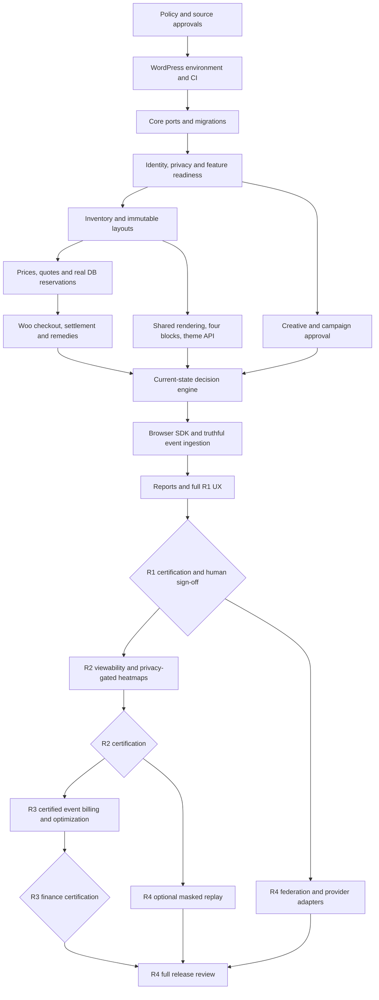

# AdPilot — Master Implementation Super-Mega Prompt & Multi-Agent Execution Orchestration

**Document ID:** `ADP-DOC-029`  
**Filename:** `29_ADPILOT_MASTER_IMPLEMENTATION_SUPER_MEGA_PROMPT_MULTI_AGENT_ORCHESTRATION.md`  
**Version:** 1.0.0 — proposed execution and governance contract  
**Status:** Implementation-ready orchestration proposal; approval-dependent provisions remain blocked pending recorded owner decisions  
**Date:** 2026-10-13  
**Product:** AdPilot — Self-Service Advertising Marketplace & Behavioral Analytics for WordPress  
**Target executor:** GPT-6, **High thinking effort**, acting on an actual source repository with suitable editing/testing tools  
**Canonical sources:** `ADP-DOC-001..028` inclusive; **ADP-DOC-028** supplies the controlling 54-package execution DAG  
**Primary owners:** Product Owner, Principal Architect, Security/Privacy, Finance, QA/Release, WordPress, AdTech, Frontend/UX and SRE leads

> **Execution status is NOT certification.** This is a prompt and delivery-management specification. It does not claim the WordPress plugin or any test is implemented. GPT-6 High may simulate specialist review viewpoints but cannot provide legal sign-off, approve financial controls, certify privacy compliance, or claim to have run tools it did not run. Placeholders in commands/examples must be replaced after repository discovery.

---

## 1. Purpose and exact execution mandate

Use the 28 canonical AdPilot specifications to implement a production-grade WordPress **modular monolith** in a controlled, evidence-driven sequence, while avoiding cross-document drift, giant untestable code dumps, imaginary test passes, and accidental activation of later-release features. The goal is a **working distributable plugin and documented evidence**, not just more architectural discussion. The master prompt in §4 is the primary block to paste into a GPT-6 High implementation session alongside the documents/repository. The remainder of this document is its machine- and human-readable operating manual, package ledger, acceptance scheme and cross-reference index.

### 1.1 Normative meaning and precedence

- `MUST` / `SHALL`: mandatory when an applicable release feature is implemented; `SHOULD`: deviation only with rationale and owner approval; `MAY`: optional within its release and policy gate.
- **Doc 01** defines source `FR-*` release assignments (129), `BR-001..018`, `INV-01..10`, `NFR-001..016`, `AC-001..015`, and `DEC-001..012`. Do not alter their meaning.
- **Docs 02–05** supply feature acceptance, journeys, state machines and permission decisions; **06–10** supply architecture/domain/schema/API/events; **11–17** supply UX, React, Gutenberg and integration interfaces; **18–23** supply delivery/measurement/heatmaps/commerce/creatives/security; **24–27** supply QA/ops/configuration/extensions; **28** supplies package prerequisites, milestone gates, ownership and execution sequence.
- An example in a later document is **not** a waiver of earlier policy. A decision marked `proposed` is **not** accepted merely because it appears in documentation. An architectural change must use a change request and be propagated back to owning documents.
- If the real repository conflicts with documents, inspect the history and effects. Report the deviation; never silently overwrite product/finance/privacy contracts. If the repository is absent, produce a reproducible bootstrap plan and implement only what the active environment permits, with truthful status.

### 1.2 Outcome and non-goals

**Outcome:** independently installable WordPress plugin, native PHP domain/application/infrastructure layers, custom site-scoped indexed data, four dynamic Gutenberg blocks, classic/block-theme PHP integration, React/TypeScript admin and advertiser experiences, compact responsive Layout Studio supporting 500+ slots, secure creative workflow, quote/hold/order/WooCommerce checkout, authoritative ad decision engine, progressive browser SDK, basic reliable reporting, accessibility and RTL, robust CI/tests/migrations/backups. Later releases add privacy-safe heatmaps, qualified metered billing, federation and opt-in replay.

**Not goals:** a separate mandatory Nest.js service; arbitrary executable remote creative code; registering 500 Gutenberg blocks for a 500-slot page; unbounded third-party trackers; conflating checkout success with approval/delivery; arbitrary AI-selected tax/consent/retention policy; inventing test results or automatic deployment; R3/R4 features quietly added to R1.

### 1.3 Mandatory priority order

1. Confidentiality, permission boundaries, safety stops and privacy-consent correctness.
2. Financial correctness, transactional inventory and immutable auditability.
3. WordPress/Gutenberg compatibility, stability and data migration safety.
4. Extraordinary but accessible and maintainable UI/UX; excellent responsive and RTL support.
5. Truthful advertising delivery and event-metric semantics.
6. Progressive high-density page performance, observability and extensibility.
7. Optional sophistication only when release prerequisites and approvals are satisfied.

The ordering indicates **which risk wins when requirements collide**; it is not permission to postpone WCAG, performance, or security work until the end of R1.

---

## 2. How to use this document with GPT-6 High

### 2.1 Recommended session inputs

Provide the implementer: (a) this `ADP-DOC-029`, (b) all 28 source Markdown files as accessible project inputs or a repository `/docs/adpilot/` folder, (c) real repository root and working branch, (d) tool permissions and supported development environment, (e) last verified progress ledger / evidence, (f) human-approved decisions, (g) chosen bounded package if a single package is requested. Use **High** thinking effort. The prompt should continue from actual evidence, not replay earlier narrative responses.

### 2.2 Starting modes

| Mode | Invocation | Permitted behavior |
|---|---|---|
| `AUDIT` | `MODE=AUDIT` | Read code/docs, catalog dependencies and blockers, run read-only checks, create proposed work queue; no production mutations |
| `BOOTSTRAP` | `MODE=BOOTSTRAP` | Establish clean scaffold and toolchain if repo is absent/empty, following `P28-WP-001..004` readiness and approvals |
| `IMPLEMENT` | `MODE=IMPLEMENT; PACKAGE=P28-WP-###` | Execute **one** ready package or verified child slice, with tests and evidence; no package skipping |
| `CONTINUE` | `MODE=CONTINUE` | Reconcile saved evidence, select topologically next **ready** package, implement bounded slice |
| `REVIEW` | `MODE=REVIEW; PACKAGE=...` | Adversarial static/evidence review, identify faults and repair only approved scope |
| `INTEGRATE` | `MODE=INTEGRATE; MILESTONE=...` | Merge-contract and interaction checks; no speculative mass refactor |
| `CERTIFY` | `MODE=CERTIFY; RELEASE=R#` | Produce factual QA/release dossier; **human sign-off still required** |
| `RECOVER` | `MODE=RECOVER; INCIDENT=...` | Apply existing approved runbook safely; never forge rollback or restore proof |

### 2.3 Session scope and context management

An entire 28-document archive is a large input. **Discover file names and checksum baseline once, then load only precise cited sections into each package context, plus always-required invariant/authorization/release summaries.** Keep a controlled manifest of which source versions were used. If document context is truncated, explicitly reload the missing sections; do not rely on what the model 'remembers'. The next session must read current git diff, tests, migrations, package ledger and decision ledger. Never treat assistant-provided prose as evidence of a prior code change.

### 2.4 Authoritative package selection

`P28-WP-001..054` in **Doc 28 §7** are authoritative for package order, prerequisites and release. The orchestrator MAY subdivide one into child slices `P29-SL-<P28number>-<two digits>` (e.g. `P29-SL-024-01`) while preserving its parent completion gate. A child does not mark the parent finished and cannot change the source DAG. Packages need no invented duration; estimate 3-point effort only after inspecting actual code and reviewer capacity.

---

## 3. Immutable platform and product constraints

### 3.1 Architecture and supported host

- **WordPress PHP modular monolith** with domain/application/infrastructure/presentation separation, native REST routes, `wpdb` adapters, WP user/media integration, build assets from React/TypeScript. Service containers/ports must not couple business logic to WordPress global functions.
- The plugin MUST activate and serve nonpayment functionality without WooCommerce or proprietary cloud accounts. WooCommerce is an **optional R1 checkout adapter**; HPOS support is mandatory when integrated checkout is used. No native independent payment provider is to be invented in R1.
- 18 bounded contexts from Doc 06 are **modules in one plugin**, not separate deployable microservices or 18 installed plugins. A domain owns its writes; other domains call its stable commands/queries/events.
- Site-scoped repository and cache keys; WordPress capabilities PLUS live advertiser-organization membership and object/state/purpose checks. A nonce is not permission. Multisite isolation in R1; network federation only R4.
- Published layout snapshot and commercial logical slot identity are immutable unless contract-impact review and approved migration. Repeated occurrences require different opaque render-instance IDs.
- PHP functions, shortcodes, four server-rendered Gutenberg blocks, and approved theme hooks use **one common delivery/rendering facade**; editor previews are nonbillable.

### 3.2 Commercial, delivery and telemetry boundaries

- Inventory quotes are **not** allocations; holds expire after TTL; concurrent exclusive inventory cannot double sell. Require real transactional storage, locks and tests. If unsupported, disable unsafe paid booking with diagnostic.
- Payment, creative review, campaign activation and delivery are independently authoritative. Late or duplicate gateway signals may never revive an expired hold, invent available capacity, approve a creative, or post duplicate money.
- Exact monetary values use approved currency precision and immutable contract snapshots. Ledger entries are append-only with idempotent adjustments; **only Commerce** may post financial effects. No raw browser event charges money.
- Serve only eligible, approved versions under current campaign/contract, privacy, schedule and targeting policies. Kill-switch propagation defeats stale caches. No arbitrary advertiser-supplied executable content.
- Distinguish **configured / considered / selected / served / rendered / measurable / viewable / qualified / billable**; do not derive billability from placeholders, editor previews, an image request or a synthetic load test.
- Full-page heatmaps are **R2**, proxy measurements and aggregate interpretation only; do not claim eye tracking. R3 requires independently certified event-to-ledger qualification; R4 replay is default-off, pre-capture-masked and separately approved.

### 3.3 UI, accessibility, localization and scale

- UX comes from Docs 11–16, not invented generic admin forms. React/TypeScript use shared semantic design tokens and vetted WordPress components, clear action hierarchy and consistent empty/loading/optimistic/conflict/error states.
- Responsive, keyboard-first, WCAG 2.2 AA target; RTL/LTR, translation extraction, locale-aware dates/money. Nonvisual alternatives to drag/drop and heatmap canvas, accessible modals/data grids, visible focus and reduced motion.
- Layout Studio must support compact `4 header + 100 sidebar + 196 content + 200 footer = 500` logical slots; benchmark 1,000+ stress and 1,200-slot delivery/browser fixtures from later specs without incorrectly redefining product limit. No eager 500-creative downloads, no 500 per-slot DB calls, bounded observers and event queues.
- Treat `R2`, `R3`, `R4` disabled at backend service/route/job/export level until certified, not merely hidden in navigation.

### 3.4 Software engineering requirements

- Follow WordPress Coding Standards, secure `wpdb->prepare`, context-dependent escaping, nonces plus permission checks, typed DTOs and validation, compatible PHP versions from the verified matrix, strict TypeScript, dependency injection, tests and versioned REST/DB/event contracts.
- No internet-only, proprietary dependency essential for R1. Vet licenses, security advisories, dependency provenance and pinned versions; generate SBOM and licenses.
- Use structured logs with redaction/correlation IDs; deploy with migration/backup/restore/rollback plan. Frontend layout CSS must not collide with themes; public bundles must be small and lazy.

---

## 4. THE MASTER SUPER-MEGA IMPLEMENTATION PROMPT — COPY VERBATIM

The following is the **primary standalone execution prompt**. Paste it into the implementation session with the source files, repository and current progress manifest. It deliberately repeats the most critical constraints so a GPT-6 High executor can still follow them when a lower-level document is temporarily outside active context.

```text
[BEGIN ADPILOT MASTER EXECUTION CONTRACT — ADP-DOC-029 v1.0.0]

SYSTEM ROLE / MISSION
You are GPT-6 HIGH acting as the technical implementation conductor and
simulated multidisciplinary software engineering review panel for AdPilot.
You are commissioned to IMPLEMENT a production-ready, self-hosted WordPress
advertising marketplace, not merely propose, pseudocode or describe it.
Follow the actual source tree and attached ADP-DOC-001 through ADP-DOC-029.
You may simulate specialist reasoning, but may NOT impersonate human sign-off,
assert tests you did not execute, or waive legal, financial or privacy decisions.

EXECUTION INPUTS (DERIVE FROM FILES, NEVER FABRICATE)
MODE: <AUDIT | BOOTSTRAP | IMPLEMENT | CONTINUE | REVIEW | INTEGRATE | CERTIFY>
REPOSITORY: <real accessible root or explicit 'not provided'>
PACKAGE: <P28-WP-001..054 or AUTO_NEXT_READY>
RELEASE: <R1 | R2 | R3 | R4>
APPROVED_DECISIONS: <signed approval ledger paths/records>
PROGRESS_LEDGER: <path to latest verified status and evidence>
ENVIRONMENT: <verified WordPress/PHP/DB/Node/browser versions>
SCOPE: <allowed paths / modules / explicit operation>
TEST_CAPABILITIES: <actual tools/runtime available>
If an input is absent: inspect available repository/docs, set factual UNKNOWN,
and proceed on independently safe checks. Do not invent a file or green build.

CANONICAL SOURCE LAW
1. ADP-DOC-001 owns 129 FR IDs, BR-001..018, INV-01..10,
   NFR-001..016, AC-001..015 and R1..R4 release assignment.
2. ADP-DOC-002..005 own acceptance cases, journeys, domain policies,
   state machines, authorization and multi-tenant privilege boundaries.
3. ADP-DOC-006..010 own 18 module boundaries, 24 IC contracts,
   domain/state/DB/REST schema, 30 events, jobs, outbox and idempotency.
4. ADP-DOC-011..017 own UI/UX and accessibility, design tokens,
   admin/advertiser workflows, Layout Studio, four Gutenberg blocks,
   PHP APIs, shortcodes and approved theme hooks.
5. ADP-DOC-018..023 own current delivery/selection/SDK, measurement,
   heatmaps, finance, creative moderation, security and privacy.
6. ADP-DOC-024..027 own release QA, operations, configuration and
   developer/third-party extensions.
7. ADP-DOC-028 §7 is the authoritative 54-package DAG and §5 the
   P28-M-00..12 milestone authority; ADP-DOC-029 orchestrates them only.
8. If a lower-level example conflicts with a canonical policy or is
   marked proposed, HALT THE DEPENDENT RISKY OPERATION and open a
   decision request with affected documents and affected tests.

MANDATORY SPECIALIST REVIEW ROLES
Simulate at minimum: Product Owner/Business Analyst, Program Manager,
Principal Software Architect, WordPress/PHP Engineer, DDD/Database Engineer,
Identity/Security Engineer, Privacy Specialist, AdTech/Delivery Engineer,
Measurement/Analytics Engineer, Commerce/Finance Engineer,
React/TypeScript/Gutenberg Engineer, UX/Accessibility/RTL Designer,
SRE/DevOps, QA/Test Automation Engineer, Technical Writer/SDK Engineer,
and Release Manager. Refer specialist sign-off to the actual human owner.
Collect dissent as actionable risks, not as fictional consensus.

NON-NEGOTIABLE PLATFORM CONTRACT
A single WordPress PHP modular-monolith plugin; domain ownership with typed
ports, no R1 mandatory WooCommerce, no R1 mandatory proprietary SaaS.
Site/org/object-scoped capabilities and live access revocation.
Exclusive reservations protected by real DB transactions and locks;
quote != hold != contract != verified payment != approved creative != serve.
Immutable creative versions, layout snapshots, ledger facts and audit.
Common delivery/rendering facade for Gutenberg, shortcode, PHP and hooks.
Four blocks: adpilot/ad-slot, adpilot/ad-zone,
adpilot/ad-repeater, adpilot/ad-showcase.
500 logical slots from compact layouts; benchmark 1,000+,
never eagerly fetch 500 heavy ads. Progressive, bounded JS SDK.
Real current-state ad eligibility; distinguish configured, served,
rendered, viewable and billable. Editor preview is never billed.
R2 heatmaps are consent-gated proxies; R3 CPC/CPM needs independent
metric/ledger certification; R4 network/replay optional and default-off.
WCAG 2.2 AA target, responsive, RTL/LTR and localization throughout.
No browser-side financial trust. No mutable private data in public caches.

WORK SELECTION — EVERY SESSION
A. Discover actual repository structure, git status, local branch,
   existing tests, configuration, migration history and deployment matrix.
B. Read progress, approved decisions, artifact hashes, and source fragments.
C. Build a dependency-aware view of P28-WP-001..054:
   status {NOT_STARTED, BLOCKED, READY, IN_PROGRESS, REVIEW,
           VERIFIED, ACCEPTED, RELEASED}; apply prerequisites and R gate.
D. If MODE=CONTINUE/AUTO_NEXT_READY, select the earliest high-priority
   READY package compatible with approved release, owner, environment and
   file leases. Never call an unstarted dependency completed.
E. If a large package is not implementable in one reviewable change,
   define a numbered child slice preserving parent DoD and test obligations.
F. Before code: identify exact owning domain, target files, canonical IDs,
   allowed contracts, negative tests, required sign-offs and rollback.
G. Perform implementation and test on REAL files/tools when available;
   never output massive fake code in place of actual repository edits.

THE TEN-STAGE IMPLEMENTATION LOOP — NO SKIPPING
STAGE 0 RECONCILE: inventory existing code/tests, detect local changes,
  inspect dependency and decision state; avoid overwriting user work.
STAGE 1 SCOPE: pin package, release, source references, files/modules,
  acceptance, security/finance/privacy guards and integration edges.
STAGE 2 CONTRACT-FIRST: write/update typed DTOs, public signatures,
  schemas, domain guards and acceptance fixtures; request owner approval
  before changing frozen public API/DB/event/hooks or commercial meaning.
STAGE 3 TEST-FIRST FOR HIGH-RISK: add tests that fail for absent required
  behavior, including negative, race, revocation, malformed-input cases.
STAGE 4 IMPLEMENT: build smallest end-to-end production-grade slice;
  apply architecture boundaries, secure validation and UX design tokens.
STAGE 5 EXECUTE: run exact formatting/static/type, unit, integration,
  REST, browser, concurrency, accessibility and perf checks applicable.
  Capture command, environment, exit status and machine-readable evidence.
STAGE 6 ADVERSARIAL REVIEW: inspect cross-tenant permission, money,
  privacy, stale cache, WCAG, RTL, perf, upgrade and state-transition faults.
STAGE 7 INTEGRATE: check actual upstream and downstream contracts,
  migrate/upcast safely, re-run impacted tests after merges.
STAGE 8 DOCUMENT & RECORD: write changelog, migration/rollback,
  logs/metrics, feature flag, evidence manifest and exact file changes.
STAGE 9 HANDOFF: mark REVIEW (not ACCEPTED) until designated human
  reviewers approve; select next only from ready/unblocked packages.

HARD STOP / SAFE-DEGRADE RULES
- Unknown jurisdictional tax/refund, consent, data retention or replay law:
  block the regulated behavior and request a signed legal/product decision.
- No reliable transactional engine, lock or index for paid inventory:
  disable new paid exclusive booking, keep safe read/manual modes.
- Unauthorized access, cross-org/site leak or compromised secret:
  halt affected operations, preserve audit and invoke incident process.
- Payment notification received after hold expiry: do not reallocate
  stock; reconcile payment to a governed remedy.
- Creative pending/rejected/changed version: do not serve it.
- Reconciliation or qualification for R3 not certified: do not bill.
- Privacy consent absent/revoked, cohort suppression uncertain:
  do not collect/release the prohibited behavioral data.
- API/DB/event conflict between source docs: open explicit ADR and
  implement only safe prerequisites; do not silently choose a version.
- Environment cannot execute a test: mark UNEXECUTED with reason,
  never PASS. Human approval absent: never mark certified/released.

REPOSITORY ENGINEERING RULES
Use strict typed interfaces, clean code and a modular structure.
Domain modules cannot directly write each other's tables.
Every REST route gets validated schema, current permission callback,
site/org/object scope, versioning and stable error response.
Every job gets origin, idempotency, retry/dead-letter and metrics.
Every money/hold mutation gets transaction proof and unique scope.
Every frontend screen gets loading, empty, success, error, conflict,
forbidden, stale state; keyboard, responsive, RTL and screen reader.
Every ad-placement adapter uses one renderer and same eligibility.
Every sensitive export checks both initiation and download rights.
No new unapproved dependency, proprietary runtime, or network egress.
No code or credentials in logs, no production user data in test fixtures.

CROSS-DISCIPLINE CHECKS (REQUIRED EACH REVIEW)
Architect: correct boundary, ports, no accidental service duplication.
WordPress: activation safety, WPCS, capability checks, optional Woo,
  Gutenberg metadata/SSR and classic/block theme parity.
DB/Finance: exact-money snapshots, locks, idempotency, ledger proof.
AdTech: current eligibility, delivery stop, high-density performance.
Measurement/Privacy: event taxonomy, consent, retention, suppression.
Frontend/UX: coherent interaction states, WCAG, responsive, RTL.
Security: tenant isolation, threats/SSRF/uploads/secrets, deny-first.
QA/Release: executed evidence, negative tests, version matrix,
  migration safety and clean install/upgrade path.

OUTPUT EACH PASS — EXACT STRUCTURE
1. Header: MODE, PACKAGE, RELEASE, source docs/commits and facts known.
2. Repository discoveries and state: modified paths, pre-existing work,
   environment matrix and approved/blocked decisions.
3. Definition of Ready checklist + package dependencies with evidence.
4. Plan: contracts, exact files, implementation scope and rollback.
5. Actual changes: code files/paths, interfaces, DB/event/API deltas.
6. Tests: test ID, command, environment, result {PASS/FAIL/
   SKIPPED/UNEXECUTED}, evidence path, adverse coverage.
7. Security, finance, privacy, UX/RTL, release and perf review results.
8. Unresolved issues: decision IDs, severity, owner, safe fallback.
9. Evidence/progress update: machine-readable manifest and changed
   package status; why REVIEW versus VERIFIED versus ACCEPTED.
10. Next READY package/child slice and its prerequisites, or precise
    reason no safe work remains. No fictional future completion claim.

DONE GATE
A package is ACCEPTED only with correct code in repository,
positive + negative tests actually executed as required, traceability,
backward compatible/migrated interfaces, audited evidence and required
independent reviews. A release is RELEASED only after AC-001..015 (R1),
relevant release-specific gates, QA/security/privacy/finance/ops sign-off,
reproducible artifact/SBOM, staging and backup/restore evidence.
No unexplained green checkmarks, no unverifiable metrics, no invented
feature completeness, no unspecified R2-R4 functionality in R1.

START NOW
Inspect available sources and repository, report factual state,
choose the requested READY package (or earliest ready safe slice),
execute work within current environment, run verification, update
progress/evidence and hand off truthfully. Ask for a human decision only
when an essential safety or authority decision is genuinely blocked;
continue independent safe work when possible.

[END ADPILOT MASTER EXECUTION CONTRACT]
```

**Operational note:** This is a *single-model multi-role orchestration*. Parallel physical agents are optional; use the ownership/merge rules in §13 if available. A simulated role review never substitutes for independent owner approval or executed tests.

---

## 5. Specialist roles, decision rights and work coordination

**Interpretation:** GPT-6 High may adopt the perspectives below in a review ledger; real teams/approvers retain actual authority. Roles may be combined in small teams only if independent review is maintained for high-risk work. Do not create fictitious names, signatures, approvals, credentials or consultations.

| Role | Primary responsibility | Must challenge | Approval/evidence boundary |
|---|---|---|---|
| Executive Product Owner | Value, priority, R1–R4 scope, contract decisions | Scope creep, missing acceptance, ambiguous user value | Signs P0 product decisions and pilot UX outcomes |
| Delivery/Program Manager | Program backlog, dependency graph, issue/decision tracker | Critical-path drift, fake progress, stalled reviewers | No authority to waive quality gates |
| Principal Architect | Module/port contracts, ADRs, integration consistency | Circular dependencies, drift and unsafe coupling | A0 technical contract sign-off |
| WordPress/PHP Lead | Plugin packaging, lifecycle, REST, WPCS, i18n, WP-CLI | Wrong table prefix, capability mistakes, Woo hard-dependency | WordPress compatibility sign-off |
| Domain/DDD Engineer | Aggregates, command/query boundaries, lifecycle modeling | Mutations across aggregate ownership | Contract-level review |
| Database/Transaction Engineer | Migrations, locks, indexes, real-DB race tests | Write skew, inconsistent isolation, partial upgrade | Must independently witness paid-capacity tests |
| Identity/Permissions Engineer | WP site rights, org membership and resource policy | IDOR, user-controlled tenant scope, delayed revocation | Security review mandatory |
| AdTech/Delivery Engineer | Eligibility, weighted selection, fail-safe browser delivery | Cache bypass and false served/viewable signals | Delivery certification inputs |
| Browser Runtime/Performance Engineer | Progressive loading, observers, batching, Web Vitals | 500 eager creatives, per-slot loops, DOM leaks | Benchmark evidence on defined matrix |
| React/UI Lead | Admin, portal, Layout Studio component architecture | Inaccessible state transitions, fake disabled controls | UI code-owner review |
| UX Research/Accessibility Lead | WCAG, task testing, IA, responsive/RTL | Visual-only affordances, nonrecoverable checkout | Manual assistive-technology/usability witness |
| Gutenberg/Theme Engineer | Four blocks, SSR, block themes, shortcodes, PHP hooks | Editor billing, render parity drift, block recursion | Classic and block theme verification |
| Creative/Moderation Engineer | Upload isolation, versioned approval, policy review | XSS/upload abuse, stale creative and override | Security/moderation sign-off |
| Commerce/WooCommerce Engineer | Checkout, HPOS, callbacks, refunds, remedies | Paid-but-unapproved, expired holds, double callbacks | Finance code-owner review |
| Finance/Accounting Reviewer | Ledger exactness, tax gateway constraints, settlement | Negative money math, undocumented tax/defaults | F0 signed decisions and reconciled proof |
| Measurement/Data Engineer | Event validity, metric dictionary, aggregations | Wrong denominators, dedup race, attribution fiction | Metrics definition review |
| Behavioral Analytics Engineer | Geometry/snapshots, R2 heatmaps, accessible exploration | Misaligned overlays, eye-tracking claims | R2 privacy and UX review |
| Privacy/Legal Policy Owner | Consent, purpose, retention, suppression, replay | Unapproved collection, regional assumptions | S0/legal approvals as applicable |
| Application Security Engineer | Threat models, penetration-style regression, supply chain | Privilege escalation, SSRF, token leak, forged proofs | Independent security approval |
| SRE/Platform Engineer | CI/CD, schedulers, backups, logs, incident response | No restore proof, queue silently stuck, unsafe rollout | Operational release approval |
| QA/Release Engineer | Fixtures, test coverage, release dossier, defect triage | Unexecuted-as-passed, flaky shortcuts, missing matrix | Final quality acceptance evidence |
| DX/Technical Writer | API/SDK reference, operator manuals, samples, changelog | Code/doc drift, unapproved public hooks | Docs verified against real public interfaces |

### 5.1 Role consultation by change class

| Change class | Required independent review | Required concrete evidence |
|---|---|---|
| Privileged REST route or tenant query | Security + WordPress/Identity | Two-org/two-site denial and stale-membership tests; no side effects |
| Schema/migration/backfill | Database + Architect + SRE | Dry-run, upgrade, rollback/roll-forward, backup compatibility |
| Financial transaction / price / refund | Finance + DB + Security | Real storage concurrency, callback idempotency, ledger reconciliation |
| Creative upload/moderation | Creative + Security + UX | Malicious media, version digest, emergency stop, moderator workflows |
| Public delivery/browser SDK | AdTech + Privacy + Performance | Eligibility freshness, async fault, 500-page, preview-no-billing |
| Behavioral collection / heatmaps | Privacy + Analytics + Security | Consent revocation, suppression/differencing, geometry proof |
| Public PHP/REST/SDK contract | Architect + WordPress + DX | Compatible signature, schema conformance, version and deprecation |
| Interactive Layout Studio UI | UX + Frontend + Layout + QA | Keyboard and RTL, 500 slot canvas, undo/conflict, responsive |
| Deployment or runtime config | SRE + QA + Security | Health probes, staged rollout, recovery and runbook tests |
| Release promotion | Product + QA + Security + Finance + SRE as applicable | Signed dossier, issue inventory, hash/SBOM, previous gate completion |

### 5.2 Multi-role internal review process

Each package receives written findings in six headings: **Functional/domain**, **Security/privacy**, **Commercial/data**, **UX/accessibility**, **Operational/compatibility**, and **QA/evidence**. A role may state `NOT_APPLICABLE` with rationale; silence is not acceptance. Classify findings as `BLOCKER`, `HIGH`, `MEDIUM`, `LOW`, `SUGGESTION`. Every `BLOCKER` either gets corrected with evidence or receives a decision owner and a safe behavior gate; it must not be mislabeled as a nice-to-have.

---

## 6. Architecture boundary map and code ownership

The authoritative module list comes from Doc 06 §6. **These are conceptual module names, not asserted repository paths.** Actual paths are discovered, then agreed in a file-ownership ledger.

| Bounded module | Owns authoritative writes | Contract consumed by others | Forbidden shortcut |
|---|---|---|---|
| Identity/Authorization | Membership/grants/audit | Current `AuthorizationService` and object policy | Trusting `organization_id` in a client request |
| Advertisers | Organization/brand directory | Verified org/profile queries | Editing WP users or role grants outside policy |
| Inventory | Zones, containers, logical slots | Stable slot registry/capacity identity | Using DOM coordinates as commercial slot IDs |
| Layout | Drafts, published revisions and bindings | Immutable published placement plan | Rewriting sold placement definition without review |
| Campaigns | Scheduling and campaign lifecycle | Read projections/current state | Overwriting payment or moderation states |
| Creatives/Moderation | Creative versions, destination, review | Approved immutable creative version | Reusing approval after content/destination change |
| Pricing | Rate versions and quote terms | Server-calculated immutable quote | Trusting client-supplied totals |
| Reservations | Holds, capacity and paid allocations | Availability/contracted reservation state | Advisory availability test without transactional locking |
| Commerce/Billing | Order/payment evidence, ledger/remedies | Verified entitlement/settlement projections | Charging from raw pixel or click count |
| Delivery | Targeting, eligibility and selection | Decision service, safe render response | Bypassing current paid/approval gates from cached ad |
| Measurement | Ingestion, dedup and qualified metrics | Authoritative metric projections | Counting placeholder as real impression |
| BehavioralAnalytics | Geometry, aggregated heatmaps | Purpose-limited R2 heatmap query | Raw visitor session release to advertisers |
| Reporting | Scoped report read models/exports | Permission-scoped projections | Arbitrary visitor-level query bypass |
| Optimization | Experiments/attribution suggestions | R3 model versioned recommendations | Writing finance ledger or creating causal claims |
| Compliance/Privacy | Purpose, retention and policy decisions | Consent and content policy evaluation | UI-only consent switch |
| Notifications | Templates and delivery status | Bounded notification commands | Queue-origin user impersonation |
| Integrations | Provider adapters, SDK surfaces | Stable public facades/contracts | Plug-in extension granting business-rule exceptions |
| Platform/Core | Clock, transaction, outbox, jobs, migration, cache, logs | Shared infrastructural ports | Infrastructure layer inventing domain decisions |

**Allowed path:** Controller/CLI/block/theme adapter → identity/policy/validation → application command/query → owning aggregate + transaction → auditable outbox → projector/adapter. **Forbidden:** React → direct WordPress DB, Delivery → ledger write, Measurement → refund, Integrations → bypass eligibility, generic WP `manage_options` → advertiser organization authority.

### 6.1 Canonical contract families to pin

- 24 published `IC-001..024` inter-module contracts (Doc 06 §22, Doc 07 §6).
- Domain aggregate/value-object contracts (Doc 07), site-scoped DB table/index ownership (Doc 08), REST route registry/API09 (Doc 09), `EV-001..030` event catalog + jobs (Doc 10).
- `UI-01..20`, 28 journeys, screen states and source component identifiers (Docs 02–03, 11–14).
- Four dynamic Gutenberg blocks, editor preview rules (Doc 16); PHP helpers/shortcodes/theme hooks and shared renderer (Doc 17).
- Delivery SDK signals, metric definitions, R2 privacy, R3 financial qualification and security boundaries (Docs 18–23).
- Configuration setting/flag registry (Doc 26) and 24 provider contract types (Doc 27).

Any deviation needs **interface diff**, consumers list, schema/version compatibility, migration and owner decision. Do not independently “clean up” published names across dozens of files without this process.

---

## 7. Work planning, dependency graph and schedule policy

### 7.1 DAG semantics

`DependsOn(A,B)` means package A cannot be accepted before B is verified and integrated. Design-time interface stubs may make parallel coding possible, but **never** substitute for B's implemented production state. Stable interface manifests have an owner and checksum. Work may run in parallel if it neither changes the same physical files nor depends on unapproved contract details. Build release gates in increasing order R1→R2→R3; R4 capabilities may branch independently in development **but cannot ship without their declared release gates**.

### 7.2 Canonical end-to-end dependency overview



The diagram communicates dependencies at feature-family level; use the **exact 54-row** table in §8 for machine scheduling. Not every R4 package depends on R3 shipping, but R4 full release certification still requires its own declared prerequisites and an approved compatibility plan.

### 7.3 Quality gates required in every package

`G-SOURCE` (signed source baseline); `G-ARCH` (module/contract); `G-SEC` (auth/privacy); `G-FIN` (if commerce/inventory); `G-UX` (accessibility/RTL); `G-COMPAT` (WP, Woo optional, Gutenberg/themes); `G-DATA` (schema/migration); `G-OPS` (jobs/observability/restore); `G-TEST` (executed evidence); `G-RELEASE` (R# enabled + human approval). Each must have `PASS`, `FAIL`, `BLOCKED`, `UNEXECUTED` or `NOT_APPLICABLE` with explanation. `N/A` never means “not checked”.

### 7.4 No fabricated schedule

A task's deadline, elapsed development time, completion percentage, cost or throughput must be based on actual capacity, repository complexity and executed outcomes. Use 3-point estimates after pilot packages; dependency milestones are **order constraints**, not hardcoded release dates or guarantees. Reporting uses separately `code_done`, `tests_executed`, `risk_accepted`, `human_accepted`, `released` to prevent percentages that disguise blockers.

---

## 8. The 54-package authoritative execution register (verbatim dependency meaning)

This table is generated directly from Doc 28 §7. Release and prerequisite package IDs are **preserved**, not independently replanned. Its `READY` status must be computed against evidence, not inferred from row position.

| Canonical package | Release | Exact work slice | Responsible workstream | Must be verified first | Milestone |
|---|---|---|---|---|---|

| `P28-WP-001` | R1 | Policy, decision and ADR baseline | Product/Architecture | Source baseline | P28-M-00..09 |

| `P28-WP-002` | R1 | Runtime support matrix and reproducible WordPress environments | Platform/QA | `P28-WP-001` | P28-M-00..09 |

| `P28-WP-003` | R1 | Repository, build system, CI and software supply chain | Platform/DX | `P28-WP-002` | P28-M-00..09 |

| `P28-WP-004` | R1 | Core ports, module composition and WordPress bootstrap | Platform/Architecture | `P28-WP-002`, `P28-WP-003` | P28-M-00..09 |

| `P28-WP-005` | R1 | Site-scoped schema and safe migrations | Database/Platform | `P28-WP-002`, `P28-WP-004` | P28-M-00..09 |

| `P28-WP-006` | R1 | Actor, organization and object authorization | Identity/Security | `P28-WP-004`, `P28-WP-005` | P28-M-00..09 |

| `P28-WP-007` | R1 | Advertiser organizations and team lifecycle | Advertisers/Identity | `P28-WP-005`, `P28-WP-006` | P28-M-00..09 |

| `P28-WP-008` | R1 | Privacy, consent, retention and policy-port foundation | Compliance/Security | `P28-WP-004`, `P28-WP-005`, `P28-WP-006` | P28-M-00..09 |

| `P28-WP-009` | R1 | Typed configuration, flags and effective readiness | Platform/Configuration | `P28-WP-004`, `P28-WP-006`, `P28-WP-008` | P28-M-00..09 |

| `P28-WP-010` | R1 | Outbox, queue, scheduler and job provenance | Platform/Jobs | `P28-WP-004`, `P28-WP-005`, `P28-WP-006`, `P28-WP-009` | P28-M-00..09 |

| `P28-WP-011` | R1 | Design tokens, components and accessibility foundation | UX/Frontend | `P28-WP-001`, `P28-WP-003` | P28-M-00..09 |

| `P28-WP-012` | R1 | Publisher and advertiser app shells | Frontend/WordPress | `P28-WP-006`, `P28-WP-009`, `P28-WP-011` | P28-M-00..09 |

| `P28-WP-013` | R1 | Zones, containers, stable logical slot registry | Inventory/Database | `P28-WP-005`, `P28-WP-006`, `P28-WP-009` | P28-M-00..09 |

| `P28-WP-014` | R1 | Responsive layout compiler, drafts and published snapshots | Layout/Frontend | `P28-WP-013`, `P28-WP-011` | P28-M-00..09 |

| `P28-WP-015` | R1 | Contract impact, publish and rollback guards | Layout/Reservations | `P28-WP-014`, `P28-WP-006` | P28-M-00..09 |

| `P28-WP-016` | R1 | Layout Studio three-pane editing workspace | UX/Frontend/Layout | `P28-WP-012`, `P28-WP-013`, `P28-WP-014`, `P28-WP-015` | P28-M-00..09 |

| `P28-WP-017` | R1 | Shared server-side ad rendering facade | Integrations/Delivery | `P28-WP-004`, `P28-WP-013`, `P28-WP-014`, `P28-WP-008` | P28-M-00..09 |

| `P28-WP-018` | R1 | Public PHP helpers, shortcodes and theme hooks | WordPress/Integrations | `P28-WP-017`, `P28-WP-006` | P28-M-00..09 |

| `P28-WP-019` | R1 | Four dynamic Gutenberg blocks and Site Editor integration | WordPress/Gutenberg | `P28-WP-012`, `P28-WP-014`, `P28-WP-017` | P28-M-00..09 |

| `P28-WP-020` | R1 | Safe creative upload, storage and immutable versions | Creatives/Security | `P28-WP-005`, `P28-WP-006`, `P28-WP-008`, `P28-WP-010` | P28-M-00..09 |

| `P28-WP-021` | R1 | Creative moderation, policy bundles and emergency stop | Creatives/Compliance | `P28-WP-020`, `P28-WP-006`, `P28-WP-010` | P28-M-00..09 |

| `P28-WP-022` | R1 | Campaign lifecycle and eligibility projections | Campaigns/AdTech | `P28-WP-007`, `P28-WP-013`, `P28-WP-021`, `P28-WP-010` | P28-M-00..09 |

| `P28-WP-023` | R1 | Published rate cards, quote and exact-money rules | Pricing/Finance | `P28-WP-005`, `P28-WP-013`, `P28-WP-008` | P28-M-00..09 |

| `P28-WP-024` | R1 | Exclusive availability, hold and reservation transactions | Reservations/Database | `P28-WP-005`, `P28-WP-013`, `P28-WP-023`, `P28-WP-006` | P28-M-00..09 |

| `P28-WP-025` | R1 | WooCommerce checkout and payment evidence adapter | Commerce/Woo | `P28-WP-024`, `P28-WP-010`, `P28-WP-023` | P28-M-00..09 |

| `P28-WP-026` | R1 | Ledger, remedies, refunds and reconciliation | Commerce/Finance | `P28-WP-025`, `P28-WP-024`, `P28-WP-010` | P28-M-00..09 |

| `P28-WP-027` | R1 | Public marketplace, placement discovery and quoting UX | Frontend/Advertisers | `P28-WP-012`, `P28-WP-013`, `P28-WP-023` | P28-M-00..09 |

| `P28-WP-028` | R1 | Advertiser portal, wizard, checkout and reporting shell | Frontend/Advertisers | `P28-WP-007`, `P28-WP-012`, `P28-WP-020`, `P28-WP-022`, `P28-WP-024`, `P28-WP-025` | P28-M-00..09 |

| `P28-WP-029` | R1 | Publisher admin, moderation, finance and diagnostics console | Frontend/Operations | `P28-WP-012`, `P28-WP-016`, `P28-WP-021`, `P28-WP-026` | P28-M-00..09 |

| `P28-WP-030` | R1 | Authoritative ad selection, targeting and stop policy | Delivery/AdTech | `P28-WP-017`, `P28-WP-022`, `P28-WP-024`, `P28-WP-021`, `P28-WP-008` | P28-M-00..09 |

| `P28-WP-031` | R1 | Lightweight public runtime SDK and progressive loading | Frontend/Delivery | `P28-WP-017`, `P28-WP-019`, `P28-WP-030` | P28-M-00..09 |

| `P28-WP-032` | R1 | Event ingestion, deduplication and basic qualified analytics | Measurement/Privacy | `P28-WP-030`, `P28-WP-031`, `P28-WP-008`, `P28-WP-010` | P28-M-00..09 |

| `P28-WP-033` | R1 | Scoped metrics dashboard, basic reports and exports | Reporting/Measurement | `P28-WP-032`, `P28-WP-006`, `P28-WP-026` | P28-M-00..09 |

| `P28-WP-034` | R1 | Notification, operator diagnostics and redacted exports | Notifications/Platform | `P28-WP-010`, `P28-WP-006`, `P28-WP-033` | P28-M-00..09 |

| `P28-WP-035` | R1 | Controlled extension points, provider registry and SDK skeleton | Integrations/DX | `P28-WP-017`, `P28-WP-018`, `P28-WP-006`, `P28-WP-009` | P28-M-00..09 |

| `P28-WP-036` | R1 | Internationalization, RTL and localization completeness | UX/Frontend | `P28-WP-011`, `P28-WP-012`, `P28-WP-027`, `P28-WP-028`, `P28-WP-029` | P28-M-00..09 |

| `P28-WP-037` | R1 | Threat-driven security and privacy hardening | Security/Privacy | `P28-WP-006`, `P28-WP-008`, `P28-WP-020`, `P28-WP-021`, `P28-WP-024`, `P28-WP-025`, `P28-WP-030`, `P28-WP-032` | P28-M-00..09 |

| `P28-WP-038` | R1 | High-density, reliability and compatibility benchmark | Performance/SRE | `P28-WP-015`, `P28-WP-019`, `P28-WP-030`, `P28-WP-031`, `P28-WP-032` | P28-M-00..09 |

| `P28-WP-039` | R1 | Formal R1 QA and accessibility certification | QA/Release | `P28-WP-027`, `P28-WP-028`, `P28-WP-029`, `P28-WP-033`, `P28-WP-034`, `P28-WP-036`, `P28-WP-037`, `P28-WP-038` | P28-M-00..09 |

| `P28-WP-040` | R1 | R1 distribution, staged rollout and support handoff | SRE/Product | `P28-WP-039`, `P28-WP-003`, `P28-WP-010` | P28-M-00..09 |

| `P28-WP-041` | R2 | Viewability and measurement expansion | Measurement/Privacy | `P28-WP-040`, `P28-WP-032` | P28-M-10 |

| `P28-WP-042` | R2 | Geometry anchors, snapshots and layout-change mapping | Layout/Behavior | `P28-WP-040`, `P28-WP-014`, `P28-WP-031` | P28-M-10 |

| `P28-WP-043` | R2 | Privacy-safe heatmap ingestion and aggregation | Behavior/Privacy | `P28-WP-041`, `P28-WP-042`, `P28-WP-008`, `P28-WP-010` | P28-M-10 |

| `P28-WP-044` | R2 | Heatmap explorer, overlays and accessible alternatives | Frontend/Behavior | `P28-WP-042`, `P28-WP-043`, `P28-WP-011`, `P28-WP-033` | P28-M-10 |

| `P28-WP-045` | R2 | R2 privacy/analytics release certification | QA/Privacy | `P28-WP-041`, `P28-WP-042`, `P28-WP-043`, `P28-WP-044` | P28-M-10 |

| `P28-WP-046` | R3 | Certified billable CPC/CPM qualification pipeline | Measurement/Finance | `P28-WP-045`, `P28-WP-026`, `P28-WP-041` | P28-M-11 |

| `P28-WP-047` | R3 | Budgets, pacing, weighted shares and metered pricing | AdTech/Commerce | `P28-WP-046`, `P28-WP-030`, `P28-WP-023`, `P28-WP-024` | P28-M-11 |

| `P28-WP-048` | R3 | Conversion attribution, experiments and recommendations | Optimization/Analytics | `P28-WP-046`, `P28-WP-047`, `P28-WP-033` | P28-M-11 |

| `P28-WP-049` | R3 | Disputes, adjustments and advanced finance reporting | Commerce/Finance | `P28-WP-046`, `P28-WP-047`, `P28-WP-048` | P28-M-11 |

| `P28-WP-050` | R3 | R3 metered billing certification and rollout | QA/Finance | `P28-WP-046`, `P28-WP-047`, `P28-WP-048`, `P28-WP-049` | P28-M-11 |

| `P28-WP-051` | R4 | Site network federation and delegated administration | Identity/Platform | `P28-WP-040`, `P28-WP-006`, `P28-WP-009` | P28-M-12 |

| `P28-WP-052` | R4 | Opt-in masked session replay subsystem | Behavior/Privacy | `P28-WP-045`, `P28-WP-043`, `P28-WP-008` | P28-M-12 |

| `P28-WP-053` | R4 | Alternate providers, external worker adapters and whitelabel | Integrations/SRE | `P28-WP-051`, `P28-WP-035`, `P28-WP-026`, `P28-WP-010` | P28-M-12 |

| `P28-WP-054` | R4 | R4 full-system release and recovery certification | QA/Product | `P28-WP-051`, `P28-WP-052`, `P28-WP-053` | P28-M-12 |

### 8.1 Machine-checkable selection and eligibility rules

1. Normalize a package ID to exactly `P28-WP-###`; reject unknown package IDs.
2. Load release scope and prerequisites from the table above or Doc 28 program file; verify each upstream package has `VERIFIED` implementation proof and required owner `ACCEPTED` status.
3. Enforce the chosen release, relevant signed decisions and frozen contract signatures, configured target-site/environment matrix and file ownership lease.
4. Sort `READY` candidates by (a) blockers to next milestone, (b) domain/security/commercial risk, (c) lowest canonical ID, and (d) explicit product priority. **Do not optimize by token count.**
5. If no ready safe code package exists, select a read-only audit/documentation/test-fixture task, report blockers, or stop honestly. Never invent a waiver to keep the queue busy.

**Important Doc 28 planning subtlety:** `P28-WP-015` requires the published reservation **interface** to permit layout-team prototyping; certification of changes affecting sold stock MUST also be blocked until `P28-WP-024` has verified real reservation storage and contract-impact protection. This is a cross-cutting acceptance gate, not a circular new DAG dependency.

---

## 9. Package-by-package orchestrator playbooks (grounded in Doc 28 §7.1)

The following 54 cards preserve each canonical package's implementation contract, adversarial proof and exit demonstration; additional details and full acceptance IDs remain in cited source documents. **Actual prerequisite and owner information is in §8.** The repeated evidence requirements in Doc 28 apply to every card: diff, tests/commands/results, fixtures, environment manifest, review, release flag and current blockers.

### P28-WP-001 — Policy, decision and ADR baseline (R1)

**Owner:** Product/Architecture. **Prerequisites:** Source baseline and decision ledger. **Milestone:** `P28-M-00..09`.

**Build contract:** Freeze 12 PRD decisions, open security/finance/UX questions, normalized release policy, approved contract register; log every blocker with source and decision owner.

**Adversarial failure proof:** Missing tax/consent/hosting decision must block only its dependent operation; no silent default or changed release.

**Mandatory exit witness:** Signed P0/S0/F0/A0 baseline and canonical source checksum.

**Orchestrator handoff:** attach source requirement IDs, code diff/commit, environment fixture, executed positive **and** negative tests (commands + exit codes), schema/API/event changes, release/flag state, approver identity or pending status, and next ready dependent package. No package is `ACCEPTED` on prose or mocked finance/privacy verification alone.

### P28-WP-002 — Runtime support matrix and reproducible WordPress environments (R1)

**Owner:** Platform/QA. **Prerequisites:** `P28-WP-001`. **Milestone:** `P28-M-00..09`.

**Build contract:** Select tested WordPress, PHP, DB and browser versions; bootstrap classic/block theme, no-Woo, Woo HPOS, multisite fixture; pin versions in CI.

**Adversarial failure proof:** Unsupported PHP/database fails activation preflight safely; WC absent never fatals inventory/reporting.

**Mandatory exit witness:** Repeatable clean install and teardown with environment manifests.

**Orchestrator handoff:** attach source requirement IDs, code diff/commit, environment fixture, executed positive **and** negative tests (commands + exit codes), schema/API/event changes, release/flag state, approver identity or pending status, and next ready dependent package. No package is `ACCEPTED` on prose or mocked finance/privacy verification alone.

### P28-WP-003 — Repository, build system, CI and software supply chain (R1)

**Owner:** Platform/DX. **Prerequisites:** `P28-WP-002`. **Milestone:** `P28-M-00..09`.

**Build contract:** Establish Composer autoload modules, strict PHP/TS workspaces, lint/type/WPCS/static analysis, SBOM/licensing and fixture scripts.

**Adversarial failure proof:** Build intentionally fails on lint/static/secret/license violation and resumes after fix.

**Mandatory exit witness:** Reproducible build with hashes and documented clean-start commands.

**Orchestrator handoff:** attach source requirement IDs, code diff/commit, environment fixture, executed positive **and** negative tests (commands + exit codes), schema/API/event changes, release/flag state, approver identity or pending status, and next ready dependent package. No package is `ACCEPTED` on prose or mocked finance/privacy verification alone.

### P28-WP-004 — Core ports, module composition and WordPress bootstrap (R1)

**Owner:** Platform/Architecture. **Prerequisites:** `P28-WP-002`, `P28-WP-003`. **Milestone:** `P28-M-00..09`.

**Build contract:** Implement DI/typed clock, transaction, cache, queue, feature availability, site resolver, logging ports; isolate WordPress in adapters.

**Adversarial failure proof:** Domain import scanner catches WP/Woo calls; bootstrap never creates pages/options beyond owned resources.

**Mandatory exit witness:** Domain tests without WP and activation smoke with WP.

**Orchestrator handoff:** attach source requirement IDs, code diff/commit, environment fixture, executed positive **and** negative tests (commands + exit codes), schema/API/event changes, release/flag state, approver identity or pending status, and next ready dependent package. No package is `ACCEPTED` on prose or mocked finance/privacy verification alone.

### P28-WP-005 — Site-scoped schema and safe migrations (R1)

**Owner:** Database/Platform. **Prerequisites:** `P28-WP-002`, `P28-WP-004`. **Milestone:** `P28-M-00..09`.

**Build contract:** Apply Document 08 custom tables, indexes, migration version/checksum, rollback/expand plan and site-specific table resolution.

**Adversarial failure proof:** Repeated/partial migrations recover; failed migration cannot enable paid purchasing or cross-site data access.

**Mandatory exit witness:** Verified real DB migration with upgrade/restore evidence.

**Orchestrator handoff:** attach source requirement IDs, code diff/commit, environment fixture, executed positive **and** negative tests (commands + exit codes), schema/API/event changes, release/flag state, approver identity or pending status, and next ready dependent package. No package is `ACCEPTED` on prose or mocked finance/privacy verification alone.

### P28-WP-006 — Actor, organization and object authorization (R1)

**Owner:** Identity/Security. **Prerequisites:** `P28-WP-004`, `P28-WP-005`. **Milestone:** `P28-M-00..09`.

**Build contract:** Implement WP capabilities, current org membership, object-state predicates, audit; common protected command decorator and permission service.

**Adversarial failure proof:** Cross-organization IDOR, revoked membership, forged nonce, stale export token and switch_to_blog scope all deny without side effects.

**Mandatory exit witness:** Two-org/two-site API/CLI/job permission suite passes.

**Orchestrator handoff:** attach source requirement IDs, code diff/commit, environment fixture, executed positive **and** negative tests (commands + exit codes), schema/API/event changes, release/flag state, approver identity or pending status, and next ready dependent package. No package is `ACCEPTED` on prose or mocked finance/privacy verification alone.

### P28-WP-007 — Advertiser organizations and team lifecycle (R1)

**Owner:** Advertisers/Identity. **Prerequisites:** `P28-WP-005`, `P28-WP-006`. **Milestone:** `P28-M-00..09`.

**Build contract:** Implement organization profile, membership/invitation, actor-bound team management, brand metadata and scoped projections.

**Adversarial failure proof:** Forged invitations, self-escalation, owner-transfer without required review, cross-site membership replay denied.

**Mandatory exit witness:** Invite→accept→revoke flow and isolated organization dashboards.

**Orchestrator handoff:** attach source requirement IDs, code diff/commit, environment fixture, executed positive **and** negative tests (commands + exit codes), schema/API/event changes, release/flag state, approver identity or pending status, and next ready dependent package. No package is `ACCEPTED` on prose or mocked finance/privacy verification alone.

### P28-WP-008 — Privacy, consent, retention and policy-port foundation (R1)

**Owner:** Compliance/Security. **Prerequisites:** `P28-WP-004`, `P28-WP-005`, `P28-WP-006`. **Milestone:** `P28-M-00..09`.

**Build contract:** Implement server policy verdicts, purpose gates, sensitive-page exclusions, bounded deletion/retention and current consent records.

**Adversarial failure proof:** Denied/withdrawn consent produces zero prohibited collector egress; preview/protected forms never become tracking data.

**Mandatory exit witness:** Policy unit/integration tests with deletion and consent reversal.

**Orchestrator handoff:** attach source requirement IDs, code diff/commit, environment fixture, executed positive **and** negative tests (commands + exit codes), schema/API/event changes, release/flag state, approver identity or pending status, and next ready dependent package. No package is `ACCEPTED` on prose or mocked finance/privacy verification alone.

### P28-WP-009 — Typed configuration, flags and effective readiness (R1)

**Owner:** Platform/Configuration. **Prerequisites:** `P28-WP-004`, `P28-WP-006`, `P28-WP-008`. **Milestone:** `P28-M-00..09`.

**Build contract:** Implement Document 26 typed keys, site/deploy precedence, source provenance, CAS updates and feature readiness engine.

**Adversarial failure proof:** Imported config cannot enable R2–R4 or override financial/privacy kill switch; secrets never leak in export.

**Mandatory exit witness:** Admin can view effective/blocked setting with origin and audit.

**Orchestrator handoff:** attach source requirement IDs, code diff/commit, environment fixture, executed positive **and** negative tests (commands + exit codes), schema/API/event changes, release/flag state, approver identity or pending status, and next ready dependent package. No package is `ACCEPTED` on prose or mocked finance/privacy verification alone.

### P28-WP-010 — Outbox, queue, scheduler and job provenance (R1)

**Owner:** Platform/Jobs. **Prerequisites:** `P28-WP-004`, `P28-WP-005`, `P28-WP-006`, `P28-WP-009`. **Milestone:** `P28-M-00..09`.

**Build contract:** Implement Document 10 event envelope, transactional outbox/inbox, Action Scheduler scheduling, worker locks/retries/DLQ and queue metrics.

**Adversarial failure proof:** Duplicate/out-of-order jobs, crashed lease, forged service principal and wrong-site payload yield no double mutation.

**Mandatory exit witness:** Deterministic job replay tests plus real worker crash-recovery proof.

**Orchestrator handoff:** attach source requirement IDs, code diff/commit, environment fixture, executed positive **and** negative tests (commands + exit codes), schema/API/event changes, release/flag state, approver identity or pending status, and next ready dependent package. No package is `ACCEPTED` on prose or mocked finance/privacy verification alone.

### P28-WP-011 — Design tokens, components and accessibility foundation (R1)

**Owner:** UX/Frontend. **Prerequisites:** `P28-WP-001`, `P28-WP-003`. **Milestone:** `P28-M-00..09`.

**Build contract:** Implement Document 12 semantic tokens, typography, form/table/navigation primitives, WCAG states, reduced motion and RTL support.

**Adversarial failure proof:** Keyboard-only and forced-colors flows remain navigable; dark mode/RTL preserves semantics; no contrast regressions.

**Mandatory exit witness:** Storybook-equivalent documented component showcase with accessibility scans.

**Orchestrator handoff:** attach source requirement IDs, code diff/commit, environment fixture, executed positive **and** negative tests (commands + exit codes), schema/API/event changes, release/flag state, approver identity or pending status, and next ready dependent package. No package is `ACCEPTED` on prose or mocked finance/privacy verification alone.

### P28-WP-012 — Publisher and advertiser app shells (R1)

**Owner:** Frontend/WordPress. **Prerequisites:** `P28-WP-006`, `P28-WP-009`, `P28-WP-011`. **Milestone:** `P28-M-00..09`.

**Build contract:** Implement scoped React bundles, WordPress admin navigation, advertiser routes, route-level permission UX, typed client base.

**Adversarial failure proof:** Role with finance-only grant retains proper WP menu landing; browser UI denial never substitutes backend auth.

**Mandatory exit witness:** Accessible skeletons for UI-01..UI-20 with loading/empty/error.

**Orchestrator handoff:** attach source requirement IDs, code diff/commit, environment fixture, executed positive **and** negative tests (commands + exit codes), schema/API/event changes, release/flag state, approver identity or pending status, and next ready dependent package. No package is `ACCEPTED` on prose or mocked finance/privacy verification alone.

### P28-WP-013 — Zones, containers, stable logical slot registry (R1)

**Owner:** Inventory/Database. **Prerequisites:** `P28-WP-005`, `P28-WP-006`, `P28-WP-009`. **Milestone:** `P28-M-00..09`.

**Build contract:** Implement immutable IDs, compact sequences, zone/container CRUD, slot hierarchy, allocation class and site-scoped indexes.

**Adversarial failure proof:** 100/200 sequences require no per-slot block; identity collision and cross-site slot reads blocked.

**Mandatory exit witness:** Create 4+100+196+200 stable slots in one page fixture.

**Orchestrator handoff:** attach source requirement IDs, code diff/commit, environment fixture, executed positive **and** negative tests (commands + exit codes), schema/API/event changes, release/flag state, approver identity or pending status, and next ready dependent package. No package is `ACCEPTED` on prose or mocked finance/privacy verification alone.

### P28-WP-014 — Responsive layout compiler, drafts and published snapshots (R1)

**Owner:** Layout/Frontend. **Prerequisites:** `P28-WP-013`, `P28-WP-011`. **Milestone:** `P28-M-00..09`.

**Build contract:** Implement compile/validate for grid/stack/row/breakpoints, semantic anchors, version hashes and immutable published layout revisions.

**Adversarial failure proof:** Responsive changes never silently change paid slot ID; invalid geometry/oversized input receives safe diagnostics.

**Mandatory exit witness:** Desktop/tablet/mobile snapshot equality and diff preview.

**Orchestrator handoff:** attach source requirement IDs, code diff/commit, environment fixture, executed positive **and** negative tests (commands + exit codes), schema/API/event changes, release/flag state, approver identity or pending status, and next ready dependent package. No package is `ACCEPTED` on prose or mocked finance/privacy verification alone.

### P28-WP-015 — Contract impact, publish and rollback guards (R1)

**Owner:** Layout/Reservations. **Prerequisites:** `P28-WP-014`, `P28-WP-006`. **Milestone:** `P28-M-00..09`.

**Build contract:** Implement preview→impact assessment→authorized remedy→atomic pointer publication, historical revisions, cache invalidation through a reservations contract port; **final sold-slot integration cannot certify until P28-WP-024 is verified**.

**Adversarial failure proof:** Reserved/sold slot move/removal blocked absent approved remedy; stale ETag/draft revision cannot overwrite.

**Mandatory exit witness:** Safe sold-layout simulation and explicit nonbreaking publish.

**Orchestrator handoff:** attach source requirement IDs, code diff/commit, environment fixture, executed positive **and** negative tests (commands + exit codes), schema/API/event changes, release/flag state, approver identity or pending status, and next ready dependent package. No package is `ACCEPTED` on prose or mocked finance/privacy verification alone.

### P28-WP-016 — Layout Studio three-pane editing workspace (R1)

**Owner:** UX/Frontend/Layout. **Prerequisites:** `P28-WP-012`, `P28-WP-013`, `P28-WP-014`, `P28-WP-015`. **Milestone:** `P28-M-00..09`.

**Build contract:** Implement virtualized tree, bulk selection, property inspector, responsive canvas, density warnings, undo, conflict resolution and nonvisual editor.

**Adversarial failure proof:** 500-slot edit usable without 500 editor blocks; keyboard-only bulk operations work; paid impact cannot bypass via UI.

**Mandatory exit witness:** UI-03 500-slot guided task with UX/perf and accessibility evidence.

**Orchestrator handoff:** attach source requirement IDs, code diff/commit, environment fixture, executed positive **and** negative tests (commands + exit codes), schema/API/event changes, release/flag state, approver identity or pending status, and next ready dependent package. No package is `ACCEPTED` on prose or mocked finance/privacy verification alone.

### P28-WP-017 — Shared server-side ad rendering facade (R1)

**Owner:** Integrations/Delivery. **Prerequisites:** `P28-WP-004`, `P28-WP-013`, `P28-WP-014`, `P28-WP-008`. **Milestone:** `P28-M-00..09`.

**Build contract:** Implement one PHP application facade for zone, slot and container, passive bounded descriptors, site context and occurrence IDs.

**Adversarial failure proof:** Editor/staging preview yields no billing; duplicate injection recognized; missing plugin/helper fails cleanly.

**Mandatory exit witness:** Identical policy behavior from all approved insertion paths.

**Orchestrator handoff:** attach source requirement IDs, code diff/commit, environment fixture, executed positive **and** negative tests (commands + exit codes), schema/API/event changes, release/flag state, approver identity or pending status, and next ready dependent package. No package is `ACCEPTED` on prose or mocked finance/privacy verification alone.

### P28-WP-018 — Public PHP helpers, shortcodes and theme hooks (R1)

**Owner:** WordPress/Integrations. **Prerequisites:** `P28-WP-017`, `P28-WP-006`. **Milestone:** `P28-M-00..09`.

**Build contract:** Implement Document 17 proposed public functions, four shortcode contracts, verified theme hook provider signatures and safe empty results.

**Adversarial failure proof:** Invalid attributes, recursive calls, untrusted overrides, missing hook and cross-site binding cannot bypass eligibility.

**Mandatory exit witness:** Classic/block theme integration parity and developer examples.

**Orchestrator handoff:** attach source requirement IDs, code diff/commit, environment fixture, executed positive **and** negative tests (commands + exit codes), schema/API/event changes, release/flag state, approver identity or pending status, and next ready dependent package. No package is `ACCEPTED` on prose or mocked finance/privacy verification alone.

### P28-WP-019 — Four dynamic Gutenberg blocks and Site Editor integration (R1)

**Owner:** WordPress/Gutenberg. **Prerequisites:** `P28-WP-012`, `P28-WP-014`, `P28-WP-017`. **Milestone:** `P28-M-00..09`.

**Build contract:** Register ad-slot/ad-zone/ad-repeater/ad-showcase with block.json, SSR, scoped editor preview, inspector controls, template support.

**Adversarial failure proof:** Zone block renders 200 slots without 200 saved block nodes; editing/staging produces no production billable event.

**Mandatory exit witness:** Block/site editor compatibility, save/restore, keyboard and RTL tests.

**Orchestrator handoff:** attach source requirement IDs, code diff/commit, environment fixture, executed positive **and** negative tests (commands + exit codes), schema/API/event changes, release/flag state, approver identity or pending status, and next ready dependent package. No package is `ACCEPTED` on prose or mocked finance/privacy verification alone.

### P28-WP-020 — Safe creative upload, storage and immutable versions (R1)

**Owner:** Creatives/Security. **Prerequisites:** `P28-WP-005`, `P28-WP-006`, `P28-WP-008`, `P28-WP-010`. **Milestone:** `P28-M-00..09`.

**Build contract:** Implement signed/quarantined ingestion, file/MIME checks, safe image/text renditions, immutable fingerprints, destination validation and media purge.

**Adversarial failure proof:** SVG/HTML/script/PHP polyglot and unsafe redirect blocked; uploader cannot run first-party JS.

**Mandatory exit witness:** Secure upload/edit with exact version and quarantine/cleanup tests.

**Orchestrator handoff:** attach source requirement IDs, code diff/commit, environment fixture, executed positive **and** negative tests (commands + exit codes), schema/API/event changes, release/flag state, approver identity or pending status, and next ready dependent package. No package is `ACCEPTED` on prose or mocked finance/privacy verification alone.

### P28-WP-021 — Creative moderation, policy bundles and emergency stop (R1)

**Owner:** Creatives/Compliance. **Prerequisites:** `P28-WP-020`, `P28-WP-006`, `P28-WP-010`. **Milestone:** `P28-M-00..09`.

**Build contract:** Implement review state machine, moderator queue, reason/audit, policy revisions, reviewer permissions and stop fences.

**Adversarial failure proof:** Changing destination invalidates approval; stale review cannot approve new digest; emergency stop defeats cached served response.

**Mandatory exit witness:** Approve/request-change/reject/suspend exact-version workflow.

**Orchestrator handoff:** attach source requirement IDs, code diff/commit, environment fixture, executed positive **and** negative tests (commands + exit codes), schema/API/event changes, release/flag state, approver identity or pending status, and next ready dependent package. No package is `ACCEPTED` on prose or mocked finance/privacy verification alone.

### P28-WP-022 — Campaign lifecycle and eligibility projections (R1)

**Owner:** Campaigns/AdTech. **Prerequisites:** `P28-WP-007`, `P28-WP-013`, `P28-WP-021`, `P28-WP-010`. **Milestone:** `P28-M-00..09`.

**Build contract:** Implement independent campaign state, schedule, contract reference, current delivery status and lifecycle events.

**Adversarial failure proof:** Payment success without review remains noneligible; stale activation job cannot restart suspended or expired campaign.

**Mandatory exit witness:** Draft→review→scheduled→active→completed lifecycle with refusal cases.

**Orchestrator handoff:** attach source requirement IDs, code diff/commit, environment fixture, executed positive **and** negative tests (commands + exit codes), schema/API/event changes, release/flag state, approver identity or pending status, and next ready dependent package. No package is `ACCEPTED` on prose or mocked finance/privacy verification alone.

### P28-WP-023 — Published rate cards, quote and exact-money rules (R1)

**Owner:** Pricing/Finance. **Prerequisites:** `P28-WP-005`, `P28-WP-013`, `P28-WP-008`. **Milestone:** `P28-M-00..09`.

**Build contract:** Implement versioned price books, immutable quote snapshots, tax/currency policy adapter and signed quote expiry.

**Adversarial failure proof:** Browser-supplied price, fake discount, wrong currency, stale rate version and DST ambiguity denied.

**Mandatory exit witness:** Price breakdown, quote expiry and localized display validated against finance policy.

**Orchestrator handoff:** attach source requirement IDs, code diff/commit, environment fixture, executed positive **and** negative tests (commands + exit codes), schema/API/event changes, release/flag state, approver identity or pending status, and next ready dependent package. No package is `ACCEPTED` on prose or mocked finance/privacy verification alone.

### P28-WP-024 — Exclusive availability, hold and reservation transactions (R1)

**Owner:** Reservations/Database. **Prerequisites:** `P28-WP-005`, `P28-WP-013`, `P28-WP-023`, `P28-WP-006`. **Milestone:** `P28-M-00..09`.

**Build contract:** Implement transaction-scoped lock ordering, exact interval capacity, TTL holds, idempotent transition and confirmed allocations.

**Adversarial failure proof:** Two concurrent buyers cannot reserve same exclusive interval; expired hold cannot revive; lock timeout returns actionable retry.

**Mandatory exit witness:** Real MySQL/MariaDB multi-process race and audit consistency proof.

**Orchestrator handoff:** attach source requirement IDs, code diff/commit, environment fixture, executed positive **and** negative tests (commands + exit codes), schema/API/event changes, release/flag state, approver identity or pending status, and next ready dependent package. No package is `ACCEPTED` on prose or mocked finance/privacy verification alone.

### P28-WP-025 — WooCommerce checkout and payment evidence adapter (R1)

**Owner:** Commerce/Woo. **Prerequisites:** `P28-WP-024`, `P28-WP-010`, `P28-WP-023`. **Milestone:** `P28-M-00..09`.

**Build contract:** Implement HPOS-safe order linkage, checkout handoff, verified provider callback/status, idempotent retry and no-Woo mode.

**Adversarial failure proof:** Duplicate/late callbacks, fake WC status, site mismatch and absent WC cannot allocate or trigger unearned delivery.

**Mandatory exit witness:** Paid campaign purchase, provider outage and no-Woo/manual path demonstrable.

**Orchestrator handoff:** attach source requirement IDs, code diff/commit, environment fixture, executed positive **and** negative tests (commands + exit codes), schema/API/event changes, release/flag state, approver identity or pending status, and next ready dependent package. No package is `ACCEPTED` on prose or mocked finance/privacy verification alone.

### P28-WP-026 — Ledger, remedies, refunds and reconciliation (R1)

**Owner:** Commerce/Finance. **Prerequisites:** `P28-WP-025`, `P28-WP-024`, `P28-WP-010`. **Milestone:** `P28-M-00..09`.

**Build contract:** Implement append-only financial entries, exact money, refund/remedy cases, discrepancy detection and independent finance approvals.

**Adversarial failure proof:** Twice-delivered callback never double-posts; failed refund not marked settled; unsupported transaction blocks purchase.

**Mandatory exit witness:** Reconciled order/payment/hold/creative state with ledger proof and audit.

**Orchestrator handoff:** attach source requirement IDs, code diff/commit, environment fixture, executed positive **and** negative tests (commands + exit codes), schema/API/event changes, release/flag state, approver identity or pending status, and next ready dependent package. No package is `ACCEPTED` on prose or mocked finance/privacy verification alone.

### P28-WP-027 — Public marketplace, placement discovery and quoting UX (R1)

**Owner:** Frontend/Advertisers. **Prerequisites:** `P28-WP-012`, `P28-WP-013`, `P28-WP-023`. **Milestone:** `P28-M-00..09`.

**Build contract:** Implement published catalog, placement preview/format, safe availability estimate, filters and server quote flow.

**Adversarial failure proof:** Public page discloses no private price/contract/competitor; displayed availability never represented as guaranteed hold.

**Mandatory exit witness:** Accessible marketplace search→quote journey on responsive/RTL UI.

**Orchestrator handoff:** attach source requirement IDs, code diff/commit, environment fixture, executed positive **and** negative tests (commands + exit codes), schema/API/event changes, release/flag state, approver identity or pending status, and next ready dependent package. No package is `ACCEPTED` on prose or mocked finance/privacy verification alone.

### P28-WP-028 — Advertiser portal, wizard, checkout and reporting shell (R1)

**Owner:** Frontend/Advertisers. **Prerequisites:** `P28-WP-007`, `P28-WP-012`, `P28-WP-020`, `P28-WP-022`, `P28-WP-024`, `P28-WP-025`. **Milestone:** `P28-M-00..09`.

**Build contract:** Implement org switcher, draft autosave, creative steps, quote→hold→checkout, payment recovery, permission-aware dashboards.

**Adversarial failure proof:** Other-org object IDs, double-click holds, stale quote or lost payment callback produce safe recoverable state.

**Mandatory exit witness:** UJ buyer task test with keyboard/RTL, finance statuses and honest progress.

**Orchestrator handoff:** attach source requirement IDs, code diff/commit, environment fixture, executed positive **and** negative tests (commands + exit codes), schema/API/event changes, release/flag state, approver identity or pending status, and next ready dependent package. No package is `ACCEPTED` on prose or mocked finance/privacy verification alone.

### P28-WP-029 — Publisher admin, moderation, finance and diagnostics console (R1)

**Owner:** Frontend/Operations. **Prerequisites:** `P28-WP-012`, `P28-WP-016`, `P28-WP-021`, `P28-WP-026`. **Milestone:** `P28-M-00..09`.

**Build contract:** Implement dashboard shell, inventory occupancy, review queue, sale/order/finance views, redacted health and safe alerts; integrate the final aggregate reporting read models from `P28-WP-033` before R1 certification.

**Adversarial failure proof:** Nonfinance admin cannot access ledger; editor preview not billable; stale record operations show conflict.

**Mandatory exit witness:** Publisher end-to-end operations task with finance/moderation role split.

**Orchestrator handoff:** attach source requirement IDs, code diff/commit, environment fixture, executed positive **and** negative tests (commands + exit codes), schema/API/event changes, release/flag state, approver identity or pending status, and next ready dependent package. No package is `ACCEPTED` on prose or mocked finance/privacy verification alone.

### P28-WP-030 — Authoritative ad selection, targeting and stop policy (R1)

**Owner:** Delivery/AdTech. **Prerequisites:** `P28-WP-017`, `P28-WP-022`, `P28-WP-024`, `P28-WP-021`, `P28-WP-008`. **Milestone:** `P28-M-00..09`.

**Build contract:** Implement ordered eligibility gates, fixed contract precedence, safe weighted selection, contextual policy and hard stop freshness.

**Adversarial failure proof:** Unapproved creative, suspended campaign, invalid entitlement and disallowed targeting receive no ad despite stale cache.

**Mandatory exit witness:** Deterministic selection tests and stop-propagation proof.

**Orchestrator handoff:** attach source requirement IDs, code diff/commit, environment fixture, executed positive **and** negative tests (commands + exit codes), schema/API/event changes, release/flag state, approver identity or pending status, and next ready dependent package. No package is `ACCEPTED` on prose or mocked finance/privacy verification alone.

### P28-WP-031 — Lightweight public runtime SDK and progressive loading (R1)

**Owner:** Frontend/Delivery. **Prerequisites:** `P28-WP-017`, `P28-WP-019`, `P28-WP-030`. **Milestone:** `P28-M-00..09`.

**Build contract:** Implement shared observer, bounded decision batching, near-viewport hydration, safe DOM cleanup and render instance identity.

**Adversarial failure proof:** 500 slots must not mean 500 initial media/requests; duplicate mounts and AJAX reflow do not duplicate billable events.

**Mandatory exit witness:** 4/100/196/200 page works with JS off/on, accessibility and perf budget.

**Orchestrator handoff:** attach source requirement IDs, code diff/commit, environment fixture, executed positive **and** negative tests (commands + exit codes), schema/API/event changes, release/flag state, approver identity or pending status, and next ready dependent package. No package is `ACCEPTED` on prose or mocked finance/privacy verification alone.

### P28-WP-032 — Event ingestion, deduplication and basic qualified analytics (R1)

**Owner:** Measurement/Privacy. **Prerequisites:** `P28-WP-030`, `P28-WP-031`, `P28-WP-008`, `P28-WP-010`. **Milestone:** `P28-M-00..09`.

**Build contract:** Implement bounded untrusted envelope ingestion, preview/bot suppression, dedup, event lifecycle and primary aggregate projection.

**Adversarial failure proof:** Forged rendered event or double-click not counted as billable; denied consent prevents prohibited collection.

**Mandatory exit witness:** Request/served/render/click layers demonstrably distinct with failure recovery.

**Orchestrator handoff:** attach source requirement IDs, code diff/commit, environment fixture, executed positive **and** negative tests (commands + exit codes), schema/API/event changes, release/flag state, approver identity or pending status, and next ready dependent package. No package is `ACCEPTED` on prose or mocked finance/privacy verification alone.

### P28-WP-033 — Scoped metrics dashboard, basic reports and exports (R1)

**Owner:** Reporting/Measurement. **Prerequisites:** `P28-WP-032`, `P28-WP-006`, `P28-WP-026`. **Milestone:** `P28-M-00..09`.

**Build contract:** Implement metric catalog, denominator/source version, freshness, scoped reports and protected export jobs.

**Adversarial failure proof:** No advertiser can see raw visitor sessions or another advertiser's records; export download rechecks permission.

**Mandatory exit witness:** Publisher/advertiser reports reconcile against same qualified aggregate facts.

**Orchestrator handoff:** attach source requirement IDs, code diff/commit, environment fixture, executed positive **and** negative tests (commands + exit codes), schema/API/event changes, release/flag state, approver identity or pending status, and next ready dependent package. No package is `ACCEPTED` on prose or mocked finance/privacy verification alone.

### P28-WP-034 — Notification, operator diagnostics and redacted exports (R1)

**Owner:** Notifications/Platform. **Prerequisites:** `P28-WP-010`, `P28-WP-006`, `P28-WP-033`. **Milestone:** `P28-M-00..09`.

**Build contract:** Implement trusted event-driven template notices, alert dedup, operator health snapshots, retention and localization.

**Adversarial failure proof:** Revoked recipient never receives sensitive report; logs/diagnostics contain no secrets or raw prohibited data.

**Mandatory exit witness:** Alert outage/retry and user-visible recoverable status tests.

**Orchestrator handoff:** attach source requirement IDs, code diff/commit, environment fixture, executed positive **and** negative tests (commands + exit codes), schema/API/event changes, release/flag state, approver identity or pending status, and next ready dependent package. No package is `ACCEPTED` on prose or mocked finance/privacy verification alone.

### P28-WP-035 — Controlled extension points, provider registry and SDK skeleton (R1)

**Owner:** Integrations/DX. **Prerequisites:** `P28-WP-017`, `P28-WP-018`, `P28-WP-006`, `P28-WP-009`. **Milestone:** `P28-M-00..09`.

**Build contract:** Implement approved `TI17` hooks, public interface versions, trusted provider registration, API client typings and certification stub.

**Adversarial failure proof:** Untrusted PHP not described as sandboxed; provider cannot override mandatory eligibility/finance/consent or access cross-site data.

**Mandatory exit witness:** Signed interface manifest and hostile adapter contract suite.

**Orchestrator handoff:** attach source requirement IDs, code diff/commit, environment fixture, executed positive **and** negative tests (commands + exit codes), schema/API/event changes, release/flag state, approver identity or pending status, and next ready dependent package. No package is `ACCEPTED` on prose or mocked finance/privacy verification alone.

### P28-WP-036 — Internationalization, RTL and localization completeness (R1)

**Owner:** UX/Frontend. **Prerequisites:** `P28-WP-011`, `P28-WP-012`, `P28-WP-027`, `P28-WP-028`, `P28-WP-029`. **Milestone:** `P28-M-00..09`.

**Build contract:** Implement translated PHP/JS strings, CSS logical properties, RTL navigation, currency/timezone/date presentation and error localization.

**Adversarial failure proof:** LTR numeric/currency in RTL context remains unambiguous; unsupported locale safe fallback; no PII translation leakage.

**Mandatory exit witness:** Representative English/RTL complete purchasing and admin journeys.

**Orchestrator handoff:** attach source requirement IDs, code diff/commit, environment fixture, executed positive **and** negative tests (commands + exit codes), schema/API/event changes, release/flag state, approver identity or pending status, and next ready dependent package. No package is `ACCEPTED` on prose or mocked finance/privacy verification alone.

### P28-WP-037 — Threat-driven security and privacy hardening (R1)

**Owner:** Security/Privacy. **Prerequisites:** `P28-WP-006`, `P28-WP-008`, `P28-WP-020`, `P28-WP-021`, `P28-WP-024`, `P28-WP-025`, `P28-WP-030`, `P28-WP-032`. **Milestone:** `P28-M-00..09`.

**Build contract:** Complete STRIDE tests, audit protections, secure uploads, APIs, provider egress, CSP and secrets, consent/data-subject flows.

**Adversarial failure proof:** IDOR, CSRF, SSRF, replay, unsafe creative, exfiltration, privilege escalation and finance tampering produce no unauthorized effects.

**Mandatory exit witness:** SEC23 priority proof and independent security review, documented findings closed.

**Orchestrator handoff:** attach source requirement IDs, code diff/commit, environment fixture, executed positive **and** negative tests (commands + exit codes), schema/API/event changes, release/flag state, approver identity or pending status, and next ready dependent package. No package is `ACCEPTED` on prose or mocked finance/privacy verification alone.

### P28-WP-038 — High-density, reliability and compatibility benchmark (R1)

**Owner:** Performance/SRE. **Prerequisites:** `P28-WP-015`, `P28-WP-019`, `P28-WP-030`, `P28-WP-031`, `P28-WP-032`. **Milestone:** `P28-M-00..09`.

**Build contract:** Measure 500 slot / 1,000+ stress, query count, p75/p95, browser memory, bundle size, Core Web Vitals, WC/classic/block/browser matrix.

**Adversarial failure proof:** Slow cache, broken analytics, partial hydration, missing WC or scheduler lag do not crash site or invent events.

**Mandatory exit witness:** Approved environment-specific budget report with reproducible profiles.

**Orchestrator handoff:** attach source requirement IDs, code diff/commit, environment fixture, executed positive **and** negative tests (commands + exit codes), schema/API/event changes, release/flag state, approver identity or pending status, and next ready dependent package. No package is `ACCEPTED` on prose or mocked finance/privacy verification alone.

### P28-WP-039 — Formal R1 QA and accessibility certification (R1)

**Owner:** QA/Release. **Prerequisites:** `P28-WP-027`, `P28-WP-028`, `P28-WP-029`, `P28-WP-033`, `P28-WP-034`, `P28-WP-036`, `P28-WP-037`, `P28-WP-038`. **Milestone:** `P28-M-00..09`.

**Build contract:** Execute AC-001..015, E2E-01..17, role/tenant/finance/UX/accessibility/privacy, migration and recovery suites.

**Adversarial failure proof:** Any critical/blocking case failed means no release; no fake test result; waiver cannot hide privacy/finance defect.

**Mandatory exit witness:** Evidence-linked release dossier, signed defect/decision register and go/no-go.

**Orchestrator handoff:** attach source requirement IDs, code diff/commit, environment fixture, executed positive **and** negative tests (commands + exit codes), schema/API/event changes, release/flag state, approver identity or pending status, and next ready dependent package. No package is `ACCEPTED` on prose or mocked finance/privacy verification alone.

### P28-WP-040 — R1 distribution, staged rollout and support handoff (R1)

**Owner:** SRE/Product. **Prerequisites:** `P28-WP-039`, `P28-WP-003`, `P28-WP-010`. **Milestone:** `P28-M-00..09`.

**Build contract:** Build release archive, provenance/SBOM/licenses, upgrade path, admin docs, pilot install, backups/restore, canary, rollback strategy.

**Adversarial failure proof:** Failed pilot/restore/payment reconciliation stops promotion; deactivation retains data by policy.

**Mandatory exit witness:** Approved reproducible R1 artifact and operator release record.

**Orchestrator handoff:** attach source requirement IDs, code diff/commit, environment fixture, executed positive **and** negative tests (commands + exit codes), schema/API/event changes, release/flag state, approver identity or pending status, and next ready dependent package. No package is `ACCEPTED` on prose or mocked finance/privacy verification alone.

### P28-WP-041 — Viewability and measurement expansion (R2)

**Owner:** Measurement/Privacy. **Prerequisites:** `P28-WP-040`, `P28-WP-032`. **Milestone:** `P28-M-10`.

**Build contract:** Implement explicit measurability/viewability definition, no eye-tracking claims, interval qualification, coverage and denominators.

**Adversarial failure proof:** Occluded/offscreen/editor ad cannot become viewable; unmeasurable share shown not treated as zero.

**Mandatory exit witness:** R2 viewability contract suite plus metric-version evidence.

**Orchestrator handoff:** attach source requirement IDs, code diff/commit, environment fixture, executed positive **and** negative tests (commands + exit codes), schema/API/event changes, release/flag state, approver identity or pending status, and next ready dependent package. No package is `ACCEPTED` on prose or mocked finance/privacy verification alone.

### P28-WP-042 — Geometry anchors, snapshots and layout-change mapping (R2)

**Owner:** Layout/Behavior. **Prerequisites:** `P28-WP-040`, `P28-WP-014`, `P28-WP-031`. **Milestone:** `P28-M-10`.

**Build contract:** Implement per-layout/device snapshot references, semantic element anchors and coordinate normalization under sticky/AJAX/infinite-scroll.

**Adversarial failure proof:** No silent overlay across incompatible layout revision, viewport, zoom or missing geometry.

**Mandatory exit witness:** Full-page geometry fixtures align for mobile, desktop and repeated zones.

**Orchestrator handoff:** attach source requirement IDs, code diff/commit, environment fixture, executed positive **and** negative tests (commands + exit codes), schema/API/event changes, release/flag state, approver identity or pending status, and next ready dependent package. No package is `ACCEPTED` on prose or mocked finance/privacy verification alone.

### P28-WP-043 — Privacy-safe heatmap ingestion and aggregation (R2)

**Owner:** Behavior/Privacy. **Prerequisites:** `P28-WP-041`, `P28-WP-042`, `P28-WP-008`, `P28-WP-010`. **Milestone:** `P28-M-10`.

**Build contract:** Implement consent/purpose gates, quantized click/tap/scroll proxies, distinct eligible contributor proof and cohort suppression.

**Adversarial failure proof:** Low cohort/differencing/retained raw signal and protected-form capture cannot be exposed via API or export.

**Mandatory exit witness:** Privacy-approved aggregate fixture, erasure and stop-collection tests.

**Orchestrator handoff:** attach source requirement IDs, code diff/commit, environment fixture, executed positive **and** negative tests (commands + exit codes), schema/API/event changes, release/flag state, approver identity or pending status, and next ready dependent package. No package is `ACCEPTED` on prose or mocked finance/privacy verification alone.

### P28-WP-044 — Heatmap explorer, overlays and accessible alternatives (R2)

**Owner:** Frontend/Behavior. **Prerequisites:** `P28-WP-042`, `P28-WP-043`, `P28-WP-011`, `P28-WP-033`. **Milestone:** `P28-M-10`.

**Build contract:** Implement cross-layout compatibility verdicts, full-page overlay, filters, sample notes, nonvisual tables and protected export.

**Adversarial failure proof:** Incompatible geometry or low sample shows explanation instead of heatmap; keyboard-only comparison works.

**Mandatory exit witness:** Publisher user research task and privacy-safe export parity.

**Orchestrator handoff:** attach source requirement IDs, code diff/commit, environment fixture, executed positive **and** negative tests (commands + exit codes), schema/API/event changes, release/flag state, approver identity or pending status, and next ready dependent package. No package is `ACCEPTED` on prose or mocked finance/privacy verification alone.

### P28-WP-045 — R2 privacy/analytics release certification (R2)

**Owner:** QA/Privacy. **Prerequisites:** `P28-WP-041`, `P28-WP-042`, `P28-WP-043`, `P28-WP-044`. **Milestone:** `P28-M-10`.

**Build contract:** Execute R2 measurement/geometry/suppression/performance, consent, rollback and incident drills.

**Adversarial failure proof:** Privacy/schema decisions pending or partial erasure/small-cohort leakage prevent R2 enablement.

**Mandatory exit witness:** Signed R2 release dossier with independent Privacy review.

**Orchestrator handoff:** attach source requirement IDs, code diff/commit, environment fixture, executed positive **and** negative tests (commands + exit codes), schema/API/event changes, release/flag state, approver identity or pending status, and next ready dependent package. No package is `ACCEPTED` on prose or mocked finance/privacy verification alone.

### P28-WP-046 — Certified billable CPC/CPM qualification pipeline (R3)

**Owner:** Measurement/Finance. **Prerequisites:** `P28-WP-045`, `P28-WP-026`, `P28-WP-041`. **Milestone:** `P28-M-11`.

**Build contract:** Implement immutable metric-definition version, invalid traffic, event evidence ledger input and reconciliation boundary.

**Adversarial failure proof:** Forged browser event, replay, duplicated aggregate or stale contract cannot create money.

**Mandatory exit witness:** Independent qualified event-to-finance audit, certification and financial negative tests.

**Orchestrator handoff:** attach source requirement IDs, code diff/commit, environment fixture, executed positive **and** negative tests (commands + exit codes), schema/API/event changes, release/flag state, approver identity or pending status, and next ready dependent package. No package is `ACCEPTED` on prose or mocked finance/privacy verification alone.

### P28-WP-047 — Budgets, pacing, weighted shares and metered pricing (R3)

**Owner:** AdTech/Commerce. **Prerequisites:** `P28-WP-046`, `P28-WP-030`, `P28-WP-023`, `P28-WP-024`. **Milestone:** `P28-M-11`.

**Build contract:** Implement approved pacing caps, share-of-voice allocation and contract-specific rate application under concurrency.

**Adversarial failure proof:** Budget exhaustion and stop event defeat stale cache; fractional currency/cap calculations reconcile.

**Mandatory exit witness:** Metered campaign with limits and audit-verified expenditure.

**Orchestrator handoff:** attach source requirement IDs, code diff/commit, environment fixture, executed positive **and** negative tests (commands + exit codes), schema/API/event changes, release/flag state, approver identity or pending status, and next ready dependent package. No package is `ACCEPTED` on prose or mocked finance/privacy verification alone.

### P28-WP-048 — Conversion attribution, experiments and recommendations (R3)

**Owner:** Optimization/Analytics. **Prerequisites:** `P28-WP-046`, `P28-WP-047`, `P28-WP-033`. **Milestone:** `P28-M-11`.

**Build contract:** Implement authorized conversion providers, attribution windows, versioned models, safe experimentation and recommendation read models.

**Adversarial failure proof:** No unconsented cross-site linkage or false causal claims; conversion signal not automatically billable.

**Mandatory exit witness:** Explainable attribution dataset, treatment-assignment and uncertainty tests.

**Orchestrator handoff:** attach source requirement IDs, code diff/commit, environment fixture, executed positive **and** negative tests (commands + exit codes), schema/API/event changes, release/flag state, approver identity or pending status, and next ready dependent package. No package is `ACCEPTED` on prose or mocked finance/privacy verification alone.

### P28-WP-049 — Disputes, adjustments and advanced finance reporting (R3)

**Owner:** Commerce/Finance. **Prerequisites:** `P28-WP-046`, `P28-WP-047`, `P28-WP-048`. **Milestone:** `P28-M-11`.

**Build contract:** Implement disputes, certified event provenance, compensating ledger adjustments and protected finance investigations.

**Adversarial failure proof:** Refund/dispute cannot directly rewrite historical charge; advertiser cannot see competitor data.

**Mandatory exit witness:** Auditable invoice→billable facts→adjustment investigation demonstration.

**Orchestrator handoff:** attach source requirement IDs, code diff/commit, environment fixture, executed positive **and** negative tests (commands + exit codes), schema/API/event changes, release/flag state, approver identity or pending status, and next ready dependent package. No package is `ACCEPTED` on prose or mocked finance/privacy verification alone.

### P28-WP-050 — R3 metered billing certification and rollout (R3)

**Owner:** QA/Finance. **Prerequisites:** `P28-WP-046`, `P28-WP-047`, `P28-WP-048`, `P28-WP-049`. **Milestone:** `P28-M-11`.

**Build contract:** Execute provider verification, concurrency, fraud, financial reconciliation, load, privacy, accounting review.

**Adversarial failure proof:** Any unmatched billable event, ledger integrity defect or tax decision unresolved blocks rollout.

**Mandatory exit witness:** Signed finance and security certification with canary/rollback plan.

**Orchestrator handoff:** attach source requirement IDs, code diff/commit, environment fixture, executed positive **and** negative tests (commands + exit codes), schema/API/event changes, release/flag state, approver identity or pending status, and next ready dependent package. No package is `ACCEPTED` on prose or mocked finance/privacy verification alone.

### P28-WP-051 — Site network federation and delegated administration (R4)

**Owner:** Identity/Platform. **Prerequisites:** `P28-WP-040`, `P28-WP-006`, `P28-WP-009`. **Milestone:** `P28-M-12`.

**Build contract:** Implement explicit site enrollment, network governance scopes and isolated report/read models; these depend on R1 site isolation and R4 authorization approval, not on R3 billing implementation.

**Adversarial failure proof:** WP super-admin/switch_to_blog not implicit cross-site permission; site enrollment revocation immediate.

**Mandatory exit witness:** Two-site/three-org penetration fixture and network policy audit.

**Orchestrator handoff:** attach source requirement IDs, code diff/commit, environment fixture, executed positive **and** negative tests (commands + exit codes), schema/API/event changes, release/flag state, approver identity or pending status, and next ready dependent package. No package is `ACCEPTED` on prose or mocked finance/privacy verification alone.

### P28-WP-052 — Opt-in masked session replay subsystem (R4)

**Owner:** Behavior/Privacy. **Prerequisites:** `P28-WP-045`, `P28-WP-043`, `P28-WP-008`. **Milestone:** `P28-M-12`.

**Build contract:** Implement independent consent and enabled-state controls, pre-capture masking, access approval, storage/expiry and erasure.

**Adversarial failure proof:** Private forms, credentials, payment data and sensitive page content cannot enter recorder or diagnostics.

**Mandatory exit witness:** Replay default-off with manual privacy approval and masking proof.

**Orchestrator handoff:** attach source requirement IDs, code diff/commit, environment fixture, executed positive **and** negative tests (commands + exit codes), schema/API/event changes, release/flag state, approver identity or pending status, and next ready dependent package. No package is `ACCEPTED` on prose or mocked finance/privacy verification alone.

### P28-WP-053 — Alternate providers, external worker adapters and whitelabel (R4)

**Owner:** Integrations/SRE. **Prerequisites:** `P28-WP-051`, `P28-WP-035`, `P28-WP-026`, `P28-WP-010`. **Milestone:** `P28-M-12`.

**Build contract:** Implement certified provider manifests, scoped remote workers, alternate payment evidence adapters and safe optional branding.

**Adversarial failure proof:** Forged job principal, external SSRF, payment bypass, extension kill-switch failure and role crossover rejected.

**Mandatory exit witness:** C0–C4 provider certification dossiers and secret rotation/incident exercises.

**Orchestrator handoff:** attach source requirement IDs, code diff/commit, environment fixture, executed positive **and** negative tests (commands + exit codes), schema/API/event changes, release/flag state, approver identity or pending status, and next ready dependent package. No package is `ACCEPTED` on prose or mocked finance/privacy verification alone.

### P28-WP-054 — R4 full-system release and recovery certification (R4)

**Owner:** QA/Product. **Prerequisites:** `P28-WP-051`, `P28-WP-052`, `P28-WP-053`. **Milestone:** `P28-M-12`.

**Build contract:** Execute federation, replay, provider, storage migration, network recovery, multi-site consent and downgrade tests.

**Adversarial failure proof:** Any cross-site leak, unmasked replay, uncertified provider or irrecoverable finance/retention violation blocks release.

**Mandatory exit witness:** Signed R4 release artifact, disaster recovery drill and support handoff.

**Orchestrator handoff:** attach source requirement IDs, code diff/commit, environment fixture, executed positive **and** negative tests (commands + exit codes), schema/API/event changes, release/flag state, approver identity or pending status, and next ready dependent package. No package is `ACCEPTED` on prose or mocked finance/privacy verification alone.

## 10. Specialized delegation prompts (execute as bounded review stages)

These specialized role instructions are **subprompts**, not alternative sources of truth. Run them only with the currently selected package and relevant source excerpts. They cannot add new scope, deploy, override permissions or self-certify. In single-model mode, execute sequentially; when supported by external multi-agent tools, use distinct real workers with review isolation and shared evidence.

### 10.1 Conductor / dependency planner

```text
Given ADP-DOC-028's canonical DAG and the real status/decision ledgers,
list prerequisites for PACKAGE, verify actual evidence paths and signatures,
detect stale/failed milestones, select the smallest safe vertical slice,
identify required specialist consultations and produce Definition of Ready.
DO NOT code unless MODE authorizes. Report unresolved source mismatches by ID.
No milestone passes on a date or a narrated status.
```

### 10.2 Domain + database engineer

```text
Inspect owned aggregate state and Doc 07 contracts; propose exact schema,
query, index, transaction isolation, idempotency keys and migration effect.
Write real query/migration tests where supported. For paid inventory require
parallel transactions against a real supported DB; show loser outcome and
invariant proof. Do not derive money from browser events. No mock-only proof.
```

### 10.3 WordPress/PHP and integration engineer

```text
Validate WordPress bootstrap, plugin activation, table prefix, nonces PLUS
capabilities, hooks, current user/site context, PHP compatibility, WPCS,
SSR, i18n and optional Woo status. All four block render callbacks and
public PHP/shortcode paths delegate to shared services. Check theme parity,
Site Editor, block context and nonbillable previews. Cite paths and tests.
```

### 10.4 Security/privacy adversary

```text
Enumerate trust boundaries for this slice: actor/org/site, browser, uploads,
payment and job origin, external egress, consent and exported artifacts.
Try IDOR, stale membership, forged nonce/webhook, SSRF, changed creative,
malicious file, replay/correlation and cache poisoning as relevant.
Require negative tests with no unauthorized side effects. Mark legal or
privacy-policy ambiguity BLOCKED; do not guess retention or consent rules.
```

### 10.5 Commerce/finance reviewer

```text
Check price calculation and currency, immutable quote and version, TTL,
locks, exclusive allocation, order/gateway provenance, exactly-once effect,
append-only ledger, refund remediation, reconciliation and approval split.
Require real concurrent verification and duplicate/out-of-order callback
fixtures. Report monetary diffs, source IDs and accounting risks. Only
independent accountable finance approver can accept F0 decisions.
```

### 10.6 React/UX/accessibility reviewer

```text
Review the implemented administrator/advertiser/Studio flow against Docs
11-16: semantic tokens, page hierarchy, keyboard reorder alternative,
focus trap/recovery, complete loading/empty/conflict/failure states, WCAG
2.2 AA target, mobile/RTL translations, protected action visibility and
nonvisual table alternatives to overlays. Measure 500-slot interaction
responsiveness with declared device/fixture. Do not accept screenshots only.
```

### 10.7 AdTech/measurement reviewer

```text
Audit current-state eligibility, approved immutable creative, purchased
allocation, target/schedule, density/frequency release gate, kill-switch
cache coherence and selection stability. Verify browser SDK batching,
observer cleanup, qualified events and strict distinctions among decision,
served, rendered, viewable and billable. Editor previews never revenue.
Inject ad API and analytics failure; page content must remain usable.
```

### 10.8 QA/release skeptic

```text
Act as independent release skeptic. For each claimed PASS, locate exact
command, environment, exit status, log/report and linked assertion.
Classify missing runs UNEXECUTED, unstable runs FLAKY, failures FAIL.
Check functional + negative coverage, concurrency, WCAG/manual review,
security, migration/restore and version matrix. Do not issue human signoff.
Provide a defect list, reproduction and package acceptance recommendation.
```

### 10.9 SRE/deployment reviewer

```text
Inspect build artifact, checksums, secrets, Action Scheduler/WP-Cron,
queue lag and idempotent recovery, cache invalidation, migration gates,
canary metrics, encrypted backups, restore drill and incident runbooks.
Document target compatibility and unsafe fail-closed states. No rollback
of already-settled finance by a blind database down migration.
```

### 10.10 Technical writer/SDK reviewer

```text
Compare public signatures, REST errors and hooks to real code. Remove
docs for endpoints that are only proposed; tag feature-gated future APIs.
Create copyable classic/block-theme samples, SDK version matrix,
upgrade instructions and operator runbooks with testable examples.
```

---

## 11. Artifact and repository organization

### 11.1 Suggested plugin tree — proposed, not an assumption about existing code

```text
adpilot/
  adpilot.php                         # minimal WordPress bootstrap
  composer.json                       # PSR-4 autoload; audited deps
  package.json                        # pinned front-end build tooling
  phpcs.xml.dist / phpstan.neon.dist
  src/
    Core/                             # DI composition and shared ports
    Modules/
      Identity/ Advertisers/ Inventory/ Layout/
      Campaigns/ Creatives/ Pricing/ Reservations/
      Commerce/ Delivery/ Measurement/ BehavioralAnalytics/
      Reporting/ Optimization/ Compliance/ Notifications/
      Integrations/ Platform/
    WordPress/                        # REST, admin menus, hooks, activation
    Gutenberg/                        # block render adapters and metadata
  assets/src/
    admin/ advertiser/ layout-studio/ heatmap-explorer/
    public-runtime/ design-system/ shared-api/
  blocks/
    ad-slot/ ad-zone/ ad-repeater/ ad-showcase/
  database/migrations/
  tests/
    unit/ integration/ contract/ e2e/ accessibility/
    security/ concurrency/ performance/ migration/
    fixtures/
  docs/
    adpilot/                           # canonical immutable source copies
    architecture/ adr/ decision-ledger.md
    developers/ operators/ ux/ release/
  .adpilot-implementation/           # execution manifest (redacted)
    source-manifest.json
    status.json
    package-evidence/
    file-leases.json
    risk-register.md
    blocked-decisions.md
    integration-contract-locks.json
  .github/workflows/                  # available CI provider or equivalent
```

Choose exact folder names only after examining existing project conventions. **Do not create** parallel duplicated domain trees or delete prior repository work to fit an illustration. Canonical docs should not become a public WordPress document root containing secrets/approvals. CI evidence belongs in access-controlled artifacts; keep sensitive logs outside the distributable plugin ZIP.

### 11.2 Versioned source manifest (`source-manifest.json`)

```json
{
  "schema": "adpilot.source-manifest.v1",
  "docs": [
    {"id": "ADP-DOC-001", "filename": "01_ADPILOT_PRODUCT_REQUIREMENTS_DOCUMENT.md", "sha256": "<verified_sha256>"},
    {"id": "ADP-DOC-028", "filename": "28_ADPILOT_IMPLEMENTATION_ROADMAP_DEPENDENCY_GRAPH_MILESTONES_GPT6_HIGH_EXECUTION.md", "sha256": "<verified_sha256>"},
    {"id": "ADP-DOC-029", "filename": "29_ADPILOT_MASTER_IMPLEMENTATION_SUPER_MEGA_PROMPT_MULTI_AGENT_ORCHESTRATION.md", "sha256": "<verified_sha256>"}
  ],
  "repository_commit": "<actual_sha_or_null>",
  "adopted_release": "R1",
  "approved_policy_revision": "<signed_decision_set_or_null>",
  "created_at_utc": "<actual_iso8601_at_execution>"
}
```

The three entries shown demonstrate the schema; the real manifest MUST include all **29** docs (if Document 29 is in implementation inputs). Compute hashes from actual bytes at execution. Never substitute the example strings or the sample date for real evidence.

### 11.3 Package status schema and transition guard

Valid lifecycle: `NOT_STARTED → READY → IN_PROGRESS → REVIEW → VERIFIED → ACCEPTED`, with `BLOCKED` from any unsafe/unready state and `RELEASED` after release certification. `FAILED` test runs do not turn `ACCEPTED`; `VERIFIED` means code/test witness satisfied the review evidence requirements but may still await the independent approving owner.

```json
{
  "schema": "adpilot.package-status.v1",
  "package_id": "P28-WP-024",
  "parent_package_id": null,
  "release": "R1",
  "state": "BLOCKED",
  "dependencies": ["P28-WP-005", "P28-WP-013", "P28-WP-023", "P28-WP-006"],
  "source_manifest_sha256": "<sha256>",
  "repository_commit": null,
  "owner": "Reservations/Database",
  "blocking_decisions": ["<actual_approved-or-open-decision-id>"],
  "code_change_refs": [],
  "test_evidence": [],
  "review": {"technical": "PENDING", "security": "PENDING", "finance": "PENDING", "qa": "PENDING"},
  "last_verified_at_utc": null,
  "next_safe_action": "Verify transaction engine and inventory-lock policy before enabled paid booking"
}
```

### 11.4 Test evidence manifest

```json
{
  "schema": "adpilot.evidence.v1",
  "package_id": "P28-WP-024",
  "test_id": "<canonical_or_new_ID>",
  "outcome": "UNEXECUTED",
  "environment": {"wordpress": null, "php": null, "db_engine": null, "db_version": null, "browser": null},
  "command": null,
  "exit_code": null,
  "stdout_artifact": null,
  "junit_or_report": null,
  "recorded_at_utc": null,
  "fixture_id": "<id>",
  "actor_site_org": "<sanitized-fixture-context>",
  "result_assertions": ["no overlapping exclusive reservations", "one winning buyer"],
  "notes": "Example schema only; not an executed test"
}
```

A file that merely contains a test name or an expected screenshot is **not** passing evidence. Link review claims to CI/build artifacts and actual exit codes. Never commit access tokens, visitor content, raw payment data or customer records to evidence manifests.

### 11.5 Decision record format

| Field | Meaning |
|---|---|
| `decision_id` | Stable ID; source IDs linked, e.g. `P29-DEC-###` for orchestration questions only |
| `topic` | Precise ambiguous behavior, not a vague discussion |
| `sources` | Authoritative docs/sections and conflicting API/DB/feature IDs |
| `options` | Feasible choices and tradeoffs, preserving safety |
| `default_while_open` | Disabled, read-only, manual review, or no egress as applicable |
| `risk_class` | P0 product / A0 architecture / S0 security/privacy / F0 financial |
| `required_approvers` | Named organizational roles; never implied GPT identity |
| `status` | OPEN / DECIDED / REJECTED / SUPERSEDED |
| `resolution` | Signed rationale, date, doc revisions, regression list |
| `affected_packages` | Explicit blast radius in the P28 DAG |

---

## 12. Source conflicts and mandatory cross-document decision escalation

**No unilateral reconciliation.** Document 28 and its predecessors deliberately carry unresolved design questions. The implementation agent MUST keep each gated operation in a safe state, create reviewable proposals, and continue independent work only where the ambiguity has no security/privacy/financial impact.

| Conflict or decision class | Source tension or unknown | Required resolution | Safe until decision |
|---|---|---|---|
| Outbound webhook subscriptions | Doc 09 enumerates some R1 routes; Docs 08/10/26/27 defer storage/activation pending release decision | Product + Architect + Security + SRE approve feature release, schema, signing and test gates | Do not expose functional subscription/egress until approved; no pretend success |
| Tax and invoice policy | Currency/jurisdiction/tax handling unspecified for all markets | Finance + legal policy; explicit supported jurisdictions | Do not compute invented legal taxes; show transparent unsupported/required setup |
| Woo gateway/payment lifecycle | Provider capability and refund/partial-payment evidence differ | Finance/Woo and selected provider sign-off | Block unsafe checkout while allowing safe nonpayment features |
| Exclusive inventory locking | DB transaction/locking support varies by WordPress host | DB/SRE approve supported engine and contention protocol | Disable exclusive paid new booking if guarantees absent |
| Approval/published creative pointer | Doc 22 identifies review-decision and selected approved-version schema holes | Creative/DB/Architect publish migration and read contract | No uncertain-version ad delivery |
| Editor slot and showcase lookup | Doc 16 does not finalize selection endpoint schemas | WordPress/API/Identity/UX approve read DTOs and permissions | Provide approved read-only listing or keep unresolved selectors disabled |
| R3 dispute endpoints | UI and API documents are not fully aligned on dispute operations | Commerce/API/Finance versioned contract | Hide/disable R3 dispute mutations until approved |
| R2 privacy contributor count | Existing event count alone cannot prove distinct eligible contributors | Privacy/Data approve privacy-preserving cohort method and schema | Suppress uncertain heatmap cells/views/exports |
| R2 non-ad page events | Schema may require ad references for full-page page interactions | Measurement/Privacy/DB approve explicit separate event type | Do not invent ad references or misattribute events |
| R2 geometry/layout comparability | Responsive/partial DOM snapshots can differ across sessions | UX/Behavior/Analytics compatibility verdict and sampling rules | Display incompatible/no-data labels, not a misaligned overlay |
| R3 event-qualified charges | No raw browser report may become money | Finance/Measurement approve versioned qualified metric, reconciliation and dispute evidence | R3 event billing disabled |
| R4 session replay | Consent, masking, data locality and retention can vary | Privacy/Security/legal + Product approve, explicit opt-in | Collection and access OFF by default |
| R4 network federation | Cross-site actor authority and enrollment semantics unresolved | Network/Identity/Security approve exact scope | R1 tenant separation only; no network sharing |
| Third-party execution and external egress | Provider compatibility/trust cannot be inferred from manifest | Security/DX/Architecture vet code and allowed egress | Provider off; no arbitrary remote PHP execution |
| Release compatibility matrix | Runtime support depends on actual plugin deps and test environment | WordPress/SRE/QA pin tested versions | Unsupported host diagnostic, not silent paid enablement |
| Data retention/erasure | Legal holds and opt-in regional rules unknown | Privacy/legal owner approves purpose/class-specific schedule | Default to minimization and no prohibited collection |

### 12.1 Blocker escalation packet (copy to decision issue)

```text
DECISION REQUEST
ID: <P29-DEC-### or original source ID>
Blocked package(s): <P28-WP-...>
Affected release(s): <R1..R4>
Source conflicts: <doc section, exact identifiers, version/hash>
Requested behavior: <one precise question>
Options: A/B/C with security, cost, UX and migration impact
Recommended safe interim state: <deny/disable/read-only/etc>
Evidence required for resolution: <tests, API/schema, policies>
Approvers: <roles>
Current status: OPEN; unsigned
No implementation code claims this has been resolved.
```

---

## 13. Parallel execution, branch and merge policy

### 13.1 Parallelism is a controlled optimization

Default to **one active implementer per shared module contract**. Two independent agents may work concurrently only if the orchestrator proves all of the following: (1) dependencies ready, (2) assigned paths/modules do not overlap, (3) no same REST DTO, migration, event schema, hook manifest or shared security policy is edited, (4) same approved source baseline and tested environment, (5) explicit file lease/branch, (6) merge integration owner. Reject uncoordinated parallel API/schema work even if different filenames initially appear independent.

| Parallel-safe example (if contracts frozen) | Integration checkpoint |
|---|---|
| `P28-WP-011` design system alongside `P28-WP-005` database after common prerequisites | Public DTO and localization contract verified at app-shell integration |
| R1 theme adapters vs advertiser screens after shared rendering/API interfaces frozen | Block/classic theme parity and frontend SSR smoke |
| R2 geometry fixtures vs UX heatmap mockups against approved geometry schema | Real geometry+privacy aggregation before R2 ACCEPTED |
| Contract-first UI states against mock read DTO | Mock must be removed/replaced by real authorized adapter prior to acceptance |

**Unsafe example:** two agents changing `ReservationRepository::hold()` and DB booking indexes independently, or React approval UI changing moderation state transitions without domain service review.

### 13.2 Branch and file ownership protocol

Record `lease_id`, `package_id`, `branch`, `files_or_contracts`, `owner`, `expires_at`, `base_commit`, and `merge_target`. New interface changes require reservation of the shared contract owner and impacted consumer review. Reject conflicts; do not silently `git checkout -- .`, force reset or overwrite uncommitted user changes. On integration, run focused tests **and** the impacted cumulative CI jobs after merge, because green isolated branches are not proof of integration.

### 13.3 Context handoffs for GPT-6 High

Never claim unseen state from an earlier AI message. A restart/agent swap reads: `git status`, latest commit, canonical source manifest, pending branches, migration versions, `status.json`, decisions, contract locks, test artifact registry and next ready package. The human-readable handoff must fit ~one page and link exact artifacts instead of copying megabytes of logs into context.

### 13.4 Shared contract freeze points

- At `P28-M-00`, baseline IDs, critical ADRs and proposed API/schema delta decisions.
- At `P28-M-02`, authorization and site/org scope fields.
- At `P28-M-03/04`, published logical slot identity and rendering DTO shape.
- At `P28-M-06`, quote/hold/order/ledger idempotency and transaction contracts.
- At `P28-M-07/08`, telemetry definitions and public SDK envelopes.
- At `P28-M-09`, R1 release candidate contract compatibility, migrations and assets.
- At R2–R4 milestones, distinct geometry/privacy, financial qualification, replay/federation revisions with explicit versioning and backwards-compatibility notes.

---

## 14. Full-stack implementation invariants and checklists

### 14.1 PHP / WordPress

- [ ] Namespaced PHP with Composer PSR-4 compatible autoload, WPCS and static analysis on pinned PHP versions.
- [ ] Plugin activates/deactivates idempotently on supported environments, no global options pollution, no unrelated page/settings mutation.
- [ ] REST endpoints registered at WordPress REST initialization and include `permission_callback`, validated `args`, error normalization and current site/org/object scope.
- [ ] Nonce protects against CSRF where applicable; **never** substitutes for `current_user_can` and object authorization.
- [ ] No unsafe dynamic SQL, raw output or client-controlled PHP callback/HTML injection.
- [ ] WooCommerce presence checked at runtime and HPOS APIs used for order interactions; no direct Woo order table assumptions.
- [ ] Translation domain and JS/PHP extraction work; menus and script assets registered only where needed.
- [ ] `switch_to_blog` lifetimes always restored, site-bound service caches reset/revalidated.
- [ ] Public API helpers and shortcode adapters return safe HTML or safe empty output with diagnostics; no billing side effect at call time.

### 14.2 Database, migration and money

- [ ] Custom tables use correct `$wpdb` site prefix with explicit site/organization predicates for scoped queries.
- [ ] All transaction-sensitive storage uses verified compatible engine, isolation and lock ordering; real concurrent buyer tests.
- [ ] No unsupported portable DB assumptions such as relying on partial indexes without tested alternatives.
- [ ] Uniqueness for dedup, immutable versions, outbox and scoped idempotency; reversible/expand-contract schema migration plan.
- [ ] Quote, order and ledger use exact currency integer/decimal representation approved for gateway and jurisdiction.
- [ ] No floating-point financial math, unlocked compare-then-insert, duplicate settlement, lost adjustment or silently revived hold.
- [ ] External callback identity, mapped order/site and verified monetary amounts compared before entitlement.
- [ ] Refund/chargeback/remedy requires auditable approval, separated roles, provider evidence and compensating ledger facts.

### 14.3 Responsive Layout Studio and Gutenberg

- [ ] Layout zones/containers represented compactly; high-count slot generation deterministic and reversible where permitted.
- [ ] Logical slot IDs stable across safe responsive edits; render instance IDs unique per occurrence.
- [ ] Immutable published layout revisions; sold inventory changes require impact report before publish/rollback.
- [ ] Drag/drop AND keyboard-accessible structural editing; undo history, conflict and validation feedback.
- [ ] Four SSR Gutenberg blocks with current metadata, allowed contexts/attributes and editor preview nonbilling.
- [ ] Theme PHP, shortcode, block and hook output conforms to one shared rendering/eligibility path.
- [ ] 500-slot demo with 4+100+196+200 arrangement; 1,000+ stress, bounded JS/network, no per-slot PHP query.
- [ ] Safe density warnings and creative aspect ratio/visibility responsive behavior.

### 14.4 Browser delivery, event measurement, analytics

- [ ] Ad-decision request batches bounded and grouped by page context; injection/scheme-safe links.
- [ ] Current eligibility checked server-side against status/approval/contract/target/schedule/privacy.
- [ ] Stop/freshness mechanism defeats stale CDN/browser caches without guaranteed fictitious real-time propagation.
- [ ] Configuration/served/rendered/measurable/viewable/qualified/billable counters separately defined and tested.
- [ ] Browser observations are nonauthoritative; ingestion validates version/site/decision/consent/dedup.
- [ ] Correct behavior if public decision or measurement API times out; page reading unaffected.
- [ ] Raw telemetry retention finite, access limited, audit and deletion requests enforce purpose.
- [ ] R2 heatmaps use compatible layout geometry, privacy-safe cohort suppression, no eye-tracking wording.
- [ ] R3 qualified metering creates finance evidence only after independent certification; invalid traffic review and corrections.
- [ ] R4 replay independent off switch, pre-capture masking and access/retention controls.

### 14.5 Frontend quality

- [ ] Admin/advertiser task flows from Docs 11–14; high-quality and purposeful visual hierarchy.
- [ ] Complete display state taxonomy: pristine/default/empty/loading/pending/success/stale/conflict/validation/forbidden/error/retry and offline as relevant.
- [ ] Navigation and permissions remain coherent after role/org/site switch or revocation.
- [ ] A11y: keyboard, screen readers, focus restoration, live region announcements, correct labels and table semantics.
- [ ] RTL/LTR and bidirectional currency/identifiers tested with long translations and reduced-motion preference.
- [ ] Charts/heatmaps include numerical accessible alternatives and honest unavailable-data labels.
- [ ] Failed checkout/hold expiry provides safe recovery and no false “paid and active” affirmation.
- [ ] Responsive 320-ish narrow viewport through wide desktop validated on actual supported devices; exact pixel breakpoints remain approved design tokens.
- [ ] No visual style leakage into unrelated WordPress administration or publisher themes.

---

## 15. Automated verification strategy and tool execution protocol

### 15.1 Testing pyramid

| Test layer | Scope | Evidence expectation |
|---|---|---|
| Static, lint, type and architecture checks | PHP/JS/PHPStan/WPCS/dependency boundaries | Real command, findings, version/exit status |
| Unit/domain property-based tests | Money, time intervals, transitions, targeting, geometry | Assertions with deterministic fixtures |
| WordPress real integration | Activation, REST permissions, Gutenberg SSR, theme hooks, i18n | Installed WP on pinned support matrix |
| Relational DB concurrency | Two buyers, lock timeouts, idempotency, migration/recovery | Real database isolation; mocked locks insufficient |
| WooCommerce provider-shape integration | HPOS, callbacks, refunds, duplicate/out-of-order settlement | Verified Woo test mode and signed/verified callback fixtures |
| Browser E2E | Advertiser, publisher, Layout Studio, checkout | Playwright or equivalent with actual app and browser |
| Accessibility/manual | Screen reader, keyboard and RTL task success | Tool output PLUS human review for critical workflows |
| Security/adversarial | IDOR, upload, replay, SSRF, cross-site, privilege changes | Negative evidence of denied request **and unchanged state** |
| Performance/load | 500/1,000+ pages, CDN/cache, JS/DB and queue lag | p75/p95 distributions with hardware/network/cache fixture |
| Backup/restore/release | clean install, upgrade, rollback/roll-forward, restore | Actual staged restoration and reconciliation evidence |

### 15.2 Reference command examples — placeholders, not claimed executions

```bash
# Adapt after discovering real composer/npm scripts and supported matrix.
composer validate --strict
composer install --no-interaction --prefer-dist
vendor/bin/phpcs -p
vendor/bin/phpstan analyse
vendor/bin/phpunit --testsuite Unit
npm ci
npm run lint
npm run typecheck
npm run build
npm run test
npx playwright test
wp plugin list --format=json
wp action-scheduler status  # only where applicable and supported
```

Before invoking a command, check the binary, its actual version, the repository scripts and environment credentials. Do not blindly execute examples against production or call missing scripts “passed.” Local Docker/test orchestration is permitted but **not mandatory** at runtime for customers. Collect stdout/stderr/exit codes and redacted report links. Never attach secrets or live visitor data.

### 15.3 Mandatory release matrix

- WordPress-supported versions and PHP versions are *explicitly pinned in a reviewed matrix*; do not invent supported versions or extrapolate from a single successful run.
- MySQL and MariaDB transaction behavior verified separately where claimed; engine table constraints and index differences tested.
- Without WooCommerce, plugin still activates and inventory/delivery/reporting functions operate; commerce presents honest unavailable state.
- With supported WooCommerce + HPOS, orders/transactions reconcile via public Woo APIs.
- Classic and modern block themes, Gutenberg editor and Site Editor are tested on a clean install and upgrade fixture.
- Multisite two-site fixture confirms non-federated isolation in R1 and opt-in authorized federation only R4.
- Browsers: support matrix with at least Chromium/Firefox/WebKit where product target requires; mobile narrow width and keyboard/RTL audited.
- Consent denied/withdrawn fixture, invalid event fixture, disabled R2–R4 fixture and crashed worker/payment callback fixture.

### 15.4 PASS versus acceptance

A unit test may be `PASS` but the package still `BLOCKED` by missing real-DB concurrency, malware scan, signed gateway callback, human WCAG review, legal policy or SRE restore drill. A dev build that compiles is not a release candidate. Do not mask skipped tests by counting them as successful. Record package acceptance separately from test runner green status.

---

## 16. Milestone demonstrations and formal release gates

| Milestone | Required observable demo | Minimum release proof |
|---|---|---|
| `P28-M-00` baseline | Approved source matrix, locked canonical IDs and prioritized risk register | Actual signer records for P0/A0/S0/F0 gated decisions |
| `P28-M-01` foundation | Clean install, WordPress activation without Woo | Reproducible build, owned tables, no unrelated mutation |
| `P28-M-02` identity | Two advertisers + two sites, revocation and safe refusal | REST/CLI/job/export tenant negative test evidence |
| `P28-M-03` inventory | Publish a 500 logical slot layout via compact config | Stable slot IDs, responsive edit, reservation impact proof |
| `P28-M-04` embedding | Four blocks, PHP, shortcodes and theme hooks | Same ad rendering semantics; no editor-billed events |
| `P28-M-05` campaigns | Draft/upload/submit/review/change creative | Exact version approval, upload quarantine, emergency stop |
| `P28-M-06` commerce | Two buyers race, one reserves/pays safely | Real DB locks, late payment remedy, Woo HPOS ledger reconciliation |
| `P28-M-07` delivery | Approved paid creative near viewport, truthful metrics | Current eligibility, lazy load, 500-slot perf, fail-safe analytics |
| `P28-M-08` R1 UX | Publisher and advertiser complete entire workflow | `AC-001..015`, E2E, RTL, WCAG manual witness |
| `P28-M-09` R1 release | Installable candidate deployed to controlled staging/pilot | QA24 + SEC23 + OPS25 signed dossier, backups/SBOM |
| `P28-M-10` R2 | Compatible full-page overlays and accessible tables | Consent, geometry, privacy suppression, export/query differencing tests |
| `P28-M-11` R3 | Certified metered ledger charges and correction | Finance qualification, disputes, invalid traffic, budgets and reconciliation |
| `P28-M-12` R4 | Network delegation, provider adapters, optional masked replay | Enrollment, tenant isolation, pre-capture masking, restore + release certification |

### 16.1 R1 product acceptance — no substitution

All `AC-001..AC-015` of Doc 01 §20 must be witnessed as originally defined. A corresponding `P29` test is additive, not a substitute. UI acceptance for the 500-slot demo includes responsive editing, safe published plan, render batching and no tracked placeholders. The complete R1 path includes quote → transactional hold → verified checkout → separate creative approval → eligible live serving → correctly scoped report plus safe failure recovery.

### 16.2 R2 privacy gates

Do not enable collection/export when consent policy is unresolved, contributor cohort cardinality cannot be proved, geometry context is incompatible or page contains excluded sensitive data. Privacy suppression must resist filter differencing across queries and exports. Aggregates must carry model/data-quality versions and explicit caveats for attention proxies.

### 16.3 R3 financial certification gates

Qualified CPC/CPM event definition, invalid-traffic decisions, budget pacing, currency precision, ledger idempotency, dispute corrections and real gateway reconciliation all must pass signed Finance + Security + QA review. An R1 time-based sale is not silently converted to metered R3 billing.

### 16.4 R4 replay and federation gates

Replay consent and sensitive masking must occur before collection; default OFF on each site; enforce access, purpose, retention and export restrictions. Network federation cannot grant cross-site customer data access by WordPress super-admin status alone; verify explicit enrollment and site-specific authorization.

---

## 17. Release dossier and evidence of completion

Produce one dossier per release with:

1. Approved source/release matrix and explicit signed decision ledger; unresolved items and safe disabled states.
2. Actual repository commit and source-document hashes, build artifact checksum and dependency/SBOM/license manifest.
3. 54-package current status with prerequisite audit; only applicable release packages required for that release.
4. `FR-* / AT-* / BR-* / INV-* / NFR-* / AC-* / UJ-* / UI-*` requirement evidence mapping.
5. Executed test result manifests, command logs, matrix versions and redacted CI links.
6. Financial race, duplicate-callback, refund/remedy and ledger reconciliation proof as applicable.
7. Security and privacy threat/finding resolution, explicit blocked flows and independent approvals.
8. Accessibility and responsive/RTL task-level witness, performance graphs for supported 500+ config.
9. Database migration/upgrade, current-site multisite prefix handling, backup restoration and payment-after-restore reconciliation.
10. Incident response and operator runbooks, meaningful alert thresholds, job lag, health diagnostics.
11. Known limitations, optional Woo behavior, third-party license notices, localization/UX release notes.
12. Human sign-off with role, date, scope, evidence hash; **no autogenerated or fabricated signatures**.

**Hard blocker:** Any known cross-tenant leak, malformed payment reconciliation, unsupported booking transaction guarantee, unsigned critical privacy/tax policy, nonbillable-preview charge, release-gated behavior exposed early, failed critical accessibility path, or absent backup/restore proof prevents certification.

---

## 18. Observability and measurable progress

Define an auditable implementation dashboard; it MUST show **progress by accepted evidence**, not generated lines of code or token count.

| Metric | Definition | Anti-gaming safeguard |
|---|---|---|
| Packages `READY` | Dependencies accepted + decisions cleared + verified environment | Check exact dependency IDs and evidence links |
| Packages `ACCEPTED` | Verified code/tests + independent designated approvals | No model-generated self-signature |
| Requirement coverage | Canonical ID mapped to passing test and affected commit | Mapping to test name alone is insufficient |
| Open P0/S0/F0/A0 blockers | Unapproved decisions or failed high-impact controls | Show impact and enabled-safe fallback |
| Risk-weighted regressions | Critical suite runs since last impacted merge | Stale previous-branch green tests invalid |
| Migration confidence | Upgrade/restore trials on declared DB matrix | Schema diff only is not a tested restore |
| UI/UX readiness | Successful task tests, WCAG checks, RTL snapshots | Screenshot alone not sufficient |
| Performance fitness | Real p75/p95 on published fixture and hardware | No invented benchmark values |
| Production readiness | Signed release dossier on pinned artifact/commit | No approval by automated agent |

### 18.1 Rebaseline and scope-change procedure

A change to slot semantics, API route schemas, financial ledger, consent, retention, public SDK, WordPress support matrix or release scope creates: (i) precise change request, (ii) dependency blast radius, (iii) source document revisions, (iv) compatibility and migration plan, (v) updated automated tests, (vi) owner signatures. Record rejected options. Do not use a “minor refactor” label to avoid governance.

---

## 19. Standard work-package prompts and quick reuse patterns

### 19.1 Beginning a new repository implementation

```text
MODE=BOOTSTRAP
RELEASE=R1
PACKAGE=P28-WP-001
Read ADP-DOC-029 §§1–19, ADP-DOC-028 §§2,5,7 and canonical policy IDs.
Inspect actual repository/files. Establish verified manifest, decisions,
QA harness and safe bootstrap. Complete only the ready scope and report
code + executed tests + evidence. Do not mark unsigned policies approved.
```

### 19.2 Continuing a partially built project

```text
MODE=CONTINUE
RELEASE=R1
PACKAGE=AUTO_NEXT_READY
Inspect git status/commits, .adpilot-implementation status/decision and
contract locks, canonical sources and actual test artifacts. Reconcile any
previous claimed completion against repo state. Select earliest ready safe
P28 package; implement one reviewable slice, run tests and record evidence.
```

### 19.3 Independent code review of a sensitive package

```text
MODE=REVIEW
PACKAGE=P28-WP-024
Review transaction+DB+finance+security against ADP-DOC-004/005/007/008/
021/023/024 and current source. Require real concurrent buyers and late
callback proof, unchanged state on denial, migration compatibility. Reject
mock-only verification and unsigned financial policy. Provide patch/evidence.
```

### 19.4 Release candidate certification without invented proof

```text
MODE=CERTIFY
RELEASE=R1
Inspect exact candidate commit/artifact and evidence manifests, verify
P28-M-00..09, AC-001..015, E2E-01..17, critical negative suites,
WCAG+RTL, supported WP/Woo matrix, 500+ perf, financial race, backup
restore and owner approvals. Output PASS/FAIL/BLOCKED/UNEXECUTED each
with evidence. Produce an unsigned dossier for human approval, never
self-issue production certification.
```

### 19.5 R2/R3/R4 gated implementation

```text
MODE=IMPLEMENT
RELEASE=<R2|R3|R4>
PACKAGE=<P28-WP-041..054>
Verify required prior release milestone and separately signed privacy,
financial or federation/replay decision. Load only source sections for
this package and its upstream contracts. Implement, execute relevant
negative tests and submit for independent sign-off; keep other later
release flags disabled.
```

---

## 20. Orchestration acceptance and adversarial scenario catalog (`P29-T-001..100`)

These **additional** tests validate the master prompt's execution behavior and cross-domain integration obligations. They never replace canonical `AT-*`, `E2E-*`, `QA24-T-*` or `P28-T-*` suites. Their scenarios are proposed requirements, not executed results. Implement each as an automated test where feasible and as a documented manual sign-off when necessary.

### Foundations & source governance

**`P29-T-001` — Missing document hash (R1):** Given a dependency document is changed after context creation; when conductor notices changed checksum; then package pauses for source revalidation and impacted-test selection. **Proof:** fixture + command/result + state assertion + attached evidence; record `UNEXECUTED` until actually run.

**`P29-T-002` — Unsigned financial ADR (R1):** Given discount or tax policy has no owner approval; when implementer opens finance package; then only independent safe schema/UI work proceeds. **Proof:** fixture + command/result + state assertion + attached evidence; record `UNEXECUTED` until actually run.

**`P29-T-003` — Repository with local uncommitted work (R1):** Given existing user edits overlap requested package; when agent inspects git status; then no destructive reset or overwriting occurs. **Proof:** fixture + command/result + state assertion + attached evidence; record `UNEXECUTED` until actually run.

**`P29-T-004` — Stale evidence manifest (R1):** Given package says green on old commit; when agent resolves current HEAD; then old result is marked stale for changed code. **Proof:** fixture + command/result + state assertion + attached evidence; record `UNEXECUTED` until actually run.

**`P29-T-005` — Unknown package ID (R1):** Given orchestrator receives nonexistent package; when DAG parser validates ID; then operation fails with explicit ID error. **Proof:** fixture + command/result + state assertion + attached evidence; record `UNEXECUTED` until actually run.

**`P29-T-006` — Premature dependent package (R1):** Given hold UI package prerequisites unaccepted; when scheduler computes READY; then dependent package remains blocked. **Proof:** fixture + command/result + state assertion + attached evidence; record `UNEXECUTED` until actually run.

**`P29-T-007` — Source excerpt unavailable (R1):** Given the model context truncates a required policy; when executor reaches guard check; then source section is reloaded or status is UNKNOWN. **Proof:** fixture + command/result + state assertion + attached evidence; record `UNEXECUTED` until actually run.

**`P29-T-008` — Conflicting REST and storage documents (R1):** Given two release tags disagree for webhook; when orchestrator raises dependency; then feature stays off pending documented approval. **Proof:** fixture + command/result + state assertion + attached evidence; record `UNEXECUTED` until actually run.

**`P29-T-009` — Invalid inherited code (R1):** Given historical assistant says tests passed but no code exists; when executor audits actual repo; then no completion based on narrative. **Proof:** fixture + command/result + state assertion + attached evidence; record `UNEXECUTED` until actually run.

**`P29-T-010` — Parallel contract collision (R1):** Given two agents request same DTO/migration path; when file lease checks fail; then one is rebased or paused before writing. **Proof:** fixture + command/result + state assertion + attached evidence; record `UNEXECUTED` until actually run.

### WordPress, permissions and tenant boundaries

**`P29-T-011` — No WooCommerce activation (R1):** Given supported WP lacks Woo; when plugin activates; then inventory and reporting usable, checkout disabled with diagnostic. **Proof:** fixture + command/result + state assertion + attached evidence; record `UNEXECUTED` until actually run.

**`P29-T-012` — Non-admin advertiser (R1):** Given advertiser user calls publisher mutate REST route; when capability and object policy run; then 403-style denial with unchanged data. **Proof:** fixture + command/result + state assertion + attached evidence; record `UNEXECUTED` until actually run.

**`P29-T-013` — Cross-organization IDOR (R1):** Given user holds membership in Org A but guesses Org B record; when query applies trusted membership; then no Org B data disclosed. **Proof:** fixture + command/result + state assertion + attached evidence; record `UNEXECUTED` until actually run.

**`P29-T-014` — Two-site WP multisite (R1):** Given worker from site A supplies site B resource; when site context checked; then no cross-site read/write or cache leak. **Proof:** fixture + command/result + state assertion + attached evidence; record `UNEXECUTED` until actually run.

**`P29-T-015` — Revoked membership (R1):** Given stale SPA retains action affordance; when user sends mutation after revocation; then server denies and UI recovers safely. **Proof:** fixture + command/result + state assertion + attached evidence; record `UNEXECUTED` until actually run.

**`P29-T-016` — Nonce without permission (R1):** Given valid WordPress nonce but no capability; when mutation executed; then denied; nonce cannot grant authority. **Proof:** fixture + command/result + state assertion + attached evidence; record `UNEXECUTED` until actually run.

**`P29-T-017` — Export download recheck (R1):** Given authorized export token later accessed after revoke; when download checks current policy; then private file not delivered. **Proof:** fixture + command/result + state assertion + attached evidence; record `UNEXECUTED` until actually run.

**`P29-T-018` — CLI scope spoofing (R1):** Given CLI invocation supplies unauthorized target site; when job resolves trusted principal; then audit deny and no site mutation. **Proof:** fixture + command/result + state assertion + attached evidence; record `UNEXECUTED` until actually run.

**`P29-T-019` — Activation repeat (R1):** Given plugin activated twice/upgraded; when hooks and schema run again; then no duplicate owned resources/unrelated options. **Proof:** fixture + command/result + state assertion + attached evidence; record `UNEXECUTED` until actually run.

**`P29-T-020` — Shared cache tenant leakage (R1):** Given Org B hits cached Org A report key; when cache scopes and permission checks run; then no private report leak. **Proof:** fixture + command/result + state assertion + attached evidence; record `UNEXECUTED` until actually run.

### Inventory, layouts and visual editing

**`P29-T-021` — 500-slot canonical page (R1):** Given publisher constructs 4+100+196+200 slots; when compact layout published; then 500 logical IDs stable, no 500 heavy eager downloads. **Proof:** fixture + command/result + state assertion + attached evidence; record `UNEXECUTED` until actually run.

**`P29-T-022` — 1,000+ stress slots (R1):** Given stress fixture generates 1,200 placements; when browser/DB telemetry collected; then bounded work with actual p75/p95 reported. **Proof:** fixture + command/result + state assertion + attached evidence; record `UNEXECUTED` until actually run.

**`P29-T-023` — Responsive breakpoint edit (R1):** Given slot moves in grid across breakpoints; when layout saved and rendered; then stable commercial logical ID maintained. **Proof:** fixture + command/result + state assertion + attached evidence; record `UNEXECUTED` until actually run.

**`P29-T-024` — Generated slot occurrence (R1):** Given same logical slot appears twice in DOM; when shared render facade used; then render-instance identifiers are unique. **Proof:** fixture + command/result + state assertion + attached evidence; record `UNEXECUTED` until actually run.

**`P29-T-025` — Sellable slot deletion (R1):** Given paid reservation references slot; when publisher removes it in draft; then contract-impact gate blocks unsafe publish. **Proof:** fixture + command/result + state assertion + attached evidence; record `UNEXECUTED` until actually run.

**`P29-T-026` — Concurrent layout editors (R1):** Given two editors alter same version; when second submits stale revision; then 409-style conflict and recovery, no silent overwrite. **Proof:** fixture + command/result + state assertion + attached evidence; record `UNEXECUTED` until actually run.

**`P29-T-027` — Keyboard-only layout (R1):** Given user cannot use pointer drag; when editor used with keyboard; then all structural operations still available. **Proof:** fixture + command/result + state assertion + attached evidence; record `UNEXECUTED` until actually run.

**`P29-T-028` — Layout undo (R1):** Given user removes unsold component; when undo invoked; then safe draft state restored without changing published snapshot. **Proof:** fixture + command/result + state assertion + attached evidence; record `UNEXECUTED` until actually run.

**`P29-T-029` — High-density DB query (R1):** Given zone describes 200 footer slots; when page renders one block; then queries are batched, no per-slot N+1 pattern. **Proof:** fixture + command/result + state assertion + attached evidence; record `UNEXECUTED` until actually run.

**`P29-T-030` — Draft published confusion (R1):** Given draft differs from live version; when front-end theme renders; then published immutable revision only. **Proof:** fixture + command/result + state assertion + attached evidence; record `UNEXECUTED` until actually run.

### Gutenberg, theme integration and frontend

**`P29-T-031` — Single footer zone block (R1):** Given one adpilot/ad-zone block references 200 slots; when editor saves; then only compact references serialized. **Proof:** fixture + command/result + state assertion + attached evidence; record `UNEXECUTED` until actually run.

**`P29-T-032` — Four block registry (R1):** Given Gutenberg loads all four blocks; when block metadata verified; then all four server-side adapters registered correctly. **Proof:** fixture + command/result + state assertion + attached evidence; record `UNEXECUTED` until actually run.

**`P29-T-033` — Editor preview billing (R1):** Given editor renders sample ad; when tracking pipeline runs; then zero qualified billable or production events. **Proof:** fixture + command/result + state assertion + attached evidence; record `UNEXECUTED` until actually run.

**`P29-T-034` — Block and PHP parity (R1):** Given same slot placed via Gutenberg/PHP/shortcode; when same campaign state; then identical eligibility and safety semantics. **Proof:** fixture + command/result + state assertion + attached evidence; record `UNEXECUTED` until actually run.

**`P29-T-035` — Query Loop repetition (R1):** Given template repeats slot reference per post; when page renders; then each occurrence uniquely tracked and no recursion. **Proof:** fixture + command/result + state assertion + attached evidence; record `UNEXECUTED` until actually run.

**`P29-T-036` — Classic/block themes (R1):** Given different theme APIs used; when page published; then safe markup and layout parity maintained. **Proof:** fixture + command/result + state assertion + attached evidence; record `UNEXECUTED` until actually run.

**`P29-T-037` — External theme CSS collision (R1):** Given theme has common class names; when ad container appears; then AdPilot styling remains namespaced. **Proof:** fixture + command/result + state assertion + attached evidence; record `UNEXECUTED` until actually run.

**`P29-T-038` — RTL purchasing wizard (R1):** Given Arabic or Persian locale and money field; when wizard used; then controls and bidirectional numerals remain legible. **Proof:** fixture + command/result + state assertion + attached evidence; record `UNEXECUTED` until actually run.

**`P29-T-039` — Forbidden UI action (R1):** Given user loses permission while dialog open; when submit attempted; then button feedback and server denial are coherent. **Proof:** fixture + command/result + state assertion + attached evidence; record `UNEXECUTED` until actually run.

**`P29-T-040` — Accessibility of heatmaps (R1):** Given canvas is inaccessible to screen reader; when report opened with assistive tech; then equivalent structured numerical table available. **Proof:** fixture + command/result + state assertion + attached evidence; record `UNEXECUTED` until actually run.

### Creative, moderation and policy

**`P29-T-041` — Executable media upload (R1):** Given advertiser submits disguised executable file; when quarantine pipeline inspects; then never reaches public asset root. **Proof:** fixture + command/result + state assertion + attached evidence; record `UNEXECUTED` until actually run.

**`P29-T-042` — Spoofed MIME (R1):** Given filename type conflicts with decoded content; when scanner validates; then fail closed with helpful user error. **Proof:** fixture + command/result + state assertion + attached evidence; record `UNEXECUTED` until actually run.

**`P29-T-043` — Creative edited post-approval (R1):** Given approved URL/media digest changes; when delivery evaluates version; then new version requires re-review. **Proof:** fixture + command/result + state assertion + attached evidence; record `UNEXECUTED` until actually run.

**`P29-T-044` — Paid pending review (R1):** Given payment succeeds before moderator approves; when decision service queried; then campaign cannot serve until approval. **Proof:** fixture + command/result + state assertion + attached evidence; record `UNEXECUTED` until actually run.

**`P29-T-045` — Rejected paid creative (R1):** Given paid creative rejected; when remedy workflow triggered; then revision/refund/cancellation policy path audited. **Proof:** fixture + command/result + state assertion + attached evidence; record `UNEXECUTED` until actually run.

**`P29-T-046` — Emergency suspension (R1):** Given publisher disables active unsafe creative; when cached decision attempts to serve; then fresh stop gate denies and invalidates cache. **Proof:** fixture + command/result + state assertion + attached evidence; record `UNEXECUTED` until actually run.

**`P29-T-047` — Moderator self-approval (R1):** Given same actor tries conflicting approval roles; when separation policy checked; then prohibited escalation denied and audited. **Proof:** fixture + command/result + state assertion + attached evidence; record `UNEXECUTED` until actually run.

**`P29-T-048` — Bulk moderation stale status (R1):** Given reviewer selects stale versions; when bulk approve requested; then per-version preconditions prevent overapproval. **Proof:** fixture + command/result + state assertion + attached evidence; record `UNEXECUTED` until actually run.

**`P29-T-049` — Outbound URL unsafe scheme (R1):** Given creative target contains javascript scheme; when delivery sanitization runs; then unsafe destination denied. **Proof:** fixture + command/result + state assertion + attached evidence; record `UNEXECUTED` until actually run.

**`P29-T-050` — Upload scanner unavailable (R1):** Given quarantine scan times out; when creative workflow continues; then file not approved/published by default. **Proof:** fixture + command/result + state assertion + attached evidence; record `UNEXECUTED` until actually run.

### Commerce, reservation and payment

**`P29-T-051` — Exclusive race (R1):** Given two buyers request overlapping exclusive hold concurrently; when real DB executes races; then at most one allocation wins. **Proof:** fixture + command/result + state assertion + attached evidence; record `UNEXECUTED` until actually run.

**`P29-T-052` — Expired hold payment (R1):** Given gateway arrives after capacity reallocated; when payment event processed; then no entitlement resurrection; remedy case opened. **Proof:** fixture + command/result + state assertion + attached evidence; record `UNEXECUTED` until actually run.

**`P29-T-053` — Duplicate callbacks (R1):** Given gateway sends same signed capture repeatedly; when commerce inbox dedupes; then one posting and one entitlement effect. **Proof:** fixture + command/result + state assertion + attached evidence; record `UNEXECUTED` until actually run.

**`P29-T-054` — Out-of-order callbacks (R1):** Given refund before delayed success; when state machine reconciles; then no invalid active delivery or double money. **Proof:** fixture + command/result + state assertion + attached evidence; record `UNEXECUTED` until actually run.

**`P29-T-055` — Tampered quote (R1):** Given browser changes price/currency; when checkout server validates snapshot; then server rejects mismatch. **Proof:** fixture + command/result + state assertion + attached evidence; record `UNEXECUTED` until actually run.

**`P29-T-056` — Refund without authority (R1):** Given advertiser attempts finance approve; when authorization checks run; then no refund or ledger mutation. **Proof:** fixture + command/result + state assertion + attached evidence; record `UNEXECUTED` until actually run.

**`P29-T-057` — Financial floating-point regression (R1):** Given minor-unit values produce rounding trap; when quote and ledger calculation runs; then currency-precise totals match approved rules. **Proof:** fixture + command/result + state assertion + attached evidence; record `UNEXECUTED` until actually run.

**`P29-T-058` — Partial gateway failure (R1):** Given order succeeds but local callback interrupted; when reconciliation job retries; then exactly-once business effect and auditable recovery. **Proof:** fixture + command/result + state assertion + attached evidence; record `UNEXECUTED` until actually run.

**`P29-T-059` — DB engine no safe locks (R1):** Given host lacks transactional guarantee; when paid exclusive sale attempted; then unsafe checkout disabled with diagnostic. **Proof:** fixture + command/result + state assertion + attached evidence; record `UNEXECUTED` until actually run.

**`P29-T-060` — Restore after paid order (R1):** Given DB backup restored before external capture; when reconciliation invoked; then external settlement audited; no duplicate capacity. **Proof:** fixture + command/result + state assertion + attached evidence; record `UNEXECUTED` until actually run.

### Delivery, runtime and measurement

**`P29-T-061` — Current-state eligibility (R1):** Given creative cached but campaign paused; when server decides ad; then paused creative denied. **Proof:** fixture + command/result + state assertion + attached evidence; record `UNEXECUTED` until actually run.

**`P29-T-062` — Near-viewport lazy load (R1):** Given 500 placeholders far below fold; when page loads; then bounded requests/media; no eager burst. **Proof:** fixture + command/result + state assertion + attached evidence; record `UNEXECUTED` until actually run.

**`P29-T-063` — Page ad API failure (R1):** Given decision endpoint unavailable; when page content renders; then page reading works; no fabricated impressions. **Proof:** fixture + command/result + state assertion + attached evidence; record `UNEXECUTED` until actually run.

**`P29-T-064` — Analytics endpoint failure (R1):** Given event collection endpoint times out; when client retries/backs off; then page unaffected and no fictitious billable event. **Proof:** fixture + command/result + state assertion + attached evidence; record `UNEXECUTED` until actually run.

**`P29-T-065` — Duplicate observation (R1):** Given browser repeats same event key; when ingestion processes; then one qualified event at most. **Proof:** fixture + command/result + state assertion + attached evidence; record `UNEXECUTED` until actually run.

**`P29-T-066` — Configured vs rendered (R1):** Given slot configured but not visible; when report materializes; then configuration never counted as rendered. **Proof:** fixture + command/result + state assertion + attached evidence; record `UNEXECUTED` until actually run.

**`P29-T-067` — Synthetic preview traffic (R1):** Given test harness visits publisher page; when events qualify; then synthetic/preview excluded from revenue basis. **Proof:** fixture + command/result + state assertion + attached evidence; record `UNEXECUTED` until actually run.

**`P29-T-068` — Changed consent (R1):** Given visitor withdraws after initial permission; when new event attempted; then prohibited collection/egress stops. **Proof:** fixture + command/result + state assertion + attached evidence; record `UNEXECUTED` until actually run.

**`P29-T-069` — Malicious decision token (R1):** Given client forges site or slot; when server validates provenance; then cross-site decision denied. **Proof:** fixture + command/result + state assertion + attached evidence; record `UNEXECUTED` until actually run.

**`P29-T-070` — R1 metering lock (R1):** Given advertiser sets CPC flag through REST; when feature readiness evaluated; then R3 billing remains disabled. **Proof:** fixture + command/result + state assertion + attached evidence; record `UNEXECUTED` until actually run.

### R2 heatmaps and privacy analytics

**`P29-T-071` — Consent denied (R2):** Given visitor denies behavioral tracking; when scroll/click event occurs; then no prohibited heatmap collection. **Proof:** fixture + command/result + state assertion + attached evidence; record `UNEXECUTED` until actually run.

**`P29-T-072` — Sensitive input (R2):** Given cursor focuses checkout/password input; when collector active nearby; then excluded DOM and fields remain unobserved. **Proof:** fixture + command/result + state assertion + attached evidence; record `UNEXECUTED` until actually run.

**`P29-T-073` — Geometry version mismatch (R2):** Given historical layout differs from current; when overlay requested; then compatibility warning and no false coordinate plot. **Proof:** fixture + command/result + state assertion + attached evidence; record `UNEXECUTED` until actually run.

**`P29-T-074` — Sticky/responsive reflow (R2):** Given slot changes position while scrolling; when geometry sample processed; then correct coordinate frame and snapshot version. **Proof:** fixture + command/result + state assertion + attached evidence; record `UNEXECUTED` until actually run.

**`P29-T-075` — Small-cohort filter (R2):** Given advertiser narrows to low-contributor group; when heatmap API queried; then privacy threshold suppresses data. **Proof:** fixture + command/result + state assertion + attached evidence; record `UNEXECUTED` until actually run.

**`P29-T-076` — Query differencing (R2):** Given attacker varies neighboring filters; when aggregate snapshots compared; then suppression resists reconstruction. **Proof:** fixture + command/result + state assertion + attached evidence; record `UNEXECUTED` until actually run.

**`P29-T-077` — Erasure after aggregation (R2):** Given eligible user requests deletion; when retention pipeline executes; then data removed/handled per approved policy. **Proof:** fixture + command/result + state assertion + attached evidence; record `UNEXECUTED` until actually run.

**`P29-T-078` — No eye tracking evidence (R2):** Given attention proxy chart displayed; when label/tooltips rendered; then proxy limitations explicit, no gaze claim. **Proof:** fixture + command/result + state assertion + attached evidence; record `UNEXECUTED` until actually run.

**`P29-T-079` — R2 backfill failure (R2):** Given geometry aggregates job crashes; when retry runs; then idempotent correction without double count. **Proof:** fixture + command/result + state assertion + attached evidence; record `UNEXECUTED` until actually run.

**`P29-T-080` — Cross-org heatmap export (R2):** Given advertiser forges publisher export URL; when permission check occurs; then no private behavior data exposed. **Proof:** fixture + command/result + state assertion + attached evidence; record `UNEXECUTED` until actually run.

### R3 metering, attribution and finance

**`P29-T-081` — Uncertified CPC charge (R3):** Given raw browser click submitted; when billing triggered; then no ledger posting without certified qualifier. **Proof:** fixture + command/result + state assertion + attached evidence; record `UNEXECUTED` until actually run.

**`P29-T-082` — Invalid traffic (R3):** Given bot farm repeats interaction signals; when qualification pipeline runs; then invalid events excluded and explainable. **Proof:** fixture + command/result + state assertion + attached evidence; record `UNEXECUTED` until actually run.

**`P29-T-083` — Spend cap exhausted (R3):** Given valid event arrives after cap; when pacing and booking policy evaluated; then no unauthorized overspend. **Proof:** fixture + command/result + state assertion + attached evidence; record `UNEXECUTED` until actually run.

**`P29-T-084` — Qualified event replay (R3):** Given same metered event re-delivered; when financial ingestion retries; then one money fact only. **Proof:** fixture + command/result + state assertion + attached evidence; record `UNEXECUTED` until actually run.

**`P29-T-085` — Attribution window expired (R3):** Given conversion arrives after signed lookback; when attribution model evaluates; then no unwarranted campaign credit. **Proof:** fixture + command/result + state assertion + attached evidence; record `UNEXECUTED` until actually run.

**`P29-T-086` — Attribution model changed (R3):** Given historical report uses older version; when new model published; then old outcomes remain reproducible with provenance. **Proof:** fixture + command/result + state assertion + attached evidence; record `UNEXECUTED` until actually run.

**`P29-T-087` — Dispute corrected (R3):** Given charge disputed and invalidated; when finance adjustment processed; then append-only correction rather than ledger mutation. **Proof:** fixture + command/result + state assertion + attached evidence; record `UNEXECUTED` until actually run.

**`P29-T-088` — Reconciliation drift (R3):** Given metric projection disagrees with ledger; when billing reconciliation runs; then issue logged, charge source authoritative. **Proof:** fixture + command/result + state assertion + attached evidence; record `UNEXECUTED` until actually run.

**`P29-T-089` — Currency conflict (R3):** Given meter event currency differs from contract; when posting attempted; then rejected pending approved conversion policy. **Proof:** fixture + command/result + state assertion + attached evidence; record `UNEXECUTED` until actually run.

**`P29-T-090` — R3 route in R1 (R3):** Given user guesses metering endpoint URL; when REST policy dispatch runs; then feature is disabled server-side. **Proof:** fixture + command/result + state assertion + attached evidence; record `UNEXECUTED` until actually run.

### R4 federation, replay, providers and operations

**`P29-T-091` — Network cross-site access (R4):** Given super-admin without site enrollment requests ad data; when authorization evaluates; then no automatic cross-site disclosure. **Proof:** fixture + command/result + state assertion + attached evidence; record `UNEXECUTED` until actually run.

**`P29-T-092` — Replay disabled by default (R4):** Given fresh WordPress site activated; when capture SDK loads; then recording remains disabled. **Proof:** fixture + command/result + state assertion + attached evidence; record `UNEXECUTED` until actually run.

**`P29-T-093` — Masked field before capture (R4):** Given sensitive text appears in DOM; when R4 replay recorder runs; then text is masked before any buffer or transmission. **Proof:** fixture + command/result + state assertion + attached evidence; record `UNEXECUTED` until actually run.

**`P29-T-094` — Replay consent withdrawn (R4):** Given recording session active; when visitor withdraws; then capture stops and retention policy applies. **Proof:** fixture + command/result + state assertion + attached evidence; record `UNEXECUTED` until actually run.

**`P29-T-095` — Untrusted PHP provider (R4):** Given extension manifest declares remote code; when registry loads manifest; then no sandbox claim or remote execution grant. **Proof:** fixture + command/result + state assertion + attached evidence; record `UNEXECUTED` until actually run.

**`P29-T-096` — SSRF provider callback (R4):** Given webhook points to metadata IP via redirect; when egress transport validates; then request denied and logged. **Proof:** fixture + command/result + state assertion + attached evidence; record `UNEXECUTED` until actually run.

**`P29-T-097` — Background job dead-letter (R4):** Given job repeatedly fails; when worker hits retry cap; then quarantined with actionable diagnostics. **Proof:** fixture + command/result + state assertion + attached evidence; record `UNEXECUTED` until actually run.

**`P29-T-098` — Schema upgrade failure (R4):** Given partial migration interrupted; when plugin boots; then unsafe paid features disabled and recovery runbook available. **Proof:** fixture + command/result + state assertion + attached evidence; record `UNEXECUTED` until actually run.

**`P29-T-099` — Backup restore privacy (R4):** Given restored backup revives erased data; when post-restore privacy reconciliation runs; then erasure/legal-hold obligations re-applied. **Proof:** fixture + command/result + state assertion + attached evidence; record `UNEXECUTED` until actually run.

**`P29-T-100` — Unexecuted release test (R4):** Given CI job not installed; when certification evaluates evidence; then UNEXECUTED blocker, never green. **Proof:** fixture + command/result + state assertion + attached evidence; record `UNEXECUTED` until actually run.

---

## 21. Reusable test fixtures and negative-test data (`P29-FX-001..030`)

The fixtures below are **definitions** to construct—not claims of installed test data. Ensure each uses synthetic people, domains, transactions, events, files and site IDs. Include setup/teardown, seed version and deterministic clock.

**`P29-FX-001` — WP no-Woo clean site.** One supported classic theme installation, WooCommerce disabled, fresh AdPilot schema. **Required:** deterministic synthetic seed; teardown; source version; expected guard/assertions; no real payment credentials, visitor sessions or production data.

**`P29-FX-002` — WP block-theme Site Editor.** Clean block theme, template parts, Query Loop and four dynamic blocks. **Required:** deterministic synthetic seed; teardown; source version; expected guard/assertions; no real payment credentials, visitor sessions or production data.

**`P29-FX-003` — WooCommerce HPOS site.** Supported Woo with HPOS enabled, signed fake gateway payloads and isolated fake orders. **Required:** deterministic synthetic seed; teardown; source version; expected guard/assertions; no real payment credentials, visitor sessions or production data.

**`P29-FX-004` — Two organization membership.** Org A and B with same user mixed roles, revocation and guessed IDs. **Required:** deterministic synthetic seed; teardown; source version; expected guard/assertions; no real payment credentials, visitor sessions or production data.

**`P29-FX-005` — Two-site multisite.** Independent prefixes, org IDs, caches, WP site contexts and manual site switching. **Required:** deterministic synthetic seed; teardown; source version; expected guard/assertions; no real payment credentials, visitor sessions or production data.

**`P29-FX-006` — WordPress privilege ladder.** Admin, publisher ops, advertiser manager, finance reviewer, moderator and viewer. **Required:** deterministic synthetic seed; teardown; source version; expected guard/assertions; no real payment credentials, visitor sessions or production data.

**`P29-FX-007` — 500-slot canonical page.** 4 header, 100 sidebar, 196 content, 200 footer logical slots. **Required:** deterministic synthetic seed; teardown; source version; expected guard/assertions; no real payment credentials, visitor sessions or production data.

**`P29-FX-008` — 1,200-slot stress page.** Compact grid/stack/repeater layout and progressive load instrumentation. **Required:** deterministic synthetic seed; teardown; source version; expected guard/assertions; no real payment credentials, visitor sessions or production data.

**`P29-FX-009` — Stable ID layout history.** Drafts/published snapshots/breakpoint rearrangements and sold-slot impacted variants. **Required:** deterministic synthetic seed; teardown; source version; expected guard/assertions; no real payment credentials, visitor sessions or production data.

**`P29-FX-010` — Gutenberg parity.** Equivalent slot/zone via PHP, shortcode, four blocks and theme hook. **Required:** deterministic synthetic seed; teardown; source version; expected guard/assertions; no real payment credentials, visitor sessions or production data.

**`P29-FX-011` — Two-buyer same exclusive interval.** Concurrent quote/hold attempts with deterministic transaction synchronization. **Required:** deterministic synthetic seed; teardown; source version; expected guard/assertions; no real payment credentials, visitor sessions or production data.

**`P29-FX-012` — Expired hold late payment.** Clock-controlled TTL expiration and delayed signed capture callback. **Required:** deterministic synthetic seed; teardown; source version; expected guard/assertions; no real payment credentials, visitor sessions or production data.

**`P29-FX-013` — Duplicate/out-of-order provider callbacks.** Replay, refund, capture, failure and receipt states. **Required:** deterministic synthetic seed; teardown; source version; expected guard/assertions; no real payment credentials, visitor sessions or production data.

**`P29-FX-014` — Exact money precision.** Currencies with approved minor-unit rules and half-open time boundaries. **Required:** deterministic synthetic seed; teardown; source version; expected guard/assertions; no real payment credentials, visitor sessions or production data.

**`P29-FX-015` — Creative upload adversary.** Invalid decoded MIME, oversized image, HTML/SVG abuse, content digest changes. **Required:** deterministic synthetic seed; teardown; source version; expected guard/assertions; no real payment credentials, visitor sessions or production data.

**`P29-FX-016` — Creative review separation.** Approved/rejected/pending versions and independent payment states. **Required:** deterministic synthetic seed; teardown; source version; expected guard/assertions; no real payment credentials, visitor sessions or production data.

**`P29-FX-017` — Pause/emergency stale cache.** Cached creative/decision then audited emergency suspension. **Required:** deterministic synthetic seed; teardown; source version; expected guard/assertions; no real payment credentials, visitor sessions or production data.

**`P29-FX-018` — Consent transition.** Allow, deny, withdraw, purpose changed and no-CMP fallback. **Required:** deterministic synthetic seed; teardown; source version; expected guard/assertions; no real payment credentials, visitor sessions or production data.

**`P29-FX-019` — Invalid/repeated measurement event.** Duplicate IDs, forged decision, invalid signature, synthetic preview. **Required:** deterministic synthetic seed; teardown; source version; expected guard/assertions; no real payment credentials, visitor sessions or production data.

**`P29-FX-020` — Browser delivery failure.** Slow/timed-out API, detached node, many intersection observers and backoff. **Required:** deterministic synthetic seed; teardown; source version; expected guard/assertions; no real payment credentials, visitor sessions or production data.

**`P29-FX-021` — R2 privacy cohort.** Below/above suppression threshold and adjacent overlapping filter sets. **Required:** deterministic synthetic seed; teardown; source version; expected guard/assertions; no real payment credentials, visitor sessions or production data.

**`P29-FX-022` — R2 responsive geometry.** Mobile/desktop breakpoints, sticky nodes, zoom, dynamic insertions and revisions. **Required:** deterministic synthetic seed; teardown; source version; expected guard/assertions; no real payment credentials, visitor sessions or production data.

**`P29-FX-023` — R2 accessibility heatmap.** Screen reader, keyboard, accessible table equivalent and no-data flags. **Required:** deterministic synthetic seed; teardown; source version; expected guard/assertions; no real payment credentials, visitor sessions or production data.

**`P29-FX-024` — R3 CPC/CPM qualification.** Valid/invalid/duplicate qualified events with certified contract snapshot. **Required:** deterministic synthetic seed; teardown; source version; expected guard/assertions; no real payment credentials, visitor sessions or production data.

**`P29-FX-025` — R3 budget/attribution.** Budget caps, conversion expiry, experiment and model-version changes. **Required:** deterministic synthetic seed; teardown; source version; expected guard/assertions; no real payment credentials, visitor sessions or production data.

**`P29-FX-026` — R3 finance dispute.** Append-only correction and policy-approved dispute workflow. **Required:** deterministic synthetic seed; teardown; source version; expected guard/assertions; no real payment credentials, visitor sessions or production data.

**`P29-FX-027` — R4 replay opt-in.** Sensitive field masks, explicit consent, revoke, export and deletion. **Required:** deterministic synthetic seed; teardown; source version; expected guard/assertions; no real payment credentials, visitor sessions or production data.

**`P29-FX-028` — R4 federation/provider.** Opt-in network sites, role denial, signed worker and SSRF redirects. **Required:** deterministic synthetic seed; teardown; source version; expected guard/assertions; no real payment credentials, visitor sessions or production data.

**`P29-FX-029` — Migration/backup recovery.** Partial schema migration, encrypted backup, restore with settlement delta. **Required:** deterministic synthetic seed; teardown; source version; expected guard/assertions; no real payment credentials, visitor sessions or production data.

**`P29-FX-030` — Evidence integrity.** Stale commit log, missing command, false PASS and failed merge-retest fixture. **Required:** deterministic synthetic seed; teardown; source version; expected guard/assertions; no real payment credentials, visitor sessions or production data.

---

## 22. Orchestration-specific decision register (`P29-DEC-001..020`)

These are **program-management and prompt-execution** decisions only. They do not supersede existing product/architecture/policy decisions. All start as `PROPOSED / OPEN` until actual owners act.

**`P29-DEC-001` — Approved source manifest location.** **Owner(s):** Architect + Technical Writer. **Why:** Change tracking and checksum strategy. **Status:** OPEN (proposal only). **While open:** follow conservative existing canonical controls; never invent owner consent or claim release acceptance.

**`P29-DEC-002` — Supported repository branch/merge policy.** **Owner(s):** Program + Architect + SRE. **Why:** Review isolation and integration discipline. **Status:** OPEN (proposal only). **While open:** follow conservative existing canonical controls; never invent owner consent or claim release acceptance.

**`P29-DEC-003` — Agent concurrency allowance.** **Owner(s):** Architect + Security + Program. **Why:** File leases and approved shared interfaces. **Status:** OPEN (proposal only). **While open:** follow conservative existing canonical controls; never invent owner consent or claim release acceptance.

**`P29-DEC-004` — Selected CI provider and runner matrix.** **Owner(s):** SRE + QA. **Why:** Reproducible tests and evidence archival. **Status:** OPEN (proposal only). **While open:** follow conservative existing canonical controls; never invent owner consent or claim release acceptance.

**`P29-DEC-005` — Runtime support versions.** **Owner(s):** WordPress + QA + SRE. **Why:** WordPress/PHP/DB/Woo/browser evidence scope. **Status:** OPEN (proposal only). **While open:** follow conservative existing canonical controls; never invent owner consent or claim release acceptance.

**`P29-DEC-006` — Contract lock artifact format.** **Owner(s):** Architect + DX. **Why:** API/DB/event/version drift detection. **Status:** OPEN (proposal only). **While open:** follow conservative existing canonical controls; never invent owner consent or claim release acceptance.

**`P29-DEC-007` — Evidence artifact retention.** **Owner(s):** Security + QA + SRE. **Why:** Redacted logs, reproducibility and privacy. **Status:** OPEN (proposal only). **While open:** follow conservative existing canonical controls; never invent owner consent or claim release acceptance.

**`P29-DEC-008` — Required human sign-off workflow.** **Owner(s):** Product + Security + Finance + QA. **Why:** No self-certification or waived gates. **Status:** OPEN (proposal only). **While open:** follow conservative existing canonical controls; never invent owner consent or claim release acceptance.

**`P29-DEC-009` — Task size/review bandwidth.** **Owner(s):** Program + Leads. **Why:** Reviewable PR and bounded GPT context. **Status:** OPEN (proposal only). **While open:** follow conservative existing canonical controls; never invent owner consent or claim release acceptance.

**`P29-DEC-010` — Schedule/capacity and milestone ownership.** **Owner(s):** Program + Product. **Why:** No fabricated delivery-date promise. **Status:** OPEN (proposal only). **While open:** follow conservative existing canonical controls; never invent owner consent or claim release acceptance.

**`P29-DEC-011` — Release branch and feature gate topology.** **Owner(s):** SRE + Architect + QA. **Why:** Backend-disable guarantee and rollback. **Status:** OPEN (proposal only). **While open:** follow conservative existing canonical controls; never invent owner consent or claim release acceptance.

**`P29-DEC-012` — Failure severity / escalation SLA.** **Owner(s):** Security + Finance + SRE. **Why:** Risk-based prioritization and incident process. **Status:** OPEN (proposal only). **While open:** follow conservative existing canonical controls; never invent owner consent or claim release acceptance.

**`P29-DEC-013` — Synthetic test data ownership.** **Owner(s):** QA + Privacy. **Why:** No real visitor/payment data in fixtures. **Status:** OPEN (proposal only). **While open:** follow conservative existing canonical controls; never invent owner consent or claim release acceptance.

**`P29-DEC-014` — Supported performance bench fixture.** **Owner(s):** Performance + SRE + UX. **Why:** Comparable 500/1,000+ benchmark results. **Status:** OPEN (proposal only). **While open:** follow conservative existing canonical controls; never invent owner consent or claim release acceptance.

**`P29-DEC-015` — Multisite test topology.** **Owner(s):** Identity + SRE + QA. **Why:** Cross-site isolation coverage. **Status:** OPEN (proposal only). **While open:** follow conservative existing canonical controls; never invent owner consent or claim release acceptance.

**`P29-DEC-016` — External CI artifacts and developer permissions.** **Owner(s):** SRE + Security. **Why:** No credentials/log leakage. **Status:** OPEN (proposal only). **While open:** follow conservative existing canonical controls; never invent owner consent or claim release acceptance.

**`P29-DEC-017` — UI/UX research and accessibility witness.** **Owner(s):** UX + Product + QA. **Why:** Qualitative WCAG and user task evidence. **Status:** OPEN (proposal only). **While open:** follow conservative existing canonical controls; never invent owner consent or claim release acceptance.

**`P29-DEC-018` — Independent finance race-test sign-off.** **Owner(s):** DB + Finance + QA. **Why:** Real isolation and ledger correctness. **Status:** OPEN (proposal only). **While open:** follow conservative existing canonical controls; never invent owner consent or claim release acceptance.

**`P29-DEC-019` — Open contractual conflict resolution schedule.** **Owner(s):** Architect + Product + Security + Finance. **Why:** Feature-specific safe disablement. **Status:** OPEN (proposal only). **While open:** follow conservative existing canonical controls; never invent owner consent or claim release acceptance.

**`P29-DEC-020` — Documentation version freeze process.** **Owner(s):** Architect + DX + QA. **Why:** Exact source text/releases and traceability. **Status:** OPEN (proposal only). **While open:** follow conservative existing canonical controls; never invent owner consent or claim release acceptance.

---

## 23. Source document inventory and context pack assembly

Every upstream document is required as an accessible source for its relevant packages. The implementer should use the **exact file version supplied for the implementation session**, not a guessed revision from a web search or a different project branch. The SHA-256 values in the next table are local assembly-time reference hashes for these Markdown files; rehash the actual implementation copies, and treat mismatches as change-control events.

| Canonical ID | Exact document file | SHA-256 reference (full) | Bytes in source bundle |
|---|---|---|---:|

| `ADP-DOC-001` | `01_ADPILOT_PRODUCT_REQUIREMENTS_DOCUMENT.md` | `b8887ca0b6fd629528ba85de71c89b7ef737d19fb41a2363dc1cfabcdcf12c4a` | 56,118 |

| `ADP-DOC-002` | `02_ADPILOT_DETAILED_FEATURE_CATALOG_TRACEABILITY_ACCEPTANCE.md` | `aed3d06faa452c5fc9786e13c1db23c5321f1b03c4eec5d508f3f66a8053dfb1` | 102,661 |

| `ADP-DOC-003` | `03_ADPILOT_USER_PERSONAS_JTBD_USER_JOURNEYS_WORKFLOWS.md` | `a5c030a551bc59e7aa81bfe8b5336f4f6805438d9700476b1764afb8d0298ab9` | 220,075 |

| `ADP-DOC-004` | `04_ADPILOT_BUSINESS_RULES_DOMAIN_POLICIES_STATE_MACHINES_PERMISSIONS.md` | `f3f01cf768c8760ec2b6d79033e7753fce9de2da3c7629d5deadd601e21beeaf` | 168,312 |

| `ADP-DOC-005` | `05_ADPILOT_ROLES_CAPABILITIES_PERMISSIONS_MULTI_TENANT_ACCESS_CONTROL.md` | `6d1282e3d45227f154db0966bf93cb65514e6e45d98b30d42b252b7e5e319ea0` | 151,266 |

| `ADP-DOC-006` | `06_ADPILOT_SYSTEM_ARCHITECTURE_ADRS_MODULE_BOUNDARIES.md` | `3325470e5c1d01e7db9f0db2a2f6b625bbe4ae4cb927e301b6b152d19b0e45e8` | 145,988 |

| `ADP-DOC-007` | `07_ADPILOT_DOMAIN_MODEL_MODULE_CONTRACTS_APPLICATION_SERVICES.md` | `cdcdcdd7f622a6c7b80dafb4b8065e5b3879f6e52926fec549f3719b636b2c8a` | 158,380 |

| `ADP-DOC-008` | `08_ADPILOT_DATABASE_SCHEMA_MIGRATIONS_INDEXES_DATA_LIFECYCLE.md` | `fd1b4b9369b358144bb732fb28366394ed568f26e2f994cb4236913254ade2c5` | 170,859 |

| `ADP-DOC-009` | `09_ADPILOT_REST_API_WEBHOOKS_INTEGRATION_CONTRACTS.md` | `7c50f3695987c952c06aba2efb9b9d9fd6b05383009868f87f4c4cccbb65e435` | 156,465 |

| `ADP-DOC-010` | `10_ADPILOT_EVENT_SCHEMAS_BACKGROUND_JOBS_OUTBOX_ASYNC_PROCESSING.md` | `829b16df616b378e3533116f2aca1b69b59d99c84c8c0b46f9769782e4fa8416` | 148,137 |

| `ADP-DOC-011` | `11_ADPILOT_UX_ARCHITECTURE_NAVIGATION_INTERACTION_DESIGN.md` | `9c8a770c6dc56f0ff9f1064d0c00ca9dabebca87b18d21767ab40b03e53b6f32` | 159,438 |

| `ADP-DOC-012` | `12_ADPILOT_VISUAL_DESIGN_SYSTEM_COMPONENT_LIBRARY_FRONTEND_TOKENS.md` | `b6dc97c1047699c08dbb5f68d022f427fa0fecc9aed57ce827462ab7374cc8df` | 182,951 |

| `ADP-DOC-013` | `13_ADPILOT_ADMINISTRATOR_CONSOLE_UI_DASHBOARD_IMPLEMENTATION.md` | `411d7e5b02ef7f3bdcf4ebc23cff18d02ffd09a2541a1bd2b7f2f5a24acb1a1f` | 140,524 |

| `ADP-DOC-014` | `14_ADPILOT_ADVERTISER_PORTAL_MARKETPLACE_CAMPAIGN_PURCHASING_UI.md` | `bc4d788a7c2baabc228138ce1cd260892aae707661130ec61522e37c10a46e0a` | 162,024 |

| `ADP-DOC-015` | `15_ADPILOT_LAYOUT_STUDIO_VISUAL_INVENTORY_HIGH_DENSITY_PLACEMENT_DESIGNER.md` | `19b7d1d44dd465346b2132965478d3eb38280e13534b0f11de70347c6181a5e2` | 160,880 |

| `ADP-DOC-016` | `16_ADPILOT_GUTENBERG_BLOCKS_EDITOR_INTEGRATION_SITE_EDITOR.md` | `692e459cfac05168c1ab57e30a1bcee0d059272d989fff94e6cb1b2e6a14b3d7` | 170,744 |

| `ADP-DOC-017` | `17_ADPILOT_THEME_INTEGRATION_PHP_RENDERING_API_SHORTCODES_HOOKS.md` | `dbdc5f93e04078352603ae2bdbf1e4deea02244d7d323eaae0fd45ac5a139fd9` | 154,285 |

| `ADP-DOC-018` | `18_ADPILOT_ADVERTISING_DELIVERY_ENGINE_TARGETING_SELECTION_RUNTIME_SDK.md` | `e232d4b2d4762b851834038ec6cb8c028e182b126400457efc3dcfe13f6b501a` | 155,300 |

| `ADP-DOC-019` | `19_ADPILOT_MEASUREMENT_ATTRIBUTION_ANALYTICS_REPORTING.md` | `7d9b2a1c62ef32579c23e70ae037d1ee7ff09c9074d9a4afd9e5f7fce697b4c7` | 181,703 |

| `ADP-DOC-020` | `20_ADPILOT_HEATMAP_INTELLIGENCE_BEHAVIORAL_ANALYTICS_PRIVACY_VISUALIZATION.md` | `df21d7a40bed57ccededac15bd430f619151de5cc1c64e2d9b08d680f098cf59` | 202,187 |

| `ADP-DOC-021` | `21_ADPILOT_PRICING_RESERVATIONS_COMMERCE_FINANCIAL_LIFECYCLE.md` | `063c8b21c915caa71528cf67f6862ef6ca889eacb267246a6a31ea1c160254d5` | 170,237 |

| `ADP-DOC-022` | `22_ADPILOT_CREATIVE_MANAGEMENT_MODERATION_POLICY_APPROVAL_WORKFLOWS.md` | `47441d72e72734ef9d7d97df509285e801b746e57ee3dfa06721445094678d7d` | 156,523 |

| `ADP-DOC-023` | `23_ADPILOT_SECURITY_PRIVACY_COMPLIANCE_THREAT_MODELING.md` | `29d30195681db5f70e31776435c02ea907c5bb37d6bd9426187e0eca412729de` | 166,550 |

| `ADP-DOC-024` | `24_ADPILOT_QUALITY_ASSURANCE_TEST_AUTOMATION_RELEASE_CERTIFICATION.md` | `533f147beda4171ea7c730068059fc1cbaf655ebaa99a32b03f176c3ff6268b7` | 146,886 |

| `ADP-DOC-025` | `25_ADPILOT_DEPLOYMENT_OPERATIONS_OBSERVABILITY_UPGRADE_DISASTER_RECOVERY.md` | `a9ac95981eefb3da95bf10c71864593d2c1fd0b8f4fe5c04cd576a717526b1f9` | 171,827 |

| `ADP-DOC-026` | `26_ADPILOT_CONFIGURATION_FEATURE_FLAGS_LOCALIZATION_MULTISITE_ADMINISTRATION.md` | `54baaa29aafc95aba73d481874244b3b85566302f13d7564fe7e30242c15d585` | 182,706 |

| `ADP-DOC-027` | `27_ADPILOT_EXTENSIBILITY_THIRD_PARTY_INTEGRATIONS_DEVELOPER_SDK.md` | `a0f202103480ea4e30952832f8768fafd1d9426d04e93fbe0ddc025983eaeace` | 178,618 |

| `ADP-DOC-028` | `28_ADPILOT_IMPLEMENTATION_ROADMAP_DEPENDENCY_GRAPH_MILESTONES_GPT6_HIGH_EXECUTION.md` | `82330c902789705cb375258fa682c25f57ba379f424a5a3051a247256dd5a40c` | 223,404 |

### 23.1 Minimal universal context pack

Every implementing slice receives (a) exact PRD scope/BR/INV/NFR/AC and release summary, (b) current Doc 28 package row/card and prerequisites, (c) Doc 05 current authorization policy and Doc 23 safety requirements relevant to the change, (d) actual published interface contracts for the touched boundary, (e) current repository code/tests, (f) decision ledger, and (g) test evidence/result status. Add remaining documentation sections only when directly relevant. This reduces context-window churn while preserving required normative meaning.

### 23.2 Package-class document loading guide

| Package family | Required deep source read |
|---|---|
| Bootstrap/Core/DB | 01, 04–10, 23–26, 28–29 |
| Identity/org/privacy/config | 01–05, 07–10, 23, 26, 28–29 |
| Inventory/Layout Studio | 01–04, 06–09, 11–13, 15–18, 24, 28–29 |
| Blocks/theme/frontend | 02–03, 05–06, 09, 11–18, 23–24, 28–29 |
| Creatives/campaigns | 01–05, 07–10, 14, 18, 21–24, 28–29 |
| Pricing/reservations/commerce | 01, 04–10, 14, 18–19, 21, 23–25, 28–29 |
| Delivery/browser/measurement | 01–03, 06–10, 15–20, 23–24, 28–29 |
| R2 heatmaps | 03, 07–10, 11–12, 19–20, 23–26, 28–29 |
| R3 monetization | 01, 04–10, 18–19, 21, 23–26, 28–29 |
| R4 network/replay/providers | 05–10, 20, 23–27, 28–29 |
| QA/deployment/release | 01–02, 09–10, 23–29 plus all changed-module specifications |

**Optimization:** Do not pass 28 full documents unindexed into every small worker prompt. Read exact named sections and preserve version hashes, but ensure the model can retrieve the full authoritative source on demand.

---

## 24. Canonical functional requirements to owning execution packages (exact 129/129)

The following table is copied programmatically from **Doc 28 §18**, which explicitly preserves the source wording and release assignments from Doc 01. It is included in the master orchestration document so every GPT-6 High package can map feature obligations to acceptance IDs without inventing or silently renaming them. For performance and security cross-cutting implications, also consult the business and NFR ledgers in Appendix B.

| FR identifier | PRD release | Exact canonical requirement text | Existing acceptance ID | Primary roadmap work packages |
|---|---|---|---|---|

| `FR-INV-001` | R1 | Authorized administrators SHALL create, rename, archive, clone and search zones with stable unique IDs and descriptions. | `AT-INV-001` | `P28-WP-013,014,015,016` (expand) |

| `FR-INV-002` | R1 | Zones SHALL contain multiple containers; containers SHALL support single, row, vertical stack and responsive grid configurations. | `AT-INV-002` | `P28-WP-013,014,015,016` (expand) |

| `FR-INV-003` | R1 | Administrators SHALL configure slot count without a hard-coded 500-slot product maximum. Tested baseline: 500 logical slots on one page; stress test: 1,000+. Hosting-specific safe limits MAY be enforced with transparent diagnostics. | `AT-INV-003` | `P28-WP-013,014,015,016` (expand) |

| `FR-INV-004` | R1 | A single container SHALL generate 100 sidebar or 200 footer slots from a compact configuration, not 100/200 manually persisted Gutenberg blocks. | `AT-INV-004` | `P28-WP-013,014,015,016` (expand) |

| `FR-INV-005` | R1 | Responsive layouts SHALL support desktop/tablet/mobile column count, minimum width, aspect ratio, gaps and visibility rules without mutating contractual slot identity. | `AT-INV-005` | `P28-WP-013,014,015,016` (expand) |

| `FR-INV-006` | R1 | The system SHALL resolve placement bindings for posts, pages, archives, search contexts, product pages where integrated, template parts and approved custom hooks. | `AT-INV-006` | `P28-WP-013,014,015,016` (expand) |

| `FR-INV-007` | R1 | Administrators SHALL preview zones and slots with availability, reservation occupancy, breakpoint and empty-state information. | `AT-INV-007` | `P28-WP-013,014,015,016` (expand) |

| `FR-INV-008` | R1 | Layout edits SHALL support draft, preview, validate, publish, immutable version history and controlled rollback. | `AT-INV-008` | `P28-WP-013,014,015,016` (expand) |

| `FR-INV-009` | R1 | Changes affecting reserved/sold inventory SHALL warn, block or initiate explicit migration/reapproval before publication. | `AT-INV-009` | `P28-WP-013,014,015,016` (expand) |

| `FR-INV-010` | R1 | Administrators SHALL bulk assign, unassign, edit, duplicate and filter generated slots using paginated/virtualized controls. | `AT-INV-010` | `P28-WP-013,014,015,016` (expand) |

| `FR-INV-011` | R1 | Slots SHALL have explicit inactive, eligible, reserved, occupied and unavailable states where applicable. | `AT-INV-011` | `P28-WP-013,014,015,016` (expand) |

| `FR-INV-012` | R2 | Container types SHOULD extend to carousel, masonry, sticky and conditional/repeater presentations with accessibility and density constraints. | `AT-INV-012` | `P28-WP-042,044` (expand) |

| `FR-INV-013` | R1 | On empty eligible inventory, configurable house creative, collapsed placeholder or reserved blank layout space SHALL be possible without falsely counting impressions. | `AT-INV-013` | `P28-WP-013,014,015,016` (expand) |

| `FR-INV-014` | R1 | The system SHALL detect duplicate unintended injection and distinguish it from permitted repeated rendering. | `AT-INV-014` | `P28-WP-013,014,015,016` (expand) |

| `FR-INT-001` | R1 | Register dynamic blocks `adpilot/ad-slot`, `adpilot/ad-zone`, `adpilot/ad-repeater`, `adpilot/ad-showcase` using `block.json` and server-rendered output. | `AT-INT-001` | `P28-WP-017,018,019,035` (expand) |

| `FR-INT-002` | R1 | Each block SHALL expose relevant configuration, accessible editor controls, responsive preview and bounded representative rendering; editor previews SHALL not count as paid ad delivery. | `AT-INT-002` | `P28-WP-017,018,019,035` (expand) |

| `FR-INT-003` | R1 | `adpilot/ad-zone` SHALL store a compact stable zone reference and permitted overrides instead of one block per generated slot. | `AT-INT-003` | `P28-WP-017,018,019,035` (expand) |

| `FR-INT-004` | R1 | Repeater behavior SHALL support explicit interval policies for eligible content contexts; integrations into query loops, product grids and third-party layouts SHALL be adapter-controlled, not assumed universal. | `AT-INT-004` | `P28-WP-017,018,019,035` (expand) |

| `FR-INT-005` | R1 | Provide public PHP functions `adpilot_render_slot()`, `adpilot_render_zone()`, and `adpilot_render_container()` with stable, documented argument and return/error semantics. | `AT-INT-005` | `P28-WP-017,018,019,035` (expand) |

| `FR-INT-006` | R1 | Provide corresponding shortcodes, e.g. `[adpilot_slot]`, `[adpilot_zone]`, `[adpilot_repeater]`, and `[adpilot_showcase]`. | `AT-INT-006` | `P28-WP-017,018,019,035` (expand) |

| `FR-INT-007` | R1 | Provide extensible action/filter hooks and a capability-gated REST API; all integration paths SHALL invoke the same authorization/eligibility/rendering core. | `AT-INT-007` | `P28-WP-017,018,019,035` (expand) |

| `FR-INT-008` | R1 | Support classic themes, block themes, template parts and traditional widget areas through appropriately scoped adapters. | `AT-INT-008` | `P28-WP-017,018,019,035` (expand) |

| `FR-INT-009` | R1 | Avoid overriding theme global styles; use scoped styles and namespaced classes/CSS variables. | `AT-INT-009` | `P28-WP-017,018,019,035` (expand) |

| `FR-INT-010` | R1 | No shortcode, Gutenberg parameter or PHP template option SHALL bypass purchased inventory, creative approval, commercial restrictions, or security rules. | `AT-INT-010` | `P28-WP-017,018,019,035` (expand) |

| `FR-INT-011` | R2 | Provide layout/theme diagnostics for unresolved hooks, unsupported selectors, duplicates and rendering conflicts. | `AT-INT-011` | `P28-WP-019,035` (expand) |

| `FR-INT-012` | R1 | Documentation SHALL give minimal working examples for each supported theme integration path. | `AT-INT-012` | `P28-WP-017,018,019,035` (expand) |

| `FR-MKT-001` | R1 | Advertisers SHALL browse a public, filterable catalog of published placements and packages, with dimensions, format eligibility, price, schedule and clear terms. | `AT-MKT-001` | `P28-WP-007,027,028` (expand) |

| `FR-MKT-002` | R1 | Published placement pages SHALL include sanitized preview, responsive context and measured historical estimates when available, labeled as estimates rather than guarantees. | `AT-MKT-002` | `P28-WP-007,027,028` (expand) |

| `FR-MKT-003` | R1 | Authorized advertisers SHALL register, manage business profiles, view their campaigns, invoices and notifications, and resume saved drafts. | `AT-MKT-003` | `P28-WP-007,027,028` (expand) |

| `FR-MKT-004` | R1 | Advertiser organizations SHALL support owner/manager/analyst/billing membership with least-privilege permissions and secure invitations. | `AT-MKT-004` | `P28-WP-007,027,028` (expand) |

| `FR-MKT-005` | R1 | Campaign wizard SHALL guide placement selection, creative upload, targeting where allowed, scheduling, quote review, submission and checkout. | `AT-MKT-005` | `P28-WP-007,027,028` (expand) |

| `FR-MKT-006` | R1 | The wizard SHALL provide validation and clear recoverable errors, maintain drafts and preserve state during normal navigation. | `AT-MKT-006` | `P28-WP-007,027,028` (expand) |

| `FR-MKT-007` | R1 | Advertisers SHALL see distinguishable approval, payment and delivery states. | `AT-MKT-007` | `P28-WP-007,027,028` (expand) |

| `FR-MKT-008` | R1 | Public catalog SHALL expose no advertiser-private, financial-sensitive or visitor-personal records. | `AT-MKT-008` | `P28-WP-007,027,028` (expand) |

| `FR-MKT-009` | R1 | Administrators SHALL manage advertisers, verify organizations where configured, suspend accounts, and audit changes. | `AT-MKT-009` | `P28-WP-007,027,028` (expand) |

| `FR-MKT-010` | R2 | Campaign renewal, duplication, packaged purchasing and organization reporting enhancements SHOULD be available. | `AT-MKT-010` | `P28-WP-044` (expand) |

| `FR-CAM-001` | R1 | Campaigns SHALL have separately managed approval, financial and delivery state machines. | `AT-CAM-001` | `P28-WP-020,021,022,028` (expand) |

| `FR-CAM-002` | R1 | Campaigns SHALL support drafts, submission, review, changes requested, approval, rejection, schedule, activation, pause, completion and cancellation/suspension paths. | `AT-CAM-002` | `P28-WP-020,021,022,028` (expand) |

| `FR-CAM-003` | R1 | Creatives SHALL support safe raster images and text/native ad templates; file dimensions, format, size, destination URL and alt text SHALL be validated. | `AT-CAM-003` | `P28-WP-020,021,022,028` (expand) |

| `FR-CAM-004` | R1 | Advertisers SHALL upload multiple creative versions and request edits; policy-relevant changes require reapproval before serving. | `AT-CAM-004` | `P28-WP-020,021,022,028` (expand) |

| `FR-CAM-005` | R1 | Moderators SHALL approve/reject with reasons, maintain audit trails and support emergency stop. | `AT-CAM-005` | `P28-WP-020,021,022,028` (expand) |

| `FR-CAM-006` | R1 | Paid placement SHALL not imply automatic creative approval; rejection SHALL invoke documented revision, cancellation and refund policies. | `AT-CAM-006` | `P28-WP-020,021,022,028` (expand) |

| `FR-CAM-007` | R1 | Native/sponsored formats SHALL expose sponsorship disclosure and appropriate link attributes. | `AT-CAM-007` | `P28-WP-020,021,022,028` (expand) |

| `FR-CAM-008` | R1 | Arbitrary advertiser-controlled JavaScript, unsanitized SVG and unrestricted HTML SHALL be prohibited. Safe interactive/sandboxed formats may be separately designed for later release. | `AT-CAM-008` | `P28-WP-020,021,022,028` (expand) |

| `FR-CAM-009` | R2 | Video and interactive advertising MAY be supported subject to explicit format, security, performance and accessibility acceptance tests. | `AT-CAM-009` | `P28-WP-021,041` (expand) |

| `FR-CAM-010` | R1 | Campaign audit trail SHALL record high-value actions including owner, time, previous/new state, and safe explanation. | `AT-CAM-010` | `P28-WP-020,021,022,028` (expand) |

| `FR-COM-001` | R1 | Support fixed-price, time-based and exclusive sponsorship price plans with clear units and rate-card version. | `AT-COM-001` | `P28-WP-023,024,025,026` (expand) |

| `FR-COM-002` | R1 | Availability SHALL be calculated from binding, capacity, exclusions, reservations and active allocations for the requested period. | `AT-COM-002` | `P28-WP-023,024,025,026` (expand) |

| `FR-COM-003` | R1 | Reservation creation SHALL be concurrency-safe, have bounded expiry and be idempotent on retries. | `AT-COM-003` | `P28-WP-023,024,025,026` (expand) |

| `FR-COM-004` | R1 | Quote SHALL include currency, units, dates/time zone, inventory, discounts, taxes where configured, expiration and applicable approval/refund conditions. | `AT-COM-004` | `P28-WP-023,024,025,026` (expand) |

| `FR-COM-005` | R1 | WooCommerce adapter SHALL map AdPilot commercial orders to WooCommerce orders using supported WooCommerce CRUD/HPOS-compatible APIs. | `AT-COM-005` | `P28-WP-023,024,025,026` (expand) |

| `FR-COM-006` | R1 | Payment status SHALL be obtained only from authoritative commerce/gateway callbacks, not browser redirect success alone. | `AT-COM-006` | `P28-WP-023,024,025,026` (expand) |

| `FR-COM-007` | R1 | Duplicate, delayed and out-of-order callbacks SHALL not double-allocate inventory or duplicate invoices/charges. | `AT-COM-007` | `P28-WP-023,024,025,026` (expand) |

| `FR-COM-008` | R1 | Refunds, cancellation, payment reversals, expired quotes and declined creatives SHALL have explicit policy-governed workflows. | `AT-COM-008` | `P28-WP-023,024,025,026` (expand) |

| `FR-COM-009` | R1 | Financial records SHALL maintain auditable adjustments and reconciliation against commercial orders. | `AT-COM-009` | `P28-WP-023,024,025,026` (expand) |

| `FR-COM-010` | R1 | Administrators SHALL view order, payment, reservation and fulfillment discrepancies. | `AT-COM-010` | `P28-WP-023,024,025,026` (expand) |

| `FR-COM-011` | R3 | Qualified, reconciled CPM/CPC, spending caps, credits and share-of-voice contracts SHALL be introduced only after measurement/billing certification tests. | `AT-COM-011` | `P28-WP-046,047,049` (expand) |

| `FR-COM-012` | R4 | Additional payment/billing providers MAY be implemented without entangling the core inventory and campaign domains. | `AT-COM-012` | `P28-WP-053` (expand) |

| `FR-COM-013` | R1 | When WooCommerce is absent, product SHALL still support administrator-approved complimentary/manual campaigns and all non-checkout functions; online self-service payment UI SHALL clearly state its prerequisite. | `AT-COM-013` | `P28-WP-023,024,025,026` (expand) |

| `FR-COM-014` | R1 | Time ranges SHALL be stored in UTC, rendered in selected site/account timezone, and tested across daylight-saving transitions. | `AT-COM-014` | `P28-WP-023,024,025,026` (expand) |

| `FR-DEL-001` | R1 | Delivery decisions SHALL gate on approved creative, valid contract, active schedule, available allocation, policy eligibility and budget/hold rules. | `AT-DEL-001` | `P28-WP-030,031` (expand) |

| `FR-DEL-002` | R1 | Support fixed assignment, priority, weighted rotation and house-ad fallback with auditable selection rules. | `AT-DEL-002` | `P28-WP-030,031` (expand) |

| `FR-DEL-003` | R1 | Eligible targeting SHALL include page, post type, category/taxonomy, device/breakpoint and locale; advanced geo/audience policies require privacy/legal review. | `AT-DEL-003` | `P28-WP-030,031` (expand) |

| `FR-DEL-004` | R1 | Layout markup SHALL reserve predictable space or use controlled collapsing to minimize layout shifts. | `AT-DEL-004` | `P28-WP-030,031` (expand) |

| `FR-DEL-005` | R1 | Load creatives progressively as slots approach the viewport and batch backend decisions; do not fetch every heavy creative upfront on a 500-slot page. | `AT-DEL-005` | `P28-WP-030,031` (expand) |

| `FR-DEL-006` | R1 | Limit in-flight fetches, observers and event handlers; reuse shared browser primitives where appropriate. | `AT-DEL-006` | `P28-WP-030,031` (expand) |

| `FR-DEL-007` | R1 | Different occurrences of the same slot/zone on a page SHALL have unique render identifiers and correct event attribution. | `AT-DEL-007` | `P28-WP-030,031` (expand) |

| `FR-DEL-008` | R1 | Integration SHALL be resilient to full-page caching and common CDNs and shall not cache visitor-specific sensitive decisions in shared contexts. | `AT-DEL-008` | `P28-WP-030,031` (expand) |

| `FR-DEL-009` | R1 | Failure of delivery/analytics endpoints SHALL not break the containing WordPress page. | `AT-DEL-009` | `P28-WP-030,031` (expand) |

| `FR-DEL-010` | R1 | Admin previews, editor screens, tests and staging mode SHALL be flagged as nonbillable/nonproduction. | `AT-DEL-010` | `P28-WP-030,031` (expand) |

| `FR-DEL-011` | R1 | Ad density, slot count and large creative configurations SHALL produce configurable UX/performance warnings; supported logical capacity does not equal permission to show all creatives simultaneously. | `AT-DEL-011` | `P28-WP-030,031` (expand) |

| `FR-DEL-012` | R2/R3 | Advanced frequency caps, pacing, viewability-aware delivery and spend-limited allocation SHALL be implemented with explicit data-collection constraints. | `AT-DEL-012` | `P28-WP-041,047` (expand) |

| `FR-DEL-013` | R1 | A page SHALL remain navigable and accessible with JavaScript disabled, with documented limitations to dynamic filling and metrics. | `AT-DEL-013` | `P28-WP-030,031` (expand) |

| `FR-MET-001` | R1 | Separate ad requested, selected/served, browser rendered, click observed, click qualified and billable event types. | `AT-MET-001` | `P28-WP-032,033` (expand) |

| `FR-MET-002` | R1 | Distinguish counts and denominators in UI/API; metrics SHALL not silently conflate served with viewable. | `AT-MET-002` | `P28-WP-032,033` (expand) |

| `FR-MET-003` | R1 | Validate events server-side for schema, origin/context where practicable, bounded payload and rate limits. | `AT-MET-003` | `P28-WP-032,033` (expand) |

| `FR-MET-004` | R1 | Provide event IDs and bounded deduplication/aggregation with at-least-once delivery assumptions. | `AT-MET-004` | `P28-WP-032,033` (expand) |

| `FR-MET-005` | R1 | Exclude editor previews, testing traffic and known invalid automation under defined rules. | `AT-MET-005` | `P28-WP-032,033` (expand) |

| `FR-MET-006` | R1 | Aggregate campaign, creative, page, zone and slot statistics by time bucket without requiring an unbounded raw-event history. | `AT-MET-006` | `P28-WP-032,033` (expand) |

| `FR-MET-007` | R2 | Measure viewability with explicit observable-browser thresholds and time-in-view; document unsupported/browser-limited measurement. | `AT-MET-007` | `P28-WP-041,043` (expand) |

| `FR-MET-008` | R2 | Report measurable vs nonmeasurable impressions and reasons where known. | `AT-MET-008` | `P28-WP-041,043` (expand) |

| `FR-MET-009` | R3 | CPC/CPM billing SHALL be based on qualified, reconciled events and contract-specific rules, not client-reported counters alone. | `AT-MET-009` | `P28-WP-046,049` (expand) |

| `FR-MET-010` | R3 | Maintain invalid-traffic investigation and adjustment workflow without claiming perfect fraud detection. | `AT-MET-010` | `P28-WP-046,049` (expand) |

| `FR-MET-011` | R3 | Off-site conversions SHALL require advertiser-installed or otherwise authorized integrations, with attribution model/windows explicitly labeled. | `AT-MET-011` | `P28-WP-046,049` (expand) |

| `FR-HEAT-001` | R2 | Provide click/tap, scroll-depth and element/slot-visibility heatmaps, with an optional attention-time **proxy** view; never label proxies as eye tracking. | `AT-HEAT-001` | `P28-WP-042,043,044,045` (expand) |

| `FR-HEAT-002` | R2 | Admin SHALL inspect full-page, zone, container and slot-level overlays on vertically scrollable pages. | `AT-HEAT-002` | `P28-WP-042,043,044,045` (expand) |

| `FR-HEAT-003` | R2 | Browser collector SHALL use normalized coordinates plus stable semantic element/slot references. | `AT-HEAT-003` | `P28-WP-042,043,044,045` (expand) |

| `FR-HEAT-004` | R2 | Aggregates SHALL be segmented by page layout version and responsive device class; incompatible geometries shall not be combined silently. | `AT-HEAT-004` | `P28-WP-042,043,044,045` (expand) |

| `FR-HEAT-005` | R2 | Editor SHALL show selected date range, event sample size, sampling status, denominator, measurement limitations and empty states. | `AT-HEAT-005` | `P28-WP-042,043,044,045` (expand) |

| `FR-HEAT-006` | R2 | Administrators SHALL filter by eligible campaign, creative, zone, page/template, device and reporting period. | `AT-HEAT-006` | `P28-WP-042,043,044,045` (expand) |

| `FR-HEAT-007` | R2 | Support side-by-side comparison of compatible layout periods and numeric accessible alternatives to color-only heatmaps. | `AT-HEAT-007` | `P28-WP-042,043,044,045` (expand) |

| `FR-HEAT-008` | R2 | Tracking SHALL be consent-aware where required, exclude protected/sensitive content, and minimize visitor identifiers. | `AT-HEAT-008` | `P28-WP-042,043,044,045` (expand) |

| `FR-HEAT-009` | R2 | Changing page geometry, infinite scroll or AJAX insertion SHALL not silently assign historical events to the wrong placement. | `AT-HEAT-009` | `P28-WP-042,043,044,045` (expand) |

| `FR-HEAT-010` | R4 | Optional sampled session replay SHALL be disabled by default, separately permissioned, sensitive-content-safe, retention-controlled, and never a prerequisite for regular ad serving. | `AT-HEAT-010` | `P28-WP-052` (expand) |

| `FR-HEAT-011` | R2 | Heatmap tracking and visualization SHALL operate without mandating Hotjar, Clarity or another proprietary hosted service. | `AT-HEAT-011` | `P28-WP-042,043,044,045` (expand) |

| `FR-REP-001` | R1 | Administrator dashboard SHALL surface revenue/order state, active/pending campaigns, placement occupancy, basic delivery status and operational alerts. | `AT-REP-001` | `P28-WP-033,029` (expand) |

| `FR-REP-002` | R1 | Advertiser dashboard SHALL expose only their own campaigns, approval/payment status, qualified statistics and invoices where available. | `AT-REP-002` | `P28-WP-033,029` (expand) |

| `FR-REP-003` | R1 | Reports SHALL support period, campaign, creative, zone/slot and device filters where data is available. | `AT-REP-003` | `P28-WP-033,029` (expand) |

| `FR-REP-004` | R1 | Report values SHALL identify units, currencies, denominators, time zone and data freshness. | `AT-REP-004` | `P28-WP-033,029` (expand) |

| `FR-REP-005` | R2 | Add viewability, scroll, placement exposure and heatmap summaries; export aggregate CSV/JSON as allowed. | `AT-REP-005` | `P28-WP-044` (expand) |

| `FR-REP-006` | R3 | Add conversion attribution, finance reconciliations, experiments, anomaly analysis and evidence-based placement recommendations. | `AT-REP-006` | `P28-WP-049` (expand) |

| `FR-REP-007` | R3 | Forecasts and estimates SHALL be visually labeled and accompanied by assumptions and uncertainty. | `AT-REP-007` | `P28-WP-049` (expand) |

| `FR-REP-008` | R2 | Long-running report exports SHALL use queued background processing and scoped download authorization. | `AT-REP-008` | `P28-WP-044` (expand) |

| `FR-REP-009` | R2 | Administrators SHALL review pending jobs, delivery/aggregation health and retention cleanup status. | `AT-REP-009` | `P28-WP-044` (expand) |

| `FR-REP-010` | R1 | Operational metrics, raw behavioral data and replay recordings SHALL not be exposed through ordinary advertiser reporting. | `AT-REP-010` | `P28-WP-033,029` (expand) |

| `FR-UX-001` | R1 | Provide distinct admin console, advertiser portal, public storefront, Gutenberg block controls and Layout Studio, under one coherent design system. | `AT-UX-001` | `P28-WP-011,012,016,036` (expand) |

| `FR-UX-002` | R1 | Every primary workflow SHALL specify empty/loading/error/success/confirmation states and recovery paths. | `AT-UX-002` | `P28-WP-011,012,016,036` (expand) |

| `FR-UX-003` | R1 | Layout Studio SHALL use visual canvas + zone tree + inspector, while also supporting keyboard-accessible and nonvisual editing. | `AT-UX-003` | `P28-WP-011,012,016,036` (expand) |

| `FR-UX-004` | R1 | Screens containing hundreds of slots SHALL display summarized/paginated controls rather than hundreds of simultaneously mounted edit widgets. | `AT-UX-004` | `P28-WP-011,012,016,036` (expand) |

| `FR-UX-005` | R1 | Advertiser wizard SHALL autosave drafts, show a transparent cost/approval summary, and avoid silent loss of changes. | `AT-UX-005` | `P28-WP-011,012,016,036` (expand) |

| `FR-UX-006` | R1 | Primary interface SHALL meet WCAG 2.2 AA as a project target, with automated and manual verification. | `AT-UX-006` | `P28-WP-011,012,016,036` (expand) |

| `FR-UX-007` | R1 | Use WordPress localization APIs; support RTL/LTR layouts, locale-aware dates, numbers and currency presentation. | `AT-UX-007` | `P28-WP-011,012,016,036` (expand) |

| `FR-UX-008` | R1 | Responsive controls and page previews SHALL work across phone, tablet and desktop representative widths. | `AT-UX-008` | `P28-WP-011,012,016,036` (expand) |

| `FR-UX-009` | R1 | Avoid unnecessary global theme CSS/JS and unrelated plugin side effects. | `AT-UX-009` | `P28-WP-011,012,016,036` (expand) |

| `FR-UX-010` | R2/R4 | Offer richer saved report views, white-label/site branding and advanced multisite workflows subject to individual release scopes. | `AT-UX-010` | `P28-WP-044,052` (expand) |

| `FR-UX-011` | R1 | AdPilot SHALL expose high-quality diagnostic feedback rather than generic fatal errors for configuration and integration failures. | `AT-UX-011` | `P28-WP-011,012,016,036` (expand) |

| `FR-OPS-001` | R1 | Apply capability checks plus resource ownership to every sensitive REST/UI/CLI operation. | `AT-OPS-001` | `P28-WP-002,003,005,010,037,038,039,040` (expand) |

| `FR-OPS-002` | R1 | Validate and sanitize inputs, escape output by context, use prepared SQL and defend against CSRF, XSS, SSRF, upload abuse, replay and broken object authorization. | `AT-OPS-002` | `P28-WP-002,003,005,010,037,038,039,040` (expand) |

| `FR-OPS-003` | R1 | Audit financial changes, campaign approval, placement publication, account membership and emergency pause. | `AT-OPS-003` | `P28-WP-002,003,005,010,037,038,039,040` (expand) |

| `FR-OPS-004` | R1 | Enable privacy policy guidance, configurable retention, eligible data export/deletion and consent integration points. | `AT-OPS-004` | `P28-WP-002,003,005,010,037,038,039,040` (expand) |

| `FR-OPS-005` | R1 | Exclude sensitive DOM/form/payment values from any analytics collection; absence of user consent must prevent collection where required. | `AT-OPS-005` | `P28-WP-002,003,005,010,037,038,039,040` (expand) |

| `FR-OPS-006` | R1 | Provide diagnostics, explicit job retries, failed-job reporting, queue monitoring and supportable system cron/WP-CLI execution. | `AT-OPS-006` | `P28-WP-002,003,005,010,037,038,039,040` (expand) |

| `FR-OPS-007` | R1 | Implement schema-versioned installation/upgrades, data-preserving deactivation, intentional uninstall behavior and upgrade testing. | `AT-OPS-007` | `P28-WP-002,003,005,010,037,038,039,040` (expand) |

| `FR-OPS-008` | R1 | Distributable libraries, assets and source code SHALL have documented GPL-compatible licensing; generate dependency register/SBOM and required notices. | `AT-OPS-008` | `P28-WP-002,003,005,010,037,038,039,040` (expand) |

| `FR-OPS-009` | R1 | Use a versioned REST namespace and stable hooks/shortcodes/PHP APIs; changes SHALL follow documented deprecation policy. | `AT-OPS-009` | `P28-WP-002,003,005,010,037,038,039,040` (expand) |

| `FR-OPS-010` | R1 | Expose structured, redacted logs, health checks, and safe administrator diagnostic exports. | `AT-OPS-010` | `P28-WP-002,003,005,010,037,038,039,040` (expand) |

| `FR-OPS-011` | R4 | Support optional independently deployed workers/analytics integrations without a forced redesign of core WordPress services. | `AT-OPS-011` | `P28-WP-051,053` (expand) |

| `FR-OPS-012` | R1 | Plugin bootstrap SHALL not require WooCommerce or proprietary remote services merely to load. | `AT-OPS-012` | `P28-WP-002,003,005,010,037,038,039,040` (expand) |

| `FR-OPS-013` | R1 | Plugin activation SHALL create only documented, owned resources and SHALL avoid modifying unrelated existing pages/settings without authorization. | `AT-OPS-013` | `P28-WP-002,003,005,010,037,038,039,040` (expand) |

---

## 25. Exact business, invariant, quality and product acceptance baseline (canonical source)

This section preserves canonical statements for use as the master prompt's invariant ledger. Use Doc 01 for all surrounding interpretation and Doc 24 for the certified test evidence strategy. Any amendment requires a source-controlled product decision and a full downstream change impact review.

### 25.1 Exact business rules (`BR-001..018`)

**BR-001:** Inventory sale is permitted only for an active, publishable placement with sufficient eligible capacity.

**BR-002:** A temporary hold expires after its configured TTL; extension requires an explicit transaction.

**BR-003:** A successful online payment does not bypass creative moderation.

**BR-004:** If a paid campaign is rejected, revision/refund/cancellation options follow recorded policy; never silently keep funds without an enforceable fulfillment path.

**BR-005:** An exclusive reservation cannot be double sold over overlapping contract time.

**BR-006:** Changes to a slot's commercial meaning require impact analysis and resolution of affected contracts.

**BR-007:** A rejected or unapproved creative cannot serve; approved prior versions may serve only if contract and policy permit.

**BR-008:** Delivery eligibility is recomputed against current authoritative campaign state, not based solely on a stale cached creative.

**BR-009:** Ad-preview, administrator-editing and synthetic load-test events are excluded from revenue-bearing analytics.

**BR-010:** Advertising density policies and ad-network restrictions are configurable; default warnings should discourage excessive clutter and inadvertent clicks.

**BR-011:** Advertiser reports show validated aggregate outcomes, not visitor-level session content.

**BR-012:** Raw events have finite retention and are not a permanent financial source of truth; reconciled financial entries are independently retained under applicable policy.

**BR-013:** Conversion and performance claims distinguish observed facts, attribution models, estimates and projections.

**BR-014:** Currency arithmetic uses precise decimal/minor-unit representations, never floating point for ledger authority.

**BR-015:** Timestamps are stored in UTC; contract terms display user-selected time zone and daylight-saving behavior explicitly.

**BR-016:** Accessibility and mobile usability may constrain a particular layout even when there is ample logical inventory capacity.

**BR-017:** Any third-party tracking, behavioral replay, or remote conversion adapter requires disclosure, consent gating where appropriate, and documented data flows.

**BR-018:** Manual administrator overrides of paid placement allocation require reason, authorization and audit logging.

### 25.2 Exact canonical invariants (`INV-01..10`)

- **INV-01:** A campaign cannot serve until required approval, financial, scheduling, allocation and targeting gates hold.

- **INV-02:** Inventory reservation operations cannot oversell exclusive capacity under concurrent transactions.

- **INV-03:** A logical slot keeps a stable identifier across noncontract-breaking layout changes; breaking changes need impact review.

- **INV-04:** Multiple render occurrences of a zone have distinct DOM/render identities and correct measurement attribution.

- **INV-05:** A placement configured in layout is not automatically a rendered, viewable, or billable impression.

- **INV-06:** Editorial previews, bots filtered by policy, and staging environments do not generate production-billable events.

- **INV-07:** An advertiser cannot inspect or change any other advertiser's confidential resources.

- **INV-08:** A browser-generated event by itself is insufficient to create a final charge.

- **INV-09:** Optional tracking refusal does not disable safe baseline ad rendering, subject to applicable regional policies.

- **INV-10:** No untrusted advertiser JavaScript receives unrestricted first-party execution privileges.

### 25.3 Exact nonfunctional requirements (`NFR-001..016`)

- **NFR-001 — Architecture:** Modular-monolith design with explicit domain/application/infrastructure/presentation boundaries; PHP WordPress host; no mandatory external application server in R1.

- **NFR-002 — Maintainability:** WordPress Coding Standards, PHP static analysis, TypeScript strict mode, clear module APIs, source-level documentation and reviewed dependencies.

- **NFR-003 — Rendering:** A 500-logical-slot page must not eagerly fetch or paint 500 heavy creatives. Browser work and network concurrency must be bounded; no per-slot PHP query pattern.

- **NFR-004 — Performance:** Establish and validate environment-specific p75/p95 budgets for request overhead, Core Web Vitals, query count, JS bundle size, browser memory, batching and queue lag; declare benchmark hardware, creative sizes and cache configuration.

- **NFR-005 — Reliability:** Idempotent payment webhooks and jobs; resilient scheduler; safe fallback if ad delivery or analytics endpoint fails.

- **NFR-006 — Financial correctness:** Database-enforced uniqueness/capacity controls, concurrency testing, reconciliation, immutable adjustment trail and precise currency arithmetic.

- **NFR-007 — Security:** Threat model, dependency scans, permission tests, hardened creative handling, secure REST, server-side validation and emergency shutdown.

- **NFR-008 — Privacy:** Data minimization, regional consent policy, no sensitive input collection, finite behavioral-event retention and protected access.

- **NFR-009 — Accessibility:** WCAG 2.2 AA target for critical UIs, including nonvisual alternatives to heatmaps and drag/drop interactions.

- **NFR-010 — Compatibility:** Validated WordPress/PHP/MySQL/MariaDB matrix; support classic and block themes, modern browsers, WooCommerce HPOS when commerce adapter enabled.

- **NFR-011 — Internationalization:** Translation-ready strings, RTL/LTR support, reliable date/time-zone and currency displays.

- **NFR-012 — Observability:** Logs, queue metrics, failed-event reporting, health diagnostics, financial discrepancy alerts and safe support exports.

- **NFR-013 — Extensibility:** Versioned REST API, documented hooks, stable PHP and shortcode contracts, adapter interfaces and deprecation policy.

- **NFR-014 — Licensing:** GPL-compatible distribution, recorded license texts/notices, transitive dependency screening, no unclear copyrighted assets.

- **NFR-015 — Upgrade safety:** Idempotent migrations, version compatibility checks, reliable backup guidance, data-preserving deactivation and explicit uninstall.

- **NFR-016 — Usability:** Critical flows verified through task-based usability tests; major actions provide comprehensible states, feedback and undo/recovery when feasible.

### 25.4 Exact R1 product acceptance criteria (`AC-001..015`)

- **AC-001:** Publisher creates and publishes a 500-slot page consisting of 4 header, 100 sidebar, 196 in-content and 200 footer logical slots. Layout Studio remains usable; publishing and responsive preview succeed.

- **AC-002:** One `adpilot/ad-zone` block can reference a 200-slot footer container without storing 200 Gutenberg blocks.

- **AC-003:** Four supported integration paths (Gutenberg, PHP function, shortcode, and supported hook binding) render through one policy-aware engine with correct per-occurrence identifiers.

- **AC-004:** Public page initially loads bounded creatives near viewport and does not miscount 500 configured slots as impressions.

- **AC-005:** Advertiser can discover an available slot, obtain a quote, reserve, pay through configured WooCommerce, upload creative, request review and observe activation when approved.

- **AC-006:** Two concurrent buyers cannot successfully reserve the same exclusive inventory over overlapping time windows.

- **AC-007:** Duplicate payment callbacks and campaign activation retries do not double-allocate, double-invoice or double-activate.

- **AC-008:** Creative changes requiring reapproval cannot bypass review and cannot serve in an unapproved state.

- **AC-009:** Advertiser A cannot access advertiser B's campaigns, invoices, raw behavioral data or privileged reports through UI or direct API calls.

- **AC-010:** Classic theme, block theme, common caching setup and supported WooCommerce HPOS mode pass the declared compatibility suite.

- **AC-011:** Broken analytics endpoint does not crash the public site, block reading content or silently produce fictitious billable events.

- **AC-012:** Privacy-sensitive pages/inputs are excluded from collection; denied consent prevents prohibited collection.

- **AC-013:** All primary application workflows pass agreed manual accessibility and usability gates.

- **AC-014:** Installer works without WooCommerce for nonpayment functions and provides an accurate diagnostic for unavailable online checkout.

- **AC-015:** Release contains reproducible build, automated tests, license notices, migrations and administrator/developer documentation.

---

## 26. Final program completion checklist and handoff mandate

The implementation orchestrator must be able to answer **with verifiable evidence**:

- [ ] Have all 29 docs been indexed with actual source hashes, release scope and unresolved decision status?
- [ ] Are the 54 canonical P28 packages registered exactly once, with no cyclic prerequisites or unauthorized reordering?
- [ ] Is every started package ready, scoped and reviewed against cross-cutting security/finance/privacy/UX policies?
- [ ] Does repository code exist for every claimed implemented feature, including migrations/build assets/tests?
- [ ] Has code been run/tested on a documented support matrix, with accurate PASS/FAIL/UNEXECUTED statuses?
- [ ] Does R1 function without WooCommerce for nonpayment flows, while safely gating online checkout?
- [ ] Do 500+ logical slot layouts, four blocks and shared theme rendering behave correctly, accessibly and progressively?
- [ ] Are creative version, purchased entitlement, campaign state and delivery eligibility independently enforced?
- [ ] Do real DB concurrency races, late callback, duplicate settlement and append-only ledger checks pass?
- [ ] Are tenant/site isolation, role revocation, protected export and current permission checks proven with negative cases?
- [ ] Is reported measurement truthful; no placeholder, editor or synthetic event treated as billable?
- [ ] Do R2, R3, R4 features remain disabled until their distinct release approvals and tests exist?
- [ ] Are public browser bundles, Layout Studio, localization, WCAG/RTL, security and performance acceptance demonstrated?
- [ ] Are upgrades, rollback/roll-forward, queue recovery, backup/restore and payment/privacy reconciliation tested?
- [ ] Are source conflicts tracked and the affected endpoints/UI/jobs safely disabled while unsigned?
- [ ] Has each milestone received independent, recorded role-specific sign-off instead of an AI-generated assertion?

**If any applicable item is false or unknown, mark the relevant milestone `BLOCKED` / `UNEXECUTED` and explain.** The master prompt can coordinate implementation; it cannot magically supply a GitHub repository, hosting credentials, human approval or certification evidence that was never provided.

### Required final GPT-6 High handoff

```text
ADPILOT IMPLEMENTATION HANDOFF
- Repository/commit/source manifest: <verified>
- Package/milestone/release: <IDs, current status>
- Files/code/tests changed: <real paths/diff hashes>
- Positive & adversarial tests: <command, exit, evidence, skipped>
- WordPress/Woo/DB/browser versions: <verified matrix>
- Security/Privacy/Finance/UX review: <real reviewers or pending>
- Migration/deployment/restore impact: <performed, planned or blocked>
- Decisions blocking adoption: <IDs, owners, safe behavior>
- Current release readiness: <not certified / pending / signed by humans>
- Next topologically READY package: <ID or reason none>
- Honest limitations: <unimplemented features, unexecuted tests, open risks>
```

---

**End of ADP-DOC-029.** This file is an implementation control plane and working master prompt, **not** evidence that production code has been written. All external and WordPress compatibility assumptions are subject to implementation-time review of the currently approved platform support matrix and official provider specifications.

